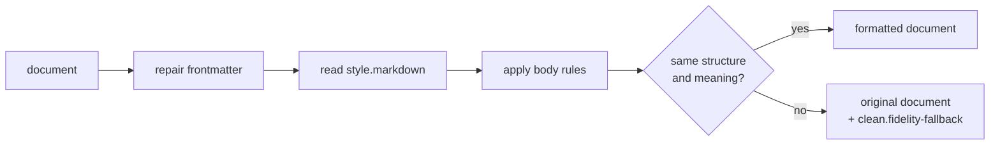
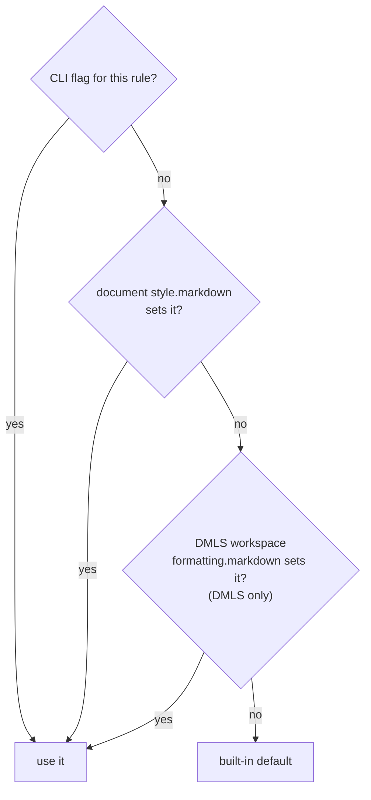

# Markdown Formatting Rules (`style.markdown`)

`md clean`, `md FILE --save`, and the DMLS language server's "Format
Document" all run the same cleanup. Cleanup tidies how a document's Markdown
is spelled: it pads tables, labels unlabeled code fences, fixes misnumbered
lists, and repairs broken frontmatter YAML. It never changes what the
document means.

A document chooses its formatting under `style.markdown` in its own
frontmatter:

```yaml
---
title: Release notes
style:
    markdown:
        fixed-width: 80
        list-item-padding: none
---
```

Every key is optional. If you leave a key out (or set it to `null`), the
next level down decides: a command-line flag, then the editor's workspace
settings, then the built-in default. See [Who wins](#who-wins-precedence).

## What cleanup never does

These guarantees hold whatever the settings:

1. **Directive lines are left alone.** Every `::block`, `::end-block`,
   `::file`, `::shell`, `::shell-block` (and its body), and every other line
   compose treats as a directive comes out byte-for-byte unchanged, at the
   same column and in the same container. Cleanup never adds a blank line
   next to one, because once compose removes the directive that blank line
   could split a list in two. Ordinary Markdown *between* `::block` and
   `::end-block` is still formatted. Expressions (`{{ … }}`, `$(…)`) keep
   their exact spelling; cleanup never evaluates them or wraps inside them.
2. **The structure is the same.** Every block stays in the same container,
   with the same kind, the same ordered-list start number, and the same code
   content. Links, images, emphasis, hard breaks, raw HTML, and task-list
   checkboxes mean the same thing afterwards. There are only two deliberate
   exceptions: `list-item-padding` and `list-interior-padding` may change
   whether a list is tight or loose when you set them (see [List
   spacing](#list-spacing)), and `default-language` adds a label to an
   unlabeled fence.
3. **No new trailing whitespace.** A trailing space or whitespace-only line
   in the output was already in the input. Code-block bytes are kept.
4. **The source survives.** Line endings (LF, CRLF, or a mix), a byte-order
   mark, an empty frontmatter block, and a missing final newline are kept as
   they were. Inserted lines use the line ending of their neighbors.
5. **All or nothing.** After the rules run, cleanup compares the result with
   the input. If the structure or meaning differs anywhere, cleanup returns
   the input unchanged and reports `clean.fidelity-fallback`, naming the
   first place that differed. A frontmatter repair from the same run is
   discarded too.



A refusal usually means the document has a malformed directive region, such
as a `::block` with no `::end-block`:

```text
markdown cleanup
- clean.fidelity-fallback. cleanup left the document unchanged because of a
  malformed directive region at line 4, column 1: ::block when="x" is never
  closed by an ::end-block
```

## The rules

| Key | Default | What it does |
| --- | --- | --- |
| [`frontmatter`](#frontmatter) | `true` | Applies safe YAML repairs to the frontmatter block. |
| [`table-layout`](#table-layout) | `true` | Pads table cells so columns line up. |
| [`unwrap`](#unwrap) | `false` | Joins single line breaks inside paragraphs. |
| [`fixed-width`](#fixed-width) | `false` | Unwraps, then re-wraps prose to a width. |
| [`indentation`](#indentation) | `4` | Spaces per nested-list level, or `preserve`. |
| [`ordered-lists`](#ordered-lists) | `true` | Renumbers misnumbered ordered lists. |
| [`list-padding`](#list-padding) | `true` | One blank line before and after each list. |
| [`list-item-padding`](#list-item-padding-blank-lines-between-sibling-items) | `preserve` | Blank lines between sibling list items. |
| [`list-interior-padding`](#list-interior-padding-blank-lines-inside-an-item) | `preserve` | Blank lines inside a list item. |
| [`default-language`](#default-language) | `text` | Label added to unlabeled code fences. |

With every rule at its default, cleanup repairs frontmatter, keeps every line
break you wrote, fixes misnumbered ordered lists, re-indents nested lists to
four spaces, pads tables, puts a blank line around lists, and labels
unlabeled fences `text`. It leaves directives and spacing between list
items alone.

Defaults are built in. They are never written into your frontmatter, and they
still apply when the baseline schema is turned off.

### `frontmatter`

`true` applies the deterministic YAML repairs that are proven not to change
the parsed value, such as quoting a scalar that starts with `@`:

```yaml
title: @daily-report      # before: not valid YAML
title: "@daily-report"    # after
```

`false` leaves the frontmatter block byte-for-byte, comments included.
Findings are still reported. If the block cannot be read without a repair
and repair is off, cleanup stops with an error rather than format a document
it cannot read. The full list of repairs is in [`md clean`](../cli/clean.md#frontmatter-repair-and-schema-precedence).

Frontmatter that strict YAML rejects but Darkmatter itself reads, such as a
bare `{{ … }}` value (`review: {{ ctx.area }}/review.md`), is a supported
document. Cleanup keeps that block exactly as written, applies no repair to
it, reports the YAML finding as a suggestion, and formats the body.

With repair on, tab-indented frontmatter is recovered instead: each indentation tab becomes
two spaces, which Darkmatter reads as the same value, and any other
[repair](../cli/clean.md#frontmatter-repair-and-schema-precedence) the block
needs then applies.

### `table-layout`

`true` pads every cell so each column has one width, and lines up the
delimiter row. Alignment markers (`:--`, `:-:`, `--:`) are kept.

```md
<!-- before -->
| a | bb |
|---|---|
| ccc | d |

<!-- after -->
| a   | bb  |
| --- | --- |
| ccc | d   |
```

`false` leaves tables as written.

### `unwrap`

`true` joins the single line breaks inside a paragraph, including paragraphs
in list items and block quotes. A hard break (two trailing spaces or a
trailing `\`) stays a hard break.

```md
<!-- before -->
one
two··
three

<!-- after (·· marks the two trailing spaces of the hard break) -->
one two··
three
```

`false` (the default) keeps every line break you wrote.

### `fixed-width`

A number from 1 to 1000 unwraps prose and then re-wraps it to that display
width. `true` means 120 and `false` means never re-wrap. The width counts
list and block-quote prefixes, and a wrapped list item continues under its
first word:

```md
<!-- fixed-width: 20 -->
One two three four
five six seven eight
nine ten.

- Alpha beta gamma
  delta epsilon zeta
  eta theta.
```

A positive width implies `unwrap`. `fixed-width: false` does not turn off an
`unwrap: true` set elsewhere.

### `indentation`

`2`, `4`, or `8` re-indents nested lists to that many spaces per level.
`preserve` leaves list indentation as written.

```md
<!-- indentation: 2, from four-space input -->
- a
  - b
    - c
```

The new indentation must describe the same list tree. A nested list must sit
past its parent's marker, so when the requested step would move it out of its
parent, cleanup uses the nearest indentation that keeps the tree. For `8`
under a numbered item, it pads the parent marker instead:

```md
<!-- indentation: 8 -->
1.   a
        - b
```

### `ordered-lists`

CommonMark renders an ordered list from its first number, whatever the rest
say. With `true`, cleanup leaves a list alone when every number equals the
first (`1, 1, 1`) or the numbers count up by one (`1, 2, 3` or `3, 4, 5`).
Otherwise it renumbers from the first number:

| Before | After |
| --- | --- |
| `1, 3, 8` | `1, 2, 3` |
| `2, 2, 5` | `2, 3, 4` |
| `1, 1, 1` | unchanged |
| `3, 4, 5` | unchanged |

`false` leaves numbers as written.

### `list-padding`

`true` makes sure there is exactly one blank line before and after each
list:

```md
<!-- before -->
Intro:
- a

<!-- after -->
Intro:

- a
```

It never adds a blank line next to a directive line, at the start or end of
the list's container, or where the blank line would change the document's
structure. A line with no blank line before it that directly follows a list
item is part of that item ("lazy continuation"), so cleanup leaves it in
place. It also never removes a blank line that the document needs. `false`
leaves blank lines around lists as written.

### `default-language`

Adds this label to a code fence that has none:

````md
```
code
```
````

becomes

````md
```text
code
```
````

An existing label is never changed. `""` adds nothing. A value containing a
line break, a control character, or a backtick is rejected, because it could
break the fence.

## List spacing

Three settings control blank lines around and inside lists. Each one owns a
different kind of boundary:

```text
Some intro paragraph.
                              <- list-padding           (before the list)
- Install the tool
                              <- list-interior-padding  (item -> nested block)
    Run it once first.
                              <- list-interior-padding  (nested block -> next nested block)
    - macOS
                              <- list-item-padding      (between nested siblings)
    - Linux
                              <- list-item-padding      (between top-level siblings)
- Configure it
                              <- list-padding           (after the list)
Closing paragraph.
```

The picture shows every boundary a setting *could* fill; what each one does
depends on its value. `list-padding` is on by default. The other two default
to `preserve`, which leaves your blank lines exactly as you wrote them.

### Tight and loose lists

In CommonMark, a list is either **tight** or **loose**, and this changes how
it renders.

- A **tight** list has no blank lines between its items, or between an
  item's first line and the blocks nested in it. Each item renders as plain
  text, so the items sit close together.
- A **loose** list has at least one such blank line. Every item in a loose
  list renders as a paragraph (`<li><p>…</p></li>` in HTML), with more space
  between items.

```md
<!-- tight: renders compactly -->
- apples
- pears

<!-- loose: each item becomes a paragraph, with extra space -->
- apples

- pears
```

Because these blank lines change how a list *looks*, the two settings that
add or remove them are opt-in. When you set one, cleanup's structure check
accepts a tight/loose change on the lists that setting edits, and only
there. `list-padding` never changes tight/loose, because blank lines outside
a list do not count.

### `list-item-padding`: blank lines between sibling items

This applies to the items of every list, at every nesting level. The space
between the end of one item, including anything nested in it, and the start
of the next item is a sibling boundary.

| Value | Meaning |
| --- | --- |
| `preserve` | Leave sibling spacing as written. |
| `none` | No blank line between siblings. Lists become tight unless something inside an item keeps them loose. |
| `one` | Exactly one blank line between siblings, never more. Lists become loose. |

The same input under each value:

```md
<!-- input (and preserve) -->
- apples

- pears
    - green

    - red
- plums

<!-- none -->
- apples
- pears
    - green
    - red
- plums

<!-- one -->
- apples

- pears
    - green

    - red

- plums
```

Under `one`, `- green` stays directly under `- pears`: that boundary is
inside an item, which `list-interior-padding` owns.

`md clean --compact` is the same as `list-item-padding: none`, and `--loose`
is the same as `one`.

### `list-interior-padding`: blank lines inside an item

An item's *first line* is the text after its marker. Anything after it
inside the item is a *nested block*: another paragraph, a nested list, a code
block, or a block quote. This setting controls the blank line before each
nested block.

| Value | Meaning |
| --- | --- |
| `preserve` | Leave interior spacing as written. |
| `none` | Remove every blank line inside items that CommonMark does not require. |
| `except-nested-lists` | One blank line before every nested block except a nested list, which stays directly under its parent line. |
| `all` | One blank line before every nested block, nested lists included. |

The same input under each value:

```md
<!-- input (and preserve, and except-nested-lists) -->
- Install the tool

    ```sh
    brew install tool
    ```
    - macOS
    - Linux

<!-- none -->
- Install the tool
    ```sh
    brew install tool
    ```
    - macOS
    - Linux

<!-- all -->
- Install the tool

    ```sh
    brew install tool
    ```

    - macOS
    - Linux
```

Some blank lines are required, and no value removes them. A paragraph nested
in an item needs one before it; otherwise it would join the line above. A
paragraph after a nested list needs one; otherwise it would join the last
nested item. With both padding rules set to `none`, this input is unchanged:

```md
- a

    para
- b
    - c

    after
```

## Who wins (precedence)

Each rule is decided on its own, highest level first:



- `false`, `preserve`, and `""` are real values that stop the search. Only a
  missing key or `null` falls through.
- The CLI flags are `--indent` (`indentation`), `--compact` and `--loose`
  (`list-item-padding`), `--fixed-width N` (`fixed-width`, which implies
  `unwrap`), and `--ignore-incidental-newlines` (`unwrap: false` and
  `fixed-width: false`, overriding a document width). A flag you did not
  pass does not override anything.
- DMLS reads workspace settings from `[formatting.markdown]` in
  `.dmls.toml`, with the same keys. See the [DMLS editor
  setup](../../dmls/docs/editors/README.md#root-marker-and-configuration).

Cleanup reads `style.markdown` passively. It never evaluates an expression,
runs a shell command, fetches a URL, or composes the document to find a
setting. A value that is still an unevaluated `{{ … }}` cannot be used.

### When `style.markdown` is invalid

If any key under `style.markdown` has an unusable value, cleanup ignores the
whole `style.markdown` object, reports `clean.invalid-rules` at the bad
value, and formats with the remaining levels (flags, workspace, defaults):

```text
markdown cleanup
- clean.invalid-rules. style.markdown.indentation: expected 2, 4, 8, or
  preserve, found 3; so style.markdown was ignored
```

A quoted `"4"` is not the number `4`, and a quoted `"true"` is not `true`;
both are rejected rather than silently converted. Findings about other
frontmatter keys do not affect `style.markdown`.

### Rendering ignores these settings

`style.markdown` is read only by `md clean`, `md FILE --save`, and DMLS
formatting. `md FILE` rendering accepts the keys as valid style (including
under `--deny style`), but it tidies the body with the built-in defaults
and `--indent`, not with the document's settings. Compose's own cleanup step
takes its settings from compose options, not from the document either. See
[Cleaning](../inline/cleaning.md).
