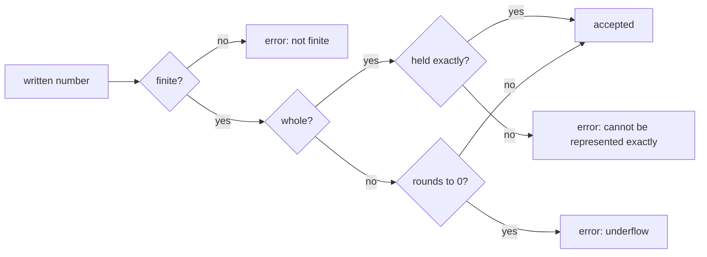

# Numbers

Every Darkmatter number is a finite `f64`: frontmatter values, raw schema
bounds, expression literals, text converted to a number, function arguments
and results, and every calculation. There is no separate integer type;
`number(integer)` is a constraint on the value: a whole number below 2^64 in
magnitude. This page is the one description of the numeric model; schema and
expression pages link here.

A number enters that model only when it can be held without silently
changing it. Darkmatter decides this from the number **as written**:

- a **whole** number must be held exactly, whatever its spelling;
- a number with a **fractional part** takes the nearest `f64`, so `0.1` is
  accepted;
- a non-zero number that would become `0` (**underflow**) is rejected;
- a number too large for an `f64`, or `inf`/`NaN`, is rejected as **not
  finite**.

| Written | Result | Why |
| --- | --- | --- |
| `9007199254740992` (2^53), `-9007199254740992` | accepted | held exactly |
| `9007199254740993`, `9007199254740993.0`, `9.007199254740993e15` | "cannot be represented exactly" | the same whole number in three spellings; `f64` would store `…992` |
| `18446744073709551615` (`u64::MAX`) | "cannot be represented exactly" | `f64` would store 2^64 |
| `99999999999999999999`, `1e308` | "cannot be represented exactly" | whole numbers no `f64` holds |
| `0.1`, `1e3`, `.5`, `4.0` | accepted | the nearest `f64` (`0.1`, `1000`, `0.5`, `4`) |
| `1e-400` | "cannot be represented exactly: a non-zero value would become 0" | underflow |
| `.inf`, `-.inf`, `.nan` (YAML), `Infinity`, `NaN` (JSON5) | "not finite" | no finite `f64` |



To keep a value that is not a Darkmatter number, quote it so it stays text:
`id: "9007199254740993"`.

## Frontmatter

A native YAML number that cannot be admitted fails the document's load, at
the property, whatever type the schema declares:

```yaml
---
n: 9007199254740993
---
```

```text
Failed to parse frontmatter in doc.md: n: number 9007199254740993 cannot be represented exactly; quote it to keep it as text at line 1 column 4
```

Line and column count from the first line inside the frontmatter fences. A
nested value names its path (`a.b[1]`).

Quoted text is text. Against a `number` property, numeric text is converted,
and text whose number cannot be admitted fails validation with the reason:

```yaml
---
$schema:
  n: number(required)
n: "9007199254740993"   # fails: "…" is not of type "number": the number cannot be represented exactly
---
```

## Raw schemas

A raw JSON Schema (`.json`, or a YAML file that is not a SimplifiedSchema
document) has every number admitted when it loads: bounds, `multipleOf`,
`enum` and `const` members, `default`, and every other value. A failure is a
schema-load error naming the JSON Pointer, line, and column:

```json
{ "properties": { "n": { "maximum": 9007199254740993.0 } } }
```

```text
invalid standalone schema document `n.json`: /properties/n/maximum: number 9007199254740993.0 cannot be represented exactly at line 1 column 37
```

A JSON number too large for an `f64` (`1e400`) is not valid JSON to the
loader, so the file is reported as neither a SimplifiedSchema nor a JSON
Schema.

## Expression literals

A numeric literal is digits with an optional fraction (`0`, `42`, `3.14`);
there is no exponent (`1e3`) or leading-dot (`.5`) form. A whole literal must
be held exactly: `{{ 9007199254740993 }}` fails with "cannot be represented
exactly" at the literal, while `{{ 9007199254740992 }}` renders
`9007199254740992`.

## Arithmetic

Operators compute in `f64` with ordinary binary rounding. A result that is not
finite is an error, never infinity or a clamped value:

```md
{{ big * 10 }}   ⇒ error: not finite, when big is the largest finite number
{{ 1 / 0 }}      ⇒ error: Division by zero
{{ 1 % 0 }}      ⇒ error: Remainder by zero
{{ 10 / 4 }}     ⇒ 2.5
```

Numeric text converts through the same rules as schema conversion: surrounding
whitespace, a sign, an exponent, a leading dot, and `_` between digits are
accepted; `inf`, `NaN`, a trailing dot, and hexadecimal are not numbers.

```md
{{ " 4 " * 2 }}               ⇒ 8
{{ "1_000" + 1 }}             ⇒ 1001
{{ "9007199254740993" + 1 }}  ⇒ error: cannot be represented exactly
```

Comparisons use the represented value: `2 == 2.0` and `2 < 2.5` are both
`true`, and a frontmatter `f: 2.0` equals `2`. An array index that is not
whole, or is outside the list, selects nothing: `items[1.5]` and
`items[9007199254740992]` are empty.

## Display

A whole number displays without a decimal suffix, a fraction keeps its
meaningful digits, and no number uses an exponent:

```md
{{ 4.0 }}                    ⇒ 4
{{ 2.5 }}                    ⇒ 2.5
{{ 9007199254740992 + 0 }}   ⇒ 9007199254740992
```

A whole number is written with every digit it holds, so the text reads back
as the same number.

## JSON5 values

`md compose --state` and `--set`, and a transclusion's `set.NAME=` and `set=`,
read JSON5. A non-finite JSON5 number (`Infinity`, `NaN`, `1e400`) is an
error ("a number is not finite"), never `null`. A `name=value` shorthand
setter keeps such a value as text, as it does any value that does not parse.
