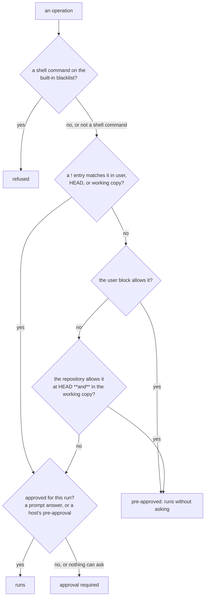
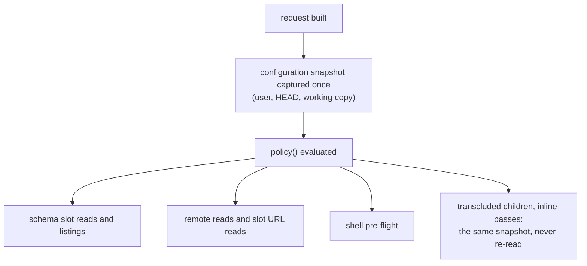

# Permissions

The `permissions` block of a [configuration file](./configuration.md) decides
which operations Darkmatter (and Claudine, which reads the same block) may
perform **without asking you**:

- which files a schema slot may read (`file-read`),
- which shell commands run without a prompt (`shell-commands`), and
- whether URLs may be fetched (`network`).

Anything the block does not pre-approve is not forbidden; it is asked about
for the current run, or fails with an approval-required error where nothing
can ask. The only thing that is ever refused outright is a command on the
[built-in shell blacklist](#the-built-in-shell-blacklist).

```yaml
# ~/.darkmatter.yaml
permissions:
    file-read:
        - "&**/*.yaml"           # YAML anywhere in the repository
        - "!&secrets/**"         # ... but never pre-approve secrets/
    shell-commands:
        - prefix ls              # `ls` with any arguments
        - exact ps -e            # exactly `ps -e`
        - template git add {{ string }}
        - "!prefix git add secrets"
    network: deny
```

This page covers:

- [the three policies](#the-three-policies) and the entries each takes,
- [defaults and how a written list overrides them](#defaults-and-overrides),
- [how the user and repository scopes combine](#how-the-scopes-combine),
- [approvals for the current run](#current-run-approvals) and the
  [built-in shell blacklist](#the-built-in-shell-blacklist),
- [where each policy is consulted](#where-each-policy-is-consulted),
- [saving an "always allow" answer](#saving-an-always-allow-answer), and
- [evaluating the policy from Rust](#from-rust).

Where the block lives, pointing it at another file (Claudine's
`config.yaml`), and how the files load are covered in
[Configuration Files](./configuration.md).

## The three policies

`permissions` holds three separate policies. An entry of one never approves
anything for another: a `file-read` entry does not let a shell command read
that file, and `network: allow` does not pre-approve `curl`.

### `file-read`

A list of glob references, in the grammar `$path` and `match()` use. A
leading `!` turns an entry into an [exclusion](#exclusions). Which forms a
scope accepts:

| Pattern | Means | User | Repository |
| --- | --- | --- | --- |
| `./*.yaml`, `data/*.csv` | relative to the reading document | yes | yes, unless `..` leaves the starting folder |
| `&docs/**/*.md` | from the repository root | yes | yes, unless `..` climbs above the root |
| `^*.md` | nearest package, package area, then repository | yes | yes |
| `~/notes/*.md` | under your home directory | yes | no |
| `{{NOTES}}/*.md` | under a declared portable variable | yes, when listed in `PORTABLE_ENV_VARIABLES` | when listed, and only when its value lies inside the repository |
| `/etc/*.md`, `C:\data\*.md` | absolute | no | no |
| `@x/*.md`, `vault:x/*.md`, URLs | search roots and remote | no | no |

A form a scope does not accept is a configuration error
(`dm.config.invalid`), located at the entry; it is never silently ignored.

An entry is judged for the **document doing the read**: `./*.yaml` means
YAML files beside that document (for a schema slot, beside the schema file
the slot is written in), `&` is the repository root, `~/` the home.

- `..` in the path being read is resolved before matching, so
  `docs/../secrets/key.md` is `secrets/key.md`.
- A file that does not exist yet is judged by where it would be.
- A repository entry allows a file only when the file's real location,
  after following symbolic links, is inside the repository: a link to a file
  outside never becomes a repository allow.
- An exclusion matches either the path as written or where a link leads.

### `shell-commands`

A list of rules, one per entry, each optionally led by `!`:

| Rule | Pre-approves |
| --- | --- |
| `exact <command>` | exactly that command |
| `prefix <program>` | that program with any arguments |
| `template <shape>` | commands of that shape, such as `git add {{ string }}`; the command then runs as a template, with each value checked against its type |

A rule with no command is an error. A chained command (`a && b`, `a || b`)
is pre-approved only when every segment is. The rule grammar, escaping, and
template shapes are described in
[Pre-Flight Shell Approval](../inline/preflight-checks.md#shell-rules).

### `network`

`allow` or `deny`. Under `allow`, every `http` and `https` URL may be
fetched; under `deny`, none may, except a host you name for one run with
`--allow host=HOST` (see
[Remote URL References](./remote-url-references.md#allowed-hosts)).

## Defaults and overrides

An absent setting takes its scope's default, read from the shipped schema
(`darkmatter/schemas/darkmatter-config.yaml`):

| Setting | User default | Repository default |
| --- | --- | --- |
| `file-read` | common text and data files (`txt`, `md`, `csv`, `json`, `yaml`, `toml`, …) beside the reading document (`./*.<ext>`) | the same extensions anywhere in the repository (`&**/*.<ext>`) |
| `shell-commands` | none: every command prompts | none |
| `network` | `deny` | `deny` |

The full list of extensions is under
[Defaults](./configuration.md#defaults).

**A list you write replaces the default; it is never merged with it.** To
keep the defaults and add one entry, write the defaults out too (`md init`
writes every default so you can edit it):

```yaml
permissions:
    file-read: []          # this scope pre-approves no file at all
```

```yaml
permissions:
    file-read:
        - ./*.yaml         # only YAML beside the document; the other
                           # default extensions are no longer pre-approved
```

Explicit `null` is an error, never "use the default". An absent
`permissions` block, or `permissions: {}`, holds all three defaults.

### Exclusions

An entry led by `!` is an **exclusion**: whatever it matches is never
pre-approved, whichever scope would otherwise allow it.

```yaml
permissions:
    shell-commands:
        - prefix git
        - "!exact git push --force-with-lease"
```

Here `git status` runs without asking and `git push --force-with-lease` is
asked about. An exclusion is not a deny list: it only removes pre-approval,
so a current-run approval (a prompt answer) can still let the operation run.
To refuse something outright there is no setting; only the
[built-in shell blacklist](#the-built-in-shell-blacklist) refuses.

Remember to quote an exclusion in YAML (`"!prefix rm"`): an unquoted `!` starts
a YAML tag.

## How the scopes combine

Inside a repository, three blocks are in play: your user file, the
repository file as committed at `HEAD`, and the repository file in the
working copy (see
[The Repository File at HEAD and in the Working Copy](./configuration.md#the-repository-file-at-head-and-in-the-working-copy)).
Outside a repository only the user file applies.

A file read or a shell command is **pre-approved** (it runs without asking)
when:

1. no `!` entry in the user file, the repository file at `HEAD`, or the
   repository working copy matches it, **and**
2. the user file allows it, **or** the repository file allows it both at
   `HEAD` and in the working copy.

In other words, the repository's allows are the **intersection** of its two
revisions, that result is **unioned** with the user's allows, and an
exclusion in **any** of the three removes pre-approval. Everything else
needs a [current-run approval](#current-run-approvals).

For one operation:



Because an uncommitted edit only counts once it is committed, an edit that
**adds** an allow has no effect until it is committed, while an edit that
**removes** an allow or **adds** a `!` applies at once. That keeps an agent
editing its own repository's configuration from widening what it may do.

The two repository revisions are judged per operation, not entry by entry,
so they need not share entries:

```yaml
# .darkmatter.yaml at HEAD        # .darkmatter.yaml in the working copy
permissions:                      permissions:
    shell-commands:                   shell-commands:
        - prefix ls                       - exact ls -la
```

`ls -la` is pre-approved (both revisions allow it); `ls -R` is not (only
`HEAD` allows it).

| Example | Pre-approved? |
| --- | --- |
| user `file-read: []`, repository defaults, reading `&docs/a.md` | yes: the repository allows it |
| repository `file-read: ["&**/*.md", "!&secrets/**"]`, reading `secrets/key.md` | no: excluded |
| user `!prefix rm`, repository `prefix rm` | no: an exclusion in any file removes pre-approval |
| user `prefix ls`, repository working copy `!prefix ls` | no: the working copy's exclusion applies before it is committed |

### `network` is the most restrictive

`network` does not use the union. It is `allow` only when **every**
applicable block says `allow`: the user file outside a repository; the user
file, `HEAD`, and the working copy inside one. An absent file counts as its
defaults (`deny`), so a repository without `.darkmatter.yaml` keeps the
network closed even when your user file says `allow`. `--allow host=HOST`
still allows one host for one run on top.

| User | Repository (`HEAD` / working copy) | Every URL fetched without asking? |
| --- | --- | --- |
| `allow` | none (outside a repository) | yes |
| `allow` | `allow` / `allow` | yes |
| `allow` | `deny` / `allow` | no |
| `allow` | absent | no |

### An invalid block

When any `permissions` block fails to load (an invalid entry, or a
reference whose target is missing or invalid), nothing falls back to the
defaults or to an empty policy. Every operation that needs the policy fails
with that configuration error (`dm.config.invalid` or
`dm.config.reference`), and nothing is asked. The built-in shell blacklist
still refuses first.

## Current-run approvals

Approvals you give during one run sit beside the configuration and are
forgotten when the run ends (unless you choose "always allow"):

| Policy | Current-run approval |
| --- | --- |
| `shell-commands` | a prompt answer ("allow once", or an "always allow" choice), or a host's pre-approval (Claudine's pre-flight, `--yolo`); it can approve an excluded command, never a blacklisted one |
| `file-read` | "allow this file for this run" lets the read happen even when an exclusion matches; "deny for this run" refuses it (`dm.schema.slot_denied`) even when the configuration pre-approves it |
| `network` | `--allow host=HOST`; for a schema slot's URL read, an "allow this URL for this run" or "deny for this run" answer |

Where nothing can ask (a data output such as `--output json`, `md graph`,
`md validate refs`, the editor, or a run without a terminal), an operation
that is not pre-approved fails with an approval-required error instead of
prompting.

## The built-in shell blacklist

A set of dangerous commands (`rm`, `dd`, `chmod`, `git reset`,
`git push --force`, package managers, …) is compiled into Darkmatter and
refused before anything else is consulted. No `shell-commands` entry, no
prompt answer, no cached decision, and no host's "approve everything" mode
overrides it, and nothing configures or extends it. The full list is under
[Blacklisted Commands and Syntax](../inline/preflight-checks.md#blacklisted-commands-and-syntax).

The blacklist is separate from `!` exclusions: an exclusion asks, the
blacklist refuses.

## Where each policy is consulted

| Policy | Consulted by | Details |
| --- | --- | --- |
| `file-read` | a schema slot's file read and existence check, and the files a slot's listing (`find_files`, …) may return | [Schema Slots: How a file read is decided](./schemas/schema-slots.md#how-a-file-read-is-decided), [Listings](./schemas/schema-slots.md#listings) |
| `network` | a composition's remote reads (`::file`, `::code`, or a read-side function given an `https://…` URL), and a schema slot's URL reads | [Remote URL References](./remote-url-references.md#allowed-hosts), [Schema Slots: URL reads](./schemas/schema-slots.md#url-reads) |
| `shell-commands` | `md compose`'s pre-flight of `::shell`, `::shell-block`, frontmatter `$( … )`, and lifecycle `shell` actions | [Pre-Flight Shell Approval](../inline/preflight-checks.md#security-policy) |
| `shell-commands` | Claudine's pre-flight of a document's and its lifecycle stacks' commands, judged by the rules of the repository each document lives in | [Claudine: Pre-Flight Shell Approval](../../../claudine/docs/topics/pre-flight-checks.md#approval-policy) |

Each request reads the configuration once, when it is built, and every
consumer judges with that same captured policy (see
[One Snapshot per Request](./configuration.md#one-snapshot-per-request)).
Editing a file during a run changes nothing until the next run.



DMLS shows the same verdict on a shell command's hover from a read-only load; it never
prompts or saves.

## Saving an "always allow" answer

Choosing "always allow" at a shell or schema-slot prompt (or the editor's
*Always allow* quick fix for a slot read) saves one entry to the **user**
scope: `~/.darkmatter.yaml`, or the file its `permissions` reference names,
such as Claudine's `config.yaml`. A repository file is never edited, a `!`
entry is never removed, and a site or `network` grant is never saved. The
entry takes effect from the next run; the current run already treats it as
approved. When it cannot be saved, the operation is still approved for this
run and a `dm.config.not_saved` warning says why.

The writer's exact rules are in
[Saving an "Always Allow" Approval](./configuration.md#saving-an-always-allow-approval).

## A hostile repository

The commit rule protects against an uncommitted edit. It cannot protect you
from a repository whose **committed** configuration pre-approves commands you
would not: read a cloned repository's `.darkmatter.yaml` and
`.claudine/config.yaml` before you run Darkmatter or Claudine in it. See
[The Cloned-Repository Risk](./configuration.md#the-cloned-repository-risk),
including how a repository can review every widening of its permissions.

## From Rust

`ConfigSnapshot::policy()` returns the evaluated
`darkmatter::config::permissions::PermissionPolicy`. It answers the
combination rule above; prompting, current-run approvals, and the built-in
blacklist stay with the caller, which checks the blacklist first:

```rust
use biscuit_file::FileResolutionContext;
use darkmatter::config::load::ConfigSnapshot;
use darkmatter::markdown::compose::shell_expansion::policy::{check_user_blacklist, check_whitelist, normalize_command};
use std::path::Path;

fn decide(snapshot: &ConfigSnapshot, reading: &FileResolutionContext) -> Result<(), Box<dyn std::error::Error>> {
    let policy = snapshot.policy()?;
    let read = policy.file_read(Path::new("data/table.csv"), reading);
    let args = vec!["-la".to_string()];
    let normalized = normalize_command("ls", &args);
    let shell = policy.shell().verdict(
        |allows| check_whitelist(allows, "ls", &normalized),
        |excluded| check_user_blacklist(excluded, "ls", &args, &normalized),
    );
    println!("{} {} {:?}", read.is_preapproved(), shell.is_preapproved(), policy.network());
    Ok(())
}
```

- A `PermissionVerdict` is `Preapproved` or `ApprovalRequired`; the latter
  carries the `PolicyExclusion` (layer, file, and entry as written) when an
  exclusion, rather than a missing allow, removed pre-approval.
- `PermissionPolicy::verdict` is the same rule for any per-layer predicate,
  and `policy.shell().exclusions()` is every layer's `!` rules in one set.
- `snapshot.permissions()` still returns each file's raw setting (a
  reference unfollowed).
- `darkmatter::config::permissions::persist::save_user_approval` saves an
  "always allow" answer; see
  [Saving an "Always Allow" Approval](./configuration.md#saving-an-always-allow-approval).
