# Schema Definition

Darkmatter can **define**, **detect**, and **evaluate** schemas for Markdown frontmatter. Authors declare the shape of their frontmatter with **SimplifiedSchema** — a single-line YAML grammar that compiles deterministically to a Draft 2020-12 JSON Schema. Every validation runs through the `jsonschema` crate; SimplifiedSchema is a surface, not a parallel validator.

This topic covers the practical usage of schemas for standalone validation, schema detection, and validation within the compose pipeline.

## What You Get

- A `$schema` frontmatter property that can hold an inline schema, point at a YAML/JSON file, or list a root-level union.
- A **baseline schema** that every document inherits. Darkmatter ships a built-in one, compiled into the library, which `md compose`, `md schema validate`, and DMLS apply by default.
- A `md schema validate` CLI subcommand with `pretty` and `json` output.
- A `md schema detect` CLI subcommand that infers a SimplifiedSchema from existing documents.
- A library API ([`DarkmatterSchemas`](#library-api)) for embedding the same behavior.
- Schema-aware completion hints for downstream shell-completion tooling.

## The `$schema` Frontmatter Property

`$schema` is **reserved** by Darkmatter inside frontmatter. Its value may be:

1. An inline **SimplifiedSchema** dictionary.
2. A string `FileReference` (resolved via `biscuit-file`) to a `.yaml` / `.json` file containing either a SimplifiedSchema or a JSON Schema.
3. A YAML sequence — a [root-level union](#root-level-unions) where each arm is a complete object schema.

The key is stripped from the frontmatter before validation, so a raw JSON Schema with `additionalProperties: false` will not reject every document for carrying a `$schema` field.

```yaml
---
$schema:
    title: "string(required)"
    tags:  "string[]"
---
```

```yaml
---
$schema: ./schemas/post.yaml
---
```

## SimplifiedSchema Grammar

A SimplifiedSchema is a YAML mapping from property names to **type-and-constraint** strings.

```yaml
$schema:
    name: string
    age:  number
```

### Syntax Forms

Every property value follows one of four shapes:

| Form                                       | Example                                              |
|--------------------------------------------|------------------------------------------------------|
| `{type}`                                   | `name: string`                                       |
| `{type}({constraints})`                    | `name: string(required)`                             |
| `{type} -> {description}`                  | `name: string -> The author's full name`             |
| `{type}({constraints}) -> {description}`   | `slug: string(not-empty;required) -> URL slug`       |
| `{ prop: type-expr, ... }`                 | `config: "{ host: string(required), port: number }"` |
| `{ prop: type-expr, ... }[]`               | `entries: "{ foo: string(required) }[]"`             |
| `{type} \| {type}`                         | `id: "string \| number"`                             |
| `tuple([{type}, ...])`                     | `point: "tuple([number, number])"`                   |

- **Whitespace** inside `(...)` and inside `{ ... }` is insignificant. Quote the whole scalar so YAML keeps it as a string when whitespace is present.
- **Multiple constraints** are separated by `;`.
- **Optional by default** — properties are optional unless `required` appears in the constraint list. An optional property also accepts `null` as a sentinel for absent, so a frontmatter value that resolves to `null` validates the same way as a missing key. A property whose type itself admits `null` (`null`, `unknown`, or a union with one of those arms) is always optional, even when it is marked `required`; see [Null-Admitting Properties](#null-admitting-properties).
- **Arrays** are written by appending `[]` to the type. Item constraints sit inside the parens that precede the brackets; constraints on the array itself sit in a second parens after the brackets.
- **Unions** are written with `|` or as a YAML list; both mean the same thing. See [The `|` Operator and Grouping](#the--operator-and-grouping).
- **Descriptions** (`-> ...`) populate the `description` annotation in the generated JSON Schema. Inside an inline object, a description terminates at the next top-level comma or closing brace (see [Inline Object Literals](#inline-object-literals)). When a property fails validation, its declared description surfaces at the point of failure — in `md schema validate` (pretty and JSON output) and in compose schema-failure blocks (see [Error Rendering](#error-rendering)).
- **Inline object literals** are an extension of the type-expression grammar. The whole `{ ... }` body is a single string scalar that the string-layer parser recognizes. YAML mapping values at a property position are still errors — quote the mapping as a string to opt into inline object syntax.

```yaml
$schema:
    tags:   string[]                      # optional array of strings
    scores: "number(min(0); max(100))[]"  # each item in 0..=100
```

### Types

For a practical introduction with worked examples, see
[Choosing Schema Types](./schema-types.md).

| Type         | Accepts                                                                                                | Notes                                                                                                                                                                           |
|--------------|--------------------------------------------------------------------------------------------------------|---------------------------------------------------------------------------------------------------------------------------------------------------------------------------------|
| `string`     | Any YAML string scalar.                                                                                | Constraints: `min`, `max`, `not-empty`, `pattern`, `suggest`, `default`, `required`.                                                                                              |
| `date`       | ISO-8601 date `YYYY-MM-DD`.                                                                            | JSON Schema `format: date`.                                                                                                                                                     |
| `datetime`   | An RFC 3339 datetime `YYYY-MM-DDThh:mm:ss[.ms]` with a **required** offset (`Z` or `±HH:MM`).          | JSON Schema `format: date-time`.                                                                                                                                                |
| `time`       | An RFC 3339 time `hh:mm:ss` or `hh:mm:ss.ms` with a **required** offset (`Z` or `±HH:MM`); seconds are required (`14:30Z` is invalid). | JSON Schema `format: time`.                                                                                                                       |
| `number`     | Any JSON number; numeric text converts to one ([Type Coercion](#conversion-rules)). | Constraints: `min`, `max`, `integer`, `suggest`, `default`, `required`.                                                                                                         |
| `numberlike` | What `number` accepts: a JSON number **or** numeric text (`"4"`, `" 4 "`, `"+4"`, `"1e3"`, `"1_000"`).          | Compiles to `{ "type": ["number", "string"], "format": "darkmatter-numberlike" }`. The value is validated and kept **exactly as written** (see [Type Coercion](#numberlike-and-boolish-keep-what-was-written)). |
| `boolean`    | Any JSON boolean; a boolean word converts to one ([Type Coercion](#conversion-rules)). | Constraints: `default`, `required`.                                                                                                                                             |
| `boolish`    | What `boolean` accepts: a JSON boolean **or** a boolean word (`true`/`false`, `yes`/`no`, `on`/`off`, `1`/`0`, any case). | Compiles to `{ "type": ["boolean", "string"], "format": "darkmatter-boolish" }`. The value is validated and kept **exactly as written** (see [Type Coercion](#numberlike-and-boolish-keep-what-was-written)). |
| `object`     | Any YAML/JSON object.                                                                                  | No nested-schema authoring in v1 — `object` accepts any shape. Reference an external file for deeper typing.                                                                    |
| `file`       | A file reference parsed via `biscuit-file::FileReference`. Single or array form.                       | Constraints: `eager`, `match(glob, ...)` (each glob a prefixed glob reference such as `^**/*spec*.md`), `required`. **Lazy by default**; `file(eager)` resolves and checks existence (implicit paths from the document directory first, then the repository root; explicit `./`/`../` from the document directory only). Schema-selected file values materialize as absolute native paths at the request boundary; lazy values use the first unprobed candidate. See [Files](#files).        |
| `enum`       | A value from an explicit set.                                                                          | Constraints required — the members are the constraint. See [Enumerations](#enumerations).                                                                                       |
| `literal`    | Exactly one scalar value, of any scalar type.                                                          | Compiles to JSON Schema `const`. Bare `true`/`2` are typed; quoting forces string. Constraints: `required`, an equal `default`. See [Literals](#literals).                       |
| `url`        | A string parseable as an absolute URL.                                                                 | Constraints: `scheme(...)`, `default`, `required`.                                                                                                                              |
| `email`      | A string in `addr-spec` form.                                                                          | JSON Schema `format: email`.                                                                                                                                                    |
| `yaml`       | A string whose **content** parses as YAML, **or** a native mapping/sequence/scalar coerced to a YAML string. | JSON Schema `format: darkmatter-yaml`. Accepts JSON too (JSON is valid YAML). See [Content-Format Types](#content-format-types-yaml--json).                              |
| `json`       | A string whose **content** parses as strict JSON, **or** a native value coerced to a JSON string.      | JSON Schema `format: darkmatter-json`. Rejects YAML-only syntax. See [Content-Format Types](#content-format-types-yaml--json).                                                  |
| `expression` | A string that parses under the Darkmatter expression grammar. Parse-only — never evaluated.            | JSON Schema `format: darkmatter-expression`. The third content-format string type. Native booleans/numbers coerce to their string form. See [Expressions](#expressions).        |
| `type-definition` | A string type expression, native mapping object definition, or non-empty property union.          | Describes one SimplifiedSchema property definition as data. Parse-only; the value is never resolved or normalized. See [Semantic Meta-Types](#semantic-meta-types).              |
| `schema`     | An inline schema mapping, local schema reference string, or non-empty root union.                       | Describes one complete `$schema` declaration as data. Parse-only; validation checks syntax without reading referenced files. See [Semantic Meta-Types](#semantic-meta-types).  |
| `unknown`    | Anything, including `null`, or omission. `any` is an equivalent alias.                                  | JSON Schema `{}`. `required` has no effect: `unknown(required)` still accepts `null` and omission. To require a value, use a concrete type, e.g. `unknown[](required)` for a required list. See [`unknown` and `null`](#unknown-and-null). |
| `null`       | Only an explicit `null`, or omission.                                                                  | JSON Schema `{"type": "null"}`. `required` has no effect. Written unquoted (`review: null`, `review: ~`) or as `"null"`. See [`unknown` and `null`](#unknown-and-null). |
| `alphanumeric` | A string of ASCII letters and digits (`[A-Za-z0-9]`), widened or narrowed by type options.          | Options before `;`, constraints after: `alphanumeric(allow-dashes; min(1))`. Lowers to a string `pattern`. Never coerces numbers or booleans. See [Alphanumeric Strings](#alphanumeric-strings). |
| `shell`      | A string that holds a shell command: at least one non-whitespace character. Never parsed or run.       | JSON Schema `format: darkmatter-shell`. Constraints and coercion mirror `expression`. See [Shell Commands](#shell-commands). |
| `tuple`      | A list whose positions each have their own type: `tuple([string, number?, ...boolean[]])`.             | Compiles to `prefixItems`, `minItems`, and `items`. See [Tuples](#tuples).                                                                                                      |
| `function`   | Nothing: a `function(...)` type describes a callable and never validates data.                         | Legal only in a schema file's `types:`; a document schema that reaches one fails to load. See [Function Signatures](#function-signatures).                                      |

Append `[]` to any type for an array of that type — e.g. `string[]`, `enum(red,green,blue)[]`, `file(match('*.md'))[]`.

`unknown`, `null`, `alphanumeric`, `shell`, `tuple`, and `function` are
built-in keywords, so a bare `shell` always means the built-in type. A local named type that happens
to share one of these names is referenced explicitly as `shell@this` (see
[Local Type References](./local-type-references.md)).

### Semantic Meta-Types

`type-definition` and `schema` are Darkmatter's semantic meta-types: they let a
SimplifiedSchema describe its own authored grammar without maintaining a
second JSON meta-schema. The existing Rust parsers remain authoritative.
Compiled JSON Schema delegates to those parsers through
`x-darkmatter-type-definition` and `x-darkmatter-schema`.

A semantic meta-type has two distinct type relationships:

- Its **carrier type** is how the definition is represented in YAML. Both
  meta-types accept string, mapping, and sequence carriers.
- Its **denoted type** is what that authored definition describes. For example,
  the value `string(required)` has carrier type `string`, semantic type
  `type-definition`, and denotes a required string property. A union containing
  `string` and an object definition denotes `string | object`.

`type-definition` accepts exactly one complete property definition: a scalar
type expression, a native mapping object definition, or a non-empty property
union. `schema` accepts exactly one complete document schema declaration: an
inline mapping, a syntactically valid local `FileReference`, or a non-empty
root union of those forms. Remote references and malformed or empty unions are
invalid semantic values.

```yaml
$schema:
    field-definition: type-definition(required)
    document-schema:  schema(required)

field-definition:
    - string(required)
    - nested: number
document-schema: ./schemas/article.yaml
```

Both meta-types are **parse-only**. Validation never loads a reference, expands
an import or example, evaluates an expression, runs composition, or accesses
the network. It also preserves the authored YAML representation: mappings stay
mappings and sequences stay sequences. Actual `$schema` preparation remains a
separate operation that may resolve referenced schema files.

#### Source-Aware Presentation Boundary

The semantic parsers operate on YAML values, while DMLS and other diagnostic
consumers additionally require exact source spans. The v1 source-aware grammar
is deliberately capped at these authored presentations:

- plain, single-quoted, and double-quoted scalars, where a plain scalar may
  continue onto more-indented lines;
- literal (`|`, `|-`) and folded (`>`, `>-`) block scalars, the usual way to
  write a multi-line `function(...)` signature;
- block and flow sequences, including a block sequence whose `-` sits at the
  same column as its parent key;
- implicit scalar-key block and flow mappings;
- explicit scalar-key block mapping pairs, including compact mapping items in
  block sequences; and
- mapping-value anchors and scalar aliases used by the shipped schema corpus.

Serializers often produce indentless lists, and editors may wrap plain values
onto continuation lines. Each presentation has the same meaning as its
conventionally indented or single-line equivalent.

**Indentless sequences.** Wherever the grammar accepts a sequence, its items
may sit at the parent key's column. The list ends at the next line at that
column that is not a `- ` item, so `next` below is a sibling definition, not
part of `t`:

```yaml
kind: schema
types:
  t:
  - string
  - number
  next: boolean
```

`t` is the property-level union `[string, number]`. The same holds for a union
nested in a mapping arm, for compact mapping items (`- count: number`), and
after an anchor (`status: &arms` followed by `- number`). Indentation never
changes which values are allowed: an indentless list under `$schema` is a
root-level union, while a list under `types` is still rejected because `types`
must be a mapping.

**Continued plain scalars.** An unquoted value may continue onto lines indented
past its key or `-`. The type expression, its constraints, and its description
can all be split this way:

```yaml
kind: schema
types:
  t: string(min(1);
    max(8)) -> a description long enough that the editor
    wraps it onto another physical line
  next: boolean
```

The schema parser receives the value exactly as YAML decodes it: adjacent
lines join with one space, and their indentation and any trailing comment are
dropped. A blank line between two content lines becomes a line break instead,
so the description below is `first paragraph` and `second paragraph` on two
lines, the same as the quoted `"string(min(3)) -> first paragraph\nsecond
paragraph"`:

```yaml
$schema:
  title: string(min(3)) -> first paragraph

    second paragraph
  next: boolean
```

The value ends at the first line that is not indented past its key (here
`next`) or at a comment line. Folding never makes an invalid expression valid;
`string(min(1);` continued onto `bogus(2))` still has an unknown constraint.

**Ranges.** Source maps and `suggest(...)` candidate spans are byte ranges into
the original file, with its line endings left as authored (LF or CRLF). A token
on a continuation line is ranged on that line, without its indentation. A token
or expression that crosses a line break gets one range from its first authored
byte to its last, with the break and indentation inside it. Editor positions
are a separate step: DMLS converts these byte ranges to the line and column
encoding the editor negotiated (UTF-8 or UTF-16), so a grammar error such as
`bogus` above is underlined on its own line, not across the whole value.

This is a SimplifiedSchema authoring grammar, not a promise to project every
presentation accepted by a general YAML parser. Tags, quoted scalars
continued across lines, complex keys, explicit
flow-mapping keys, directives, and other unlisted YAML presentations are
outside the v1 source-map and DMLS contract; a schema file that uses one fails
to load with `could not project SimplifiedSchema expression spans through YAML
source`. Every non-comment line of a schema value must belong to a presentation
the grammar recognizes, so an unrecognized one fails rather than being skipped.
Frontmatter lookup is more tolerant and also follows tags and quoted
continuations; that does not extend to schema documents. Authors should
prefer ordinary `key: value` mappings. Expanding this closed boundary requires
a separately specified feature; discovering another valid-but-unlisted YAML
spelling is not a production-readiness regression for these meta-types.

#### Semantic Arrays

The ordinary array postfix remains available. `type-definition[]` and
`schema[]` mean arrays of independent semantic values. When one array item is
itself a union, use a nested sequence so the outer sequence remains the
collection boundary.

```yaml
$schema:
    definitions: type-definition[]

definitions:
    - string
    - [number, { nested: boolean }]
```

Only the universal `required`, `eager`, `default(...)`, and `generated`
constraints apply to these nominal types.
Semantic defaults must themselves parse as the declared artifact. Darkmatter
does not infer either meta-type in `md schema detect`, because a carrier value
does not establish the author's semantic intent. Terminal import syntax still
takes precedence, so `schema@file` and `type-definition@file` remain named-type
imports rather than primitive meta-type declarations.

### Universal Constraints

Every type accepts:

- `required` — the property must be present. Presence may still be deferred at
  stabilized launch so an actor inside the run can supply it; it is mandatory at
  completion. `required` has no effect on a property whose type admits `null`
  (see [Null-Admitting Properties](#null-admitting-properties)).
- `eager` — a supplied value is validated at stabilized launch. `eager` is
  timing metadata, not a presence rule: absence is allowed unless `required` is
  also declared. It is not encoded into authored JSON Schema. On a `file` item
  ordinary schema preparation additionally retains the existing existence
  check; the passive phase validator itself checks syntax and presence without
  probing the filesystem.
- `default(value)` — JSON Schema `default`. Darkmatter does **not** mutate documents; downstream tools and detection honor it.
- `category(Name)` — documentation metadata. The name is the text up to `)`,
  trimmed and case-sensitive, and may contain spaces and punctuation
  (`category(Date Arithmetic)`, `category(CI/CD)`). It emits the
  `x-darkmatter-category: Name` annotation and never changes what validates.
  A schema file that declares a [`categories:` list](#categories) only allows
  the names it lists.
- `generated` — marks a property whose value the **host tool supplies at compose time** (for example the `ctx.*` context values in the Darkmatter base schema). It emits the `x-darkmatter-generated: true` annotation and suppresses the property's static `required` entry, so an authored document validates before the host fills the value in; the typed (non-null) arm is preserved. `datetime(generated; required)` therefore reads "required once generated", not "must be authored".

- `deferred` — a value here that is a `{{ … }}` template is **supplied later**,
  when whatever consumes it renders the template, so schema validation accepts
  it without judging or evaluating it. Every literal value here is still
  judged, and so is everything around the template: an unknown key beside it,
  a missing or extra tuple element, a malformed template (`{{ 1 + }}`). A
  template at a place **not** marked `deferred` is ordinary text and is judged
  against the declared type. It emits the `x-darkmatter-deferred: true`
  annotation on the node it marks (never on an optional property's `null`
  wrapper):

  ```yaml
  $schema:
      on_success: "{ retries: number(integer; deferred) | object(deferred), note: string }[]"
  on_success:
      - retries: "{{ fm.max_retries }}"   # accepted: the template is rendered later
      - retries: 3                         # judged: a literal
      - note: "{{ fm.summary }}"           # judged as text: `note` is not marked
  ```

  Where it is written decides what it marks: `number(deferred)[]` marks each
  item, `number[](deferred)` the list itself, `tuple([number(deferred),
  number])` one slot, and inside a union `a | b` only the alternative that
  carries it (write it on each arm that may be a template). It works the same
  inside a named or [recursive](#recursive-named-types) type, at every depth.
  It applies to templates nested below a top-level key; a whole top-level
  template follows
  [the shell-deferral contract](../../inline/schema-validation.md#the-shell-deferral-contract).
  Raw JSON Schema can mark a node
  the same way by writing `x-darkmatter-deferred: true` on it.

- `operands(<verb>-short)` / `operands(<verb>-long)` — the value is the short
  or long spelling of the Darkmatter lifecycle verb `<verb>` (an expression
  function or side effect). Schema validation reads it as the lifecycle
  parser does (`null`, a positional list, one scalar, or a mapping whose keys
  select one overload) and binds it through the verb's runtime registration,
  whose verdict replaces the type's for those operands: a call the
  registration binds passes even where the type rejects an operand, and one it
  refuses is a positioned problem even where the type accepts it. `{{ … }}`
  operands stay deferred and nothing is evaluated, but a `{{ … }}` span that
  does not parse, anywhere in an operand, is a positioned syntax problem at
  that string even where the type accepts the text
  (`ensure_file: "out/{{ 1 + }}.md"`); it replaces any type problem at the same place, and a stored
  literal token is data, never scanned. A stored literal token is never
  deferred either: the text it holds is bound like any literal, so `abs`
  refuses a token holding `{{ fm.count }}` as it refuses `three`. An unknown
  key, an extra operand, or a bad `no_error` beside the operands is still
  judged by the type. It emits the `x-darkmatter-operands: <verb>-short` annotation on the
  node it marks (never on an optional property's `null` wrapper). The
  lifecycle schema generator writes it on the generated verb types; see
  [the two lifecycle partials](#the-two-lifecycle-partials). The verbs the
  lifecycle parser owns itself (`say` and the other communication verbs,
  `shell`, the directives, `set`) carry it on their hand-written types too.
  They have no registration to bind, so the marker only checks the strings
  the parser reads as templates: `say: "{{ 1 + }}"`,
  `proxy: { target: next.md, with: { n: "{{ 1 + }}" } }`, and
  `set: { n: "{{ 1 + }}" }` are positioned syntax problems, while a `set`
  value written as a whole-value `$( … )` command, `no_error`, and
  `break.code` are not read as templates.

`required` and `eager` are independent axes: `required` decides whether the
property must be present, `eager` decides when a supplied value is validated.
Phase-aware validation derives both recursively from the resolved
SimplifiedSchema without mutating the instance or authored schema:

| Constraint | Launch | Completion |
|------------|--------|------------|
| none | Optional; present values remain type-checked | Optional; present values remain type-checked |
| `eager` | Optional; a present value is validated eagerly | Optional; present values remain type-checked |
| `required` | Optional; present values remain type-checked | Required |
| `required; eager` | Required, and the value is validated eagerly | Required |
| `generated; required` | Optional while the host can supply it | Required |

Missing and explicit `null` both count as absence at these seams. An
eager-only `null` is therefore allowed at both phases, `required; eager`
rejects it at launch, and `required` rejects it at completion. The table holds
for every type except a null-admitting one, which is optional at both phases
whatever its markers: neither `required`, `eager`, nor `generated` makes
`maybe: [string(required; eager), null]` demand a value. Raw JSON Schema
has no phase vocabulary, so its authored `required` behavior remains in force
at launch and completion. Authors who need an actor *inside* the run to produce
a value must therefore use SimplifiedSchema, which is the only surface where
presence and validation timing can differ.

`eager` without `required` is how you say "optional, but resolve and check it
eagerly when supplied": a caller may omit the property, and any value it does
supply must be valid before the provider starts. Write `required; eager` when
omission is itself an error, and plain `required` when an actor inside the run
is expected to produce the value.

Both constraints are derived recursively, so a `required` sub-property of an
inline object is demanded at completion under its full path
(`products.uk_price`), and a property union hoists `eager` from any arm exactly
as it hoists `required` — the constraint governs the property as a whole, while
the selected arm still governs the value. Interactive collection is a
top-level-property UI, so a missing nested property is reported rather than
synthesized.

The same holds at every level of a
[recursive named type](#recursive-named-types): each property nested
in its definition is timed by its own markers, whatever the timing of the
property that uses the type. With
`item: "{ name: string(required), kids: item[](required) }"`, a `name` missing
five levels down is accepted at launch and reported at completion, and one
`item` definition serves `now: item(required; eager)` and
`later: item(required)` alike; only the two properties differ.

### Null-Admitting Properties

Use a null-admitting type when a whole value may be left out even though the
type you reuse says `required`. A property is **null-admitting** when its
whole value is typed:

- `null`, or `unknown` (alias `any`), without `[]`; or
- a union, written at the property or through a named union reference, with a
  `null` or `unknown` arm.

A null-admitting property is never required. A `required` written on it,
inherited from a named type, or hoisted from another union arm has no effect,
and neither `eager` nor `generated` restores presence. This is how you make
an optional variant of a required named type:

```yaml
kind: schema
types:
    code: string(required; min(3))
    record: "{ code: code }"        # record.code is required (inherited)
    draft_code: [code, null]        # optional: null, omitted, or a valid code
```

The other arms keep their constraints for non-null values, so a property
typed `draft_code@./types.yaml` accepts `null`, omission, and `abc`, and
rejects `ab`.

The decision is made in this order:

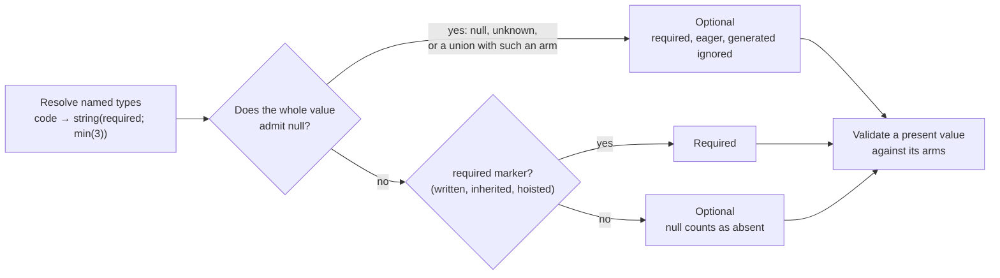

Named references are resolved first, so a reference to a type defined as
`[code, null]` is optional wherever it is used. Null admission is decided
before the ordinary optional-property `null` wrapper is added; otherwise every
optional concrete type would look null-admitting and could never be required.

The rule concerns the **whole value**, not its items or fields:

| Declaration | Missing or `null` | Notes |
|---|---|---|
| `unknown(required)`, `null(required)` | accepted | `required` has no effect |
| `[string(required; min(3)), null]` | accepted | `ab` is still rejected |
| `unknown[](required)` | rejected | a list is required; its items may be anything, including `null` |
| `null[](required)` | rejected | a list is required; every item must be `null` |
| `"{ note: null, id: string }(required)"` | rejected | a nullable field leaves its object required |

The same calculation governs validation, generated JSON Schema, trigger
matching, composition's optional-property materialization, and launch and
completion validation. A null-admitting property lowers to its bare fragment
(`{}` or `{"type": "null"}`, or the union's arms) and is never placed in the
parent's `required` list.

Raw JSON Schema is unaffected: a property listed in its authored `required`
array is required even when its schema is `{}` or `{"type": "null"}`.

A host may apply its own policy to an invalid optional value. Claudine, for
example, drops an invalid optional value with a warning instead of failing, so
`c: ab` against `c: [string(required; min(3)), null]` is dropped by Claudine
while `md schema validate` reports it.

### Numeric Constraints (`number`)

| Constraint   | Effect                          | JSON Schema             |
|--------------|---------------------------------|-------------------------|
| `min(n)`     | Inclusive minimum.              | `minimum`               |
| `max(n)`     | Inclusive maximum.              | `maximum`               |
| `integer`    | Whole numbers below 2^64 in magnitude. | `type: integer` and `x-darkmatter-integer: true` |
| `default(n)` | Default value.                  | `default`               |
| `required`   | Property is required.           | parent `required` entry |

Numbers written in a schema (`min`, `max`, `default`, and the values of
`literal` and `enum`) must be numbers Darkmatter can hold exactly. A whole
number that a 64-bit float cannot represent, an infinite value, or a non-zero
value that would round to zero fails to load, with the reason:

```yaml
$schema:
    a: number(min(1.5))                    # fine; a fraction takes the nearest value
    b: number(default(9007199254740993))   # error: cannot be represented exactly
    c: number(max(inf))                    # error: not finite
    d: number(min(1e-400))                 # error: a non-zero value would become 0
```

### String Constraints (`string`)

| Constraint     | Effect                                                                                            | JSON Schema             |
|----------------|---------------------------------------------------------------------------------------------------|-------------------------|
| `min(n)`       | Minimum length (Unicode code points).                                                             | `minLength`             |
| `max(n)`       | Maximum length.                                                                                   | `maxLength`             |
| `not-empty`    | Disallow empty / all-whitespace.                                                                  | `pattern: "\\S"`        |
| `pattern(re)`  | ECMA-262 regex compiled with `jsonschema::PatternOptions::regex()` (ReDoS-safe, linear-time).     | `pattern`               |
| `default(s)`   | Default string.                                                                                   | `default`               |
| `required`     | Property is required.                                                                             | parent `required` entry |

A value must satisfy every pattern. When an atom has more than one pattern-producing constraint (for example `not-empty` with a `pattern(...)`, or several `pattern(...)` constraints), each lowers to its own `allOf` entry instead of a single `pattern` keyword.

### Date / Time Constraints

`date`, `datetime`, and `time` accept `default(s)` (ISO string) and `required`. The type itself emits the corresponding `format` with format-assertion enabled.

### Advisory Suggestions (`suggest`)

`suggest(...)` provides representative completion candidates for `string` and `number` properties. Unlike `enum(...)`, suggestions are **advisory** — a document value is valid when it satisfies the underlying type and constraints, whether or not it appears in the suggestion list. DMLS uses valid suggestions for frontmatter value completion.

```yaml
$schema:
    color: string(suggest(red, green, "blue gray"))
    port: number(integer; suggest(80, 443))
    ratio: number(min(0); max(1); suggest(0.25, 0.5, 1))
    tags: string(suggest(alpha, beta))[]
    retries: number(integer; suggest(1, 2, 3))[]
```

#### Eligibility

`suggest(...)` is available only on exact `string` and `number` types and on `alphanumeric`. `number(integer)` remains eligible because `integer` is a constraint on `number`. Array forms (`string[]`, `number[]`) are eligible — their candidates describe individual elements, not whole arrays.

`suggest(...)` is not available on `numberlike`, `date`, `datetime`, `time`, `url`, `email`, `boolean`, `boolish`, `enum`, `unknown`, `null`, `object`, `file`, `shell`, `expression`, or raw JSON Schema.

On `alphanumeric` the check is stricter: every candidate must be a valid value of the type, or the schema fails to load (see [Alphanumeric Strings](#alphanumeric-strings)). Everywhere else an invalid candidate is only linted.

#### Cardinality

A complete property definition may contain at most one `suggest(...)` constraint. A second occurrence is a structural grammar error. This restriction applies across all atoms of a property-level union:

```yaml
# INVALID: two suggest(...) across union atoms
$schema:
    value: [string(suggest(a)), string(suggest(b))]
```

Each property declaration in a separate root-level schema-union arm is an independent complete property definition and may carry its own suggestion list.

`suggest()` with no candidates is a structural grammar error.

#### Argument Grammar

Candidate arguments reuse the existing SimplifiedSchema argument delimiter, quoting, and escaping grammar — the feature introduces no new string literal syntax. The parser retains the exact source span and decoded text for every candidate.

#### String Interpretation

Every syntactically valid argument to `string(suggest(...))` is interpreted as a string. Bare spellings that resemble numbers, booleans, or null are still strings. Quotes delimit and escape; they do not create a distinct candidate type. So `12` and `"12"` are the same interpreted string candidate.

#### Number Interpretation

Bare and quoted arguments to `number(suggest(...))` are interpreted using the **simple decimal** syntax:

```text
optional `-` + one or more digits + optional (`.` + one or more digits)
```

The syntax accepts leading zeros and canonicalizes them. It does not accept exponent notation (`1e3`), a leading plus sign (`+1`), a missing integer portion (`.5`), a missing fractional portion (`5.`), or leading/trailing whitespace.

A simple decimal becomes a JSON number only when its canonical decimal text survives conversion to the supported JSON numeric model and canonical JSON serialization with the same exact value (lossless canonical round-trip equality). For example, `3`, `"3"`, `003`, and `3.0` all have canonical decimal text `3` and interpret to the same numeric candidate `3`. `-0` canonicalizes to `0`.

A simple decimal outside the lossless representation boundary is retained as its exact canonical decimal JSON string — it is invalid metadata that DMLS warns about and omits from completion, but it never blocks schema loading or validation.

An argument whose decoded text does not use simple decimal syntax (e.g. `many`) is also retained as its decoded JSON string for linting and diagnostics — it is not a schema-load error.

#### Uniqueness

Candidates must be unique after target-directed interpretation. A duplicate is a structural grammar error ranged at the later argument, including duplicates created by leading-zero, trailing-fractional-zero, quoted/bare, or negative-zero normalization.

#### Generated Annotation

Darkmatter preserves interpreted suggestions in generated JSON Schema using the custom `x-darkmatter-suggest` annotation. Authors never write this field — they write only `suggest(...)`.

```yaml
$schema:
    score: number(min(0); max(100); suggest(-1, 50, 101))
```

generates:

```json
{
  "type": "number",
  "minimum": 0,
  "maximum": 100,
  "x-darkmatter-suggest": [-1, 50, 101]
}
```

The annotation preserves interpreted candidate order and scalar values. It is never lowered to the standard JSON Schema `examples` annotation and is distinct from Darkmatter's `example(...)` artifact and `x-darkmatter-example` annotation. Raw JSON Schema may contain a field with the same spelling, but Darkmatter and DMLS do not discover suggestions from raw JSON Schema.

#### Candidate Linting

The Darkmatter library owns candidate checking via `lint_suggestions()` — a structured, typed, span-bearing lint API. Each interpreted candidate is checked against its target schema (the non-null scalar or array-item fragment, with `x-darkmatter-suggest` excluded).

In a union, the target is the property's effective type at the place the candidate is inserted, not just the arm that stores the list: a candidate is valid when **any** alternative there accepts it. Scalar alternatives share one place and the element alternatives of array forms (`string[]`, or the arms of a `U[]` list) share another, so an element arm never vouches for a scalar candidate. The failure reason reported is the storing arm's own. An unresolved named reference cannot vouch for a candidate until the schema is resolved.

```yaml
$schema:
    # `large` is kept: the second arm accepts it. `huge` is linted.
    size: ["string(pattern(^small$); suggest(small, large, huge))", "string(pattern(^large$))"]
``` Applicable number constraints include `min`, `max`, and `integer`; applicable string constraints include `minLength`, `maxLength`, `not-empty`, and `pattern`. `required`, `default`, `generated`, and `example(...)` do not constrain a candidate.

Invalid candidates produce structured lint problems (not schema-load errors) with decoded text, interpreted value, failure reason, and exact source span. Schema resolution, validator construction, frontmatter validation, and composition all continue uninterrupted. See `SuggestionLintProblem` and `SuggestionLintReason` in the library API.

#### Completion Query

DMLS reads suggestions from the SimplifiedSchema representation via `suggestions_for_path()`. This returns lint-valid candidates in declaration order, prefixed-filtered, with YAML-safe insertion text (double-quoted strings, canonical numbers). Invalid candidates are omitted; valid siblings are retained. See `SuggestionItem` and `SuggestionQuery` in the library API.

### Boolean Constraints

`boolean` and `boolish` accept `default(b)` and `required`.

### Enumerations

`enum` requires a positional comma list of members; other constraints follow after a `;`. Members with whitespace, commas, parentheses, or `;` must be single-quoted.

```yaml
$schema:
    color:  enum(red,green,blue; required)
    status: "enum(draft, published, archived; default(draft))"
    spaced: "enum('a, b', 'c; d')"
```

### Literals

`literal(value)` types a property whose value must **equal exactly one scalar**. It compiles to JSON Schema `const`, replaces the single-member-enum workaround (`kind: enum(spec)`), and makes discriminated unions first-class.

```yaml
$schema:
    kind:     literal(spec)                     # string literal
    version:  literal(2; required)              # number literal + constraint
    archived: literal(false)                    # boolean literal
    note:     "literal('a, b'; default('a, b'))"  # quoted value (protects , ; )
```

- Exactly **one** positional value, lexed with the same rules as enum members: a bare token or a single-/double-quoted string. Quoting protects `,`, `;`, and `)`.
- Constraints follow after `;`, exactly like `enum(a, b; required)`.
- `literal()` with no value is a `SchemaError` (*literal requires a value*). Two or more positional values is a `SchemaError` whose message points you at `enum(...)`.

#### Value Typing

The positional value is lexed as a YAML-style scalar, so the literal's JSON type mirrors how YAML would type the frontmatter value being validated:

| Authored                                | Typed as |
|-----------------------------------------|----------|
| bare `true` / `false`                   | boolean  |
| bare integer / float (numberlike-shaped) | number   |
| any other bare token                    | string   |
| quoted (`'2'`, `"true"`)                | string   |

`version: 2` in a document therefore satisfies `literal(2)` without coercion gymnastics, and quoting opts out (`literal('2')` matches the string `"2"`, not the number `2`). Number detection reuses the existing numberlike-shape test — no scientific notation, no leading-zero octal surprises; anything that fails the shape test is text.

A **bare `null`** is rejected with an actionable error (*quote it or drop the key*): optional properties already accept `null`, so a null literal is always an authoring mistake. To declare a property that must be `null` or absent, use the [`null` type](#unknown-and-null).

#### Constraints

| Constraint  | Allowed | Notes                                                                                                          |
|-------------|---------|----------------------------------------------------------------------------------------------------------------|
| `required`  | yes     | Enforces presence and equality.                                                                                |
| `default(v)` | yes     | Schema-load lint: `v` must equal the literal value, else `SchemaError` — a default that violates its own `const` is always a bug. |
| `suggest(...)` | no   | Completion is implied by the value itself.                                                                     |
| everything else (`min`, `pattern`, …) | no | Nothing to constrain beyond identity.                                                            |

A non-`required` literal accepts missing/`null` through the standard optional-nullable wrapper; otherwise the value must equal the literal.

#### JSON Schema Emission

`literal(spec)` → `{ "const": "spec" }`; `literal(2)` → `{ "const": 2 }`. The array form `literal(x)[]` is **allowed** and places the `const` under `items`, so every item must equal the value — grammatically uniform with every other type, niche but well-defined.

#### Coercion

The literal implies its scalar type, so conversion treats it like the corresponding primitive: a document value `"2"` against `literal(2)` converts to the number `2`; `"yes"` against `literal(true)` converts to the boolean `true`; a number or boolean against a string literal converts to its text (`2` against `literal('2')` becomes `"2"`) and is then compared. A converted value that does not equal the literal is an error, and `$(...)`-pending values wait for expansion (see [Type Coercion](#type-coercion)).

#### Relationship to `enum`

`literal(x)` validates **identically to `enum(x)` for string values**. Keep using `enum` for "one of N strings"; reach for `literal` when you mean "exactly this value, of any scalar type" — including non-string discriminants (`version: 2`) that `enum` cannot express. Single-member enums keep working; there is no deprecation.

#### Trigger Matches

`literal` is a pure value-equality constraint (no I/O), so it is permitted in [schema-trigger](#repository-trigger-schemas) match expressions. `kind: literal(spec)` is the idiomatic trigger discriminant, replacing the older `enum(spec)` spelling.

### Expressions

`expression` types a **string that must parse under the Darkmatter expression grammar**. It is the third member of the content-format string-type family alongside [`yaml` / `json`](#content-format-types-yaml--json), and it is **parse-only** — never evaluated, no I/O, no shell, no function execution.

```yaml
$schema:
    when:  expression                           # bare
    guard: expression(required)                 # with constraints
    hooks: "{ on-error: expression, on-done: expression }"
```

- A plain keyword type with no positional value — parses exactly like `string`.
- There is **no** parameterized form in v1. `expression(condition)` is reserved for a future backward-compatible opt-in and is rejected today.

#### Semantics

The expression language has two dialects that disagree on `&&` / `||`: the **value** dialect (body `{{ }}` interpolation) and the **condition** dialect (`when="..."`, where `&&`/`||` are logical AND/OR). A bare `expression` validates when the string parses under **either** dialect, so `when: expression` accepts `is_agent() && os == "macos"` on day one. In practice this is a single condition-mode parse, because the condition parser accepts a parse-superset of the value dialect.

Validation checks **parseability only**:

- **No evaluation, ever** — the same passivity contract as `yaml` / `json` content-format validation.
- **Unknown identifiers are not schema errors.** Identifier resolution (frontmatter keys, `ctx.*`, `env.*`) is a compose-time concern. DMLS layers richer advisory diagnostics on top inside the editor.

#### JSON Schema Emission and Constraints

Emits `{ "type": "string", "format": "darkmatter-expression" }`, backed by a pure parse check. Constraint applicability, optional-nullability, and the `$()` / `{{ }}` pending-value deferral rules mirror `yaml` / `json` exactly: it permits the universal `required`, `default(...)`, and `generated` constraints plus array constraints when suffixed with `[]`; string constraints and `suggest(...)` are rejected. A `default(...)` value must itself parse as an expression, or the schema fails to load.

#### Coercion

`when: true` and `retries: 3` are valid degenerate expressions that YAML types as boolean/number before the validator sees them. The coercion pass serializes native boolean and number scalars to their canonical literal string forms (`true` → `"true"`, `3` → `"3"`), the same native-value-accepted-then-serialized behavior `yaml`/`json` already have. Number spelling canonicalizes through YAML's reading (`3.10` → `"3.1"`); quoting preserves exact spelling. **Mappings and sequences do not coerce — they are type mismatches.**

#### Consumer Layering

The type ships in Darkmatter; consumers adopt it in their own schemas. Claudine's extension baseline retypes `when: string` → `when: expression` with zero Claudine-specific code in Darkmatter, then DMLS lights up schema-driven expression completion, hover, and diagnostics inside those frontmatter values.

### `unknown` and `null`

`unknown` names "any value at all"; `null` names "deliberately absent". Both
admit `null`, so both are always optional (see
[Null-Admitting Properties](#null-admitting-properties)).

```yaml
$schema:
    payload: unknown            # any value, null, or omitted
    legacy:  any                # the same type, spelled with its alias
    review:  null               # only null, or omitted
    spec:    [file, null]       # a file reference, null, or omitted
```

**`unknown`** accepts every value: a string, number, boolean, mapping,
sequence, or `null`, and omission. It lowers to the empty JSON Schema `{}`.
`any` parses to the same type and is never written back: serialization, `md
schema about`, and DMLS hover all say `unknown` and list `any` as its alias.
Values keep their native types, including nested `null`s; `unknown` performs
no coercion. Because it accepts everything, `unknown(required)` cannot demand
that a key be present. Use a concrete type for that, such as
`agent: string(required)` or `steps: unknown[](required)`. "Anything except
`null`" is a union of the accepted types:
`value: [string(required), number, boolean, object, "unknown[]"]`.

An expression variable that no frontmatter key, caller input, or schema
property declares is of type `unknown`. A function argument with this type
cannot be proven incompatible before execution. DMLS can warn about that
uncertainty when `expressions.strict` is enabled; ordinary composition does
not reject it on that basis. The actual value must still satisfy the function
at runtime. See [Expression Type Checking](../darkmatter-expressions.md).

**`null`** accepts an explicit `null` or omission and rejects every other
value. It lowers to `{"type": "null"}`.

- At a type position (a property, a union arm, a nested property, or a named
  type), the YAML null scalars `null`, `Null`, `NULL`, and `~`, an empty
  value (`review:`), an empty sequence item (`-`), and the string `"null"` all
  mean the `null` type. A quoted empty string `""` is a string, not a null
  spelling, so `d: ""` is still the grammar error *expected a type name*.
- `null(required)` is legal and behaves exactly like `null`.
- A `default(...)` on `null` must itself be `null`. `null(default(1))` fails
  to load, with the error ranged on `1`.
- `null` is a property type only. An empty root (`$schema:` with no value), a
  `null` arm of a root union, and `literal(null)` remain errors.
- Serialization writes the explicit `"null"` type string, never an empty
  YAML value.

`null` is how a [root union](#root-level-unions) excludes a key from an arm.

### Alphanumeric Strings

`alphanumeric` is a string made of ASCII letters and digits (`[A-Za-z0-9]`).
Type options widen or narrow that character set. No option is on by default.

```yaml
$schema:
    slug: alphanumeric(allow-dashes; min(1); max(40))
    path: alphanumeric(allow-slashes, allow-periods, block-double-periods, block-leading-slash)
    name: alphanumeric(leading-alpha, allow-underscores)
    code: alphanumeric(min(1))       # no options; constraints only
```

Options are written first, separated by commas; ordinary constraints follow
the `;`, as with `enum` members.

| Option | Effect |
|---|---|
| `allow-dashes` | also allows `-` |
| `allow-underscores` | also allows `_` |
| `allow-slashes` | also allows `/` (never `\`) |
| `allow-periods` | also allows `.` |
| `allow-whitespace` | also allows the ASCII space (U+0020); never tabs, newlines, or other Unicode whitespace |
| `block-double-periods` | the value may not contain `..` |
| `block-leading-dash` | the first character may not be `-` |
| `block-leading-slash` | the first character may not be `/` |
| `leading-alpha` | the first character must be an ASCII letter |

- **Grammar.** Options are a closed set. An unknown option, a repeated
  option, an option with arguments, and an option after the `;` are grammar
  errors. A list with no `;` that holds no option is read as constraints
  (`alphanumeric(min(1))`, `alphanumeric(required)`); a list with no `;` that
  mixes options and constraints is an error whose message shows the
  `alphanumeric(allow-dashes; min(1))` form. An option on another type
  (`string(allow-dashes)`) is an error too.
- **Empty values.** The empty string is accepted unless `min(1)` or
  `not-empty` excludes it. The leading-character options only constrain a
  first character when there is one.
- **Canonical form.** An option that cannot change the accepted values is
  redundant and dropped: `block-double-periods` without `allow-periods`,
  `block-leading-dash` without `allow-dashes` or with `leading-alpha`, and
  `block-leading-slash` without `allow-slashes` or with `leading-alpha`. The
  remaining options are ordered as in the table, whatever the authored order.
  Identity, serialization, `md schema about`, DMLS hover, and the
  [subtype relation](#subtype-relation-is_subtype) all use the canonical
  form, so `alphanumeric(block-leading-dash)` serializes as `alphanumeric`.
- **Constraints.** After the `;`: `min(n)` and `max(n)` (characters),
  `not-empty`, `pattern(re)`, `suggest(...)`, `default(...)`, `example(...)`,
  and the universal `required`, `generated`, and `eager`. Every pattern
  applies: the option pattern, each `pattern(...)`, and `not-empty`.
- **Defaults and suggestions must be valid values.** A `default(...)` or
  `suggest(...)` value that the type rejects fails the schema load, without
  coercion. `alphanumeric(default(12))` fails because `12` is a number; write
  `default('12')`.
- **No coercion.** A native number or boolean is a type mismatch, never
  converted to text: `n: 3` fails against `n: alphanumeric`. In a union, the
  other arms keep their own coercion, so `[alphanumeric, string]` still turns
  `3` into `"3"` through the `string` arm.
- **Host-independent.** The type does not establish that a value is a safe
  path or a safe shell argument; quoting and path policy belong to the code
  that uses the value.

**Named types.** Options are part of a named type's identity. A use site may
add ordinary constraints, and may repeat the exact option set, but any other
option set is a `SchemaError::ConstraintConflict`, never a widening.
Options are compared after canonicalization, so equivalent spellings agree:

```yaml
kind: schema
types:
    slug: alphanumeric(allow-dashes)
    a: slug(max(10))                     # ok: constraints only
    b: slug(allow-dashes; max(10))       # ok: the same option set
    c: slug(allow-periods)               # error: a different option set
```

The error names both declarations: the definition's option group and the use
site.

**JSON Schema.** The type lowers to a string with a linear-time `pattern`
that encodes exactly the canonical options and checks the whole value, plus
two annotations that record the type identity for JSON consumers. The
annotations do not validate anything. `alphanumeric(allow-dashes,
block-leading-dash; min(1))` lowers to:

```json
{
  "type": "string",
  "minLength": 1,
  "pattern": "^(?:[A-Za-z0-9][A-Za-z0-9\\-]*)?$",
  "x-darkmatter-type": "alphanumeric",
  "x-darkmatter-options": ["allow-dashes", "block-leading-dash"]
}
```

`x-darkmatter-options` is `[]` for the base type. When a user `pattern(...)`
or `not-empty` is also present, each pattern becomes its own `allOf` entry,
so none overwrites another.

### Shell Commands

`shell` types a string that is a shell command. It joins `expression`,
`yaml`, and `json` in the content-format family. Its job is type identity: a
schema can say "this value is a shell command", and a union of action types
can include or exclude it.

```yaml
$schema:
    build: shell(required)          # e.g. `cargo build --release`
    hooks: shell[](min(1))
```

- **Validation.** A value must contain at least one non-whitespace character
  (Unicode whitespace). There is **no shell-syntax check**: Darkmatter's own
  `$( … )` and `::shell` grammar is narrower than the system shell that a host
  such as Claudine runs (`sh -c` or `cmd /C`), so no single parser is right
  for every host. `ls | wc -l; echo done` is valid; `"   "` is not.
- **Passive.** Validation never runs, approves, or reads anything.
- **Constraints, coercion, and pending values mirror `expression`.**
  `required`, `default(...)`, `generated`, `eager`, `example(...)`, and array
  constraints after `[]` are allowed; string constraints and `suggest(...)`
  are rejected. Native booleans and numbers coerce to their text
  (`shell: true` → `"true"`); mappings and sequences are type mismatches. A
  `default(...)` is converted to text the same way and must contain a
  non-whitespace character; a `null`, list, or mapping default fails to load.
  An authored whole-value `$( … )` or `{{ … }}` is deferred as on
  `expression`, while data that merely contains that syntax is validated as
  text.
- **JSON Schema.** `shell` lowers to
  `{"type": "string", "format": "darkmatter-shell"}`. Every Darkmatter
  validator registers and asserts that format. A consumer of exported JSON
  Schema must enforce the custom format itself; a validator that ignores
  unknown formats accepts any string, including a blank one.

A lifecycle-style schema can allow a shell action under one event and not
another by typing each event as a list of a different action union. Action
alternatives are closed inline objects with a required action key, so an
object that mixes an allowed action with a `shell` key, or an empty `{}`, is
rejected as well:

```yaml
# actions.yaml
kind: schema
types:
    say_action: "{ say: string(required) }"
    set_action: "{ set: object(required) }"
    shell_action: "{ shell: shell(required) }"
    initialize_action: [say_action, set_action]
    start_action: [say_action, set_action, shell_action]
```

```yaml
$schema:
    initialize: initialize_action[]@./actions.yaml
    start: start_action[]@./actions.yaml
```

With this schema `start: [{shell: echo hi}]` is valid and
`initialize: [{shell: echo hi}]` is reported by `md schema validate`,
composition, and DMLS. An opaque `object` or `unknown` alternative would
accept a shell action anyway, so do not add one. This is authoring
validation only: a host that must never run a shell during an event, as
Claudine refuses during `initialize`, still enforces that ban at run time,
including for shell-valued `set` and `$(...)` forms that a schema does not
see as a `shell` key.

### Files

The `file` type wraps a `FileReference` string and is **lazy by default**. A bare
`file` value is valid as long as it **parses as a `FileReference`** — the reference
is never resolved against the filesystem, so a syntactically valid path to a
not-yet-created output file passes. This is the right default for prompt authoring,
where a property often names a file the run is about to *produce*.

Add `eager` to opt into existence checking. When a value is supplied,
`file(eager)` requires that:

1. The string parses as a `FileReference`.
2. The reference resolves to an existing filesystem entry **at validation time**.

Relative paths in an eager check resolve like implicit file references: a bare path
(`spec.md`, `notes/spec.md`) is tried **from the prompt document's directory first,
then the repository root**, while an explicit `./`/`../` path resolves from the
document directory only. This is the same order `$schema` file references and the expression
path (`file_exists`/`frontmatter`) use. Every eager check resolves through the request's
file-resolution context; a document with no path of its own (a string or stdin) resolves
from that context's directory. No ambient current working directory is read.

`match(globs)` shapes path completion: it decides which candidates a tool offers.
In a single schema it only suggests paths, so an existing file outside the
configured globs still validates. In a root union, it is also an arm constraint:
an existing file outside an arm's declared glob rules that arm out. This holds
when the other arms declare the same glob, a different glob, or no glob.

Each `match(...)` is one **group**: a path must match one of the group's
positive globs and none of its `!` exclusions. Repeating `match(...)`, which
usually happens when a [named type](#merging-use-site-constraints) is reused
with another `match`, adds a group, and a path must satisfy every group:
`file(match('*.md'); match('guide*'))` admits `guide-intro.md` but neither
`notes.md` nor `guide.txt`. An exclusion stays inside its own group.

Each glob is a **glob reference**: an optional `!` (exclude), an optional
file-reference prefix, then the glob. The prefix says where the glob starts,
so one schema can mean the same files from any launch directory:

| Prefix | Example | Judged from |
|---|---|---|
| _(none)_ | `**/*spec*.md`, `*.md` | the value's directory, then the repository root |
| `./` | `./docs/*.md` | the value's directory only |
| `../` | `../shared/*.md` | the parent of the value's directory only |
| `&` | `&fixes/**/spec.md` | the repository root only |
| `^` | `^**/*spec*.md` | the package, the package area, then the repository root |
| `@` | `@prompts/*.md` | the launch directory's package, package area, and repository root, then home |
| `~/` | `~/notes/**/*.md` | your home folder |
| absolute | `/srv/specs/*.md` | that folder |
| `vault:` | `vault:journal/**/*.md` | each configured vault root |
| `{{VAR}}` | `{{SPECS_DIR}}/*.md` | the folder the variable names; its value is literal text, never glob syntax |
| `!` | `!&**/_completed/**` | excludes what the rest of the pattern, with its own prefix, matches |

- **The value's directory** is the launch directory for a value a caller
  supplies (`md compose doc.md spec=…`, a completion, a chooser) and the
  document's folder for a value written in the frontmatter, so a bare, `./`,
  or `../` pattern can mean two different places. Use `&`, `^`, or `@` when a
  pattern must mean one place for both.
- **Nearest root.** A file is judged only relative to the first of a
  pattern's folders that contains it, so `match(**/*spec*.md, !fixes/**)`
  launched from `pkg/` rejects `pkg/fixes/x/spec.md` and the repository
  root's `fixes/y/spec.md` alike.
- **File-name view.** A pattern with no `/` after its prefix (`*.md`,
  `^*.md`, `!_*.md`) also matches a file's bare name at any depth, so
  `match(*.md, !_*.md)` rejects `docs/_draft.md`.
- `*` stays within one path segment and `**` crosses segments; matching is
  case-sensitive on every OS.
- A pattern that is not a glob reference is a schema definition error naming
  the property and pattern: `%…` (a glob already recurses), a URL, an
  invalid glob, or a list of only `!` exclusions.

A prefixed pattern means the same files wherever `md` runs. Here `journal`
offers Markdown from every configured vault except its templates, and `spec`
offers spec files from anywhere in the repository:

```yaml
$schema:
    journal: "file(match('vault:journal/**/*.md', '!vault:journal/_templates/**'))"
    spec:    "file(eager; match('&**/features/**/spec.md'))"
```

```yaml
$schema:
    - kind: "literal(feature)"
      spec: "file(required; eager; match(**/features/**/spec.md))"
    - kind: "literal(fix)"
      spec: "file(required; eager; match(**/fixes/**/spec.md))"
      severity: "string(required)"
```

| Frontmatter | Result |
|---|---|
| `spec: fixes/x/spec.md` | the `feature` arm is ruled out; the `fix` arm applies and asks for `severity` |
| `spec: features/x/spec.md` | the `feature` arm applies |
| `kind: fix`, `spec: features/x/spec.md` | invalid: the only arm `kind` allows rejects the path |

The same rule applies when both arms declare `match(**/fixes/**/spec.md)`:
`kind: fix` with `spec: features/x/spec.md` is invalid. It also applies when
only the `fix` arm declares `spec` with that glob, or when the other arm is a
referenced raw JSON Schema. In each case, `kind: fix` with an existing
`fixes/x/spec.md` is valid; the raw arm may separately accept other values.

The rules:

- Each simplified arm in a root union enforces its own declared glob, including
  beside an arm written as raw JSON Schema. The raw arm follows its own schema;
  it may still accept a value the simplified arm rejects.
- The glob is enforced in two places: on a property of the arm whose type is
  `file` or `file[]` (written directly or through a named type that is just
  that file), and on every file inside a
  [recursive named type](./local-type-references.md) the arm uses, at every
  depth and wherever in the arm the type is used. Any other file in the arm
  only suggests: a file alternative of a union (`file(match(…)) | number`,
  also through a named type), a file inside an inline object, a dictionary
  value, a tuple slot, or a list of a union. That holds as well for a file
  inside a [shared named type](#shared-named-types) used twice: it suggests,
  exactly as the copied type did, while a recursive type the shared type
  uses is still enforced. Outside a root union every glob only suggests.

  ```yaml
  $schema:
      - node: "file(match('./notes/*.md')) | { children: node[] }"
        tree: node                                 # enforced, at every depth
        main: "file(match('./notes/*.md'))"        # enforced
        either: "file(match('./notes/*.md')) | number" # suggests only
        meta: "{ path: file(match('./notes/*.md')) }"  # suggests only
      - kind: "literal(other)"
  ```
- Only an **existing** file is judged. A value that names no file yet (a lazy
  output path, a partial a chooser is about to complete, a value still holding
  `{{ … }}` or `$(…)`) never rules an arm out; existence is `eager`'s job.
- The path is judged from the value's directory, as above: a caller-supplied
  value from the launch directory, which is where completion walks the glob,
  so what completion offers, the arm accepts; a document-authored value from
  the document's folder. Each is resolved from that same origin. In a
  `file[]`, every item must match.
- Coercion, which runs without a request, judges only an existing absolute
  path against the bare and absolute patterns (by its full path), so a
  `./`, `&`, `^`, or `@` pattern cannot steer how a sibling value is coerced.

When a schema arm selects `file(eager)`, validation probes the candidate plan and
materializes the winning **absolute native path**. A lazy `file` value materializes
the plan's first lexically normalized absolute candidate without probing it; recursive
lazy references are rejected because they have no single path shape without I/O.
String-typed properties, remote URLs, absent/`null` optionals, and values still
holding `$(...)` or unresolved `{{ ... }}` are not materialized. Markdown
presentation uses the portable sidecar while expressions and lifecycle state retain
the native identity.
See [Schema Validation — Eager-`file` value normalization](../../inline/schema-validation.md#eager-file-value-normalization)
for the full contract.

Caller-originated eager-file overrides retain a resolved absolute native path in
effective frontmatter because their identity belongs to the caller's captured
launch area, not the document. Markdown body interpolation uses a separate
portable presentation value for direct variables and static member/index
selections. Path operations, comparisons, and lifecycle state continue to read
the native effective value.

```yaml
$schema:
    review:      "file(eager; required; match('**/*review*.md'))"   # must be supplied and must exist
    spec:        "file(eager; match('**/*spec*.md'))"                # optional; must exist when supplied
    plan:        "file"                                              # lazy: may be a future output path
    doc:         "file(match('*.doc', '*.pdf', '*.md', '*.txt'))"   # lazy + completion hints
    source_code: "file(match('src/**/*.rs', '!src/**/test_*.rs'))"
    images:      "file(eager; match('*.png', '*.jpg'))[](min(1))"   # each item must exist
```

`eager` is universal. Array placement determines ownership:
`file(eager)[]` applies the eager existence check to each present item, while
`file[](eager)` applies eager timing to the array property itself and leaves the
items lazy. Neither placement makes the property required — declare `required`
independently, and prefer `file[](required; eager)` when the array must be
present and eagerly validated. `match(...)` still applies per item, both to
completion and, in a root union, to the arm's verdict.

### URLs

| Constraint           | Effect                                              |
|----------------------|-----------------------------------------------------|
| `scheme(a, b, ...)`  | Restrict to one of the listed schemes (lowercased). |
| `default(s)`         | Default URL.                                        |
| `required`           | Property is required.                               |

```yaml
$schema:
    homepage:  "url(scheme(https))"
    canonical: "url(required)"
```

### Emails

`email` accepts `default(s)` and `required`; the type emits JSON Schema `format: email` with assertion enabled.

### Array Constraints

Place item constraints inside the parens **before** `[]`; place constraints on the array itself in a second parens **after** `[]`.

```yaml
$schema:
    # required array of 1..=5 unique lowercase tags
    tags: "string(pattern(^[a-z][a-z0-9-]*$))[](min(1); max(5); unique; required)"
```

| Constraint        | Effect                                       | JSON Schema      |
|-------------------|----------------------------------------------|------------------|
| `min(n)`          | Minimum number of items.                     | `minItems`       |
| `max(n)`          | Maximum number of items.                     | `maxItems`       |
| `unique`          | All items must be distinct.                  | `uniqueItems`    |
| `required`        | Array property is required (not items).      | parent `required` |
| `default(value)`  | Default for the array property.              | `default`        |

The `default(...)` argument is read as a scalar, like every other constraint
argument, so `default([a])` stores the string `"[a]"`, not a one-item list. A
list-valued default cannot be written in the type-expression grammar today.

To make a list whose items may each take one of several shapes, group the
options and add `[]` (`steps: "(string | number)[](min(1))"`), or name the
union and reference it with `[]`: `steps: step[](min(1))`, where `step` is a
union-typed named type. Both are the same list. See
[Named Union References](#named-union-references).

### Tuples

A tuple is a list whose positions have their own types. Each position is
required unless it ends in `?`, and at most one final `...T[]` spread accepts
any number of further values of `T`:

```yaml
$schema:
    point: "tuple([number, number])"                 # exactly two numbers
    range: "tuple([date, date?])"                     # one date, or two
    row:   "tuple([string, ...number[]]; required)"   # a label, then any numbers
    none:  "tuple([])"                                # only []
```

- Positions go **required, then optional (`?`), then at most one spread**.
  Two spreads, a spread before another position, `?` on a spread, and a
  required position after an optional one are schema-load errors.
- A spread must be a list type (`...number[]`, `...(string | number)[]`);
  `...number` is an error.
- Positions are unnamed: `tuple([x: number])` is an error.
- A position may be a union. Group it before `?`: `(string | number)?`, since
  `string | number?` is ambiguous and rejected.
- A position's type describes the value itself. An optional position may be
  left out, but a supplied `null` must match its type: `tuple([number?])`
  accepts `[]` and `[1]` and rejects `[null]`; `tuple([(number | null)?])`
  accepts all three.
- Constraints on the tuple follow its element list inside the same
  parentheses, after `;`. A tuple property is optional like any other.

A tuple compiles to standard JSON Schema: `prefixItems` for the positions,
`minItems` for the required ones, and `items` for what may follow (`false` for
a fixed length, the spread's item schema otherwise):

```json
{ "type": "array",
  "prefixItems": [{ "type": "number" }, { "type": "number" }],
  "minItems": 2,
  "items": false }
```

## Inline Object Literals

The type-expression grammar accepts an **inline object literal** — a single string scalar that declares the shape of a nested object. This is the way to type object-typed properties and arrays of objects without dropping down to an external JSON Schema file. The motivating case is the typed object array:

```yaml
$schema:
    authors: "{ name: string(required), email: email }[]"
```

### Forms

An inline object appears wherever a type expression is valid: as a single property, a property-level union arm, or the item type of an array.

```yaml
$schema:
    # Array of typed objects — the motivating case
    entries: "{ foo: string(required), bar: string }[]"

    # Optional single typed object
    config: "{ host: string(required), port: number(default(8080)) }"

    # Required single typed object — the postfix constraint applies to config
    config_required: "{ host: string }(required)"

    # Multi-line for readability (whitespace inside braces is ignored)
    endpoints: "{
        url: url(scheme(https); required),
        method: enum(GET, POST, PUT, DELETE; required),
        timeout: number(default(30))
    }[]"

    # Nested objects
    database: "{
        primary: { host: string(required), port: number(default(5432)) },
        replicas: { host: string, port: number }[]
    }"

    # Required non-empty array — postfix constraints after [] apply to replicas
    replicas: "{ host: string }[](min(1); required)"

    # Inline object as a union arm
    payload:
      - "{ type: enum(foo; required), foo_id: string(required) }"
      - "{ type: enum(bar; required), bar_count: number(required) }"

    # Mixed: inline object array or a plain string fallback
    metadata:
      - "{ key: string(required), value: string(required) }[]"
      - "string"
```

The inline object body parses identically in single-line and multi-line form because the parser strips whitespace after `{`, around `,` and `:`, and before `}`. Braces are not allowed inside constraint argument lists, so there is no ambiguity with the existing constraint syntax.

### Identifier Rules

Inline object property names are always **unquoted string-layer identifiers** — unquoted ASCII alphanumeric characters plus `-` and `_`, including leading digits. The same scanner is used elsewhere in the grammar.

Accepted: `name`, `foo_id`, `x-custom`, `api2_version`, `123abc`.

Rejected: `display name`, `@type`, `x.custom`, `"x-custom"`. There is no quoted-property-name form in this feature; rename the property to a valid identifier or drop down to a JSON Schema file for richer naming needs.

### Descriptions

Each property inside `{ ... }` may carry a `-> description` suffix that follows the same four syntax forms as top-level properties. Inside an inline object, **descriptions terminate at the next top-level comma or closing brace** at the current nesting level. Commas inside an inline property description are not supported by this feature — keep descriptions comma-free inside `{ ... }`. A description is plain prose: quotes and square brackets in it mean nothing, so `{ a: string -> (it's fine), b: number }` and `{ a: string -> plain [x, b: number }` both end `a`'s description at the comma before `b`. Top-level descriptions (outside any inline object) still consume the rest of the scalar string after `->` exactly as before.

### Postfix Constraints

Inline objects support the same postfix constraints as primitive atoms.

- A **single inline object** with a postfix constraint — `{ host: string }(required)` — applies the constraint to the containing property. `required` hoists to the parent `required` array; `default(...)` sets a default on the object property.
- An **inline object array** with constraints after `[]` — `{ name: string }[](min(1); required)` — applies those constraints to the array property itself (`minItems`, parent `required`). Constraints on nested properties remain inside the inline object fragment and become JSON Schema constraints on each `items` object.
- A trailing comma after the last property is allowed: `{ foo: string, }` is identical to `{ foo: string }`.

### Nesting Depth

The inline object parser enforces a hard maximum of **32 nesting levels** of inline objects. Exceeding that depth returns `SchemaError::Grammar`. The limit is the same for single inline objects, inline object arrays, and unions whose arms contain inline objects — depth is counted at every level of nested `{ ... }`.

```yaml
$schema:
    # OK: 3 levels of nesting
    a: "{ b: { c: { d: string } } }"

    # Error at depth 33: SchemaError::Grammar
    deep: "{ a: { a: { a: { a: { a: { a: { a: { a: { a: { a: { a: { a: { a: { a: { a: { a: { a: { a: { a: { a: { a: { a: { a: { a: { a: { a: { a: { a: { a: { a: { a: { a: string } } } } } } } } } } } } } } } } } } } } } } } } } } } } } } } }"
```

The cap limits how deeply one type string is written, not how deeply a document may nest. For a structure that repeats at every level, such as a tree, declare a [recursive named type](#recursive-named-types). Otherwise, if you need deeper typing, reference an external JSON Schema file with `$schema: ./path/to/schema.yaml` (or use a root-level union whose arm is a file reference).

### `additionalProperties: false`

Every inline object compiles to a JSON Schema fragment that sets `additionalProperties: false`. This is the intended default — declaring an inline object is a signal that the author wants shape restriction. It differs from the root schema default (`additionalProperties: true`) and from the opaque `object` type, which still compiles to `{ "type": "object" }` with no `additionalProperties: false`. Authors used to the root default may be surprised; this is documented behavior. A future `lenient` constraint on the inline object body may opt back to `true`.

### YAML Mapping vs. Inline Object

A YAML mapping at a property position is still a `SchemaError::Grammar`. Inline object syntax is recognized **only** when the property value is a **quoted string scalar** that the string-layer grammar parser recognizes as an inline object body. Authors who want typed nested objects must quote the object body as a string; YAML-native mapping schemas are a separate, future feature.

```yaml
$schema:
    # OK: string scalar recognized as inline object
    config: "{ host: string(required) }"

    # Error: YAML mapping at a property position is still reserved
    # config:
    #     host: string
```

### JSON Schema Output

An inline object compiles to the same Draft 2020-12 JSON Schema shape a hand-written `{ "type": "object", "properties": ..., "required": ..., "additionalProperties": false }` would produce, with `required` populated from per-property `required` constraints and the inline object's own `required` postfix hoisted to the parent `required` array.

For an array of inline objects, the `items` sub-schema is the inline object fragment and `minItems` / `maxItems` / `uniqueItems` / `required` come from the postfix constraints after `[]`.

## Composition Primitives

Four primitives compose named types, dictionaries, and content-format strings on top of the base grammar. They are additive — a schema that uses none of them parses and compiles exactly as before.

### `example(...)` Constraint

`example(...)` attaches one or more **example artifacts** to a property. Examples are documentation, like a richer `description` — they do **not** constrain the annotated property's value. Comma-separated file references resolve relative to the referencing schema file (magic paths and `this` are honored, mirroring `$schema` resolution).

```yaml
$schema:
    today: "date(required; example(./ctx/today-example.yaml)) -> Local date"
    demo:  "string(example(./a.yaml, ./b.yaml))"
```

Each referenced file is validated at **schema-load time** — a missing, malformed, or invalid example is a schema-load error (fail loud; the point is trustworthy examples). Validation has two layers:

1. The common **envelope** validates against the built-in example schema (`kind`, `invocation`, `returns`, `description`).
2. Target-specific fields such as `parameters` validate against the inherited target shape (for expression-function examples, an array of single-key `name → value` maps).

Resolved example objects are emitted onto the JSON Schema as the `x-darkmatter-example` extension so downstream consumers (`md schema about`, DMLS hover) read them without re-reading disk. Unchanged example files are cached by content hash across warm loads.

A `function` type also takes inline examples, `example(call => result)`; see
[Function Signatures](#function-signatures). The `=>` tells the two forms apart,
and the inline form on any other type is a schema-load error.

### Cross-File Named-Type Imports (`Name@file`)

`Name@fileref` gives the use site the definition of the named type `Name` from the referenced file — structural substitution: each use validates exactly as if the definition were written there. In the generated JSON Schema most uses are such a copy. Two kinds of type are stored once and referenced instead: a type that refers back to itself (see [Recursive Named Types](#recursive-named-types)), and a structured type that two or more places use (see [Shared Named Types](#shared-named-types)). A schema file's **top-level mapping entries are its named types** — the entries under `$schema:` in a pure envelope, or under `types:` in a `kind: schema` envelope (see [Standalone Schema Documents](#standalone-schema-documents)). Each is a full SimplifiedSchema definition (scalar, enum, union, or an inline object with literal or pattern keys).

A type defined in the same schema may be referenced by its **bare name**: `type` and `type@this` are the same reference. See [Local Type References](./local-type-references.md) for where local names live, built-in collisions, and why a bare name inside an imported definition still resolves in its defining file.

```yaml
$schema:
    type:       type@./types.yaml        # inlines types.yaml's `type` definition
    parameters: parameter[]@./types.yaml # array of the inlined `parameter` map
    value:      kind                     # the `kind` defined in *this* schema
    other:      kind@this                # the same reference, spelled explicitly
    kind:       enum(a, b)
```

Grammar: `type_ref := ident ('(' constraints ')')? ('[]' ('(' constraints ')')?)? ('@' fileref)?`. A bare `ident` that is a built-in type keyword is the built-in; any other bare `ident` is a local reference. Postfix composes **outward**:

- `Name[]@file` — an array of the inlined `Name`.
- `Name(constraints)@file` — the inlined type with `constraints` merged into its own (see [Merging use-site constraints](#merging-use-site-constraints)).
- `Name[](constraints)@file` — an array of the inlined `Name`, with `constraints` on the array.
- `Name -> description` — a use-site description replaces the inherited one; omitting it keeps the inherited description.
- `@this` (or no `@` at all) — the current schema (self-target), including inline top-level documents.
- `@darkmatter:<stem>` — a type from one of the schema partials Darkmatter ships, wherever the importing schema lives (see [Reserved Darkmatter References](#reserved-darkmatter-references-namedarkmatterstem)).

A constraint list before `[]` (`Name(c)[]`) parses, but only a union-typed named type accepts one, and only its property markers; on any other named type it is a schema error, so write the list's constraints after `[]`. Adding `[]` to a named type that is already an array is an error. A reference to a **union-typed** named type accepts `[]` with list constraints, the `required`, `generated`, and `eager` markers (before or after `[]`), and a description, in all three forms (bare, `@this`, and `Name@file`); any other constraint on it is an error. See [Named Union References](#named-union-references).

The file reference is read as written up to the next `->`, `,`, or `}`, whichever comes first. No other punctuation in it has meaning, so `Name@./a(b.yaml` names the file `./a(b.yaml`, and `Name@./a{b.yaml -> the shared shape` names `./a{b.yaml` and describes it. Inside a YAML flow sequence, quote an arm whose filename contains `[` or `{`, because YAML ends a plain flow scalar there: `['Name@./a{b.yaml', string]`.

Rules:

- The right side resolves as a `biscuit_file::FileReference` whose `cwd` is the schema file's directory, in the request's file-resolution context when one is supplied — the same resolution as root-union file refs and `$schema`.
- The target must be a SimplifiedSchema file whose payload is a mapping with a matching named type. Importing from a raw JSON Schema file, from a root-union schema file, from a file whose whole payload is a reference to another file, or from a missing file is a schema error. A name the target does not define is `SchemaError::UnknownNamedType`, naming the type, the schema searched, and the property that holds the reference.
- **Every constraint of the definition survives the reference**, including `required` and `generated`. An inherited `required` keeps its scope: on `people: person[]` it makes `people` required, and inside one arm of a property-level union it is hoisted to the property like any arm's `required`. Requiring a field *inside* an object type does not require the property that holds the object.
- Expansion is **eager, bounded, and cycle-checked**. A named type may refer back to itself, directly or through other named types in the same or other files, as long as every cycle passes through a child value; see [Recursive Named Types](#recursive-named-types). A type that does not recurse is either copied into each use or, when it is structured and used from two or more places, stored once and referenced (see [Shared Named Types](#shared-named-types)); either way it accepts and rejects the same values. A chain of non-repeating references deeper than 32 is rejected (`SchemaError::ImportCycle`) — the same protection as the inline-object nesting cap.
- Each import of another file is a **dependency edge** recorded on the resolved schema (`ResolvedSchema.imports`) so the schema cache and DMLS index can invalidate when an imported file changes. A local reference adds no edge.
- An inherited `example(...)` reference resolves from the file that declared it, not from the importing schema.
- `to_json_schema` rejects any unresolved import that reaches conversion, exactly as it rejects unresolved root-union file arms — imports are always expanded by the resolver first.

#### Shared Tables and Independent Imports

Importing several names from one file does not copy that file's entire type
library for each reference. Within one import-expansion operation, the resolver
keeps one immutable table of the file's unexpanded definitions. The first
lookup, later lookups, and `@this` lookups inside that file share the same
table. The root document has its own table, copied once before expansion so
local references can still read its original definitions. Declaration order is
preserved.

Each use receives its own selected definition before its constraints,
description, and array modifier are applied. For example, given a type library
whose `name` is an optional string:

```yaml
# types.yaml
kind: schema
types:
    name: string
```

```yaml
$schema:
    primary: name(required)@./types.yaml
    backup:  name@./types.yaml
```

`primary` is required, while `backup` remains optional. Neither use changes
`name` in the library. A reference written inside an imported definition reads
that definition's own file for `@this` and bare local names, even if the root
document declares a type with the same name. Recursive types and repeated
structured types share their compiled bodies as described in
[Recursive Named Types](#recursive-named-types) and
[Shared Named Types](#shared-named-types); use-site modifiers still do not
mutate those bodies.

There are two cache lifetimes. The expansion's namespace cache ends with that
operation. Separately, a bounded cache in the running process retains parsed
file tables by the path read and a hash of the file's contents. A new expansion
reads the file before consulting that cache, so edits and deletions are
observed; a cache hit saves parsing, rather than suppressing the read. The
cache holds successful parses only. Expansion state, dependency tracking, and
use-site modifications remain local to each operation.

This sharing reduces copying and repeated parsing. It does not remove file
resolution, selected-definition copying, or expansion work, and it does not
promise a fixed end-to-end speedup. Schemas without named references skip the
import-expansion machinery.

#### Reserved Darkmatter References (`Name@darkmatter:<stem>`)

`Name@darkmatter:<stem>` names the type `Name` in the schema partial
`darkmatter/schemas/partials/<stem>.yaml` that Darkmatter ships. Like `this`,
`darkmatter:<stem>` is a reserved word, not a file reference, so it means the
same thing whoever writes it and wherever the schema lives:

```yaml
# schemas/notify.yaml, in any repository
kind: schema
types:
    talk: communicate@darkmatter:lifecycle   # exactly one communicate action
    tally: count@darkmatter:lifecycle        # a non-negative integer or a whole-value {{ … }}
    steps: md-stack@darkmatter:md-lifecycle -> what md runs for this event
```

- **The disk is never read.** The partial comes from the copy compiled into
  the library, whether the importing schema is a file on disk, a schema
  Darkmatter embeds, or a document in a host's embedded schema bundle. The
  reference therefore works the same in a checkout, in an installed binary,
  and in a directory that holds only the host's own files.
- **The partial's own references stay inside the shipped partials.**
  `md-lifecycle.yaml` writes `info-short@./lifecycle.yaml`; that always
  reaches Darkmatter's `lifecycle.yaml`, even when the importing schema's
  folder holds a `lifecycle.yaml` of its own.
- **It is not a file dependency.** A shipped partial adds no edge to
  `ResolvedSchema.imports`, and DMLS does not watch it.
- **`<stem>` is a bare file stem**, with no folder and no `.yaml`. A stem no
  shipped partial has (`darkmatter:bogus`, `darkmatter:fm.yaml`,
  `darkmatter:../fm`) is `SchemaError::NoMatch`, whose message names the whole
  reference. A known stem without the type is `SchemaError::UnknownNamedType`.
- Use-site constraints, `[]`, and a `->` description compose exactly as they
  do on `Name@file`.

Darkmatter ships the partials `fm`, `style`, `context-variables`, `error`,
`timing`, `lifecycle`, and `md-lifecycle`. The two lifecycle partials are the
ones written for reuse by other schemas; see
[Lifecycle Event Typing](#lifecycle-event-typing).

#### Merging use-site constraints

Constraints written at a use site combine with the constraints the named type
already carries. This is a merge inside one reused type; it is unrelated to
[schema layering](./authoring-schemas.md#schema-layering), where the winning
schema's whole property definition replaces lower layers.

```yaml
# types.yaml
kind: schema
types:
    label: string(min(3))
    site: url(scheme(http, https))
```

```yaml
$schema:
    title: label(max(80))@./types.yaml       # 3..80 characters
    short: label(min(5))@./types.yaml        # at least 5 characters
    home: site(scheme(https))@./types.yaml   # https only
```

| Situation | Result | Example |
|---|---|---|
| Different constraints | Both apply | `label` + `max(80)` → 3..80 characters |
| Repeated lower bound | The larger (stricter) wins | `min(3)` + `min(5)` → `min(5)` |
| Repeated upper bound | The smaller (stricter) wins | `max(80)` + `max(50)` → `max(50)` |
| Contradictory bounds | `SchemaError::ConstraintConflict` | `min(10)` + `max(5)` |
| Flags (`not-empty`, `integer`, `unique`, `eager`, `required`, `generated`) | Idempotent | `required` twice = `required` |
| Repeated `pattern(…)` | Every pattern applies | `pattern(^a)` + `pattern(z$)` accepts `az`, rejects `ab` and `bz` |
| Repeated `match(…)` | Groups intersect | `file(match('*.md'))` + `match('guide*')` offers `guide-intro.md`, not `notes.md` or `guide.txt` |
| Repeated `scheme(…)` | Intersection; empty is a `ConstraintConflict` | `scheme(http, https)` + `scheme(https)` → `https` |
| Repeated `default(…)` | Must be equal; different values are a `ConstraintConflict` | `default(3)` + `default(3.0)` is fine; `default(3)` + `default("3")` is not |
| Repeated `suggest(…)` | Error: at most one `suggest` per property | |
| Repeated `example(…)` | All kept, inherited first | each resolves from the file that declared it |
| `alphanumeric` options | The same canonical set is accepted; a different set is a `ConstraintConflict` | `slug(allow-dashes; max(10))` over `slug: alphanumeric(allow-dashes)` is fine; `slug(allow-periods)` is not (see [Alphanumeric Strings](#alphanumeric-strings)) |

The rules in detail:

- **Bounds compare per kind:** string length (`min`/`max` on a string),
  number (`min`/`max` on a number), item count (`min`/`max` on an array), and
  key count (`min-keys`/`max-keys`). Equal lower and upper bounds are valid.
- **Bounds are read against the resolved target.** Parsing a reference does
  not know its target type, so `label(max(80))` means a length when `label`
  is a string and a numeric maximum when it is a number. On a named type that
  is already an array, such as `tags: string[](max(5))`, a use-site `min` or
  `max` is an item count: `tags(min(6))` conflicts with the inherited
  `max(5)`. A fractional length bound on a string target is an error.
- **Item and container constraints never merge.** A named `string(min(3))`
  used as `label[]` requires each item to have at least three characters;
  `label[](min(1))` also requires at least one item. The two minima stay
  separate.
- **Patterns are conjunctive.** `not-empty` counts as a pattern. With a single
  pattern-producing constraint the JSON Schema keeps one `pattern` keyword;
  with several, each becomes its own entry in an `allOf` beside the base
  `type`, `format`, bounds, and `x-darkmatter-*` annotations. Patterns are
  never combined into one regular expression, and Darkmatter does not try to
  prove that they can all match.
- **`match` groups intersect.** Each `match(...)` keeps its own positive and
  `!` exclusion list, and a path must satisfy every group. An exclusion in one
  group never applies to another group's positives. Groups are not
  concatenated, because a combined list would widen the choices instead of
  narrowing them. As with a single `match`, the groups only shape completion
  in a single schema and reject no value there; in a
  [root union](#files) an existing file must satisfy every group of an arm
  for that arm to apply. An empty intersection is not detected at schema-load
  time, which would need a file search: the schema loads, and completion
  offers no files.
- **Defaults compare after number normalization**, so `3` equals `3.0`, while
  `"3"` and `3` differ. Existing type-specific default checks still apply.
- **One `suggest` per property.** The limit covers the whole property,
  including the arms of a union reached through different named types.
  Use-site `suggest(...)` candidates are checked against the resolved target,
  which must be exactly `string` or `number`.
- **The definition owns the target type.** A use site cannot replace enum
  members or a literal value, or change the type. A constraint the resolved
  type does not accept is rejected, as on any property.

A `ConstraintConflict` names the property, the kind of conflict (`Bounds`,
`Scheme`, `Default`, or `Options`), and every declaration involved as a
`SchemaConstraintParticipant`, in merge order (inherited first). Each
participant has two fields:

- `origin: SchemaConstraintOrigin`: where the constraint was declared: its
  source (a file or the inline document), path, keyword, occurrence, and, for
  a file, the byte span of the constraint. In a multi-hop chain the origin
  points at the declaration that introduced the value.
- `constraint: Constraint`: the complete value that took part in the conflict.

With `label: string(min(10))` in `./types.yaml` and
`title: label(max(5))@./types.yaml` in the document, the error reads:

```text
title: contradictory bounds on named type `label`: `min(10)` in `./types.yaml` and `max(5)` in the inline `$schema`
```

The terminal status block lists the same values, one line per participant
(`` `min(10)` at label in ./types.yaml ``), and DMLS relates each declaration
as `` `max(5)` is declared here `` (see
[DMLS Schema Support](./dmls-schema-support.md#named-type-references)).

Which value a participant holds depends on the kind:

| Kind | Participant values |
|---|---|
| `Bounds` | the surviving (strictest) bound of each side, such as `min(10)` and `max(5)`; equal bounds keep the first origin |
| `Default` | each `default(…)` as declared, keeping its JSON type: `default('3')` and `default(3)` are different values, as are `default('null')` and `default(null)` |
| `Options` | the named type's option set and the use site's, such as `alphanumeric(allow-dashes)` and `alphanumeric(allow-periods)` |
| `Scheme` | the inherited scheme list as it stood just before the failing intersection, and the use site's list |

Two values need care when you read them:

- **Effective schemes.** An inherited scheme list can already have been
  narrowed by earlier, successful merges. With `link: url(scheme(http, https))`
  and the use `narrow: link(scheme(https, ftp); scheme(ftp))`, the first
  intersection leaves `https` and the second is empty. The inherited
  participant is `scheme(https)`, even though its origin still points at the
  `scheme(http, https)` declaration that introduced the group.
  The value is the effective constraint at the failing merge, not the
  authored text, and DMLS words every scheme participant that way.
- **Empty options.** A named type declared as bare `alphanumeric` takes part
  as `Constraint::Options` with an empty set, rendered `alphanumeric`. It
  has no option token, so its origin has no span and points at the type's
  declaration instead.

Messages never format values by hand. Each one is
`Constraint::diagnostic_excerpt()`: the constraint's canonical schema text
(`Constraint::to_schema_text(None)`), with line breaks, tabs, and other
control characters escaped (`\n`, `\t`, `\u{1b}`), shortened to at most 160
Unicode scalar values including a final `…`. The same excerpt appears in
`Display`, the terminal block, and DMLS, always inside a code span, so schema
text cannot become terminal markup. Paths and sources are not part of the
limit, and the structured `constraint` keeps the full value. A compound
default that only Rust code can build, such as an object, is rendered as
compact JSON (`default({"a":1})`); that is a diagnostic spelling, not schema
grammar.

When the conflict arises inside a schema the document references,
`SchemaError::ReferencedSchema` wraps it.

The same contradictions on a single atom, with no reuse involved, are errors
too: `string(min(10); max(5))`, `url(scheme(http); scheme(ftp))`, and two
different defaults are each a `SchemaError::Convert` naming the property.

Because a named type can be *any* definition and `@` substitutes it, composition (named types + `@` + `[]` + unions + pattern keys) **is** the type system — SimplifiedSchema's ergonomic answer to JSON Schema `$ref` / `$defs`.

### Recursive Named Types

A named type can describe a structure that nests to any depth — a tree, a
linked list, a grammar whose items hold more items — by referring to itself.
There is no new syntax: the bare name, `Name@this`, and `Name@file` spellings
work in a cycle exactly as they do anywhere else.

```yaml
$schema:
  item: "{ value: string(required), children: item[](required) }"
  tree: item(required)
tree:
  value: root
  children:
    - value: a
      children: []      # an empty list is a finite leaf
```

Every level is checked against the same definition: each `item` needs a
`value` and a `children` list, and `children: []` ends the branch. A missing
`children` or `children: null` four levels down fails at that node. The schema
has no depth setting; a document may nest as deeply as its values do. A tool
that needs a nesting limit enforces it in its own parser.

This describes finite values, not unlimited resources. Existing parser and
conversion limits still apply, and exhausting a traversal limit is an error;
it never makes an unchecked remainder valid. Recursion stores each cyclic body
once; a type outside any cycle follows the rules in
[Shared Named Types](#shared-named-types). Neither promises compact output for
every possible schema.

#### Supported cycles

| Cycle | Example |
|---|---|
| Direct | `item: "{ children: item[] }"` |
| Mutual, in one file | `group: "{ members: member[] }"` and `member: "{ name: string, group: group }"` |
| Across two files | `a.yaml`: `node: "{ name: string(required), next: leaf(required)@./b.yaml }"`; `b.yaml`: `leaf: "{ back: node[](required)@./a.yaml }"` |
| Alias into a cycle | `node: "{ kids: node[] }"`, then `tree: node -> A tree` |

Both files of a two-file cycle are dependency edges of the resolved schema
(`ResolvedSchema.imports`), including the one reached only by the reference
that closes the cycle, so a change to either file is seen by the schema
cache and by DMLS. A
repeated import of the same recursive type shares one definition.

#### The child-value rule

Every cycle must pass through a **child value**, because only then does each
round of the recursion judge a smaller part of the document. Four positions
are child values:

| Position | Example |
|---|---|
| Object property | `item: "{ next: item }"` |
| Dictionary value | `item:` with the YAML mapping `<string>: item` |
| List item | `item: "{ children: item[] }"` |
| Tuple slot | `item: "tuple([string, item?])"` |

Nothing else counts. An alias and a union arm stand for the same value, and a
type inside a `function(...)` signature describes a parameter, not part of the
document. A cycle made only of those would ask the same question about the
same value forever, so it is rejected with `SchemaError::NonDescendingCycle`:

| Rejected schema | Why |
|---|---|
| `a: b` and `b: a` | An alias cycle never reaches a value. |
| `a: [a, string]` | A self-union, rejected even though the `string` arm could accept a value. |
| `f: "function(parameters(x: f); returns(string))"` | A cycle through a callable signature. |

Admission looks at the whole group of types that reach each other: after
setting aside every child-value edge, no cycle may remain. Finding one
child-value edge somewhere in the group is not enough.

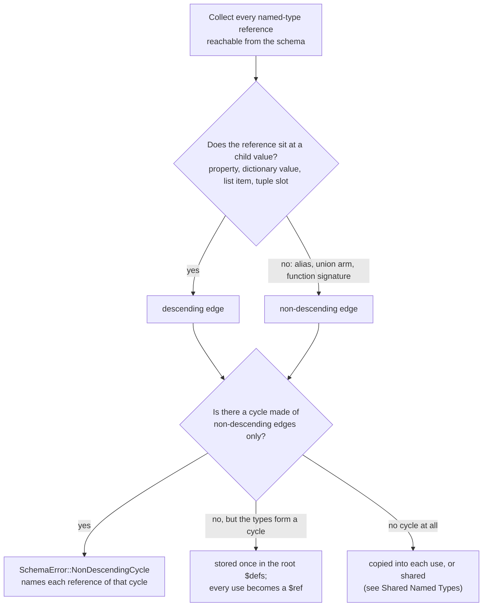

So a group holding a good cycle and a bad one reports only the bad one.
`a: [b, "{ x: a }"]` with `b: a` is rejected, and the error names the two
references `b → a` and `a[0] → b`; the descending `x: a` is not mentioned.
Change `b` to `"{ y: a }"` and the same group resolves.

The error names every reference of each rejected cycle, with the schema it is
written in and the schema of its target. `md schema validate` prints:

```text
SchemaError: non-descending type cycle
┃ b in the inline $schema refers to a from the inline $schema
┃ a in the inline $schema refers to b from the inline $schema
```

Each entry is a `CycleReference` carrying the reference site (source and
path), the target name and source, and, for a reference written in a schema
file, the byte span of the name, so a cycle between two files has a span in
each. DMLS shows the error as a schema diagnostic on the cycle's first
reference in the open document and lists the others as related locations.
When the cycle sits in a schema the document references,
`SchemaError::ReferencedSchema` wraps it, as for other named-type errors.

#### Definitions and use sites

A recursive type is stored once, as a **definition**, and each property that
uses it is a **use site**. The definition holds the value's shape: its
properties, item types, and its own bounds. Everything about the property
holding the value belongs to the use site:

- **presence:** `required`, `generated`, and `eager`;
- **nullability:** an optional property accepts a missing value or `null`,
  while a list element of the same type does not;
- **annotations:** the description and `default`;
- **extra bounds** such as `min-keys(1)` or, on a list, `min(1)`.

```yaml
$schema:
  item: "{ value: string(required), children: item[](required) }"
  root: item(required)       # must be present and not null
  optional: item             # may be missing or null
  list: item[]               # elements must be items; [null] is rejected
  wide: item(min-keys(1))    # a bound beside the shared definition
```

Markers written on the definition are inherited by every use, exactly as for
an inlined type, so `node: "{ kids: node[] }(required)"` makes every property
typed `node` required. They apply to the property, never to the shared body.
The other inherited rules hold too:

- Two uses with different constraints share one unchanged definition.
- A use-site bound that contradicts the definition's own bound is a
  `SchemaError::ConstraintConflict` naming the definition first, then the use.
- A definition that admits `null` (`link: [null, "{ next: link(required) }"]`)
  is never required at any use, whatever its markers say.
- `[]` on a definition that is already a list is an error, as for any named
  type, and `suggest(...)` at a use site of a recursive type is a
  `SchemaError::Grammar`.

A definition's identity is the schema that declares it plus its name. The
`item` in a document's inline `$schema` and the `item` in `types.yaml` are two
different definitions, and each inline arm of a root union is its own
namespace. A bare name inside a definition still resolves in its defining
file (see [Local Type References](./local-type-references.md)).

In JSON Schema, a use lowers to a `$ref` into the schema's root `$defs`, with
the use site's annotations and bounds beside it. With `node: "{ kids: node[]
}"` and `tree: node -> A tree`, the property `root: tree(required)` lowers to
`{ "$ref": "#/$defs/node", "description": "A tree" }`, `root` joins the
root's `required` list, and the `node` body appears once under `$defs`. An
optional use wraps the reference with a `null` arm. Generated `$defs` keys
follow the type name (`item`, then `item-2` for a second, different `item`),
are the same on every run, and never contain a file path.

#### Where recursive types reach

- **Validation** follows a reference at every depth, and an error deep inside
  keeps its JSON path and its line and column in the document:
  `tree/children/0/children/0/value [42] is not of type "string" (at line 10, column 18)`.
- **Phases.** Launch and Completion apply each property's own markers at
  every level below a recursive reference; one definition can serve an eager
  and a deferred property at once. See
  [Universal Constraints](#universal-constraints).
- **Conversion** continues at every depth, up to the conversion engine's
  64-level limit; see [Recursive Types](#recursive-types) under Type Coercion.
- **Merges.** Each schema keeps its own `$defs`: a root-union arm that names
  another schema file, a trigger payload, and a baseline each bring theirs to
  the merged root, and a key two of them share with different bodies is
  renamed in the schema that joins (`item` becomes `item-2`) along with that
  schema's own references, so a reference never binds to another layer's
  type. A key two of them share with an equal body is kept once. Shared
  acyclic definitions (see [Shared Named Types](#shared-named-types)) merge by
  the same rules. A raw JSON Schema baseline or trigger payload stays a simple
  object schema with no root `$ref` or root union; see
  [JSON Schema Baseline Restrictions](#json-schema-baseline-restrictions).
- **Function types** are still not allowed anywhere a document schema can
  reach: a `function(...)` property inside a recursive definition is a
  `SchemaError::Convert` at the use-site path, such as `root.f`.
- **Editors.** Completion and hover descend through a recursive type one level
  at a time, following the cursor's path, and never expand recursive branches
  the cursor is not in. A whole-type display names the back-reference
  (`kids: node[]`) instead of expanding it forever. See
  [Completing inside a union value](#completing-inside-a-union-value) for the
  library API and [DMLS Schema Support](./dmls-schema-support.md) for the
  editor.

### Shared Named Types

A structured named type that a schema uses in two or more places is stored
once in the generated JSON Schema, and each use points to it, even when the
type never refers back to itself. This keeps a schema that reuses large
objects or unions from growing with every reference. It is automatic: there is
no syntax to request or prevent it, and it never changes which values a schema
accepts, where an error is reported, or what an editor offers. Only the shape
of the JSON Schema changes, which matters if you read `md schema` output or a
resolved schema's JSON directly.

```yaml
# types.yaml
kind: schema
types:
    contact: "{ name: string(required), email: email }"
    slug: alphanumeric(allow-dashes)
```

```yaml
$schema:
    author:   contact@./types.yaml              # stored once, referenced here
    reviewer: contact(required)@./types.yaml    # ... and here
    handle:   slug(min(3))@./types.yaml         # copied: a primitive alias
    nickname: slug@./types.yaml                 # copied
```

`contact` is an object used twice, so its body appears once under the root
`$defs` and both properties refer to it. Each use keeps its own presence,
description, and added bounds beside the reference, exactly as for a
[recursive type](#definitions-and-use-sites): `reviewer` is required, while
`author` is optional and wraps its reference with a `null` arm.
`slug` is a primitive alias, so each use is copied and stays flat and readable
with its own narrowing (`minLength: 3` on `handle` only):

```json
{
  "properties": {
    "author":   { "anyOf": [{ "type": "null" }, { "$ref": "#/$defs/contact" }] },
    "reviewer": { "$ref": "#/$defs/contact" },
    "handle":   { "type": "string", "minLength": 3, "pattern": "…" },
    "nickname": { "anyOf": [{ "type": "null" }, { "type": "string", "pattern": "…" }] }
  },
  "required": ["reviewer"],
  "$defs": { "contact": { "type": "object", "properties": { … }, "required": ["name"] } }
}
```

#### Which types are shared

A named type outside any reference cycle is shared when **both** hold:

1. **Its value is structured.** Arrays and unions are judged by what they
   contain, and an alias by the type it names.

   | Shared | Never shared |
   |---|---|
   | an object, such as `"{ name: string }"` | a primitive or primitive alias: `alphanumeric(allow-dashes)`, `string(min(3))` |
   | a pattern-key dictionary (`<string>: number`) | a list of primitives: `string[]` |
   | a tuple: `tuple([string, number])` | a union of primitives only: `[string, number]`, and a list of one |
   | a list of structured items: `"{ n: string }[]"` | a `function(...)` signature |
   | a union with at least one structured arm: `["{ n: string }", number]` | |

2. **Two or more distinct authored references reach it** (see
   [Counting uses](#counting-uses)).

Some structured types are still never shared, because what they mean depends
on the place that uses them and a reference beside an unchanged body could not
carry it:

- a type whose top level admits `null`, such as `[null, "{ n: string }"]`, or
  carries `operands(...)` or `deferred`;
- a union whose arms carry `required`, `generated`, `default(...)`, or
  `suggest(...)`, admit `null`, include a `file` arm (a list of files is
  fine), or refer to a recursive type.

A `file(match(...))` in the body does not stop sharing. Its glob keeps
suggesting at every use, also in a [root union](#files) arm, where only a
recursive type's globs are enforced.

[Global catalog](#the-built-in-baseline) declarations, the built-in baseline
`fm` among them, follow the same rules: a type a declaration uses at two or
more sites is stored once in that declaration's definition table. The
lifecycle stacks `composed`, `failed`, `cancelled`, and `finalize` of the
built-in baseline all use `md-stack`, so it is stored once and referenced four
times.

#### Counting uses

A use is one reference written in a schema file or inline `$schema`,
identified by where it is written and the type it names:

- **Two places that write the reference count twice**, whether both are
  properties (`author` and `reviewer` above), two references inside one type's
  body, or two aliases of the type.
- **A reference inside another type counts once**, however often that type is
  used. With `team: "{ lead: contact }"` used by three properties, `contact`
  has one use from `team`'s body; `team` itself has three.
- **Unused declarations and callable signatures count for nothing.** A library
  type no reference reaches, and a type named only inside a `function(...)`
  signature, add no uses.
- **A type is its file plus its name.** `entry@./a.yaml` and `entry@./b.yaml`
  are two different types with one use each, so neither is shared. Two
  spellings of one file (`entry@./a.yaml` and `entry@a.yaml`) name the same
  type, so it has two uses and is shared. Each inline arm of a root union is
  its own namespace.
- **Counts belong to one resolution.** The baseline, each trigger payload, and
  the document's `$schema` are resolved separately and never pool their uses.
  Two triggers that each import `contact` once do not share it, even when both
  apply to the same document.

#### When one use is copied instead

Being shared is decided once per type. Each use then keeps the reference only
when the reference plus the use's own additions behaves exactly as a copy
would; otherwise that one use is copied, and the other uses stay references.
The schema stays exactly as valid or as invalid as before: a contradictory
constraint is still a `SchemaError::ConstraintConflict`, never turned into a
copy to make it pass.

A use keeps its reference when it adds only presence and annotation markers
(`required`, `generated`, `eager`, `default(...)`, `example(...)`, a
description) and, on an object, `min-keys`/`max-keys`, or on a list,
`min`/`max`/`unique`. A use is copied when it:

- adds `suggest(...)` or any other value constraint;
- adds `uncounted-keys(...)` that changes how the body's own key bounds count;
- is an arm of a union and either carries a postfix or names a union, a list,
  or a type with presence markers. Copying keeps the enclosing union's
  alternatives one flat list, with markers hoisted as usual (see
  [Named Union References](#named-union-references));
- names an alias of a shared type with a postfix the reference cannot carry.
  The whole alias chain down to the body is copied.

Key exclusion shows why a reference cannot always stand in for a copy. In a
type library:

```yaml
# types.yaml
kind: schema
types:
    entry: "{ value: string, note: string }(max-keys(1))"
```

```yaml
$schema:
    ordinary:  entry@./types.yaml
    annotated: entry(uncounted-keys(note))@./types.yaml
```

| Value | `ordinary` | `annotated` |
|---|---|---|
| `{ value: v }` | valid | valid |
| `{ value: v, note: n }` | invalid: two keys, above `max-keys(1)` | valid: `note` is not counted |

Copied, `annotated` merges its `uncounted-keys(note)` with the inherited
`max-keys(1)` into one count. A reference cannot: the stored body keeps
counting `note`, and a sibling constraint cannot loosen a bound inside the
definition. So `annotated` is copied and `ordinary` stays a reference. Had the
body already declared `uncounted-keys(note)`, the same use would keep its
reference.

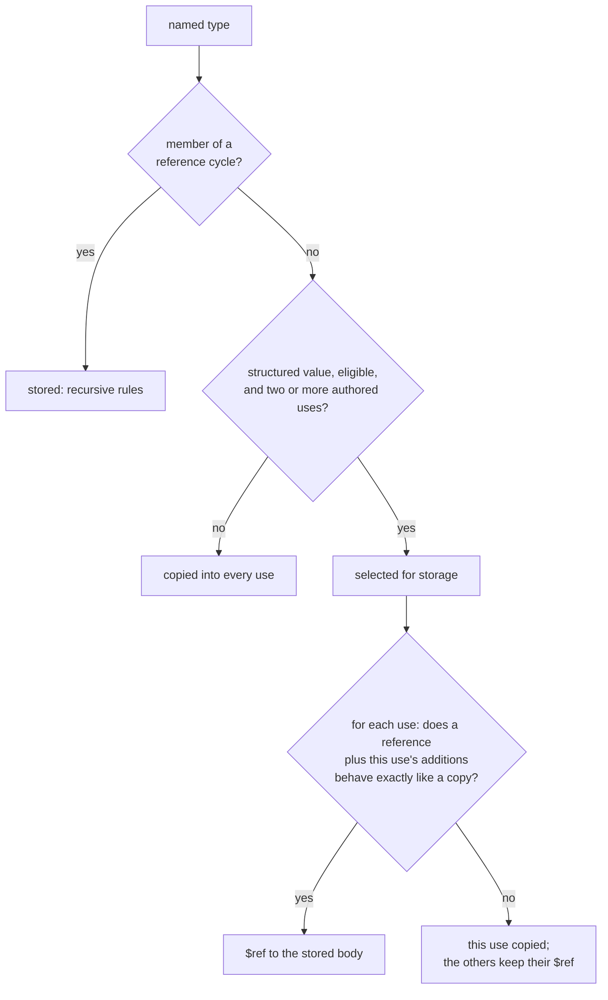

#### What the output looks like

- Shared bodies sit in the root `$defs` beside recursive ones. Keys follow the
  type name (`contact`, then `contact-2` for a different `contact`), are the
  same on every run, and never contain a file path.
- A body is emitted only if some surviving reference reaches it. When every
  use of a selected type is copied, the schema has no `$defs` entry for it.
- Validation, phases, conversion, and editors follow a shared reference as
  they follow a recursive one (see
  [Where recursive types reach](#where-recursive-types-reach)), so problem
  codes, document paths, and line and column positions are those of the copy.
  Only internal JSON Schema keyword paths can move into `$defs`.
- Merged layers keep their own `$defs`: an equal body under the same key is
  kept once, and a different body is renamed with the references that layer
  wrote. Two layers that each store the same imported type therefore end up
  with one body.
- The 32-level import-chain limit applies exactly as for copied types, so
  sharing never makes a rejected chain valid.

### Pattern / Dictionary Keys

Inside an inline object (or a YAML-block schema object), keys may follow a **pattern** instead of a fixed literal set. This types dictionaries — objects whose keys are data, not a known vocabulary.

```yaml
$schema:
    headers: "{ <string>: string }"                 # any string key → string value
    parameter:
        "<string>": unknown                         # any string key → any value
```

Key forms:

| Form                    | Meaning                                              | JSON Schema                          |
|-------------------------|------------------------------------------------------|--------------------------------------|
| `<string>`              | Any string key (catch-all).                          | `additionalProperties: <valueType>`  |
| `<starting::PREFIX>`    | Keys beginning with the **literal** string `PREFIX`. | `patternProperties` (`^PREFIX`)      |
| `<ending::SUFFIX>`      | Keys ending with the **literal** string `SUFFIX`.    | `patternProperties` (`SUFFIX$`)      |
| `<pattern::RE>`         | A raw ECMA-262 regex escape hatch.                   | `patternProperties` (`RE`)           |

Rules:

- **Literal keys win** over pattern keys. Because JSON Schema's `patternProperties` also applies to declared `properties`, the converter subtracts literal names from each emitted non-catch-all pattern with a negative lookahead. For example `<starting::x->` alongside literal key `x-kind` emits a pattern equivalent to `^(?!(?:x-kind)$)x-`. If wrapping would make a user-supplied `<pattern::RE>` invalid, conversion fails loudly rather than silently double-validating.
- Multiple pattern keys are allowed (multiple `patternProperties`).
- A pattern-keyed object is **closed** by default (`additionalProperties: false`) unless a `<string>` catch-all is present, in which case the catch-all lowers to `additionalProperties: <valueType>`.
- A pattern-keyed object whose value type is a `@`-import sidesteps the one-level inline-object nesting cap — cross-file named types are the depth escape hatch.

Schemas that emit a lookaround-bearing pattern are validated with `jsonschema`'s `fancy-regex` engine **per schema**; every other schema keeps the ReDoS-safe linear engine.

### Object Arity Constraints (`min-keys` / `max-keys`)

Pattern-keyed objects match `0..N` keys; some shapes need a bounded count. `min-keys(n)` / `max-keys(n)` are the object analog of the array `min` / `max`, lowering to JSON Schema `minProperties` / `maxProperties`. They apply only to object atoms — using them on a non-object type or an array-level constraint position is a schema error.

They can be authored as **postfix constraints** or via the reserved **`$constraints`** block key — one canonical model, two surfaces:

```yaml
$schema:
    # Postfix form — exactly one key/value pair
    parameter: "{ <string>: unknown }(min-keys(1); max-keys(1))"

    # $constraints block form — identical desugaring
    parameter:
        "<string>": unknown
        $constraints:
            min-keys: 1
            max-keys: 1
```

`$constraints` (dollar-prefixed, mirroring `$schema`) is **reserved only inside authored schema objects**: it is stripped before shape assembly and never participates in literal/pattern key matching. Flag constraints are written `name: true`. This does **not** reserve `$constraints` in user frontmatter data — only the schema-authoring language uses the sentinel.

The block and the postfix are one scope. Key bounds from a `$constraints` block, from the object's postfix, and from a use site that reuses the object as a named type merge under the [merge rules](#merging-use-site-constraints): the stricter bound wins, and a minimum above the maximum is an error whichever spelling declared it.

#### Keys the count leaves out (`uncounted-keys`)

`uncounted-keys(a, b)` names keys that `min-keys` and `max-keys` do not count.
Use it when an object holds exactly one entry of one kind with optional
companion keys beside it. A lifecycle action, for example, is one verb, with
`when` and `no_error` allowed beside it:

```yaml
$schema:
    action:
        info: string
        stop: null
        when: string
        no_error: boolean
        $constraints:
            min-keys: 1
            max-keys: 1
            uncounted-keys: [when, no_error]
```

| `action` value | Valid? | Why |
|---|---|---|
| `{ info: hi }` | yes | one counted key |
| `{ info: hi, when: x, no_error: true }` | yes | `when` and `no_error` are not counted |
| `{ when: x }` | no | no counted key: below `min-keys(1)` |
| `{ info: hi, stop: null, when: x }` | no | two counted keys: above `max-keys(1)` |

The postfix spelling is `{ … }(min-keys(1); max-keys(1); uncounted-keys(when, no_error))`.
It needs `min-keys` or `max-keys` on the same object and names one to eight
distinct keys. JSON Schema counts every key, so it lowers to an `allOf` with one
`if`/`then` condition for each combination of the named keys present, each
raising both bounds by the number present, plus an `x-darkmatter-uncounted-keys`
annotation (`{ keys, min, max }`) from which Darkmatter's conversion engine
reads the same count directly.

What else a block may hold depends on where it sits:

| Block on | Accepted keys | Anything else |
|---|---|---|
| an object-typed property | `min-keys`, `max-keys`, `uncounted-keys`, `required`, `generated` | schema error ("`$constraints` key `…` is not valid on an inline object") |
| the root schema, or one arm of a root union | `min-keys`, `max-keys`, `uncounted-keys` | schema error ("… is not valid on the root object") |

On a property's object, `required: true` and `generated: true` mean exactly the same as the postfix spelling: they apply to the property, so this `author` is required:

```yaml
$schema:
    author:
        name: string
        $constraints:
            required: true
```

### Content-Format Types (`yaml` / `json`)

`yaml` and `json` type a **string whose content must parse** as a structured document. They join the string-with-format family (`date`, `datetime`, `time`, `email`, `url`, `file`) — the same custom-format seam, not a new mechanism.

```yaml
$schema:
    invocation:
        - string(required)
        - { frontmatter: yaml }   # a frontmatter block expressed as a YAML string
    config: json                  # a string of strict JSON
```

- They compile to `{ "type": "string", "format": "darkmatter-yaml" }` / `"darkmatter-json"`, with validators that parse the value through biscuit-file's YAML / strict-JSON facilities. A parse failure is a validation error.
- **String or native.** The value may be a YAML/JSON **string** *or* a **native** mapping, sequence, number, or boolean, so `frontmatter: yaml` accepts both `"title: Foo"` and a native `{ title: Foo }`. How a native value becomes text, and why text is kept as written, is part of [Type Coercion](#conversion-rules).
- **`json` is strict; `yaml` is a superset.** JSON is valid YAML, so `yaml` accepts JSON; `json` rejects YAML-only syntax.
- Validation-only APIs stay **non-mutating** — they validate against a transient converted copy and leave the caller's frontmatter untouched. Only the composing/write-back path exposes the serialized value.
- Embedded sub-schema constraints (`yaml(schema(<ref>))`) are deferred to a future extension.

## Unions

### Property-Level Unions

Any property value may be a YAML sequence of type expressions to declare an `anyOf` union. The property matches if at least one arm does.

```yaml
$schema:
    foo:
      - string
      - number

    status:
      - "enum(draft, published, archived)"
      - "number(integer; min(0))"
      - unknown

    # accepts a positive number or a CSS-length string
    width:
      - "number(min(0))"
      - "string(pattern(^\\d+(px|%)$))"
```

**Hoisting.** `required`, `eager`, and `default(...)` are property-level — they
are extracted from whichever arm declares them and applied to the property as a
whole. `required` on any arm makes the property required, unless another arm
is `null` or `unknown` (see [Null-Admitting Properties](#null-admitting-properties));
`eager` on any arm makes a supplied value launch-validated without requiring it. Convention is to
place them on the first arm. Differing
`default(...)` values on multiple arms is a compile-time error.

```yaml
$schema:
    title:
      - "string(required; not-empty)"  # required hoisted; not-empty stays on this arm
      - "number"
```

Arm-level constraints stay arm-local. Arm descriptions (`-> ...`) annotate that arm in the generated JSON Schema.

A property-level union may mix a `literal` arm with any other atom — something `enum` cannot do, because `enum` members are homogeneous strings:

```yaml
$schema:
    width: [literal(auto), "number(min(1))"]   # the keyword `auto` or a positive number
```

### The `|` Operator and Grouping

`|` writes a union inside one type expression, which is how a union appears
where a YAML list cannot: a tuple position, a function parameter or return
type, or an inline object property. `id: "string | number"` is exactly the
same definition as `id: [string, number]` and compiles to the same `anyOf`.

`[]` binds tighter than `|`, and parentheses group, as in TypeScript:

```yaml
$schema:
    one:  "string | number[]"     # a string, or a list of numbers
    many: "(string | number)[]"   # a list whose items are strings or numbers
```

`(string | number)[]` is the same list as `t[]` for a named type
`t: [string, number]`, and compiles to one array whose `items` is the
`anyOf`. A trailing `-> description` describes the last option; to describe
each option, use the YAML list form. An option of a YAML list union is one
type, so `[string | number, boolean]` is an error: list each option instead.
A file reference in `Name@file` ends at `|`, so a path cannot contain `|`.

## Function Signatures

A `function(...)` type describes a callable: what it takes, what it returns,
and how it is documented. It is **description-only**. It never validates
data and produces no JSON Schema. It belongs in a schema file's `types:`
mapping, and may be nested in another function's parameter or return type
or in a tuple position. A document schema that reaches a function, directly
or through a named reference, union, list, tuple, or object property, fails
to load with an error naming the property path.

```yaml
kind: schema
types:
    min: |-
        function(
            parameters(a: number, b: number);
            returns(number);
            category(Math);
            example(min(3, 5) => 3);
            example(min("pear", 5) => error);
        ) -> Returns the smaller of two numbers.
```

`parameters(...)` and `returns(...)` are required; the rest are optional.
Constraints are separated by `;`, and a trailing `;` before `)` is allowed.

| Constraint | Meaning |
|---|---|
| `parameters(name: T, ...)` | The arguments, in order. `parameters(void)` for none. |
| `returns(T)` | The value returned on success; any type, including a union. |
| `category(Name)` | The documentation category (see [Categories](#categories)). |
| `narrows(name: T; kind)` / `narrows(name; kind)` | What a guard call proves about one argument (see [Narrowing facts](#narrowing-facts)). Optional; at most one. |
| `fallible` | The function can fail even when its arguments are valid. A function whose only failure is a wrong argument is not fallible: such a call never reaches it (see [Type Coercion](#function-calls-bind-then-compute)). |
| `example(call => result)` | An inline example; repeatable (see below). |
| `example(./file.yaml)` | An example file, as on any type. |

**Parameters.** `name: T` is required, `name?: T` may be omitted, and
`...name: T` collects zero or more remaining arguments, each of type `T`.
Required parameters come first, then optional ones, then at most one rest
parameter, which cannot carry `?`. Names must be unique; they are
documentation and never change which calls bind. `void` stands alone, and
`parameters()` is an error. Omission is not null: `age?: number` may be left
out but rejects `null`, while `age?: number | null` allows both.

**Inline examples.** `example(CALL => RESULT)` shows a call and its expected
result. `CALL` is a Darkmatter function-call expression. `RESULT` is a
literal (`3`, `"3"`, `[1, 2]`, `{a: 1}`, `null`, `true`) or the word `error`.
An inline example is executable: tests run the call and compare the result
structurally, so `3` is not `"3"` and the key order of an object does not
matter. Add `; display-only: REASON` for an example that cannot run reliably
in a test, such as one that needs the network or the clock; it is shown in
documentation and never run. A result that spans several lines uses the file
form instead, whose file holds the call as `invocation` and the result as
`returns`:

```yaml
types:
    ping: |-
        function(
            parameters(address: string, timeout?: number);
            returns(boolean | null);
            category(Network);
            fallible;
            example(ping("192.168.1.1", 250) => true; display-only: needs network);
        ) -> Sends one ICMP echo to an IP address.
    as_line_separated: |-
        function(
            parameters(list: any[] | null);
            returns(string | null);
            category(List Formatting);
            example(./function-examples/as_line_separated.yaml);
        ) -> Joins a list into newline-separated text.
```

```yaml
# function-examples/as_line_separated.yaml
kind: example
invocation: 'as_line_separated(["a", "b", "c"])'
returns: |-
    a
    b
    c
```

### Narrowing facts

A predicate used as a guard (`when="file_exists(log)"`, `a ? b : c`) can tell
the analyzer what its result proves about an argument. The `narrows` clause
declares that fact in the signature, so the catalog is the one place it is
written:

```yaml
types:
    file_exists: |-
        function(
            parameters(path: unknown | null);
            returns(boolean);
            narrows(path: file; true-implies);
            category(Filesystem);
        ) -> Returns true when the file exists.
    is_empty: |-
        function(
            parameters(x: unknown | null);
            returns(boolean);
            narrows(x; false-implies);
        ) -> Returns true for null, empty text, and empty collections.
```

| Form | True result | False result |
|---|---|---|
| `narrows(x: T; true-implies)` | `x` is suitable for `T` | nothing |
| `narrows(x: T; true-iff)` | `x` has type `T` | `T` is removed from `x` |
| `narrows(x: T; false-implies)` | nothing | `x` is suitable for `T` |

Omitting the type gives a presence-only fact: `true-implies` excludes `null`
when the result is true, `false-implies` when it is false, and `true-iff` on
the true side while keeping only `null` on the false side.

A call proves its fact only when the design-time call check accepts it; a
call with the wrong argument count, or with an argument no value of its type
can bind, proves neither side (see
[Darkmatter Expressions](../darkmatter-expressions.md#where-a-predicates-facts-come-from)).

Rules:

- **Ordering.** The clause may appear anywhere among the clauses, separated
  by `;` like the others. It names one parameter exactly as declared; the
  `: T` operand is optional, and omitting it means "present" (not `null`),
  never "nonempty" or "truthy".
- **Boolean returns.** The function must return `boolean`; the clause on any
  other return type is an error.
- **Targets.** `T` is a single self-contained type: a union and a named
  reference are rejected, and so is a named type anywhere inside `T` (in an
  object member, a dictionary value, a tuple position, a union arm, or a
  grouped array such as `(Name | string)[]`), because a fact is applied
  without the definitions of the schema that declared it. `{a: string}` and
  `tuple([string])` are valid one-way targets; `{a: Name}` and
  `tuple([Name])` are not. `true-iff` is limited to `null` and the bare
  families (`string`, `number`, `boolean`, `object`, `unknown[]`), because
  only those have a false side that can be described. A refinement or a
  constrained type (`file`, `string(min(3))`, `enum(a, b)`) is a one-way
  target only. An array of a grouped union, `(string | number)[]`, is one
  array type and a valid one-way target. The parameter cannot be a rest
  parameter or one the function does not declare.
- **Overloads.** Every overload must declare the same fact, or none may:
  the same parameter at the same position, the same implication, and the
  same target (compared by meaning, not spelling). A disagreement is an
  error naming both overloads, with both locations: different facts are
  reported at the later overload's clause, and a missing fact at the
  declaring clause, each with the other overload as a related location (see
  [DMLS schema support](./dmls-schema-support.md#definitions-with-two-locations)).
  A second `narrows` clause on one function is reported at its keyword, with
  the first clause as the related location.
- **One set of rules.** Every reader applies these rules the same way:
  parsing a schema, the `type-definition` and `schema` meta-types, editor
  diagnostics, host catalog loading, and function registration. A
  declaration a schema accepts is one a host can register.
- **Original argument.** The fact is about the value as the caller wrote it,
  not a coerced copy: `is_number("4")` is `false` even though `"4"` would
  convert. Negative narrowing is limited to what can be described: removing
  `string` from a `string | number` leaves `number`, but a false
  `true-implies` never removes anything.
- **Description-only.** The clause validates no data, changes no binding,
  runs no handler, and is read without calling the function. A document
  schema that reaches a `function(...)` with a `narrows` clause fails to load
  like any other function.

**Overloads.** A function with several signatures is a union of `function(...)`
types, written as a YAML list or with `|`. Two overloads whose parameters bind
exactly the same calls are a schema-load error. Parameter names, descriptions,
examples, categories, `fallible`, return types, `any` versus `unknown`, and
the order of union options do not make two signatures different; a local
named type is compared by its definition:

```yaml
kind: schema
types:
    pr_list:
        - "function(parameters(count: number(integer; min(1))); returns(string[]))"
        - "function(parameters(query: object); returns(string[]))"
        # error if added: binds the same calls as the first overload
        # - "function(parameters(n: number(min(1); integer)); returns(object))"
```

### Named Union References

A union written once as a [named type](#cross-file-named-type-imports-namefile)
can be reused, marked required, described, or turned into a list at each place
that references it. This is how you declare a list whose items may each take a
different shape, such as "a non-empty list whose entries are each a rule
string or a rule mapping".

```yaml
# types.yaml
kind: schema
types:
    step:
      - "string -> A shell command"
      - "{ run: string(required), cwd: string }"
```

```yaml
$schema:
    setup: step@./types.yaml                              # the union, optional
    main:  "step(required)@./types.yaml -> The main step" # the union, required
    steps: "step[](min(1); unique)@./types.yaml"          # a non-empty list of distinct steps
```

The bare (`step[]`), `@this` (`step[]@this`), and cross-file
(`step[]@./types.yaml`) forms of a reference behave identically.

#### What a reference may add

| Use site | Meaning |
|---|---|
| `U` | The union, inlined: its arms become the property's arms. |
| `U(required)`, `U(generated)`, `U(eager)`, or a combination | The union, with the marker applied to the property as a whole, exactly as on a [property-level union](#property-level-unions). `eager` does not imply `required`. |
| `U -> text` | The union, described as a whole. Each arm keeps its own description. |
| `U[]` | A list whose every item is one of `U`'s arms. Each item is judged on its own and may match a different arm. |
| `U[](min(n); max(n); unique; required; generated; eager)` | That list, with the constraints applied to the list itself. `default(...)` and `example(...)` are accepted after `[]` as on [any other array](#array-constraints). |
| `U(required)[]`, `U(generated)[]`, `U(eager)[]`, or with a list after `[]` too | Exactly the same list as the marker written after `[]`: `step(eager)[]` and `step[](eager)` are one schema. The markers belong to the property, so their side of `[]` does not matter. |

Anything else is rejected with `SchemaError::UnionReference`, rather than being
copied into every arm. The error names the property, the union, what was
rejected (a `SchemaUnionRejection`), and where the union is defined; DMLS
reports the same error at the reference.

| Rejected use site | Why | `SchemaUnionRejection` |
|---|---|---|
| `U(max(10))`, `U(pattern(^a))`, `U(unique)`, `U(default(x))`, `U(max(2))[]` | A value constraint without `[]`, or before it, would have to apply to every arm. Put it on the arms instead. | `Constraint { keyword, array_level: false }` |
| `U[](pattern(^a))`, `U[](integer)` | After `[]`, only list constraints apply. | `Constraint { keyword, array_level: true }` |
| `U[]` where an arm is already a list, such as `[string[], number]` | Checked after imported and nested union arms are expanded, so an array arm behind an import is caught too. | `ArrayArm { arm }` |
| `U[]` where an arm carries a scalar `default(...)` | A scalar default cannot become the list's default; see [Defaults](#defaults-on-named-union-references). | `ScalarDefault { arm, value }` |

```text
p: constraint `max` cannot apply to a union-typed type (named type `choice`)
```

A named type that is itself a postfixed union reference is still a union, so
references to it take exactly these postfixes and rejections. It keeps its own
markers and description; with `[]`, its markers apply to the list:

```yaml
# types.yaml
kind: schema
types:
    step: [string, number]
    required_step: step(required)   # still union-typed
```

```yaml
$schema:
    steps: "required_step[](min(1))@./types.yaml"  # a required, non-empty list
    bad:   "required_step(max(2))@./types.yaml"    # rejected: Constraint { keyword: "max", .. }
```

A list *inside* an object arm is fine: `[string, "{ tags: string[] }"]` may be
referenced as `U[]`, because no arm's outer value is a list.

For an unnamed union, group the alternatives before adding `[]`:
`(string | number)[](min(1))`. It uses the same array-of-union representation
as a named `U[]`; see [The `|` Operator and Grouping](#the--operator-and-grouping).
The reference-specific restrictions above describe modifiers on a named type.

#### Item versus container scope

An arm's constraints describe one item; constraints after `[]` describe the
list. They never merge, even when they share a keyword:

```yaml
# types.yaml
kind: schema
types:
    choice: ["string(required; min(3))", number]
```

```yaml
$schema:
    list: "choice[](max(2))@./types.yaml"
```

- `min(3)` stays on the string arm: each string item needs at least three
  characters. It does not become the list's minimum item count.
- `max(2)` follows `[]`, so the list holds at most two items.
- `required` on the arm is a presence marker, so it hoists to `list`, which is
  required.

#### Presence and timing

- `required` and `generated` declared on any arm hoist to the property that
  holds the reference, whether that property is the union (`U`, `U(eager)`) or
  a list of it (`U[]`), just as they do for a property-level union. Markers
  written at the use site add to them. A union with a `null` or `unknown` arm
  is the exception: `U` and `U(required)` stay optional (see
  [Null-Admitting Properties](#null-admitting-properties)), while `U[]` is a
  list and keeps its markers.
- `generated` keeps its [usual meaning](#universal-constraints): it adds the
  `x-darkmatter-generated` annotation and removes the property from the static
  `required` list. It supplies no value.
- `eager` written at the use site (`U(eager)`, `U(eager)[]`, or `U[](eager)`)
  is property timing: a supplied value is validated at launch. An arm's
  `eager` also times the property that holds the reference, whether that is
  the union or a list of it, as on a property-level union. With
  `choice: ["string(required; eager)", number]`, both `p: choice` and
  `p: choice[]` must be supplied at launch.
- Neither `eager` on the reference nor an eager sibling arm turns a lazy
  `file` arm into `file(eager)`.
  An arm already declared `file(eager)` keeps its existence check either way.
- Fields of an object arm keep their own `required`, `generated`, and `eager`.

#### Defaults on named union references

- Without `[]`, an arm's `default(...)` hoists to the property as on any
  property-level union.
- With `[]`, an arm's default could only become the list's default. A scalar
  default cannot, so the declaration fails with `ScalarDefault`, naming the
  arm and the value. The default is neither dropped nor wrapped in a one-item
  list. Because the grammar reads every `default(...)` argument as a scalar
  (see [Array Constraints](#array-constraints)), any arm default fails this
  way.
- A `default(...)` written after `[]` at the use site lowers exactly as on any
  other array.
- A caller constructing schema definitions through the Rust API can supply
  an actual JSON array as an arm's default. That array becomes the containing
  list's default. Multiple inherited and use-site defaults must be equal;
  conflicting defaults fail schema preparation. This does not add a
  list-valued default spelling to the authoring grammar.
- Darkmatter never inserts a default value into a document.

#### Lowering

A list of a union lowers to an array whose `items` is the union's `anyOf`.
Nested unions flatten into one `anyOf`, and arm order and arm descriptions are
kept. Items get no automatic `null` wrapper: an item accepts `null` only when
an authored arm admits it, such as `null` or `unknown`. An optional property
wraps the whole array in the usual `anyOf: [{ type: null }, …]`, so a missing or `null` property is
allowed independently of whether an item arm admits `null`. A use-site description sits on that
wrapper. The `content_policy` property of the
[example below](#example-a-content-policy-list) lowers to:

```json
{
  "anyOf": [
    { "type": "null" },
    {
      "type": "array",
      "minItems": 1,
      "items": { "anyOf": [ { "type": "string", "pattern": "^Evergreen$" },
                            …,
                            { "type": "object", "properties": { "rule": { "anyOf": [ … ] }, "action": { … } },
                              "required": ["rule", "action"], "additionalProperties": false } ] }
    }
  ]
}
```

When `U` does not itself admit null, `U(required)` lowers to the union's
`anyOf` without an optional-property wrapper and puts the property in the
parent's `required` list. Null-admitting unions follow the
[presence exception](#null-admitting-properties) above. A nested arm that
carries its own postfix flattens exactly like a bare one, so coercion, literal-discriminant
selection, and error reporting see one list of alternatives:

- its `required`, `generated`, and `eager` markers belong to the containing
  property, as an arm's own presence markers do. `[pair(required), boolean]`
  makes the property required, and a reference `choice[]` to that union makes
  the list required.
  `eager` sets the property's timing only: a `file` arm of `pair` stays lazy
  unless `pair` itself says `file(eager)`;
- its `-> description` describes each of its arms that has no description of
  its own.

```yaml
pair: [string, number]
choice: ["pair(required) -> a label", boolean]
# choice lowers to one anyOf, with no null arm:
#   [{type: string, description: a label}, {type: number, description: a label}, {type: boolean}]
```

In the typed model, a bare `U` stays a `PropertyDef::Union`. A postfixed
reference becomes one `PropertyAtom` whose `ty` is `TypeExpr::Union(arms)`,
with `is_array` set for `U[]`. Use `schemas::flattened_alternatives` to list
the leaf alternatives of either form.

#### Example: a content policy list

A content-policy style schema whose policies may be short strings or
`{ rule, action }` mappings. The [built-in baseline](#the-built-in-baseline)
types `content_policy` this way, importing Content Policy's shipped schema:

```yaml
# content-policy.yaml
kind: schema
types:
    short_form:
      - string(pattern(^Evergreen$))
      - string(pattern(^TimeSensitive$))
      # … one pattern arm each for ValidFor(…), ValidUntil(…), and FileChanged(…)
    long_form:
        rule: short_form(required)
        action: enum(refresh, archive, remove; required)
    policy: [short_form, long_form]
```

```yaml
$schema:
    content_policy: "policy[](min(1))@./content-policy.yaml"
```

| `content_policy` value | Result | Why |
|---|---|---|
| `[ValidFor(3mo), {rule: ValidUntil(2027-01-01), action: archive}]` | valid | Each item matches an arm; items may match different arms. |
| missing, or `null` | valid | The property is optional. |
| `[null]` | invalid | Items have no `null` arm. |
| `ValidFor(3mo)` | invalid | A single string is not a list. |
| `[]` | invalid | `min(1)` |
| `[Duration(3mo)]` | invalid | No arm matches. |
| `[{action: archive}]` or `[{rule: null, action: archive}]` | invalid | `rule` is required in `long_form`. |
| `[{rule: ValidFor(3mo), action: delete}]` | invalid | `delete` is not an `action` member. |

### Discriminated Unions

When the arms of a union are inline objects that each carry a `literal`-typed **discriminant** key, the union becomes a genuine tagged union. Both `md schema validate` diagnostics and DMLS editor behavior narrow to the single matched arm.

```yaml
$schema:
    event:
      - "{ kind: literal(created), path: file(required) }"
      - "{ kind: literal(deleted), reason: string }"
```

Given a document with `kind: created`, validation reports only the `created` arm's missing/unknown/type problems instead of the full `anyOf` noise, and DMLS sibling-key completion offers only that arm's keys.

Validation narrows the same way wherever the union sits: a property, each item of an array of a union (`events: event[]`, where every item selects its own arm), or a field nested inside an object. Narrowing changes only which problems are reported. A value that another arm accepts is still valid, and a union location with no problems is never narrowed.

A problem's description is looked up through union arms as well. For `/events/1/path`, the lookup descends into the `items` alternatives, takes the arm the item's tag selects (or, without one, every arm that declares `path`), and reads that field's description. When several arms declare the field with different descriptions and no tag picks one, the problem carries no description rather than a guessed one.

An arm is selected **only when** all of the following hold:

- the same discriminant key is present as a `literal` in **at least two** arms,
- the instance contains that key with an authored value, and
- exactly **one** arm's typed literal equals the instance value.

Equality is **type-sensitive**: a typed `2` does not select an arm tagged `'2'`. If multiple discriminant keys qualify, they must all select the same arm. For an absent, unknown, duplicate, or conflicting discriminant, validation and completion fall back to the normal merged/union behavior — narrowing never guesses an arm from a partial or ambiguous match. Schemas without literal discriminants keep byte-identical `anyOf` diagnostics.

### Choosing an Arm: Reporting versus Changing Data

Several parts of Darkmatter ask "which arm does this value belong to?" at a
union location: a property union, an item of a `U[]` list, or a field nested
inside either. How much evidence each needs depends on what it does with the
answer. Explaining a problem may lean on a heuristic such as the closest arm;
changing stored data may not.

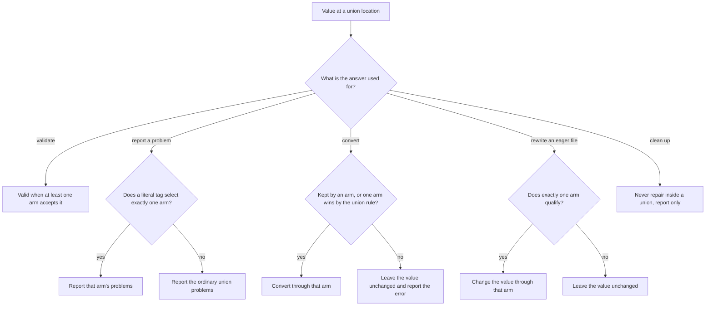

| Consumer | Picks an arm when | Otherwise |
|---|---|---|
| Validation | It never needs to: the value is valid when any arm accepts it. | — |
| Problem reporting | A literal tag selects one arm ([Discriminated Unions](#discriminated-unions)). A root union also reports its closest arm. | The ordinary union report. |
| Conversion (validation and compose) | An arm accepts the value as written; otherwise exactly one arm is reachable, or the number-over-boolean or JSON-over-YAML tie-breaker settles it ([Choosing a Union Option](#choosing-a-union-option)). Arm order never matters. | The value is left as written; a tie no tie-breaker settles is an error naming each reading. |
| Eager-`file` rewriting (compose) | Exactly one arm that contains an eager `file`, as the value itself or as a field of an object arm, accepts the value ([Files](#files)). | The value is left unchanged. |
| Cleanup (`md clean`) | Never inside a union, even when a tag would identify the arm. | Problems are reported and the value is left unchanged; no key is deleted. Values outside the union keep cleanup's usual repair rules. |
| Editor completion and hover | Completion: a literal tag selects one arm. Hover: exactly one arm accepts the value. | Every applicable alternative is offered or listed. |

The same rules apply to every item of a `U[]` list, judged on its own, so
neighboring items can select different arms. Closest-arm scoring only ever
explains a failure: it never decides which arm converts, rewrites, or cleans
a value.

### Root-Level Unions

The root `$schema` may itself be a YAML sequence. Each arm is a complete object schema and the document is valid if it matches at least one arm. Arms may be inline SimplifiedSchema mappings or string file references.

```yaml
---
$schema:
  - ./schemas/post.yaml     # arm 0: file reference (SimplifiedSchema)
  - ./schemas/page.yaml     # arm 1: file reference (JSON Schema is fine too)
  - title: string           # arm 2: inline SimplifiedSchema
    body:  string
---
```

The effective schema is `{ "anyOf": [arm0, arm1, ...] }`. **Baseline merging is applied to each arm independently** — a baseline declares the fields every arm inherits.

**Root unions are inclusive.** A document is valid when it matches **one or
more** arms. A root mapping is open, so a property an arm does not declare is
unconstrained in that arm. This schema accepts a `schema` file, a `review`
file, or both, and rejects a document with neither:

```yaml
$schema:
  - schema: file(required)
  - review: file(required)
```

To accept **exactly one**, exclude the other key in each arm with the
[`null` type](#unknown-and-null). The excluded key may be omitted or `null`,
so this schema rejects both files and neither:

```yaml
$schema:
  - schema: file(required)
    review: null
  - review: file(required)
    schema: null
```

Pattern-key dictionaries and explicit raw JSON Schema restrictions inside an
arm still apply.

When validation fails against a root union, Darkmatter reports the **closest-matching arm** — the one producing the fewest problems — and prefixes problems with the arm index. JSON output carries an `arm_index` field on every problem.

## Schema Resolution

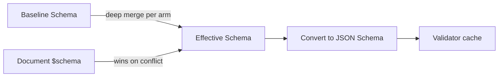

The resolution rules:

1. **Inline mapping** at `$schema` — parsed directly as SimplifiedSchema.
2. **String reference** at `$schema` — resolved via `FileReference`, then disambiguated:
   - Parse as YAML.
   - Treat YAML as SimplifiedSchema only when it uses one of the two
     [standalone envelopes](#standalone-schema-documents): `$schema` as the
     sole root key, or `kind: schema` with a `types` mapping.
   - Otherwise treat it as raw JSON Schema, including a document with a
     `$schema` string URI such as
     `https://json-schema.org/draft/2020-12/schema`.
   - `.json` files are always treated as JSON Schema.
3. **YAML sequence** at `$schema` — root union; each arm is resolved by the same rules above.
4. **No `$schema`** — the baseline alone applies; `md schema validate` and `md compose` use the [built-in baseline](#the-built-in-baseline) unless told otherwise. With no baseline either, validation succeeds vacuously and `pretty` mode prints a note saying so (suppressed by `--quiet`).

Path references in `$schema` resolve like implicit file references: a bare path is
tried **from the document's directory first, then the repository root**, while an explicit
`./`/`../` reference resolves from the document's directory only. A bare **name**
(`$schema: claudine.yaml`, no path separator) instead resolves to the first of the
five [schema roots](#schema-roots) that holds that file; write `./claudine.yaml` for a
file beside the document. The same lookup applies to a bare name in an import
(`Name@claudine.yaml`) or `example(claudine.yaml)`. A name no root holds is an
error, which suggests `./claudine.yaml` when a file of that name sits beside the
document. When no root is searched at all (none of the five folders exists,
trigger discovery is off with `--disable schema-triggers`, or `md` is checking a
document outside a repository), a bare name resolves like any other bare path.
No ambient current working directory is read.

Remote (`http://` / `https://`) references are **not supported** in v1 and produce a clear `SchemaError::RemoteUnsupported` directing the user to download the schema locally.

## Standalone Schema Documents

A standalone YAML file can be a SimplifiedSchema authoring document, recognized by **content** — not by filename, glob, or consumer discovery. The library classifier `parse_standalone_schema_document()` recognizes two envelopes:

### Pure Envelope

A YAML mapping whose only top-level key is `$schema`:

```yaml
$schema:
    name: string(suggest(Bob, Mary, Sam))
    age: number(integer; min(0); suggest(21, 30, 40))
```

The `$schema` value is the SimplifiedSchema payload. A mapping payload is usable both as a whole-file schema and as the namespace for `Name@fileref` named imports. A sequence payload is a root-level schema union for whole-file use only (it supplies no named-import namespace).

### Tagged Envelope

A YAML mapping containing exactly `kind: schema` and a `types` mapping:

```yaml
kind: schema
types:
    name: string(suggest(Bob, Mary, Sam))
    age: number(integer; min(0); suggest(21, 30, 40))
```

The `types` mapping is semantically equivalent to a pure envelope's `$schema` mapping for whole-file use and named imports.

### Categories

A tagged envelope may also declare a `categories:` list beside `types:`. Each
entry is a name, optionally followed by `-> description`; a description may
span lines. Documentation shows categories in list order.

```yaml
kind: schema
categories:
    - Math -> Arithmetic on numbers.
    - Devops
    - |-
        Filesystem ->
        Questions about files and paths.
types:
    min: |-
        function(
            parameters(a: number, b: number);
            returns(number);
            category(Math);
        ) -> Returns the smaller of two numbers.
```

When a file declares `categories:`, every `category(X)` in its `types` must
name a listed category, compared exactly (`math` is not `Math`). Without the
list any name is accepted, and `categories: []` declares that no category is
allowed. A blank name, a repeated name, a non-list `categories`, and an entry
that is not a string are schema-load errors naming the entry, such as
`categories[1]`.

### Whole-File References and Named Imports

A Markdown document references a standalone schema file via `$schema`:

```yaml
---
$schema: ./schemas/person.yaml
name: Bob
age: 30
---
```

Referencing either mapping envelope as a whole validates the document against that mapping's complete object shape. The `Name@fileref` named-import syntax extracts a single named type from the file's mapping payload and inlines it:

```yaml
$schema:
    display-name: name@./schemas/person.yaml
    ages: age[]@./schemas/person.yaml
```

### Malformed Envelopes

Once an envelope is recognized, a missing or malformed payload is a schema-document error (`SchemaError::SchemaDocument`). The library does not silently reinterpret the document as ordinary YAML or raw JSON Schema. For the tagged envelope, `kind: schema` claims the document even when `types` is missing, malformed, or accompanied by top-level keys other than `categories`. A file that is not valid YAML at all (for example one with a duplicate key) is also a schema-document error, `not valid YAML: ...`, rather than an unrecognized file.

### Raw JSON Schema

Existing raw JSON Schema reference support remains a distinct validation format. Raw JSON Schema:

- does not provide `suggest(...)`;
- cannot supply a `Name@fileref` named-import namespace;
- does not receive SimplifiedSchema completion or type enforcement; and
- does not enable suggestion discovery from a hand-authored `x-darkmatter-suggest` field.

A referenced YAML map without either standalone envelope remains raw JSON
Schema even when every property value is a valid SimplifiedSchema type string.
If that complete non-empty map parses as SimplifiedSchema and none of its keys
is a recognized or reserved JSON Schema/custom-vocabulary key, Darkmatter emits
the `dm.schema.missing_simplified_envelope` advisory. The advisory does not
change validation or exit status: the map still constrains nothing as raw JSON
Schema. Wrap the properties under a sole root `$schema:` key, or use
`kind: schema` with a `types:` mapping, to opt into SimplifiedSchema.

## Baseline Schemas

A baseline schema is a SimplifiedSchema or JSON Schema that every validated document inherits. The library exposes:

```rust
let api = DarkmatterSchemas::new(context)
    .with_baseline_from_file("./schemas/baseline.yaml")?;
```

### The Built-in Baseline

Darkmatter's own frontmatter properties (`title`, `last_updated`, `style`,
`ctx`, and the rest) are typed by a built-in baseline: the `fm` declaration of
the global catalog [`schemas/darkmatter.yaml`](../../../schemas/darkmatter.yaml),
authored in [`schemas/partials/fm.yaml`](../../../schemas/partials/fm.yaml) and described
in [`docs/schemas/darkmatter-schema.md`](../../schemas/darkmatter-schema.md).
It also types `content_policy` by importing Content Policy's editor schema:

```yaml
content_policy: "policy[](min(1))@../../../content-policy/schemas/content-policy.yaml"
```

The property is optional and has no default, so a document without it stays
valid and nothing inserts it. A non-null value must be a non-empty list whose
items each match a `policy` entry. Explicit `null` keeps the schema's normal
optional-property behavior, although Content Policy's declaration parser
rejects it (see
[Example: a content policy list](#example-a-content-policy-list)).

The baseline and every schema it imports are compiled into the library, so an
installed `md` or `dmls` prepares it outside a checkout, with no schema files
on disk:

- the imports resolve from an internal table keyed by repository-relative
  virtual paths (`darkmatter/schemas/darkmatter.yaml`, its partials under
  `darkmatter/schemas/partials/`, and `content-policy/schemas/content-policy.yaml`). A reference is resolved
  lexically with `/` against the importing path; there is no disk or network
  fallback, so a reference to a path the table does not hold is an error;
- an embedded document is never a file dependency, so DMLS never watches it
  and `EffectiveSchema::dependencies()` does not list it;
- the baseline is prepared and lowered to JSON Schema once per process and
  shared by every caller;
- a structured type the baseline uses at two or more sites is
  [stored once](#shared-named-types) under the lowered schema's root
  `$defs`. When a document schema or trigger payload is merged over the
  baseline, those definitions join the merged root, with
  [the merge's key rules](#merge-semantics-baseline--document), and a
  definition only overridden properties reached is dropped.

`darkmatter_base_schema()` is the one definition-free form: it returns the
baseline with every acyclic type expanded at each use, for callers that read
a `SimplifiedSchema` without a definition table. It accepts exactly what the
lowered baseline accepts.

Resolving the authored `darkmatter.yaml` from a checkout with the ordinary
disk resolver gives the same JSON Schema.

### Lifecycle Event Typing

The baseline types the five lifecycle events `md compose` runs: `initialize`,
`composed`, `failed`, `cancelled`, and `finalize` (see
[Lifecycle](../lifecycle/index.md) for when each runs and what its actions
do). `fm.yaml` imports their types from the shipped `md-lifecycle` partial
through a [reserved reference](#reserved-darkmatter-references-namedarkmatterstem):

```yaml
initialize: "md-initialize-stack@darkmatter:md-lifecycle -> actions run before the document composes; shell-free"
composed: "md-stack@darkmatter:md-lifecycle -> actions run after the document composed"
```

Each event takes a list of actions or a dictionary of verbs, and a list item
can be a `when`/`then`/`else` conditional. md's profile is deliberately
tolerant, because the baseline is prepared for every document: a stack is
typed three conditional levels deep, a `then`/`else` body below that is
accepted loosely, and side-effect and expression-function arguments are not
typed; the lifecycle parser still checks all of it when the stack runs. A
host profile built from the `lifecycle` partial can do more: Claudine's
stacks are recursive, typed at every depth, and type every generated verb's
arguments (see [The two lifecycle partials](#the-two-lifecycle-partials)). A
list item in md's profile is one of:

| Item | Example | Typed as |
|---|---|---|
| a communicate verb: `stdout`, `stderr`, `info`, `warn`, `success`, `message` | `info: done` or `info: { text: done }` | short form (a string) or closed long form |
| a flow verb: `stop`, `skip`, `error` | `error: { reason: no title }` | short or closed long form |
| `shell` (not in `initialize`) | `shell: ./publish.sh` | short or long form |
| `set`, a side effect, or an expression function | `set: { status: done }` | the key is checked, its arguments are left to the parser |
| a dictionary of verbs (a bundle) | `{ info: hi, when: draft }` | short forms plus `when` and `no_error` |
| a conditional | `when: draft` with `then:` / `else:` | `when` is an `expression` |
| a bare zero-argument verb | `- stop` | a string; completion suggests md's bare verbs |
| any other action key | `say: hi` | untyped and never suggested |

Action names are offered with `suggest(...)`, not closed with `enum(...)`, so
the last row is deliberate: an action md does not provide, such as another
host's `say` or `retry`, passes the schema and `md compose` ignores it with a
warning. That open arm never matches a verb md provides, nor `when`, `then`,
`else`, or `no_error`, so a misspelled long form of an md verb, or a `shell`
in `initialize`, cannot slip through it:

```yaml
composed:
    - info: "composed {{ title }}"   # valid
    - say: hello                     # valid: not an md verb, ignored by md compose
    - when: draft
      then:
          - warn: still a draft      # valid
failed:
    - info: { message: oops }        # schema error: info's long form takes `text`
initialize:
    - shell: ./prepare.sh            # schema error: no shell in initialize
```

`then` and `else` share one pattern key in md conditionals, which keeps the
baseline small enough to prepare for every document. Two consequences: only
the lifecycle parser, not the schema, requires `then`, and the editor does not
complete `then`/`else` inside these stacks.

The baseline types only md's own event names. A key that only another host
gives meaning, such as Claudine's `start` or `blocked`, is ordinary untyped
frontmatter under the baseline. A host types its own events in its own schema,
which overrides the baseline like any document schema; Claudine's, for
example, declares `composed` and `failed` as `null`, with descriptions naming
its `start` and `blocked`, so a document it handles reports `composed:` as an
error at `/composed`.

#### The two lifecycle partials

| Partial | Holds | Use it for |
|---|---|---|
| `lifecycle` | `<verb>-short` and `<verb>-long` for every verb the lifecycle parser knows, including the verbs only a host provides (`say`, `notify`, `retry`, `proxy`, `prep`, `break`, …) and the side-effect and expression-function verbs generated from Darkmatter's typed catalogs; `interpolation` and `count`; the categories `communicate`, `flow`, `shell`, and `expression`, each a single-action dictionary: exactly one verb in short or long form, with `when` and `no_error` beside it left out of the count (`uncounted-keys`); `bundle`, and `initialize-bundle`, which has no `shell` | building a host's own action types |
| `md-lifecycle` | md's profile: `md-stack`, `md-initialize-stack`, and the item, conditional, and bundle types they are built from | typing a key with exactly md's actions |

Both are types-only: neither ever applies to a document by itself. Every verb
in `lifecycle` has a short form and a closed long form, except `set` (a
mapping of destinations to values) and the variadic `and` and `or`, which have
a short form only. A bundle of several verbs takes short forms only; a
mapping that holds one verb is typed by its category and takes either form,
wherever a stack accepts a dictionary (a whole event, a `then`/`else` body,
a list item). md's stacks accept a single action that way too.

The side-effect and expression-function verbs are typed from their catalog
signatures: `partials/functions.yaml` for expression functions and
`partials/mutations.yaml` for side-effect parameters. The short form is a
single value (for an overload with one argument) or a positional list; the
long form is a closed mapping keyed by parameter name, plus an optional
`no_error: boolean`; each overload is a separate alternative. Every operand is
marked `deferred`, so a whole-value `{{ … }}` template is accepted in its
place and checked when the event runs:

```yaml
start:
    - ensure_file: notes.md                                # (file)
    - ensure_file: [notes.md, "# Notes"]                   # (file, content)
    - ensure_file: { file: notes.md, content: "# Notes" }  # long form
    - min: [1, "{{ fm.x }}"]                               # the template is deferred
    - min: [three, 2]                                      # schema error at /start/4/min/0
```

The types are a projection of the signature, so each generated arm also
carries [`operands(...)`](#universal-constraints), and validation binds the
value through the verb's runtime registration. Its verdict decides the
literal operands, including the rules no type spells: `number` and `round`
recover a subject that is not a number through their fallback, `length`
refuses a boolean, and a call two overloads accept only after conversion is
ambiguous:

```yaml
start:
    - number: [pear, 7]     # valid: the fallback supplies 7
    - length: [true]        # schema error at /start/1/length/0: length does not accept a boolean
```

The catalog function `set(key, value)` is not generated, because the
lifecycle verb `set` owns the name. `side-effect-verb` and
`expression-function-verb` remain in the partial as the former untyped
values; no shipped host uses them.

These generated types, and their keys in `expression`, `bundle`, and
`initialize-bundle`, sit between `# BEGIN GENERATED <region>` and
`# END GENERATED <region>` lines (regions `types`, `expression`, `bundle`, and
`initialize-bundle`). They are written by
`darkmatter::lifecycle::schema_projection`; never edit them by hand. When a
catalog signature changes, regenerate them and commit the YAML:

```sh
just regen-lifecycle-schema                          # from darkmatter/
just -f darkmatter/justfile regen-lifecycle-schema   # from the repository root
```

The recipe runs
`cargo run -p darkmatter --example lifecycle_schema_generator -- --write`;
without `--write` the example prints the projection to stdout. The drift test
`the_generated_regions_are_byte_identical_to_a_regeneration` in
`lib/tests/l1/lifecycle_schema_generation.rs` fails when a checked-in region
no longer matches the catalogs.

A host schema reuses a verb or a category by reference:

```yaml
kind: schema
types:
    start-action:
        - communicate@darkmatter:lifecycle
        - shell@darkmatter:lifecycle
        - "{ say: say-short@darkmatter:lifecycle }"
```

### Selecting the Baseline

Each entry point chooses its baseline separately:

| Entry point | Default | Replace with | Opt out with |
|---|---|---|---|
| `md schema validate` | built-in baseline | `--schema <path>`, `BASELINE_SCHEMA` | `--disable baseline-schema`, `DARKMATTER_NO_BASELINE_SCHEMA` |
| `md compose` | built-in baseline | `--baseline-schema <path>` | `--disable baseline-schema`, `DARKMATTER_NO_BASELINE_SCHEMA` |
| DMLS | built-in baseline, then [extension baselines](./dmls-schema-support.md#extensibility-through-configuration) | — | — |
| `DarkmatterSchemas` | none | `with_baseline(...)`, `with_baseline_from_file(...)`, `with_darkmatter_baseline_json_schema()` | — |

```rust
let api = DarkmatterSchemas::new(context)
    .with_baseline_from_file("./schemas/baseline.yaml")?;
```

`DARKMATTER_NO_BASELINE_SCHEMA` disables the baseline only for the exact
values `1`, `true`, `TRUE`, `yes`, and `YES`. Any other value, such as `0`,
`True`, or ` yes`, leaves it on.

**Resolution order for `md schema validate`.** The first rule that applies
wins:

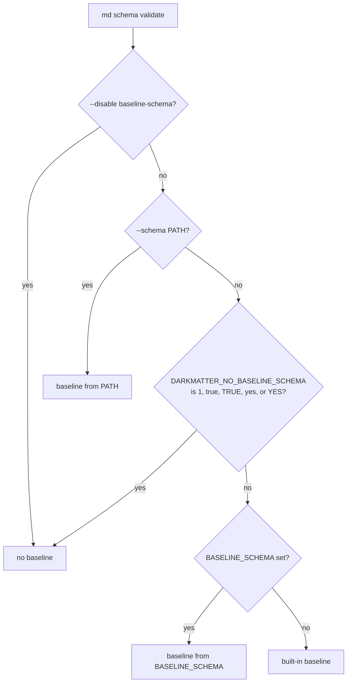

1. `--disable baseline-schema` validates with no baseline. It cannot be combined
   with `--schema`; passing both is a usage error that exits `2` before any
   file is read.

   ```bash
   md schema validate post.md --disable baseline-schema
   ```

2. `--schema <path>` replaces the built-in baseline, even when
   `DARKMATTER_NO_BASELINE_SCHEMA` is set.

   ```bash
   DARKMATTER_NO_BASELINE_SCHEMA=1 md schema validate post.md --schema ./schemas/baseline.yaml
   # validates against ./schemas/baseline.yaml
   ```

3. A disabling `DARKMATTER_NO_BASELINE_SCHEMA` validates with no baseline and
   ignores `BASELINE_SCHEMA`.

   ```bash
   DARKMATTER_NO_BASELINE_SCHEMA=1 BASELINE_SCHEMA=./schemas/baseline.yaml md schema validate post.md
   # no baseline
   ```

4. `BASELINE_SCHEMA` replaces the built-in baseline.

   ```bash
   BASELINE_SCHEMA=./schemas/baseline.yaml md schema validate post.md
   ```

5. Otherwise the built-in baseline applies.

   ```bash
   md schema validate post.md
   ```

Both environment variables are read from the environment the command was
started with. A custom path, from `--schema` or `BASELINE_SCHEMA`, takes the
same reference forms as a file argument and resolves from the directory the
command was started in, not from the document. A custom baseline that cannot
be found or loaded exits `2` and never falls back to the built-in baseline or
to none.

Opting out removes only the baseline. A document's own `$schema` and matching
[trigger schemas](#repository-trigger-schemas) still apply, and `--disable schema-triggers`
turns off triggers independently of the baseline.

**Compatibility.** Because every built-in property is checked by default, a
document with no `$schema` can now fail `md schema validate`, exactly as it
fails `md compose`. Given:

```yaml
---
last_updated: not-a-date
---
```

`md schema validate post.md` exits `1`, because `last_updated` is a `date`.
`md schema validate post.md --disable baseline-schema` or
`DARKMATTER_NO_BASELINE_SCHEMA=1 md schema validate post.md` exits `0`, as it
did before the built-in baseline was the default.

### JSON Schema Baseline Restrictions

When the baseline is a JSON Schema (rather than a SimplifiedSchema), it is restricted to **simple object schemas**. The merge algorithm operates on a property-name-keyed deep merge and cannot reason about arbitrary JSON Schema features.

Allowed root keys: `$schema`, `type`, `properties`, `required`, `additionalProperties` (must be `true`), `description`, `title`, and `$defs`.

Any other root construct — `$ref`, `allOf`, `anyOf`, `if`/`then`/`else`, `patternProperties`, `additionalProperties: false`, etc. — produces `SchemaError::Baseline` at load time. `additionalProperties: false` is explicitly rejected so the baseline cannot lock out per-document extensions. The same contract applies to a trigger payload, reported as `SchemaError::TriggerPayloadNotMergeable`.

A property may refer to a definition in the baseline's own root `$defs`, including a recursive one:

```json
{
  "type": "object",
  "properties": { "tree": { "$ref": "#/$defs/item" } },
  "$defs": {
    "item": {
      "type": "object",
      "properties": { "label": { "type": "string" }, "kids": { "type": "array", "items": { "$ref": "#/$defs/item" } } },
      "required": ["label", "kids"]
    }
  }
}
```

Those definitions move to the merged root, so the baseline's references must keep their meaning there:

- every `#/$defs/…` reference must name a definition in the baseline's own `$defs`; one that does not is `SchemaError::UnresolvedReference`, naming the reference and its location, whether or not the baseline has a `$defs` at all;
- a baseline with `$defs` must be a valid Draft 2020-12 schema (`SchemaError::Baseline`), and may not use `$id`, `$anchor`, `$dynamicAnchor`, `$dynamicRef`, an external reference, or a local reference outside `$defs` (`#`, `#/properties/…`, the empty reference); each is `SchemaError::UnsupportedMergeReference` with its location;
- a baseline without `$defs` keeps its other reference forms exactly as before: nothing of it moves.

### Merge Semantics (`baseline ⊕ document`)

- Object-level deep merge keyed by property name.
- Where both sides declare a property, the **document side wins entirely** — its type and constraints replace the baseline's. There is no per-constraint interleaving.
- `required` is a property-level concern, so replacing a property removes its inherited `required`. Re-state `required` in the document to preserve required constraint while changing the type.
- Properties present only in the baseline remain in the effective schema.
- Properties present only in the document are added.
- For root unions, the baseline is merged into each arm independently.
- The baseline's `$defs` join the document's root `$defs` (the root of a root union, never an arm). Only the definitions a copied baseline property reaches join; one reached only from properties the document replaces is dropped. The document's keys and references never change. A baseline key the document also uses is shared when both hold the same body and renamed (`item-2`) otherwise, together with every baseline reference to it; literal data that only looks like a reference (`const`, `enum`, `default`, `examples`, and extension annotations) is left byte-for-byte. A root-union arm that declares its own `$id` cannot receive a baseline with `$defs` (`SchemaError::UnsupportedMergeReference`), since references inside it would resolve in that arm.

This semantics is chosen because per-constraint merging produces surprising results (e.g. a baseline `min(5)` silently shadowing a document `min(3)`).

## Type Coercion

When a frontmatter value is not the type its property declares but converts
to it without changing its meaning, Darkmatter converts the stored value and
accepts it. Function arguments go through the same conversion engine with the
same rules, so a type means the same thing in `$schema` and in a function
signature. Conversion is always on; there is no opt-in or strict flag. It
covers inline `$schema`, baseline-merged fields, trigger payloads, and raw
JSON Schema documents. This section is the one description of that engine;
other pages link here.

The rule behind every conversion: a value is converted only when the
conversion cannot change what the author meant. `"4"` given to a `number`
means 4, so it converts; `"pear"` does not, so it is an error.

### Two Interfaces of a Type

A type answers two questions, and they are worth keeping apart:

| Interface | Question | Example for `number` |
|---|---|---|
| **Accepts** | Which values may an author or caller supply? | `4`, `"4"`, `" 4 "` |
| **Delivers** | What does the document, or the function, end up holding? | the number `4`, always |

For most types the two differ only by conversion: a `number` property
accepts numeric text but always holds a real number afterward, so a later
reader never has to ask whether it was written `4` or `"4"`.
[`numberlike` and `boolish`](#numberlike-and-boolish-keep-what-was-written)
exist for the case where that difference matters: they accept exactly what
`number` and `boolean` accept but deliver the value as written.

### Three Actions per Value

For each value the engine takes exactly one of three actions:

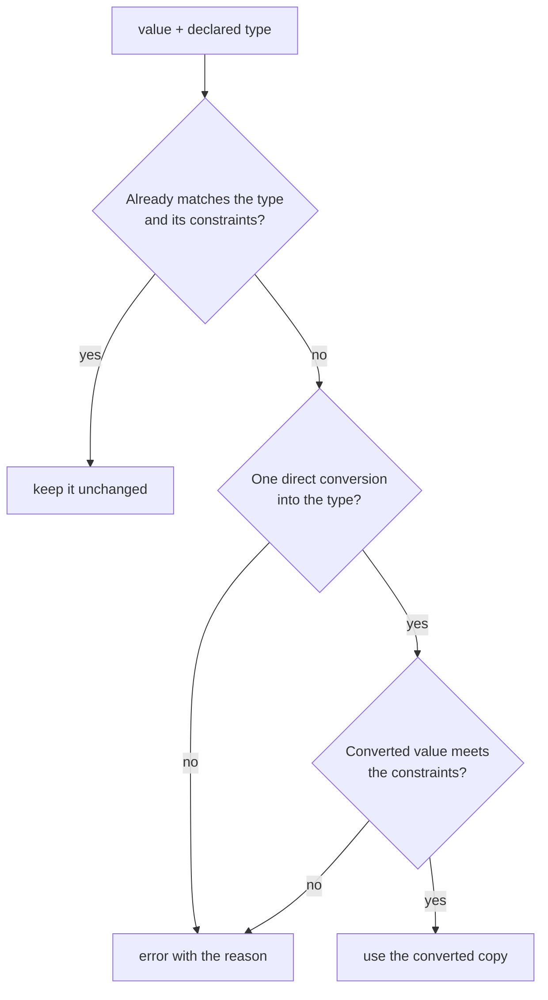

In frontmatter the error is a validation error on the property; in a function
call it is a type error and the function does not run.

Constraints are enforced, never repaired: `"2.5"` against `number(integer)`
is an error, not `2`, and `"ABCD"` against `string(max(3))` is never
truncated. The original value is never mutated; compose writes back a
converted copy, and validation-only calls write nothing.

### Conversion Rules

These are the only conversions, and they are never chained:

| From | To | Example |
|---|---|---|
| number | text (`string`, `date`, `url`, `file`, `enum(...)`, string `literal`, `expression`, `shell`, ...) | `version: 1.2` against `string` → `"1.2"`; `n: 2` against `enum("1", "2")` → `"2"` |
| boolean | text | `true` → `"true"` |
| text | `number` | `" 4 "`, `"+4"`, `"-3.5"`, `"1e3"`, `".5"`, `"1_000"` → a number |
| text | `boolean` | `true`/`false`, `yes`/`no`, `on`/`off`, `1`/`0`, any letter case → a boolean |
| object, list, number, or boolean | `json` / `yaml` | a mapping → its JSON (written key order) or YAML text |

A refined text type (`date`, `url`, `email`, `file`, `enum`, a string literal)
first receives the text and then runs its own check, so `2026` against `date`
becomes `"2026"` and then fails the date check. A number or boolean literal
accepts the matching text: `"2"` against `literal(2)` becomes `2`.

Text given to `json` or `yaml` is already content: it is validated (JSON
rejects duplicate keys and numbers such as `1e400`) and kept as written,
never quoted again.

These are **never** converted:

- a boolean to a number (`true` is not `1`), or a native number to a boolean;
- `null` to anything (`0`, `""`, `"null"`, `false`, or omission);
- a single value into a list (`"a"` is not `["a"]`);
- text into an object or list (`"[1, 2]"` stays text);
- text that is not a number (`"pear"`, `"NaN"`, `"0x10"`, `"1,000"`, `"5."`);
- a number or boolean into `alphanumeric`, which must already be text;
- anything into `unknown`, which keeps every value as written.

Whole numbers must be held exactly: `"9007199254740993"` and the native YAML
`9007199254740993` are errors with the reason "cannot be represented
exactly", `"1e400"` is "not finite", and `"1e-400"` would become `0`, which is
also an error. `number(integer)` means a whole number below 2^64 in
magnitude (the compiled schema carries `x-darkmatter-integer: true`); a raw
JSON Schema `integer` has no such ceiling. See [Numbers](../numbers.md).

### `numberlike` and `boolish` Keep What Was Written

`numberlike` accepts exactly what `number` accepts, and `boolish` exactly what
`boolean` accepts, but neither converts: the value is validated and kept as
written. `zip: "02134"` against `zip: numberlike` stays the text `"02134"`;
`flag: "On"` against `boolish` stays `"On"`; `zip: "pear"` fails. They compile
to `{ "type": ["number", "string"], "format": "darkmatter-numberlike" }` and
`{ "type": ["boolean", "string"], "format": "darkmatter-boolish" }`, whose
formats use the same parser as the engine.

### Nested Values

Conversion follows the declared structure at every depth: lists, tuples,
inline objects, unions inside them, `numberlike`/`boolish` fields, and the
values under pattern keys (`<string>: number`). The container rules:

- a list or object is converted all or nothing, and an error names the
  failing path (`meta.inner.count`, `values[2]`);
- a missing optional tuple position stays missing, never `null`, and a
  missing required position is an error at its path;
- a single value is never wrapped into a list;
- a plain `object` or `unknown` declares no structure, so its contents are
  kept as written.

```yaml
$schema:
    meta: "{ inner: { count: number }, scores: { <string>: number } }"
    pair: "tuple([string, number])"
meta:
    inner: { count: "3" }
    scores: { a: "4" }
pair: ["Ada", "36"]
# composes as
meta:
    inner: { count: 3 }
    scores: { a: 4 }
pair: ["Ada", 36]
```

Each top-level property is its own value. When one property fails, the
others still convert, and a missing required property never stops a sibling
from converting: presence is reported by validation, not by conversion.

### Choosing a Union Option

A union chooses its option the same way everywhere, and the order the
options are written in never matters:

1. A value an option already accepts is kept.
2. Otherwise, the options the value converts into (with constraints met) are
   *reachable*. One reachable option wins.
3. When several are reachable with different results, exactly two
   tie-breakers apply: a number beats a boolean (`"1"` against
   `number | boolean` becomes `1`), and JSON beats YAML (a mapping against
   `json | yaml` becomes JSON text). They apply field by field inside
   objects. Any other tie is an error that names each reading.

| Declared type | Value | Result |
|---|---|---|
| `string \| number` | `"4"` | `"4"` (already a string) |
| `string \| string[]` | `2026` | `"2026"` (only `string` is reachable) |
| `number(min(5)) \| boolean` | `"1"` | `true` (`1` fails `min(5)`) |
| `{ id: number } \| { id: boolean }` | `{ id: "1" }` | `{ id: 1 }` |
| `{ a: number, b: boolean } \| { a: boolean, b: number }` | `{ a: "1", b: "1" }` | error naming both readings |
| `(boolean \| number)[]` | `["2", "yes"]` | `[2, true]` |

A root-level union picks its arm by the same rule; an arm's conversions are
written back only when the converted document satisfies that arm.

### Function Calls: Bind, Then Compute

An [expression function](../darkmatter-expressions.md#functions) declares
its parameters with the same types (see
[Function Signatures](#function-signatures)), and every call runs in two
steps:

1. **Bind.** The engine checks every argument against its parameter, keeping
   or converting it by the rules above. A call whose arguments do not all
   bind is a **type error**, and the function never runs.
2. **Compute.** The function receives values of exactly its declared types
   and does its work. Only a function marked `fallible` can fail here, with
   a domain error such as a failed network request.

```md
{{ min("4", 5) }}      ⇒ 4         "4" binds as the number 4
{{ upper(2026) }}      ⇒ 2026      a number binds as text
{{ min("pear", 5) }}   ⇒ type error; min never runs
```

No function converts its own arguments, so the declared signature is a
complete statement of what a function accepts. Parameters follow the
property rules with two differences: a parameter is required unless it is
written `name?: T`, and it accepts `null` only when its type says so
(`number | null`). Omitting an optional argument is not the same as passing
`null`.

A function with several signatures (overloads) binds to one of them. A
signature that accepts every argument without conversion wins over one that
needs conversion; otherwise exactly one signature must bind. Two equally
good signatures are an ambiguity error, none binding is a type error that
lists every signature, and the order they are written in never matters.

Before a document is composed, Darkmatter also checks its calls against the
declared types without running anything, and rejects a call no value could
ever bind. See [Call Check](../../inline/call-check.md).

### Type Errors

The engine checks every value before it reports, so one error names every
value that failed, not just the first. A type error carries:

- for a call, the function and its signature (every signature, for an
  overload), and each failing parameter's name and position;
- for frontmatter, the property's path and its line and column;
- the expected type with its constraints, the value received, and the reason:
  no conversion from that type, the conversion failed, a constraint is not
  met, the number cannot be represented exactly, or a union or overload is
  ambiguous.

With `low: number` unset and `high: string` set to `pear`,
`{{ min(low, high) }}` fails on both arguments:

```text
min: invalid arguments for min(a: number, b: number): number a (argument
1): expected number; received null; the parameter does not declare |
null b (argument 2): expected number; received text "pear"; conversion
failed: not a number
```

A frontmatter failure names the path inside the value:

```yaml
---
$schema:
    values: number[]
    tags: string[]
values: ["1", "2", "x"]
tags: "a"
---
```

```text
- ✗ the document doc.md failed schema validation:
    - values/2 "x" is not of type "number" (at line 5, column 20)
    - tags "a" is not of type "array" (at line 6, column 7)
```

### Converting Through Raw JSON Schema

A raw JSON Schema converts through `type` (including type arrays), `const`,
`enum`, `properties`, `patternProperties`, `additionalProperties`, `items`,
`prefixItems`, `anyOf`, `oneOf`, local `$ref` with `$defs`/`definitions`
(honoring `$id` and `$anchor`), numeric bounds, and string and list lengths.
The complete schema still decides: a converted value is kept only if every
assertion accepts it, including keywords that drive no conversion (`allOf`,
`not`, `if`/`then`/`else`, `multipleOf`, `dependent*`, `propertyNames`,
`contains`, `unevaluated*`). So `{ "oneOf": [{ "type": "number" }, { "type":
"integer" }] }` rejects `"3"` (the converted `3` matches both), and with
`{ "type": "number", "multipleOf": 2 }` the text `"4"` converts while `"3"`
fails. A key matching both `properties` and `patternProperties` must satisfy
both. Remote references are never fetched.

### Recursive Types

A [recursive named type](#recursive-named-types), or a raw
`$ref` cycle that passes through a child value (a property, a list item, a
tuple position, a pattern or additional property), converts at every depth:

```yaml
$schema:
  item: "{ value: string(required), children: item[](required) }"
  tree: item(required)
tree:
  value: root
  children:
    - value: a
      children:
        - value: 42      # converts to "42", however deep it sits
          children: []
```

The same rules apply at every level: a value with no conversion is an error at
its own path, an ambiguous union is never coerced, and if any value in a
property fails, that property is kept as written. The engine walks values up
to 64 levels deep (every object and list counts one level). A value deeper
than that is an error that says the limit was reached, never silently
accepted. A raw `$ref` cycle that never reaches a child value (`{ "anyOf": [
{ "type": "number" }, { "$ref": "#/$defs/a" } ] }` inside `a`) drives no
conversion at the self-reference; the complete schema judges that part.

### Values Waiting on Composition

A value that still holds `$(...)` or an unresolved `{{ ... }}` is not
converted or judged yet; it is checked after shell expansion and
interpolation, while its resolved siblings convert now.

### Changes for Existing Documents

Frontmatter conversion now uses the same engine as function calls, which
changes some results on purpose. There is no compatibility mode. A document
written for the earlier rules may see:

| Value | Before | Now |
|---|---|---|
| `"yes"`, `"no"`, `"on"`, `"off"`, `"1"`, `"0"` against `boolean` | rejected as ambiguous | converted |
| boolean words in mixed case (`"tRuE"`) | only `true`/`True`/`TRUE` and the `false` equivalents | any letter case |
| `" 4 "`, `"+4"`, `"1e3"`, `".5"`, `"1_000"` against `number` | rejected | converted |
| a number `f64` cannot hold exactly (`9007199254740993`, `"1e400"`) | silently rounded | an error; see [Numbers](../numbers.md) |
| a root-level union | the first arm, in written order, that validated | the [union rule](#choosing-a-union-option), whatever the order |
| a property-level union | converted only when exactly one option validated | the union rule |
| unions, `numberlike`/`boolish`, and pattern-key values inside a nested object | not converted | converted at every declared depth |
| a number or boolean against `enum(...)` or a string literal | rejected | converted to text, then checked (`2` against `enum("1", "2")` becomes `"2"`) |
| a value below the fourth level of a recursive raw `$ref` | validation-only, never converted | converted at every depth, up to the [64-level limit](#recursive-types) |
| a raw JSON Schema | converted through a few keywords | converted through every keyword listed in [Converting Through Raw JSON Schema](#converting-through-raw-json-schema) |
| a mapping serialized into `json`/`yaml` | keys sorted alphabetically | keys in written order |
| `numberlike` and `boolish` values | numeric text became a number, `"true"`/`"false"` a boolean | validated, then kept exactly as written |
| text `numberlike` / `boolish` accepts | only `-?digits(.digits)` / only `true`/`false` spellings | the same spellings as `number` / `boolean` |

Validation-only calls still write nothing, and compose still writes
converted values back in the same shape.

## CLI: `md schema validate`

```
md schema validate <FILE_OR_PROP=VALUE>... [--schema <path> | --disable baseline-schema] [--disable schema-triggers] [--format pretty|json] [--quiet]
```

| Flag                       | Effect                                                                                                 |
|----------------------------|--------------------------------------------------------------------------------------------------------|
| `<FILE_OR_PROP=VALUE>...`  | Markdown files **and/or** `<prop>=<value>` assignments. See [Frontmatter Assignments](#frontmatter-assignments). |
| `--schema <path>`          | Custom baseline replacing the built-in one, used even when `DARKMATTER_NO_BASELINE_SCHEMA` is set. See [Selecting the Baseline](#selecting-the-baseline). |
| `--disable baseline-schema`| Validate with no baseline, ignoring `BASELINE_SCHEMA`. Conflicts with `--schema`. See [Policy Flags](../../cli/policy.md). |
| `--disable schema-triggers`| Do not discover or apply [trigger schemas](#repository-trigger-schemas). The baseline is unaffected.   |
| `--format pretty`          | Default. Human-readable, Prose-styled output. One block per file; each problem names its [source location](#problem-locations). |
| `--format json`            | Newline-delimited JSON, one object per file. Pipe-friendly.                                            |
| `--quiet`                  | Suppress success lines; only failures print.                                                           |

### Frontmatter Assignments

Positional arguments are classified as either file paths or `<prop>=<value>` assignments. An argument is treated as an assignment when:

1. It contains `=`, **and**
2. The substring before the first `=` is a dot-separated property path (each segment matches `[A-Za-z_][A-Za-z0-9_-]*`).

Any other token is treated as a file path. A literal file whose name contains `=` (e.g. `weird=name.md`) should be disambiguated with `./` — `./weird=name.md` — because `./weird` is not a valid identifier.

Assignments are applied to **every** document's frontmatter map before validation, and they **always override** existing values. This makes it easy to fill in missing `required` properties and check that a document would pass with them supplied.

```bash
# Satisfy a missing required `title`
md schema validate draft.md title=Hello

# Multiple assignments
md schema validate post.md title=Hello count=5 published=true

# Nested keys via dot notation
md schema validate post.md user.email=ken@ken.net user.name=Ken

# Apply the same overrides to several files
md schema validate a.md b.md c.md title=shared
```

**Value parsing.** The right-hand side of each assignment is parsed as a YAML scalar or flow value (via `serde_yaml_ng`). This matches how frontmatter would have parsed the same value if it were written into the document.

| Argument              | Parsed value                                |
|-----------------------|---------------------------------------------|
| `title=Hello`         | string `"Hello"`                            |
| `count=5`             | integer `5`                                 |
| `rating=2.5`          | float `2.5`                                 |
| `published=true`      | boolean `true`                              |
| `tags=[a, b, c]`      | array `["a", "b", "c"]`                     |
| `user={n: Ken}`       | object `{ "n": "Ken" }`                     |
| `title=`              | empty string `""` (not YAML null)           |

Malformed YAML on the right-hand side (e.g. `user={broken`) is reported as a **usage error** with exit code `64` rather than silently treated as a file path. Bare strings with special YAML characters (commas in flow context, leading `&`, etc.) should be quoted in the shell.

**Schema-aware coercion.** When the effective schema declares a top-level property as a string-shaped scalar (`string`, `date`, `datetime`, `time`, `url`, `email`, `enum`, `file`, or `alphanumeric`), the raw right-hand side is stored verbatim as a string instead of being run through the YAML scalar parser. This lets `bar=true` validate against `bar: string(required)`, and `slug=123` against `slug: alphanumeric`, without the shell-quoting acrobatics that would otherwise be needed to keep the literal `"`. Property-level unions follow the same rule when **any** non-array arm is a string-shaped type — the string variant wins so the value is preserved losslessly. A property typed by a [recursive named type](#recursive-named-types) is judged by that type's definition: given `node: [string(min(4)), { children: node[] }]` and `label: node`, `label=1.20` stays the text `"1.20"`.

Coercion is intentionally conservative:

- It only fires for **top-level** scalar paths. Nested `user.email=...` paths land inside `object`-typed properties, which are opaque in v1, so the original YAML parse is used.
- Array-typed properties (`tags: string[]`) are excluded so `tags=[a, b, c]` still flows through the YAML flow-sequence parser.
- Schemas that produce no SimplifiedSchema projection — raw JSON Schema input or root-level unions — also fall back to the plain YAML parse.
- `boolean`, `boolish`, `number`, `numberlike`, `object`, `unknown`, `null`, `shell`, and `expression` keep the YAML-parsed value (`shell` and `expression` then turn a number or boolean into text during validation). A number written in the document itself (`slug: 123`) is still a type mismatch for `alphanumeric`. For `boolish` this means a bare `flag=true` is stored as the boolean variant `true`; pass `flag=\"true\"` (or `'flag="true"'`) to get the quoted-string variant.

**Nested assignments.** Dot-separated paths create or merge intermediate objects:

- `user.email=ken@ken.net` on `{ user: { name: "Ken" } }` produces `{ user: { name: "Ken", email: "ken@ken.net" } }`.
- `user.email=...` on `{ user: "scalar" }` replaces the scalar with `{ email: "..." }` — the descent cannot continue into a non-object parent.

**Locations of assigned values.** Problem locations always come from the file as written, so an assigned value has no source of its own. A problem at a path the file already had reports the authored node there, even though the assignment replaced its value. A problem at a newly added nested path reports its nearest authored ancestor; a newly added top-level property has no location (`line` and `column` are `null`). For example, given a schema where `count`, `rating`, and `user.age` are numbers, and this frontmatter:

```yaml
---
count: 3
user:
  name: Ken
---
```

| Assignment | Problem path | Location |
|---|---|---|
| `count=many` | `/count` | line 2, column 8: the authored `3` |
| `user.age=x` | `/user/age` | line 4, column 3: the authored `user` mapping |
| `rating=x` | `/rating` | none |

### Exit Codes

| Code | Meaning                                                                                |
|------|----------------------------------------------------------------------------------------|
| 0    | All files validated successfully.                                                       |
| 1    | One or more files failed validation.                                                    |
| 2    | Schema or baseline could not be loaded (CLI baseline **or** a per-document `$schema`). |
| 3    | At least one file's frontmatter could not be parsed.                                    |
| 64   | Usage error (bad flags, malformed `<prop>=<value>` YAML, no files supplied).            |

When multiple kinds of failure occur in the same invocation, the more specific failure wins: parse error (`3`) outranks schema-load failure (`2`), which outranks validation failure (`1`).

Passing both `--schema` and `--disable baseline-schema` is rejected as a usage error before any document is read, which exits `2` with a "cannot be used with" message on stderr and nothing on stdout.

### Pretty Output

Given `draft.md`:

```markdown
---
$schema: ./schemas/post.yaml
status: orange
tags:
  - rust
  - 42
---
```

`md schema validate post.md draft.md` prints one block per file:

```
- ✔ the document post.md has a schema definition and is valid.
- ✗ the document draft.md failed schema validation:
    - title is a required property (at line 2, column 1)
        The post's title
    - status "orange" is not one of "draft", "published" or "archived" (at line 3, column 9)
    - tags/1 42 is not of type "string" (at line 6, column 5)
```

Each bullet starts with the failing path (`tags/1`), or with the missing property's name when the root lacks it, and ends with the problem's [location](#problem-locations) in the complete file: `(at line L, column C)`, `(at line L)` when no column is known, or nothing when the problem has no location.

When the failing property declares a `description` (via `-> ...`, an inline-object
per-property description, or a `description` keyword in a referenced JSON Schema),
that text renders as a dimmed sub-line one indent level beneath the problem bullet.
The sub-line is omitted entirely when the property declares no description, so a
description-less schema produces no extra lines.

For root-union failures, problems are prefixed with `arm[N]`:

```
- ✗ the document post.md failed schema validation:
    - arm[0]: title is a required property (at line 2, column 1)
```

### JSON Output

```json
{"file":"post.md","valid":true,"schema":"./schemas/post.yaml","problems":[]}
{"file":"draft.md","valid":false,"schema":"./schemas/post.yaml","problems":[
  {"path":"","property":"title","message":"\"title\" is a required property","kind":"missing","line":2,"column":1,"arm_index":null,"description":"The post's title"},
  {"path":"/tags/1","property":null,"message":"42 is not of type \"string\"","kind":"type","line":6,"column":5,"arm_index":null,"description":null}
]}
```

Each problem carries a `path` (a JSON pointer; a missing property's `path` is the
mapping that lacks it, `""` for the root), a `property` field (the missing
property's name, when resolvable) and a `kind` field — one of `missing`,
`type`, or `invalid`. `line` and `column` give the problem's
[location](#problem-locations), or are `null` when it has none.

Each problem also carries a `description` field: the failing property's declared
description string when one is resolved, or `null` when the property declares no
description (or the description was suppressed because it was whitespace-only or
byte-for-byte equal to the problem message).

The `schema` field names the document's own `$schema`. It is `null` for a document without one, even when the built-in or a custom baseline validated it; the pretty output still says such a document "has a schema definition", because its effective schema is the baseline.

Parse errors and schema-load failures emit JSON entries with an `error` key (`"frontmatter_parse"` or `"schema"`) and an empty `problems` array.

### Problem Locations

A problem's location points at the authored YAML node that is wrong, not just at the top-level property that contains it. Given a schema in which `then` items allow only `say`:

```yaml
---
start:
  - then:
      - say: hello
      - sya: goodbye
---
```

the unknown-key problem keeps the path `/start/0/then/1` and is reported at line 5, column 9, the `s` of `sya`:

```
    - start/0/then/1 Additional properties are not allowed ('sya' was unexpected) (at line 5, column 9)
```

**Coordinates.** Lines count the complete Markdown file, so the opening `---` is line 1. Columns are 1-based UTF-8 byte columns: a `😀` before the node counts as 4 columns. LF and CRLF line endings give the same line and column.

**Which node.** The problem's kind decides what it points at:

| Problem | Location | Example |
|---|---|---|
| A wrong value (type, constraint, enum, file reference) | the start of the value; for a block list item, after the `- ` | `  - oops`: column 5, the `o` |
| An unknown key (`path` is the parent mapping; the message names the key) | the start of the key itself | `sya` above: 5:9 |
| A missing required property | the start of the mapping that lacks it; for a list item, its first key rather than its dash | `  - name: b`: column 5, the `n` |
| A missing property of the root | the root mapping's first key, after any leading comments or blank lines | `---`, `# draft`, then `title: x`: line 3, column 1 |

Flow collections (`{…}`, `[…]`) written on one line are located node by node too. With `m: {a: 1, b: x}` on line 2, an unknown key `b` is at 2:11 and a wrong value `x` at 2:14.

Paths identify decoded mapping keys. A key `"a/b"` has the JSON Pointer
segment `a~1b`, and `"a~b"` has `a~0b`; both still locate their authored key
or value correctly. The segment `0` selects a key inside a mapping and an
item inside a list. An empty key is `/`, distinct from the empty pointer for
the document root.

**Scalars are one node.** A block scalar (`|`, `>`) or a quoted scalar is located at its start (the indicator or the opening quote). A problem inside its decoded content, such as a `yaml` or `json` value whose embedded document is wrong, reports that start; no position inside the scalar is invented.

**Changes keep their editing location.** Validation uses the original source
even after an assignment, interpolation, or library call replaces a value.
For a file whose second line is `count: 1`, validating the assignment
`count=abc` against `count: number` reports line 2, column 8, where `1` was
authored. It does not claim that `abc` appeared there. A new nested field uses
its nearest authored ancestor: adding `b` to an existing `m: {a: 1}` locates a
problem at the start of that flow mapping. A newly added top-level property
has no authored node or non-root ancestor, so JSON reports `null` for both
`line` and `column`.

**Fallbacks.** When the exact node has no authored source, the location falls back as shown below. Unsupported YAML presentation includes aliases (`*a`), merge keys (`<<`), unquoted `{{ … }}` templates, flow collections spread across lines, and comments inside flow collections. It never changes the validation result or causes an error; it only makes every location in that document coarser.

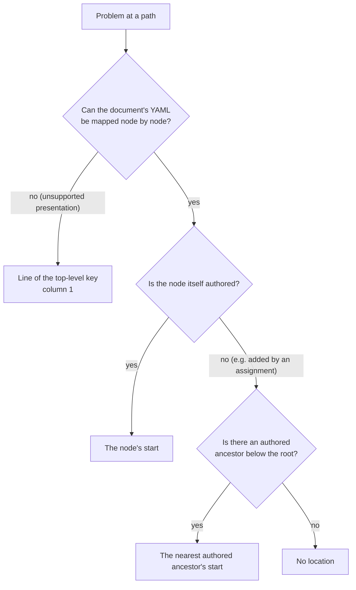

**Documents without loaded text.** Locations need the text the document was parsed from. A `Markdown` document built in code has no such text, so its locations refer to the serialized YAML of its frontmatter. Source-free validation reports no locations: `EffectiveSchema::validate`, or `validate_with_positions` given the empty `PositionMap::new()`. A library caller holding bare YAML can build a map with `schemas::validate::build_position_map(yaml)`; its lines are relative to that slice, so line 1 is the first YAML line rather than the `---`.

A position map belongs to one source snapshot. Normal document validation
builds it once and shares it across all problems, including root-union arms.
Lookup does not run expressions, resolve references, or modify frontmatter;
the path, diagnostic identity, and validation outcome remain independent of
whether a precise location is available.

The same locations appear in `md compose`'s [schema-failure block](#error-rendering), and the DMLS language server highlights the same supported nodes in an editor. Editor positions use zero-based lines and the negotiated UTF-8 or UTF-16 encoding; see [DMLS diagnostic ranging](../../../dmls/docs/diagnostics.md#ranging) before comparing them with CLI columns.

### Behavior Without `$schema`

- With a baseline, which is the built-in one unless [selected otherwise](#selecting-the-baseline), the document is validated against the baseline alone, and `pretty` mode says it has a schema definition.
- Without a baseline and without `$schema`, validation succeeds vacuously and `pretty` mode prints `doesn't have a schema definition so is valid by default.`

## CLI: `md schema detect`

```
md schema detect <file>... [--format yaml|json] [--merge]
```

| Flag             | Effect                                                                                                                      |
|------------------|-----------------------------------------------------------------------------------------------------------------------------|
| `--format yaml`  | Default. Emits SimplifiedSchema YAML.                                                                                       |
| `--format json`  | Emits the equivalent Draft 2020-12 JSON Schema.                                                                             |
| `--merge`        | When multiple files are given, union detections: a property is required only if present in every file; types widen to common ancestors. |

Without `--merge`, multiple inputs emit one schema per file with a header comment.

Each document's references are judged from the document itself, the way `md compose` and `md schema validate` resolve them, not from the directory you ran `md` in. A document in another repository finds `./`, bare, `&`, and `^` references in its own repository and `@` references in the launch scope; a document outside every repository keeps the `~` you opened it through; and two spellings of the same path (such as macOS `/var/…` and `/private/var/…`) give the same result. For example, `~/other-repo/docs/plan.md` declares `diagram: './flow.md'` (beside it) and `readme: '&README.md'` (at its repository's root). Run from `~/work/app`, a different repository:

```text
$ md schema detect ~/other-repo/docs/plan.md
# detected from: /Users/me/other-repo/docs/plan.md
$schema:
  diagram: file
  readme: file
```

### Detection Algorithm

For each top-level frontmatter property (excluding `$schema`), the inferred type is:

- boolean scalar → `boolean`
- integer scalar → `number(integer)`
- float scalar → `number`
- ISO-8601 date/datetime/time string → that type
- URL string → `url(scheme(<scheme>))`
- email string → `email`
- string that resolves via `FileReference` to an existing path → `file`
- other string → `string`
- array → recursive item-type inference; mixed items fall back to `unknown[]`
- object → `object` (v1 does not synthesise nested SimplifiedSchemas)

**No constraints are inferred** — detection produces base types only. Patterns, `min` / `max`, enum members, and other constraints are never synthesised from values. All detected properties are marked **optional**: a single sample cannot prove requiredness.

### Multi-File Merge

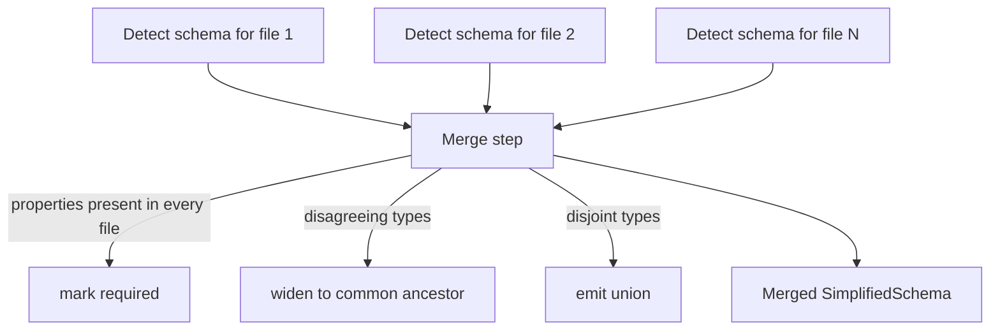

Type-widening hierarchy:

```
date  ┐
time  ├──> string
url   │
email ┘
number(integer) ──> number ──> numberlike
boolean ──> boolish
file ──> string   (only if the strings stop resolving)
```

When inferred types are **genuinely disjoint** (e.g. `string` and `boolean`), the merger emits a SimplifiedSchema union for that property rather than collapsing to `unknown`:

```yaml
$schema:
    flag:
      - boolean
      - string
```

### Exit Codes

| Code | Meaning                                          |
|------|--------------------------------------------------|
| 0    | Success.                                         |
| 2    | Conversion to JSON Schema failed (`--format json` only). |
| 3    | At least one file's frontmatter could not be parsed. |

## CLI: `md schema about`

```
md schema about
```

`md schema about` is the **implementation-bound reference** for the SimplifiedSchema authoring language. It prints a human-readable report covering schema shapes, the type vocabulary, the `alphanumeric` type options, the constraint vocabulary, inline object rules, validation behavior, and coercion rules. A type's aliases appear under its canonical keyword (`unknown` shows `alias: any`; there is no separate `any` row), and the options table lists each option's effect and the options that make it redundant.

```
SimplifiedSchema Language Reference
  …
  ## Schema Shapes
    - Single object
    - Root-level union
    - Property-level union
    - Inline object literal
    - Nested mapping object
    - Array of a named union
    - Marked union reference
  ## Type Vocabulary
    - string, date, datetime, time, number, numberlike, …
    - unknown (alias: any), null, alphanumeric, shell
  ## Type Options: alphanumeric
    - allow-dashes, allow-underscores, …, leading-alpha
  ## Constraint Vocabulary
    - min, max, not-empty, pattern, default, required, …
  ## Inline Object Rules
    - …
  ## Coercion Rules
    - …
  ## Validation Behavior
    - …
```

The report is rendered from a typed descriptor catalog in
`darkmatter::markdown::schemas` — the **same catalog** library callers consume via
`schema_type_descriptors()`, `schema_constraint_descriptors()`,
`schema_shape_descriptors()`, `inline_object_rule_descriptors()`,
`coercion_rule_descriptors()`, and `validation_behavior_descriptors()`. This
ensures the CLI report and the public descriptor surface cannot drift apart.

The command is **documentation-only** and intentionally has no input files and
no format flags of its own. The **global** `--verbose` flag expands the report
with the inline-object rules, coercion rules, validation behavior, the `ctx.*`
context-variable catalog, and expression-function signatures; the global
`--code-block` flag affects how embedded code blocks render. It performs no
document parsing, no context capture, no `EffectEngine` construction, no file
resolution, and no network access. The only observable side effect is printing
to stdout. The descriptor catalog is a static compile-time constant.

> Use `md schema about` as the implementation-bound CLI reference for the
> schema language. The prose in this document complements it with worked
> examples, motivation, and cross-references; the CLI report reflects the
> exact type, constraint, and shape surface the parser, converter, and
> compose-time coercion understand today.

## Library API

The entry point is `darkmatter::markdown::schemas::DarkmatterSchemas`.

```rust
use darkmatter::markdown::Markdown;
use darkmatter::markdown::compose::{RequestSnapshot, build_resolution_context};
use darkmatter::markdown::schemas::{DarkmatterSchemas, DetectOptions};
use std::path::Path;

// Every `$schema` reference and `file` value resolves through a built
// file-resolution context: there is no constructor without one.
let context = build_resolution_context(&RequestSnapshot::new("/work/blog"))?;

// Build the API with a baseline.
let api = DarkmatterSchemas::new(context)
    .with_baseline_from_file("./schemas/baseline.yaml")?;

// Validate a document.
let md = Markdown::try_from(Path::new("./post.md"))?;
let report = api.validate(&md)?;
if !report.valid {
    for problem in &report.problems {
        eprintln!("{} — {}", problem.path, problem.message);
    }
}

// Build the effective schema explicitly (e.g. to inspect generated JSON Schema).
if let Some(effective) = api.effective_for(&md)? {
    println!("{}", effective.json_schema);
}

// Detect a schema from a corpus.
let docs: Vec<Markdown> = /* ... */ vec![];
let refs: Vec<&Markdown> = docs.iter().collect();
let detected = api.detect(&refs, DetectOptions { merge: true });
```

### Key Types

| Type                  | Purpose                                                                                                             |
|-----------------------|---------------------------------------------------------------------------------------------------------------------|
| `DarkmatterSchemas`   | Top-level entry point. Holds the request's file-resolution context, an optional baseline, and the LRU validator cache. |
| `EffectiveSchema`     | The fully-resolved schema for a document. Carries the SimplifiedSchema projection (when available), the compiled JSON Schema, the validator, and `origins: SchemaOriginMap` (each top-level property's winning declaration: document, referenced file, trigger, or baseline; see [Embedded trigger bundles](#embedded-trigger-bundles) for reading a trigger's source). |
| `ValidationReport`    | `valid: bool` + `problems: Vec<ValidationProblem>` + `pending: Vec<PendingValue>` (populated only by `validate_with_options`). |
| `ValidationProblem`   | `path` (JSON pointer), `message`, `kind`, `property`, optional `line` / `column` (see [Problem Locations](#problem-locations)), optional `arm_index` for root-union failures, optional `description`; plus the span-aware fields `code: ValidationProblemCode`, `instance_path: JsonPointer`, optional `schema_path`, `offending_property`, and `file_reference: Option<FileReferenceDiagnostic>`. |
| `ValidationTimings`   | Stage breakdown of one validation, from `DarkmatterSchemas::validate_timed` (same result as `validate`, timings on failure too) or `ValidationTimings::record(|| ...)`: per-`ValidationStage` durations (`discover`, `match`, `resolve`, `compile`, `validate`), `total()`, `unassigned()`, `compile_cache()` (`CompileCache::Hit` / `Miss` / `NotRequested`), and `matched_triggers()`. See [Stage timings](../../inline/schema-validation.md#stage-timings--vv). |
| `PositionMap`         | Opaque source positions for one frontmatter snapshot, passed to `validate_with_positions`. `PositionMap::new()` (also `Default`) is empty and source-free; `is_empty()` reports whether any position can be given; `validate::build_position_map(yaml)` builds one from bare YAML. |
| `ValidationProblemCode` | Fine-grained problem taxonomy: `MissingRequired`, `TypeMismatch`, `ConstraintViolation`, `UnknownKey`, `InvalidFileReference`. |
| `ValidationOptions` / `PendingValue` | Mirror the compose deferral rules as data: `pending_policy` (`Defer` / `Report`) plus `excluded_keys`; a `PendingValue` records a value validation skipped because it is a whole-value `$(...)` shell expression or still holds an unresolved `{{ }}` template. |
| `SimplifiedSchema`    | Either `Single(SchemaShape)` or `Union(Vec<SchemaArm>)`.                                                            |
| `SchemaShape`         | Ordered map of property names to `PropertyDef`.                                                                     |
| `PropertyDef`         | Either `Single(PropertyAtom)` or `Union(Vec<PropertyAtom>)`.                                                        |
| `PropertyAtom`        | `ty`, `is_array`, `constraints`, `array_constraints`, `description`.                                                |
| `SimplifiedType`      | Enum of the supported types (`String`, `Date`, `Number`, …, `Unknown`, `Null`, `Alphanumeric`, `Shell`). `aliases()` lists alternative spellings (`any` for `Unknown`). |
| `AlphanumericOptions` | The canonical option set of an `alphanumeric` type (`PropertyAtom::alphanumeric_options()`), with its allowed and first-character sets (`AsciiCharSet`), `accepts(&str)`, and `pattern()`. |
| `Constraint`          | Enum of all constraint variants (`Required`, `Default`, `Min`, `Max`, `Members`, `Match`, `Suggest`, …).           |
| `SuggestionCandidate` | One interpreted `suggest(...)` argument: decoded text, interpreted value, canonical decimal, byte span.             |
| `SuggestionLintProblem` | One invalid suggestion candidate with decoded text, interpreted value, reason (`SuggestionLintReason`), and exact authored byte span. |
| `SuggestionItem`      | One lint-valid completion candidate: decoded text, interpreted value, YAML-safe insertion text, display label.     |
| `SuggestionQuery`     | Result of `suggestions_for_path()`: `is_array` flag + lint-valid `SuggestionItem`s in declaration order.            |
| `StandaloneSchemaDocument` | Parsed standalone schema file: envelope type, SimplifiedSchema payload, suggestion lint problems.            |
| `SchemaError`         | All failure modes (grammar, resolution, conversion, baseline, validator build, I/O).                                |

### Free Functions

- `parse_yaml_schema(&serde_yaml_ng::Value)` — parse a YAML value into a `SimplifiedSchema`.
- `to_json_schema(&SimplifiedSchema)` — lower to Draft 2020-12 JSON Schema (`serde_json::Value`).
- `EffectiveSchema::validate_for_phase(frontmatter, SchemaPhase)` — validate an already-resolved working instance at `Launch` or `Completion` without mutating it or resolving another schema.
- `detect_schema(&[&Markdown], DetectOptions, &FileResolutionContext)` — multi-file detection entry point; `file` inference resolves through the context derived to each document.
- `detect_schema_with_contexts(&[&Markdown], DetectOptions, &[FileResolutionContext])` — the same with one context per document, for documents that do not share the request's tree.
- `detect_from_document(&Markdown, &FileResolutionContext)` — single-document detection (returns a `SchemaShape`).

Detection is passive: it derives the supplied context to each document and never discovers a repository. A reference that does not resolve is a `string`, and so is every value when that derivation is invalid, so pass a context that admits the document: the request's for a document inside its tree, otherwise the one prepared for that document (in another repository, in none, or opened through another spelling of its path). `md schema detect` passes each argument's document context.
- `schema_to_yaml(&SimplifiedSchema)` — serialise a SimplifiedSchema back to YAML (used by `md schema detect --format yaml`).
- `is_subtype(&PropertyAtom, &PropertyAtom)` — whether every non-null value one resolved type accepts is accepted by another; see [Subtype Relation](#subtype-relation-is_subtype).
- `is_definition_subtype(&PropertyDef, &PropertyDef)` — the same relation over whole property definitions: every leaf alternative of the first is covered by an alternative of the second.
- `lint_suggestions(&SimplifiedSchema)` — check every `suggest(...)` candidate against its target schema; returns `Vec<SuggestionLintProblem>` (never a `SchemaError` for an invalid candidate).
- `suggestions_for_path(&SimplifiedSchema, &[&str])` — query lint-valid completion candidates for a property path; returns `Option<SuggestionQuery>` with YAML-safe insertion text.
- `parse_standalone_schema_document(&str, path)` — classify and parse a standalone YAML file as a SimplifiedSchema authoring document; returns `Option<StandaloneSchemaDocument>` (`None` for ordinary YAML / raw JSON Schema).
- `darkmatter_base_schema()` — the Darkmatter base frontmatter schema (the global catalog's `fm`, authored in `schemas/partials/fm.yaml` and compiled in with the schemas it imports; see [The Built-in Baseline](#the-built-in-baseline)) as a `SimplifiedSchema` with no definition table: every acyclic type is expanded at each use.
- `darkmatter_base_json_schema()` — the same base schema compiled to an independently owned Draft 2020-12 JSON Schema value, each repeated structured type stored once under its root `$defs`.
- `GlobalCatalog::baseline()` — a catalog's `fm` as a `SimplifiedSchema` with the definition table its references point into; lower the pair with `to_json_schema_with_definitions`.
- `darkmatter_base_json_schema_ref()` — a read-only borrow of the process-cached JSON Schema, avoiding a deep clone.

Use `DarkmatterSchemas::with_darkmatter_baseline_json_schema()` when configuring
the built-in baseline; each configured instance shares the cached JSON Schema.

### Source-Aware Parsing and Located Failures

An editor or linter that underlines a schema error needs to know *where* the
rejected text was written, not just what was wrong. Three passive functions
return that location along with the semantic error. None of them reads a
file, resolves an import, or evaluates anything.

| Function | Input | Success | Failure |
|---|---|---|---|
| `parse_property_definition_with_source(property, &value, yaml_source, source_offset)` | one property definition | `SourceAware<PropertyDef>` | `LocatedDefinitionFailure` |
| `parse_schema_declaration_with_source(&value, yaml_source, source_offset)` | one whole declaration, such as a frontmatter `$schema` value | `SourceAware<SchemaDeclaration>` | `LocatedDefinitionFailure` |
| `locate_standalone_definition_failure(source)` | a whole standalone schema file | — | `Option<LocatedDefinitionFailure>` |

A successful `SourceAware<T>` holds the same `value` the source-free parser
returns and a `source_map` of authored byte ranges. The source-free parsers
(`parse_property_definition`, `parse_schema_declaration`, `parse_yaml_schema`)
still return `Result<_, SchemaError>` with the same variants and messages.

A failure carries four fields:

```rust
pub struct LocatedDefinitionFailure {
    pub path: SchemaSourcePath,              // the rejected node
    pub error: Box<SchemaError>,             // what the source-free parser reports
    pub authored_span: Option<Range<usize>>, // the rejected token
    pub value_span: Option<Range<usize>>,    // the whole rejected value
}
```

For example:

```rust
let source = "tags:\n  - string\n  - string(min(nope))\n";
let value: serde_yaml_ng::Value = serde_yaml_ng::from_str(source)?;
let failure = parse_schema_declaration_with_source(&value, source, 0).unwrap_err();
assert_eq!(failure.path, SchemaSourcePath::root().property("tags").union_arm(1));
assert_eq!(&source[failure.authored_span.unwrap()], "nope");
```

- **`path`** is structural, never rebuilt from a message. Mapping keys are
  literal (`"a.b"` is one key), and sequence members, including root-union
  arms, are zero-based `union_arm` indexes. A property call starts at that
  definition, a declaration call at the declaration, and the standalone
  helper at the envelope, so its paths begin with `types` or `$schema`.
- **The node that introduced the violation is the one reported.** In
  `color: [string(suggest(red)), string(suggest(blue))]` each arm is valid
  alone, but a property allows one `suggest`; the failure is
  `color[1]` with its token at `blue`.
- **Ranges are UTF-8 byte offsets into the caller's document**, with
  `source_offset` added once. A DMLS client converts them to its negotiated
  position encoding.
- **`authored_span` is `None`** when the failure has no token (an empty union
  `tags: []`, a wrong-type arm `tags: [string, 7]`, an aliased value), when
  the presentation is outside the
  [source-aware boundary](#source-aware-presentation-boundary) (such as a
  quoted scalar continued across lines anywhere in the document), or when the
  authored text does not decode to the parsed value. `value_span` is then the
  rejected value when that can still be located, and `None` otherwise. The
  `error` is always returned; a missing location never hides it.
- **A successful semantic parse whose source cannot be projected** returns
  the projection error at the root path with no ranges.

`locate_standalone_definition_failure` recognizes a file exactly as
`parse_standalone_schema_document` does (a pure `$schema` envelope or a
`kind: schema` document with `types`). It returns the first definition
failure in parser order, including one inside a pure root-union mapping arm
(`$schema[1].b`). It returns `None` for a valid file, ordinary YAML, invalid
YAML, a global catalog, and every envelope or declaration-shape error, which
`parse_standalone_schema_document` reports as before inside
`SchemaError::SchemaDocument`.

For partial input, where no document parses yet, two helpers read a plain
scalar the way YAML folds it:

- `decode_plain_scalar_node(source, start, parent_indent)` decodes the plain
  scalar whose node starts at `start`, after any same-line anchor or tag,
  and returns its decoded map and end offset. It returns `None` for a quoted
  or block scalar, a collection, an alias, a comment, an empty value, and an
  anchor whose scalar starts on a later line.
- `locate_type_definition_cursor_in_scalar(source, &scalar, cursor)` and
  `locate_schema_declaration_cursor_in_scalar(source, &scalar, cursor)` are
  the cursor parsers over that decoded scalar. An anchor or tag never enters
  the reported token. The cursor must sit inside the scalar, at its end, or
  after trailing spaces or tabs on its last line.

### Span-Aware Validation and Normalization

`EffectiveSchema::validate_with_options(frontmatter, positions, &ValidationOptions { .. })` mirrors the compose deferral rules as data: it populates `ValidationReport.pending` for top-level values that are a whole-value `$(...)` shell expression or still hold an unresolved `{{ }}` template and (under `PendingPolicy::Defer`) drops their problems — **without executing anything**. A malformed template (`n: "{{ 1 + }}"`) is never dropped: no rendering can settle it, so its problem is reported as written. `$(...)` text compose never expands (inside a list or mapping, or after other text) is not pending and is judged as written. A whole-value literal token (`{{!data:v1:…}}`) is data: it is never pending, and it is validated as the text it holds. That text is never deferred as a template, at a place marked `deferred` or in a lifecycle verb's operand. `EffectiveSchema::validate_stored(stored, positions, phase)` judges a stored instance the same way, unphased or at a `SchemaPhase`, for a caller that does not want the pending rules. The plain `validate` / `validate_with_positions` entry points are unchanged and always return an empty `pending`. `EffectiveSchema::normalize_frontmatter` performs the eager-`file` value rewrite described in [Files](#files); the validation-only APIs stay read-only.

### Subtype Relation (`is_subtype`)

`is_subtype(a, b)` answers "does every non-null value accepted by type `a`
also satisfy type `b`?". It is passive and works on resolved
`PropertyAtom`s, so resolve named types first. Use it to decide whether a
saved rule typed `b` covers a value typed `a`, for example whether an
approval for `alphanumeric(allow-slashes)` covers an argument typed
`alphanumeric`.

```rust
use darkmatter::markdown::schemas::is_subtype;
use darkmatter::markdown::schemas::simplified::grammar::parse_type_expr;

let atom = |text| parse_type_expr("p", text).unwrap();
let rule = atom("alphanumeric(allow-slashes)");
assert!(is_subtype(&atom("alphanumeric(min(3))"), &rule)); // constraints are ignored
assert!(!is_subtype(&atom("string"), &rule));
assert!(is_subtype(&atom("email"), &atom("string")));
assert!(is_subtype(&atom("literal(4)"), &atom("number")));
assert!(is_subtype(&atom("literal('a')"), &atom("enum(a, b, c)")));
assert!(!is_subtype(&atom("literal(4)"), &atom("enum('4')"))); // structure, not `==`
```

Only the type and its canonical options count. Ordinary constraints (`min`,
`max`, `pattern`, …), presence, the optional `null` wrapper, and coercion are
outside the relation. Those exclusions apply inside structured types too:
changing an inline object's child `min(...)` constraint does not change its
type identity. Field names and child types, tuple positions and their optional
markers, and other structural details still count. This does not make an
object with a different field shape a subtype merely because some fields
agree.

| `a` | `b` | `a` ⊆ `b`? |
|---|---|---|
| any type | the same type with the same canonical options (including an identical array, inline object, or union) | yes |
| `alphanumeric(X)` | `alphanumeric(Y)` | yes when X's allowed characters and allowed first characters are subsets of Y's, and X guarantees any ban on `..` that Y makes |
| an always-text type: `string`, `date`, `datetime`, `time`, `file`, `enum(…)`, `url`, `email`, `yaml`, `json`, `expression`, `alphanumeric(…)`, `shell`, or a string `literal(…)` | `string` | yes |
| a `literal(…)` | its own scalar family: `string`, `number`, or `boolean` | yes |
| a string `literal(v)` | an `enum(…)` that has `v` as a member | yes |
| a number or boolean `literal(…)` | any `enum(…)` | no |
| `enum(X)` | `enum(Y)` | yes when X's members are a subset of Y's |
| a union (not an array of one) | any type | yes when every arm is a subtype of it |
| any type | a union (not an array of one) | yes when one arm covers it, whatever the arm order |
| `string`, `email`, or any other non-`alphanumeric` type | `alphanumeric(…)` | no |
| `unknown`, `null`, `number`, `boolean`, an array, … | `string` | no |
| any other pair, including an unresolved reference | | no |

So `string | number` is a subtype of `boolean | number | string`, and
`unknown` is never a subtype of a concrete type. Arrays compare only by
identity: `alphanumeric[]` is not a subtype of `string[]`.

A saved shell rule typed `enum(a, b, c)` therefore covers a placeholder
declared `enum(a, b)` or `literal('a')`. The rule grammar is unchanged:
rule placeholders are still string-like types, and every other placeholder
still needs a broad `{{ string }}` rule.

The `alphanumeric` row compares what the options permit, not the keywords
written. X guarantees no `..` when it blocks double periods or does not allow
periods at all, so base `alphanumeric` ⊆
`alphanumeric(allow-periods, block-double-periods)`, and
`alphanumeric(leading-alpha, allow-dashes)` ⊆
`alphanumeric(allow-dashes, block-leading-dash)`. Redundant options cancel
out: `alphanumeric(block-leading-dash)` and `alphanumeric` are subtypes of
each other. This is bounded reasoning over the option table, not inclusion
checking for user regexes, and it never replaces a runtime check of the
actual value or shell quoting.

### Schema Descriptor Catalog

The descriptor catalog that backs `md schema about` is exposed to library callers. Each function returns a `&'static [...]` slice in a deterministic, stable order:

- `schema_shape_descriptors()` — supported schema shapes and grammar forms.
- `schema_type_descriptors()` — supported type keywords, their aliases (`unknown` lists `any`), display descriptions, the item-level constraint keywords each type accepts (`accepts_constraint("min")`), and any type options. `schema_type_descriptor(name)` finds one by keyword or alias.
- `alphanumeric_option_descriptors()` — the `alphanumeric` type options in canonical order, each with its effect and the options that make it redundant (`block-leading-dash` is redundant without `allow-dashes` or with `leading-alpha`).
- `schema_constraint_descriptors()` — supported constraints, their argument forms, their applicable target types, and their JSON Schema effect.
- `inline_object_rule_descriptors()` — inline object grammar rules and limits (postfix constraints, arrays, nesting depth, identifier rules, description termination, `additionalProperties: false`).
- `coercion_rule_descriptors()` — coercion rules and the matrix of declared-type / incoming-value pairs that fire.
- `validation_behavior_descriptors()` — required/default hoisting, root-schema `additionalProperties: true`, opaque `object`, schema detection limits, and compose-time coercion.

Caller tools (for example Claudine) can render their own schema-language reports from the same descriptors so they never need to scrape CLI output. Parity tests in the darkmatter suite keep the descriptor surface in lock-step with the implemented type and constraint vocabulary, so any grammar addition or removal is caught during development.

### Validator Cache

`ValidatorCache` keys compiled validators by the xxHash (XXH64, via `biscuit-hash`) of the canonicalised JSON Schema bytes plus the schema's base directory, launch-area fallback, and repository anchors, and is bounded by an LRU policy. `validator_for(schema, base_dir, &context)` takes the request's file-resolution context, and a hit requires that whole context to match, so a validator compiled without a repository root never answers for a request that has one (its implicit `dir/file.md` paths would lose the repository-root candidate). `structural_validator_for(schema)` serves validators for callers with no request (coercion probes, example checks): they judge a `file` value by its syntax alone and never read the filesystem. The default cache size is `DEFAULT_CACHE_SIZE` (64) and is configurable via the `DARKMATTER_SCHEMA_CACHE_SIZE` environment variable (`CACHE_SIZE_ENV`). Validating a large corpus reuses compiled validators across files with the same effective schema.

A hit needs the whole resolution context to match, and the built-in baseline declares a `file` property (`style.page.stylesheet`), so its merged validator depends on that context. With the built-in baseline, each document whose schema or context differs therefore compiles the merged baseline once; this is most of the cost of validating many documents, and `--disable baseline-schema` avoids it when only document schemas matter.

## Shell-Completion Integration

The `completion` module is a read-only consumer of an `EffectiveSchema`. It reads the authored document schema alone (`EffectiveSchema::simplified`): its properties are the parameters a caller may supply, while baseline and trigger properties are host controls and are not offered. The editor's full property shape, with matching trigger payloads, is `EffectiveSchema::property_shape`. It exposes:

- `completion::completable_properties(&effective) -> Vec<String>` — properties whose declared type is completable, in declaration order.
- `completion::for_property(&effective, "name") -> Option<CompletionSuggestion>` — completion data for a single property.

Three completion categories are surfaced:

- `CompletionKind::File { alternatives }` — filesystem-path completion. `alternatives: Vec<Vec<Vec<String>>>` is an OR of AND-ed groups: a path is a candidate when it satisfies **every** group of **some** alternative, each group being the raw globs of one `match(...)` (including `!`-prefixed exclusions). A single property gives one alternative holding all of its groups, including those a reused named type inherits; a root union gives one alternative per `file` arm that declares a `match`. Empty means no `match` at all (a bare `file`). `file_match::FileMatchGroups` judges one alternative. The caller walks the filesystem.
- `CompletionKind::Enum { members }` — the enumerated members in declaration order.
- `CompletionKind::Hint { format }` — a one-line format hint for value-completion-unfriendly types (`url`, `email`, `date`, `datetime`, `time`).

For a root union, `completable_properties` lists every inline arm's completable properties, and a property declared as `file` in several arms offers each arm's groups as a separate alternative. Raw JSON Schema inputs do not expose a SimplifiedSchema projection, so they return no completion data.

A union-typed reference completes through its arms: `U(required)` like the union `U`, and `U[]` with `is_array: true` and the first completable arm describing one element. The `suggest(...)` queries (`suggestions_for_path`, `suggestions_for_def`) read the same arms and report `is_array: true` for `U[]`.

### Completing inside a union value

Editors that complete inside one value of a union — typically an element of a `U[]` list — use:

- `completion::for_list_item(&effective, "name", &item)` — the alternatives of one array element;
- `completion::for_property_value(&effective, "name", &value)` — the alternatives of a non-array property's own value;
- `completion::alternatives_for_def(&def, site, &value)` — the same answer for a `PropertyDef` the caller already resolved.
- `completion::for_path(&effective, &frontmatter, &[PathStep::Key("tree"), PathStep::Key("children"), PathStep::Index(0)])` — the same answer at any depth, following a recursive type one level per path step; `completion::def_at_path(…)` returns the declaration there, for hover.

Below a recursive or [shared](#shared-named-types) type, lookup opens only the definitions on the cursor's path, so an unused descendant is never expanded. An element not authored yet, or an object still missing its required keys, still offers the keys for the next insertion:

```yaml
types:
  item: "{ value: string(required), children: item[](required) }"
tree: item(required)
```

| Cursor inside                      | Keys offered          |
|------------------------------------|-----------------------|
| `tree`                             | `value`, `children`   |
| `tree.children[0]` (any depth)     | `value`, `children`   |
| `tree.children[3]`, not yet written | `value`, `children`  |

The `*_in` variants (`alternatives_for_def_in`, `alternative_accepts_in`) take a `DefinitionLookup` (an `EffectiveSchema` or a `DefinitionTable`); a reference whose definition is missing offers nothing. Without a lookup, `alternative_accepts` treats a reference to a stored (recursive or shared) definition as accepting nothing.

To judge many values against one alternative, prepare it once: `AlternativeMatcher::prepare(atom, &definitions)` lowers the alternative and fetches or compiles its validator, and `matcher.accepts(&value)` gives the same answer `alternative_accepts_in` does. `alternative_fingerprint(atom, &definitions)` identifies an alternative by content, including every definition it reaches, so an editor can keep prepared matchers across schema assemblies: equal fingerprints prepare the same matcher. It builds no schema, is `None` when a reached definition is missing, and is stable within one process only.

```rust
let matcher = AlternativeMatcher::prepare(atom, &effective);
let accepted: Vec<bool> = items.iter().map(|item| matcher.accepts(item)).collect();
```

Pass the value as authored so far (`Value::Null` when it is missing or empty). The result, an `AlternativeCompletion`, lists `keys` from the inline-object alternatives and `values` from the scalar alternatives (`enum` members, `literal(...)` values, and lint-valid `suggest(...)` candidates, YAML-quoted where they are strings):

```yaml
types:
  step:
    - "{ kind: literal(shell; required), run: string(required) }"
    - "{ kind: literal(say; required), text: string(required) }"
    - enum(fast, slow)
```

| Authored element of `step[]` | Keys offered        | Values offered | `selected_arm` |
|------------------------------|---------------------|----------------|----------------|
| missing or `null`            | `kind`, `run`, `text` | `fast`, `slow` | none |
| `{ kind: shell }`            | `kind`, `run`       | none           | `0` |
| `{ kind: other }` or `{}`    | `kind`, `run`, `text` | none         | none |
| `"f"`                        | none                | `fast`, `slow` | none |

The rules:

- Only alternatives that can hold the authored JSON kind apply: an object keeps the object alternatives, a scalar keeps the scalar ones, `null` keeps all of them.
- An object narrows to one alternative only when the shared literal-discriminant selector picks it unambiguously; a missing, unknown, duplicate, or conflicting tag keeps the combined choices. Nothing is chosen by closeness.
- Each element is judged on its own, so neighboring elements can narrow to different alternatives.
- A key's `required` is `true` only when every alternative offering it requires it; already-authored keys are not removed, so the caller filters them and the typed prefix.
- The same union used as a property value gives the same answer as an element, apart from `is_array`.
- `suggest(...)` candidates are judged against the whole union, not only the arm that stores them (see [Candidate Linting](#candidate-linting)). A property carries one `suggest(...)` list (see [Cardinality](#cardinality)), so a union keeps that list on one arm and still offers every candidate some alternative accepts. The built-in `content_policy` typing relies on this: Content Policy's seven example rules sit on the `^Evergreen$` arm, and completion offers all seven.

All of it is passive: no file is read or written, and no expression is evaluated.

## Error Model

All failure modes are variants of `SchemaError`:

| Variant                 | Meaning                                                                                                   |
|-------------------------|-----------------------------------------------------------------------------------------------------------|
| `Grammar`               | A type-and-constraint string could not be parsed. Carries property name, message, and byte span.          |
| `Unresolved`            | `$schema` reference is malformed or `FileReference` rejected it; carries the typed resolver error.        |
| `NoMatch`               | `$schema` reference matched no file (a path, or a bare name no schema root holds); a text with `*`, `?`, or `[` adds the literal-glob hint. |
| `AmbiguousReferenced`   | Referenced file is neither a valid SimplifiedSchema nor a valid JSON Schema.                              |
| `RemoteUnsupported`     | `http://` / `https://` `$schema` references are rejected in v1.                                           |
| `SchemaDocument`        | A recognized standalone schema document (pure or tagged envelope) has a missing or malformed payload.     |
| `FrontmatterShape`      | `$schema` is present but is not a mapping, sequence, or string.                                           |
| `Baseline`              | Baseline could not be loaded or is not a simple object schema.                                            |
| `Convert`               | SimplifiedSchema could not be lowered to JSON Schema (e.g. conflicting `default(...)` on a union, contradictory bounds or schemes on one atom, a `$constraints` key the block's object cannot use, an unresolved `@`-import reaching conversion, or a `<pattern::RE>` that cannot be wrapped for literal-key precedence). |
| `ImportCycle`           | A chain of named-type references (bare or `Name@file`) that never repeats a type is deeper than 32 levels. A type that refers back to itself is not this error. |
| `NonDescendingCycle`    | Named types form a cycle that never passes through a child value (an alias cycle, a self-union, or a cycle through a `function(...)` signature). Carries every reference of each rejected cycle as a `CycleReference` with its site, target, and, in a schema file, its span. See [Recursive Named Types](#recursive-named-types). |
| `UnresolvedReference`   | A local `$ref` names no definition in the schema it was written in, or a chain of references never reaches a schema. Carries the schema's label, the reference, and its JSON Pointer location. |
| `UnsupportedMergeReference` | A schema joined at a merge (a baseline or a root-union arm; a trigger payload reports it inside `TriggerPayloadNotMergeable`) uses a reference form whose meaning would change at the merged root (`$id`, an anchor, a dynamic or external reference, or a local reference outside `#/$defs/…`). See [JSON Schema Baseline Restrictions](#json-schema-baseline-restrictions). |
| `UnknownNamedType`      | A named-type reference names a type its schema does not define. Carries the name, the schema searched (`SchemaSourceId`), and the reference site (`SchemaReferenceSite`). |
| `ConstraintConflict`    | Constraints merged onto a reused named type contradict each other (`Bounds`, `Scheme`, `Default`, or `Options` for a different `alphanumeric` option set). Carries every conflicting declaration as a `SchemaConstraintParticipant`: its `origin` (a `SchemaConstraintOrigin`) and the `constraint` value that took part. See [Merging use-site constraints](#merging-use-site-constraints). |
| `UnionReference`        | A reference to a union-typed named type adds something it cannot take. Carries the name, the `SchemaUnionRejection` (`Constraint`, `ArrayArm`, or `ScalarDefault`), the reference site, and the union's definition site. See [Named Union References](#named-union-references). |
| `InvalidExample`        | An `example(...)` file is malformed or fails validation against the example envelope or inherited target shape. |
| `BuildValidator`        | `jsonschema` could not build a validator from the produced schema.                                        |
| `Io`                    | Filesystem read failure with the offending path.                                                          |

Every variant implements `biscuit_terminal::errors::BlockError`, so failures render as rich status blocks in CLI output and integrate with the rest of darkmatter's error rendering.

## Compose Pipeline Integration

Darkmatter runs an **always-on Schema Validation stage** inside `md compose`. It validates the document's effective frontmatter against the resolved `$schema` (and optional baseline) after `--set` / `--state` overrides are applied and after frontmatter interpolation resolves `{{ }}` expressions, but **before** frontmatter shell expansion. This means schema violations fail fast with a clear error naming the offending property, rather than producing cryptic downstream failures (e.g. `dirname ''` from an empty interpolation). Validating after interpolation lets schema-constrained fields derive from templates (e.g. `runtime_agent: '{{ env.AGENT }}'`); validating before shell expansion avoids triggering side-effectful `$(...)` commands when the frontmatter is already invalid.

### Pipeline Placement

```
Load markdown
  └─ Apply --set / --state overrides
      └─ Call Check  ──► rejects a call no value could bind; nothing has run yet
          └─ Frontmatter Interpolation   ({{ var }})
              └─ Schema Validation  ──► fails fast on violation
                  └─ Frontmatter Shell Expansion ($(cmd))
                      └─ …remaining stages…
```

The [call check](../../inline/call-check.md) reads only the schema's declared
types, so it runs before any value is computed.

The stage is **not** part of the `ComposeOperation` enum — it cannot be excluded via `ComposeOptions::only(...)` or `disable(...)`.

### Behavior

- When the document declares `$schema` **and** validation fails, compose aborts with `MarkdownError::SchemaValidationFailed`.
- `md compose` injects the Darkmatter base schema by default, so a document with no `$schema` is still validated against Darkmatter-owned frontmatter properties.
- `--disable baseline-schema` or `DARKMATTER_NO_BASELINE_SCHEMA=1` opts out of that default; when neither `$schema` nor a baseline is present, the stage is a **no-op** and compose proceeds unchanged.
- `--baseline-schema <path>` replaces the default Darkmatter base schema with a custom SimplifiedSchema YAML baseline.
- When a baseline schema is set via `ComposeOptions::with_baseline_schema(...)` and the document lacks `$schema`, the baseline alone is validated.
- `--set` and `--state` overrides are applied **before** validation, so they can fulfill required properties. A document with `spec: ""` plus `--set spec=design.md` validates successfully.
- The stage **mutates** the document: it converts values to their declared types, at every declared depth (see [Type Coercion](#type-coercion)), and **writes the converted values back** into the frontmatter, so the real types flow to every later stage (shell expansion, page blocks, body interpolation, init-stack conditions) and into the composed output. For example, a `has_spec: "{{spec ? true : false}}"` ternary resolves to the string `"true"` during interpolation and is stored as a real JSON boolean `true` after this stage.
- A top-level value still holding a `$(...)` shell expression is **skipped** by the write-back — its literal form must survive into shell expansion. Its real type is resolved later at the post-shell re-validation point, which coerces via the same helper.
- Problems on a whole-value frontmatter shell expression (`$(...)`), or at a path whose `{{ }}` template reads one (a problem on a literal sibling of that template is not deferred), are **deferred** *only when frontmatter shell expansion is enabled* — that value has not been computed at validation time, so compose re-validates the post-shell frontmatter against the same effective schema after shell expansion and the second interpolation pass. A `$(...)` that prints an invalid value (for any baseline property, `content_policy` included) therefore fails compose, with or without `--disable schema-triggers`, which removes trigger schemas but not the post-shell check. (A library caller that re-validates the composed frontmatter itself can take over that verdict with `ComposeOptions::with_caller_owned_post_shell_verdict(true)`; compose still judges result-suffix values and trigger schemas.) Any composition-independent problem fails fast, before a command runs. `$(...)` text compose never expands (`content_policy: ["$(echo X)", TimeSensitive]`, `title: "see $(date)"`) is not deferred, and the post-shell check defers nothing except a `{{ … }}` template nested at a place the schema marks [`deferred`](#universal-constraints), so such a value is judged as written. When frontmatter shell expansion is **disabled** (e.g. `ComposeOptions::only(&[ComposeOperation::Interpolation])`), no later stage re-resolves those values, so the `$(...)` deferral does not apply and every problem fails fast.
- Only **authored** text is ever pending. A data value (a data override layer, an expression's result, a decoded literal token) is final, so a problem on it is reported even when its text contains `$(` or `{{`: with `OverrideLayer::data(json!({"count": "$(echo 2)"}))` against `count: number`, validation fails, while the same value as an authored override is deferred and run. A stored literal token is judged by the text it holds.
- Recursive compose runs validate every child document after its parent `set=` overlay is applied. A child schema failure aborts the parent compose under `fail_fast` (or when the error is structural); otherwise it surfaces as a transclusion warning.
- The baseline schema participates in transclusion cache keys and the run-local options hash, so cached results are not reused across different baselines.

### Library API

```rust
use darkmatter::markdown::compose::{ComposeOptions, ComposeRequest};
use darkmatter::markdown::schemas::SimplifiedSchema;

let baseline: SimplifiedSchema = /* ... */;

let options = ComposeOptions::new()
    .with_baseline_schema(baseline);

// `snapshot` is the request's `RequestSnapshot` (see ../compose-requests.md).
let request = ComposeRequest::prepare(options, &snapshot)?;
let (composed, report) = md.compose_with(&request)?;
```

`with_baseline_schema` accepts a pre-built `SimplifiedSchema` (not a file path). When both baseline and document `$schema` declare the same property, the **document wins** — matching the existing `schemas::resolve::merge` rule.

Library callers that want the Darkmatter-owned default baseline can use
`ComposeOptions::with_darkmatter_baseline_schema()`. The CLI applies that default
for `md compose`; `--baseline-schema <path>` replaces it, and
`--disable baseline-schema` or `DARKMATTER_NO_BASELINE_SCHEMA=1` disables it.

### Error Rendering

`MarkdownError::SchemaValidationFailed` implements `biscuit_terminal::errors::BlockError`. The rendered status block shows:

- **Header**: `Schema validation failed` plus an OSC8 link to the source file.
- **Description line**: the document's `description:` frontmatter (if present), rendered dimmed and italic.
- **One bullet per problem**: styled with the problem's instance path inverted and colour-coded by category:
  - Missing required: `missing <inverse>path</inverse>: required but not provided`.
  - Wrong type: `type <inverse>path</inverse>: <message>`.
  - Constraint / format failure: `invalid <inverse>path</inverse>: <message>`.
- The path is the problem's JSON Pointer without its leading `/`, the spelling `md schema validate` prints: `invalid content_policy/1/action: "delete" is not one of …` names the field of the second list item, not just `content_policy`. A missing property has no node of its own, so its name follows its parent's path (`missing content_policy/0/rule`); a missing top-level property is its bare name, and a problem on the whole document is `<root>`.
- Each bullet ends with the problem's [location](#problem-locations) as `line:column` in the complete file, for example `invalid start: Additional properties are not allowed ('sya' was unexpected) at 5:9`.
- **Per-problem description sub-line**: when the failing property declares a description (via `-> ...`, an inline-object per-property description, or a `description` keyword in a referenced JSON Schema), it renders as a sub-line beneath the bullet, reusing the same dimmed-italic treatment as the document-level `description:` line. The document-level and per-problem description lines coexist. Schema-preparation failures (empty problems list) render no per-problem description.
- **Failure-class sub-line**: a `file` value that failed to resolve adds `failure: <class>` beneath its bullet, for example `failure: no-match` (no such file) or `failure: invalid-reference` (malformed, or a relative path that climbs out of the file tree). The class is the stable part to match on; the message is not. `md schema validate` prints the same sub-line.
- Root-union failures include the arm index (e.g. `schema arm 2`).
- For optional (nullable) properties, a failing non-null value whose problem sits **below** the property (e.g. `/config/name`) reports that typed arm's sub-path rather than a generic `anyOf` failure at the nullable wrapper. A same-path scalar failure (e.g. a bad `time` string) still reports the `anyOf` wrapper message.

The same `->` description now surfaces at the point of failure across all three surfaces — `md schema validate` (pretty and JSON) and the compose schema-failure block — so the author sees what the failing property is *for* without leaving the error.

Schema-preparation errors (unparseable `$schema`, missing referenced file, etc.) produce a block with `schema could not be prepared: <detail>` and an empty problems list, distinguishing them from validation failures (`frontmatter did not satisfy the schema`).

### Compose and Validate Defaults

`md compose` and `md schema validate` share the same `DarkmatterSchemas::validate`
implementation once their effective schemas are resolved, and both apply the
built-in baseline by default, so a document with no `$schema` fails both for
the same invalid Darkmatter-owned value. Each opts out with
`--disable baseline-schema` or `DARKMATTER_NO_BASELINE_SCHEMA`. They differ in how
a custom baseline is named (`md compose --baseline-schema <path>`;
`md schema validate --schema <path>` or `BASELINE_SCHEMA`) and in what they
check: compose validates after interpolation, so a `{{ … }}` value is checked
once it resolves, while `md schema validate` checks the frontmatter as
written. See [Selecting the Baseline](#selecting-the-baseline).

## Limitations (v1)

- **No remote `$schema`.** Download referenced schemas locally for now.
- **No authored `$ref`.** Reuse a definition through [named types](#cross-file-named-type-imports-namefile). [Recursive](#recursive-named-types) and [repeated structured](#shared-named-types) named types lower to generated `$ref`s into the root `$defs`; every other use is copied in place. Which types are stored is decided automatically and cannot be requested or prevented.
- **No `lenient` opt-out for inline object `additionalProperties: false`.** Every inline object rejects extra keys. Authors who want looser object typing should drop down to the opaque `object` type, which preserves the root-schema `additionalProperties: true` behavior.
- **Hard 32-level inline object nesting cap.** The parser rejects deeper nesting with `SchemaError::Grammar`. Use a [recursive named type](#recursive-named-types) for repeating structures, or reference a JSON Schema file for deeper typing.
- **No inline object detection.** `md schema detect` continues to emit `object` for object-typed values; inline object schemas must be hand-written.
- **No quoted inline object property names.** Rename to a valid identifier (alphanumeric, `-`, `_`, leading digits allowed) or use a JSON Schema file.
- **No escaped commas inside inline object descriptions.** Inline descriptions terminate at the next top-level comma or closing brace — keep descriptions comma-free inside `{ ... }`.
- **No coercion opt-out.** [Type coercion](#type-coercion) is default-on with no `--no-coerce` / strict-types flag.
- **No conversions beyond the rule list.** Only the [conversion rules](#conversion-rules) apply: no text parsed into a list or object, no value wrapped into a list, and no cross-property conversions.
- **No `md schema validate --write`.** The library check path reports post-coercion validity but does not rewrite files; only the compose pipeline mutates the (in-memory) document it composes.
- **No constraint inference in detection.** Patterns, `min` / `max`, and enum members are never synthesised from values.
- **No `additionalProperties: false` opt-in at the root.** Root schemas always allow extra keys; a `strict` mode may land later. Inline objects always set `additionalProperties: false`.
- **No cross-document constraints.** Uniqueness across a corpus is out of scope for v1.
- **No parameterized `expression(condition)`.** The dialect-restricting form is reserved for a future backward-compatible opt-in and is rejected today; bare `expression` accepts either dialect.
- **No expression evaluation or static return-type checking.** `expression` validates syntax only; whether `when` evaluates to a boolean is never checked.

## See Also

- [Local Type References](./local-type-references.md) — bare local names, where they resolve, and how reused types inherit constraints.
- [`json-schema-primitives.md`](../json-schema-primitives.md) — JSON Schema primitives reused under the hood.
- [`magic-paths.md`](../magic-paths.md) — `FileReference` resolution rules.
- [`frontmatter-recursion.md`](../frontmatter-recursion.md) — how frontmatter is layered through the compose pipeline.

## Implementation-Bound Reference

`md schema about` is the **implementation-bound CLI reference** for this topic. Its contents come from a typed descriptor catalog (`schema_type_descriptors`, `schema_constraint_descriptors`, `schema_shape_descriptors`, `inline_object_rule_descriptors`, `coercion_rule_descriptors`, `validation_behavior_descriptors` in `darkmatter::markdown::schemas`), which library callers can consume to render their own reports. Drift between this prose document and the CLI report is caught by parity tests that pin the descriptor catalog to the implemented `SimplifiedType` and `Constraint` enums.
### Repository Trigger Schemas

File-backed CLI and DMLS validation discover trigger schemas in the five
[schema roots](#schema-roots) of the document being checked. A YAML file in
one of those folders opts into activation by declaring `kind: schema-trigger`:

```yaml
kind: schema-trigger
match:
    all:
        - kind: enum(prompt; required)
        - none:
              - steps: unknown[](required)
$schema: prompt.yaml
```

The envelope and payload are separate files. A bare filename such as
`prompt.yaml` resolves to the first schema root that holds it; use
`./prompt.yaml` when the intended file is beside the referencing document or
schema. A trigger filename in an earlier root shadows the same filename in
every later root: the shadowed file is reported by `md schema triggers` and
never evaluated. This holds even when the earlier file fails to load.

#### Schema roots

Darkmatter and DMLS look for schema files in exactly five folders, searched
most local first:

| # | Root | Present when | Example |
|---|------|--------------|---------|
| 1 | package root | the document is inside a package of a monorepo | `{package}/schemas/` |
| 2 | package-area root | the document is inside a package area | `claudine/schemas/` |
| 3 | file tree root | always | `{repo}/schemas/` in a repository |
| 4 | the folder `SCHEMAS_DIR` names | the variable is set | `$SCHEMAS_DIR/` |
| 5 | your home folder | a home folder is known | `~/schemas/` |

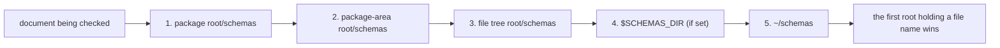

- The package and package area are those of the **document**, not of the
  directory you launched `md` from. `md` searches the roots only for a
  document in a repository; DMLS searches them for any document inside an
  open workspace folder. Outside a repository the file tree root is the tree
  the document was opened in (often its own folder).
- `SCHEMAS_DIR` names the schemas folder **itself**, which can be any folder
  you choose: with `SCHEMAS_DIR=/opt/team/dm-defs`, files are read from
  `/opt/team/dm-defs/`, never from `/opt/team/dm-defs/schemas/`. It must be an
  absolute path; an empty or relative value adds no root and
  `md schema triggers` reports it as invalid.
- A folder that does not exist is skipped. A root that names the same folder
  as an earlier one (say `SCHEMAS_DIR` pointing at `~/schemas`) is searched
  once, at the earlier position.
- A folder Darkmatter cannot inspect or read is an **error**, never a skipped
  root. If `locked/` has mode `000`, a root at `locked/anchor/schemas/` stops
  trigger discovery and bare-name `$schema` lookup with an I/O error naming
  that folder, so a `policy.yaml` in a later root such as `~/schemas/` can
  never stand in for the one you could not read. `md schema validate` and
  `md schema triggers` report the error and show no partial result; DMLS
  reports it on the document's `$schema` (or the top of its frontmatter).
- `schemas/` folders anywhere else, such as `{package}/docs/schemas/`, are
  not searched.
- Both values come from the environment the process started with. DMLS reads
  them when the editor starts the server, so a GUI editor that lacks a shell
  variable lacks `SCHEMAS_DIR` too; restart the server after changing it.

#### Matching a path with `$path`

`$path` takes one or more [glob references](#files), the same
patterns `match()` uses, and matches when some positive pattern admits the
document and no `!` pattern does:

```yaml
kind: schema-trigger
match:
    $path:
        - "^docs/**"     # docs/ of the document's package, area, or repository
        - "!**/_*.md"    # but never a file whose name starts with `_`
$schema: docs.yaml
```

- A pattern whose glob names no folder (`SKILL.md`, `*.md`) also matches that
  file name at any depth.
- A bare, `./`, or `../` pattern is read from the folder that holds the
  trigger's `schemas/` folder, so a package trigger's `*.md` matches every
  Markdown file in the package. A trigger in `SCHEMAS_DIR` or `~/schemas` lives
  outside your repositories, so its bare patterns are read from the checked
  document's file tree root: `docs/*.md` there matches `{repo}/docs/x.md`,
  not `{repo}/pkg/docs/x.md`. Prefer `&`, `^`, or `**/` in user-level
  triggers; they say which root they mean.
- `&`, `^`, `~`, and absolute paths are allowed. `~/notes/**` is how a
  trigger in `~/schemas` applies across all of your notes.
- `@`, `%`, `vault:`, and a `{{VAR}}` **anywhere** in a pattern are
  definition errors naming the pattern: whether a schema applies must not
  depend on the launch directory, vault configuration, or an arbitrary
  environment variable. So are an invalid glob and a list of only `!`
  patterns.

Property conditions reuse SimplifiedSchema type expressions. A condition
without `required` is a guard: absence is allowed, but a present value of the
wrong type defeats the match. `required` makes it a presence gate, except on
a [null-admitting](#null-admitting-properties) type: `steps: unknown(required)`
is only a guard and cannot satisfy the vacuity rule below, while
`steps: unknown[](required)` is a gate that requires a list. Match-safe
constraints are limited to structural types plus pure constraints such as
`required`, `enum`, `pattern`, length/range, item-count, and key-count.
Stateful or phase-specific constraints (`eager`, imports, `example`,
`default`, and `generated`) are rejected in trigger matches.

The match grammar supports freely nested `all`, `group`, `none`, and
`min-match: { count, of }` combinators. A list under `match:` is AND: every
entry must match. OR is always an explicit `group:` mapping whose entries are
alternatives:

```yaml
kind: schema-trigger
match:
    - kind: enum(claudine; required)
    - group:
          - prompt: string(required)
          - steps: unknown[](required)
$schema: claudine.yaml
```

This matches when `kind` is `claudine` **and** `prompt` or `steps` is present.
A mapping under `match:` is one condition whose sibling keys AND. A list
entry that is itself a list is a load error (write a `group:`), and the
removed `any:` combinator is a load error naming `group:`. `$path` is
case-sensitive on every OS (see
[Matching a path with `$path`](#matching-a-path-with-path)). Every way of
satisfying the whole expression must include a satisfiable presence gate or
`$path`; otherwise the trigger is vacuous and a load error. An empty
condition mapping (`{}`) is a load error wherever it appears, including as a
child of a combinator: `none: [{}]` would otherwise make the trigger
unmatchable, and `all: [{}, …]` would hide a dropped condition. A load error
names the field it is about, from `match` down: `` `match[1].group[0]` ``.

Use a concrete type for a presence gate, such as `prompt: string(required)`
or `steps: unknown[](required)`. `unknown(required)` and its alias
`any(required)` admit omission and null, so neither establishes presence.
A concrete type also limits which non-null values select the trigger:
`steps: unknown[](required)` does not match `steps: false`. Write the type for
the values that the target document actually accepts.

Effective precedence is caller baseline, matching trigger payloads (schema
root order and then filename order), then the document's own `$schema`. Trigger
payloads must be merge-compatible object schemas. A payload may declare
[recursive named types](#recursive-named-types), or, as raw JSON Schema, a
root `$defs`; its definitions join the effective schema's root `$defs` under
the rules in [JSON Schema Baseline Restrictions](#json-schema-baseline-restrictions)
and [Merge Semantics](#merge-semantics-baseline--document), and a broken
reference is reported as `SchemaError::TriggerPayloadNotMergeable`. Discovery
recovers per trigger: an opted-in envelope that fails to load, or whose
payload fails to resolve, merge, or compile, is skipped with a
`dm.schema.invalid_trigger` warning, and every valid trigger still applies
(see [Invalid discovered triggers](./schema-triggers.md#invalid-discovered-triggers)).
YAML files that do not [claim the envelope](#which-files-claim-the-envelope)
are ignored without a warning, even when they are not valid YAML. Only
failures that are not about one trigger still fail discovery: a root or a
file in it that cannot be read, a case-fold file-name collision, and an
invalid embedded bundle. Library hosts opt in explicitly with
`DarkmatterSchemas::with_trigger_discovery`; `md compose` and
`md schema validate` opt in for repository-backed files and accept
`--disable schema-triggers`. Use `md schema triggers <file>` to inspect the five
roots (marking absent folders and an unset or invalid `SCHEMAS_DIR`),
shadowing, each top-level condition's result, and defeat explanations. A root it cannot inspect
fails the command with the I/O error instead of a listing:

```text
Schema roots (search order):
1. package root: none (the document is not in a package)
2. package-area root: /repo/claudine/schemas
3. file tree root: /repo/schemas
4. SCHEMAS_DIR: unset
5. home: /home/me/schemas (absent)
```

#### Which files claim the envelope

A schema root also holds ordinary YAML: payloads, named-type libraries, and
files unrelated to Darkmatter. Only a file that **claims** the envelope is
reported when it fails to load, so a scratch file with a syntax error stays
silent. Even a claimed file that fails is only skipped, with a warning; it
never disables the triggers beside it.

- **Valid YAML** claims the envelope when its top-level mapping has
  `kind: schema-trigger`, however the mapping is written (quoted keys and
  JSON-style mappings included). A missing `kind`, or any other string
  (`kind: schema`, `kind: ""`), is ordinary data. `kind: trigger-schema`, the
  spelling before the rename, is a load error naming `schema-trigger`, never
  an ignored file; so is a null or non-string `kind` (`kind:`, `kind: 42`).
- A claimed file without `$schema` is a matcher-only trigger: it loads and
  matches, so `md schema triggers` lists it, but it layers no schema. An
  explicit `$schema: null` is a load error.
- **YAML that does not parse** claims it only when a line declares it the
  conventional way: `kind` at column 0, optional spaces, `:`, then exactly
  `schema-trigger` (plain, single-quoted, or double-quoted), optionally
  followed by whitespace and a `#` comment. The same line spelled
  `trigger-schema` claims it too, and fails with the rename error. Windows line endings and an
  initial byte-order mark make no difference.

| Line in a file that does not parse | Claims the envelope? |
| --- | --- |
| `kind: schema-trigger` | yes: a YAML error |
| `kind: "schema-trigger"  # note` | yes: a YAML error |
| `kind : 'schema-trigger'` | yes: a YAML error |
| `  kind: schema-trigger` (indented, so nested) | no: ignored |
| `kind: schema-trigger-extra` | no: ignored |
| `# kind: schema-trigger` (commented out) | no: ignored |
| `kind: schema-trigger` inside a multi-line quoted or block scalar | no: ignored |
| `kind: schema`, or no `kind:` line at all | no: ignored |

This fallback recognizes only a conventional block-mapping declaration. A
malformed flow mapping (`{kind: schema-trigger, match: …`) or an unusual key
spelling is ignored when it does not parse. The limit affects only how a
broken file is recovered from; valid YAML is classified from its parsed
mapping as above.

A claimed file that is not valid YAML is skipped with a warning whose reason
names the YAML problem and its position (`SchemaError::TriggerEnvelopeYaml`,
the cause of the discovery's `InvalidTriggerFinding`), not the match grammar.
With this `schemas/note-trigger.yaml`:

```yaml
kind: schema-trigger
match:
    kind: literal(note; required)
description: Note: a colon here breaks YAML
$schema: note.yaml
```

```text
ignoring invalid schema trigger …/schemas/note-trigger.yaml: not valid YAML at line 4, column 18:
mapping values are not allowed in this context
```

The line and column are one-based, and the column counts characters. The
usual cause is a plain value that contains `: ` or ` #`, or starts with an
indicator such as `@` or `*`; quote it
(`description: "Note: a colon here is fine"`). DMLS publishes the warning on
the trigger file at the start of the reported line. While the file is open,
the editor's own authoring check reports the YAML problem as an error
starting at the reported position instead. Problems in a file that parses (a
bad `match`, or none at all) are reported with the schema-trigger match or
envelope reason.

#### Embedded trigger bundles

A program that uses Darkmatter as a library can ship trigger schemas inside
its own binary, so they apply even where no schema file is installed. It
hands Darkmatter an `EmbeddedSchemaBundle`: a bundle name plus
`(file name, text)` pairs, usually from `include_str!`. Darkmatter ships no
bundle of its own; the `md` CLI and DMLS register none.

```rust
use darkmatter::markdown::schemas::{DarkmatterSchemas, EmbeddedSchemaBundle};

const BUNDLE: EmbeddedSchemaBundle = EmbeddedSchemaBundle::new(
    "my-tool",
    &[
        ("my-tool.yaml", include_str!("../schemas/my-tool.yaml")), // kind: schema-trigger
        ("steps.yaml", include_str!("../schemas/steps.yaml")),     // kind: schema
    ],
);

let schemas = DarkmatterSchemas::new(document_context)
    .with_trigger_discovery()?
    .with_embedded_trigger_bundle(BUNDLE)?;
let report = schemas.validate(&markdown)?;
```

The bundle is the **last** place triggers are looked for:

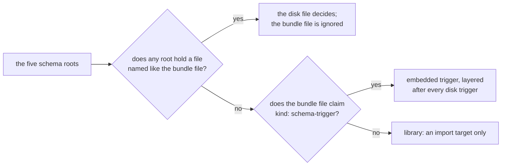

- A file of the same name in any schema root replaces the bundle's file,
  whatever that disk file holds: a matching trigger, a trigger that does not
  match the document, a plain schema, or a broken trigger. A broken disk
  trigger is skipped with a warning; the bundle never stands in for it.
- An embedded trigger's `$schema` and every import in it
  (`steps: step[]@./steps.yaml`, imports inside the imported library, and
  `@this`) resolve among the bundle's own files, by name, without touching
  the disk. `../` cannot leave the bundle, and a name the bundle lacks is an
  error. A disk trigger never imports a bundle file: its `./steps.yaml` must
  exist on disk.
- A malformed embedded trigger, or one whose payload does not resolve, is
  skipped with a warning naming `embedded:{bundle}/{file name}`, never a file
  path; its name stays claimed from later bundles. A bundle whose name is not
  one plain folder name, or whose file names are not distinct plain
  `.yaml`/`.yml` names, is rejected when registered.
- Embedded triggers add no dependency edges: they cannot change while the
  program runs.
- The trigger trace (`trace_registry`, which `md schema triggers` prints for
  disk triggers) shows an embedded trigger as `embedded:{bundle}/{file name}`.

`EffectiveSchema.origins` names the winning declaration of each top-level
property. The rule is the same for disk and embedded triggers: the document's
own `$schema` wins, otherwise the last matching trigger that declares the
property, otherwise the baseline. For a trigger origin,
`SchemaOrigin::trigger_source()` returns `TriggerSource::File(path)` for a
schema-root file or `TriggerSource::Embedded { bundle, name }` for a bundle
file; `SchemaOrigin::file()` returns a path only for a real file, so an
embedded origin is never shown as one:

```rust
if let Some(TriggerSource::Embedded { bundle, name }) = effective.origins["model"].trigger_source() {
    assert_eq!((bundle.as_str(), name.as_str()), ("my-tool", "my-tool.yaml"));
}
```
