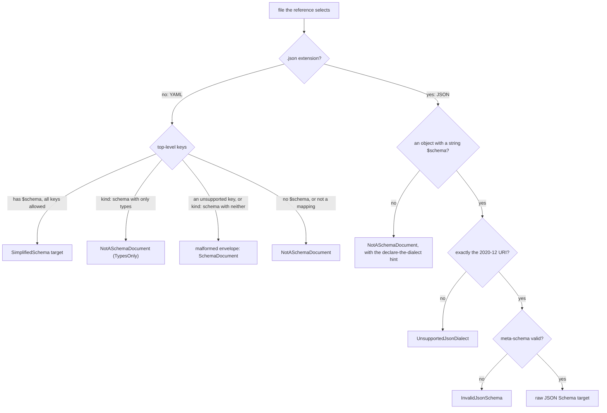
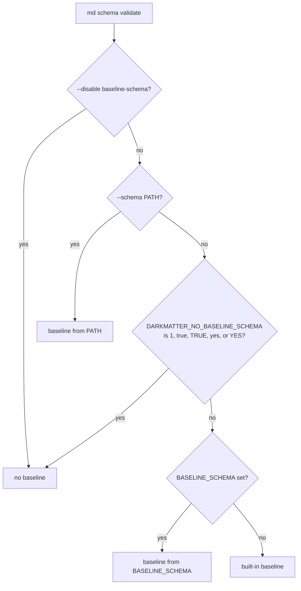
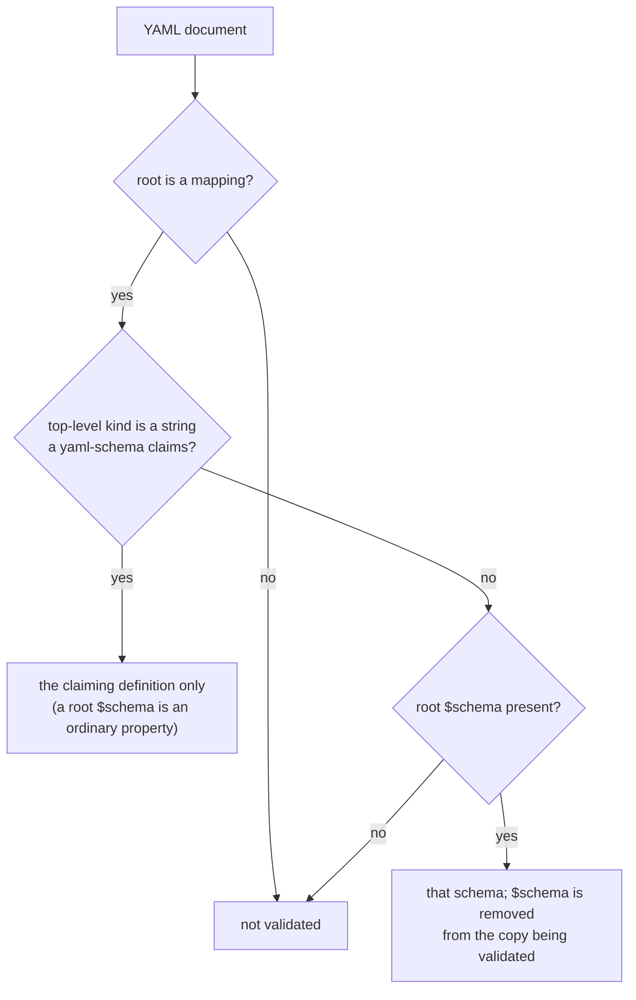
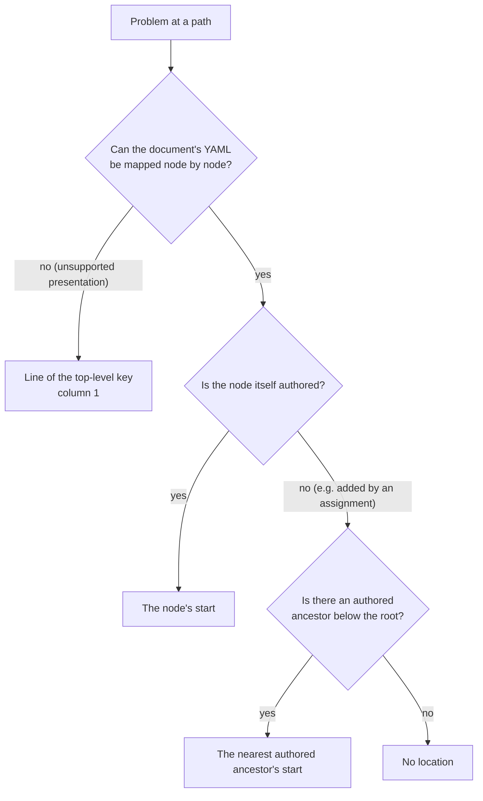
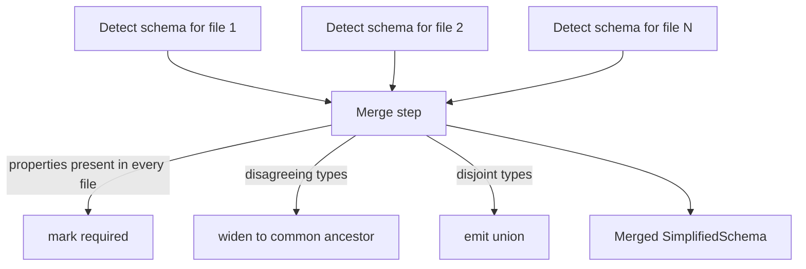
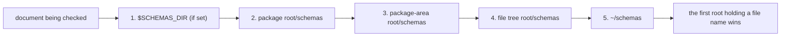
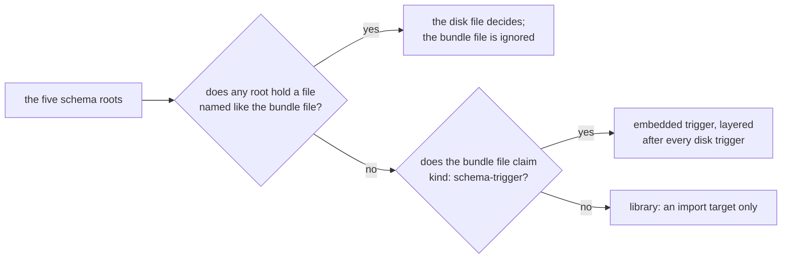

# Schema Definition

Darkmatter can **define**, **detect**, and **evaluate** schemas for Markdown frontmatter. Authors declare the shape of their frontmatter with **SimplifiedSchema** — a single-line YAML grammar that compiles deterministically to a Draft 2020-12 JSON Schema. Every validation runs through the `jsonschema` crate; SimplifiedSchema is a surface, not a parallel validator.

This topic covers how Darkmatter applies schemas: the `$schema` property, the baseline, whole YAML documents, standalone validation and detection, and validation within the compose pipeline. The SimplifiedSchema language itself is documented with its library; see [The SimplifiedSchema Language](#the-simplifiedschema-language).

## What You Get

- A `$schema` frontmatter property that can hold an inline schema, point at a YAML/JSON file, or list a root-level union.
- A **baseline schema** that every document inherits. Darkmatter ships a built-in one, compiled into the library, which `md compose`, `md schema validate`, and DMLS apply by default.
- Validation of whole **YAML documents** (`.yaml`, `.yml`), selected by the document's `kind` or its root `$schema`; see [YAML Documents](#yaml-documents).
- A `md schema validate` CLI subcommand with `pretty` and `json` output.
- A `md schema detect` CLI subcommand that infers a SimplifiedSchema from existing documents.
- A library API ([`DarkmatterSchemas`](#library-api)) for embedding the same behavior.
- Schema-aware completion hints for downstream shell-completion tooling.

## The `$schema` Frontmatter Property

`$schema` is **reserved** by Darkmatter inside frontmatter. Its value may be:

1. An inline **SimplifiedSchema** dictionary.
2. A string `FileReference` (resolved via `biscuit-file`) to a YAML schema document with a top-level `$schema`, or a `.json` JSON Schema declaring Draft 2020-12; see [What a `$schema` Reference May Point At](#what-a-schema-reference-may-point-at).
3. A YAML sequence — a [root-level union](../../../../simplified-schema/docs/topics/language/unions.md#root-level-unions) where each arm is a complete object schema.

The key is stripped from the frontmatter before validation, so a raw JSON Schema with `additionalProperties: false` will not reject every document for carrying a `$schema` field.

```yaml
---
$schema:
    title: "string(required)"
    tags:  "string[]"
---
```

```yaml
---
$schema: ./schemas/post.yaml
---
```

A bare file name such as `$schema: post.yaml` is looked up in the
[schema roots](#schema-roots), in order; write `./post.yaml` for a file beside
the document. The roots are searched only where they apply (a document in a
repository for `md`, inside an open workspace folder for DMLS); elsewhere a
bare name is a file beside the document, and an absolute or `~/` path names a
schema anywhere. A missing file is an error.

### What a `$schema` Reference May Point At

A `$schema` that names a file accepts two kinds of file. Every other file is
an error that names it, so a typo or a stray data file can never silently
validate nothing:

| Target | Valid? |
|---|---|
| A YAML schema document with a top-level `$schema` (a mapping, a [root union](../../../../simplified-schema/docs/topics/language/unions.md#root-level-unions) sequence, or a reference to another schema file) | yes, if the payload and the files it uses are valid |
| A `.json` object declaring `"$schema": "https://json-schema.org/draft/2020-12/schema"` | yes, if it is a valid Draft 2020-12 schema |
| A YAML file with no top-level `$schema`, including a `kind: schema` file that exports only `types` | **no**: import its types with `Name@file.yaml` instead |
| A `.json` file that is not a Draft 2020-12 JSON Schema document | **no** |

The same rules apply to each file arm of a root union, to a schema file
that delegates with `$schema: ./other.yaml`, and to a trigger's payload. The
file's extension decides how it is read: `.json` (in any letter case) is
JSON, everything else is YAML.

#### YAML schema documents

A YAML file is a schema document when its top-level keys form one of these
envelopes:

| Type | Identifier | Allowed top-level keys |
|---|---|---|
| `schema` | `kind: schema` | `$schema`, `types`, `description` (a string), `categories`; each is optional, but at least one of `$schema` or `types` is required |
| informal `schema` | no `kind` | `$schema` (required), `types`, `description` (a string), `categories` |
| `schema-trigger` | `kind: schema-trigger` | match rules and a `$schema` payload; see [Repository Trigger Schemas](#repository-trigger-schemas) |
| `yaml-schema` | `kind: yaml-schema` | `$schema` (required), `types`, `description`, `categories`; it defines a YAML document kind and is never a `$schema` target; see [YAML Documents](#yaml-documents) |

Any other top-level key is a malformed-envelope error. Only a document with
a `$schema` property can be a Markdown document's `$schema` target; a
`types`-only `schema` document is a library that other schemas import from.
A `schema-trigger` file activates by placement and match, never by
reference: naming one in `$schema` is an error that tells you which payload
file to reference instead.

```yaml
# schemas/post.yaml: an informal schema, accepted as a `$schema` target
description: A blog post
$schema:
    title: string(required)
    tags: string[]
```

```yaml
# schemas/people.yaml: a `types`-only library, never a `$schema` target
kind: schema
types:
    person:
        name: string(required)
```

A global catalog such as Darkmatter's own
[`schemas/darkmatter.yaml`](../../../schemas/darkmatter.yaml) is a `kind: schema`
document with a `$schema` mapping. It types the baseline only because the
code registers it; a document whose `$schema` names it gets the catalog's
entries as ordinary, optional document properties.

The full envelope grammar, including `types` and `categories`, is in
[Standalone Schema Documents](../../../../simplified-schema/docs/topics/language/schema-documents.md#standalone-schema-documents).

#### JSON schema files

A `.json` file is a schema only when its root is an object whose `$schema`
is exactly `https://json-schema.org/draft/2020-12/schema`. It is then
checked against the Draft 2020-12 meta-schema, offline; declaring the
dialect does not by itself make the file valid.

| JSON target | Outcome |
|---|---|
| An object declaring the 2020-12 URI | accepted, then checked as a schema (`InvalidJsonSchema` when the meta-schema rejects it) |
| An object with no `$schema`, or a non-object root (array, boolean, number, string) | not a schema (`NotASchemaDocument`); the message suggests declaring `"$schema": "https://json-schema.org/draft/2020-12/schema"` |
| An object declaring another dialect, such as `http://json-schema.org/draft-07/schema#` | `UnsupportedJsonDialect`, naming the declared URI |

```json
{
  "$schema": "https://json-schema.org/draft/2020-12/schema",
  "description": "A blog post",
  "type": "object",
  "properties": { "title": { "type": "string" } },
  "required": ["title"]
}
```

#### How a target is classified



Every error names the file and the reason; the
[Diagnostics](../../../../simplified-schema/docs/topics/diagnostics.md#when-a-file-is-not-a-schema-target)
page lists each reason and its hint. A file at the winning location with
invalid contents stays the selected file: its error is reported, and no
copy in a later schema root is tried in its place.

#### The `description` property

Both YAML `schema` forms accept a top-level `description` string, and a JSON
schema has the standard `description` keyword. It says what the schema is
for, and editors show it first when you hover a `$schema` value that names
the file. It does not become a document property and does not affect
validation. In YAML it must be a string (`""` is allowed); any other value
is a malformed-envelope error.

```yaml
kind: schema
description: Frontmatter for release notes
$schema:
    version: string(required)
```

#### Migrating a file that is no longer a target

Two kinds of file that `$schema` once accepted are now rejected.

**Raw JSON Schema written in YAML.** A YAML file whose `$schema` is a
JSON Schema dialect URI, beside JSON Schema keywords, is a malformed envelope,
and the error says to rewrite it as JSON:

```yaml
# schemas/post.yaml: rejected, unsupported top-level key(s): type, properties
$schema: https://json-schema.org/draft/2020-12/schema
type: object
properties:
    title: { type: string }
```

Move it to a `.json` file that declares the 2020-12 URI, and point `$schema`
at the new file (`$schema: post.json`):

```json
{
  "$schema": "https://json-schema.org/draft/2020-12/schema",
  "type": "object",
  "properties": { "title": { "type": "string" } }
}
```

A JSON file without the declaration has no other migration path: add
`"$schema": "https://json-schema.org/draft/2020-12/schema"`.

**A `types`-only file.** A `kind: schema` file with only `types` exports no
document properties, so `$schema: people.yaml` fails with a hint to use a
named-type import. Import the type you need instead:

```yaml
---
$schema:
    author: person@people.yaml
---
```

Or, when the file should describe whole documents, give it a `$schema`
beside its `types`:

```yaml
kind: schema
$schema:
    author: person
types:
    person:
        name: string(required)
```

## The SimplifiedSchema Language

The grammar a `$schema` is written in belongs to the `simplified-schema`
library, and its reference lives there. Darkmatter adds the frontmatter
property above, the baseline, schema triggers, the `md schema` commands, and
the compose-time rules on this page.

- [Types and Constraints](../../../../simplified-schema/docs/topics/language/types.md):
  every type keyword, the universal constraints (`required`, `default`,
  `eager`, `deferred`, …), files, URLs, shell commands, arrays, and tuples.
- [Objects and Named Types](../../../../simplified-schema/docs/topics/language/objects-and-named-types.md):
  inline object literals, `example(...)`, `Name@file` imports, recursive and
  shared named types, pattern keys, and object arity.
- [Unions and Function Signatures](../../../../simplified-schema/docs/topics/language/unions.md):
  property and root unions, named union references, discriminated unions, and
  `function(...)` signatures.
- [Schema Resolution and Standalone Documents](../../../../simplified-schema/docs/topics/language/schema-documents.md):
  how a reference finds its file, and the standalone schema envelope.
- [Conversion](../../../../simplified-schema/docs/topics/conversion.md): the
  conversions soft validation applies before judging a value.
- [Diagnostics](../../../../simplified-schema/docs/topics/diagnostics.md):
  `SchemaError` variants and source-located failures.

## Baseline Schemas

A baseline schema is a SimplifiedSchema or JSON Schema that every validated document inherits. The library exposes:

```rust
let api = DarkmatterSchemas::new(context)
    .with_baseline_from_file("./schemas/baseline.yaml")?;
```

### The Built-in Baseline

Darkmatter's own frontmatter properties (`title`, `last_updated`, `style`,
`ctx`, and the rest) are typed by a built-in baseline: the `fm` declaration of
the global catalog [`schemas/darkmatter.yaml`](../../../schemas/darkmatter.yaml),
authored in [`schemas/partials/fm.yaml`](../../../schemas/partials/fm.yaml) and described
in [`docs/schemas/darkmatter-schema.md`](../../schemas/darkmatter-schema.md).
It also types `content_policy` by importing Content Policy's editor schema:

```yaml
content_policy: "policy[](min(1))@../../../content-policy/schemas/content-policy.yaml"
```

The property is optional and has no default, so a document without it stays
valid and nothing inserts it. A non-null value must be a non-empty list whose
items each match a `policy` entry. Explicit `null` keeps the schema's normal
optional-property behavior, although Content Policy's declaration parser
rejects it (see
[Example: a content policy list](../../../../simplified-schema/docs/topics/language/unions.md#example-a-content-policy-list)).

The baseline and every schema it imports are compiled into the library, so an
installed `md` or `dmls` prepares it outside a checkout, with no schema files
on disk:

- the imports resolve from an internal table keyed by repository-relative
  virtual paths (`darkmatter/schemas/darkmatter.yaml`, its partials under
  `darkmatter/schemas/partials/`, and `content-policy/schemas/content-policy.yaml`). A reference is resolved
  lexically with `/` against the importing path; there is no disk or network
  fallback, so a reference to a path the table does not hold is an error;
- an embedded document is never a file dependency, so DMLS never watches it
  and `EffectiveSchema::dependencies()` does not list it;
- the baseline is prepared and lowered to JSON Schema once per process and
  shared by every caller;
- a structured type the baseline uses at two or more sites is
  [stored once](../../../../simplified-schema/docs/topics/language/objects-and-named-types.md#shared-named-types) under the lowered schema's root
  `$defs`. When a document schema or trigger payload is merged over the
  baseline, those definitions join the merged root, with
  [the merge's key rules](#merge-semantics-baseline--document), and a
  definition only overridden properties reached is dropped.

`darkmatter_base_schema()` is the one definition-free form: it returns the
baseline with every acyclic type expanded at each use, for callers that read
a `SchemaRoot` without a definition table. It accepts exactly what the
lowered baseline accepts.

Resolving the authored `darkmatter.yaml` from a checkout with the ordinary
disk resolver gives the same JSON Schema.

### Lifecycle Event Typing

The baseline types the five lifecycle events `md compose` runs: `initialize`,
`composed`, `failed`, `cancelled`, and `finalize` (see
[Lifecycle](../lifecycle/index.md) for when each runs and what its actions
do). `fm.yaml` imports their types from the shipped `md-lifecycle` partial
through a [reserved reference](../../../../simplified-schema/docs/topics/language/objects-and-named-types.md#reserved-darkmatter-references-namedarkmatterstem):

```yaml
initialize: "md-initialize-stack@darkmatter:md-lifecycle -> actions run before the document composes; shell-free"
composed: "md-stack@darkmatter:md-lifecycle -> actions run after the document composed"
```

Each event takes a list of actions or a dictionary of verbs, and a list item
can be a `when`/`then`/`else` conditional. md's profile is deliberately
tolerant, because the baseline is prepared for every document: a stack is
typed three conditional levels deep, a `then`/`else` body below that is
accepted loosely, and side-effect and expression-function arguments are not
typed; the lifecycle parser still checks all of it when the stack runs. A
host profile built from the `lifecycle` partial can do more: Claudine's
stacks are recursive, typed at every depth, and type every generated verb's
arguments (see [The two lifecycle partials](#the-two-lifecycle-partials)). A
list item in md's profile is one of:

| Item | Example | Typed as |
|---|---|---|
| a communicate verb: `stdout`, `stderr`, `info`, `warn`, `success`, `message` | `info: done` or `info: { text: done }` | short form (a string) or closed long form |
| a flow verb: `stop`, `skip`, `error` | `error: { reason: no title }` | short or closed long form |
| `shell` (not in `initialize`) | `shell: ./publish.sh` | short or long form |
| `set`, a side effect, or an expression function | `set: { status: done }` | the key is checked, its arguments are left to the parser |
| a dictionary of verbs (a bundle) | `{ info: hi, when: draft }` | short forms plus `when` and `no_error` |
| a conditional | `when: draft` with `then:` / `else:` | `when` is an `expression` |
| a bare zero-argument verb | `- stop` | a string; completion suggests md's bare verbs |
| any other action key | `say: hi` | untyped and never suggested |

Action names are offered with `suggest(...)`, not closed with `enum(...)`, so
the last row is deliberate: an action md does not provide, such as another
host's `say` or `retry`, passes the schema and `md compose` ignores it with a
warning. That open arm never matches a verb md provides, nor `when`, `then`,
`else`, or `no_error`, so a misspelled long form of an md verb, or a `shell`
in `initialize`, cannot slip through it:

```yaml
composed:
    - info: "composed {{ title }}"   # valid
    - say: hello                     # valid: not an md verb, ignored by md compose
    - when: draft
      then:
          - warn: still a draft      # valid
failed:
    - info: { message: oops }        # schema error: info's long form takes `text`
initialize:
    - shell: ./prepare.sh            # schema error: no shell in initialize
```

`then` and `else` share one pattern key in md conditionals, which keeps the
baseline small enough to prepare for every document. Two consequences: only
the lifecycle parser, not the schema, requires `then`, and the editor does not
complete `then`/`else` inside these stacks.

The baseline types only md's own event names. A key that only another host
gives meaning, such as Claudine's `start` or `blocked`, is ordinary untyped
frontmatter under the baseline. A host types its own events in its own schema,
which overrides the baseline like any document schema; Claudine's, for
example, declares `composed` and `failed` as `null`, with descriptions naming
its `start` and `blocked`, so a document it handles reports `composed:` as an
error at `/composed`.

#### The two lifecycle partials

| Partial | Holds | Use it for |
|---|---|---|
| `lifecycle` | `<verb>-short` and `<verb>-long` for every verb the lifecycle parser knows, including the verbs only a host provides (`say`, `notify`, `retry`, `proxy`, `prep`, `break`, …) and the side-effect and expression-function verbs generated from Darkmatter's typed catalogs; `interpolation` and `count`; the categories `communicate`, `flow`, `shell`, and `expression`, each a single-action dictionary: exactly one verb in short or long form, with `when` and `no_error` beside it left out of the count (`uncounted-keys`); `bundle`, and `initialize-bundle`, which has no `shell` | building a host's own action types |
| `md-lifecycle` | md's profile: `md-stack`, `md-initialize-stack`, and the item, conditional, and bundle types they are built from | typing a key with exactly md's actions |

Both are types-only: neither ever applies to a document by itself. Every verb
in `lifecycle` has a short form and a closed long form, except `set` (a
mapping of destinations to values) and the variadic `and` and `or`, which have
a short form only. A bundle of several verbs takes short forms only; a
mapping that holds one verb is typed by its category and takes either form,
wherever a stack accepts a dictionary (a whole event, a `then`/`else` body,
a list item). md's stacks accept a single action that way too.

The side-effect and expression-function verbs are typed from their catalog
signatures: `partials/functions.yaml` for expression functions and
`partials/mutations.yaml` for side-effect parameters. The short form is a
single value (for an overload with one argument) or a positional list; the
long form is a closed mapping keyed by parameter name, plus an optional
`no_error: boolean`; each overload is a separate alternative. Every operand is
marked `deferred`, so a whole-value `{{ … }}` template is accepted in its
place and checked when the event runs:

```yaml
start:
    - ensure_file: notes.md                                # (file)
    - ensure_file: [notes.md, "# Notes"]                   # (file, content)
    - ensure_file: { file: notes.md, content: "# Notes" }  # long form
    - min: [1, "{{ fm.x }}"]                               # the template is deferred
    - min: [three, 2]                                      # schema error at /start/4/min/0
```

The types are a projection of the signature, so each generated arm also
carries [`operands(...)`](../../../../simplified-schema/docs/topics/language/types.md#universal-constraints), and validation binds the
value through the verb's runtime registration. Its verdict decides the
literal operands, including the rules no type spells: `number` and `round`
recover a subject that is not a number through their fallback, `length`
refuses a boolean, and a call two overloads accept only after conversion is
ambiguous:

```yaml
start:
    - number: [pear, 7]     # valid: the fallback supplies 7
    - length: [true]        # schema error at /start/1/length/0: length does not accept a boolean
```

The catalog function `set(key, value)` is not generated, because the
lifecycle verb `set` owns the name. `side-effect-verb` and
`expression-function-verb` remain in the partial as the former untyped
values; no shipped host uses them.

These generated types, and their keys in `expression`, `bundle`, and
`initialize-bundle`, sit between `# BEGIN GENERATED <region>` and
`# END GENERATED <region>` lines (regions `types`, `expression`, `bundle`, and
`initialize-bundle`). They are written by
`darkmatter::lifecycle::schema_projection`; never edit them by hand. When a
catalog signature changes, regenerate them and commit the YAML:

```sh
just regen-lifecycle-schema                          # from darkmatter/
just -f darkmatter/justfile regen-lifecycle-schema   # from the repository root
```

The recipe runs
`cargo run -p darkmatter --example lifecycle_schema_generator -- --write`;
without `--write` the example prints the projection to stdout. The drift test
`the_generated_regions_are_byte_identical_to_a_regeneration` in
`lib/tests/l1/lifecycle_schema_generation.rs` fails when a checked-in region
no longer matches the catalogs.

A host schema reuses a verb or a category by reference:

```yaml
kind: schema
types:
    start-action:
        - communicate@darkmatter:lifecycle
        - shell@darkmatter:lifecycle
        - "{ say: say-short@darkmatter:lifecycle }"
```

### Selecting the Baseline

Each entry point chooses its baseline separately:

| Entry point | Default | Replace with | Opt out with |
|---|---|---|---|
| `md schema validate` | built-in baseline | `--schema <path>`, `BASELINE_SCHEMA` | `--disable baseline-schema`, `DARKMATTER_NO_BASELINE_SCHEMA` |
| `md compose` | built-in baseline | `--baseline-schema <path>` | `--disable baseline-schema`, `DARKMATTER_NO_BASELINE_SCHEMA` |
| DMLS | built-in baseline, then [extension baselines](./dmls-schema-support.md#extensibility-through-configuration) | — | — |
| `DarkmatterSchemas` | none | `with_baseline(...)`, `with_baseline_from_file(...)`, `with_darkmatter_baseline_json_schema()` | — |

```rust
let api = DarkmatterSchemas::new(context)
    .with_baseline_from_file("./schemas/baseline.yaml")?;
```

`DARKMATTER_NO_BASELINE_SCHEMA` disables the baseline only for the exact
values `1`, `true`, `TRUE`, `yes`, and `YES`. Any other value, such as `0`,
`True`, or ` yes`, leaves it on.

**Resolution order for `md schema validate`.** The first rule that applies
wins:



1. `--disable baseline-schema` validates with no baseline. It cannot be combined
   with `--schema`; passing both is a usage error that exits `2` before any
   file is read.

   ```bash
   md schema validate post.md --disable baseline-schema
   ```

2. `--schema <path>` replaces the built-in baseline, even when
   `DARKMATTER_NO_BASELINE_SCHEMA` is set.

   ```bash
   DARKMATTER_NO_BASELINE_SCHEMA=1 md schema validate post.md --schema ./schemas/baseline.yaml
   # validates against ./schemas/baseline.yaml
   ```

3. A disabling `DARKMATTER_NO_BASELINE_SCHEMA` validates with no baseline and
   ignores `BASELINE_SCHEMA`.

   ```bash
   DARKMATTER_NO_BASELINE_SCHEMA=1 BASELINE_SCHEMA=./schemas/baseline.yaml md schema validate post.md
   # no baseline
   ```

4. `BASELINE_SCHEMA` replaces the built-in baseline.

   ```bash
   BASELINE_SCHEMA=./schemas/baseline.yaml md schema validate post.md
   ```

5. Otherwise the built-in baseline applies.

   ```bash
   md schema validate post.md
   ```

Both environment variables are read from the environment the command was
started with. A custom path, from `--schema` or `BASELINE_SCHEMA`, takes the
same reference forms as a file argument and resolves from the directory the
command was started in, not from the document. A custom baseline that cannot
be found or loaded exits `2` and never falls back to the built-in baseline or
to none.

Opting out removes only the baseline. A document's own `$schema` and matching
[trigger schemas](#repository-trigger-schemas) still apply, and `--disable schema-triggers`
turns off triggers independently of the baseline.

**Compatibility.** Because every built-in property is checked by default, a
document with no `$schema` can now fail `md schema validate`, exactly as it
fails `md compose`. Given:

```yaml
---
last_updated: not-a-date
---
```

`md schema validate post.md` exits `1`, because `last_updated` is a `date`.
`md schema validate post.md --disable baseline-schema` or
`DARKMATTER_NO_BASELINE_SCHEMA=1 md schema validate post.md` exits `0`, as it
did before the built-in baseline was the default.

### JSON Schema Baseline Restrictions

When the baseline is a JSON Schema (rather than a SimplifiedSchema), it is restricted to **simple object schemas**. The merge algorithm operates on a property-name-keyed deep merge and cannot reason about arbitrary JSON Schema features.

Allowed root keys: `$schema`, `type`, `properties`, `required`, `additionalProperties` (`true` or `false`), `description`, `title`, and `$defs`.

Any other root construct — `$ref`, `allOf`, `anyOf`, `if`/`then`/`else`, `patternProperties`, a schema-valued `additionalProperties`, etc. — produces `SchemaError::Baseline` at load time. The same contract applies to a trigger payload, reported as `SchemaError::TriggerPayloadNotMergeable`.

A baseline with `additionalProperties: false` (for example a SimplifiedSchema root marked [`closed`](../../../../simplified-schema/docs/topics/language/objects-and-named-types.md#closed-roots-closed)) is admitted, but its closure is never copied into the document: its properties are merged, and the document stays as open or closed as it declares itself. A baseline therefore cannot lock out per-document extensions. See [Layering](../../../../simplified-schema/docs/topics/schema-object.md#layering).

A property may refer to a definition in the baseline's own root `$defs`, including a recursive one:

```json
{
  "type": "object",
  "properties": { "tree": { "$ref": "#/$defs/item" } },
  "$defs": {
    "item": {
      "type": "object",
      "properties": { "label": { "type": "string" }, "kids": { "type": "array", "items": { "$ref": "#/$defs/item" } } },
      "required": ["label", "kids"]
    }
  }
}
```

Those definitions move to the merged root, so the baseline's references must keep their meaning there:

- every `#/$defs/…` reference must name a definition in the baseline's own `$defs`; one that does not is `SchemaError::UnresolvedReference`, naming the reference and its location, whether or not the baseline has a `$defs` at all;
- a baseline with `$defs` must be a valid Draft 2020-12 schema (`SchemaError::Baseline`), and may not use `$id`, `$anchor`, `$dynamicAnchor`, `$dynamicRef`, an external reference, or a local reference outside `$defs` (`#`, `#/properties/…`, the empty reference); each is `SchemaError::UnsupportedMergeReference` with its location;
- a baseline without `$defs` keeps its other reference forms exactly as before: nothing of it moves.

### Merge Semantics (`baseline ⊕ document`)

- Object-level deep merge keyed by property name.
- Where both sides declare a property, the **document side wins entirely** — its type and constraints replace the baseline's. There is no per-constraint interleaving.
- `required` is a property-level concern, so replacing a property removes its inherited `required`. Re-state `required` in the document to preserve required constraint while changing the type.
- Properties present only in the baseline remain in the effective schema.
- Properties present only in the document are added.
- For root unions, the baseline is merged into each arm independently.
- The baseline's `$defs` join the document's root `$defs` (the root of a root union, never an arm). Only the definitions a copied baseline property reaches join; one reached only from properties the document replaces is dropped. The document's keys and references never change. A baseline key the document also uses is shared when both hold the same body and renamed (`item-2`) otherwise, together with every baseline reference to it; literal data that only looks like a reference (`const`, `enum`, `default`, `examples`, and extension annotations) is left byte-for-byte. A root-union arm that declares its own `$id` cannot receive a baseline with `$defs` (`SchemaError::UnsupportedMergeReference`), since references inside it would resolve in that arm.

This semantics is chosen because per-constraint merging produces surprising results (e.g. a baseline `min(5)` silently shadowing a document `min(3)`).

## YAML Documents

Darkmatter can validate a whole YAML file (`.yaml`, `.yml`), not only the
frontmatter of a Markdown document: a data file, a configuration file, or one
of Darkmatter's own schema and trigger files. A YAML document picks its schema
in one of two ways:

- **By `kind`.** A `kind: yaml-schema` file defines a document _kind_, and
  every YAML document whose top-level `kind` names that kind is judged by the
  definition. This is the way to give a family of files one contract without
  each file pointing at it.
- **By a root `$schema`.** A document whose `kind` no definition claims can
  carry its own `$schema`, exactly as frontmatter does.

Validate one from the command line with
[`md schema validate`](#yaml-documents-on-the-command-line), or from the
library with
[`DarkmatterSchemas::validate_yaml_document`](#validating-from-the-library).
In the editor, DMLS reports the same judgment as diagnostics, with
completion and hover from the selected schema (see
[DMLS Schema Support](./dmls-schema-support.md#yaml-documents)).

For example, this definition in a repository's `schemas/roster.yaml` defines
the kind `roster` (see
[Defining a YAML Document Kind](./authoring-schemas.md#defining-a-yaml-document-kind)
for how to write one):

```yaml
kind: yaml-schema
types:
    platform:
        name: string(required)
$schema:
    kind: literal(roster; required)
    roster_version: literal(1; required)
    platforms: platform[](required)
    $constraints: { closed: true }
```

Any YAML document in that repository that says `kind: roster` is then
validated against it, wherever the document lives:

```yaml
kind: roster
roster_version: 1
platforms:
    - name: slack
```

Misspelling `platforms` as `platfroms` fails with an unknown-key problem at
line 3, because the definition's root is closed.

### Which Schema a YAML Document Gets



- **`kind` is read as written, before any conversion.** Only a non-empty
  string can claim a definition. A missing, null, numeric, list, mapping, or
  empty-string `kind` claims nothing, and the document falls through to its
  `$schema`, if any. Kinds compare exactly: `kind: Roster` is not a `roster`.
- **A claimed `kind` wins.** The definition is the document's whole contract,
  and a root `$schema` beside it is just another property, which the
  definition must declare like any other. Under the closed `roster` definition
  above, a `$schema: ./other.yaml` line in a roster is reported as an unknown
  key and the file it names is never read.
- **This is how Darkmatter's own files are judged.**
  [`schemas/darkmatter.yaml`](../../../schemas/darkmatter.yaml) says
  `kind: schema`, so it is validated as a schema document against the shipped
  `schema` definition, never against the global variables it declares. A
  `kind: schema-trigger` file is validated against the trigger definition,
  never against its own `$schema` payload, which describes the Markdown
  documents it matches.
- **An unclaimed document uses its root `$schema`**, in any form a frontmatter
  `$schema` accepts: an inline mapping, a root union, or a reference to a
  SimplifiedSchema or JSON Schema file (see
  [What a `$schema` Reference May Point At](#what-a-schema-reference-may-point-at)).
  A bare file name is looked up in the [schema roots](#schema-roots) where
  they apply, exactly as for frontmatter: outside a repository (`md`) or every
  workspace folder (DMLS) it is a file beside the document. The
  `$schema` key is removed only from the copy being validated, so a closed
  schema never sees it, while lines and columns still count it.
- **A `$schema` that is present must be valid.** `$schema: null`, a number,
  `""`, or a root union with a non-schema element is a schema error, never
  treated as "no schema". So is a `$schema` naming a trigger file or a
  `kind: yaml-schema` file.
- **With neither**, the document is not validated (`YamlOutcome::NoSchema`).
  Scalar, sequence, and empty documents are never validated either.

Where `kind: yaml-schema` definitions are found, and what happens when two
claim the same kind or one is broken, is described in
[Schema Discovery](./schema-discovery.md).

### Loading a YAML Document

The file is read as exactly one YAML document:

- A leading `---` and a trailing `...` are YAML document markers, not
  frontmatter fences; the file needs neither.
- A leading byte-order mark and CRLF line endings are accepted.
- Malformed YAML, a second document, a duplicate key, a mapping key that is
  not a string, and a number the [numeric model](../numbers.md) rejects
  (such as `9007199254740993`, which no `f64` holds exactly) are load
  errors (`SchemaError::SchemaDocument` naming the file, with the byte span
  of the failure when the parser reports one). Quote a key such as `1:` or
  `true:` to keep it as text.

```yaml
---
kind: roster
roster_version: 1
platforms: []
...
```

### How a YAML Document Is Validated

- **Only the selected schema applies.** No baseline schema and no
  [trigger](#repository-trigger-schemas) layers apply, on either route, even
  when the `DarkmatterSchemas` instance was configured with them. A YAML file
  is not a Markdown document, so frontmatter properties such as `title` mean
  nothing to it.
- **Validation is soft and changes nothing.** Values are
  [converted](../../../../simplified-schema/docs/topics/conversion.md) on a
  copy before they are judged, and the file is never written back. With
  `port: number(integer)`, `port: "8080"` passes and `port: "2.5"` fails.
- **Templates and shell text are data.** A YAML document is not composed,
  so a whole-value `"{{ count }}"` or `"$(date)"` is an ordinary string: it
  fails a `number` property and passes a `string` one, and it is never
  deferred as a pending value.
- **Locations refer to the file as written.** Lines count from the first line
  of the file, including a leading `---`, and the
  [Problem Locations](#problem-locations) rules choose the node, as they do
  for frontmatter.

### Kind Checks

Darkmatter's own kinds have rules that their definitions cannot express, such
as whether a trigger's `$path` glob is valid. Once a document satisfies its
definition, these checks run on the same document and add their problems to
the same report:

| Kind | What is checked |
|---|---|
| `schema` | the schema document parses as a schema: category entries, categories that `category(...)` uses but `categories` does not declare, duplicate or disagreeing overloads; and every named-type import resolves |
| `schema-trigger` | the trigger grammar: each `$path` glob, an empty `match` list, a vacuous match, `min-match` count bounds, and match-safe conditions (see [Repository Trigger Schemas](#repository-trigger-schemas)) |
| `yaml-schema` | its exported `$schema` prepares and claims a finite set of kinds |

A kind check is an error in the file itself, with the problem code
`KindCheck` (diagnostic code `dm.schema.kind_check`), located at the node it
is about. A document that fails its definition reports only the definition's
problems, so nothing is reported twice.

Kind checks judge meaning, never shape. The selected definition alone
decides which keys a document may have and what type each value is, and the
checks read the values as that definition accepted them (converted, so
`categories: [2024]` is read as the category `"2024"`). In a source checkout
of this repository the selected definition can be an edited copy of a
shipped one (see [Schema Discovery](./schema-discovery.md)): with the root
`$constraints: { closed: true }` line removed from the copy of
`schema-trigger.yaml`, a trigger with an extra `note: hi` key passes, and
its `$path` globs are still checked. What a document imports (`Name@file`)
is loaded directly and is still checked against the definitions built into
the binary. A kind defined in your own
`yaml-schema` has no kind checks: its definition is its whole contract.

```yaml
kind: schema-trigger
match:
    all:
        - $path: "@/docs/**"
        - title: string(required)
```

This trigger satisfies its definition, but `$path` cannot use `@`, so the
report holds one `kind_check` problem at line 4, column 18, the quoted glob.
The same defect found while discovering triggers for a Markdown document is a
warning instead; see
[Invalid discovered triggers](./schema-triggers.md#invalid-discovered-triggers).

### When a Kind Cannot Be Selected

When a document's string `kind` cannot be settled, validation fails with
`SchemaError::KindSelection { kind, cause }` rather than falling through to
its `$schema` or to "not validated":

| `cause` | When | Message after ``cannot select a schema for `kind: roster`:`` |
|---|---|---|
| `Duplicate { files }` | two or more definitions claim the kind | `` it is claimed by more than one definition: `…/a.yaml`, `…/b.yaml` `` (sorted by path) |
| `Reserved { file, defect }` | the one definition that claims it failed | `` its definition `…/roster.yaml` failed: … `` |
| `Unavailable { file, defect }` | no healthy definition claims it, and a definition failed before showing what it claims | `` schema selection is unavailable: definition `…/broken.yaml` failed before revealing its kind: … `` |
| `RootUnreadable { root, defect }` | a schema root could not be read | `` schema root `…/schemas` could not be read: … `` |

A document with no string `kind` is never affected by these failures. The
failed definition's own defect is reported when that file itself is
validated. [Schema Discovery](./schema-discovery.md#when-a-definition-fails)
explains each case.

### Validating from the Library

`DarkmatterSchemas::validate_yaml_document(text, path)` validates the text of
the YAML document at `path`. Build the `DarkmatterSchemas` with the
**document's own** file-resolution context: its schema roots supply the kind
definitions, and its folder resolves the document's relative file values.

```rust
use darkmatter::markdown::compose::{RequestSnapshot, build_resolution_context};
use darkmatter::markdown::schemas::{DarkmatterSchemas, YamlOutcome};
use std::path::Path;

let path = Path::new("/work/repo/config/roster.yaml");
let text = std::fs::read_to_string(path)?;
let context = build_resolution_context(&RequestSnapshot::new("/work/repo/config"))?;

match DarkmatterSchemas::new(context).validate_yaml_document(&text, path)? {
    YamlOutcome::NoSchema => println!("no schema selected"),
    YamlOutcome::Validated(validation) => {
        println!("validated by {}", validation.definition);
        for problem in &validation.report.problems {
            eprintln!("{:?}:{:?} {}", problem.line, problem.column, problem.message);
        }
    }
}
```

Without a registry of its own, each call builds the kind registry for its
context with `KindRegistry::from_filesystem(&context, RegistryScope::for_context(&context))`.
To validate many documents that share one context, build it once and pass it
with `with_kind_registry`; the registry must have been built for that same
context:

```rust
use darkmatter::markdown::schemas::{DarkmatterSchemas, KindRegistry, RegistryScope};
use std::sync::Arc;

let registry = Arc::new(KindRegistry::from_filesystem(&context, RegistryScope::for_context(&context)));
let schemas = DarkmatterSchemas::new(context).with_kind_registry(registry);
```

| Item | Purpose |
|---|---|
| `YamlOutcome` | `NoSchema` (nothing was checked) or `Validated(YamlValidation)`. |
| `YamlValidation` | `route` (`Route::Kind(kind)` or `Route::RootSchema`), `report` (a `ValidationReport`), `definition` (what validated it: a definition file's path, `built-in <path>` for a shipped definition, the `$schema` reference, or the text "the inline `$schema`"), and `byte_range(&problem)`, the byte range of a problem's token in the validated text. |
| `KindRegistry` | The kinds one context can select. `from_filesystem(context, scope)` reads the schema roots from disk; `build(context, source, scope)` reads them through a `SchemaRootSource`, so an editor can supply unsaved buffers, also in a root whose folder does not exist yet (`absent_root_files`; run it inside `simplified_schema::resolve::buffers::with` for definitions' imports to read them too); `shipped()` holds the shipped definitions alone. `claim(kind)` and `claims()` read it; `incomplete()` and `root_failures()` list what it could not read; `dependencies()` and `searched_locations()` say which files and folders to watch before reusing it. |
| `LoadedYamlDocument` | A document `load(text, path)` admitted, for `validate_loaded_yaml_document`; `validate_yaml_document` is the two in one. `declaration_key()` hashes its `kind` and root `$schema`, the parts a contract is prepared from. |
| `YamlContract` | The selected schema, resolved and compiled: `prepare_yaml_contract(&document)` (`None` when no schema is selected). `validate(&document)` judges any text of the document with the same `declaration_key()`, without resolving or compiling again; it is passive unless `checks_read_files()` (a `schema` or `yaml-schema` document's checks resolve its own imports). `validate_loaded_yaml_document` is the two in one. |
| `RegistryScope` | `WithRoots` (shipped definitions plus the schema roots) or `ShippedOnly`. `for_context` chooses `WithRoots` inside a repository and `ShippedOnly` outside one, as `md` does. |
| `Claim`, `DefinitionSource`, `Incomplete` | In `darkmatter::markdown::schemas::yaml_documents`: a kind's claim (`Healthy`, `Duplicate`, `Reserved`), where a definition came from (`Shipped(path)` or `File(path)`), and a failure that leaves the registry unable to rule a kind out. |

`validate_yaml_document` returns `Err` for a load error
(`SchemaError::SchemaDocument`), a `KindSelection` error, every resolution
error of a root `$schema`, and validator-construction errors. A document that
was judged, valid or not, is `Ok(YamlOutcome::Validated(..))`.

A referenced schema file that fails to load is also a
`SchemaError::SchemaDocument`, so to tell the document's own load error from
its schema's, load and validate in two steps. `md schema validate` does this
to exit `3` for the first and `2` for the second:

```rust
use darkmatter::markdown::schemas::LoadedYamlDocument;

let document = LoadedYamlDocument::load(&text, path)?; // the document's load error, only
let outcome = DarkmatterSchemas::new(context).validate_loaded_yaml_document(&document)?; // selection and schema errors
```

An editor that judges a document on every keystroke prepares the contract
once and validates each new text against it while the declaration holds:

```rust
let contract = schemas.prepare_yaml_contract(&document)?; // reads and compiles
if let Some(contract) = contract {
    let edited = LoadedYamlDocument::load(&edited_text, path)?;
    if edited.declaration_key() == document.declaration_key() {
        let validation = contract.validate(&edited); // no resolution, no compilation
    }
}
```

## CLI: `md schema validate`

```
md schema validate <FILE_OR_PROP=VALUE>... [--schema <path> | --disable baseline-schema] [--disable schema-triggers] [--format pretty|json] [--quiet]
```

| Flag                       | Effect                                                                                                 |
|----------------------------|--------------------------------------------------------------------------------------------------------|
| `<FILE_OR_PROP=VALUE>...`  | Markdown or YAML files **and/or** `<prop>=<value>` assignments. A `.yaml` or `.yml` file is validated as a whole [YAML document](#yaml-documents-on-the-command-line). See [Frontmatter Assignments](#frontmatter-assignments). |
| `--schema <path>`          | Custom baseline replacing the built-in one, used even when `DARKMATTER_NO_BASELINE_SCHEMA` is set. See [Selecting the Baseline](#selecting-the-baseline). |
| `--disable baseline-schema`| Validate with no baseline, ignoring `BASELINE_SCHEMA`. Conflicts with `--schema`. See [Policy Flags](../../cli/policy.md). |
| `--disable schema-triggers`| Do not discover or apply [trigger schemas](#repository-trigger-schemas). The baseline is unaffected.   |
| `--format pretty`          | Default. Human-readable, Prose-styled output. One block per file; each problem names its [source location](#problem-locations). |
| `--format json`            | Newline-delimited JSON, one object per file. Pipe-friendly.                                            |
| `--quiet`                  | Suppress success lines; only failures print.                                                           |

### YAML Documents on the Command Line

An argument whose file ends in `.yaml` or `.yml` (in any letter case, judged
on the file the argument opened, so `@service.yaml` counts) is validated as a
whole [YAML document](#yaml-documents): its claimed `kind` or, failing that,
its root `$schema` selects the schema, and nothing else applies.

```bash
md schema validate schemas/roster.yaml data/platforms.yaml
```

- **No baseline, no triggers.** A YAML document is judged by its selected
  schema alone. A batch of YAML files never loads the baseline, so a broken
  `BASELINE_SCHEMA` does not affect it; a batch that also holds Markdown
  loads it for the Markdown files only. `--disable baseline-schema` and
  `--disable schema-triggers` are accepted and change nothing for YAML.
- **No assignments and no `--schema`.** Both concern Markdown frontmatter.
  Every argument is opened before anything is validated, and a batch with a
  YAML file and either one is a usage error (exit `64`) that prints nothing
  on stdout.
- **No schema is not an error.** A YAML file with no claimed `kind` and no
  `$schema`, or whose root is not a mapping, is reported like a Markdown file
  without one: "doesn't have a schema definition so is valid by default", and
  `"schema": null` in JSON.
- **Load errors exit `3`.** A file that is not one admissible YAML document
  (malformed YAML, a duplicate key, a second document) is reported as "is not
  a valid YAML document" with its location, and in JSON with
  `"error": "yaml_parse"` plus `line` and `column`. A `$schema` naming a file
  that fails to load is a schema error of the document (exit `2`), not a load
  error.
- **Selection errors exit `2`.** A kind claimed by two definitions, or by a
  definition that fails, is a schema error naming the definition files.
- **Kind checks.** A problem from the checks Darkmatter's own kinds carry
  beyond their definitions (for example a category used in `types` that
  `categories` does not declare) has `"kind": "kind_check"` in JSON.

```text
$ md schema validate service.yaml
- ✗ the document service.yaml failed schema validation:
    - port "2.5" is not of type "integer": converted to 2.5, which fails integer (whole, below 2^64) (at line 3, column 7)
```

In JSON the `schema` field names what validated the file: the definition of
its kind (for example `built-in simplified-schema/schemas/schema.yaml`), or
the root `$schema` reference (the words "the inline `$schema`" for an inline one).

### Frontmatter Assignments

Positional arguments are classified as either file paths or `<prop>=<value>` assignments. An argument is treated as an assignment when:

1. It contains `=`, **and**
2. The substring before the first `=` is a dot-separated property path (each segment matches `[A-Za-z_][A-Za-z0-9_-]*`).

Any other token is treated as a file path. A literal file whose name contains `=` (e.g. `weird=name.md`) should be disambiguated with `./` — `./weird=name.md` — because `./weird` is not a valid identifier.

Assignments are applied to **every** document's frontmatter map before validation, and they **always override** existing values. This makes it easy to fill in missing `required` properties and check that a document would pass with them supplied.

```bash
# Satisfy a missing required `title`
md schema validate draft.md title=Hello

# Multiple assignments
md schema validate post.md title=Hello count=5 published=true

# Nested keys via dot notation
md schema validate post.md user.email=ken@ken.net user.name=Ken

# Apply the same overrides to several files
md schema validate a.md b.md c.md title=shared
```

**Value parsing.** The right-hand side of each assignment is parsed as a YAML scalar or flow value (via `serde_yaml_ng`). This matches how frontmatter would have parsed the same value if it were written into the document.

| Argument              | Parsed value                                |
|-----------------------|---------------------------------------------|
| `title=Hello`         | string `"Hello"`                            |
| `count=5`             | integer `5`                                 |
| `rating=2.5`          | float `2.5`                                 |
| `published=true`      | boolean `true`                              |
| `tags=[a, b, c]`      | array `["a", "b", "c"]`                     |
| `user={n: Ken}`       | object `{ "n": "Ken" }`                     |
| `title=`              | empty string `""` (not YAML null)           |

Malformed YAML on the right-hand side (e.g. `user={broken`) is reported as a **usage error** with exit code `64` rather than silently treated as a file path. Bare strings with special YAML characters (commas in flow context, leading `&`, etc.) should be quoted in the shell.

**Schema-aware coercion.** When the effective schema declares a top-level property as a string-shaped scalar (`string`, `date`, `datetime`, `time`, `url`, `email`, `enum`, `file`, or `alphanumeric`), the raw right-hand side is stored verbatim as a string instead of being run through the YAML scalar parser. This lets `bar=true` validate against `bar: string(required)`, and `slug=123` against `slug: alphanumeric`, without the shell-quoting acrobatics that would otherwise be needed to keep the literal `"`. Property-level unions follow the same rule when **any** non-array arm is a string-shaped type — the string variant wins so the value is preserved losslessly. A property typed by a [recursive named type](../../../../simplified-schema/docs/topics/language/objects-and-named-types.md#recursive-named-types) is judged by that type's definition: given `node: [string(min(4)), { children: node[] }]` and `label: node`, `label=1.20` stays the text `"1.20"`.

Coercion is intentionally conservative:

- It only fires for **top-level** scalar paths. Nested `user.email=...` paths land inside `object`-typed properties, which are opaque in v1, so the original YAML parse is used.
- Array-typed properties (`tags: string[]`) are excluded so `tags=[a, b, c]` still flows through the YAML flow-sequence parser.
- Schemas that produce no SimplifiedSchema projection — raw JSON Schema input or root-level unions — also fall back to the plain YAML parse.
- `boolean`, `boolish`, `number`, `numberlike`, `object`, `unknown`, `null`, `shell`, and `expression` keep the YAML-parsed value (`shell` and `expression` then turn a number or boolean into text during validation). A number written in the document itself (`slug: 123`) is still a type mismatch for `alphanumeric`. For `boolish` this means a bare `flag=true` is stored as the boolean variant `true`; pass `flag=\"true\"` (or `'flag="true"'`) to get the quoted-string variant.

**Nested assignments.** Dot-separated paths create or merge intermediate objects:

- `user.email=ken@ken.net` on `{ user: { name: "Ken" } }` produces `{ user: { name: "Ken", email: "ken@ken.net" } }`.
- `user.email=...` on `{ user: "scalar" }` replaces the scalar with `{ email: "..." }` — the descent cannot continue into a non-object parent.

**Locations of assigned values.** Problem locations always come from the file as written, so an assigned value has no source of its own. A problem at a path the file already had reports the authored node there, even though the assignment replaced its value. A problem at a newly added nested path reports its nearest authored ancestor; a newly added top-level property has no location (`line` and `column` are `null`). For example, given a schema where `count`, `rating`, and `user.age` are numbers, and this frontmatter:

```yaml
---
count: 3
user:
  name: Ken
---
```

| Assignment | Problem path | Location |
|---|---|---|
| `count=many` | `/count` | line 2, column 8: the authored `3` |
| `user.age=x` | `/user/age` | line 4, column 3: the authored `user` mapping |
| `rating=x` | `/rating` | none |

### Exit Codes

| Code | Meaning                                                                                |
|------|----------------------------------------------------------------------------------------|
| 0    | All files validated successfully.                                                       |
| 1    | One or more files failed validation.                                                    |
| 2    | Schema or baseline could not be loaded (CLI baseline **or** a per-document `$schema`). |
| 3    | At least one file could not be opened, its frontmatter could not be parsed, or a YAML file is not valid YAML. |
| 64   | Usage error (bad flags, malformed `<prop>=<value>` YAML, no files supplied, or an assignment or `--schema` with a YAML file). |

When multiple kinds of failure occur in the same invocation, the more specific failure wins: parse error (`3`) outranks schema-load failure (`2`), which outranks validation failure (`1`).

Passing both `--schema` and `--disable baseline-schema` is rejected as a usage error before any document is read, which exits `2` with a "cannot be used with" message on stderr and nothing on stdout.

### Pretty Output

Given `draft.md`:

```markdown
---
$schema: ./schemas/post.yaml
status: orange
tags:
  - rust
  - 42
---
```

`md schema validate post.md draft.md` prints one block per file:

```
- ✔ the document post.md has a schema definition and is valid based on its $schema ./schemas/post.yaml and the Darkmatter default schema.
- ✗ the document draft.md failed schema validation:
    - title is a required property (at line 2, column 1)
        The post's title
    - status "orange" is not one of "draft", "published" or "archived" (at line 3, column 9)
    - tags/1 42 is not of type "string" (at line 6, column 5)
```

Each bullet starts with the failing path (`tags/1`), or with the missing property's name when the root lacks it, and ends with the problem's [location](#problem-locations) in the complete file: `(at line L, column C)`, `(at line L)` when no column is known, or nothing when the problem has no location.

When the failing property declares a `description` (via `-> ...`, an inline-object
per-property description, or a `description` keyword in a referenced JSON Schema),
that text renders as a dimmed sub-line one indent level beneath the problem bullet.
The sub-line is omitted entirely when the property declares no description, so a
description-less schema produces no extra lines.

For root-union failures, problems are prefixed with `arm[N]`:

```
- ✗ the document post.md failed schema validation:
    - arm[0]: title is a required property (at line 2, column 1)
```

### JSON Output

```json
{"file":"post.md","valid":true,"schema":"./schemas/post.yaml","layers":{"document":{"form":"reference","reference":"./schemas/post.yaml"},"triggers":[],"baseline":{"form":"darkmatter"}},"problems":[]}
{"file":"draft.md","valid":false,"schema":"./schemas/post.yaml","layers":{"document":{"form":"reference","reference":"./schemas/post.yaml"},"triggers":[],"baseline":{"form":"darkmatter"}},"problems":[
  {"path":"","property":"title","message":"\"title\" is a required property","kind":"missing","line":2,"column":1,"arm_index":null,"description":"The post's title"},
  {"path":"/tags/1","property":null,"message":"42 is not of type \"string\"","kind":"type","line":6,"column":5,"arm_index":null,"description":null}
]}
```

Each problem carries a `path` (a JSON pointer; a missing property's `path` is the
mapping that lacks it, `""` for the root), a `property` field (the missing
property's name, when resolvable) and a `kind` field — one of `missing`,
`type`, `invalid`, or (YAML documents only) `kind_check`. `line` and `column` give the problem's
[location](#problem-locations), or are `null` when it has none.

Each problem also carries a `description` field: the failing property's declared
description string when one is resolved, or `null` when the property declares no
description (or the description was suppressed because it was whitespace-only or
byte-for-byte equal to the problem message).

The `schema` field names the document's own `$schema`. It is `null` for a document without one, even when a trigger or a baseline validated it.

The `layers` object says which schema layers judged the document, so a consumer never has to infer it from `schema`:

| Key | Value |
| --- | --- |
| `document` | `null` when the document has no schema of its own; otherwise `{"form": "inline"}`, `{"form": "union"}`, `{"form": "reference", "reference": "./schemas/post.yaml"}`, or, for a YAML document, `{"form": "definition", "reference": "<label>"}` |
| `triggers` | the matching triggers that layered a schema, in layering order: a file trigger as its path, a bundled one as `embedded:{bundle}/{name}`; `[]` when none matched |
| `baseline` | `null` when no baseline applied; otherwise `{"form": "darkmatter"}` for the built-in one or `{"form": "custom", "reference": "./my-baseline.yaml"}` |

The pretty output names the same layers; see [Behavior Without `$schema`](#behavior-without-schema).

Parse errors and schema-load failures emit JSON entries with an `error` key (`"frontmatter_parse"`, `"yaml_parse"`, or `"schema"`) and an empty `problems` array; a `yaml_parse` entry also has the failure's `line` and `column`. A YAML file's problem from one of its kind's own checks has `kind` `"kind_check"` (see [YAML Documents on the Command Line](#yaml-documents-on-the-command-line)).

### Problem Locations

A problem's location points at the authored YAML node that is wrong, not just at the top-level property that contains it. Given a schema in which `then` items allow only `say`:

```yaml
---
start:
  - then:
      - say: hello
      - sya: goodbye
---
```

the unknown-key problem keeps the path `/start/0/then/1` and is reported at line 5, column 9, the `s` of `sya`:

```
    - start/0/then/1 Additional properties are not allowed ('sya' was unexpected) (at line 5, column 9)
```

**Coordinates.** Lines count the complete Markdown file, so the opening `---` is line 1. Columns are 1-based UTF-8 byte columns: a `😀` before the node counts as 4 columns. LF and CRLF line endings give the same line and column.

**Which node.** The problem's kind decides what it points at:

| Problem | Location | Example |
|---|---|---|
| A wrong value (type, constraint, enum, file reference) | the start of the value; for a block list item, after the `- ` | `  - oops`: column 5, the `o` |
| An unknown key (`path` is the parent mapping; the message names the key) | the start of the key itself | `sya` above: 5:9 |
| A missing required property | the start of the mapping that lacks it; for a list item, its first key rather than its dash | `  - name: b`: column 5, the `n` |
| A missing property of the root | the root mapping's first key, after any leading comments or blank lines | `---`, `# draft`, then `title: x`: line 3, column 1 |

Flow collections (`{…}`, `[…]`) written on one line are located node by node too. With `m: {a: 1, b: x}` on line 2, an unknown key `b` is at 2:11 and a wrong value `x` at 2:14.

Paths identify decoded mapping keys. A key `"a/b"` has the JSON Pointer
segment `a~1b`, and `"a~b"` has `a~0b`; both still locate their authored key
or value correctly. The segment `0` selects a key inside a mapping and an
item inside a list. An empty key is `/`, distinct from the empty pointer for
the document root.

**Scalars are one node.** A block scalar (`|`, `>`) or a quoted scalar is located at its start (the indicator or the opening quote). A problem inside its decoded content, such as a `yaml` or `json` value whose embedded document is wrong, reports that start; no position inside the scalar is invented.

**Changes keep their editing location.** Validation uses the original source
even after an assignment, interpolation, or library call replaces a value.
For a file whose second line is `count: 1`, validating the assignment
`count=abc` against `count: number` reports line 2, column 8, where `1` was
authored. It does not claim that `abc` appeared there. A new nested field uses
its nearest authored ancestor: adding `b` to an existing `m: {a: 1}` locates a
problem at the start of that flow mapping. A newly added top-level property
has no authored node or non-root ancestor, so JSON reports `null` for both
`line` and `column`.

**Fallbacks.** When the exact node has no authored source, the location falls back as shown below. Unsupported YAML presentation includes aliases (`*a`), merge keys (`<<`), unquoted `{{ … }}` templates, flow collections spread across lines, and comments inside flow collections. It never changes the validation result or causes an error; it only makes every location in that document coarser.



**Documents without loaded text.** Locations need the text the document was parsed from. A `Markdown` document built in code has no such text, so its locations refer to the serialized YAML of its frontmatter. Source-free validation reports no locations: `EffectiveSchema::validate`, or `validate_with_positions` given the empty `PositionMap::new()`. A library caller holding bare YAML can build a map with `schemas::validate::build_position_map(yaml)`; its lines are relative to that slice, so line 1 is the first YAML line rather than the `---`.

A position map belongs to one source snapshot. Normal document validation
(`DarkmatterSchemas::validate` and its siblings, which `md schema validate`
and `md compose` use) builds it only when the finished report holds at least
one problem, once, and shares it across all of that report's problems. A valid
document, including one checked against the baseline alone or one without any
schema, never builds a map, and neither does a document whose schema cannot be
prepared. Problems are located after the report is settled, so a problem that
is set aside before then (a losing root-union arm, a deferred template) costs
no map either. A caller that passes its own `PositionMap` to
`validate_with_positions` or a sibling keeps that map's positions unchanged.
Lookup does not run expressions, resolve references, or modify frontmatter;
the path, diagnostic identity, and validation outcome remain independent of
whether a precise location is available.

The same locations appear in `md compose`'s [schema-failure block](#error-rendering), and the DMLS language server highlights the same supported nodes in an editor. Editor positions use zero-based lines and the negotiated UTF-8 or UTF-16 encoding; see [DMLS diagnostic ranging](../../../dmls/docs/diagnostics.md#ranging) before comparing them with CLI columns.

### Behavior Without `$schema`

A document without `$schema` has no explicit schema definition, but matching [schema triggers](authoring-schemas.md) and the baseline (the built-in one unless [selected otherwise](#selecting-the-baseline)) still judge it. `pretty` mode says so and names each layer that applied:

- trigger and baseline: `does not have an explicit schema definition but it is valid based on the trigger schema post.trigger.yaml and the Darkmatter default schema.`
- built-in baseline alone: `does not have an explicit schema definition but it is valid based on the Darkmatter default schema.`
- custom baseline alone: `does not have an explicit schema definition but it is valid based on the baseline schema ./my-baseline.yaml.`
- nothing (no baseline, no matching trigger): validation succeeds vacuously and `pretty` mode prints `doesn't have a schema definition so is valid by default.`

A document with `$schema` opens with `has a schema definition and is valid based on` and names its own schema first (`its inline $schema`, `its $schema ./schemas/post.yaml`, or `its $schema union`), then the same trigger and baseline layers.

## CLI: `md schema detect`

```
md schema detect <file>... [--format yaml|json] [--merge]
```

| Flag             | Effect                                                                                                                      |
|------------------|-----------------------------------------------------------------------------------------------------------------------------|
| `--format yaml`  | Default. Emits SimplifiedSchema YAML.                                                                                       |
| `--format json`  | Emits the equivalent Draft 2020-12 JSON Schema.                                                                             |
| `--merge`        | When multiple files are given, union detections: a property is required only if present in every file; types widen to common ancestors. |

Without `--merge`, multiple inputs emit one schema per file with a header comment.

Each document's references are judged from the document itself, the way `md compose` and `md schema validate` resolve them, not from the directory you ran `md` in. A document in another repository finds `./`, bare, `&`, and `^` references in its own repository and `@` references in the launch scope; a document outside every repository keeps the `~` you opened it through; and two spellings of the same path (such as macOS `/var/…` and `/private/var/…`) give the same result. For example, `~/other-repo/docs/plan.md` declares `diagram: './flow.md'` (beside it) and `readme: '&README.md'` (at its repository's root). Run from `~/work/app`, a different repository:

```text
$ md schema detect ~/other-repo/docs/plan.md
# detected from: /Users/me/other-repo/docs/plan.md
$schema:
  diagram: file
  readme: file
```

### Detection Algorithm

For each top-level frontmatter property (excluding `$schema`), the inferred type is:

- boolean scalar → `boolean`
- integer scalar → `number(integer)`
- float scalar → `number`
- ISO-8601 date/datetime/time string → that type
- URL string → `url(scheme(<scheme>))`
- email string → `email`
- string that resolves via `FileReference` to an existing path → `file`
- other string → `string`
- array → recursive item-type inference; mixed items fall back to `unknown[]`
- object → `object` (v1 does not synthesise nested SimplifiedSchemas)

**No constraints are inferred** — detection produces base types only. Patterns, `min` / `max`, enum members, and other constraints are never synthesised from values. All detected properties are marked **optional**: a single sample cannot prove requiredness.

### Multi-File Merge



Type-widening hierarchy:

```
date  ┐
time  ├──> string
url   │
email ┘
number(integer) ──> number ──> numberlike
boolean ──> boolish
file ──> string   (only if the strings stop resolving)
```

When inferred types are **genuinely disjoint** (e.g. `string` and `boolean`), the merger emits a SimplifiedSchema union for that property rather than collapsing to `unknown`:

```yaml
$schema:
    flag:
      - boolean
      - string
```

### Exit Codes

| Code | Meaning                                          |
|------|--------------------------------------------------|
| 0    | Success.                                         |
| 2    | Conversion to JSON Schema failed (`--format json` only). |
| 3    | At least one file's frontmatter could not be parsed. |

## CLI: `md schema about`

```
md schema about
```

`md schema about` is the **implementation-bound reference** for the SimplifiedSchema authoring language. It prints a human-readable report covering schema shapes, the type vocabulary, the `alphanumeric` type options, the constraint vocabulary, inline object rules, validation behavior, and coercion rules. A type's aliases appear under its canonical keyword (`unknown` shows `alias: any`; there is no separate `any` row), and the options table lists each option's effect and the options that make it redundant.

```
SimplifiedSchema Language Reference
  …
  ## Schema Shapes
    - Single object
    - Root-level union
    - Property-level union
    - Inline object literal
    - Nested mapping object
    - Array of a named union
    - Marked union reference
  ## Type Vocabulary
    - string, date, datetime, time, number, numberlike, …
    - unknown (alias: any), null, alphanumeric, shell
  ## Type Options: alphanumeric
    - allow-dashes, allow-underscores, …, leading-alpha
  ## Constraint Vocabulary
    - min, max, not-empty, pattern, default, required, …
  ## Inline Object Rules
    - …
  ## Coercion Rules
    - …
  ## Validation Behavior
    - …
```

The report is rendered from a typed descriptor catalog in
`darkmatter::markdown::schemas` — the **same catalog** library callers consume via
`schema_type_descriptors()`, `schema_constraint_descriptors()`,
`schema_shape_descriptors()`, `inline_object_rule_descriptors()`,
`coercion_rule_descriptors()`, and `validation_behavior_descriptors()`. This
ensures the CLI report and the public descriptor surface cannot drift apart.

The command is **documentation-only** and intentionally has no input files and
no format flags of its own. The **global** `--verbose` flag expands the report
with the inline-object rules, coercion rules, validation behavior, the `ctx.*`
context-variable catalog, and expression-function signatures; the global
`--code-block` flag affects how embedded code blocks render. It performs no
document parsing, no context capture, no `EffectEngine` construction, no file
resolution, and no network access. The only observable side effect is printing
to stdout. The descriptor catalog is a static compile-time constant.

> Use `md schema about` as the implementation-bound CLI reference for the
> schema language. The prose in this document complements it with worked
> examples, motivation, and cross-references; the CLI report reflects the
> exact type, constraint, and shape surface the parser, converter, and
> compose-time coercion understand today.

## Library API

The entry point is `darkmatter::markdown::schemas::DarkmatterSchemas`.

```rust
use darkmatter::markdown::Markdown;
use darkmatter::markdown::compose::{RequestSnapshot, build_resolution_context};
use darkmatter::markdown::schemas::{DarkmatterSchemas, DetectOptions};
use std::path::Path;

// Every `$schema` reference and `file` value resolves through a built
// file-resolution context: there is no constructor without one.
let context = build_resolution_context(&RequestSnapshot::new("/work/blog"))?;

// Build the API with a baseline.
let api = DarkmatterSchemas::new(context)
    .with_baseline_from_file("./schemas/baseline.yaml")?;

// Validate a document.
let md = Markdown::try_from(Path::new("./post.md"))?;
let report = api.validate(&md)?;
if !report.valid {
    for problem in &report.problems {
        eprintln!("{} — {}", problem.path, problem.message);
    }
}

// Build the effective schema explicitly (e.g. to inspect generated JSON Schema).
if let Some(effective) = api.effective_for(&md)? {
    println!("{}", effective.json_schema);
}

// Detect a schema from a corpus.
let docs: Vec<Markdown> = /* ... */ vec![];
let refs: Vec<&Markdown> = docs.iter().collect();
let detected = api.detect(&refs, DetectOptions { merge: true });
```

A whole YAML file is validated with `api.validate_yaml_document(&text, path)`
instead; see [Validating from the Library](#validating-from-the-library).

### Key Types

`DarkmatterSchemas`, `EffectiveSchema`, `ValidationReport`, `PreparationSummary`, `ValidationTimings`, `ValidationOptions`, and `PendingValue` are Darkmatter's, as are the YAML document types (`YamlOutcome`, `YamlValidation`, `Route`, `KindRegistry`, `RegistryScope`) listed in [Validating from the Library](#validating-from-the-library). The rest belong to the `simplified-schema` library, so import them from `simplified_schema`; the [library docs](../../../../simplified-schema/README.md) describe them in full, including the `SimplifiedSchema` object for callers that need the language without Darkmatter's document policy.

| Type                  | Purpose                                                                                                             |
|-----------------------|---------------------------------------------------------------------------------------------------------------------|
| `DarkmatterSchemas`   | Top-level entry point. Holds the request's file-resolution context, an optional baseline, and the LRU validator cache. |
| `EffectiveSchema`     | The fully-resolved schema for a document. Carries the SimplifiedSchema projection (when available), the compiled JSON Schema, the validator, and `origins: SchemaOriginMap` (each top-level property's winning declaration: document, referenced file, trigger, or baseline; see [Embedded trigger bundles](#embedded-trigger-bundles) for reading a trigger's source). |
| `ValidationReport`    | `valid: bool` + `problems: Vec<ValidationProblem>` + `pending: Vec<PendingValue>` (populated only by `validate_with_options`). |
| `ValidationProblem`   | `path` (JSON pointer), `message`, `kind`, `property`, optional `line` / `column` (see [Problem Locations](#problem-locations)), optional `arm_index` for root-union failures, optional `description`; plus the span-aware fields `code: ValidationProblemCode`, `instance_path: JsonPointer`, optional `schema_path`, `offending_property`, and `file_reference: Option<FileReferenceDiagnostic>`. |
| `PreparationSummary`  | What the effective-schema resolution behind `DarkmatterSchemas::validate_summarized` found, returned beside its report: its `layers` and `has_schema()`, which is `false` when no baseline, trigger, or `$schema` applied. |
| `SchemaLayers`        | Which layers an effective schema merged: `document` (the document's own `$schema`), `triggers` (the matching `TriggerSource`s that layered a payload), and `baseline`. Read from `PreparationSummary::layers` or `EffectiveSchema::layers()`. |
| `ValidationTimings`   | Stage breakdown of one validation, from `DarkmatterSchemas::validate_timed` (same result as `validate`, timings on failure too) or `ValidationTimings::record(|| ...)`: per-`ValidationStage` durations (`discover`, `match`, `resolve`, `compile`, `validate`), `total()`, `unassigned()`, `compile_cache()` (`CompileCache::Hit` / `Miss` / `NotRequested`), and `matched_triggers()`. See [Stage timings](../../inline/schema-validation.md#stage-timings--vv). |
| `PositionMap`         | Opaque source positions for one frontmatter snapshot, passed to `validate_with_positions`. `PositionMap::new()` (also `Default`) is empty and source-free; `is_empty()` reports whether any position can be given; `validate::build_position_map(yaml)` builds one from bare YAML. |
| `ValidationProblemCode` | Fine-grained problem taxonomy: `MissingRequired`, `TypeMismatch`, `ConstraintViolation`, `UnknownKey`, `InvalidFileReference`, and `KindCheck` (a YAML document's [kind check](#kind-checks)). |
| `ValidationOptions` / `PendingValue` | Mirror the compose deferral rules as data: `pending_policy` (`Defer` / `Report`) plus `excluded_keys`; a `PendingValue` records a value validation skipped because it is a whole-value `$(...)` shell expression or still holds an unresolved `{{ }}` template. |
| `SchemaRoot`          | A parsed `$schema`: either `Single(SchemaShape)` or `Union(Vec<SchemaArm>)`.                                        |
| `SchemaShape`         | Ordered map of property names to `PropertyDef`.                                                                     |
| `PropertyDef`         | Either `Single(PropertyAtom)` or `Union(Vec<PropertyAtom>)`.                                                        |
| `PropertyAtom`        | `ty`, `is_array`, `constraints`, `array_constraints`, `description`.                                                |
| `SimplifiedType`      | Enum of the supported types (`String`, `Date`, `Number`, …, `Unknown`, `Null`, `Alphanumeric`, `Shell`). `aliases()` lists alternative spellings (`any` for `Unknown`). |
| `AlphanumericOptions` | The canonical option set of an `alphanumeric` type (`PropertyAtom::alphanumeric_options()`), with its allowed and first-character sets (`AsciiCharSet`), `accepts(&str)`, and `pattern()`. |
| `Constraint`          | Enum of all constraint variants (`Required`, `Default`, `Min`, `Max`, `Members`, `Match`, `Suggest`, …).           |
| `SuggestionCandidate` | One interpreted `suggest(...)` argument: decoded text, interpreted value, canonical decimal, byte span.             |
| `SuggestionLintProblem` | One invalid suggestion candidate with decoded text, interpreted value, reason (`SuggestionLintReason`), and exact authored byte span. |
| `SuggestionItem`      | One lint-valid completion candidate: decoded text, interpreted value, YAML-safe insertion text, display label.     |
| `SuggestionQuery`     | Result of `suggestions_for_path()`: `is_array` flag + lint-valid `SuggestionItem`s in declaration order.            |
| `StandaloneSchemaDocument` | Parsed standalone schema file: envelope type, `SchemaRoot` payload, suggestion lint problems.                |
| `SchemaError`         | All failure modes (grammar, resolution, conversion, baseline, validator build, I/O).                                |

### Free Functions

From `simplified_schema`:

- `parse_yaml_schema(&serde_yaml_ng::Value)` — parse a YAML value into a `SchemaRoot`.
- `to_json_schema(&SchemaRoot)` — lower to Draft 2020-12 JSON Schema (`serde_json::Value`).
- `is_subtype(&PropertyAtom, &PropertyAtom)` — whether every non-null value one resolved type accepts is accepted by another; see [Subtype Relation](../../../../simplified-schema/docs/topics/language/subtyping.md#subtype-relation-is_subtype).
- `is_definition_subtype(&PropertyDef, &PropertyDef)` — the same relation over whole property definitions: every leaf alternative of the first is covered by an alternative of the second.
- `lint_suggestions(&SchemaRoot)` — check every `suggest(...)` candidate against its target schema; returns `Result<Vec<SuggestionLintProblem>, SchemaError>`; an invalid candidate is a problem in the list, never an error.
- `suggestions_for_path(&SchemaRoot, &[&str])` — query lint-valid completion candidates for a property path; returns `Option<SuggestionQuery>` with YAML-safe insertion text.
- `parse_standalone_schema_document(&str, path)` — classify and parse a standalone YAML file as a SimplifiedSchema authoring document; returns `Option<StandaloneSchemaDocument>` (`None` for ordinary YAML / raw JSON Schema).

From `darkmatter::markdown::schemas`:

- `EffectiveSchema::validate_for_phase(frontmatter, SchemaPhase)` — validate an already-resolved working instance at `Launch` or `Completion` without mutating it or resolving another schema.
- `detect_schema(&[&Markdown], DetectOptions, &FileResolutionContext)` — multi-file detection entry point; `file` inference resolves through the context derived to each document.
- `detect_schema_with_contexts(&[&Markdown], DetectOptions, &[FileResolutionContext])` — the same with one context per document, for documents that do not share the request's tree.
- `detect_from_document(&Markdown, &FileResolutionContext)` — single-document detection (returns a `SchemaShape`).

Detection is passive: it derives the supplied context to each document and never discovers a repository. A reference that does not resolve is a `string`, and so is every value when that derivation is invalid, so pass a context that admits the document: the request's for a document inside its tree, otherwise the one prepared for that document (in another repository, in none, or opened through another spelling of its path). `md schema detect` passes each argument's document context.
- `schema_to_yaml(&SchemaRoot)` — serialize a schema back to SimplifiedSchema YAML (used by `md schema detect --format yaml`).
- `darkmatter_base_schema()` — the Darkmatter base frontmatter schema (the global catalog's `fm`, authored in `schemas/partials/fm.yaml` and compiled in with the schemas it imports; see [The Built-in Baseline](#the-built-in-baseline)) as a `SchemaRoot` with no definition table: every acyclic type is expanded at each use.
- `darkmatter_base_json_schema()` — the same base schema compiled to an independently owned Draft 2020-12 JSON Schema value, each repeated structured type stored once under its root `$defs`.
- `GlobalCatalog::baseline()` — a catalog's `fm` as a `SchemaRoot` with the definition table its references point into; lower the pair with `to_json_schema_with_definitions`.
- `darkmatter_base_json_schema_ref()` — a read-only borrow of the process-cached JSON Schema, avoiding a deep clone.

Use `DarkmatterSchemas::with_darkmatter_baseline_json_schema()` when configuring
the built-in baseline; each configured instance shares the cached JSON Schema.

### Span-Aware Validation and Normalization

`EffectiveSchema::validate_with_options(frontmatter, positions, &ValidationOptions { .. })` mirrors the compose deferral rules as data: it populates `ValidationReport.pending` for top-level values that are a whole-value `$(...)` shell expression or still hold an unresolved `{{ }}` template and (under `PendingPolicy::Defer`) drops their problems — **without executing anything**. A malformed template (`n: "{{ 1 + }}"`) is never dropped: no rendering can settle it, so its problem is reported as written. `$(...)` text compose never expands (inside a list or mapping, or after other text) is not pending and is judged as written. A whole-value literal token (`{{!data:v1:…}}`) is data: it is never pending, and it is validated as the text it holds. That text is never deferred as a template, at a place marked `deferred` or in a lifecycle verb's operand. `EffectiveSchema::validate_stored(stored, positions, phase)` judges a stored instance the same way, unphased or at a `SchemaPhase`, for a caller that does not want the pending rules. The plain `validate` / `validate_with_positions` entry points are unchanged and always return an empty `pending`. `EffectiveSchema::normalize_frontmatter` performs the eager-`file` value rewrite described in [Files](../../../../simplified-schema/docs/topics/language/types.md#files); the validation-only APIs stay read-only.

### Schema Descriptor Catalog

The descriptor catalog that backs `md schema about` is exposed to library callers. Each function returns a `&'static [...]` slice in a deterministic, stable order:

- `schema_shape_descriptors()` — supported schema shapes and grammar forms.
- `schema_type_descriptors()` — supported type keywords, their aliases (`unknown` lists `any`), display descriptions, the item-level constraint keywords each type accepts (`accepts_constraint("min")`), and any type options. `schema_type_descriptor(name)` finds one by keyword or alias.
- `alphanumeric_option_descriptors()` — the `alphanumeric` type options in canonical order, each with its effect and the options that make it redundant (`block-leading-dash` is redundant without `allow-dashes` or with `leading-alpha`).
- `schema_constraint_descriptors()` — supported constraints, their argument forms, their applicable target types, and their JSON Schema effect.
- `inline_object_rule_descriptors()` — inline object grammar rules and limits (postfix constraints, arrays, nesting depth, identifier rules, description termination, `additionalProperties: false`).
- `coercion_rule_descriptors()` — coercion rules and the matrix of declared-type / incoming-value pairs that fire.
- `validation_behavior_descriptors()` — required/default hoisting, root-schema `additionalProperties: true`, opaque `object`, schema detection limits, and compose-time coercion.

Caller tools (for example Claudine) can render their own schema-language reports from the same descriptors so they never need to scrape CLI output. Parity tests in the darkmatter suite keep the descriptor surface in lock-step with the implemented type and constraint vocabulary, so any grammar addition or removal is caught during development.

### Validator Cache

`ValidatorCache` (`simplified_schema::validate`) keys compiled validators by the xxHash (XXH64, via `biscuit-hash`) of the canonicalised JSON Schema bytes plus the schema's base directory, launch-area fallback, repository anchors, and the origins of caller-supplied properties, and is bounded by an LRU policy. `validator_for(schema, base_dir, &context)` takes the request's file-resolution context, and a hit requires that whole context to match, so a validator compiled without a repository root never answers for a request that has one (its implicit `dir/file.md` paths would lose the repository-root candidate). `structural_validator_for(schema)` serves validators for callers with no request (coercion probes, example checks): they judge a `file` value by its syntax alone and never read the filesystem. The default cache size is `DEFAULT_CACHE_SIZE` (64) and is configurable via the `DARKMATTER_SCHEMA_CACHE_SIZE` environment variable (`CACHE_SIZE_ENV`). Validating a large corpus reuses compiled validators across files with the same effective schema.

Composition's eager-`file` rewrite ([Files](../../../../simplified-schema/docs/topics/language/types.md#files)) takes each union arm's
validator from the same cache. The arm is compiled whole, with the root
`$defs` its references point into, and keyed like any other validator: a
validator compiled for one document directory, fallback, request context, or
set of caller origins never judges for another. A root-union arm is compiled
from the same wrapped arm the document's validation uses, so the rewrite
reuses that validator. An arm of a union inside a property (reached directly,
through a type reference, a list, or an inline object) is judged from the
origin of the top-level property it sits under, as that property's
validation judged it. For example, with
`node: "file(eager; match(./*.md)) | { children: node[] }"` in a root-union
arm, a caller in `launch/` who supplies `[a.md]` for `spec: node[]` gets
`["launch/a.md"]` (its `./*.md` is judged from `launch/`), while a document-authored `other: node[]`
holding `./a.md` gets `["a.md"]`. The rewrite holds each arm's validator, per
origin, for the rest of the call, so a list of 1,000 union items costs one
lookup per distinct arm and origin, not 1,000 compilations. Only compiled validators are reused: every item, and
whether its file exists, is judged on every call, so a file created or
removed between two compositions changes the outcome.

The `alphanumeric` load check ([Alphanumeric Strings](../../../../simplified-schema/docs/topics/language/types.md#alphanumeric-strings))
takes its validator from the process-wide cache's structural slot. The cached
schema is the type's option pattern plus every string constraint, without the
`default(...)` and `suggest(...)` values, so types with the same options and
constraints share one validator across imports and resolutions, while
different options compile apart. Only the validator is reused: every default
and suggestion is judged again on every load, so a rejected value stays
rejected with the same diagnostic.

A hit needs the whole resolution context to match, and the built-in baseline declares a `file` property (`style.page.stylesheet`), so its merged validator depends on that context. With the built-in baseline, each document whose schema or context differs therefore compiles the merged baseline once; this is most of the cost of validating many documents, and `--disable baseline-schema` avoids it when only document schemas matter.

## Shell-Completion Integration

The `completion` module is a read-only consumer of an `EffectiveSchema`. It reads the authored document schema alone (`EffectiveSchema::simplified`): its properties are the parameters a caller may supply, while baseline and trigger properties are host controls and are not offered. The editor's full property shape, with matching trigger payloads, is `EffectiveSchema::property_shape`. It exposes:

- `completion::completable_properties(&effective) -> Vec<String>` — properties whose declared type is completable, in declaration order.
- `completion::for_property(&effective, "name") -> Option<CompletionSuggestion>` — completion data for a single property.

Three completion categories are surfaced:

- `CompletionKind::File { alternatives }` — filesystem-path completion. `alternatives: Vec<Vec<Vec<String>>>` is an OR of AND-ed groups: a path is a candidate when it satisfies **every** group of **some** alternative, each group being the raw globs of one `match(...)` (including `!`-prefixed exclusions). A single property gives one alternative holding all of its groups, including those a reused named type inherits; a root union gives one alternative per `file` arm that declares a `match`. Empty means no `match` at all (a bare `file`). `file_match::FileMatchGroups` judges one alternative. The caller walks the filesystem.
- `CompletionKind::Enum { members }` — the enumerated members in declaration order.
- `CompletionKind::Hint { format }` — a one-line format hint for value-completion-unfriendly types (`url`, `email`, `date`, `datetime`, `time`).

For a root union, `completable_properties` lists every inline arm's completable properties, and a property declared as `file` in several arms offers each arm's groups as a separate alternative. Raw JSON Schema inputs do not expose a SimplifiedSchema projection, so they return no completion data.

A union-typed reference completes through its arms: `U(required)` like the union `U`, and `U[]` with `is_array: true` and the first completable arm describing one element. The `suggest(...)` queries (`suggestions_for_path`, `suggestions_for_def`) read the same arms and report `is_array: true` for `U[]`.

### Completing inside a union value

Editors that complete inside one value of a union — typically an element of a `U[]` list — use:

- `completion::for_list_item(&effective, "name", &item)` — the alternatives of one array element;
- `completion::for_property_value(&effective, "name", &value)` — the alternatives of a non-array property's own value;
- `completion::alternatives_for_def(&def, site, &value)` — the same answer for a `PropertyDef` the caller already resolved.
- `completion::for_path(&effective, &frontmatter, &[PathStep::Key("tree"), PathStep::Key("children"), PathStep::Index(0)])` — the same answer at any depth, following a recursive type one level per path step; `completion::def_at_path(…)` returns the declaration there, for hover.

Below a recursive or [shared](../../../../simplified-schema/docs/topics/language/objects-and-named-types.md#shared-named-types) type, lookup opens only the definitions on the cursor's path, so an unused descendant is never expanded. An element not authored yet, or an object still missing its required keys, still offers the keys for the next insertion:

```yaml
types:
  item: "{ value: string(required), children: item[](required) }"
tree: item(required)
```

| Cursor inside                      | Keys offered          |
|------------------------------------|-----------------------|
| `tree`                             | `value`, `children`   |
| `tree.children[0]` (any depth)     | `value`, `children`   |
| `tree.children[3]`, not yet written | `value`, `children`  |

The `*_in` variants (`alternatives_for_def_in`, `alternative_accepts_in`) take a `DefinitionLookup` (an `EffectiveSchema` or a `DefinitionTable`); a reference whose definition is missing offers nothing. Without a lookup, `alternative_accepts` treats a reference to a stored (recursive or shared) definition as accepting nothing.

To judge many values against one alternative, prepare it once: `AlternativeMatcher::prepare(atom, &definitions)` lowers the alternative and fetches or compiles its validator, and `matcher.accepts(&value)` gives the same answer `alternative_accepts_in` does. `alternative_fingerprint(atom, &definitions)` identifies an alternative by content, including every definition it reaches, so an editor can keep prepared matchers across schema assemblies: equal fingerprints prepare the same matcher. It builds no schema, is `None` when a reached definition is missing, and is stable within one process only.

```rust
let matcher = AlternativeMatcher::prepare(atom, &effective);
let accepted: Vec<bool> = items.iter().map(|item| matcher.accepts(item)).collect();
```

Pass the value as authored so far (`Value::Null` when it is missing or empty). The result, an `AlternativeCompletion`, lists `keys` from the inline-object alternatives and `values` from the scalar alternatives (`enum` members, `literal(...)` values, and lint-valid `suggest(...)` candidates, YAML-quoted where they are strings):

```yaml
types:
  step:
    - "{ kind: literal(shell; required), run: string(required) }"
    - "{ kind: literal(say; required), text: string(required) }"
    - enum(fast, slow)
```

| Authored element of `step[]` | Keys offered        | Values offered | `selected_arm` |
|------------------------------|---------------------|----------------|----------------|
| missing or `null`            | `kind`, `run`, `text` | `fast`, `slow` | none |
| `{ kind: shell }`            | `kind`, `run`       | none           | `0` |
| `{ kind: other }` or `{}`    | `kind`, `run`, `text` | none         | none |
| `"f"`                        | none                | `fast`, `slow` | none |

The rules:

- Only alternatives that can hold the authored JSON kind apply: an object keeps the object alternatives, a scalar keeps the scalar ones, `null` keeps all of them.
- An object narrows to one alternative only when the shared literal-discriminant selector picks it unambiguously; a missing, unknown, duplicate, or conflicting tag keeps the combined choices. Nothing is chosen by closeness.
- Each element is judged on its own, so neighboring elements can narrow to different alternatives.
- A key's `required` is `true` only when every alternative offering it requires it; already-authored keys are not removed, so the caller filters them and the typed prefix.
- The same union used as a property value gives the same answer as an element, apart from `is_array`.
- `suggest(...)` candidates are judged against the whole union, not only the arm that stores them (see [Candidate Linting](../../../../simplified-schema/docs/topics/language/types.md#candidate-linting)). A property carries one `suggest(...)` list (see [Cardinality](../../../../simplified-schema/docs/topics/language/types.md#cardinality)), so a union keeps that list on one arm and still offers every candidate some alternative accepts. The built-in `content_policy` typing relies on this: Content Policy's seven example rules sit on the `^Evergreen$` arm, and completion offers all seven.

All of it is passive: no file is read or written, and no expression is evaluated.

## Compose Pipeline Integration

Darkmatter runs an **always-on Schema Validation stage** inside `md compose`. It validates the document's effective frontmatter against the resolved `$schema` (and optional baseline) after `--set` / `--state` overrides are applied and after frontmatter interpolation resolves `{{ }}` expressions, but **before** frontmatter shell expansion. This means schema violations fail fast with a clear error naming the offending property, rather than producing cryptic downstream failures (e.g. `dirname ''` from an empty interpolation). Validating after interpolation lets schema-constrained fields derive from templates (e.g. `runtime_agent: '{{ env.AGENT }}'`); validating before shell expansion avoids triggering side-effectful `$(...)` commands when the frontmatter is already invalid.

### Pipeline Placement

```
Load markdown
  └─ Apply --set / --state overrides
      └─ Call Check  ──► rejects a call no value could bind; nothing has run yet
          └─ Frontmatter Interpolation   ({{ var }})
              └─ Schema Validation  ──► fails fast on violation
                  └─ Frontmatter Shell Expansion ($(cmd))
                      └─ …remaining stages…
```

The [call check](../../inline/call-check.md) reads only the schema's declared
types, so it runs before any value is computed.

The stage is **not** part of the `ComposeOperation` enum — it cannot be excluded via `ComposeOptions::only(...)` or `disable(...)`.

### Behavior

- When the document declares `$schema` **and** validation fails, compose aborts with `MarkdownError::SchemaValidationFailed`.
- `md compose` injects the Darkmatter base schema by default, so a document with no `$schema` is still validated against Darkmatter-owned frontmatter properties.
- `--disable baseline-schema` or `DARKMATTER_NO_BASELINE_SCHEMA=1` opts out of that default; when neither `$schema` nor a baseline is present, the stage is a **no-op** and compose proceeds unchanged.
- `--baseline-schema <path>` replaces the default Darkmatter base schema with a custom SimplifiedSchema YAML baseline.
- When a baseline schema is set via `ComposeOptions::with_baseline_schema(...)` and the document lacks `$schema`, the baseline alone is validated.
- `--set` and `--state` overrides are applied **before** validation, so they can fulfill required properties. A document with `spec: ""` plus `--set spec=design.md` validates successfully.
- The stage **mutates** the document: it converts values to their declared types, at every declared depth (see [Type Coercion](../../../../simplified-schema/docs/topics/conversion.md#type-coercion)), and **writes the converted values back** into the frontmatter, so the real types flow to every later stage (shell expansion, page blocks, body interpolation, init-stack conditions) and into the composed output. For example, a `has_spec: "{{spec ? true : false}}"` ternary resolves to the string `"true"` during interpolation and is stored as a real JSON boolean `true` after this stage.
- A top-level value still holding a `$(...)` shell expression is **skipped** by the write-back — its literal form must survive into shell expansion. Its real type is resolved later at the post-shell re-validation point, which coerces via the same helper.
- Problems on a whole-value frontmatter shell expression (`$(...)`), or at a path whose `{{ }}` template reads one (a problem on a literal sibling of that template is not deferred), are **deferred** *only when frontmatter shell expansion is enabled* — that value has not been computed at validation time, so compose re-validates the post-shell frontmatter against the same effective schema after shell expansion and the second interpolation pass. A `$(...)` that prints an invalid value (for any baseline property, `content_policy` included) therefore fails compose, with or without `--disable schema-triggers`, which removes trigger schemas but not the post-shell check. (A library caller that re-validates the composed frontmatter itself can take over that verdict with `ComposeOptions::with_caller_owned_post_shell_verdict(true)`; compose still judges result-suffix values and trigger schemas.) Any composition-independent problem fails fast, before a command runs. `$(...)` text compose never expands (`content_policy: ["$(echo X)", TimeSensitive]`, `title: "see $(date)"`) is not deferred, and the post-shell check defers nothing except a `{{ … }}` template nested at a place the schema marks [`deferred`](../../../../simplified-schema/docs/topics/language/types.md#universal-constraints), so such a value is judged as written. When frontmatter shell expansion is **disabled** (e.g. `ComposeOptions::only(&[ComposeOperation::Interpolation])`), no later stage re-resolves those values, so the `$(...)` deferral does not apply and every problem fails fast.
- Only **authored** text is ever pending. A data value (a data override layer, an expression's result, a decoded literal token) is final, so a problem on it is reported even when its text contains `$(` or `{{`: with `OverrideLayer::data(json!({"count": "$(echo 2)"}))` against `count: number`, validation fails, while the same value as an authored override is deferred and run. A stored literal token is judged by the text it holds.
- Recursive compose runs validate every child document after its parent `set=` overlay is applied. A child schema failure aborts the parent compose under `fail_fast` (or when the error is structural); otherwise it surfaces as a transclusion warning.
- The baseline schema participates in transclusion cache keys and the run-local options hash, so cached results are not reused across different baselines.

### Library API

```rust
use darkmatter::markdown::compose::{ComposeOptions, ComposeRequest};
use simplified_schema::SchemaRoot;

let baseline: SchemaRoot = /* ... */;

let options = ComposeOptions::new()
    .with_baseline_schema(baseline);

// `snapshot` is the request's `RequestSnapshot` (see ../compose-requests.md).
let request = ComposeRequest::prepare(options, &snapshot)?;
let (composed, report) = md.compose_with(&request)?;
```

`with_baseline_schema` accepts a pre-built `SchemaRoot` (not a file path). When both baseline and document `$schema` declare the same property, the **document wins** — the layer merge `simplified_schema::resolve::merge_baseline` applies.

Library callers that want the Darkmatter-owned default baseline can use
`ComposeOptions::with_darkmatter_baseline_schema()`. The CLI applies that default
for `md compose`; `--baseline-schema <path>` replaces it, and
`--disable baseline-schema` or `DARKMATTER_NO_BASELINE_SCHEMA=1` disables it.

### Error Rendering

`MarkdownError::SchemaValidationFailed` implements `biscuit_terminal::errors::BlockError`. The rendered status block shows:

- **Header**: `Schema validation failed` plus an OSC8 link to the source file.
- **Description line**: the document's `description:` frontmatter (if present), rendered dimmed and italic.
- **One bullet per problem**: styled with the problem's instance path inverted and colour-coded by category:
  - Missing required: `missing <inverse>path</inverse>: required but not provided`.
  - Wrong type: `type <inverse>path</inverse>: <message>`.
  - Constraint / format failure: `invalid <inverse>path</inverse>: <message>`.
- The path is the problem's JSON Pointer without its leading `/`, the spelling `md schema validate` prints: `invalid content_policy/1/action: "delete" is not one of …` names the field of the second list item, not just `content_policy`. A missing property has no node of its own, so its name follows its parent's path (`missing content_policy/0/rule`); a missing top-level property is its bare name, and a problem on the whole document is `<root>`.
- Each bullet ends with the problem's [location](#problem-locations) as `line:column` in the complete file, for example `invalid start: Additional properties are not allowed ('sya' was unexpected) at 5:9`.
- **Per-problem description sub-line**: when the failing property declares a description (via `-> ...`, an inline-object per-property description, or a `description` keyword in a referenced JSON Schema), it renders as a sub-line beneath the bullet, reusing the same dimmed-italic treatment as the document-level `description:` line. The document-level and per-problem description lines coexist. Schema-preparation failures (empty problems list) render no per-problem description.
- **Failure-class sub-line**: a `file` value that failed to resolve adds `failure: <class>` beneath its bullet, for example `failure: no-match` (no such file) or `failure: invalid-reference` (malformed, or a relative path that climbs out of the file tree). The class is the stable part to match on; the message is not. `md schema validate` prints the same sub-line.
- Root-union failures include the arm index (e.g. `schema arm 2`).
- For optional (nullable) properties, a failing non-null value whose problem sits **below** the property (e.g. `/config/name`) reports that typed arm's sub-path rather than a generic `anyOf` failure at the nullable wrapper. A same-path scalar failure (e.g. a bad `time` string) still reports the `anyOf` wrapper message.

The same `->` description now surfaces at the point of failure across all three surfaces — `md schema validate` (pretty and JSON) and the compose schema-failure block — so the author sees what the failing property is *for* without leaving the error.

Schema-preparation errors (unparseable `$schema`, missing referenced file, etc.) produce a block with `schema could not be prepared: <detail>` and an empty problems list, distinguishing them from validation failures (`frontmatter did not satisfy the schema`).

### Compose and Validate Defaults

`md compose` and `md schema validate` resolve the same effective schema
(`DarkmatterSchemas::effective_for`) and judge the frontmatter with its
validators, and both apply the
built-in baseline by default, so a document with no `$schema` fails both for
the same invalid Darkmatter-owned value. Each opts out with
`--disable baseline-schema` or `DARKMATTER_NO_BASELINE_SCHEMA`. They differ in how
a custom baseline is named (`md compose --baseline-schema <path>`;
`md schema validate --schema <path>` or `BASELINE_SCHEMA`) and in what they
check: compose validates after interpolation, so a `{{ … }}` value is checked
once it resolves, while `md schema validate` checks the frontmatter as
written. See [Selecting the Baseline](#selecting-the-baseline).

## Limitations (v1)

The SimplifiedSchema language has its own limits (no remote references, no
authored `$ref`, fixed inline-object rules, a fixed set of conversions); see
[Limitations](../../../../simplified-schema/docs/topics/language/index.md#limitations).
Darkmatter adds these:

- **No remote `$schema`.** Download referenced schemas locally for now.
- **No coercion opt-out in compose.** [Type coercion](../../../../simplified-schema/docs/topics/conversion.md#type-coercion) is default-on in `md compose` and `md schema validate`, with no `--no-coerce` / strict-types flag.
- **No inline object detection.** `md schema detect` continues to emit `object` for object-typed values; inline object schemas must be hand-written.
- **No `md schema validate --write`.** The library check path reports post-coercion validity but does not rewrite files; only the compose pipeline mutates the (in-memory) document it composes.
- **No constraint inference in detection.** Patterns, `min` / `max`, and enum members are never synthesised from values.
- **No cross-document constraints.** Uniqueness across a corpus is out of scope for v1.

## See Also

- [The SimplifiedSchema language](../../../../simplified-schema/docs/topics/language/index.md) — the grammar reference, owned by the `simplified-schema` library.
- [Local Type References](../../../../simplified-schema/docs/topics/language/local-type-references.md) — bare local names, where they resolve, and how reused types inherit constraints.
- [`json-schema-primitives.md`](../json-schema-primitives.md) — JSON Schema primitives reused under the hood.
- [`magic-paths.md`](../magic-paths.md) — `FileReference` resolution rules.
- [`frontmatter-recursion.md`](../frontmatter-recursion.md) — how frontmatter is layered through the compose pipeline.

## Implementation-Bound Reference

`md schema about` is the **implementation-bound CLI reference** for this topic. Its contents come from a typed descriptor catalog (`schema_type_descriptors`, `schema_constraint_descriptors`, `schema_shape_descriptors`, `inline_object_rule_descriptors`, `coercion_rule_descriptors`, `validation_behavior_descriptors` in `darkmatter::markdown::schemas`), which library callers can consume to render their own reports. Drift between this prose document and the CLI report is caught by parity tests that pin the descriptor catalog to the implemented `SimplifiedType` and `Constraint` enums.
### Repository Trigger Schemas

File-backed CLI and DMLS validation discover trigger schemas in the five
[schema roots](#schema-roots) of the document being checked. A YAML file in
one of those folders opts into activation by declaring `kind: schema-trigger`:

```yaml
kind: schema-trigger
match:
    all:
        - kind: enum(prompt; required)
        - none:
              - steps: unknown[](required)
$schema: prompt.yaml
```

The envelope and payload are separate files. A bare filename such as
`prompt.yaml` resolves to the first schema root that holds it; use
`./prompt.yaml` when the intended file is beside the referencing document or
schema. A trigger filename in an earlier root shadows the same filename in
every later root: the shadowed file is reported by `md schema triggers` and
never evaluated. This holds even when the earlier file fails to load.

#### Schema roots

Darkmatter and DMLS look for schema files in exactly five folders.
`SCHEMAS_DIR` comes first, so a team or host override outranks every copy in
the repository; the rest are searched most local first:

| # | Root | Present when | Example |
|---|------|--------------|---------|
| 1 | the folder `SCHEMAS_DIR` names | the variable is set | `$SCHEMAS_DIR/` |
| 2 | package root | the document is inside a package of a monorepo | `{package}/schemas/` |
| 3 | package-area root | the document is inside a package area | `claudine/schemas/` |
| 4 | file tree root | always | `{repo}/schemas/` in a repository |
| 5 | your home folder | a home folder is known | `~/schemas/` |



This one order applies everywhere a schema file is looked up by bare name: a
`$schema` value, a named-type import (`Name@shared.yaml`), an
`example(shared.yaml)` constraint, a trigger's payload, and which trigger file
shadows another. With `SCHEMAS_DIR=/opt/team/dm-defs` and both
`/opt/team/dm-defs/shared.yaml` and `{package}/schemas/shared.yaml` present,
`$schema: shared.yaml` in a package document selects the `SCHEMAS_DIR` copy.
If the selected copy is broken, that error is reported; the package copy is
never used in its place.

`kind: yaml-schema` definitions are read from the same five roots, but never
by name: every definition in every root counts, and two that claim one kind
are an error rather than one shadowing the other (see
[Schema Discovery](./schema-discovery.md)).

- The package and package area are those of the **document**, not of the
  directory you launched `md` from. `md` searches the roots only for a
  document in a repository; DMLS searches them for any document inside an
  open workspace folder. Outside a repository the file tree root is the tree
  the document was opened in (often its own folder).
- `SCHEMAS_DIR` names the schemas folder **itself**, which can be any folder
  you choose: with `SCHEMAS_DIR=/opt/team/dm-defs`, files are read from
  `/opt/team/dm-defs/`, never from `/opt/team/dm-defs/schemas/`. It must be an
  absolute path; an empty or relative value adds no root and
  `md schema triggers` reports it as invalid.
- A folder that does not exist is skipped. A root that names the same folder
  as an earlier one (say `SCHEMAS_DIR` pointing at `~/schemas`) is searched
  once, at the earlier position.
- Because `SCHEMAS_DIR` is first, pointing it at a package, package-area, or
  file tree `schemas/` folder makes that folder the `SCHEMAS_DIR` root, and
  the repository root of the same folder is reported as its duplicate. The
  folder's triggers then read bare, `./`, and `../` `$path` patterns from the
  document's tree root, as every `SCHEMAS_DIR` trigger does, rather than
  from the folder holding `schemas/`. With
  `SCHEMAS_DIR={repo}/area/pkg/schemas`, a trigger there matching
  `docs/*.md` applies to `{repo}/docs/x.md`, not `{repo}/area/pkg/docs/x.md`.
- A folder Darkmatter cannot inspect or read is an **error**, never a skipped
  root. If `locked/` has mode `000`, a root at `locked/anchor/schemas/` stops
  trigger discovery and bare-name `$schema` lookup with an I/O error naming
  that folder, so a `policy.yaml` in a later root such as `~/schemas/` can
  never stand in for the one you could not read. `md schema validate` and
  `md schema triggers` report the error and show no partial result; DMLS
  reports it on the document's `$schema` (or the top of its frontmatter).
- `schemas/` folders anywhere else, such as `{package}/docs/schemas/`, are
  not searched.
- Both values come from the environment the process started with. DMLS reads
  them when the editor starts the server, so a GUI editor that lacks a shell
  variable lacks `SCHEMAS_DIR` too; restart the server after changing it.

#### Matching a path with `$path`

`$path` takes one or more [glob references](../../../../simplified-schema/docs/topics/language/types.md#files), the same
patterns `match()` uses, and matches when some positive pattern admits the
document and no `!` pattern does:

```yaml
kind: schema-trigger
match:
    $path:
        - "^docs/**"     # docs/ of the document's package, area, or repository
        - "!**/_*.md"    # but never a file whose name starts with `_`
$schema: docs.yaml
```

- A pattern whose glob names no folder (`SKILL.md`, `*.md`) also matches that
  file name at any depth.
- A bare, `./`, or `../` pattern is read from the folder that holds the
  trigger's `schemas/` folder, so a package trigger's `*.md` matches every
  Markdown file in the package. A trigger in `SCHEMAS_DIR` or `~/schemas` lives
  outside your repositories, so its bare patterns are read from the checked
  document's file tree root: `docs/*.md` there matches `{repo}/docs/x.md`,
  not `{repo}/pkg/docs/x.md`. Prefer `&`, `^`, or `**/` in user-level
  triggers; they say which root they mean.
- `&`, `^`, `~`, and absolute paths are allowed. `~/notes/**` is how a
  trigger in `~/schemas` applies across all of your notes.
- `@`, `%`, `vault:`, and a `{{VAR}}` **anywhere** in a pattern are
  definition errors naming the pattern: whether a schema applies must not
  depend on the launch directory, vault configuration, or an arbitrary
  environment variable. So are an invalid glob and a list of only `!`
  patterns.

Property conditions reuse SimplifiedSchema type expressions. A condition
without `required` is a guard: absence is allowed, but a present value of the
wrong type defeats the match. `required` makes it a presence gate, except on
a [null-admitting](../../../../simplified-schema/docs/topics/language/types.md#null-admitting-properties) type: `steps: unknown(required)`
is only a guard and cannot satisfy the vacuity rule below, while
`steps: unknown[](required)` is a gate that requires a list. Match-safe
constraints are limited to structural types plus pure constraints such as
`required`, `enum`, `pattern`, length/range, item-count, and key-count.
Stateful or phase-specific constraints (`eager`, imports, `example`,
`default`, and `generated`) are rejected in trigger matches.

The match grammar supports freely nested `all`, `group`, `none`, and
`min-match: { count, of }` combinators. A list under `match:` is AND: every
entry must match. OR is always an explicit `group:` mapping whose entries are
alternatives:

```yaml
kind: schema-trigger
match:
    - kind: enum(claudine; required)
    - group:
          - prompt: string(required)
          - steps: unknown[](required)
$schema: claudine.yaml
```

This matches when `kind` is `claudine` **and** `prompt` or `steps` is present.
A mapping under `match:` is one condition whose sibling keys AND. A list
entry that is itself a list is a load error (write a `group:`), and the
removed `any:` combinator is a load error naming `group:`. `$path` is
case-sensitive on every OS (see
[Matching a path with `$path`](#matching-a-path-with-path)). Every way of
satisfying the whole expression must include a satisfiable presence gate or
`$path`; otherwise the trigger is vacuous and a load error. An empty
condition mapping (`{}`) is a load error wherever it appears, including as a
child of a combinator: `none: [{}]` would otherwise make the trigger
unmatchable, and `all: [{}, …]` would hide a dropped condition. A load error
names the field it is about, from `match` down: `` `match[1].group[0]` ``.

Use a concrete type for a presence gate, such as `prompt: string(required)`
or `steps: unknown[](required)`. `unknown(required)` and its alias
`any(required)` admit omission and null, so neither establishes presence.
A concrete type also limits which non-null values select the trigger:
`steps: unknown[](required)` does not match `steps: false`. Write the type for
the values that the target document actually accepts.

Effective precedence is caller baseline, matching trigger payloads (schema
root order and then filename order), then the document's own `$schema`. Trigger
payloads must be merge-compatible object schemas. A payload may declare
[recursive named types](../../../../simplified-schema/docs/topics/language/objects-and-named-types.md#recursive-named-types), or, as raw JSON Schema, a
root `$defs`; its definitions join the effective schema's root `$defs` under
the rules in [JSON Schema Baseline Restrictions](#json-schema-baseline-restrictions)
and [Merge Semantics](#merge-semantics-baseline--document), and a broken
reference is reported as `SchemaError::TriggerPayloadNotMergeable`. Discovery
recovers per trigger: an opted-in envelope that fails to load, or whose
payload fails to resolve, merge, or compile, is skipped with a
`dm.schema.invalid_trigger` warning, and every valid trigger still applies
(see [Invalid discovered triggers](./schema-triggers.md#invalid-discovered-triggers)).
YAML files that do not [claim the envelope](#which-files-claim-the-envelope)
are ignored without a warning, even when they are not valid YAML. Only
failures that are not about one trigger still fail discovery: a root or a
file in it that cannot be read, a case-fold file-name collision, and an
invalid embedded bundle. Library hosts opt in explicitly with
`DarkmatterSchemas::with_trigger_discovery`; `md compose` and
`md schema validate` opt in for repository-backed files and accept
`--disable schema-triggers`. Use `md schema triggers <file>` to inspect the five
roots (marking absent folders and an unset or invalid `SCHEMAS_DIR`),
shadowing, each top-level condition's result, and defeat explanations. A root it cannot inspect
fails the command with the I/O error instead of a listing:

```text
Schema roots (search order):
1. SCHEMAS_DIR: unset
2. package root: none (the document is not in a package)
3. package-area root: /repo/claudine/schemas
4. file tree root: /repo/schemas
5. home: /home/me/schemas (absent)
```

#### Which files claim the envelope

A schema root also holds ordinary YAML: payloads, named-type libraries, and
files unrelated to Darkmatter. Only a file that **claims** the envelope is
reported when it fails to load, so a scratch file with a syntax error stays
silent. Even a claimed file that fails is only skipped, with a warning; it
never disables the triggers beside it.

- **Valid YAML** claims the envelope when its top-level mapping has
  `kind: schema-trigger`, however the mapping is written (quoted keys and
  JSON-style mappings included). A missing `kind`, or any other string
  (`kind: schema`, `kind: ""`), is ordinary data. `kind: trigger-schema`, the
  spelling before the rename, is a load error naming `schema-trigger`, never
  an ignored file; so is a null or non-string `kind` (`kind:`, `kind: 42`).
- A claimed file without `$schema` is a matcher-only trigger: it loads and
  matches, so `md schema triggers` lists it, but it layers no schema. An
  explicit `$schema: null` is a load error.
- **YAML that does not parse** claims it only when a line declares it the
  conventional way: `kind` at column 0, optional spaces, `:`, then exactly
  `schema-trigger` (plain, single-quoted, or double-quoted), optionally
  followed by whitespace and a `#` comment. The same line spelled
  `trigger-schema` claims it too, and fails with the rename error. Windows line endings and an
  initial byte-order mark make no difference.

| Line in a file that does not parse | Claims the envelope? |
| --- | --- |
| `kind: schema-trigger` | yes: a YAML error |
| `kind: "schema-trigger"  # note` | yes: a YAML error |
| `kind : 'schema-trigger'` | yes: a YAML error |
| `  kind: schema-trigger` (indented, so nested) | no: ignored |
| `kind: schema-trigger-extra` | no: ignored |
| `# kind: schema-trigger` (commented out) | no: ignored |
| `kind: schema-trigger` inside a multi-line quoted or block scalar | no: ignored |
| `kind: schema`, or no `kind:` line at all | no: ignored |

This fallback recognizes only a conventional block-mapping declaration. A
malformed flow mapping (`{kind: schema-trigger, match: …`) or an unusual key
spelling is ignored when it does not parse. The limit affects only how a
broken file is recovered from; valid YAML is classified from its parsed
mapping as above.

A claimed file that is not valid YAML is skipped with a warning whose reason
names the YAML problem and its position (`SchemaError::TriggerEnvelopeYaml`,
the cause of the discovery's `InvalidTriggerFinding`), not the match grammar.
With this `schemas/note-trigger.yaml`:

```yaml
kind: schema-trigger
match:
    kind: literal(note; required)
description: Note: a colon here breaks YAML
$schema: note.yaml
```

```text
ignoring invalid schema trigger …/schemas/note-trigger.yaml: not valid YAML at line 4, column 18:
mapping values are not allowed in this context
```

The line and column are one-based, and the column counts characters. The
usual cause is a plain value that contains `: ` or ` #`, or starts with an
indicator such as `@` or `*`; quote it
(`description: "Note: a colon here is fine"`). DMLS publishes the warning on
the trigger file at the start of the reported line. While the file is open,
the editor's own authoring check reports the YAML problem as an error
starting at the reported position instead. Problems in a file that parses (a
bad `match`, or none at all) are reported with the schema-trigger match or
envelope reason.

#### Embedded trigger bundles

A program that uses Darkmatter as a library can ship trigger schemas inside
its own binary, so they apply even where no schema file is installed. It
hands Darkmatter an `EmbeddedSchemaBundle`: a bundle name plus
`(file name, text)` pairs, usually from `include_str!`. Darkmatter ships no
bundle of its own; the `md` CLI and DMLS register none.

```rust
use darkmatter::markdown::schemas::{DarkmatterSchemas, EmbeddedSchemaBundle};

const BUNDLE: EmbeddedSchemaBundle = EmbeddedSchemaBundle::new(
    "my-tool",
    &[
        ("my-tool.yaml", include_str!("../schemas/my-tool.yaml")), // kind: schema-trigger
        ("steps.yaml", include_str!("../schemas/steps.yaml")),     // kind: schema
    ],
);

let schemas = DarkmatterSchemas::new(document_context)
    .with_trigger_discovery()?
    .with_embedded_trigger_bundle(BUNDLE)?;
let report = schemas.validate(&markdown)?;
```

The bundle is the **last** place triggers are looked for:



- A file of the same name in any schema root replaces the bundle's file,
  whatever that disk file holds: a matching trigger, a trigger that does not
  match the document, a plain schema, or a broken trigger. A broken disk
  trigger is skipped with a warning; the bundle never stands in for it.
- An embedded trigger's `$schema` and every import in it
  (`steps: step[]@./steps.yaml`, imports inside the imported library, and
  `@this`) resolve among the bundle's own files, by name, without touching
  the disk. `../` cannot leave the bundle, and a name the bundle lacks is an
  error. A disk trigger never imports a bundle file: its `./steps.yaml` must
  exist on disk.
- A malformed embedded trigger, or one whose payload does not resolve, is
  skipped with a warning naming `embedded:{bundle}/{file name}`, never a file
  path; its name stays claimed from later bundles. A bundle whose name is not
  one plain folder name, or whose file names are not distinct plain
  `.yaml`/`.yml` names, is rejected when registered.
- Embedded triggers add no dependency edges: they cannot change while the
  program runs.
- The trigger trace (`trace_registry`, which `md schema triggers` prints for
  disk triggers) shows an embedded trigger as `embedded:{bundle}/{file name}`.

`EffectiveSchema.origins` names the winning declaration of each top-level
property. The rule is the same for disk and embedded triggers: the document's
own `$schema` wins, otherwise the last matching trigger that declares the
property, otherwise the baseline. For a trigger origin,
`SchemaOrigin::trigger_source()` returns `TriggerSource::File(path)` for a
schema-root file or `TriggerSource::Embedded { bundle, name }` for a bundle
file; `SchemaOrigin::file()` returns a path only for a real file, so an
embedded origin is never shown as one:

```rust
if let Some(TriggerSource::Embedded { bundle, name }) = effective.origins["model"].trigger_source() {
    assert_eq!((bundle.as_str(), name.as_str()), ("my-tool", "my-tool.yaml"));
}
```
