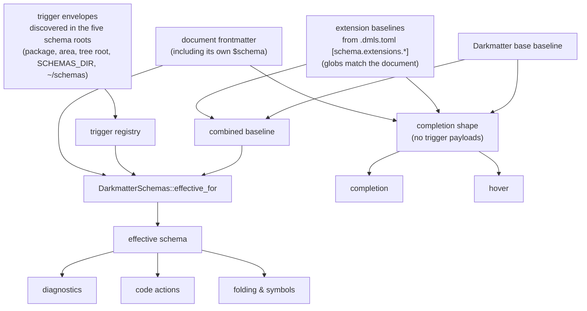

# DMLS Schema Support

## Overview

The **Darkmatter Language Server** (DMLS) is the piece of the Darkmatter package area that makes [Simplified Schemas](./authoring-schemas.md) come alive inside your editor. It speaks standard **LSP 3.17 over stdio** and targets four primary editors: VS Code, Zed, Neovim, and Helix. Its protocol behavior is covered by automated tests; most real-editor checks remain on the [manual smoke checklist](../../../dmls/docs/editors/smoke-checklist.md), with automated real-client coverage for Neovim's semantic-token integration.

Two principles govern everything in this document:

1. **The library owns schema semantics.** DMLS uses the same `darkmatter` library parsers, schema selection, validation, descriptor catalogs, and union-arm selection that `md compose` and `md schema validate` use. DMLS owns the LSP-specific assembly and presentation of completion items, hovers, diagnostics, and edits.
2. **Editor analysis is passive.** Schema requests run on source text, captured workspace context, and passive local-file resolution. DMLS may read local schema files and check whether referenced paths exist, but it never executes a shell command, fetches a remote URL, or mutates a file. A schema may *declare* `file(eager)` or `expression` values, but DMLS never executes their contents.

DMLS layers schema intelligence onto two very different authoring experiences:

- **consuming documents** — a Markdown file whose frontmatter is validated, completed, and explained against its effective schema
- **authoring schemas** — editing the `$schema` property inline, an external `kind: schema` file, or a trigger envelope, where the schema grammar itself becomes the language being edited

Both are covered below, and the [coverage matrix](#coverage-matrix) gives the honest per-feature scorecard for each.

## How DMLS Assembles the Effective Schema

Before any schema intelligence can fire, DMLS must decide *which* schema applies. It reproduces the compose precedence described in [Authoring Schemas](./authoring-schemas.md#schema-layering) — nothing schema-related is editor-specific:



A few details worth knowing:

- the base baseline always applies, so a document with no `$schema` of its own still gets schema-driven completion and hover for keys like `title` or `style`
- the base baseline is the [built-in baseline](./definition.md#the-built-in-baseline) compiled into the server, including the Content Policy schema it imports to type `content_policy`. Those compiled-in documents are never read from disk and never become watched dependencies, so the server needs no schema files to type a document. An extension, trigger, or document schema that declares `content_policy` replaces the built-in typing, as for any other baseline property
- extension baselines whose activation globs match the document contribute their shapes even when the document declares no `$schema`, so their keys are completed and hovered "for free"
- **trigger payloads drive diagnostics only.** Completion and hover read the base baseline, the matched extension baselines, and the document's own `$schema`; a matching trigger's payload is not part of that shape. A document typed only by a trigger therefore gets diagnostics from it but no completion or hover for its keys. Declaring a key in the document's `$schema` (or an extension baseline) brings completion and hover back for that key
- the effective schema (and every file it depends on — the referenced `$schema` file, its imports, its examples, and each matched extension baseline) is content-hash cached per document; editing any dependency invalidates the bundle immediately
- the cache is also keyed on the document's file-resolution context: its repository, its folder, its tree root and how that was chosen, the home folder, the environment (so `SCHEMAS_DIR`), and the extra `@` roots. A `$schema: ^shape.yaml` that resolves to a package's `shape.yaml` is never served to the same text once the package root changes; the schema is assembled again for the new context
- a failed assembly is cached together with the files its error names, so fixing an imported schema file clears the error without reopening the document
- when a schema fails to load, DMLS keeps the **last good** bundle serving completion and hover rather than flapping to nothing mid-keystroke

DMLS searches the same five [schema roots](./definition.md#schema-roots) as `md`, for the document being edited (when it is inside an open workspace folder), so the editor and the terminal apply the same triggers and resolve the same bare-name `$schema`. `SCHEMAS_DIR` and the home folder come from the environment the editor started the server with: a GUI editor that was not launched from your shell may lack `SCHEMAS_DIR`, and a changed value takes effect after a server restart. Additional always-on baselines arrive through [configuration](#extensibility-through-configuration).

### Claudine documents

Claudine's schemas are an ordinary set of disk files, five of them in
`claudine/schemas/`:

| File | Kind | Holds |
|---|---|---|
| `action.yaml` | library (`kind: schema`) | the lifecycle action types and the dictionary-bundle types |
| `lifecycle.yaml` | library (`kind: schema`) | the lifecycle stack types and the `loop:` block type |
| `linking.yaml` | library (`kind: schema`) | the linking keys of a skill, command, or agent |
| `claudine.yaml` | trigger (`kind: trigger-schema`) | Claudine's frontmatter catalog, for a document with a non-null lifecycle event, `loop`, `prompt`, `agent`, or `model` |
| `inline-compose.yaml` | trigger (`kind: trigger-schema`) | inline-compose's document metadata, for a non-null `prompt` with no non-null `sequence` |

DMLS needs no configuration for them. A document whose package area is
`claudine/` finds them through the package-area root, so a misspelled verb, a
malformed long form, or a `shell` action in `initialize` is a diagnostic with
no `$schema` in the document. Anywhere else, put a complete bundle of regular
files (all five, so their relative imports resolve) in the repository root's
`schemas/`, the folder an absolute `SCHEMAS_DIR` names, or `~/schemas`. A
symlinked trigger file is ignored, and `$schema: claudine.yaml` fails, because
a trigger activates by placement and match, never by reference.

DMLS reads these files **only from disk**: it has no Claudine dependency and
registers no embedded bundle. The `claudine` binary carries its own embedded
copy, so a document outside the Claudine area can pass or fail `claudine
compose` while the editor, with no disk bundle in reach, says nothing about
it. As above, the triggers drive diagnostics but not completion or hover.
[Claudine's Schemas](../../../../claudine/docs/topics/schemas.md) describes
what the files check and how the CLI resolves them.

## Implemented LSP Features

Only capabilities that are actually implemented are ever advertised — the capability advertisement grows feature by feature and never claims a surface the server cannot answer. This section walks through each implemented feature as it interacts with schemas.

### Diagnostics

Diagnostics are **push-based** (`textDocument/publishDiagnostics`): DMLS computes them on every change (debounced, default 200 ms) and publishes them, including an empty batch when a document becomes clean. Schema diagnostics arrive with precise, source-spanned ranges — value problems range the value, `unknown_key` ranges the offending key, and `missing_required` ranges the parent mapping so it is always visible.

| Code                                                           | Meaning                                                                                               |
|----------------------------------------------------------------|-------------------------------------------------------------------------------------------------------|
| `dm.frontmatter.yaml_parse`                                    | the frontmatter YAML could not be parsed                                                              |
| `dm.schema.invalid_schema_shape`                               | the `$schema` value is not a valid schema shape (also covers a rejected standalone outer declaration) |
| `dm.schema.invalid_type_definition`                            | a property definition in a schema-authoring surface is invalid, including an unknown named type, contradictory constraints on a reused type, a named-type cycle, and an unsupported postfix on a union-typed reference (see [Named-type references](#named-type-references)) |
| `dm.schema.prepare`                                            | the schema could not be resolved, merged, or compiled; in a standalone schema file, an explicit `Name@file` target that cannot be found or read |
| `dm.schema.type_mismatch`                                      | a value did not match its declared type                                                               |
| `dm.schema.constraint`                                         | a non-type constraint failed (range, length, pattern, enum, …)                                        |
| `dm.schema.missing_required`                                   | a required key is absent — **strict mode only**                                                       |
| `dm.schema.unknown_key`                                        | a key the schema does not declare is present                                                          |
| `dm.schema.deprecated_key`                                     | a deprecated key is present                                                                           |
| `dm.schema.invalid_file_reference`                             | a `file(...)`-typed value failed to parse, resolve, or match a file                                   |
| `dm.schema.invalid_suggestion`                                 | a `suggest(...)` candidate is invalid metadata for its target schema                                  |
| `dm.schema.missing_simplified_envelope`                        | a referenced bare property map looks like SimplifiedSchema but lacks a supported envelope             |
| `dm.schema.document_malformed`                                 | a recognized standalone schema envelope is malformed                                                  |
| `dm.style.unknown_key` / `dm.style.deprecated_key`             | `style:` surface problems                                                                             |
| `dm.expression.malformed` / `dm.expression.unknown_function`   | expression-typed frontmatter values that do not parse or call an unknown function (errors)            |
| `dm.expression.undeclared_property`                            | an expression reads an undeclared document property (advisory warning; the property is valid)         |

The severity policy follows one guiding principle: *diagnose edit-time problems, not compose-time ones*. A document is a template; values arrive at compose time via CLI `--set`, seeds, `$(...)` expansion, or an interactive prompt. So:

- a `required` key that is absent is **not** flagged by default — it is expected to be injected at launch (`schema.strict` re-enables it)
- a value holding a deferred `{{ … }}` or `$(...)` construct is not type-checked; its type is unknowable until the value is real
- `unknown_key` is a warning by default and an error in strict mode

Standalone schema documents **own their problems**: when a `kind: schema` file is open in the editor, its `invalid_suggestion` warnings and `document_malformed` errors are published on that file, never duplicated onto the Markdown documents consuming it.

#### Named-type references

Named-type failures are defects of the schema, not of a document value, so
DMLS publishes them as `dm.schema.invalid_type_definition` wherever the
reference is written: in a Markdown document's inline `$schema` or in a
standalone schema file. Four library errors are projected this way:

| Library error | Example | Primary range | Related locations |
|---|---|---|---|
| `UnknownNamedType` | `title: nope` | the reference name | the reference and the schema searched, when they are in another file |
| `ConstraintConflict` | `title: label(max(2))` over `label: string(min(5))`; `c: slug(allow-periods)` over `slug: alphanumeric(allow-dashes)` | the consuming reference name | each conflicting declaration, in its own file (for options, the definition's option group and the use site) |
| `ImportCycle` | `a: b`, `b: a` | the whole `$schema` declaration | none |
| `UnionReference` | `p: choice(max(10))` over `choice: [string, number]` | the consuming reference name | the reference, when it is in another file, and the union's definition (`` `choice` is defined here``), in this buffer or its own file |

- The primary range is the consuming reference's name, for bare, `@this`, and
  cross-file spellings alike. A `$schema` written as a YAML block scalar
  cannot be projected, so its diagnostic falls back to the property entry.
- A conflict lists every declaration that took part as
  `relatedInformation`, so the editor can show the inherited `min(5)` in
  `types.yaml` beside the use site's `max(2)`. In a multi-hop chain each
  related location is the declaration that introduced the value.
- An import cycle carries no single source location, so it is ranged on the
  whole declaration; its message shows the chain, such as `b -> a -> b`.
- A union reference accepts only `[]` with list constraints, `required`,
  `generated`, `eager`, and a description (see
  [Named Union References](./definition.md#named-union-references)). Anything
  else, `[]` over a union with a list arm, and an arm default under `[]` are
  reported as the library's `UnionReference` error; DMLS adds no rules of its
  own. Accepted forms such as `policy[](min(1))@./content-policy.yaml` and
  `choice(required)` produce no schema diagnostic.
- When the error is inside a schema file the document references, the
  diagnostic points at the reference inside that file.
- A standalone schema file resolves its own references, so a missing name
  (`title: nope`) is reported on the file itself. An explicit target there
  that cannot be found or read (`Name@./missing.yaml`) is a
  `dm.schema.prepare` diagnostic on the target text.
- `suggest(...)` candidates written on a reference are checked against the
  resolved type, as `dm.schema.invalid_suggestion`. An invalid candidate the
  type inherits is reported in the file that declared it.

In a schema file, an invalid definition is ranged at the token the grammar rejected, such as an unknown constraint name, rather than the whole value. The same holds for the core types: an unknown, repeated, misplaced, or mixed `alphanumeric` option is ranged on the option, and a non-null default on `null` (`null(default(1))`) on its argument. A native YAML null definition (`review: null`, `review: ~`, or `review:` with no value) is the `null` type and produces no diagnostic, while a quoted `""` is still *expected a type name*. A value that breaks a type is an ordinary value diagnostic: under a schema whose `initialize` actions exclude `{ shell: shell(required) }`, a `shell` action there is ranged on that list item, exactly as `md schema validate` reports it. This also holds for the two line-wrapped spellings the schema grammar accepts, a plain value continued onto more-indented lines and a list whose `-` sits at its parent key's column (see [Source-Aware Presentation Boundary](./definition.md#source-aware-presentation-boundary)). Hover and completion work on continuation lines and indentless list items too, and select the same schema node as the conventional spelling. Ranges are converted to the editor's negotiated position encoding (UTF-8 or UTF-16).

### Completion

Completion is a merged provider chain (substrate → wiki → frontmatter → DSL), so a schema-driven candidate and a Markdown candidate can coexist in one response. Within frontmatter, the effective schema drives:

- **schema keys** — not-yet-present property keys at any nesting depth an inline object declares, with required keys marked
- **enum values** — the declared choices for an `enum(...)` property
- **boolish scaffolds** — the accepted spellings for `boolish` properties
- **file paths** — workspace-relative path completion inside `file(...)` values
- **`style.*` keys** — the style descriptor catalog when the cursor is inside the opaque `style` object
- **`suggest(...)` candidates** — advisory value suggestions (including block-sequence items) that aid discovery but never validate
- **literal-discriminated union arms** — when a union's arms are discriminated by a `literal(...)` value, selecting the authored discriminant narrows key completion to that arm's shape
- **items of a union list** — inside one item of a `U[]` list, completion combines every applicable alternative's keys and values, unless a `literal(...)` tag in the item selects exactly one; each item is judged on its own (see [Items of an array of a union](../../../dmls/docs/autocomplete.md#items-of-an-array-of-a-union))
- **named types** — while authoring a schema, local names are offered bare (`person`), including types declared later in the same table. A local name that is also a built-in keyword is offered as `string@this`, and a type from another file with its target (`person@./people.yaml`). Root-union schema files, whole-file reference files, and raw JSON Schema export no names, so they contribute none
- **`ctx.*` variables** — the generated context keys, fully qualified

While *authoring a schema* — inside an inline `$schema` value, a `type-definition`-typed value, or a standalone schema file — the same request flips to grammar completion, driven by the shared descriptor catalogs:

- type keywords from the [`SimplifiedSchema` Types](./schema-types.md) catalog (each offered with its `[]` array form), plus each alias labeled with its canonical type (`any`, an alias of `unknown`)
- `alphanumeric` options inside `alphanumeric(` before the first `;`, leaving out the options already written there; after the `;`, only constraints
- definition scaffolds: `{}`, `[]`, and `Name@./types.yaml`
- constraint keywords from the [`SimplifiedSchema` Constraints](./schema-constraints.md) catalog, **filtered by the subject type's accepted-constraint list** — `min(` is not offered under a `boolean`, and the postfix `[](...)` list offers only the array-level constraint surface
- `$schema` file references (`./schema.yaml` scaffolds plus workspace paths)

A deliberate gap: a constraint's *arguments* (a regex body, a glob, an enum member) are author-supplied values — the catalog has nothing truthful to offer there, so completion is silent rather than guessing.

Grammar completion reads each part of a definition the way the parser does. Text after `->` is a human description, so completion is silent while the cursor is inside it. Inside an inline object that description ends at the property's `,`, and completion resumes for the next property: in `{ a: string -> (it's fine), b: str`, the cursor after `str` is offered `string`. A `Name@reference` filename is one token up to its `,`, `}`, or `->`, so `Name@./a(b.yaml` is a file reference rather than a constraint list, and `[Name@./a(b.yaml, s` offers type keywords for the second alternative.

All items are **eager and self-contained**: every item carries an explicit `textEdit` replacing the exact token under the cursor, with plain insert text (no snippets) and no `completionItem/resolve` round-trip. This is deliberately Zed-safe. Trigger characters are `/` (paths), `#` (anchors), `(` (directive options and function arguments), and `.` (`ctx.` members inside an open `{{ }}`).

### Hover

Hovering a named-type reference (`person`, `person@this`, or `person@./people.yaml`) shows the definition it selects, with local references inside it spelled bare.

Hovering a schema-declared frontmatter property renders its full declaration — type (including `Name@reference` for imports and `[]` array suffixes), a `literal(...)` pinned value, `Required`, eager timing, enum values, default, and the `->` prose description. The formatting rule is bounded by what LSP hover Markdown can express (color is a theme decision, never ours): **inline-code box = the subject, bold = its type, italic = its enum/default values, plain prose = the description**.

Hover also understands schema *authoring*:

- hovering a property definition inside a `$schema` value or a standalone schema file renders a `type-definition` block — what the definition declares, whether it is required, its eager timing, and each built-in type's catalog description (`any` shows as `unknown` with its alias); an `alphanumeric` definition adds its canonical options and the characters it allows overall and first
- hovering an `expression`-typed value gets the shared expression hover (parsed form plus the `ctx.*`/function catalog)
- hovering a declared-but-unset key inside a body `{{ … }}` interpolation falls back to the schema property's description — a set frontmatter value always wins

A property typed by a postfixed union reference (`U[]`, `U(required)`) has no single type, so its hover lists every alternative with its own description. Hovering one item of a `U[]` list names an alternative only when exactly one alternative accepts the item; a missing, invalid, or multiply-matching item shows every alternative instead. Acceptance is decided by the Darkmatter library, never by a closest-match guess (see [Union-typed properties and list items](../../../dmls/docs/hover.md#union-typed-properties-and-list-items)).

### Navigation

- **go-to-definition** on a `$schema` file reference or a `file(...)` value jumps to the target file; both also render as clickable **document links**
- **go-to-definition** on a named-type reference (bare, `@this`, or cross-file) lands on the defining key in the file that defines it
- an interpolation variable in the body jumps to the frontmatter key that defines it, and a key the effective schema declares counts as a known identifier even when the document has not set it
- **references** answers "who transcludes this file" across the workspace graph

Document highlights currently cover headings and wiki links; schema keys are not yet highlightable (see [below](#not-implemented-yet)).

### Structure

- **folding** covers the frontmatter block and its nested mappings, alongside headings, code fences, and directive blocks
- **document symbols** can surface top-level frontmatter keys in the outline — gated on the `[symbols] frontmatter = true` configuration, off by default so the outline stays prose-first

### Quick Fixes and Formatting

One schema-specific code action ships today: **add a missing required key**, offered directly on a `dm.schema.missing_required` diagnostic (and therefore only in strict mode). Other code actions — create the missing file, migrate a deprecated `style:` key, close an unclosed `::block`, wrap a malformed interpolation in a literal — are schema-adjacent rather than schema-driven. Whole-document **formatting** is byte-equivalent to the `md clean` cleanup sequence; it is a document-level operation, not a schema one.

### Content policies

Because the built-in baseline types `content_policy`, every document gets
help with its [content policy](../../../../content-policy/docs/topics/policy-lifecycle.md#get-help-in-the-editor)
without a `$schema`:

- **completion** inside a compact entry (`- Ever…`), after `rule:` and
  `action:` in a `{rule, action}` entry, and for that entry's keys;
- **hover** on a compact or long-form rule shows the description of the rule
  form it matches, such as *Interval from a property* for
  `ValidFor(3mo, @last_updated)`;
- **diagnostics** on the item, field, or value at fault: an unknown action is
  ranged on the action's value, a missing `rule` on the entry's mapping, and a
  single string where a list belongs on the whole value.

```yaml
---
content_policy:
  - ValidFor(3mo)
  - rule: ValidUntil(2027-01-01)
    action: delete        # flagged: not refresh, archive, or remove
---
```

Checks are passive like every other schema check: DMLS never reads the file a
`FileChanged` rule watches, so a rule naming a missing file is not flagged.

### Imported files stay live

Every file a schema imports a named type from is a dependency of the
assembled schema. Editing that file refreshes completion, hover,
go-to-definition, and diagnostics in the documents that use it, without
reopening them, and clears an error that the edit fixed. A local reference
reads no other file and adds no dependency.

### Known limitations

- In a schema whose `$schema` is a root union, completion offers the local
  names of every inline arm, although each arm resolves bare names and `@this`
  only against its own top-level entries. A name offered from another arm is
  then reported as unknown.
- `alphanumeric` options are not completed inside a reference to a named
  `alphanumeric` type (`slug(`): a use site may only repeat its definition's
  options, so offering them would mostly lead to a conflict.
- When a named type and its use site both declare `suggest(...)`, the "at
  most one `suggest`" error is ranged on the whole `$schema`, because the
  inherited candidate's span belongs to another file.
- A frontmatter value holding a `{{ … }}` template is not diagnosed, because
  its value is known only after interpolation. `md compose` checks it then;
  DMLS reports nothing for it, including an invalid `content_policy` entry such
  as `FileChanged({{HOME}}/x, @fp)`.

## Not Implemented (yet)

The honest list. None of these are advertised to the editor, so no client will ever ask for them and receive a lie:

| Surface                                                    | Status                                                                                                                                                                                                        |
|------------------------------------------------------------|---------------------------------------------------------------------------------------------------------------------------------------------------------------------------------------------------------------|
| **Inlay hints** (`textDocument/inlayHint`)                 | not implemented — the `[hints]` config section is *parsed* today so configs stay valid, but no provider answers it yet                                                                                        |
| **Code lenses** (`textDocument/codeLens`)                  | not implemented — no compose-preview or reference-count lenses                                                                                                                                                |
| **Signature help** (`textDocument/signatureHelp`)          | not implemented — function signatures surface through completion `detail` and hover instead                                                                                                                   |
| **Semantic tokens for frontmatter and schemas**            | the frozen V1 legend covers body constructs only (interpolations, directives, wiki links); expression tokens are reserved in the legend for a future phase, and no frontmatter/schema token family exists yet |
| **Rename of schema keys**                                  | rename today covers headings and files only; renaming a frontmatter key (and its `{{ … }}` usages) is not offered                                                                                             |
| **References / highlights on schema keys**                 | references answer transclusion questions; there is no "every usage of this frontmatter key" query yet                                                                                                         |
| **Pull diagnostics** (`textDocument/diagnostic`)           | push-only; editors that prefer pull get the same diagnostics via `publishDiagnostics`                                                                                                                         |
| **Commands** (`workspace/executeCommand`)                  | no server commands (compose preview, cache invalidation, …) yet                                                                                                                                               |
| **Selection ranges / linked editing / on-type formatting** | client capability gates are tracked in the server's client profile, but no handlers are routed                                                                                                                |
| **Constraint-argument completion**                         | deliberately absent (see [Completion](#completion))                                                                                                                                                           |
| **Remote URI `$schema` references**                        | the grammar reserves them, but remote resolution is not implemented anywhere in Darkmatter yet                                                                                                                |
| **`SCHEMAS_DIR` changes while running**                    | read once from the environment the server started with; restart the server to pick up a change                                                                                                                |

## Coverage Matrix

The scorecard: one dimension is the LSP capability, the other is the Darkmatter schema/DSL surface it is applied to. Legend: ✅ shipped · 🟨 partial (see notes) · ❌ not yet · — does not apply.

| Schema surface                                | Diagnostics | Completion | Hover | Def. / Links | Fold. / Symbols | Sem. Tokens | Rename | Code Actions |
|-----------------------------------------------|:-----------:|:----------:|:-----:|:------------:|:---------------:|:-----------:|:------:|:------------:|
| Frontmatter keys (schema-declared)            | ✅          | ✅ ¹       | ✅    | —            | 🟨 ²            | ❌          | ❌     | ✅ ³         |
| Frontmatter values (type / constraint)        | ✅          | ✅         | ✅    | —            | —               | ❌          | ❌     | —            |
| `enum(...)` and `suggest(...)` values         | ✅ ⁴        | ✅ ⁵       | ✅    | —            | —               | ❌          | ❌     | —            |
| Unions, including items of a `U[]` list       | ✅          | ✅ ⁶       | ✅ ¹⁷ | —            | —               | ❌          | ❌     | —            |
| Named types (`Name`, `Name@file`)             | ✅ ⁷        | ✅ ⁸       | ✅    | ✅ ⁹         | —               | ❌          | ❌     | —            |
| Pattern dictionary keys (`<string>`, …)       | ✅          | ❌ ¹⁰      | 🟨 ¹¹ | —            | —               | ❌          | ❌     | —            |
| `file(...)` references                        | ✅          | ✅         | —     | ✅           | —               | ❌          | ❌     | —            |
| `$schema` inline authoring                    | ✅          | ✅ ¹²      | ✅    | —            | —               | ❌          | ❌     | —            |
| `$schema` file reference                      | ✅          | 🟨 ¹³      | —     | ✅           | —               | ❌          | ❌     | —            |
| Standalone schema documents (`kind: schema`)  | ✅ ¹⁴       | ✅         | ✅    | —            | —               | ❌          | ❌     | —            |
| `expression`-typed values                     | ✅          | ✅         | ✅    | —            | —               | ❌ ¹⁵       | ❌     | —            |
| `style.*` keys                                | ✅          | ✅         | ✅    | —            | —               | ❌          | ❌     | ✅           |
| Trigger envelopes (`kind: trigger-schema`)    | ✅ ¹⁶       | —          | —     | —            | —               | ❌          | ❌     | —            |
| `ctx.*` generated keys                        | —           | ✅         | ✅    | —            | —               | ❌ ¹⁵       | ❌     | —            |

1. Required keys marked; nested keys offered per the enclosing inline-object shape.
2. Nested-mapping folding ships; frontmatter document symbols are config-gated (`[symbols] frontmatter = true`).
3. Add-missing-key, on the `missing_required` diagnostic (strict mode only).
4. Constraint violations for enums; `invalid_suggestion` linting for advisory candidates.
5. Enum choices rigid; `suggest(...)` candidates advisory — they never validate.
6. Alternatives combine; an authored `literal(...)` discriminant that selects one union arm narrows key completion to it, per item in a `U[]` list.
7. Unknown names, constraint conflicts, cycles, and unsupported union postfixes are `dm.schema.invalid_type_definition` at the reference, with related locations for conflicting declarations and for the union's definition.
8. Local names offered bare; `name@this` only for a built-in collision; imported names with their target.
9. Go-to-definition on every reference spelling; whole-file `$schema` references also render as links.
10. Pattern keys validate but are not offered as completions — an inline object's keys are the author's own.
11. Authored pattern-key definitions hover in schema documents; consumers hover the value definition only where the shape resolves it.
12. Type keywords, array forms, scaffolds, and subject-filtered constraint keywords; constraint *arguments* are deliberately not completed.
13. Path completions and scaffolds for the reference itself.
14. The schema file owns its problems (`invalid_suggestion`, `document_malformed`); they never duplicate onto consumers.
15. Reserved in the semantic-token legend for a future expression phase; not emitted in V1.
16. The matched payload merges into the effective schema and drives diagnostics on consuming documents; it does not feed their completion or hover (see [How DMLS Assembles the Effective Schema](#how-dmls-assembles-the-effective-schema)). A malformed envelope is diagnosed on the envelope file.
17. A union property lists its alternatives; a list item names its alternative only when exactly one accepts it.

The short version: **the read/analyze half of the LSP surface (diagnostics, completion, hover, navigation, structure) is broadly shipped for schemas, while the styling-and-refactor half (semantic tokens, rename, references-on-keys, lenses, hints) is still ahead of us.**

## Editor Support

All four primary editors get the complete schema feature set described above; the differences between them are in how a few capabilities are *delivered*, driven by what each client advertises. Position-encoding negotiation (UTF-8/UTF-16), per-client gates for folding, semantic tokens, and file operations, and hover Markdown fidelity are all handled by a capability profile computed once at `initialize`. The per-editor matrix and setup guides live in the DMLS docs: [`dmls/docs/features.md`](../../../dmls/docs/features.md).

## Extensibility Through Configuration

DMLS is configured through a **`.dmls.toml`** file at the workspace root (which also doubles as the editor root marker). Configuration has three sources, merged in this precedence:

1. the editor's `workspace/configuration` / `didChangeConfiguration` overlay (highest)
2. `.dmls.toml` at the workspace root
3. built-in defaults

Every key is parsed even where its consumer lands in a later phase, so a config written today stays valid as features arrive. Configuration is hot-reloadable: a `didChangeConfiguration` re-reads the file layer, re-merges, and re-publishes diagnostics for all open documents without a restart. A malformed overlay is logged and discarded — bad editor settings can never wedge the server; the last good config keeps serving.

The schema-relevant sections:

```toml
[schema]
# Strict mode: unknown frontmatter keys become errors and missing
# required keys are diagnosed at edit time.
strict = false

# Baseline schema extensions. Pure data: a document schema file plus
# activation globs. Trigger schemas (Claudine's included) need no entry:
# DMLS discovers them in the schema roots.
[schema.extensions.team]
path = "schemas/team-prompt.yaml"
globs = ["prompts/**"]

[style]
# Strict mode for the style: surface (unknown/deprecated keys).
strict = false

[symbols]
# Surface top-level frontmatter keys in the document outline.
frontmatter = false

[semantic_tokens]
# Master switch for semantic-token emission (body families today).
enable = true

[diagnostics]
# Debounce (ms) for immediate-tier diagnostics after the last edit.
debounce_ms = 200

[code_actions.categories]
# Per-category enable/disable overrides; absent categories are enabled.
"add-missing-key" = true
```

The `[schema.extensions.*]` table is the workhorse. Each entry is a **pure-data baseline extension**: point `path` at a SimplifiedSchema YAML file (relative paths resolve against the workspace root) and list `globs` that select the documents it applies to. The path is loaded as a `$schema` reference is, so it names a document schema, never a trigger envelope. The extension's shape merges over the base baseline with compose precedence, and its keys participate in completion and hover exactly like built-in ones — even for documents that declare no `$schema` of their own. Editing an extension's file (or any type it imports) content-hash-invalidates every bundle that matched it, so the change is visible on the next keystroke.

Extensions and trigger schemas are the two data-only ways a tool built on Darkmatter teaches DMLS its document vocabulary without the server ever learning a tool-specific code path. An extension is selected by path globs and feeds completion and hover; a trigger is selected by the frontmatter it matches and feeds diagnostics. These settings configure only the editor: `md` and other hosts never read `.dmls.toml`.

## Extensibility Programmatically

DMLS deliberately ships **no plugin API** in v1: no dynamic provider registration, no custom completion sources, no server-side hooks. That is a design decision, not an omission — the editor surface stays a *projection* of the library, and the extension seam lives one layer down where it benefits every consumer at once.

The programmatic seam is the **`darkmatter` library itself** (`darkmatter::markdown::schemas`). These public types provide the schema semantics that DMLS projects into LSP, so a host application can share parsing, selection, validation, and catalog behavior with the editor:

- **`DarkmatterSchemas`** is the schema engine builder. Stack your own baselines the same way DMLS does:
    - `with_baseline(...)` / `with_baseline_from_file(...)` / `with_baseline_json_schema(...)` — add SimplifiedSchema or raw JSON Schema baselines
    - `with_trigger_discovery(...)` / `with_trigger_registry(...)` — activate trigger matching
    - `with_embedded_trigger_bundle(...)` — add a host's compiled-in triggers as the last-resort location after the schema roots
    - `effective_for(&markdown)` — resolve the layered effective schema for a document, exactly the call DMLS's overlay makes
    - `validate(...)`, `validate_for_phase(...)`, `detect(...)` — validation and schema detection/inference

- **`EffectiveSchema`** carries the assembled result: `validate_with_positions(...)` for source-spanned problems, `dependencies()` for the files the schema depends on (what DMLS content-hash watches), and `advisories()` for non-fatal findings.
- **`resolve::expand_named_types`** expands the named-type references of a schema held in memory, using that schema (not the file on disk) as `this`, so an unsaved buffer resolves. **`resolve::named_type_reference_path`** returns the file an explicit `Name@target` selects, using the resolver's own lookup. DMLS uses both for standalone schema files.
- **`parse_standalone_schema_document`** is the passive classifier for standalone schema files — the same authority that decides when your open buffer is a `kind: schema` document deserving authoring intelligence.
- **The shared catalogs** — `schema_type_descriptors()`, `schema_constraint_descriptors()`, `suggestions_for_path()`, `select_literal_discriminant_arm()`, and the tolerant cursor parsers `locate_schema_declaration_cursor(...)` / `locate_type_definition_cursor(...)` — are public. DMLS uses these authorities when constructing completion and hover responses, which keeps their schema vocabulary aligned with library validation. A documentation generator, linter, or custom editor can build on the same primitives, while still owning its presentation and request-specific behavior.

The pattern in practice: a host application (Claudine is the worked example) authors its vocabulary as schema *data* — trigger schemas plus the libraries they import — embeds the files in its binary as an `EmbeddedSchemaBundle` for its own runtime (`DarkmatterSchemas::with_embedded_trigger_bundle`, consulted only for trigger names no schema root holds), and ships the same files on disk where the editor discovers them in the schema roots. One schema artifact, zero server code, the same validation rules everywhere; see [Embedded trigger bundles](./definition.md#embedded-trigger-bundles).

## See Also

- [Authoring Schemas](./authoring-schemas.md) — the SimplifiedSchema grammar, layering rules, and trigger design
- [SimplifiedSchema Types](./schema-types.md) and [Constraints](./schema-constraints.md) — the catalogs behind completion and hover
- [Schema Validation](./schema-validation.md) and [Schema Discovery](./schema-discovery.md) — the CLI/library side of the same authority
- [Schema Triggers](./schema-targeting.md) — the trigger matching model and its implementation status
- [`dmls/docs/features.md`](../../../dmls/docs/features.md), [`autocomplete.md`](../../../dmls/docs/autocomplete.md), [`hover.md`](../../../dmls/docs/hover.md), [`diagnostics.md`](../../../dmls/docs/diagnostics.md) — the DMLS crate's own capability documentation and per-editor setup guides
