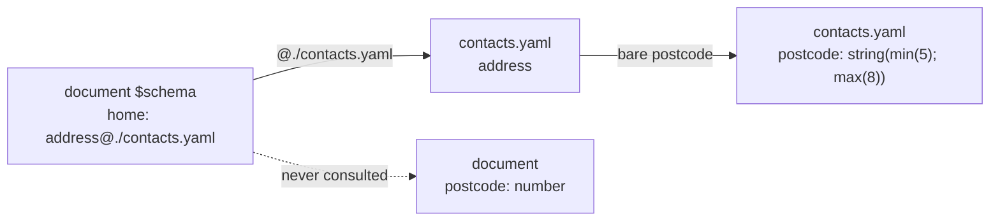

# Local Type References

A schema can define reusable named types and use them by name. A type defined
in the same schema is referenced by its **bare name**:

```yaml
$schema:
    person: "{ name: string(required), email: email }"
    author: person                 # the `person` defined above
    reviewers: person[]            # an array of that type
    editor: person(required)       # the type, plus a use-site constraint
```

`person` and `person@this` mean exactly the same thing; write whichever you
prefer. `@` is only needed for a type from another file, such as
`person@./people.yaml`. A bare reference also survives renaming the file,
which a `@./this-file.yaml` self-reference does not.

Besides `this`, one other right-hand side is a reserved word rather than a
file: `darkmatter:<stem>` names a type in one of the schema partials
Darkmatter ships, such as `count@darkmatter:lifecycle`. It resolves the same
from any schema, on disk or embedded, and never reads the disk; see
[Reserved Darkmatter References](./definition.md#reserved-darkmatter-references-namedarkmatterstem).

See [External Schemas](./authoring-schemas.md#external-schemas) for an
authoring walkthrough and
[Cross-File Named-Type Imports](./definition.md#cross-file-named-type-imports-namefile)
for the full reference grammar.

## Where Local Names Live

A bare name, like `@this`, looks only in the named types of the schema where
the reference is written:

| Where the reference is written | Its local names |
|---|---|
| a `kind: schema` file | the entries of its `types` mapping |
| a pure schema file (`$schema` as the only top-level key) | the top-level entries of its `$schema` mapping |
| a document's inline `$schema` mapping | the top-level entries of that mapping |
| one inline arm of a root union (`$schema` is a YAML sequence) | that arm's own top-level entries; names are never combined across arms |

Each top-level entry is both a property of the schema and a named type you
can reuse, so in a document's inline `$schema` a type such as `person` above
is also a frontmatter property. Keep reusable types in a schema file when they
should not be document properties. Some schemas export no names to other files: a root-union schema
file, a schema file whose whole payload is a reference to another file
(`$schema: ./other.yaml`), and raw JSON Schema. Importing a name from one of
them is a schema error.

## Resolving a Name

- **Built-in keywords win.** `string`, `email`, `file`, and the other
  [built-in types](./definition.md#types) keep their meaning. If you define a
  local type with a built-in's name, select it with `@this`: `string` is the
  built-in, `string@this` is your type. This includes `unknown` (and its
  alias `any`), `null`, `alphanumeric`, and `shell`, so a schema with its own
  `shell` type refers to it as `shell@this`.
- **Names are case-sensitive** and use the identifier characters ASCII letters,
  digits, `-`, and `_`. `Person` and `person` are different types.
- **Forward references work.** A reference can name a type declared later in
  the same table.
- **Unknown names are errors.** A bare name that is neither a built-in nor a
  local type is a `SchemaError::UnknownNamedType` naming the type, the schema
  that was searched, and the property holding the reference. It is never
  treated as `unknown`, and it is never looked up in other active schemas,
  frontmatter, or runtime globals. A misspelled built-in such as `strng`
  therefore fails at the reference, unless a local type happens to have that
  name.
- **A type may refer to itself.** A local name can close a cycle, directly
  (`item: "{ children: item[] }"`) or through other types, as long as the
  cycle passes through a child value: an object property, a dictionary value,
  a list item, or a tuple slot. A cycle that never does, such as `a: b` with
  `b: a`, or `a: [a, string]`, is a `SchemaError::NonDescendingCycle` naming
  each reference in it, whether the hops are bare or explicit. See
  [Recursive Named Types](#recursive-named-types) below.
- **Chains are bounded.** A chain of references that never repeats a type
  and is deeper than 32 is a `SchemaError::ImportCycle`.

### Resolution stays in the defining file

Importing a definition does not change what its local references mean. If
`address@./contacts.yaml` uses a bare `postcode`, that `postcode` comes from
`contacts.yaml`, not from the importing document:

```yaml
# contacts.yaml
kind: schema
types:
    postcode: string(min(5); max(8))
    address: "{ street: string, postcode: postcode }"
```

```yaml
# document frontmatter
$schema:
    postcode: number            # unrelated to contacts.yaml's postcode
    home: address@./contacts.yaml
```



`home.postcode` is a string of 5 to 8 characters. If `contacts.yaml` did not
define `postcode`, the `UnknownNamedType` error would name `contacts.yaml` as
the schema searched.

## Inheriting Constraints

A named type carries all of its constraints wherever you use it, including
`required` and `generated`. You never have to repeat a constraint just because
the type has a name:

```yaml
kind: schema
types:
    code: string(required; generated)
    err: "{ code: code }"          # err.code is required and generated
```

Writing `code@this`, or importing the same definition from another file,
gives the same result, and so does a chain where one named type references
another. An array of a required type is a required property: `people:
person[]` is required when `person` is.

You can add constraints at the use site, but leaving them out never removes
an inherited one. For example, a reusable label sets a minimum length and the
property using it adds a maximum:

```yaml
kind: schema
types:
    label: string(min(3))
    title: label(max(80))
```

`title` accepts strings of 3 to 80 characters. A `min`/`max` at the use site
is read against the resolved type: characters for a string, a numeric range
for a number, and an item count when the named type is already an array. If
`title` instead adds `min(5)`, the stricter minimum wins. Contradictory
constraints, such as an inherited `min(10)` with a use-site `max(5)`, are a
`SchemaError::ConstraintConflict` naming both declarations instead of silently
dropping either one. The full set of merge rules is in
[Merging use-site constraints](./definition.md#merging-use-site-constraints).

Constraints on array elements and on the array itself keep their own
meanings. A named `string(min(3))` used as `label[]` requires each item to
have at least three characters, while `label[](min(1))` additionally requires
at least one item. The two minima never merge.

An `alphanumeric` type's options are part of its identity, not constraints
to merge. A use site may repeat them exactly, but a different option set,
such as `slug(allow-periods)` over `slug: alphanumeric(allow-dashes)`, is a
`SchemaError::ConstraintConflict` (see
[Alphanumeric Strings](./definition.md#alphanumeric-strings)).

The one way to make a reused required type optional is a union with `null`:
`draft_code: [code, null]` accepts `null`, omission, or a valid `code`,
whatever `code`'s inherited `required` says (see
[Null-Admitting Properties](./definition.md#null-admitting-properties)).

This is different from [Schema Layering](./authoring-schemas.md#schema-layering).
Reusing a type combines its constraints with the property's additional
constraints. Layering separate schemas chooses the whole property definition
from the higher-precedence schema.

For how presence inheritance interacts with optional values and `generated`,
see [Presence travels with the type](./authoring-schemas.md#presence-travels-with-the-type).

## Recursive Named Types

A local type can use its own name to describe a structure that nests to any
depth:

```yaml
kind: schema
types:
    item: "{ value: string(required), children: item[](required) }"
    tree: item(required)
```

`tree` holds an `item` whose `children` are items, and `children: []` ends a
branch. Mutual recursion (`group: "{ members: member[] }"` with
`member: "{ name: string, group: group }"`) and a cycle that crosses into
another file through `Name@file` work the same way.

A recursive type keeps the rules on this page. A bare name inside it resolves
in its defining file, and every use inherits its constraints. The difference
is in storage: the type is stored once and each property refers to it, so the
use site, not the shared definition, decides presence (`required`,
`generated`, `eager`), whether `null` is accepted, the description, and any
extra bounds:

```yaml
kind: schema
types:
    item: "{ value: string(required), children: item[](required) }"
    root: item(required)       # must be present and not null
    optional: item             # may be missing or null
    few: item[](min(1))        # one or more items, none of them null
```

Two types with the same name in different schemas stay separate: `item` in
this schema and `item@./other.yaml` are two definitions. The same holds for
inline schemas: a document's own `$schema` mapping and the inline `$schema`
payload of each matching schema trigger each keep their own `item`, so
validation, completion, and hover under a trigger's properties use that
trigger's `item` even when the document or another trigger declares one too.
The child-value
rule, the error a rejected cycle reports, and how recursion reaches
validation, phases, conversion, and editors are described in
[Recursive Named Types](./definition.md#recursive-named-types).

## Serialization

When Darkmatter serializes a type expression, a local reference is written
bare. The one exception is a local type whose name is also a built-in:
it is written `string@this`, because bare `string` would mean the built-in. A
cross-file reference keeps its target (`person@./people.yaml`). Parsing the
written form gives back the same reference, so serialization never changes a
schema's meaning. Editing one value in a document does not respell untouched
references, so an existing `person@this` stays as written.
