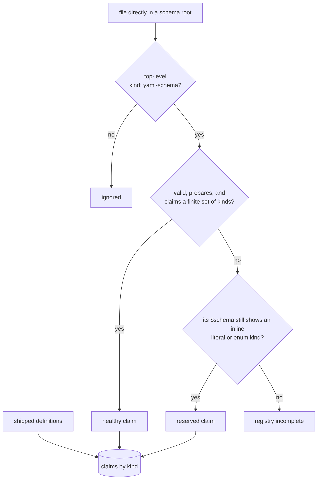
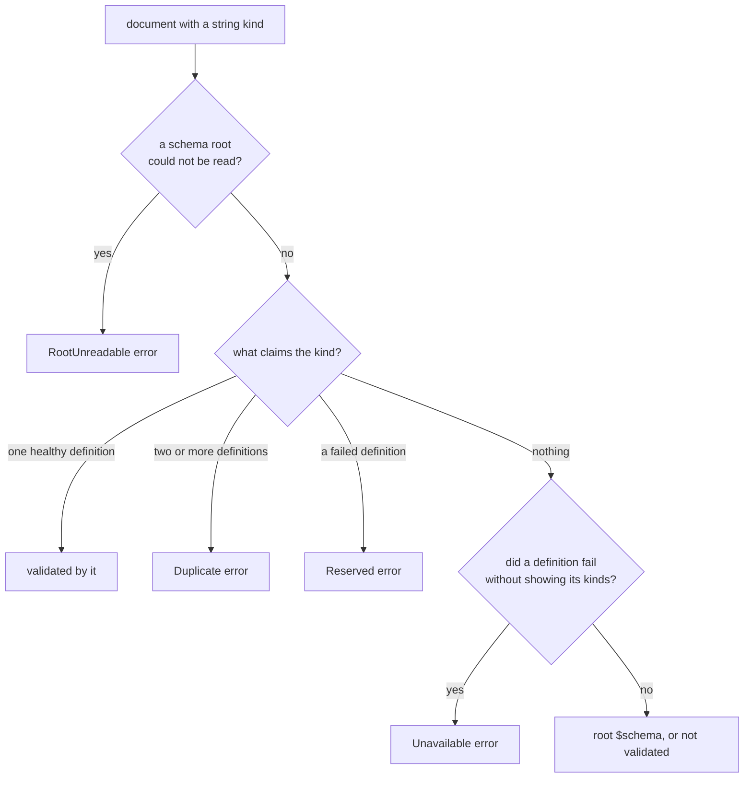

# Schema Discovery

A YAML document whose top-level `kind` is claimed by a `kind: yaml-schema`
definition is validated against that definition (see
[YAML Documents](./definition.md#yaml-documents)). This page explains where
Darkmatter looks for those definitions, how it decides which one claims a
kind, and what happens when a definition is broken.

Two related topics live elsewhere: how trigger schemas are found for Markdown
documents is in [Repository Trigger Schemas](./definition.md#repository-trigger-schemas),
and inferring a schema from existing documents is
[`md schema detect`](./definition.md#cli-md-schema-detect).

## Where Definitions Come From

Every document can select three **shipped** kinds. Their definitions are
compiled into Darkmatter, so they apply in any folder, with or without a
repository:

| Kind | Definition | Validates |
|---|---|---|
| `schema` | [`simplified-schema/schemas/schema.yaml`](../../../../simplified-schema/schemas/schema.yaml) | standalone schema documents, such as [`darkmatter.yaml`](../../../schemas/darkmatter.yaml) |
| `yaml-schema` | [`simplified-schema/schemas/yaml-schema.yaml`](../../../../simplified-schema/schemas/yaml-schema.yaml) | kind definitions, itself included |
| `schema-trigger` | [`darkmatter/schemas/schema-trigger.yaml`](../../../schemas/schema-trigger.yaml) | [trigger files](./schema-triggers.md) |

For a document inside a repository, Darkmatter also reads the definitions in
the document's five [schema roots](./definition.md#schema-roots):
`SCHEMAS_DIR`, the package's `schemas/`, the package area's `schemas/`, the
repository's `schemas/`, and `~/schemas`. Outside a repository only the
shipped kinds exist, so a `kind: roster` document there is not validated by
kind. (In the library this is `RegistryScope::for_context`: `WithRoots`
inside a repository, `ShippedOnly` outside one.)

A file in a root is a definition when its top-level mapping says
`kind: yaml-schema`. The roots are listed exactly as for trigger discovery:
only regular `.yaml` and `.yml` files directly inside a root are read, never
subfolders or symlinks, and two file names in one root that differ only by
case make that root a failure (see [When a Definition Fails](#when-a-definition-fails)).
Everything else in a root, such as payloads, type
libraries, and unrelated data, is ignored, even when it is not valid YAML. A
file that does not parse still counts as a definition when a line declares
`kind: yaml-schema` at column 0, the same lexical rule a trigger file uses
(see [Which files claim the envelope](./definition.md#which-files-claim-the-envelope)),
so a broken definition is never mistaken for an unrelated file.



## Claims Decide, Not File Names

Trigger files shadow by file name: `schemas/notes.yaml` in a package hides a
`notes.yaml` in every later root. Kind definitions never do. Every definition
in every root is read, and the kinds it claims, not its file name or its
root, decide what it applies to:

| | Triggers | Kind definitions |
|---|---|---|
| A file of the same name in a later root | shadowed, never read | still a definition |
| Two files that apply to the same documents | both layer, in root order | a `Duplicate` error naming both |
| What selects it | its `match` conditions | the document's `kind` |

So a `schemas/roster.yaml` in a package and a `schemas/team.yaml` in the
repository root that both declare `kind: literal(roster; required)` make every
`kind: roster` document fail with:

```text
cannot select a schema for `kind: roster`: it is claimed by more than one definition: `/repo/area/pkg/schemas/roster.yaml`, `/repo/schemas/team.yaml`
```

The files are sorted by path, so the message is the same whichever root each
came from. Keep exactly one definition per kind; delete or rename the claim of
the other.

A repository file that claims a shipped kind is a duplicate too: a
`schemas/my-trigger.yaml` declaring `kind: literal(schema-trigger; required)`
makes every trigger file in that repository fail selection, and the message
names the compiled-in definition by its repository-relative path,
`darkmatter/schemas/schema-trigger.yaml`. A copy of a shipped file under
another path, such as `~/schemas/schema.yaml`, is a duplicate in the same way.

Kinds compare exactly, including case: a definition claiming `roster` does
not claim `Roster`.

## Editing a Shipped Definition in Its Own Repository

A shipped definition is also an ordinary file in the repository it is built
from. When a definition in a schema root sits at a shipped definition's
repository-relative path (for example `darkmatter/schemas/schema-trigger.yaml`,
relative to the document's repository root) and claims that same kind, it
**replaces** the compiled-in copy instead of duplicating it. An edit to that
file therefore applies at once, with no rebuild, to every document whose
schema roots include its folder. In the Darkmatter repository,
`darkmatter/schemas/` is the `darkmatter` package area's root, so documents
in that area see the edited trigger definition; a document in another area
still uses the compiled-in copy.

A file at a shipped path that claims a different kind is an ordinary
definition, and the shipped one stays in place.

## When a Definition Fails

Reading the definitions never fails as a whole. A broken definition or an
unreadable root is recorded, and it affects only the documents whose
selection it could change:



- **Reserved.** A definition that fails but whose `$schema` still declares an
  inline `literal(...)` or `enum(...)` `kind` (in any inline root-union arm)
  keeps those kinds. A document of such a kind gets a selection error naming
  the definition and its defect, rather than silently passing. For example, a
  `roster` definition whose `platforms` imports `missing@./absent.yaml`
  reserves `roster`.
- **Incomplete.** A definition that fails before showing any kind (malformed
  YAML that still declares `kind: yaml-schema`, or a `kind: string(required)`
  that names no kind) could claim anything. Until it is fixed, a document
  whose kind no healthy definition claims fails with "schema selection is
  unavailable", naming that file. Kinds a healthy definition claims, shipped
  kinds included, are unaffected. A file in a root that cannot be read has the
  same effect.
- **Unreadable root.** When a schema root cannot be listed, or holds two file
  names that differ only by case, its definitions are
  unknown, so every document with a string `kind`, shipped kinds included,
  fails with an error naming the root. Make the root readable or remove it.

A document with no string `kind` is never affected by any of these. Its root
`$schema`, if it has one, still applies.

The selection error says _that_ a definition failed. The defect itself is
reported when you validate the definition file as a YAML document: its
problems against the shipped `yaml-schema` definition, or a
[kind check](./definition.md#kind-checks) that its `$schema` does not prepare
or claims no finite set of kinds. Run it with
`md schema validate schemas/roster.yaml`
([YAML documents on the command line](./definition.md#yaml-documents-on-the-command-line)),
or from the library with
[`validate_yaml_document`](./definition.md#validating-from-the-library).

## Reusing the Definitions

A library host that validates many documents in one context can read the
definitions once with `KindRegistry::from_filesystem` (or `KindRegistry::build`
with its own `SchemaRootSource`, for unsaved editor buffers) and pass the
result to `DarkmatterSchemas::with_kind_registry`. Building reads local files
only: it evaluates nothing, runs no commands, and fetches nothing.
`dependencies()` lists every file the registry read, and
`searched_locations()` every folder whose new files could change it; rebuild
the registry when either changes.
