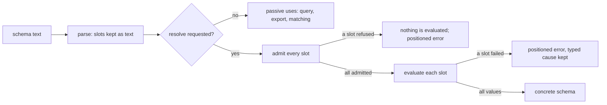

# Schema Slots in Darkmatter

A schema can take some of its values from data instead of spelling them out.
A `{{ … }}` **slot** in an `enum(...)` or `suggest(...)` list, or as the whole
argument of `literal`, `default`, `min`, `max`, or `pattern`, is an
expression that Darkmatter evaluates to fill that position:

```yaml
kind: schema
$schema:
    os: enum({{ load_data("../../../os.yaml", "string[]") }}; required)
```

The grammar, the result shapes each position takes, and the substitution
rules belong to the SimplifiedSchema language and are described in
[Schema Slots](../../../../simplified-schema/docs/topics/language/slots.md).
This page covers what is Darkmatter's: which expressions a slot may contain,
where it evaluates, what it may read, and how a failure is reported.

## When a slot is evaluated

Reading a schema evaluates nothing. Parsing, querying, exporting, trigger
matching, completion, and hover all see the slot as text. A slot is
evaluated only when a schema is **resolved**: every slot of the schema is
first admitted (judged without running anything), then each is evaluated,
and its values are substituted into an ordinary concrete schema.



When the commands resolve a template (approval, caching, and which
surfaces resolve) is **planned**; today a schema with slots fails
validation with a typed "unresolved" error.

## What a slot may contain

A schema describes documents, so a slot may depend only on the schema's own
context, never on the document being validated. Admission walks the whole
expression, including both branches of `?:`, every `||` operand, and every
callback body, whether or not evaluation would reach them. One forbidden
read anywhere refuses the slot, and no slot of the schema is evaluated.

| Allowed | Refused (`dm.schema.slot_forbidden_binding`) |
| --- | --- |
| `ctx.<key>` (`ctx.today`, `ctx.repo_root`, …) | `fm.*`, and any bare name such as `title` (it reads the document) |
| `env.NAME`, `env`, `env[...]` | host globals such as `loop` or `err` |
| `null`, `true`, `false`, literals | `ctx.cwd` (the launch directory) |
| a callback's own parameters, and `current.*` / `local.*` inside a callback | `ctx.self`, `ctx.last_updated`, `ctx.hash` (the document's identity) |
| | `ctx.id`, `ctx.sid` (a fresh value every run) |
| | a bare `ctx` or a computed `ctx[...]`, which could reach the keys above |
| | `current.*` / `local.*` outside a callback |

For example, `{{ ctx.today }}` is admitted, while
`{{ env.CI ? ['a'] : fm.choices }}` is refused at `fm.choices` even when `CI`
is set.

### Functions

Every expression function declares what it may do in a slot:

| Class | Functions | In a slot |
| --- | --- | --- |
| pure | `length`, `lower`, `as_csv`, `map`, `is_date`, … | allowed |
| captured | the date functions (`is_today`, `date`, `older_than`, …), `has_command`, `has_binary`, `package`, `package_area`, `ipv4`, `ipv6`, `has_agentic_cli` | allowed; they read values the request captured once |
| input-reading | `load_data`, `frontmatter` and its family, `file_exists`, `validate_schema`, `find_files`, the path functions (`absolute`, `basename`, `join`, `link`, …), `has_skill` | allowed; every read is checked against the slot's approvals |
| volatile | `recent_commits`, `predict_conflicts`, `branch_exists_on_remote`, `remote_vendor` | allowed; never reused across commands |
| rejected | `as_markdown`, `pr`, `pr_list`, `cicd`, `cicd_list`, `ping`, `ping_under`, `has_alias`, `has_builtin_function`, `has_user_function`, `can_execute` | refused (`dm.schema.slot_forbidden_function`) |

A host function registered by an embedding program is pure: its handler
sees only its arguments.

## Where a slot evaluates

A slot evaluates in the context of the file it is written in. A relative
path in `load_data("../os.yaml", …)` is resolved from the schema file's
folder, and a slot inside a named type imported from another file
(`Os@../shared/types.yaml`) resolves from that file's folder. A slot in a
document's inline `$schema` evaluates in the document's folder. The context
is derived from the command's request context; nothing is re-read from the
process.

Each slot gets its own work budget, the default iteration limits (100 000
item visits, 16 MiB of expansion). A runaway expression stops with the
ordinary `dm.iteration.visit_limit` or `dm.iteration.expansion_limit`
failure, positioned at the slot.

A slot's `load_data` reads share the command's memo and are listed in its
read set like any other read (see
[Compose Requests](../compose-requests.md#reading-the-read-set)).

## What a slot may read

Every read a slot makes is checked before it happens: a content read or a
fetch is checked before the file is opened or the URL requested, and before
the command's shared `load_data` memo is consulted, so a file the document
itself already loaded is not handed to the slot. Any other input a function
observed (a probed path, a folder listing, a contract import) is checked
before the function's result reaches the slot. A refused read cannot be
turned into a value by `try_frontmatter` or `||`.

Which reads are approved (automatically for clean files of the schema's own
repository, by a user-level grant, or by a prompt) is **planned**; until it
lands, every slot read is refused with `dm.schema.slot_approval_required`.

## Failures

A failed slot is reported at the slot, in the file it is written in (an
imported schema's own file included), with a line and column only when the
file's text is known. The cause the expression failed with is kept:

| Failure | Code | Also carries |
| --- | --- | --- |
| the slot text is not an expression | `dm.schema.slot_syntax` | |
| a refused binding or function | `dm.schema.slot_forbidden_binding`, `dm.schema.slot_forbidden_function` | the refused read's position |
| a read no approval covers, or a denied one | `dm.schema.slot_approval_required`, `dm.schema.slot_denied` | |
| a malformed data file, a contract mismatch | the `load_data` code (`dm.data.malformed`, …) | `data_location`, the position inside the data file |
| a missing or unreadable file | `dm.schema.slot_failed` | the reference fields (`construct`, `reference`, `failure`) |
| an exhausted work budget | `dm.iteration.visit_limit`, `dm.iteration.expansion_limit` | |
| a value of the wrong shape, an empty list | `dm.schema.slot_wrong_shape`, `dm.schema.slot_empty` | |
| a slot pattern the linear regex engine must not take | `dm.schema.slot_pattern_rejected` | |

The full family of slot codes is `SLOT_DIAGNOSTIC_CODES` in
`darkmatter::markdown::schemas::slots`.
