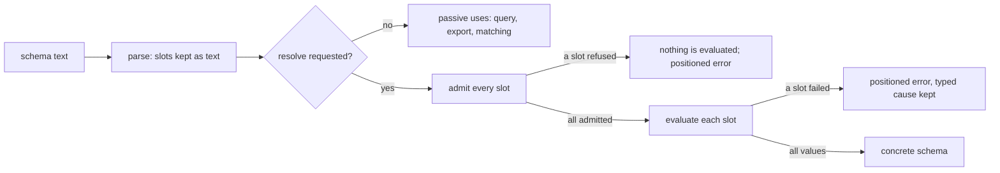
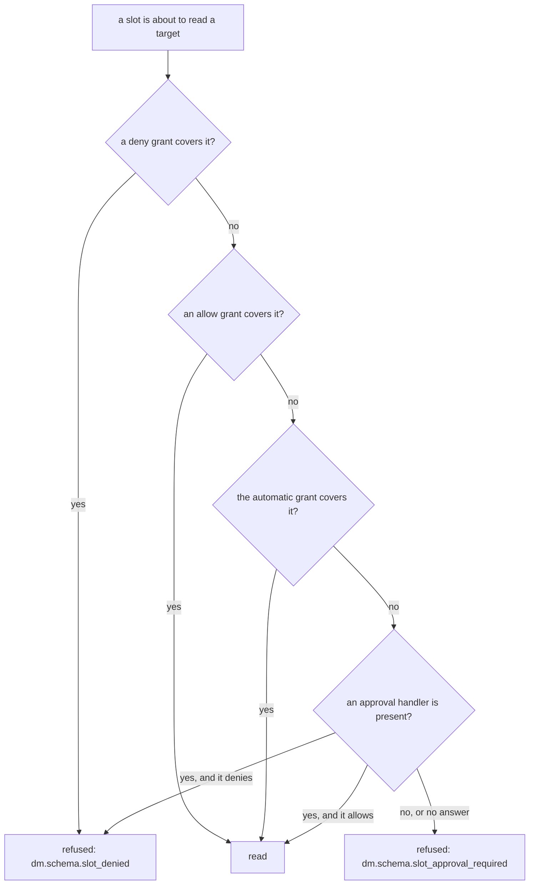
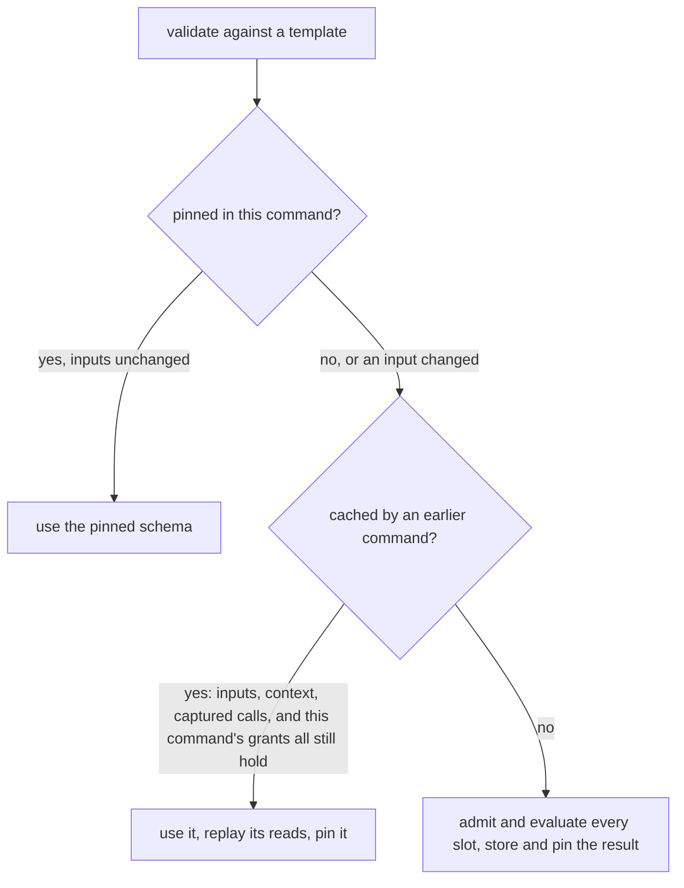
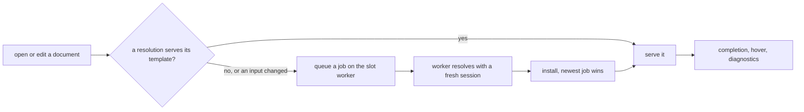

# Schema Slots in Darkmatter

A schema can take some of its values from data instead of spelling them out.
A `{{ … }}` **slot** in an `enum(...)` or `suggest(...)` list, or as the whole
argument of `literal`, `default`, `min`, `max`, or `pattern`, is a **template
constraint**: an expression that Darkmatter evaluates to fill that position:

```yaml
kind: schema
$schema:
    os: enum({{ load_data("../../../os.yaml", "string[]") }}; required)
```

The grammar, the result shapes each position takes, and the substitution
rules belong to the SimplifiedSchema language and are described in
[Schema Slots](../../../../simplified-schema/docs/topics/language/slots.md):
[Where a Slot May Be Written](../../../../simplified-schema/docs/topics/language/slots.md#where-a-slot-may-be-written)
lists every position, and
[What a Slot's Value Must Be](../../../../simplified-schema/docs/topics/language/slots.md#what-a-slots-value-must-be)
the value each one takes, including
[the cap on a slot's pattern](../../../../simplified-schema/docs/topics/language/slots.md#the-pattern-cap).
This page covers what is Darkmatter's: which expressions a slot may contain,
where it evaluates, what it may read, and how a failure is reported.

## When a slot is evaluated

Reading a schema evaluates nothing. Parsing, querying, exporting, trigger
matching, completion, and hover all see the slot as text. A slot is
evaluated only when a schema is **resolved**: every slot of the schema is
first admitted (judged without running anything), then each is evaluated,
and its values are substituted into an ordinary concrete schema.



Composing a document resolves its templates: the document's `$schema` and
each schema trigger whose payload holds slots and matches the document.
[Resolving in a command](#resolving-in-a-command) covers how. Each `md`
command decides how far it goes:

| Command | What happens to a template |
| --- | --- |
| `md compose` | resolves with the automatic, persisted, and run-only grants; on a terminal, asks about the rest before anything runs; a data output fails with `dm.schema.slot_approval_required` |
| `md schema validate <document>` | the same gate as `md compose`; an unapproved read makes the file's check unavailable (`error: slots`, exit 1), never a success |
| `md schema validate <schema file>` | checks the template's syntax and shape only, reports how many slots it holds (`slots`), and resolves nothing |
| `md clean` | the same gate; an unapproved read fails the run with the slot's diagnostic, and the document is never reported clean |
| `md graph`, `md validate refs` | resolve with the automatic and persisted grants only and never ask; a template whose read nobody granted is left for composition to judge, like any other value the check defers |
| the editor (DMLS) | resolves in the background with the automatic, persisted, and editor-session grants, never on a keystroke and never by asking; an unapproved read is a warning at the slot with quick fixes that grant it; see [In the editor](#in-the-editor) |

For example, with Claudine's sandboxing schema committed beside its
`os.yaml`:

```sh
md schema validate claudine/docs/research/sandboxing/providers/sandboxing.yaml
# ✔ … valid …  (a schema template with 1 slot; checked as written, not resolved)
md schema validate provider.md            # resolves os.yaml: the document is checked
echo "- BeOS" >> claudine/docs/os.yaml    # now dirty: no automatic grant
md schema validate provider.md --output json   # error: slots, grants_needed: […], exit 1
```

## Where slots may appear

Slots belong in a schema a document selects: its `$schema`, a schema file
that names, and a schema trigger's `$schema` payload. Everywhere else a slot
is refused, after imports are expanded (so a slot reached through
`Name@file` counts):

| Where | Result |
| --- | --- |
| a kind definition (a `kind:` claim of a YAML document kind) | the claim is broken: `dm.schema.slot_not_allowed_in_kind` |
| the baseline, a global catalog, an editor extension layer | `dm.schema.slot_not_allowed_in_baseline` |
| a schema trigger's `match` conditions | the trigger is invalid (`dm.schema.invalid_trigger`), its message naming the slot |

A trigger whose payload holds slots is **pending**, not invalid: matching it
reads nothing, and `md schema triggers` lists it as `pending: true`. Its
slots evaluate only for a document it matches.

### A replaced property's slots never run

Layers merge whole top-level properties: a property the document's
`$schema` declares replaces a trigger's declaration of it, and a later
trigger replaces an earlier one's (triggers layer in schema-root order,
then filename order within a root; see
[Keeping document layers separate](./schema-triggers.md#keeping-document-layers-separate)). A slot under a replaced declaration is never read and never asked
about, by any command or the editor, because the effective schema does not
contain it. The other properties of the same payload resolve as usual.

```yaml
# schemas/a.trigger.yaml
kind: schema-trigger
match:
  topic: literal(sandbox; required)
$schema:
  os: enum({{ load_data("../data/os.yaml", "string[]") }}; required)
```

```markdown
---
$schema:
  os: string
topic: sandbox
os: Windows
---
```

The document's `os: string` replaces the trigger's `os`, so `md compose`
succeeds without reading `data/os.yaml` or asking about it; remove the
document's `$schema` and the slot needs a grant again. The same holds when a
`b.trigger.yaml` that also matches declares `os: string`.

- A root-union `$schema` replaces a property only when **every** arm
  declares it; an arm that leaves it out keeps the trigger's declaration, so
  its slot still resolves. This holds before the document's own slots
  resolve too: a root-union `$schema` that is itself a template is read arm
  by arm as written, so the questions asked before a run match what the run
  reads.
- A named type (`Name@file`) holding a slot is resolved when a surviving
  property uses it, and skipped when only replaced properties do.
- A payload left with no slot after the replacement is an ordinary schema:
  the editor does not treat it as pending.

### Template types

A **template type** is a slot that supplies a property's whole type
definition (`status: "{{ load_data('./status-type.yaml', 'type-definition') }}"`).
The library's rules for what the value must be and how it merges with the
suffix are in
[Template Types](../../../../simplified-schema/docs/topics/language/slots.md#template-types).

> **Planned:** Darkmatter does not yet grant the reads a returned
> definition causes. A returned definition that imports a type or names an
> example file fails with `dm.schema.slot_approval_required`; one that names
> no file resolves.

## What a slot may contain

A schema describes documents, so a slot may depend only on the schema's own
context, never on the document being validated. Admission walks the whole
expression, including both branches of `?:`, every `||` operand, and every
callback body, whether or not evaluation would reach them. One forbidden
read anywhere refuses the slot, and no slot of the schema is evaluated.

| Allowed | Refused (`dm.schema.slot_forbidden_binding`) |
| --- | --- |
| `ctx.<key>` (`ctx.today`, `ctx.repo_root`, …) | `fm.*`, and any bare name such as `title` (it reads the document) |
| `env.NAME`, `env`, `env[...]` | host globals such as `loop` or `err` |
| `null`, `true`, `false`, literals | `ctx.cwd` (the launch directory) |
| a callback's own parameters, and `current.*` / `local.*` inside a callback | `ctx.self`, `ctx.last_updated`, `ctx.hash` (the document's identity) |
| | `ctx.id`, `ctx.sid` (a fresh value every run) |
| | a bare `ctx` or a computed `ctx[...]`, which could reach the keys above |
| | `current.*` / `local.*` outside a callback |

For example, `{{ ctx.today }}` is admitted, while
`{{ env.CI ? ['a'] : fm.choices }}` is refused at `fm.choices` even when `CI`
is set.

### Functions

Every expression function declares what it may do in a slot:

| Class | Functions | In a slot |
| --- | --- | --- |
| pure | `length`, `lower`, `as_csv`, `map`, `is_date`, … | allowed |
| captured | the date functions (`is_today`, `date`, `older_than`, …), `has_command`, `has_binary`, `package`, `package_area`, `ipv4`, `ipv6`, `has_agentic_cli` | allowed; they read values the request captured once, and a later command reuses the result only if each call answers the same for it |
| input-reading | `load_data`, `frontmatter` and its family, `file_exists`, `validate_schema`, `find_files`, the path functions (`absolute`, `basename`, `join`, `link`, …), `has_skill` | allowed; every read is checked against the slot's approvals |
| volatile | `recent_commits`, `predict_conflicts`, `branch_exists_on_remote`, `remote_vendor` | allowed; never reused across commands |
| rejected | `as_markdown`, `pr`, `pr_list`, `cicd`, `cicd_list`, `ping`, `ping_under`, `has_alias`, `has_builtin_function`, `has_user_function`, `can_execute` | refused (`dm.schema.slot_forbidden_function`) |

A host function registered by an embedding program is pure: its handler
sees only its arguments. A `try(expr, fallback)` call takes the class of its
two arguments together.

## Where a slot evaluates

A slot evaluates in the context of the file it is written in. A relative
path in `load_data("../os.yaml", …)` is resolved from the schema file's
folder, and a slot inside a named type imported from another file
(`Os@../shared/types.yaml`) resolves from that file's folder. A slot in a
document's inline `$schema` evaluates in the document's folder. The context
is derived from the command's request context; nothing is re-read from the
process.

A captured function reads what the command captured, wherever the slot is
written. `package()` and `package_area()` read the repository's package
layout, `ipv4()` and `ipv6()` the host's interface addresses, and
`has_agentic_cli()` the installed agentic CLIs. The command captures each of
these when a slot that calls the function first runs, so a schema moved from
a document's inline `$schema` into a referenced file, an imported type, a
trigger, or a `load_data` contract keeps working:

```yaml
# schema.yaml, referenced by `$schema: ./schema.yaml`
kind: schema
$schema:
  addresses: number(default({{ length(ipv4()) }}))
  package: string(default({{ package('./child') }}))
```

- `md compose`, `md graph`, and `md validate refs` capture from their
  request: the package layout from the repository the request found, the
  other values the way the request captures a `ctx.*` group. A library
  caller that composes with a fixed context of its own gets no new capture,
  and the slot fails with `dm.schema.slot_failed`, as a document expression
  reading that value would.
- `md schema validate`, `md clean`, and the editor capture from the context
  they validate in: its environment and its repository. Outside a
  repository no package matches, so `package(...)` is `""`.
- A schema that calls none of these functions captures nothing, and each
  value is captured at most once per command.

Each slot gets its own work budget, the default iteration limits (100 000
item visits, 16 MiB of expansion). A runaway expression stops with the
ordinary `dm.iteration.visit_limit` or `dm.iteration.expansion_limit`
failure, positioned at the slot.

A slot's `load_data` reads share the command's memo and are listed in its
read set like any other read (see
[Compose Requests](../compose-requests.md#reading-the-read-set)).

## What a slot may read

Every read a slot makes is checked before it happens:

- a content read or a fetch is checked before the file is opened or the URL
  requested, and before the command's shared `load_data` memo is consulted,
  so a file the document itself already loaded is not handed to the slot;
- a schema file is checked before it is opened: each file a `load_data`
  contract imports (`Names@./types.yaml`), and the schema a page names when
  `validate_schema` checks it (the page itself is a content read);
- a folder listing is checked before the folder is enumerated: `find_files`
  needs the folders its pattern lists below (`./*.md` lists the slot's own
  folder), and `find_first_index` or `find_last_index` the folder the file's
  family lives in. A listing is approved with a grant of that folder.

Everything a function observed (a probed path, a listing, a contract import)
is checked once more before the function's result reaches the slot. A
refused read cannot be turned into a value by `try_frontmatter`, `||`, or
[`try`](#an-optional-data-file).

Slots belong to the slot resolver alone. Composing a document never
evaluates the `{{ … }}` inside its inline `$schema` as an ordinary
frontmatter expression, so a slot's read is never made, and its list never
turned into text, before the slot's approvals are checked.

For example, with an empty grant store and no repository, this document
fails with `dm.schema.slot_approval_required`, and its read set stays empty:
neither `names.yaml` nor `types.yaml` is opened.

```yaml
---
$schema:
    os: "enum({{ load_data('./names.yaml', 'Names@./types.yaml') }})"
os: Linux
---
```

A read happens only when something approves it. The gate decides each read
in this order:



### The automatic grant

A slot may read a file of its own repository that is exactly what Git has
committed, with no grant at all. All of these must hold:

1. The schema file the slot is written in lies in the command's repository
   (the repository the command found when it started). A schema anywhere
   else gets no automatic grant for any read.
2. The target lies in that same repository after symlinks are resolved, so a
   link pointing out of the repository is judged by where it points.
3. For a read of a file's content: Git reports the file clean (tracked, with
   no staged or unstaged change and no `filter` attribute such as Git LFS),
   the bytes read hash to the committed blob, and no unsaved editor buffer
   for it differs from disk.

| Target | Automatic? |
| --- | --- |
| a clean, committed file in the schema's repository | yes |
| a modified, untracked, ignored, conflicted, or LFS-filtered file | no |
| a file in another repository, or with no repository at all | no |
| an existence check (`file_exists`) of a path in the repository, tracked or not | yes |
| a `load_data` of a file that does not exist, in the repository | yes: it fails with the ordinary not-found error |
| a folder listing or a glob (`find_files`, the `find_*_index` functions) | never |
| a URL | never |

The decision is made once per target for the whole run, so a file the run
itself changes later keeps the grant it had.

### Grants

A grant allows or denies reads of one target: a file, a folder (and
everything below it), an exact URL (query included), a URL whatever its
query, or a whole site (scheme, host, and port; no subdomains). A deny
always wins: if any deny covers a read, it is refused, whatever else allows
it.

A grant lasts for one run, or is **persisted** in the user's grant store,
`<home>/.config/darkmatter/schema-read-policy` on every OS. Nothing in a
repository or workspace can grant: the store is never read from a
repository, a document folder, or a workspace setting, and no setting can
move it. It is separate from the shell command whitelist and blacklist. The
file holds one grant per line; `#` lines and blank lines are ignored:

```text
allow file /home/me/data/people.yaml
allow dir /home/me/schemas
deny dir /home/me/schemas/private
allow url https://example.com/types.yaml?v=2
allow url-any-query https://example.com/types.yaml
allow site https://schemas.example.com
```

Paths must be absolute; URLs and sites are `http` or `https`. A line that
does not parse makes the whole file unusable for the run (a skipped line
could drop a deny), and the command stops with
`dm.schema.slot_grant_store_invalid` at the file and line. A missing or empty
file grants nothing.

`--allow host=HOST` also allows slot reads of `http` and `https` URLs on that
host for the run.

### Prompts

Before a composition runs any command, its pre-flight collects the reads its
document schema's slots will make, without evaluating them. A read whose
target is written as a literal (or built from literals and pure functions),
as a URL or as an absolute or `./`/`../` path, is known up front; both
branches of `?:` count. Every known read that no grant and no automatic
grant decides is asked about **in the same batch as the shell commands,
before them**. `md compose` on a terminal asks with a numbered prompt:

```text
  ⚠  Schema Read Approval Required
  Schema:   /repo/schemas/sandbox.yaml
  Read:     load_data() reads /repo/data/os.yaml

  1 │ Allow this file for this run          (/repo/data/os.yaml; this run only)
  2 │ Always allow this file                (saves "allow file /repo/data/os.yaml" to the schema read grants)
  3 │ Allow this file's folder for this run (/repo/data; this run only)
  4 │ Always allow this file's folder       (saves "allow dir /repo/data" to the schema read grants)
  5 │ Always deny this file                 (saves "deny file /repo/data/os.yaml" to the schema read grants)
  6 │ Deny for this run                     (the slot fails; this run only)
```

A URL offers the exact URL, the URL whatever its query (only when it has
one), and the site. Ended input is "deny for this run". A read whose target
is computed (from `env`, say) is asked about when the slot evaluates, through
the same handler. Without a terminal, and for a data output (`--output
json`, …), nothing is asked and an unapproved read is
`dm.schema.slot_approval_required`; a library caller that passes no approval
handler gets the same.

A slot's URL reads go through a remote runtime of their own, which may
fetch only the hosts its grants name; a slot grant never widens what the
document's own reads may fetch.

`md compose` hands pre-flight's run-only answers to the composition that
follows it, through the command's one session. A run with no shell operation
enabled still asks about slot reads first
(`Markdown::compose_slot_approvals`, the slot half of the pre-flight). A
library caller does the same with `SlotSession::with_run_grants`.

`md schema validate` and `md clean` do not run the compose pre-flight; they
ask about each document's known reads in one batch just before its schema
resolves (`DarkmatterSchemas::approve_slot_reads`), with the same prompt.

### An optional data file

A slot can make its data file optional with
[`try(expr, fallback)`](../../functions/try.md), which returns `fallback` when
`expr` fails to read its data (see
[Recovering from read failures](../darkmatter-expressions.md#recovering-from-read-failures)).
Here `extra.yaml` adds choices when it exists:

```yaml
$schema:
    os: enum(macOS, {{ try(load_data("./extra.yaml", "string[]"), []) }})
```

`try` changes what a slot recovers from, never what it may read:

- **A missing file in the repository recovers without a grant**, because the
  [automatic grant](#the-automatic-grant) covers it. A missing file outside
  the repository is still a read that needs a grant, so without one the slot
  fails with `dm.schema.slot_approval_required`, not the fallback.
- **Refusals are never recovered.** An approval or deny refusal, and a
  forbidden binding or function in either argument, fail the slot as they
  would without `try`. A forbidden fallback is refused before anything is
  evaluated.
- **Only the selected argument's reads are recorded.** When `expr` succeeds,
  the fallback's reads are not in the read set; pre-flight still asks about
  the known reads of both.
- **An empty fallback adds no candidates.** In an `enum(...)` or
  `suggest(...)` list, a fallback `[]` contributes nothing, and the final list
  must still not be empty: above, a missing `extra.yaml` leaves `macOS`, but
  `enum({{ try(load_data("./extra.yaml", "string[]"), []) }})` alone fails
  with `dm.schema.slot_empty`.

Once the file is created and committed, the next command reads it rather
than reusing the recovered result.

## Resolving in a command

One command (an `md compose` run, one library composition) resolves its
templates through one **slot session**. A composition builds its own from
the request (its data runtime, repository, `--allow host=HOST` values, home,
and approval handler) unless the caller attached one with
`ComposeOptions::with_slot_session`, which a caller running several passes
(pre-flight, a reference check, lifecycle steps, then composition) does once
so every pass shares it:

```rust,ignore
use std::sync::Arc;
use darkmatter::markdown::compose::{ComposeOptions, DataRuntime};
use darkmatter::markdown::schemas::slots::SlotSession;

let data = DataRuntime::new();
let session = Arc::new(
    SlotSession::new(data.clone())
        .with_repository_root(Some(repository_root))
        .with_home(home)
        .with_run_grants(approvals.slot_grants),
);
let options = ComposeOptions::new().with_data_runtime(data).with_slot_session(session);
```

Within the session:

- **Grants are decided once per run.** Each read's decision (automatic,
  for this run, persisted, or denied) is kept for the whole run. When the
  run's own approved step later changes a file it read, the file keeps the
  grant it had, even though it is now dirty.
- **Each template is pinned.** Every later validation in the run gets the
  same concrete schema, so the passes of one command agree.
- **A pin follows the run's own writes.** After a shell command or lifecycle
  step runs, the next use rehashes what the pinned resolution read. An
  unrelated write keeps the pin; a changed input drops it, and the template
  resolves again under the grants already decided. If that fails, the
  failure (with its `dm.data.*` code) is reported; nothing is validated
  against a stale schema.
- **A pass that must read nothing** (the reference check inside `md
  compose`, a pre-flight walk) uses only a schema already pinned, and
  otherwise leaves the template for composition to judge.
- **A reference-check session** (`SessionMode::ReferenceCheck`, used by `md
  graph` and `md validate refs`) resolves with the automatic and persisted
  grants but never asks; a template a read nobody granted (or a denied read)
  stops is left unresolved, and the check defers it.

A command that validates without composing builds its session from its
context instead of a request:

```rust,ignore
let session = SlotSession::for_context(DataRuntime::new(), &document_context)
    .with_handler(handler); // only when the run may ask
let schemas = DarkmatterSchemas::new(document_context).with_slot_session(Arc::new(session));
schemas.approve_slot_reads(&markdown)?; // one batched ask, before resolving
let effective = schemas.effective_for(&markdown)?;
```



Across commands in one process, resolutions are kept in memory (never on
disk) and shared when they still hold. A result is reused only if:

- the template's schema files, its slots, the request context, the
  repository, and the Darkmatter build are the same;
- every file it read is unchanged. A file whose size and modification time
  are unchanged counts as unchanged without being reread; a file edited
  within the clock's resolution without changing size is not noticed;
- every `ctx` group and `env` value it read is the same;
- every call to a captured function gives the same answer when it is made
  again, with the same arguments, against the requesting command's own
  captured values. For example, a result that used
  `is_today('2024-06-16')` is reused on June 16 at any hour but not on June
  17; one that used `ipv4()`, `package(...)`, or `has_agentic_cli(...)` is
  not reused once the captured addresses, package topology, or installed
  tools give another answer; and one that used `has_command('/opt/bin/tool')`
  is not reused once the executable is gone, even with the same `PATH`;
- the requesting command's grants allow every read it made, each judged for
  the schema file whose slot made it. A result that needed a grant for this
  run only is not reused by a command without that grant. This holds at
  every depth: when a repository schema loads data under a type from a
  shared schema outside the repository, and that type's own slot reads a
  file, the read is judged for the shared schema, which gets no automatic
  grant, even though the repository schema would have been granted the same
  file automatically. This check comes before any file the result read is
  looked at again.

These dependencies are recorded as the slots evaluate, so they include every
slot that ran: one in a root-union arm that resolution reaches only after the
first arms resolved, and the slots of a type a `load_data` contract names
(described below), including a contract the command had already prepared for
another template.

A resolution in which a volatile function ran (git state such as
`remote_vendor()`, a network probe), whether in a slot of its own, a later
union arm, or a contract's type, or one that read a URL or a folder listing,
is never reused by another command. Within one command, a pinned schema that
used a captured function is checked again after a shell command or other
step ran, so an executable the step removed is noticed. Failures are kept like
results, so creating the missing file or repairing the bad one is noticed;
a failure that depends on grants (a read needing approval, a denied read)
is never kept.

A slot whose `load_data` contract names a type holding slots resolves that
type's slots too, in the same session. When that leads back to a template
being resolved, the outer slot fails with `dm.schema.slot_cycle`. When one
of the type's own slots fails, the outer slot reports that failure with the
code and fields it would have in a slot of its own (see the table under
[Failures](#failures)). The record is
positioned at the outer slot, the one that read the data; the inner slot's
own position is not published. For example, with `Os: enum({{ 123 }})[]`
in `types.yaml`, a document slot `{{ load_data("./os.yaml",
"Os@./types.yaml") }}` fails with `dm.schema.slot_wrong_shape` at that
document slot. Outside a slot (in a document's own `load_data`), a contract
naming a type with slots fails as unresolved.

## In the editor

DMLS, Darkmatter's language server, treats a template like `md compose`
does, with two differences: it never asks you anything, and it never
resolves a slot while answering a request. Completion, hover, and
diagnostics read the last resolution kept in memory; a background worker
of its own does the resolving.



What you see while you work:

| State | Diagnostics | Completion and hover |
| --- | --- | --- |
| not resolved yet (just opened) | `dm.schema.slot_pending` (information) at the slot; the frontmatter is not judged | the template's literal parts: `enum(Haiku, {{ … }})` offers `Haiku`; each candidate and the hover say the slots are pending |
| resolved | ordinary schema diagnostics against the loaded values | the loaded values |
| an input changed, a refresh is running | the last resolution's verdict, plus one `dm.schema.slot_pending` (information) saying it is being refreshed | the last resolution's values; each candidate and the hover say they are stale |
| a read needs approval | `dm.schema.slot_approval_required` (warning) at the slot, with quick fixes | the template's literal parts, said to be pending |
| a slot failed | the slot's own code (see [Failures](#failures)) at the slot | the template's literal parts, said to be pending |

A completion candidate says so in its detail line, after anything it
already showed; its label and the text it inserts are unchanged:

```text
os: |          Linux    Schema slots stale: refreshing; shown from their last resolution.
```

The hover of a `{{ os }}` expression in the body carries the same note,
and so does the title of an *Add required key* quick fix whose inserted
value the slots supplied.

A template that did not resolve is never validated against: the
frontmatter gets the slot's diagnostics instead of a verdict, so a schema
missing its loaded values never makes a document look valid. A slot
written in another schema file is reported on the document's `$schema`
value, with a related location pointing at the slot.

**Granting a read.** Each grant an approval-required diagnostic offers is a
quick fix (the choices a prompt would list: this file or its folder, for
this session or always; then always deny, and deny for this session). A
quick fix runs the `dmls.grantSlotRead` command, which edits nothing in the
workspace:

- an "always" choice appends `allow file /repo/claudine/docs/os.yaml` (or
  `deny …`) to the [grant store](#grants), the same file `md` reads;
- a "this session" choice is kept in the server's memory until it exits and
  is never written anywhere.

Either way every open document's slots are resolved again. Running the
`dmls.refreshSchemaSlots` command does the same without granting anything,
and so does a configuration change (`workspace/didChangeConfiguration`),
because a slot may read the environment, which no file event reports.

**What refreshes a resolution.** The worker records every path a resolution
read: data files, files probed and found missing, folders listed, and, when
any of those lies in a Git repository, that repository's `.git/index` and
`HEAD` (an automatic grant depends on what they record). DMLS watches each
path itself, whatever its extension, so saving a data file, creating a
missing one, or staging a change refreshes the documents that read it. An
unsaved edit to any open file a resolution read refreshes them too, whatever
its format (a YAML, JSON, JSON5, JSON Lines, TOML, CSV, or TSV data file, a
Markdown file `frontmatter()` reads, or a schema file a contract imports),
and the resolution reads the unsaved text; closing the buffer unsaved goes
back to the file on disk. An open buffer whose text differs from the
committed file is a modified file, so it gets no automatic grant. A client that cannot watch files gets a
fallback: each save re-checks every recorded path by `stat` (size,
modification time, and whether it exists), not by content, so a rewrite
that keeps a file's size and timestamp is not noticed until something else
refreshes it.

**Limits.** Each slot in the editor gets a quarter of a command's work
allowance (25,000 visits, 4 MiB of expansion), so a runaway slot stops with
the ordinary `dm.iteration.*` code at the slot in roughly 25 ms of work. A
realistic list (500 members) uses a small fraction of it. A failure caused by
the smaller allowance is never reused by a command. A newer edit of the
template cancels a resolution still running, and only the newest result is
installed.

## Failures

A failed slot is reported at the slot, in the file it is written in. The
record's `source.file`, `line`, and `column` and its `span` (byte offsets in
that file) point at the slot's `{{ … }}` as you wrote it:

| The slot is written in | The record names |
| --- | --- |
| the document's own frontmatter `$schema` (including a root-union arm) | the document |
| a schema file the `$schema` references, or a file a named type is imported from | that schema file |
| a schema-trigger file's inline `$schema` payload | the trigger file |
| a YAML document's own root `$schema` | the YAML document |

The type string may be written in any YAML form; the position is of the
bytes in the file, not of the decoded string:

```yaml
$schema:
  a: enum({{ load_data("./os.yaml", "string[]") }})          # plain
  b: 'enum(macOS, {{ ''x'' }})'                              # single-quoted
  c: "enum(macOS, {{ \"x\" }})"                              # double-quoted, escapes counted as written
  d: |-                                                      # literal or folded block, any chomping
    enum(macOS, {{ load_data("./os.yaml", "string[]") }})    # or indentation indicator
```

A position is given only when it is proven. The schema's text is the one
the command read when it resolved the template; nothing is read again to
report a failure. When no text proves the slot's place, `line`, `column`,
and `span` are `null` and the file is still named. That happens for a
`$schema` given with `md schema validate --schema` (it is not in the
document), and for a value whose text does not say what the parsed value is
(for example, a YAML alias or merge key carrying the definition). A refused
read inside a slot is positioned at the read itself when the expression is
written exactly as it reads; through a YAML escape inside the expression, it
is positioned at the whole expression instead.

DMLS ranges a slot written in the open document at this same span, as long
as the resolution it reports read the buffer's current text; a record from
an earlier revision of the buffer is ranged at the `$schema` value until the
edited buffer resolves.

The cause the expression failed with is kept:

| Failure | Code | Also carries |
| --- | --- | --- |
| the slot text is not an expression | `dm.schema.slot_syntax` | |
| a refused binding or function | `dm.schema.slot_forbidden_binding`, `dm.schema.slot_forbidden_function` | the refused read's position |
| a read no approval covers, or a denied one | `dm.schema.slot_approval_required`, `dm.schema.slot_denied` | `grants_needed` (approval only): the grants any one of which would allow the read |
| a malformed data file, a contract mismatch | the `load_data` code (`dm.data.malformed`, …) | `data_location`, the position inside the data file |
| a missing or unreadable file | `dm.schema.slot_failed` | the reference fields (`construct`, `reference`, `failure`) |
| an exhausted work budget | `dm.iteration.visit_limit`, `dm.iteration.expansion_limit` | |
| a value of the wrong shape, an empty list | `dm.schema.slot_wrong_shape`, `dm.schema.slot_empty` | |
| a slot pattern the linear regex engine must not take | `dm.schema.slot_pattern_rejected` | |
| a contract that leads back to a template being resolved | `dm.schema.slot_cycle` | |
| the user's grant store is invalid | `dm.schema.slot_grant_store_invalid` | the store's file and line in the message |
| the schema's slots were not resolved for this surface | `dm.schema.slot_pending` | |

The full family of slot codes is `SLOT_DIAGNOSTIC_CODES` in
`darkmatter::markdown::schemas::slots`.

In a data output, an unapproved read's record names the grants that would
allow it, in the order the prompt offers them, so a script can write one to
the grant store and run again:

```json
{
  "code": "dm.schema.slot_approval_required",
  "source": { "file": "/repo/claudine/docs/research/sandboxing/providers/sandboxing.yaml", "line": 8, "column": 14, "inserted": false },
  "grants_needed": [
    { "kind": "file", "target": "/repo/claudine/docs/os.yaml", "scope": "once" },
    { "kind": "file", "target": "/repo/claudine/docs/os.yaml", "scope": "persisted" },
    { "kind": "dir", "target": "/repo/claudine/docs", "scope": "once" },
    { "kind": "dir", "target": "/repo/claudine/docs", "scope": "persisted" }
  ]
}
```

A `persisted` grant is the line `allow <kind> <target>` in the grant store;
a `once` grant can only be given at a prompt.
