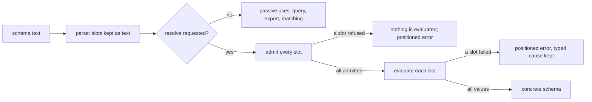
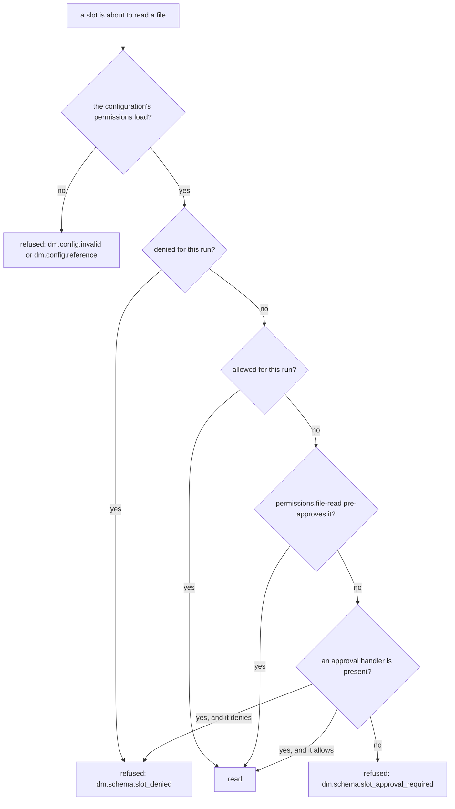
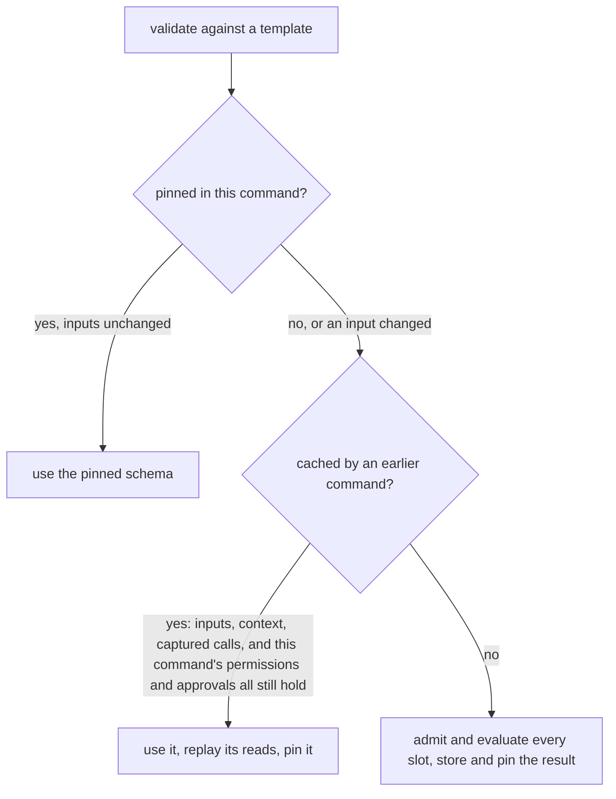
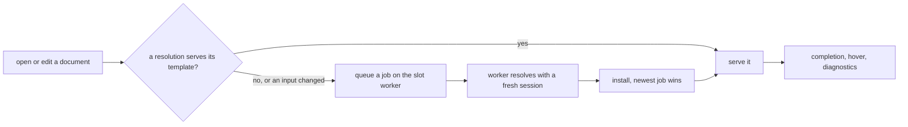
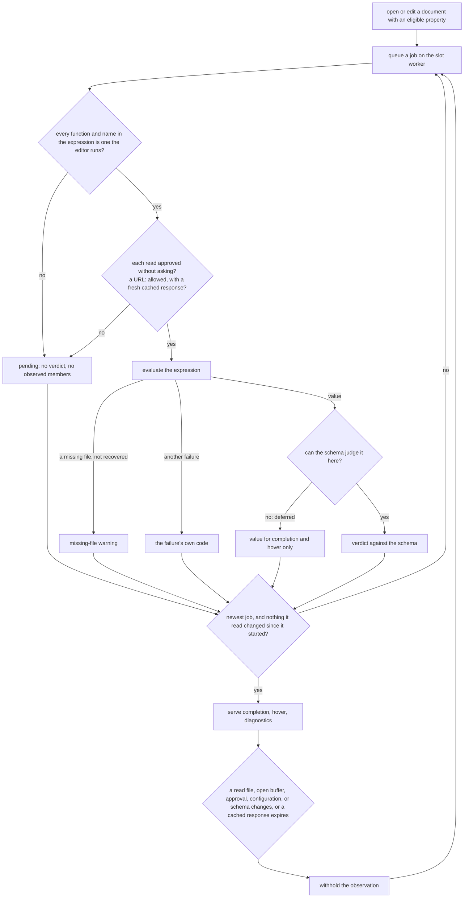

# Schema Slots in Darkmatter

A schema can take some of its values from data instead of spelling them out.
A `{{ … }}` **slot** in an `enum(...)` or `suggest(...)` list, or as the whole
argument of `literal`, `default`, `min`, `max`, or `pattern`, is a **template
constraint**: an expression that Darkmatter evaluates to fill that position:

```yaml
kind: schema
$schema:
    os: enum({{ load_data("../../../os.yaml", "string[]") }}; required)
```

The grammar, the result shapes each position takes, and the substitution
rules belong to the SimplifiedSchema language and are described in
[Schema Slots](../../../../simplified-schema/docs/topics/language/slots.md):
[Where a Slot May Be Written](../../../../simplified-schema/docs/topics/language/slots.md#where-a-slot-may-be-written)
lists every position, and
[What a Slot's Value Must Be](../../../../simplified-schema/docs/topics/language/slots.md#what-a-slots-value-must-be)
the value each one takes, including
[the cap on a slot's pattern](../../../../simplified-schema/docs/topics/language/slots.md#the-pattern-cap).
This page covers what is Darkmatter's: which expressions a slot may contain,
where it evaluates, what it may read, and how a failure is reported.

## When a slot is evaluated

Reading a schema evaluates nothing. Parsing, querying, exporting, trigger
matching, completion, and hover all see the slot as text. A slot is
evaluated only when a schema is **resolved**: every slot of the schema is
first admitted (judged without running anything), then each is evaluated,
and its values are substituted into an ordinary concrete schema.



Composing a document resolves its templates: the document's `$schema` and
each schema trigger whose payload holds slots and matches the document.
[Resolving in a command](#resolving-in-a-command) covers how. Each `md`
command decides how far it goes:

| Command | What happens to a template |
| --- | --- |
| `md compose` | resolves with the reads `permissions.file-read` pre-approves and this run's approvals; on a terminal, asks about the rest before anything runs; a data output fails with `dm.schema.slot_approval_required` |
| `md schema validate <document>` | the same gate as `md compose`; an unapproved read makes the file's check unavailable (`error: slots`, exit 1), never a success |
| `md schema validate <schema file>` | the same gate as `md schema validate <document>`: every slot in the file resolves before the file is judged, and an unapproved or failed read makes the check unavailable (`error: slots`, exit 1) |
| `md clean` | the same gate; an unapproved read fails the run with the slot's diagnostic, and the document is never reported clean |
| `md graph`, `md validate refs` | resolve with the reads `permissions.file-read` pre-approves only and never ask; a template whose read nobody approved is left for composition to judge, like any other value the check defers |
| the editor (DMLS) | resolves in the background with the reads `permissions.file-read` pre-approves and the editor session's approvals, never on a keystroke and never by asking; an unapproved read is a warning at the slot with quick fixes that approve it; see [In the editor](#in-the-editor) |

For example, with Claudine's sandboxing schema reading `claudine/docs/os.yaml`
and the repository's default `file-read` list (`&**/*.yaml` among others)
committed:

```sh
md schema validate claudine/docs/research/sandboxing/providers/sandboxing.yaml
# ✔ … valid …  (os.yaml is pre-approved by permissions.file-read; the resolved schema was checked)
md schema validate provider.md            # resolves os.yaml: the document is checked
# with a user `file-read` entry "!&claudine/docs/os.yaml", nothing pre-approves the read:
md schema validate provider.md --output json   # error: slots, grants_needed: […], exit 1
```

## Where slots may appear

Slots belong in a schema a document selects: its `$schema`, a schema file
that names, and a schema trigger's `$schema` payload. Everywhere else a slot
is refused, after imports are expanded (so a slot reached through
`Name@file` counts):

| Where | Result |
| --- | --- |
| a kind definition (a `kind:` claim of a YAML document kind) | the claim is broken: `dm.schema.slot_not_allowed_in_kind` |
| the baseline, a global catalog, an editor extension layer | `dm.schema.slot_not_allowed_in_baseline` |
| a schema trigger's `match` conditions | the trigger is invalid (`dm.schema.invalid_trigger`), its message naming the slot |

A trigger whose payload holds slots is **pending**, not invalid: matching it
reads nothing, and `md schema triggers` lists it as `pending: true`. Its
slots evaluate only for a document it matches.

### A replaced property's slots never run

Layers merge whole top-level properties: a property the document's
`$schema` declares replaces a trigger's declaration of it, and a later
trigger replaces an earlier one's (triggers layer in schema-root order,
then filename order within a root; see
[Keeping document layers separate](./schema-triggers.md#keeping-document-layers-separate)). A slot under a replaced declaration is never read and never asked
about, by any command or the editor, because the effective schema does not
contain it. The other properties of the same payload resolve as usual.

```yaml
# schemas/a.trigger.yaml
kind: schema-trigger
match:
  topic: literal(sandbox; required)
$schema:
  os: enum({{ load_data("../data/os.yaml", "string[]") }}; required)
```

```markdown
---
$schema:
  os: string
topic: sandbox
os: Windows
---
```

The document's `os: string` replaces the trigger's `os`, so `md compose`
succeeds without reading `data/os.yaml` or asking about it; remove the
document's `$schema` and the slot's read needs approval again. The same holds when a
`b.trigger.yaml` that also matches declares `os: string`.

- A root-union `$schema` replaces a property only when **every** arm
  declares it; an arm that leaves it out keeps the trigger's declaration, so
  its slot still resolves. This holds before the document's own slots
  resolve too: a root-union `$schema` that is itself a template is read arm
  by arm as written, so the questions asked before a run match what the run
  reads.
- A named type (`Name@file`) holding a slot is resolved when a surviving
  property uses it, and skipped when only replaced properties do.
- A payload left with no slot after the replacement is an ordinary schema:
  the editor does not treat it as pending.

### Template types

A **template type** is a slot that supplies a property's whole type
definition (`status: "{{ load_data('./status-type.yaml', 'type-definition') }}"`).
The library's rules for what the value must be and how it merges with the
suffix are in
[Template Types](../../../../simplified-schema/docs/topics/language/slots.md#template-types).

#### The reads a returned definition causes

A returned definition is type syntax, so it can name files the schema author
never wrote: `Person@./types.yaml`, a bare `Person@person` looked up in the
schema roots, or an `example(./sample.yaml)`. Those reads belong to the slot
that returned the definition. Each one passes the same approval gate as the
slot's own reads (see [What a slot may read](#what-a-slot-may-read)) before
the file is probed, opened, taken from an editor buffer, or taken from a
memo, and a static import's ability to read the same file never authorizes
it.

For example, with this document and its `types.yaml` beside it:

```yaml
---
$schema:
    owner: "{{ 'Person@./types.yaml' }}"
owner:
    name: Ann
---
```

| Approvals in force | Outcome |
| --- | --- |
| `permissions.file-read` pre-approves `types.yaml` (the user default `./*.yaml` does: it lies beside the document), or it was allowed for this run | `owner` validates exactly as `owner: Person@./types.yaml` would |
| `types.yaml` was denied for this run | fails with `dm.schema.slot_denied` at the slot |
| none, on a terminal | asks about `types.yaml` when the definition is expanded, then continues |
| none, with a data output, in the editor, or in a reference check | fails with `dm.schema.slot_approval_required`; a reference check defers it instead |

The file a returned definition names is a computed target: it is known only
after the slot ran, so it is never part of the batch of questions asked
before a run. Each read is asked once per resolution. A denied or
unapproved read always fails the resolution; no fallback turns it into a
schema. Imports resolve against the file the slot was written in, never
the data file that supplied the text.

Every file read and every location probed, found or missing, is recorded as
a dependency of the resolution, like the slot's own reads: it joins the
command's read set, a cached result is reused only while those files are
unchanged (creating a missing candidate counts as a change) and the
requesting command's permissions and approvals still allow them, and the
editor watches them.

## What a slot may contain

A schema describes documents, so a slot may depend only on the schema's own
context, never on the document being validated. Admission walks the whole
expression, including both branches of `?:`, every `||` operand, and every
callback body, whether or not evaluation would reach them. One forbidden
read anywhere refuses the slot, and no slot of the schema is evaluated.

| Allowed | Refused (`dm.schema.slot_forbidden_binding`) |
| --- | --- |
| `ctx.<key>` (`ctx.today`, `ctx.repo_root`, …) | `fm.*`, and any bare name such as `title` (it reads the document) |
| `env.NAME`, `env`, `env[...]` | host globals such as `loop` or `err` |
| `null`, `true`, `false`, literals | `ctx.cwd` (the launch directory) |
| a callback's own parameters, and `current.*` / `local.*` inside a callback | `ctx.self`, `ctx.last_updated`, `ctx.hash` (the document's identity) |
| | `ctx.id`, `ctx.sid` (a fresh value every run) |
| | a bare `ctx` or a computed `ctx[...]`, which could reach the keys above |
| | `current.*` / `local.*` outside a callback |

For example, `{{ ctx.today }}` is admitted, while
`{{ env.CI ? ['a'] : fm.choices }}` is refused at `fm.choices` even when `CI`
is set.

### Functions

Every expression function declares what it may do in a slot:

| Class | Functions | In a slot |
| --- | --- | --- |
| pure | `length`, `lower`, `as_csv`, `map`, `is_date`, … | allowed |
| captured | the date functions (`is_today`, `date`, `older_than`, …), `has_command`, `has_binary`, `package`, `package_area`, `ipv4`, `ipv6`, `has_agentic_cli` | allowed; they read values the request captured once, and a later command reuses the result only if each call answers the same for it |
| input-reading | `load_data`, `frontmatter` and its family, `file_exists`, `validate_schema`, `find_files`, the path functions (`absolute`, `basename`, `join`, `link`, …), `has_skill` | allowed; every read is checked against the slot's approvals |
| volatile | `recent_commits`, `predict_conflicts`, `branch_exists_on_remote`, `remote_vendor` | allowed; never reused across commands |
| rejected | `as_markdown`, `pr`, `pr_list`, `cicd`, `cicd_list`, `ping`, `ping_under`, `has_alias`, `has_builtin_function`, `has_user_function`, `can_execute` | refused (`dm.schema.slot_forbidden_function`) |

A host function registered by an embedding program is pure: its handler
sees only its arguments. A `try(expr, fallback)` call takes the class of its
two arguments together.

## Where a slot evaluates

A slot evaluates in the context of the file it is written in. A relative
path in `load_data("../os.yaml", …)` is resolved from the schema file's
folder, and a slot inside a named type imported from another file
(`Os@../shared/types.yaml`) resolves from that file's folder. A slot in a
document's inline `$schema` evaluates in the document's folder. The context
is derived from the command's request context; nothing is re-read from the
process.

A captured function reads what the command captured, wherever the slot is
written. `package()` and `package_area()` read the repository's package
layout, `ipv4()` and `ipv6()` the host's interface addresses, and
`has_agentic_cli()` the installed agentic CLIs. The command captures each of
these when a slot that calls the function first runs, so a schema moved from
a document's inline `$schema` into a referenced file, an imported type, a
trigger, or a `load_data` contract keeps working:

```yaml
# schema.yaml, referenced by `$schema: ./schema.yaml`
kind: schema
$schema:
  addresses: number(default({{ length(ipv4()) }}))
  package: string(default({{ package('./child') }}))
```

- `md compose`, `md graph`, and `md validate refs` capture from their
  request: the package layout from the repository the request found, the
  other values the way the request captures a `ctx.*` group. A library
  caller that composes with a fixed context of its own gets no new capture,
  and the slot fails with `dm.schema.slot_failed`, as a document expression
  reading that value would.
- `md schema validate`, `md clean`, and the editor capture from the context
  they validate in: its environment and its repository. Outside a
  repository no package matches, so `package(...)` is `""`.
- A schema that calls none of these functions captures nothing, and each
  value is captured at most once per command.

Each slot gets its own work budget, the default iteration limits (100 000
item visits, 16 MiB of expansion). A runaway expression stops with the
ordinary `dm.iteration.visit_limit` or `dm.iteration.expansion_limit`
failure, positioned at the slot.

A slot's `load_data` reads share the command's memo and are listed in its
read set like any other read (see
[Compose Requests](../compose-requests.md#reading-the-read-set)).

## What a slot may read

A slot reads only what you have approved. Approval comes from two places:
the `permissions.file-read` list of your configuration, which approves
files ahead of time, and the answers you give during one run. Nothing a
repository, a document folder, or a workspace setting holds can approve a
read on its own; a repository's `file-read` entries count only as far as
the configuration's rules let them (see
[Permissions](../permissions.md)).

Every read a slot makes is checked before it happens:

- a content read or a fetch is checked before the file is opened or the URL
  requested, and before the command's shared `load_data` memo is consulted,
  so a file the document itself already loaded is not handed to the slot;
- a schema file is checked before it is opened: each file a `load_data`
  contract imports (`Names@./types.yaml`), and the schema a page names when
  `validate_schema` checks it (the page itself is a content read);
- an existence check (`file_exists`) is checked like a content read of the
  same path;
- a listing (`find_files`, `find_first_index`, `find_last_index`) needs no
  approval of its own; instead it returns only the files the slot may read
  without asking (see [Listings](#listings)).

Everything a function observed (a probed path, a contract import) is checked
once more before the function's result reaches the slot. A refused read
cannot be turned into a value by `try_frontmatter`, `||`, or
[`try`](#an-optional-data-file).

Slots belong to the slot resolver alone. Composing a document never
evaluates the `{{ … }}` inside its inline `$schema` as an ordinary
frontmatter expression, so a slot's read is never made, and its list never
turned into text, before the slot's approvals are checked.

For example, with a user `file-read: []`, outside any repository, this
document fails with `dm.schema.slot_approval_required` when nothing can ask,
and its read set stays empty: neither `names.yaml` nor `types.yaml` is
opened.

```yaml
---
$schema:
    os: "enum({{ load_data('./names.yaml', 'Names@./types.yaml') }})"
os: Linux
---
```

### How a file read is decided

Each read is judged for the **reading document**: the schema file the slot
is written in, or the document itself for a slot in its inline `$schema`.
A relative `file-read` entry such as `./*.yaml` therefore means "beside the
schema file", not beside the document being validated. The gate decides in
this order, and the first step that applies wins:



1. **Invalid permissions refuse everything.** When the configuration's
   `permissions` block fails to load, every slot read fails with that
   configuration error's own code (`dm.config.invalid` or
   `dm.config.reference`); nothing is allowed and nothing is asked.
2. **This run's answers come next.** A "deny for this run" refuses the read
   (`dm.schema.slot_denied`), and an "allow for this run" allows it, even
   when a `!` exclusion in `file-read` matches the file.
3. **`permissions.file-read` pre-approves.** The user scope's entries, or
   the repository's entries when both its committed (`HEAD`) and working-copy
   `.darkmatter.yaml` allow the file, approve the read; a `!` exclusion in
   any of them removes that pre-approval. With no `file-read` written, the
   defaults apply: files with a common data or text extension (`txt`, `md`,
   `json`, `yaml`, `csv`, …) beside the reading document (user scope) or
   anywhere in its repository (repository scope). See
   [Defaults and overrides](../permissions.md#defaults-and-overrides) and
   [How the scopes combine](../permissions.md#how-the-scopes-combine).
4. **Otherwise the approval handler is asked** (see
   [Prompts](#prompts)). With no handler (a data output, `md graph`,
   `md validate refs`, the editor) the read fails with
   `dm.schema.slot_approval_required`, whose data-output record lists the
   approvals that would allow it (see [Failures](#failures)).

For example, with the user defaults and a schema at `/home/me/schemas/os.yaml`:

| The slot reads | Outcome |
| --- | --- |
| `./os-list.yaml` (beside the schema) | read: the user default `./*.yaml` pre-approves it |
| `../data/os-list.yaml` | asked about on a terminal; `dm.schema.slot_approval_required` elsewhere |
| `./os-list.yaml`, with a user entry `!./os-list.yaml` | asked about, because the exclusion removes pre-approval |
| `./os-list.yaml`, denied earlier in this run | `dm.schema.slot_denied` |

### URL reads

A slot's URL read is allowed by network consent or by an answer for this
run, never by a saved approval:

- `permissions.network: allow` allows slot reads of every `http` and `https`
  URL, and `--allow host=HOST` allows that host's URLs for one run, the same
  decision composition takes (see
  [Remote URL References](../remote-url-references.md#allowed-hosts));
- without that consent, the read is asked about with two choices, allow
  this URL for this run or deny it for this run, and fails with
  `dm.schema.slot_approval_required` where nothing can ask.

A "deny for this run" refuses the URL even when network consent would allow
it. A slot's URL reads go through a remote runtime of their own, which may
fetch only the hosts the slot was allowed; approving a slot read never
widens what the document's own reads may fetch.

### Listings

`find_files`, `find_first_index`, and `find_last_index` list the folders
their pattern names without asking anything, then keep only the files the
slot could read without asking: those `permissions.file-read` pre-approves
and those already allowed for this run. Every other file is silently left
out, as if it did not exist. Nothing is ever asked about a folder.

For example, with the user defaults (`./*.md`, `./*.yaml`, … beside the
schema) and a schema folder holding `a.md`, `b.md`, and `notes.org`:

```yaml
$schema:
    page: enum({{ find_files("./*") }})
```

`page` takes `a.md` and `b.md`; `notes.org` is not offered and nobody is
asked about it. To include it, add an entry such as `./*.org` to
`permissions.file-read`.

### Prompts

Before a composition runs any command, its pre-flight collects the reads its
document schema's slots will make, without evaluating them. A read whose
target is written as a literal (or built from literals and pure functions),
as a URL or as an absolute or `./`/`../` path, is known up front; both
branches of `?:` count. Every known read that neither
`permissions.file-read` nor network consent approves is asked about **in the
same batch as the shell commands, before them**. `md compose` on a terminal
asks with a numbered prompt:

```text
  ⚠  Schema Read Approval Required
  Schema:   /repo/schemas/sandbox.yaml
  Read:     load_data() reads /repo/data/os.yaml

  1 │ Allow this file for this run  (/repo/data/os.yaml; this run only)
  2 │ Always allow this file        (/repo/data/os.yaml; saved to your permissions.file-read)
  3 │ Deny for this run             (the slot fails; this run only)
```

| Choice | Effect |
| --- | --- |
| Allow this file for this run | the read happens; nothing is saved |
| Always allow this file | the read happens for the rest of this run, and the file is saved to your `permissions.file-read` for later runs; offered only when the permissions loaded |
| Deny for this run | the slot fails with `dm.schema.slot_denied`; nothing is saved |
| Allow this URL for this run (a URL) | the fetch happens; nothing is saved |

Ended input is "deny for this run". There is no folder, site, or saved deny
choice. A read whose target is computed (from `env`, say) is asked about
when the slot evaluates, through the same handler. Without a terminal, and
for a data output (`--output json`, …), nothing is asked and an unapproved
read is `dm.schema.slot_approval_required`; a library caller that passes no
approval handler gets the same.

**What "always allow" saves.** The file is added to the user scope's
`permissions.file-read` (in `~/.darkmatter.yaml`, or the file its
`permissions` reference names) as one exact, portable `~/` entry with glob
characters escaped: `/home/me/data/a[1].yaml` is saved as
`~/data/a[[]1[]].yaml`. Only that list is edited; comments and other keys
are kept, and an omitted list is first written out with its defaults,
because a written list replaces them. The configuration this run captured is
never reloaded, so the saved entry takes effect from the next run; the run
itself keeps the file allowed. When the entry cannot be saved, the read is
still allowed for this run and the composition report carries a
`dm.config.not_saved` warning. That happens when:

- a `!` exclusion still matches the file (an exclusion is never removed);
- the file is outside the home, or there is no home;
- writing the configuration fails.

See
[Saving an "Always Allow" Approval](../configuration.md#saving-an-always-allow-approval)
for the writer's rules.

`md compose` hands pre-flight's run-only answers to the composition that
follows it, through the command's one session. A run with no shell operation
enabled still asks about slot reads first
(`Markdown::compose_slot_approvals`, the slot half of the pre-flight). A
library caller does the same with `SlotSession::with_run_grants`.

`md schema validate` and `md clean` do not run the compose pre-flight; they
ask about each document's known reads in one batch just before its schema
resolves (`DarkmatterSchemas::approve_slot_reads`), with the same prompt.

### An optional data file

A slot can make its data file optional with
[`try(expr, fallback)`](../../functions/try.md), which returns `fallback` when
`expr` fails to read its data (see
[Recovering from read failures](../darkmatter-expressions.md#recovering-from-read-failures)).
Here `extra.yaml` adds choices when it exists:

```yaml
$schema:
    os: enum(macOS, {{ try(load_data("./extra.yaml", "string[]"), []) }})
```

`try` changes what a slot recovers from, never what it may read:

- **A missing file recovers only once its read is approved.** A file that
  does not exist is judged by where it would be, so a missing `extra.yaml`
  beside the schema is pre-approved by the default `./*.yaml` and recovers
  to the fallback. A missing file that nothing pre-approves is still a read
  that needs approval, so where nothing can ask the slot fails with
  `dm.schema.slot_approval_required`, not the fallback.
- **Refusals are never recovered.** An approval or deny refusal, and a
  forbidden binding or function in either argument, fail the slot as they
  would without `try`. A forbidden fallback is refused before anything is
  evaluated.
- **Only the selected argument's reads are recorded.** When `expr` succeeds,
  the fallback's reads are not in the read set; pre-flight still asks about
  the known reads of both.
- **An empty fallback adds no candidates.** In an `enum(...)` or
  `suggest(...)` list, a fallback `[]` contributes nothing, and the final list
  must still not be empty: above, a missing `extra.yaml` leaves `macOS`, but
  `enum({{ try(load_data("./extra.yaml", "string[]"), []) }})` alone fails
  with `dm.schema.slot_empty`.

Once the file is created, the next command reads it rather than reusing
the recovered result.

## Resolving in a command

One command (an `md compose` run, one library composition) resolves its
templates through one **slot session**. A composition builds its own from
the request (its data runtime, repository, `--allow host=HOST` values, the
configuration snapshot the request captured, and approval handler) unless
the caller attached one with
`ComposeOptions::with_slot_session`, which a caller running several passes
(pre-flight, a reference check, lifecycle steps, then composition) does once
so every pass shares it:

```rust,ignore
use std::sync::Arc;
use darkmatter::markdown::compose::ComposeOptions;
use darkmatter::markdown::schemas::slots::SlotSession;

let session = Arc::new(SlotSession::for_request(&request).with_run_grants(approvals.slot_grants));
let options = ComposeOptions::new().with_slot_session(Arc::clone(&session));
// after composing: "always allow" choices that could not be saved
let warnings = session.take_not_saved_warnings(); // dm.config.not_saved
```

`SlotSession::for_request` judges reads with the request's captured
`ConfigSnapshot`; a caller assembling a session by hand passes one with
`SlotSession::with_config_snapshot`.

Within the session:

- **Permissions are captured once per run.** Reads are judged against the
  configuration the command captured when it started, never reloaded
  mid-run, so a `permissions.file-read` entry saved by "always allow" (or
  edited by hand) takes effect from the next run. This run's own answers
  are kept for the whole run.
- **Each template is pinned.** Every later validation in the run gets the
  same concrete schema, so the passes of one command agree.
- **A pin follows the run's own writes.** After a shell command or lifecycle
  step runs, the next use rehashes what the pinned resolution read. An
  unrelated write keeps the pin; a changed input drops it, and the template
  resolves again under the same permissions and answers. If that fails, the
  failure (with its `dm.data.*` code) is reported; nothing is validated
  against a stale schema.
- **A pass that must read nothing** (the reference check inside `md
  compose`, a pre-flight walk) uses only a schema already pinned, and
  otherwise leaves the template for composition to judge.
- **A reference-check session** (`SessionMode::ReferenceCheck`, used by `md
  graph` and `md validate refs`) resolves with the reads
  `permissions.file-read` pre-approves but never asks; a template that a read
  nobody approved stops is left unresolved, and the check defers it.

A command that validates without composing builds its session from its
context instead of a request. `SlotSession::for_context` loads the
configuration for that context passively (nothing is migrated or written)
the first time a read needs it:

```rust,ignore
let session = SlotSession::for_context(DataRuntime::new(), &document_context)
    .with_handler(handler); // only when the run may ask
let schemas = DarkmatterSchemas::new(document_context).with_slot_session(Arc::new(session));
schemas.approve_slot_reads(&markdown)?; // one batched ask, before resolving
let effective = schemas.effective_for(&markdown)?;
```



Across commands in one process, resolutions are kept in memory (never on
disk) and shared when they still hold. A result is reused only if:

- the template's schema files, its slots, the request context, the
  repository, and the Darkmatter build are the same;
- every file it read is unchanged. A file whose size and modification time
  are unchanged counts as unchanged without being reread; a file edited
  within the clock's resolution without changing size is not noticed;
- every `ctx` group and `env` value it read is the same;
- every call to a captured function gives the same answer when it is made
  again, with the same arguments, against the requesting command's own
  captured values. For example, a result that used
  `is_today('2024-06-16')` is reused on June 16 at any hour but not on June
  17; one that used `ipv4()`, `package(...)`, or `has_agentic_cli(...)` is
  not reused once the captured addresses, package topology, or installed
  tools give another answer; and one that used `has_command('/opt/bin/tool')`
  is not reused once the executable is gone, even with the same `PATH`;
- the requesting command's permissions and current-run approvals allow
  every read it made without asking, each judged for the schema file whose
  slot made it. A result that needed an approval for this run only is not
  reused by a command without that approval, and one whose read a command's
  `!` exclusion now matches is not reused there. This holds at every depth:
  when a repository schema loads data under a type from a shared schema
  outside the repository, and that type's own slot reads a file, the read is
  judged for the shared schema (a relative `file-read` entry means "beside
  the shared schema"), even though the repository schema's entries would
  have pre-approved the same file. This check comes before any file the
  result read is looked at again.

These dependencies are recorded as the slots evaluate, so they include every
slot that ran: one in a root-union arm that resolution reaches only after the
first arms resolved, and the slots of a type a `load_data` contract names
(described below), including a contract the command had already prepared for
another template.

A resolution in which a volatile function ran (git state such as
`remote_vendor()`, a network probe), whether in a slot of its own, a later
union arm, or a contract's type, or one that read a URL, is never reused by
another command, and one that used a listing (`find_files`,
`find_first_index`, `find_last_index`) is served only within its own
command, because what a listing returns depends on that command's
approvals. Within one command, a pinned schema that
used a captured function is checked again after a shell command or other
step ran, so an executable the step removed is noticed. Failures are kept like
results, so creating the missing file or repairing the bad one is noticed;
a failure that depends on approvals (a read needing approval, a denied
read) or on invalid permissions is never kept.

A slot whose `load_data` contract names a type holding slots resolves that
type's slots too, in the same session. When that leads back to a template
being resolved, the outer slot fails with `dm.schema.slot_cycle`. When one
of the type's own slots fails, the outer slot reports that failure with the
code and fields it would have in a slot of its own (see the table under
[Failures](#failures)). The record is
positioned at the outer slot, the one that read the data; the inner slot's
own position is not published. For example, with `Os: enum({{ 123 }})[]`
in `types.yaml`, a document slot `{{ load_data("./os.yaml",
"Os@./types.yaml") }}` fails with `dm.schema.slot_wrong_shape` at that
document slot. Outside a slot (in a document's own `load_data`), a contract
naming a type with slots fails as unresolved.

## In the editor

DMLS, Darkmatter's language server, treats a template like `md compose`
does, with two differences: it never asks you anything, and it never
resolves a slot while answering a request. Completion, hover, and
diagnostics read the last resolution kept in memory; a background worker
of its own does the resolving.



What you see while you work:

| State | Diagnostics | Completion and hover |
| --- | --- | --- |
| not resolved yet (just opened) | `dm.schema.slot_pending` (information) at the slot; the frontmatter is not judged | the template's literal parts: `enum(Haiku, {{ … }})` offers `Haiku`; each candidate and the hover say the slots are pending |
| resolved | ordinary schema diagnostics against the loaded values | the loaded values |
| an input changed, a refresh is running | the last resolution's verdict, plus one `dm.schema.slot_pending` (information) saying it is being refreshed | the last resolution's values; each candidate and the hover say they are stale |
| a read needs approval | `dm.schema.slot_approval_required` (warning) at the slot, with quick fixes | the template's literal parts, said to be pending |
| a slot failed | the slot's own code (see [Failures](#failures)) at the slot | the template's literal parts, said to be pending |

**A property whose whole type is a slot.** When a slot supplies a
property's type (a template type, `status: "{{ … }}"`), the literal parts
know only the property's name. Until the slot resolves (and again after it
fails), the editor says exactly that and claims nothing else:

```yaml
$schema:
  status: "{{ load_data('./status.yaml', '{ type: string }').type }}(required)"
  kind: enum(note, task)
```

| Where | While `status`'s type is pending | Once it resolves to `enum(draft, published)` |
| --- | --- | --- |
| Hover on `status` | `Type: **type pending**`, no *Required*, values, or default | the resolved type, *Required*, `_draft_`, `_published_` |
| Key completion | `status` with the detail `type pending`, never `(required)` | `status` with `(required)` |
| Value completion for `status:` | nothing | `draft`, `published` |
| `kind` (no slot) | `note`, `task`, as always | `note`, `task` |

A `(required)` written after the slot does not make the key required
while the type is pending, because the returned type may admit null. In a
union such as `status: "{{ … }} | boolean"`, the static arm keeps
offering `true` and `false`, and the hover lists both arms with the
pending one as *type pending*. The imports a returned definition names
are read under the same approvals as the slot's own reads and are watched
like any other read (see below).

A completion candidate says so in its detail line, after anything it
already showed; its label and the text it inserts are unchanged:

```text
os: |          Linux    Schema slots stale: refreshing; shown from their last resolution.
```

The hover of a `{{ os }}` expression in the body carries the same note,
and so does the title of an *Add required key* quick fix whose inserted
value the slots supplied.

A template that did not resolve is never validated against: the
frontmatter gets the slot's diagnostics instead of a verdict, so a schema
missing its loaded values never makes a document look valid. A slot
written in another schema file is reported on the document's `$schema`
value, with a related location pointing at the slot.

**Which reads are approved.** The background worker loads your
configuration passively for the document's context (nothing is migrated or
written), so a read `permissions.file-read` pre-approves resolves without
any action, exactly as in `md compose`. Invalid permissions refuse every
read with the configuration's own error code.

**Approving a read.** Each approval an approval-required diagnostic offers
is a quick fix, and each runs the `dmls.grantSlotRead` command, which edits
nothing in the workspace:

- *Allow schema slots to read file … for this session* (or *URL …*) is kept
  in the server's memory until it exits and is never written anywhere;
- *Always allow schema slots to read file …* saves the file to your user
  `permissions.file-read`, as the prompt's
  [always allow](#prompts) does, and also allows it for this session. When
  it cannot be saved, it still applies for the session.

There is no folder, site, or "always deny" quick fix. Either way every open
document's slots are resolved again. Running the
`dmls.refreshSchemaSlots` command does the same without approving anything,
and so does a configuration change (`workspace/didChangeConfiguration`),
because a slot may read the environment, which no file event reports.

**What refreshes a resolution.** The worker records every path a resolution
read: data files, the files a returned type definition imports, files
probed and found missing (a missing import candidate among them), folders
listed, and, when
any of those lies in a Git repository, that repository's `.git/index` and
`HEAD` (a repository `file-read` entry counts only when the committed
`.darkmatter.yaml` at `HEAD` allows the file too). DMLS watches each
path itself, whatever its extension, so saving a data file, creating a
missing one, or staging a change refreshes the documents that read it. An
unsaved edit to any open file a resolution read refreshes them too, whatever
its format (a YAML, JSON, JSON5, JSON Lines, TOML, CSV, or TSV data file, a
Markdown file `frontmatter()` reads, or a schema file a contract imports),
and the resolution reads the unsaved text; closing the buffer unsaved goes
back to the file on disk. A client that cannot watch files gets a
fallback: each save re-checks every recorded path by `stat` (size,
modification time, and whether it exists), not by content, so a rewrite
that keeps a file's size and timestamp is not noticed until something else
refreshes it.

**Limits.** Each slot in the editor gets a quarter of a command's work
allowance (25,000 visits, 4 MiB of expansion), so a runaway slot stops with
the ordinary `dm.iteration.*` code at the slot in roughly 25 ms of work. A
realistic list (500 members) uses a small fraction of it. A failure caused by
the smaller allowance is never reused by a command. A newer edit of the
template cancels a resolution still running, and only the newest result is
installed.

### Observed properties

The editor normally leaves a frontmatter value written as `{{ … }}` alone,
because its value exists only once the document is composed. One kind of
property is the exception: when the expression loads data without a
contract, its type comes only from the data it loads. For those, the same
background worker evaluates the expression under the rules a slot follows,
and the editor judges the result against the schema exactly as
`md compose` would, so you see a wrong row while you type instead of at
compose time:

```yaml
---
$schema:
    people: "{ name: string(required), age: number }[]"
people: "{{ load_data('people.yaml') }}"
---
```

and beside it a `people.yaml` that `permissions.file-read` pre-approves:

```yaml
- name: Ada
  age: 36
- name: Grace
  age: "old"
```

`people` gets a `dm.schema.type_mismatch` error at its `{{ … }}`, with a
related location at `age: "old"` on line 4 of `people.yaml`. Hover on
`people` shows the declared type followed by a preview of the loaded rows,
and completion after `i.` in `{{ map(load_data('people.yaml'), i => i.) }}`
offers the members the rows hold, `name` and `age`.
What each surface shows is described in
[Diagnostics](../../../dmls/docs/diagnostics.md#observed-property-values),
[Autocomplete](../../../dmls/docs/autocomplete.md#members-of-a-loaded-value),
and [Hover](../../../dmls/docs/hover.md#observed-values).

The whole cycle, from the edit that asks for an observation to the change
that makes it out of date:



**Which properties are observed.** A top-level key whose entire value is one
`{{ … }}` expression that calls `load_data` anywhere (inside a callback or an
object spread too) with no `as` contract, a literal `null` one, or a computed
one that might be `null`. The schema does not need to hold slots.

| Property | Observed |
| --- | --- |
| `rows: "{{ load_data('d.yaml') }}"` | yes |
| `rows: "{{ map(load_data('d.yaml'), r => r.name) }}"` | yes |
| `rows: "{{ load_data('d.yaml', t) }}"` | yes: `t` may be `null` |
| `rows: "{{ load_data('d.yaml', 'string[]') }}"` | no: the contract already types it |
| `title: "Rows: {{ load_data('d.yaml') }}"` | no: the expression is embedded in text |
| `nested: { inner: "{{ load_data('d.yaml') }}" }` | no: not a top-level key |

Embedded and nested expressions keep their compose-time checks. An observed
expression may read another whole-value property by its bare name
(`{{ map(people, p => p.name) }}`), which is evaluated when the read is
reached; `fm.people` reads the authored value instead, so it leaves the
property pending while `people` is still a template. Properties that read
each other are pending.

**What an observation may read.** The same approvals decide as for a slot
(see [What a slot may read](#what-a-slot-may-read)), judged for the
document, and nothing is ever asked:

- A local file, read by `load_data` or checked by `file_exists`, is read only
  when `permissions.file-read` pre-approves it or an approval given in this
  server session (`dmls.grantSlotRead`) allows it. A read nothing approves
  leaves the property pending, and the file is never opened or even checked
  for existence. A pending property gets no diagnostic and no quick fix;
  approving the file in your configuration refreshes it. An open buffer is
  read instead of the file on disk.
- A URL is read only when it is allowed (`permissions.network: allow`, or an
  approval of that URL in this session), and only from a fresh entry of the
  [remote transport cache](../caching.md#editor-reads), the one
  `md compose --cache-root` fills under the document's repository root. A
  missing, expired, or `no-cache` entry, or a URL that is not allowed, leaves
  the property pending; the editor never fetches or revalidates. When the
  cached response it used expires, the observation is withdrawn and the
  property observed again.
- Only pure functions, `load_data`, and `file_exists` run. Evaluation
  follows ordinary branch selection, short-circuiting, and `try` recovery,
  and each call and name is judged only when evaluation reaches it. A
  reached one the editor does not evaluate leaves the property pending
  before it has any effect: an effectful or volatile function, a listing
  (`find_files`, …), `ctx`, a host or runtime-only binding, a property absent
  from the document, `current` or `local` outside a callback, and a recursive
  (`%`) reference. `try` never turns that into its fallback. The same names
  in a branch, fallback, recovery argument, or callback body that does not
  run change nothing:

  ```yaml
  a: "{{ true ? load_data('people.yaml') : ctx.cwd }}"          # observed: the other arm never runs
  b: "{{ load_data('people.yaml') || find_files('*.yaml') }}"   # observed: the fallback is not needed
  c: "{{ false ? load_data('people.yaml') : ctx.cwd }}"         # pending: `ctx` is reached
  ```

  The [call check](../../inline/call-check.md) is separate and passive: a
  call that can never bind is still an error in a branch that does not
  run.
- All observed properties of a document share one work allowance (the same
  25,000 visits and 4 MiB as a slot, file bytes included). A pass that runs out
  leaves the rest pending, without a prompt or an error.

**No verdict without a value.** A pending property, and one whose
observation is out of date while a refresh runs, gets no schema verdict and
no members inferred from data the editor has not seen. Completion and hover
fall back to the declared type. The editor never reports a schema error from
types alone; compose remains the check.

**A missing file.** An executed `load_data` of a local file that provably
does not exist is a `dm.expression.evaluation_failure` **warning** at the
expression; the same document fails `md compose` with an error there. It is
reported only when the read runs and nothing recovers it:

```yaml
a: "{{ load_data('gone.yaml') }}"                                        # warning
b: "{{ try(load_data('gone.yaml'), []) }}"                               # nothing: try recovers it
c: "{{ file_exists('gone.yaml') ? load_data('gone.yaml') : 'none' }}"   # nothing: the branch is not taken
```

The missing file gets no schema verdict, even when the property is declared
as a non-container type such as `string`; that mismatch appears once the file
exists, or at compose. A file that exists but cannot be read (an I/O error, a
file that vanished during the read) is pending rather than missing. Creating
the file refreshes the property. Any other evaluation failure (malformed data,
a contract that does not match) is an error with its own code, such as
`dm.data.malformed`, unless the passive call check already reports that
code at the same place.

**What is checked, and what is deferred.** An observed value is checked by
the ordinary frontmatter validation, with the same conversion, defaults, and
constraints as compose: a missing field with a default passes, `"1000"`
converts to a number, an unexpected field fails in a closed object, and a
string the data holds is data even when it contains `{{`. The editor gives no
verdict when it cannot reach the same answer as compose:

- the schema does not declare the property;
- the declaration checks a file (an eager `file` or a `match()` glob,
  including through a referenced type), which would need reads the editor
  does not make;
- the schema's root ties properties together (a root union, `anyOf`,
  `oneOf`, `allOf`, `if`/`then`/`else`, `not`, or a dependency) and another
  property is still a `{{ … }}` or `$( … )` value, or any property of the
  document is file-dependent: then every observed property waits;
- the evaluation ran a `load_data` call that read a CSV or TSV file with no
  contract (`as` omitted or `null`) and `header: false`: its type stays
  `unknown[][]` and no cell is judged, while compose checks every cell the
  schema covers. What counts is the read the call actually made, after its
  arguments are bound, so `{header: "false"}`, options held in another
  property, and options built by a spread are all headerless, and
  `{...{header: false}, header: true}` is not. A headerless call in a branch
  that did not run changes nothing: in
  `true ? load_data('t.csv') : load_data('t.csv', null, {header: false})`
  the headed result is judged. A property that reads another property's
  headerless result gets no verdict either.

**What refreshes an observation.** Everything that refreshes a slot
resolution (see **What refreshes a resolution** above): a saved
change to a file it read, the creation of a file it found missing, an unsaved
edit to an open buffer it read, and, for a client that cannot watch files,
the `stat` check on each save. A configuration change, a `dmls.grantSlotRead`
approval, `dmls.refreshSchemaSlots`, a change to the document's schema, and
the expiry of a cached response it used refresh it too. A result from a job
that started before something it read changed is discarded and the job run
again, and only the newest job installs. Until the refresh installs, the old
observation is withheld.

## Failures

A failed slot is reported at the slot, in the file it is written in. The
record's `source.file`, `line`, and `column` and its `span` (byte offsets in
that file) point at the slot's `{{ … }}` as you wrote it. `line` and `column`
are one-based and the column counts characters, as every record's does: in
`os: enum(café, {{ 123 }})` the slot starts at column 16, not 17.

| The slot is written in | The record names |
| --- | --- |
| the document's own frontmatter `$schema` (including a root-union arm) | the document |
| a schema file the `$schema` references, or a file a named type is imported from | that schema file |
| a schema-trigger file's inline `$schema` payload | the trigger file |
| a YAML document's own root `$schema` | the YAML document |

The type string may be written in any YAML form; the position is of the
bytes in the file, not of the decoded string:

```yaml
$schema:
  a: enum({{ load_data("./os.yaml", "string[]") }})          # plain
  b: 'enum(macOS, {{ ''x'' }})'                              # single-quoted
  c: "enum(macOS, {{ \"x\" }})"                              # double-quoted, escapes counted as written
  d: |-                                                      # literal or folded block, any chomping
    enum(macOS, {{ load_data("./os.yaml", "string[]") }})    # or indentation indicator
```

A position is given only when it is proven. The schema's text is the one
the command read when it resolved the template; nothing is read again to
report a failure. When no text proves the slot's place, `line`, `column`,
and `span` are `null` and the file is still named. That happens for a
`$schema` given with `md schema validate --schema` (it is not in the
document), and for a value whose text does not say what the parsed value is
(for example, a YAML alias or merge key carrying the definition). A refused
read inside a slot is positioned at the read itself when the expression is
written exactly as it reads; through a YAML escape inside the expression, it
is positioned at the whole expression instead.

DMLS ranges a slot written in the open document at this same span, as long
as the resolution it reports read the buffer's current text; a record from
an earlier revision of the buffer is ranged at the `$schema` value until the
edited buffer resolves.

The cause the expression failed with is kept:

| Failure | Code | Also carries |
| --- | --- | --- |
| the slot text is not an expression | `dm.schema.slot_syntax` | |
| a refused binding or function | `dm.schema.slot_forbidden_binding`, `dm.schema.slot_forbidden_function` | the refused read's position |
| a read no approval covers, or one denied for this run | `dm.schema.slot_approval_required`, `dm.schema.slot_denied` | `grants_needed` (approval only): the approvals any one of which would allow the read |
| the configuration's `permissions` failed to load | `dm.config.invalid`, `dm.config.reference` | the configuration error's own fields |
| a malformed data file, a contract mismatch | the `load_data` code (`dm.data.malformed`, …) | `data_location`, the position inside the data file |
| a missing or unreadable file | `dm.schema.slot_failed` | the reference fields (`construct`, `reference`, `failure`) |
| an exhausted work budget | `dm.iteration.visit_limit`, `dm.iteration.expansion_limit` | |
| a value of the wrong shape, an empty list | `dm.schema.slot_wrong_shape`, `dm.schema.slot_empty` | |
| a slot pattern the linear regex engine must not take | `dm.schema.slot_pattern_rejected` | |
| a template type's value that is not a type definition (not a string or a list, or text the definition parser rejects) | `dm.schema.slot_not_a_type` | the parser's own error in the message |
| a template type's definition that holds a `{{ … }}` slot of its own | `dm.schema.slot_nested` | |
| a template type's definition that imports a type holding a slot | `dm.schema.slot_reachable` | the file holding that slot |
| a template type's definition naming a local type (`Name`, `Name@this`) | `dm.schema.slot_local_reference` | |
| a template type's definition that conflicts with the suffix written after the slot | `dm.schema.slot_suffix_conflict` | |
| a template type's definition that cannot stand at the slot's position once expanded | `dm.schema.slot_invalid_expansion` | |
| a contract that leads back to a template being resolved | `dm.schema.slot_cycle` | |
| the schema's slots were not resolved for this surface | `dm.schema.slot_pending` | the property holding the slot, and whether its whole type is pending (a template type) or one constraint is (a template constraint) |

The full family of slot codes is `SLOT_DIAGNOSTIC_CODES` in
`darkmatter::markdown::schemas::slots`.

In a data output, an unapproved read's record names the approvals that
would allow it, in the order the prompt offers them. Each has a `kind`
(`file` or `url`), a `target` (the file's path or the exact URL), and a
`scope`: `once` is "allow for this run", which only a prompt can give, and
`persisted` is "always allow" a file, which a script can give by adding the
file to `permissions.file-read` and running again:

```json
{
  "code": "dm.schema.slot_approval_required",
  "source": { "file": "/repo/claudine/docs/research/sandboxing/providers/sandboxing.yaml", "line": 8, "column": 14, "inserted": false },
  "grants_needed": [
    { "kind": "file", "target": "/repo/claudine/docs/os.yaml", "scope": "once" },
    { "kind": "file", "target": "/repo/claudine/docs/os.yaml", "scope": "persisted" }
  ]
}
```

A URL read lists only `{ "kind": "url", "target": "<the exact URL>", "scope":
"once" }`; it is allowed in a later run by network consent
(`permissions.network: allow` or `--allow host=HOST`), never by a saved
approval.
