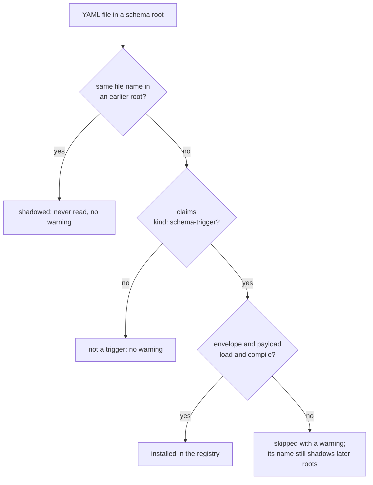

# Schemas Applied by Triggers

A schema trigger applies a frontmatter schema to matching documents without
requiring each document to name it with `$schema`. Put the trigger in one of
the document's [schema roots](./definition.md#schema-roots). Its `match`
conditions select documents; its `$schema` supplies the types they must follow.
For condition syntax and path matching, start with
[Schema Triggers in Darkmatter](./schema-targeting.md).

## Invalid discovered triggers

A trigger that fails to load is skipped with a warning; it never stops the
work it was discovered for. Every other valid trigger still applies, and
composition, validation, and cleaning continue with the baseline, those
triggers, and the document's own `$schema`. Fix the file and the next run
picks it up.

For example, this unfinished `schemas/memory.yaml` uses keys the envelope does
not support:

```yaml
kind: schema-trigger
name: Memory Trigger
description: TODO
match:
```

Composing a prompt that declares no `$schema` still succeeds. The composed
document goes to stdout, and stderr carries one warning naming the trigger,
the reason, and that it was ignored:

```text
ignoring invalid schema trigger /repo/schemas/memory.yaml: invalid schema-trigger: schema-trigger envelope supports only `kind`, `match`, and `$schema`; found unknown keys: name, description
```

The warning blames the trigger, never the document being composed, and it is
not a schema-load error. Its diagnostic code is `dm.schema.invalid_trigger`
and its severity is `warning`.

### What is skipped, and what still fails

A file is skipped with a warning when it
[claims the envelope](./definition.md#which-files-claim-the-envelope) and then
fails to load for any reason:

- its YAML does not parse, or its `kind` is null, not a string, or a
  retired spelling of `schema-trigger`;
- the envelope has unsupported keys, a missing or invalid `match`, an invalid
  or vacuous condition, or a retired spelling such as `any:`;
- its payload is missing, does not parse, imports something that does not
  resolve, forms a cycle, is not merge-compatible, or does not compile, even
  when the trigger would not match the current document and even when a
  later layer would replace the broken property.

A trigger is installed only once its envelope and its whole payload have
loaded, so a skipped trigger never contributes part of a schema. A trigger
that loads but whose schema rejects a document still fails that document's
validation, as before. YAML that does not claim the envelope (payloads,
type libraries, unrelated files, even unparseable ones) is not a trigger and
produces no warning.

Some failures are not about one trigger, and they still fail discovery with
an error instead of producing an apparently empty registry:

- a schema root that cannot be listed or read, and a file in it that cannot
  be read before it is classified;
- two file names in one root that differ only by case;
- an embedded bundle whose structure is invalid.

Recovery covers automatic discovery only. A document `$schema` that cannot
load is still an error, and so is a `$schema` that names a trigger file,
including one discovery skipped.

### Shadowing is unchanged

A skipped file keeps its file name. It still shadows a file of the same name
in every later schema root and in a program's embedded bundles, so a broken
local override never lets a farther copy stand in for it. Shadowed files are
never read and produce no warnings. Delete the broken file and the next run
applies the normal shadowing rules again.



An invalid trigger in an [embedded bundle](./definition.md#embedded-trigger-bundles)
is skipped the same way. Its warning names it as
`embedded:{bundle}/{file name}`, never as a file path, and the name stays
claimed from later bundles.

### Where the warning appears

Ordinary output writes the warning to stderr and keeps stdout for the
command's normal output. A machine-readable report carries the warning
instead and does not repeat it on stderr.

| Command | Ordinary output | Report mode |
| --- | --- | --- |
| `md compose` | stderr, after the document (after the report for `--shell`); on a failure, before the error | [`--output report-json`](../../cli/report-json.md#codes): a `dm.schema.invalid_trigger` diagnostic whose `source` is the trigger file at a YAML error's line and column, else `null` |
| `md schema validate` | stderr, before the file's result (also with `--quiet`) | `--format json`: a row in the `warnings` of the first file that discovers the trigger |
| `md schema triggers` | stderr; the trace on stdout names each skipped trigger and its code in a "Skipped invalid triggers" section, between the shadowed envelopes and the triggers, without repeating the warning | — |
| `md clean` | stderr; on a schema failure, before the error | [`--json`](../../cli/clean.md#version-1-json-envelope): the top-level `warnings` array, also in the envelope a schema failure prints |
| DMLS | a warning diagnostic on the trigger file; see [Failures](../../lsp/indexing.md#failures) | — |

A JSON row has the same four fields everywhere it appears outside
`report-json`:

```json
{
  "source": "darkmatter.schema",
  "code": "dm.schema.invalid_trigger",
  "path": "/repo/schemas/memory.yaml",
  "message": "ignoring invalid schema trigger /repo/schemas/memory.yaml: …"
}
```

`path` is `null` for an embedded trigger. When the failure is inside a
payload or import file, the message also names that file (`… (in
/repo/schemas/memory-payload.yaml)`). The named file is the one that holds
the failure:

- a payload reached through another schema file (`$schema: ./alias.yaml`,
  whose own `$schema` is `./raw.json`) names the file that wrote the rejected
  schema, `raw.json`;
- an unknown type name names the file that wrote the reference, or, when the
  trigger wrote it, the import whose types were searched;
- a payload or import that does not exist names no file, only the reference
  that did not resolve.

A line and column inside a payload or import appear only in the message,
never as a position in the trigger file.

The warning is kept when the command later fails for another reason, such as
a valid trigger rejecting the document or the document's `$schema` not
loading. `md schema validate` keeps its exit status; the warning only rides
along.

`md compose` delivers the warning even when it stops before composing the
document: a `--shell` inspection, a lifecycle whose `initialize` skips the
document (the run still succeeds and writes nothing) or fails (an `error`
action), a lifecycle `shell` that fails before composition (a missing
placeholder value or a refused approval), a lifecycle call the passive check
rejects, references that do not resolve, and a composed document that cannot
be rendered in the requested `--output` format. Reference checking reads each
transcluded document in its own context, so a refusal for unresolved
references also reports a trigger that only a transcluded document's schema
roots hold (for example `alpha/schemas/` for an included
`alpha/docs/child.md`), even though the root document never composes.

Shell preparation walks every transcluded document before any command runs,
whatever its `when=` condition, so it finds such a child-only trigger too.
`md compose`, with or without a lifecycle, delivers what that walk found:

- when composition then skips the child (`::file ../alpha/docs/child.md
  when=false`), on success;
- when preparation refuses a shell command, because no whitelist rule
  approves it on a non-interactive run (`Approval required`) or a blacklist
  rule rejects it;
- when a later document in the walk fails, such as a sibling whose `$schema`
  does not load: the triggers found before the failure, in the order they
  were found.

For example, with the trigger above:

```console
$ md compose --shell prompt.md
No shell commands discovered.

No ICMP probes discovered.
⚠ ignoring invalid schema trigger /repo/schemas/memory.yaml: …
```

Each trigger is reported **once per invocation**, however many documents,
transclusions, or schema passes discover it. Triggers are told apart by their
full identity (the normalized file path, or bundle and file name), never by
file name alone, so two triggers that share one broken payload each get a
warning. Each trigger reports its first failure only; fixing it can reveal
the next one. A new invocation reports the warning again.

### Making the warning blocking

By default the warning never fails a command. In CI you can make it fail
`md compose`:

```sh
md compose doc.md --deny dm.schema.invalid_trigger
md compose doc.md --deny all
```

Either stops composition once the document's schemas are prepared, before
any of its expressions, shell commands, or children run, and writes no
document. The warning keeps its `warning` severity and its trigger source;
see [Diagnostic Policy](../../cli/policy.md#diagnostics---deny).

A trigger that only shell preparation finds stops the command at that walk,
before any shell command is approved, prompted for, or run. With the
child-only trigger above, the whitelisted `::shell` below never runs:

```console
$ cat docs/prompt.md
::shell git init --quiet scratch

::file ../alpha/docs/child.md when=false
$ md compose --deny dm.schema.invalid_trigger docs/prompt.md
⤫ MarkdownError: blocking diagnostics
┃ ignoring invalid schema trigger /repo/alpha/schemas/memory.yaml: …
$ echo $?
1
```

A lifecycle run stops there too, after `initialize` (which runs before
preparation and keeps its effects). `--shell` inspection runs nothing, so a
denial leaves it unchanged: it still lists the commands, warns, and succeeds.

`--disable schema-triggers` turns discovery off, so no trigger applies and
none is reported.

### After a repair

Each lookup records what a skipped trigger read and where its payload
search looked, including locations that did not exist. Repairing or
deleting the trigger, repairing its payload or an import, or creating a
missing payload file (even together with its folder) makes the next lookup
load the trigger again instead of reusing a cached result, including when
every trigger was invalid the first time.
DMLS refreshes on the same changes through its file events; see
[When the registry changes](../../lsp/indexing.md#when-the-registry-changes).

## Applying a recursive type

A trigger payload can declare the same reusable and recursive types as a
document schema. For example, save this as `schemas/outline.yaml`:

```yaml
kind: schema-trigger
match:
    kind: literal(outline; required)
$schema:
    node: "{ title: string(required), children: node[](required) }"
    outline: node(required)
```

The trigger selects this document and validates every nested child:

```yaml
---
kind: outline
outline:
    title: Overview
    children:
        - title: Details
          children: []
---
```

Each node needs both `title` and `children`. An empty child list ends a
branch. A missing or invalid property deeper in the tree is reported at that
document value's path and source location. Completion and hover follow the
same type as the cursor moves into children.

The recursive type must eventually check a child value: an object property,
dictionary value, array item, or tuple slot. A cycle made only of aliases or
union alternatives is rejected. See
[Recursive Named Types](./definition.md#recursive-named-types) for the full
rule, including cycles across files and definition-versus-use-site behavior.

## Keeping document layers separate

The effective schema combines the baseline, matching triggers in their
established order, and the document's own schema. Later declarations win for
the same property. See [Merge Semantics](./definition.md#merge-semantics-baseline--document)
for the complete precedence rules.

A type belongs to the source that declares it. A `node` in this trigger and a
`node` in the document's own `$schema` remain different types. Recursive
definitions are stored once in JSON Schema's `$defs`, with references from
their uses. When layers bring different definitions with the same generated
key, Darkmatter renames the joining key and its references together. Literal
data containing `$ref` or `$defs`, such as a `default`, is not rewritten.

A raw JSON Schema trigger payload must remain a simple object schema. It may
have a root `$defs` with checked local references from its properties, but it
cannot use a root `$ref` or root union. The
[baseline restrictions](./definition.md#json-schema-baseline-restrictions)
also apply to trigger payloads. A discovered payload that breaks these rules
[skips its trigger with a warning](#invalid-discovered-triggers), even when
the trigger does not match the current document.

## Validation and runtime phases

Trigger matching and validation are passive: expressions and shell commands
are not executed, and document values are not changed. Composition can perform
its separately authorized normalization steps. Recursive children that are
absent are not created merely to traverse their type.

Launch and Completion honor each property's own `required`, `generated`, and
`eager` markers below recursive references. A shared definition can serve both
an eager and a deferred property without changing the other use. See
[Validation Phases](../../inline/schema-validation.md#validation-phases).

For slow validation, inspect [CLI stage timings](../../inline/schema-validation.md#stage-timings--vv)
or [DMLS timing logs](../../lsp/indexing.md#schema-validation-timing-lines).
