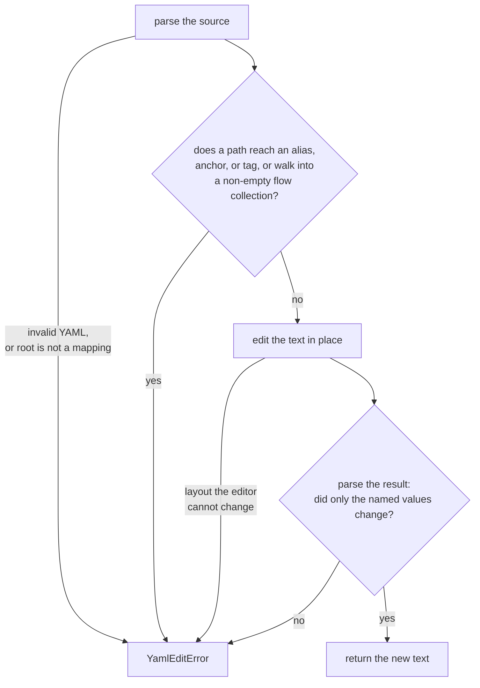

# Editing Plain YAML Files

Darkmatter can change values inside a plain `.yaml` file, such as another
program's configuration, without disturbing anything else in it. Use the
library function `darkmatter::yaml_edit::edit_yaml_paths` when your code must
write into a file a person also edits by hand: comments, blank lines, key
order, and quoting outside the values you name stay byte for byte.

This page covers the API, what each kind of edit does to the text, and the
cases the editor refuses. The same in-place rules apply to Markdown
frontmatter through `md set` and `md rm`, described in
[Frontmatter](./frontmatter.md#editing-nested-values); the difference is that
this editor never falls back to rewriting the file.

## The API

```rust
use darkmatter::yaml_edit::{YamlEdit, edit_yaml_paths};
use serde_json::json;
use simplified_schema::PropertyPath;

let source = "\
# my tool's settings
permissions:
  shell-commands:
    - prefix ls   # listing
";
let edits = [YamlEdit::Set {
    path: PropertyPath::parse("permissions.shell-commands.1")?,
    value: json!("exact pwd"),
}];
let edited = edit_yaml_paths(source, &edits)?;
assert_eq!(edited, "\
# my tool's settings
permissions:
  shell-commands:
    - prefix ls   # listing
    - exact pwd
");
```

- `YamlEdit::Set { path, value }` writes `value` (a `serde_json::Value`) at
  `path`.
- `YamlEdit::Remove { path }` removes the value at `path`.
- A path is a [property path](../../../simplified-schema/docs/topics/property-paths.md):
  dotted segments, where a number indexes a list.
- `edit_yaml_paths(source, &edits)` returns the new text, or a
  `YamlEditError`. It only computes text: writing the file is up to you, and
  on an error you still hold the original bytes.

One call can carry many edits. Every `Set` is applied first, in the order
given; then every `Remove` together, with list indexes counted as they stand
after the sets.

## What each edit does to the text

```yaml
# before                          # after
server:                           server:
  port: 80   # http                 port: 8080   # http      <- Set server.port 8080
  host: 'a'                         host: 'a'
list:                             list:
  - a                               - a
                                    - b                     <- Set list.1 "b" (append)
                                  tls:                       <- Set tls.cert "c.pem"
                                    cert: c.pem
```

| Edit | What happens to the text |
| --- | --- |
| Replace a value | its lines are rewritten in place; a comment on its key's line stays |
| Add a key | a new line at the end of its parent, at the parent's indentation |
| Add under a missing parent | the missing mappings are created, nested under the nearest existing one |
| Add under a `null` parent (`permissions:` with nothing after it) | the parent becomes a mapping |
| Append to a list | `Set` with the index equal to the list's length (`list.2` on a two-item list) adds a new `- ` line after the last item |
| Replace a whole list or mapping | `Set` on the list's own path writes the new value in block style |
| Write an empty list or mapping | `Set` with `json!([])` or `json!({})` writes `[]` or `{}` |
| Add to an empty `[]` or `{}` | the empty collection becomes a block holding the new value; a file that is only `{}` becomes a block mapping |
| Remove a value | its own lines go; a comment on the line above stays |
| Remove the last child | the parent stays, written `{}` or `[]`; removing every top-level key leaves the file's comments and `{}` |

An index beyond the length is not an append; it is refused as an invalid path.

The file's own conventions are kept:

- **Byte order mark.** A leading BOM stays first.
- **Line endings.** New lines use the file's terminator, so a CRLF file stays
  CRLF.
- **Final line break.** A file that does not end with a line break still does
  not. An empty file gets a terminated first line.
- **Document marker.** A leading `---` line stays where it is.

## Indentation of new values

When an edit writes a new list or mapping, the editor has to choose how far to
indent it. It copies the file's own style first and only falls back to a
configured preference where the file shows none. The same rules apply to
frontmatter edits (`md set`, `md rm`, `md hash --save`).

The editor picks the indentation for a new collection in this order:

1. **The block being replaced keeps its own offset.** Replacing an existing
   list or mapping keeps how far its children sat, including an indentless
   list whose `- ` items sit at the column of their key.
2. **Otherwise, the nearest authored block of the same kind.** A new mapping
   copies an existing block mapping, and a new list copies an existing block
   list. A block inside the same parent is preferred; failing that, the one
   closest in the file.
3. **Otherwise, the destination's preference.** This is what Sniff resolves
   for the file being saved, from its `.editorconfig` and the repository's
   conventions (`sniff repo indent` shows it). If the file has no destination,
   as with `edit_yaml_paths` called on text alone, the preference is four
   spaces.

Some text never counts as an example: flow collections (`[a, b]`,
`{a: 1}`), the padding a compact `- key: value` item puts after its dash,
and the content lines of a multiline (`|` or `>`) string.

```yaml
# before                          # after: Set tls.cert "c.pem"
server:                           server:
   port: 80                          port: 80
                                  tls:
                                     cert: c.pem     <- copies server's 3 columns
```

In a file with no block mapping to copy, the same edit takes the
destination's preference instead, for example two spaces where
`.editorconfig` sets `indent_size = 2` for the file.

Edits that leave every value as it was return the source unchanged, so
saving the same values twice leaves the file byte for byte identical.

## Every edit is checked

Before the text is returned it is parsed again, and every value is compared
with the intended result, the values you named and every value you did not.
If anything else would change, the edit is refused.



## Refusals

An edit the editor cannot make in place is refused. It never rewrites the
whole file in a standard style instead, because that would lose the comments
and formatting the person who owns the file wrote.

`YamlEditError` says what went wrong and where:

| Field | Meaning |
| --- | --- |
| `kind` | a `YamlEditErrorKind`, listed below |
| `path` | the property the refusal concerns; `None` for a problem with the whole file, such as a parse error |
| `location` | `offset` (bytes into your source, counting a BOM), and 1-based `line` and `column` |
| `reason` | a sentence for a person |

Its `Display` form is `line L, column C: reason`.

| Kind | When |
| --- | --- |
| `Parse` | the source is not valid YAML (for example an unclosed `[`), or has a duplicate key |
| `NotAMapping` | the file's root is a list or a single value |
| `InvalidPath` | the path does not fit the values: an index out of range, a child under a string, a removal of a value that is not there |
| `Alias` | the path reaches an alias (`*name`), whose value lives elsewhere |
| `Anchor` | the path reaches an anchored node (`&name`), which aliases elsewhere may read |
| `Tag` | the path reaches a tagged node (`!!str 5`) |
| `FlowCollection` | the path walks into a non-empty `[a, b]` or `{a: 1}`, or the whole file is one |
| `UnsupportedForm` | another layout the editor cannot change line by line, such as an indented root mapping |
| `WouldChangeUnnamed` | the result would change a value you did not name |

For example, appending to an inline list is refused at the list's key:

```yaml
name: x
allow: [ls, pwd]
```

```text
line 2, column 1: the edit reaches a flow collection at `allow`, which cannot be edited in place
```

Replacing such a list whole (`Set allow ["ls", "pwd", "ps"]`) is accepted; it
is rewritten in block style. To keep appending in place afterwards, convert
the list to block style by hand once.
