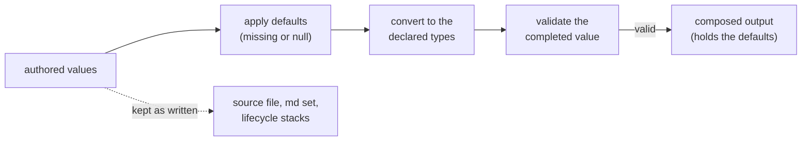

# Authoring Darkmatter documents

A Darkmatter document is CommonMark + GFM Markdown with YAML frontmatter.
Composition (`md compose`, or `compose_with` in the library) evaluates the
document's DSL, which has two parts:

- `{{{ expressions }}}`, inline;
- `::directives`, each on a line of its own.

Plain Markdown with no DSL still gets two passes: cleanup, and heading
normalization.

To check a construct before relying on it, write a small document and run
`md compose` on it. The error output names the expected signature or type.

## Pipeline order (why a feature sees what it sees)

1. A passive call check runs first. A call proven wrong anywhere, such as
   `min(flag, 5)` where `flag` is declared `boolean`, rejects the document
   before anything runs.
2. Frontmatter interpolation (pass 1), then schema validation and coercion,
   then frontmatter `$(…)` shell expansion, then interpolation pass 2.
3. `replace:` text replacement.
4. `::block when=` page blocks and the `::map`/`::filter` regions.
5. Body `{{{ }}}` interpolation.
6. `::shell` and `::shell-block`.
7. Link resolution, then transclusion (`::file`, `::code`, `::toc-linking`,
   `::file-links`). Transclusion is concurrent and recursive: each child goes
   through this same pipeline.
8. Cleanup and reflow, then link normalization on the root only.

## Frontmatter

```yaml
---
$schema:                       # optional SimplifiedSchema (or a file: $schema: ./schemas/post.yaml)
  title: string(required)
  audience: enum(internal, public)
  people: "{ name: string, active: boolean }[]"
title: Guide
audience: public
people:
  - { name: ann, active: true }
  - { name: bob, active: false }
replace:                       # find/replace on the body, literal and case-sensitive
  ACME: Acme Corp
version: "$(git describe --tags)"   # top-level $(…) shell expansion (needs approval)
---
```

- Duplicate keys at any depth are a parse error. Key order is preserved.
- Schema problems point at the YAML node by line and column. Check them with
  `md schema validate doc.md`.
- With no `$schema`, the built-in baseline schema applies. It types `style`,
  `content_policy`, and the other keys Darkmatter knows. Schema triggers in
  the repository's schema roots can attach a schema by path or by `kind`.
  `md schema triggers doc.md` shows which apply.
- `md schema about` prints the full SimplifiedSchema vocabulary. It covers
  `string`, `number`, `boolean`, `file`, `enum(…)`, `literal(…)`, objects,
  `T[]`, tuples, unions `a | b`, `unknown`/`any`, `null`, `alphanumeric`,
  `yaml`/`json`/`expression`/`shell`, modifiers like `required`, `min(0)`, and
  `suggest(…)`, and descriptions written as `-> text`.

### Required, `null`, and defaults

A missing key and `n: null` are the same value, `null`. `required` means
only "the key must be written"; the value then has to satisfy the type. A
`default(...)` fills a missing **or** `null` value, on optional and required
properties alike, before the value is judged.

| Declaration | Key missing | `n: null` |
|---|---|---|
| `n: number` | valid, `null` | valid, `null` |
| `n: number(default(3))` | valid, `3` | valid, `3` |
| `n: number(required)` | error: missing | error: not a number |
| `n: number(required; default(3))` | valid, `3` | valid, `3` |
| `n: unknown(required)` | error: missing | valid |



- `md compose` writes defaults into the **composed** frontmatter only. The
  source file never changes, and `md set` never writes a default into it.
- `md schema validate` judges the document as if the defaults were written
  and lists them in each record's `defaults` array.
- A declared but unwritten property with no default stays unbound: no `null`
  key appears in `--frontmatter` output, `{{{ note }}}` renders empty without
  an "undeclared" warning, and a transcluded child's `required` sees it as
  missing.
- A property with a non-null literal default, such as
  `retries: number(default(3))`, is typed `number` in expressions, so it needs
  no null guard. A default written as a `{{{ … }}}` template does not count.
- `not-empty` refuses empty or blank text, an empty list, or an empty
  mapping. The old `non-null` marker is a schema error now; for an optional
  value that must not be blank, write `string(not-empty)`.

## Expressions: `{{{ … }}}`

```md
# {{ title }}
{{ upper(title) }}  {{ audience == 'public' ? "public!" : "secret" }}
{{ color || "unknown" }}            <!-- fallback; also marks the absence as intended -->
{{ map(people, p => p.name) }}      <!-- ["ann","bob"] -->
{{ filter(people, p -> p.active) }}
{{ items[0] }}  {{ releases[-1].published }}  {{ fm.title }}  {{ env.HOME }}  {{ ctx.os }}
{{ ctx.today }}                     <!-- 2026-11-08 -->
{{ date(ctx.today, "long") }}       <!-- Sun, November 8th, 2026; date(iso, fmt), fmt is a named format -->
{{ ctx.branch || "detached" }}
```

`ctx` keys include `today`, `now`, `year`, `month_name`, `time`,
`timezone`, `repo_root`, `branch`, `recent_commits`, `packages`,
`current_package`, `dirty_files`, `os`, `hostname`, `cpu_cores`, and `agent`.
The full list is in `darkmatter/schemas/partials/context-variables.yaml`. An
unknown `ctx.*` key gives a warning with a "did you mean" suggestion.

### Namespaces

| Namespace | Value |
|---|---|
| a bare name, `fm.*` | the current document's frontmatter plus caller state |
| `ctx.*` | runtime context (date/time, repo/package, OS, hardware, git, documents…), captured once per request |
| `current.*` | the same keys as `ctx.*`, read live at the moment of evaluation |
| `env.*` | the document's captured environment |
| `local.*` | the nearest `::map`/`::filter` binding |

- Truthiness, `&&`, `||`, `!`, `== != < <= > >=`, arithmetic, and the ternary
  `?:` work as in JavaScript, with null propagation.
- An undeclared name evaluates to `""`/`null` and adds the
  `dm.expression.undeclared_property` warning.
- Function names are case-insensitive. The categories are: strings (`upper`,
  `lower`, `trim`, `replace`, `title_case`, `kebab_case`, …), collections
  (`map`, `filter`, `keys`, `values`, `length`, `contains`, `first`, `last`,
  `has_key`), type predicates (`is_number`, `is_empty`, …), math (`min`,
  `max`, `abs`, `round`), dates (`date(iso, fmt)`, `is_today`, `older_than`,
  `date_delta`, …), list formatting (`as_csv`, `as_unordered_list`,
  `as_json`, …), files (`file_exists`, `find_files(glob)`, `frontmatter(file)`,
  `load_data(file, type)`, `relative`, `absolute`, `link`, …), git
  (`recent_commits`, …), repository (`package`, `package_area`), shell probes
  (`has_command`, `can_execute`), network (`ping`, which needs an
  `--allow host=IP`), and `as_markdown(text)`. `as_markdown` composes the
  Markdown text it is given, so write `as_markdown("::file ./x.md")` to get
  a file's composed body. A bare path just returns the path. The content
  inherits the caller's values exactly as a `::file` child does.
- The full catalog, with signatures and examples, is
  `docs/topics/darkmatter-expressions.md#functions`.
- A guard narrows a value's type for the code inside it. For example, inside
  `::block when="is_number(count)"`, `count` is known to be a number.

### Loading data

```md
{{ load_data("hosts.csv", "{ name: string, port: number }[]") }}
```

`load_data` reads YAML, JSON, JSON Lines, CSV, TSV, TOML, or JSON5. The
second argument is a SimplifiedSchema type that the data must satisfy. A
failure points at the line and column inside the data file.

## Directives

### Conditional blocks

```md
::block when="audience == 'internal'"
Internal-only text. Blocks nest.
::end-block
```

### Transclusion: `::file`, `::code`

```md
::file ./child.md
::file ./kid.md when="audience == 'public'" set.who="Zed" exclude="## Skip"
::file child.md set='{name: "Bob", age: 42}'
::file &docs/shared/intro.md disclosure="Click to expand"
::file {{ maybe_path }}                  <!-- null/"" target: skipped, with a warning -->
::code ./snippet.rs                      <!-- fenced code block; language from the extension -->
::code ./demo.rs disclosure=true
::file https://example.com/x.md          <!-- needs --allow host=example.com -->
::file ../../topics/guide.md interpolate=false  <!-- child prose kept as written -->
```

- A child sees the parent's frontmatter. Its own keys win, and `set=` or
  `set.key=` override them for that one inclusion.
- The child's headings are re-leveled to fit under the heading that holds the
  directive. In the examples, a child's `##` became `###` under a `##`.
- The other options are `exclude="## Heading"` (repeatable; it drops that
  section of the child, matched at the child's authored level),
  `quotation=true|"caption"` (wraps the child in a blockquote),
  `disclosure=true|"summary"` (wraps it in a disclosure block), and
  `replace=true|false|{…}`. Every option needs `=value`: a bare
  `quotation` is a parse error.
- `interpolate=false` (on `::file` and `::url`) keeps the child's prose as
  written: its `{{{ … }}}` examples are not evaluated, warn about nothing, and
  stay as typed, triple braces included, even if a name matches your
  frontmatter. Use it to transclude a docs page that shows expressions. The
  child's frontmatter and directive inputs (`when=`, targets, option values,
  `::shell`) still evaluate, and every document it includes inherits the
  setting. A value other than a boolean word or unquoted `null` is an error.
- A target may use any file-reference form: `./`, bare, `&`, `^`, `@`, `~`,
  `{{{VAR}}}`, an absolute path, or `https://`.

The other transclusion directives:

- `::toc-linking ./other.md level=h2,h3 cleanup=emoji` links to the headings
  of another file.
- `::file-links "docs/**/*.md"` (also `^docs/*.md`, `&fixes/**/spec.md`, …)
  lists the matching files as a linked file tree.

### Iteration: `::map`, `::filter`

```md
::map tags
- {{ i }}                          <!-- default item name: i -->
::end-map

::map people "p => title_case(p.name)"
- {{ p }}                          <!-- the callback's parameter name holds the RESULT -->
::end-map

::filter people "p => p.active" sort="p -> p.name" sort-order="desc"
- {{ p.name }}                     <!-- filter exposes the original item -->
::end-filter

::map data "{key, value} => {key, value}"    <!-- objects iterate as {key, value} -->
- {{ key }}: {{ value }}
::end-map
```

- The source is written bare (`people`, `ctx.packages`), never inside
  `{{{ }}}`.
- The source **must have a declared iterable type**. Declare it in `$schema`,
  for example `people: "{ name: string, active: boolean }[]"`. Without a
  declaration, composition fails with `dm.collection.untyped_map_source` or
  `dm.collection.untyped_filter_source`. This applies even to an array of
  objects written in the frontmatter, and to any value supplied only at
  runtime. `--allow untyped-map-variables` or
  `--allow untyped-filter-variables` turns the failure into a warning.

### Shell

```md
::shell git branch --show-current

::shell-block when_error="(failed)"
git rev-parse --short HEAD
git log -1 --format=%cs
::end-block
```

- Output (stdout and stderr together) replaces the directive as live
  Markdown, at the directive's indentation.
- `{{{ }}}` values can supply **arguments only**. A value cannot choose the
  program or add `&&`, `;`, or redirections.
- Every command needs approval. See "Shell commands" in
  [cli.md](cli.md#shell-commands).

## Lifecycle events (root document, `md compose` only)

```yaml
---
initialize:
  - info: "starting {{ title }}"
composed:
  - stdout: "Generated by md compose; do not edit."
  - shell: "git rev-parse --short HEAD"
failed:
  - warn: "compose failed"
finalize:
  - success: "done"
---
```

- The order is: `initialize`, then composition, then `composed` (or `failed`
  if composition fails), then the document is written, then `finalize`.
- In Markdown mode, all lifecycle output goes to **stderr**, so stdout holds
  only the document.
- `skip` in `initialize` writes nothing and exits 0. Ctrl-C runs `cancelled`
  and `finalize`, then exits 130.
- Transcluded documents never fire their own lifecycle events.
- `edit: "notes/{{{ slug }}}.md"` (or `{file, create_new, gui}`) opens the file
  in your editor, waits for it to close, then runs the next action. A missing
  file is created first; `create_new: true` refuses an existing one; `gui`
  picks a graphical (`true`) or terminal (`false`) editor. A known editor gets its
  wait flag (`code --wait`); one that cannot wait is never chosen. A terminal editor needs stdin,
  stdout, and stderr on a terminal, so it fails with `--output json`, a
  redirected stdout, or a document read from stdin.
- On Linux and macOS a terminal editor holds the terminal while it is open: a
  Ctrl-C you type goes to the editor, not to `md`. Quit the editor to go on
  (`:cq` fails the action), or signal `md` itself to cancel the run, which
  stops the editor (`SIGTERM`, then `SIGKILL` after 2 s). `md` takes the
  terminal and its settings back when the editor exits; if it cannot lend or
  restore the terminal, the edit fails (`prepare the terminal` or
  `restore the terminal`).
- The target is mandatory: `edit: null`, `edit: []`, a blank path, or a long
  form without `file` is an error. A number or boolean names a file by its
  text, whether written (`edit: 5` opens `5`) or produced by a template
  (`edit: "{{{ issue }}}"` with `issue: 5` opens `5`); a template result that
  is `null`, a list, or blank fails when the action runs.
- Flags (`no_error`, `create_new`, `gui`) are literals, never evaluated.
  `true`/`false` and boolean-like text (`"yes"`, `"off"`) work; omitted or
  `null` takes the default (`false`; for `gui`, either editor); a native
  number or a `{{{ … }}}` template is an error.
- Write `no_error` once per action. Setting it both inside the long form and
  beside it fails `md compose` before any event fires, even when the values
  agree (`md schema validate` does not catch this). The `no_error: false`
  that schema validation fills in never counts as a second placement.
- Every file action (`edit`, the `*_frontmatter` writers, `ensure_file`,
  `ensure_dir`, `append_line`, `append_jsonl`) writes only inside the working
  tree you launched `md` in: the repository or worktree top level, or the
  launch directory outside a repository. A relative path resolves like a
  read from the document: an existing file is the one a read finds (for
  `notes.md`, the document's folder, then the repository root), a missing one
  is created beside the document. Write `./notes.md` to pin the document's
  folder, or `{{{ ctx.cwd }}}/notes.md` for the launch directory. A prompt
  stored outside your project cannot write beside itself; a target outside
  the boundary, through a symlink too, is refused before anything is created.
- `initialize` runs before schema validation, so its effects stay done when
  the frontmatter is then refused (the run goes on to `failed`, `finalize`).
  Put effects that must not happen for an invalid document in `composed`.

## Style (rendering)

`style:` frontmatter controls rendering, for example `style.page.theme`,
`style.page.max-width`, `style.page.code.theme`, and `style.markdown.*`
(formatting rules for `md clean`). Per-run setters override it:
`md doc.md style.page.theme=github`. To see the keys, press Tab after
`md doc.md style.`, or run `md list-themes` for the theme names.
