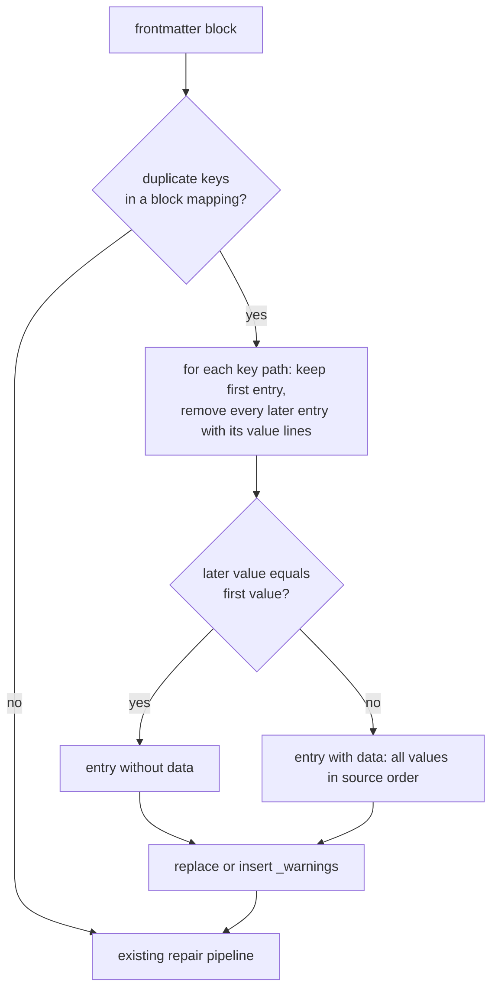

# Frontmatter Warnings

`md clean` repairs frontmatter that does not parse, but it refuses to touch a
duplicate mapping key. A duplicate key is common in agent-written frontmatter
and makes the whole block unreadable, so one stale key stops every downstream
tool. This spec makes `md clean` remove the duplicate, keep the first entry,
and record what it threw away in a new reserved frontmatter property,
`_warnings`.

## The Incident

During Phase 2 of `2026-10-09-more-pr-support`, the implementing agent was
asked to set `human_review` and `message_to_agent` on the spec. Phase 1 had
already set both. The agent inserted a new pair above `related:` instead of
overwriting the old pair below it, leaving:

```yaml
human_review: false
message_to_agent: |-
    Phase 2 is done: ...
related:
    - 2026-10-02-fresh-prs
human_review: false
message_to_agent: |-
    Phase 1 is done in sniff only. ...
```

The next lifecycle evaluation, `when="!frontmatter(spec, '$schema')"`, failed
with `duplicate entry with key "human_review"` and the workflow stopped.

The prompt has since been tightened (it now tells the agent to overwrite a key
in place). That lowers the frequency; it does not remove the failure mode,
because any agent can still write a duplicate. This spec handles the case
where one gets through.

## Today's Behavior

The `biscuit-file` YAML analyzer detects duplicate keys at every block nesting
level and inside flow mappings, emitting `yaml.duplicate-key` with the
`DeterministicFindNonDeterministicSolution` certainty and no repair. The
reasoning, recorded in `biscuit-file/lib/src/yaml/analyze/tests/duplicate_keys.rs`,
was that keeping the first value, keeping the last, merging, or deleting are
all intent decisions. `md clean` therefore prints the finding as a suggestion,
leaves the block unparseable, and exits with the error it raises when it tries
to build the document.

## Decisions

1. **Keep the first entry, drop every later one.** This is a ruling, not a
   provable repair: an agent that appends its update at the bottom of the
   block loses that update. The `_warnings` record is what makes the loss
   recoverable.
2. **Only lossy repairs are recorded.** A repair is *lossy* when it removes
   authored content or changes a parsed value. Duplicate-key removal is the
   only lossy repair today. The existing repairs (BOM removal, line-ending
   normalization, trailing whitespace, final newline, parse-equivalent
   whitespace, reserved-indicator and schema-proven quoting) do not change
   meaning and stay unrecorded.
3. **`_warnings` is replaced on each run that records something.** A
   `md clean` run that performs at least one lossy repair overwrites
   `_warnings` with that run's entries. A run that performs none leaves an
   existing `_warnings` untouched. Entries from an earlier run are therefore
   lost when a later run records new ones.
4. **Record only.** No `md` command changes its exit status or output because
   `_warnings` is present. `md clean` reports what it recorded on STDERR, the
   same way it reports suggestions today.
5. **No severity field.** Every entry is lossy by Decision 2, so a severity
   would carry no information. Whether a value was actually lost is carried
   by `data`.
6. **Every entry names its kind of lossy event in `id`**, a closed enum.
   Today it has one member, `duplicate-fm-key`; each future lossy repair adds
   its own member, so tools branch on `id` and never parse `message`.
7. **`_warnings` is part of Darkmatter's base schema**, next to the existing
   reserved `_cache` key, so schema validation and DMLS completion know it.

## The `_warnings` Property

Each entry is a mapping:

| Field      | Type     | Meaning                                                                 |
| ---------- | -------- | ----------------------------------------------------------------------- |
| `id`       | enum     | The kind of lossy event. One of: `duplicate-fm-key`.                    |
| `property` | string   | Dotted path of the affected key from the frontmatter root (`hash.kind`). |
| `message`  | string   | A plain-language account of what was wrong and what `md clean` did.     |
| `data`     | any      | Optional. For a duplicate key whose values differ: every value, in source order. The first element is the one kept. |

Base-schema entry, in `darkmatter/schemas/partials/doc.yaml`:

```yaml
_warnings: "{ id: enum(duplicate-fm-key; required); property: string(required); message: string(required); data: any }[] -> Reserved. Lossy repairs `md clean` performed on this frontmatter, replaced each time a run records one."
```

### Example

An agent duplicates `agent` with the same value and `model` with a new one:

```yaml
agent: claude
model: opus
agent: claude
model: sonnet
```

After `md clean`:

```yaml
agent: claude
model: opus
_warnings:
    - { id: "duplicate-fm-key", property: "agent", message: "A duplicate entry for the 'agent' property made the frontmatter invalid YAML. Both entries had the same value, so no information was lost; the second entry was removed." }
    - { id: "duplicate-fm-key", property: "model", message: "A duplicate entry for the 'model' property made the frontmatter invalid YAML. The second entry had a different value from the first; it was removed so the frontmatter parses, and both values are kept in `data` (the first is the one in effect).", data: ["opus", "sonnet"] }
```

An entry has `data` exactly when information was lost, so a reader (or an
agent) can find real losses by the presence of `data` without parsing
messages.

## Repair Rules



- **Scope.** Duplicates in block mappings at any depth. A removed entry spans
  its key line through the last line of its value, including nested mappings,
  sequences, and block scalars. Duplicates inside a flow mapping
  (`{ a: 1, a: 2 }`) stay report-only; they are rare and their removal needs
  separate tokenizing.
- **Same document only.** Keys in different YAML documents are never
  duplicates (the analyzer's existing rule).
- **Equality** compares parsed values, so `agent: claude` and
  `agent: "claude"` are equal. A value that cannot be parsed on its own is
  compared as trimmed raw text and, when different, recorded in `data` as that
  raw text.
- **Three or more copies** produce one entry with every value in `data` when
  any of them differ.
- **Writing `_warnings`.** If `_warnings` already exists, its entry (key line
  through its value) is replaced in place; otherwise it is appended as the
  last key of the block. Entries are written in flow-mapping style as above,
  with double-quoted scalars escaped for YAML. The result must parse, and the
  existing format-preserving guarantee holds for every byte outside the
  removed entries and the `_warnings` entry.
- **Order with other repairs.** Duplicate removal runs first, because every
  parse-equivalence-gated repair is blocked until the block parses
  (`darkmatter/cli/src/commands/clean/frontmatter_repair.rs` already rescans
  after a syntax pass restores parseability).
- **Idempotence.** A second `md clean` run on the output changes nothing.

## Ownership

- **`biscuit-file`** keeps detection neutral. The `yaml.duplicate-key`
  diagnostic gains the keep-first removal edit as a candidate repair, still
  under the report-only certainty, so `Yaml::repair_candidates` and every other
  consumer behave as before. A separate, explicitly named entry point applies
  lossy repairs and returns what each one removed (key path, kept value,
  removed values); the auto-apply filter keyed on `is_auto_apply_eligible`
  is unchanged.
- **Darkmatter** opts in. The `darkmatter` library owns the frontmatter
  repair pipeline (moved from `darkmatter-cli`): it calls the lossy entry
  point, builds the `_warnings` entries from its report, and splices them into
  the block. `md clean` and the composition pipeline both call it (see
  [Repair on Read](#repair-on-read)). The base schema gains `_warnings`.

## Acceptance

- The example above produces exactly the shown output and parses.
- `md clean` on the incident's spec (both pairs present) keeps the Phase 2
  values and records `human_review` without `data` and `message_to_agent`
  with both messages in `data`.
- Nested duplicates (`hash: { kind: ..., kind: ... }` in block form) record
  `property: "hash.kind"`.
- Every entry `md clean` writes for a removed duplicate has
  `id: duplicate-fm-key`, and a schema check rejects an entry whose `id` is
  not in the enum.
- A run with no duplicate keys never adds, changes, or removes `_warnings`.
- A run that removes a duplicate replaces an existing `_warnings`.
- Formatting-only repairs never write `_warnings`.
- `yaml.duplicate-key` remains report-only for `Yaml::repair_candidates` and
  `analyze_yaml(...).apply()`; the existing `duplicate_keys.rs` tests still
  pass with only the "carries no repairs" assertion updated.
- `md clean --json` reports each duplicate removal in `applied`.
- `darkmatter/docs/cli/clean.md` and the base-schema docs describe the
  repair and `_warnings`; the "duplicate keys are report-only" sentence is
  corrected.

## Repair on Read

Nothing ran `md clean` on the incident's path: the failure came from a Claudine
lifecycle evaluating `frontmatter(spec, ...)`, which loads the file through
Darkmatter's shared Markdown loader (`load_markdown` in
`lib/src/markdown/compose/expression/functions/mod.rs`, also used by
`markdown_title()` and its siblings). That loader calls
`Markdown::try_from_content` and fails on the duplicate key. The repair code
exists only in `darkmatter-cli`
(`cli/src/commands/clean/frontmatter_repair.rs`).

Composition does run a clean step, but it does not reach this case: that step
(`lib/src/markdown/cleanup/`) reformats the Markdown *body* of the composed
output (lists, tables, emphasis, reflow). It never repairs frontmatter, and it
never sees the files an expression such as `frontmatter(spec, ...)` reads.

So the repair is done in Darkmatter's composition pipeline, at the point where
it loads a document:

- The frontmatter repair pipeline moves from `darkmatter-cli` into the
  `darkmatter` library. `md clean` becomes a caller of it.
- The same applies to every document composition loads: files read by
  expressions through `load_markdown`, and files read by transclusion
  directives (`::file` and siblings), which today fail the same way on a
  duplicate key.
- When the loader reads a local file whose frontmatter fails to parse,
  it runs the lossy duplicate-key repair, writes the repaired file (with its
  `_warnings`) back to disk, and continues with the repaired document. Writing
  back is what makes the repair visible: the `_warnings` record is in the file
  for the author and the next agent to see, instead of a fix that happens
  silently in memory on every read.
- Only the lossy repair runs on read, and only when the block does not parse.
  A document that parses is never rewritten by a read, and formatting-only
  repairs remain `md clean`'s job.
- A remote (HTTP) document is repaired in memory only; there is nothing to
  write back to.
- If the repair cannot make the block parse, the loader fails with today's
  error, unchanged.

### Acceptance (repair on read)

- `frontmatter(spec, '$schema')` against the incident's spec returns a value,
  and the spec on disk afterwards has the Phase 2 values and a `_warnings`
  list with `duplicate-fm-key` entries for `human_review` and
  `message_to_agent`.
- Reading a parseable document through the loader never modifies the file.
- `::file` of a document with a duplicate key composes, and the transcluded
  file on disk is repaired with `_warnings`.
- `darkmatter/docs/darkmatter-compose-pipeline.md` ("Loading Documents") has
  its **planned** marker removed by the change that lands this.
