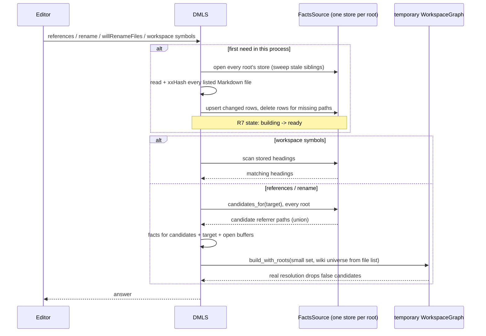

# DMLS Index Store

DMLS (`darkmatter/dmls`, the Darkmatter Markdown language server) answers
four requests that need facts from every Markdown file in a workspace: find
references, heading rename, file rename, and workspace symbols. The dependency
fix `2026-10-17-logging-improvements` stops DMLS from parsing every file at
startup; instead, its R7 builds a **full in-memory index** the first time one
of those requests arrives. On this repository that build costs about 4 s and
680 MB, and every server restart, in each of the several `dmls` processes an
editor may run, pays it again.

This feature replaces that in-memory build with a persistent SQLite store of
per-file **facts**. After a restart DMLS re-parses only files whose bytes
changed, and each request loads only the handful of files that could matter
into a small, temporary graph.

## Relationship to `2026-10-17-logging-improvements`

That fix (uncommitted, in progress) is a hard dependency. This feature keeps
its file list (R5), on-demand target parsing (R6), log style (R8), and the R7
state machine (not-started, building, ready, failed), and it **replaces and
removes** R7's full in-memory build:

- the code path that parses every listed file into a `DocumentIndex` and keeps
  a workspace-wide `WorkspaceGraph` in memory is deleted, not kept as a mode;
- R7 "building" now means "revalidating the store", which is cheap when a store
  exists; R7's other behaviors (work-done progress, one shared build,
  cancellation, reconciling changes that arrive during the build) carry over
  to the store fill unchanged;
- R7 "failed" now means a listed file could not be read or parsed, **never**
  that the store is unavailable (see R12);
- R8's `full index built …` line is replaced by the store lines in R13;
- R6's lazy target cache stays separate from store rows.

**Amendments** (that spec is not edited):

- R5's fallback-mode "(or all entries once the full index exists)" is replaced:
  after ready, a save re-hashes only the saved file plus files with pending
  events (R6 below);
- its Tests clause "Keep `dmls --bench-index` as the full-index benchmark" is
  replaced by R14 (store fill and revalidation).

## Terms

| Term | Meaning |
| --- | --- |
| `DocumentIndex` | dmls `graph/substrate.rs`: one file's full parse product (headings, links, wiki links, transclusions, schema/file/variable uses, frontmatter keys) plus `content_hash` |
| `WorkspaceGraph` | dmls `graph/arena.rs`: an immutable graph of documents, nodes, and resolved edges; built by `WorkspaceGraph::build_with_roots(indices, generation, wiki_roots, contexts)`. The existing providers (references, rename, symbols) query it |
| xxHash | `biscuit_hash` (package `biscuit-hash`) xxHash of a file's raw bytes; the same value as `DocumentIndex::content_hash` |
| file list | logging-improvements R5: the in-memory list of Markdown and YAML paths, built without reading contents |
| facts | the subset of `DocumentIndex` this feature stores per file (R1) |
| candidate key | a string derived from one outgoing link that names the file it *probably* targets (R2) |
| wiki universe | the list of wiki names (`WikiDoc`s) a wiki link is resolved and judged ambiguous against; today `wiki_docs` |
| `FactsSource` | new dmls trait: where facts come from, `StoreFacts` (SQLite) or `MemoryFacts` (fallback) (R12) |
| fallback watch mode | `WatchMode::ServerRescan` (`router.rs`): the client cannot watch files, so DMLS rescans on save |

## How it works

The store **narrows**; the existing graph **decides**. SQL never resolves a
link: it only proposes files that might reference the target, and the same
resolver and providers DMLS uses today produce the answer.

## Requirements

### R1. Stored facts and the row invariant

Per Markdown file the store holds:

| Fact | Fields |
| --- | --- |
| file | path, xxHash |
| headings | level, title, slug, title_span, line |
| links | raw target, kind/fragment, span, line |
| wiki links | target, heading, alias, target_span, heading_span, line, unsupported |
| transclusions (`::file`, `::code`) | raw target, path, span, line |
| candidate keys | R2 |

Not stored: `schema_uses`, `file_uses`, `variable_uses`, `frontmatter_keys`.
Open-document diagnostics get those from logging-improvements' lazy R6 layer.
Rows carry line numbers because DMLS locations are line-based
(`providers/location.rs`).

**Invariant: a row's facts depend only on `(path, bytes, FACTS_VERSION)`.**
Nothing that depends on configuration, schema roots, `.dmls.toml`, or a
`FileResolutionContext` (package `biscuit-file`; how a reference resolves) is
stored. Resolution happens at query time, in the temporary graph. Example: a
link `../spec.md#goals` is stored as its raw target and fragment, never as the
absolute path it resolves to.

The fingerprint is the raw-bytes xxHash, not Darkmatter's Markdown-aware hash:
that hash ignores whitespace and managed frontmatter keys, which move stored
spans and lines.

### R2. Candidate keys over-approximate; they never decide

Each outgoing link yields one or more candidate keys:

| Link form | Candidate key |
| --- | --- |
| relative link or transclusion (`../a/spec.md`) | the source directory lexically joined with the target, case-folded: the *probable* target path |
| wiki link (`[[spec]]`) | the target file-name key |
| root-prefixed form (`~/docs/spec.md`) | the target file-name key |

**File-name key (default; the implementer may refine):** the file name
case-folded, Unicode-normalized to NFC, with the Markdown extension stripped.
Wiki resolution is case-sensitive, NFC, and extension-elided
(`wiki/logical_path.rs:56`, `resolve.rs:314`), so this broader key cannot miss
a wiki referrer.

**Unusual forms (default):** percent-encoded targets, `<…>` destinations,
absolute paths, `file://` URLs, directory links, and magic roots are decoded
first; a form that still yields no probable path falls back to the file-name
key.

`candidates_for(target)` returns every row whose key matches the target's
path key or file-name key. False matches (two `spec.md` files; a symlinked
directory joined lexically) are removed by real resolution in the temporary
graph. A key must never **miss** a true referrer: when in doubt, emit a
broader key. S1 decides whether the joined-path key is needed at all.

### R3. The temporary graph

For references (including DSL "transcluded by", `providers/dsl.rs`, and wiki
references, `providers/wiki.rs`), heading rename, and file rename
(`workspace/willRenameFiles`, `providers/rename.rs::will_rename_files`):

1. take the candidate paths from R2 (union over every root, R8) and the target;
2. load their facts from the `FactsSource`, adding every open buffer (R5);
3. build a `WorkspaceGraph` with `build_with_roots` over that set only, with
   the wiki universe supplied externally (below);
4. run the existing provider; drop the graph after the request.

**Wiki universe API change.** Today `WorkspaceGraph::assemble`
(`graph/arena.rs:334`) builds `wiki_docs` from the parsed documents, and
`apply_file_rename` / `safe_new_spelling` (`providers/rename.rs` ~261-275)
copy `graph.wiki_docs()` and index it by `DocumentId`. A small graph would
judge ambiguity and pick spellings against only a few files. Therefore:

- `build_with_roots` gains an externally supplied wiki-name universe, built
  from the in-memory file list and the wiki roots;
- rename reads the universe from there, not by indexing graph documents;
- ambiguity diagnostics and rename spellings in the small graph equal those of
  the full-graph oracle (Tests).

Referrers and targets outside the workspace behave as today: they are not in
the file list and are not candidates.

**Workspace symbols** do not build a graph: they scan stored headings of every
root and emit document titles (first level-1 heading, else first heading, else
file name, as `providers/symbols.rs::document_title` does today) plus every
heading, fuzzy-matched. No database index serves a subsequence match. A scan
of about 100k short strings is **estimated** to take milliseconds; S1 measures
it.

### R4. Fill and revalidation on first need; "ready"

Nothing happens at startup. The first of the four requests in a process:

1. opens the store of **every** workspace root (R7, R8); runs the sweep (R10);
2. reads and xxHashes every Markdown file in the file list (about 360 ms here);
3. re-parses only files whose hash differs from their row, or that have none;
4. upserts those rows in batches (R11) and deletes rows whose paths are
   missing on disk;
5. answers.

**Ready** means: every Markdown file in the file list has a row whose hash
matches bytes read **in this process**, and no row exists for a path missing on
disk. An unreadable listed file makes the state failed, as R7 defines.
Symlinks and duplicate paths follow logging-improvements R5's duplicate
policy.

There is no size-and-mtime fast path: a false "unchanged" leaves a stale row
missing a new link, which is never a candidate, so rename silently misses it.
Mtimes are unreliable on FAT/exFAT (2 s), after `cp -p`, `rsync -t`, or `tar`,
under clock skew, and on WSL drvfs.

### R5. Open buffers override rows

The store holds disk state only. **Every** open buffer, saved or not, joins
the candidate set and the temporary graph, its parse replacing its row for that
request. A buffer never writes a row.

### R6. Live updates and rename freshness

- **Before ready**, events update only the file list (as logging-improvements
  R5 does); the first need revalidates everything anyway.
- **After ready, client watching**: events re-read, re-hash, and upsert or
  delete rows file by file. DMLS trusts them.
- **After ready, fallback watch mode**: a save re-hashes only the saved file
  plus files with pending events (the amendment above).
- **Before each heading or file rename in fallback watch mode**: a full
  re-hash revalidation pass (R4 steps 2-4), so a file changed outside the
  editor that gained a link to the target is a candidate.
- **Every rename** re-reads and re-hashes each referrer it edits; a referrer
  whose bytes no longer match its row is re-parsed first.

### R7. Location, override, kill switch, and permissions

- New public function `biscuit_file::user_cache_dir() -> Option<PathBuf>` in
  `biscuit-file` (default signature), built on `biscuit_file::home_dir()` and
  environment variables: Linux `$XDG_CACHE_HOME`, else `~/.cache` (a relative
  or empty `$XDG_CACHE_HOME` is treated as unset, per the XDG specification);
  macOS `~/Library/Caches`; Windows `%LOCALAPPDATA%`. DMLS must not use
  `dirs::cache_dir` directly. `None` means memory fallback (R12).
- Store directory: `<user_cache_dir>/darkmatter/dmls/`.
- Override: environment variable `DMLS_CACHE_DIR` only. No `.dmls.toml` key (a
  committed, shared file should not choose a machine's cache location) and no
  CLI flag. A missing override directory is created `0700`; if creation fails,
  DMLS uses memory (default).
- **Kill switch:** `DMLS_CACHE_DIR=off` disables the store; the process uses
  `MemoryFacts` for its lifetime (R12).
- On Unix the directory is created `0700` and database files `0600`: they hold
  paths and headings from possibly private repositories. On Windows the
  default `%LOCALAPPDATA%` ACL is sufficient and no ACL change is made
  (default; documented).
- This deliberately differs from the remote transport cache, whose
  no-fallback rule (darkmatter skill `remote-cache.md`) applies to it only.

### R8. Keying, file name, and multiple roots

- One store per **effective workspace root** (`workspace.root` applied, as in
  R5 of the dependency). Each worktree therefore has its own store.
- **Multiple roots:** a process with several workspace roots opens every
  root's store, revalidates all of them on first need (R4), and unions their
  candidates (R3). Cross-root references and renames stay complete, as with
  today's single graph.
- Key: xxHash of `biscuit_file::canonicalize_simplified(root)`, as 16 hex
  digits. No manual lowercasing; an L1 test pins macOS's canonicalization case
  behavior (worst case: a duplicate store).
- File name: `<root-xxhash>-f<FACTS_VERSION>.sqlite` (plus SQLite's `-wal` and
  `-shm`). Example: `3f9a0c1d2e4b5a69-f1.sqlite`. Two DMLS builds with
  different `FACTS_VERSION`s coexist without fighting over one file.
- A `meta` table records the store format, `FACTS_VERSION`, the root path, and
  `last_opened`. A root mismatch on open (a hash collision) deletes and
  refills the store. A format stamp that does not match the file name's
  version is treated as corruption (R12).
- Configuration is not part of the key (R1 invariant). Nested workspace
  folders may store the same file twice (space only; see Q6).

### R9. Version stamp and golden test

Two constants in dmls: `STORE_FORMAT` (table layout) and `FACTS_VERSION` (what
extraction produces). Not the crate version, not a build fingerprint. A golden
test extracts facts from a fixture corpus and compares them with a checked-in
snapshot; it fails when the snapshot changes without a `FACTS_VERSION` bump,
so a parser change cannot silently serve stale facts.

### R10. Sweep

On the first store open in a process (first need, never at startup):

- delete sibling store files (`.sqlite`, `-wal`, `-shm`) whose newest
  modification time is older than **30 days**;
- skip stores in use; on Windows a sharing violation on delete means "in use",
  skip it;
- never delete a store because its root is missing (an unmounted `/Volumes`
  disk would wipe valid stores).

A live store's `meta.last_opened` and file modification time are touched on
open and on every revalidation and batch (default), so the sweep never removes
a store in active use. Old `FACTS_VERSION` files expire through this sweep.
There is no prune subcommand; docs state the directory is always safe to
delete by hand.

### R11. Multiple processes write safely

- SQLite in WAL mode via `rusqlite` 0.31 with the `bundled` feature (as
  `biscuit-icon` and `claudine` already use it); `busy_timeout = 5000` ms,
  `synchronous = NORMAL` (working values; S1 confirms).
- Every process may write. Changed rows are upserted in batches of about 200
  files, each in one `BEGIN IMMEDIATE` transaction. Writes are idempotent:
  keyed by path, skipped when the stored hash already matches.
- Rows are deleted only for paths missing on disk, never for "absent from my
  file list" (different builds may apply different ignore rules).
- A process uses another process's row only when the row's hash equals its
  own read of the bytes. Shared rows save parsing; they never decide
  correctness.

The original stub chose SQLite because redb's exclusive file lock would not
allow several processes to share one store.

### R12. Failure fallback: recreate once, then memory

`FactsSource` backends: `StoreFacts` (SQLite) and `MemoryFacts`
(`HashMap<PathBuf, FileFacts>`; `FileFacts` is the R1 row).

| Failure | Behavior |
| --- | --- |
| corrupt / not a database / format mismatch | delete and recreate once; if delete fails (Windows sharing violation), use memory |
| read-only directory, disk full, cannot open, busy beyond the timeout | use memory |
| write error mid-fill | switch to memory, keeping facts already computed |
| `DMLS_CACHE_DIR=off`, or no cache directory | use memory |

**A cache problem never fails an editor request.** A process in memory stays
there until exit and logs one `warn` (default). The fallback holds facts, not
parse trees.

`DMLS_CACHE_DIR` on a network filesystem (NFS, SMB, WSL drvfs such as
`/mnt/c`) is documented as unsupported; nothing detects it.

### R13. Log lines

Logging-improvements R8 style (`workspace` field on each line); defaults the
implementer may refine.

| When | Level | Line |
| --- | --- | --- |
| store opened | `info` | `index store opened path=… created=false facts_version=… rows=…` |
| store created | `info` | `index store opened path=… created=true facts_version=…` |
| revalidation finishes | `info` | `index store revalidated markdown=… unchanged=… reparsed=… removed=… trigger=references elapsed_ms=…` |
| falls back to memory | `warn` | `index store unavailable, using memory reason=… path=…` |
| store recreated after corruption | `warn` | `index store recreated path=… reason=…` |
| sweep removed stores | `info` | `index store sweep removed=N skipped_in_use=… elapsed_ms=…` |

`trigger` takes R8's values. The fallback `warn` is emitted once per process.
Never log file contents or heading text.

### R14. `dmls --bench-index`

`dmls --bench-index <dir>` (`dmls/src/bench.rs`) reports store fill and
revalidation separately, each **cold** (no store) and **warm** (store present,
files unchanged), instead of the removed full in-memory build.

## Decisions and alternatives

| Decision | Rejected alternative | Reason |
| --- | --- | --- |
| store narrows, graph decides (C) | A: warm-start the full in-memory graph from the store | keeps the 680 MB resident |
| | B: answer directly in SQL | duplicates link and wiki resolution; rename results drift from the resolver |
| external wiki universe from the file list | placeholder documents; full path-only graph | the small graph must judge wiki ambiguity against every listed file |
| revalidate on first need | background revalidation at startup; tiered freshness | nothing runs at startup; background revalidation can be added later without a store change |
| full hash pass | size + mtime fast path | false "unchanged" silently breaks rename (R4) |
| user cache dir via `biscuit-file` | `dirs::cache_dir` in dmls; a `~/.darkmatter` dotdir; inside the workspace | home resolution has one authority, `biscuit_file::home_dir()` |
| per effective root, all roots queried | per process; one store per git repository | per process loses restarts; a per-repository shared store is a possible future feature |
| age-based sweep | delete when the root is missing; prune subcommand | unmounted volumes; manual deletion already suffices |
| version in file name | one file, rebuilt on mismatch | two builds on one workspace would rebuild each other forever |

## Spikes

**S1 (queued, blocks planning).** Build the store for this repository and
measure:

| Measurement | Decides |
| --- | --- |
| database size and full write time | confirms the store is cheap enough to fill on first need; sizing note for docs |
| split of the 680 MB between `DocumentIndex` data and `WorkspaceGraph` | confirms C over A, and what the memory fallback costs |
| candidate counts for `spec.md` and `README.md` targets, with and without the joined-path key | whether the joined-path key (R2) is needed |
| time to build a temporary graph from those candidates | whether C meets a latency target; input to the numeric targets |
| workspace-symbol heading scan time over every stored heading | confirms the R3 estimate |
| cold-disk vs warm revalidation time; metadata-only walk vs full hash pass | confirms the no-mtime decision, and the R6 pre-rename pass in fallback mode, cost acceptably |
| two processes cold-filling one store concurrently: max lock wait, total vs single-process time, batch size 50 / 200 / 1000 | the batch size and whether `busy_timeout = 5000` suffices |
| on the Windows host: deleting or sweeping an open store fails with a sharing violation, and the skip works | R10 and R12 Windows behavior |

Results go in the implementation log; a contradicted decision returns to the
author.

## Acceptance criteria

Done when each statement holds and has a test or recorded measurement:

1. A restart with no file changes re-parses **zero** files before answering
   the first references request (parse-counting seam).
2. Changing one file between restarts re-parses exactly that file.
3. After a restart, heading rename and file rename include an edit in a
   referrer that was never open and never referenced by an open document.
4. Every request answers identically, on a fixture corpus, to a test-only
   full-graph oracle (references, DSL transcluded-by, wiki references, heading
   rename, file rename, workspace symbols), including wiki ambiguity
   diagnostics and file-rename wiki spellings.
5. A candidate set never omits a true referrer (R2), on the same corpus.
6. In a two-root workspace, a file rename in one root edits a referrer in the
   other root, after a restart.
7. In fallback watch mode, a heading or file rename after an unwatched
   on-disk change that added a referrer includes an edit in that referrer.
8. With the store directory read-only, corrupt, locked, or disabled by
   `DMLS_CACHE_DIR=off`, all four requests still answer correctly from memory,
   with one `warn`; `off` creates no store file.
9. Two processes filling one store concurrently both reach ready with
   identical rows.
10. `dmls --bench-index` reports cold and warm store fill and revalidation.
11. Peak memory for a first references request on this repository is below a
    bound, and first-request latency after a warm restart is below a bound;
    both numbers are open (Q1).
12. The production in-memory full-build code path from logging-improvements R7
    no longer exists; the full-graph oracle lives only in tests.

## Tests

Run through `just test` (nextest) in `darkmatter/`, with deterministic read
and parse counters and injected seams rather than timing or permission tricks.
"Oracle" is a test-only full-graph build over the whole fixture corpus.

| Requirement | Tier | Test |
| --- | --- | --- |
| R1 | L1 dmls | round trip: extract facts, write, read back equal; repeated write/read/write is stable |
| R1, R9 | L1 dmls | golden: fixture corpus facts equal the checked-in snapshot; changed snapshot without `FACTS_VERSION` bump fails |
| R2 | L1 dmls | over-approximation: for every target in the corpus, candidates ⊇ oracle referrers, including case, NFC, extension-elided wiki links and the unusual link forms |
| R3 | L1 dmls | each of the four entry points answers identically to the oracle (acceptance 4) |
| R3 | L1 dmls | wiki: an ambiguous `[[name]]` whose rival is not a candidate is still ambiguous; file-rename spellings equal the oracle's |
| R4 | L1 dmls | restart with unchanged files parses zero; one change parses one; deleted file's row removed; unreadable file fails |
| R5 | L1 dmls | open buffers (unsaved, and saved but differing from the row) override rows; no buffer writes a row |
| R6 | L1 dmls | after ready, a watched-file event updates one row; before ready, it touches only the file list; a fallback-mode save re-hashes only the saved file plus files with events |
| R6 | L1 dmls | fallback mode: change a file on disk with no event to add a link, then rename; the new referrer is edited (acceptance 7) |
| R6 | L1 dmls | rename re-reads a referrer changed on disk after ready and edits the new bytes |
| R7 | L1 biscuit-file | `user_cache_dir()` per OS with injected environment and home; relative or empty `$XDG_CACHE_HOME` treated as unset |
| R7 | L1 dmls | `DMLS_CACHE_DIR` override; missing directory created; Unix modes `0700`/`0600` (`#[cfg(unix)]`) |
| R7, R12 | L1 dmls | `DMLS_CACHE_DIR=off`: memory backend, no store file created |
| R8 | L1 dmls | key is stable; root mismatch in `meta` refills; macOS case behavior of `canonicalize_simplified` pinned |
| R8 | L1 dmls | two roots, two stores: cross-root references and file rename match the oracle (acceptance 6) |
| R10 | L1 dmls | sweep deletes stale siblings (injected clock or set mtimes), keeps fresh ones, keeps stores with missing roots, keeps a store touched by a recent batch |
| R10, R12 | L1 dmls, Windows | an open store fails to delete with a sharing violation and is skipped (runs on the native Windows leg) |
| R11 | L1 dmls | two connections writing interleaved batches converge; a foreign row with a mismatching hash is re-parsed |
| R12 | L1 dmls | fault-injecting `FactsSource` seam: corrupt file recreated once; second failure uses memory; mid-fill write error keeps computed facts; one `warn`; memory persists for later requests |
| R13 | L1 dmls | captured `tracing` subscriber shows each line and field once |
| R14 | L1 dmls | `bench_index` on a small fixture reports cold and warm fill and revalidation sections |

## Documentation

Canonical pages for a developer new to this repository (example per rule,
Mermaid where clearer); they never name this spec.

- `darkmatter/docs/lsp/indexing.md` (created by logging-improvements):
  extend with the store: what it holds and why it is only a cache, the
  sequence diagram, ready and revalidation, open-buffer override, rename
  freshness in each watch mode, multiple roots, location, `DMLS_CACHE_DIR` and
  `off`, the sweep, multiple processes, fallback, the network filesystem
  limit, "always safe to delete", the R13 log lines, and `--bench-index`.
  Remove the in-memory full-build description.
- `darkmatter/docs/lsp/configuration.md` (created by logging-improvements):
  `DMLS_CACHE_DIR` and `off`, and why it is not a `.dmls.toml` key.
- `darkmatter/docs/lsp/architecture.md`: any description of the full index,
  and the external wiki universe of `build_with_roots`.
- `biscuit-file/docs/topics/`: `user_cache_dir()` beside the existing
  `home_dir()` section; `.claude/skills/biscuit-file/` likewise.
- `darkmatter/docs/dependencies.md` and `docs/dependencies.md`: `rusqlite`
  (bundled) in `dmls`.
- `.claude/skills/darkmatter/dmls.md`: the store, `FactsSource`, and the
  removed full build; `remote-cache.md`: note that its no-fallback rule does
  not apply to the DMLS store.
- `storage-strategy` skill: name `<user_cache_dir>/darkmatter/dmls/` as always
  safe to delete (see Q5 on where that skill lives).

## Proposed symbols

To be confirmed in planning: `biscuit_file::user_cache_dir()`. In dmls, an `index_store` module with
`IndexStore` (`open`, `upsert_batch`, `remove_missing`, `candidates_for`, a
heading scan), `store_path(root)`, `STORE_FORMAT`, `FACTS_VERSION`, the `meta`
table, `sweep_stale_stores(dir, max_age)`, `FactsSource` with `StoreFacts` and
`MemoryFacts`, `FileFacts`, and `StoreFailure`; a wiki-universe parameter on
`WorkspaceGraph::build_with_roots`. `rusqlite` 0.31 (bundled) is added to
`darkmatter/dmls/Cargo.toml`.

## Out of Scope

- Background revalidation at startup (addable later without a store change).
- A store shared per git repository across worktrees.
- A prune subcommand or cache-size limit.
- Storing schema uses, file uses, variable uses, or frontmatter keys.
- Detecting network filesystems.
- Folder renames: a directory `willRenameFiles` makes no edits today (early
  return in `providers/rename.rs`) and still makes none; possible follow-up.

## Open Questions

1. **Numeric targets** (acceptance 11): peak memory for the first references
   request on this repository, and first-request latency after a warm
   restart. Pending S1.
2. **Batch size and busy timeout** (R11): 200 files and 5000 ms are working
   values; S1 confirms or changes them.
3. **Joined-path key** (R2): kept or dropped, pending S1.
4. **Heading-scan time** (R3): whether a full scan of stored headings is fast
   enough for workspace symbols, or needs a narrowing step. Pending S1.
5. **`storage-strategy` skill location** (Documentation): it exists only in
   the user-global `~/.claude/skills/storage-strategy`, not in this
   repository. Updated outside this change, or copied in?
6. **Nested roots in multi-root answers** (R3, R8): when nested workspace
   folders store the same file twice, are candidates and workspace symbols
   de-duplicated by canonical path before the graph is built and results are
   returned? Today's single graph implies yes; not yet decided.
