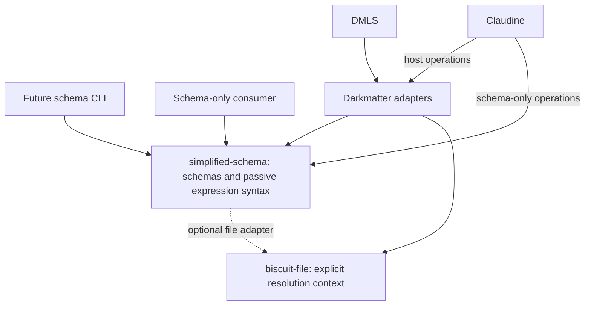

# Extract SimplifiedSchema

Extract SimplifiedSchema from Darkmatter into a reusable Rust library. A
consumer should be able to define, inspect, resolve, and validate structured
data without depending on Markdown composition or rendering.

This is a behavior-preserving extraction. Existing observable behavior is
the parity authority. The work changes ownership and introduces ergonomic,
efficient standalone APIs; it does not redesign the language or correct
existing function behavior. API and internal-boundary refactors that improve
ergonomics and performance are intentional: preserving functionality does
not freeze the old Rust API. The separate strict/soft methods remain part
of the agreed new surface.

The first release is **library only**. A small CLI using that library is a
likely subsequent addition. The package layout should accommodate that CLI,
but implementing it is not part of this extraction.

This is a draft. The user has established the library-first direction,
the `simplified-schema` package name, and its ownership of passive expression
syntax, the pure conversion engine, and the numeric model. The remaining
ownership and public API decisions below are subject to review. This document
does not authorize implementation.

## Motivation

SimplifiedSchema is now a schema language with its own AST, grammar, named
and recursive types, unions, tuples, function signatures, subtype rules,
JSON Schema generation, source-aware diagnostics, and completion metadata.
Those capabilities have applications beyond Markdown frontmatter.

Reuse already exists:

- Claudine's generator inspects schema definitions to check research
  sidecars against its Rust catalog (`claudine/gen/src/schema_compat.rs`).
- Messenger uses Darkmatter's schema APIs to validate provider research
  data (`messenger/lib/src/research/load.rs`). It also uses Markdown APIs,
  so extraction alone would not remove its Darkmatter dependency.
- Darkmatter's expression catalogs, DMLS, and Claudine consume the same
  language and need one authoritative implementation of its rules.

Today those users reach through `darkmatter::markdown::schemas`. A new
schema-only consumer also inherits Darkmatter's rendering, syntax
highlighting, networking, and composition dependencies. The extraction
establishes a smaller ownership and dependency boundary. It does not promise
that applications already using Darkmatter will compile faster.

## Scope and Package Layout

The confirmed package-area name is `simplified-schema`, with the library at
`simplified-schema/lib/` and Cargo package name `simplified-schema`.
`SimplifiedSchema` remains the language name.

If the later CLI is approved, it would live at `simplified-schema/cli/` with
Cargo package name `simplified-schema-cli`. Its executable name and command
surface are undecided. Do not create an empty CLI crate or speculative CLI
interfaces during the library extraction.

The initial delivery includes the library, workspace registration,
package-area recipes, tests, documentation, and migration of existing
consumers. Existing schema, validation, coercion, and runtime behavior must
remain unchanged for existing callers.

Out of scope:

- New schema syntax, a replacement type system, or new coercion rules.
- Function-signature changes, numeric recovery changes, new exclusions on
  existing functions, or fixes to catalog/runtime inconsistencies.
- A Markdown parser, renderer, composition engine, or expression evaluator
  in the new package.
- Moving DMLS transport, workspace indexing, or CLI presentation policy.
- New remote-schema fetching, persistent semantic caches, or schema registries.
- TypeScript or Rust code generation; these remain possible future exports.
- Renaming existing schema vocabulary or removing `md schema` commands.
- A general plugin framework or multiple independently versioned schema crates
  without a demonstrated dependency need.

## Proposed Ownership

The existing `simplified/` directory is a starting inventory, not the final
extraction boundary. Import resolution, validation, and conversion also live
in adjacent modules and share rules with expressions. Passive expression
syntax, conversion, and numeric ownership are confirmed below; the remaining
proposals still require review.

| Responsibility | Proposed owner |
| --- | --- |
| AST, type grammar, YAML schema envelopes, serialization | Schema library |
| Passive expression tokenization, syntax tree, parsing modes, errors, and source spans needed for shared parsing | `simplified-schema`; confirmed, reused by Darkmatter |
| Named-type expansion, recursive-definition graph, cycle checks, use-site constraint merging | Schema library, using explicitly supplied sources |
| JSON Schema lowering, generic validation, typed problems | Schema library |
| Presence calculations, subtype rules, pure phase projection | Schema library; the host selects the phase |
| Source maps, scalar decoding, schema cursor queries, suggestions and suggestion linting | Schema library |
| Pure conversion shapes, rule engine, and conversion failures shared with argument binding | `simplified-schema`; confirmed, reused by Darkmatter |
| Numeric admission, precision rules, and shared numeric helpers | `simplified-schema`; confirmed, reused by Darkmatter |
| Schema-file access and file-value checks | Explicit file adapter using `biscuit-file` and caller-supplied context |
| Markdown extraction, frontmatter origin tracking, document-relative diagnostic projection | Darkmatter adapter |
| Markdown expression scanning, expression value lookup, function registration, and evaluation | Darkmatter |
| Baseline selection, trigger discovery, schema-root policy, shipped Darkmatter catalogs | Darkmatter |
| Composition sequencing, pending-value classification, literal-token handling, lifecycle operand binding | Darkmatter; supplies the necessary facts or checks to the library |
| Applying defaults, optional-property materialization, and eager-file normalization to a composed document | Darkmatter |
| Terminal, browser, and editor presentation | Existing CLI, rendering, and DMLS packages |

The schema library may return converted values or proposed changes. It does
not mutate a Markdown document or decide when composition applies them.

The library must offer a useful in-memory path. Filesystem support must not
be a prerequisite for parsing an inline schema or validating ordinary data.



Darkmatter uses the passive expression parser owned by `simplified-schema`;
no separate syntax package is part of this extraction. The same library owns
the pure conversion engine and numeric model. Markdown scanning, expression
execution, argument-binding orchestration, and applying converted values to
documents remain in Darkmatter. No additional package is needed for these
shared rules. The full dependency graph must remain acyclic, with no
dependency from the schema library back to Darkmatter.

## Public Object Direction

The public facade is one `SimplifiedSchema` object with first-class mutable
layering, direct strict/soft validation, typed inspection, and exports.
Callers do not need an explicit compile or prepare call. The object retains
the appropriate internal representation, including typed definitions, raw
JSON Schema, and root unions; do not flatten those forms into a property map.

Provide one-argument fallible factories on `SimplifiedSchema`, returning
`Result<Self, E>`. Illustrative calls include `try_from(input)`,
`try_from_markdown(&file_reference)`, `try_from_yaml(&file_reference)`, and
`try_from_json_schema(&file_reference)`. Missing files, missing schema-bearing
structure, and malformed definitions are errors. Do not require a public
loader object, a second context argument, or separate source-handle setup.
The exact file-argument types and context plumbing require implementation
proof while preserving existing provenance and resolution behavior.

`TryFrom<&str>` accepts raw document content only and performs no filesystem
I/O. Recognize schema-bearing YAML with root `$schema` or Markdown with
frontmatter `$schema` using the existing language parsers. Markdown body
content contributes no schema. A valid YAML scalar alone is not a schema;
a file-looking string is content, never an instruction to open that file.
File access uses the explicit one-argument Markdown, YAML, or JSON Schema
file factories, which read the input file once. This targeted convenience
extraction preserves the existing `kind: schema`/`types` and raw JSON Schema
parser surfaces.

References written inside content remain parsed schema references. Content
parsing may retain unresolved external references for a later explicit
adapter/context; it does not capture an ambient environment or open the
input string as a file. Preserve source origins and dependency tracking
through subsequent explicit resolution without inventing a new policy here.

Use one loaded source buffer for classification and construction, avoiding
redundant reads or reparsing of the same buffer. Loading a URI and linking
named references remain distinct operations. The proposed asynchronous
`resolve(uri)` surface is limited to existing supported non-network
references and supplied sources. It adds no URI grammar, registry, or
HTTP(S) fetching. No constructor requires a Markdown parser in this library
or implicit host discovery.

Layering sketches include `as_base`, an override operation, `layer_under`,
and `layer_over`. Layering methods mutate the receiver and use the fluent
shape `&mut self -> Result<&mut Self, ...>`. Source schemas are borrowed and
left unchanged. The returned reference aliases the receiver; producing it
does not require an independent schema clone or an implicit full-schema
copy. Successful definition changes invalidate affected derived state;
unchanged state remains reusable. Failure atomicity is not yet decided.
Exact method names and base/alias meanings remain open.

For both under- and over-layering, incoming lists run from low to high
priority: the last supplied layer wins an incoming conflict. With
`layer_under`, the receiver wins over the resulting incoming layer; with
`layer_over`, the resulting incoming layer wins over the receiver. Preserve
whole-property declaration replacement, including existing root-union and
reference restrictions; do not introduce constraint intersections or new
merge semantics.

For example, let incoming `s1` declare `timeout: number` and `s2` declare
`timeout: string`. Layering `[&s1, &s2]` onto receiver `s0` gives:

| Receiver `s0` | Under-layer result for `timeout` | Over-layer result for `timeout` |
| --- | --- | --- |
| Declares only `name` | `string` | `string` |
| Also declares `timeout: boolean` | `boolean` | `string` |

Export simplified YAML through the existing serializer and supported typed
definitions to JSON Schema through the existing lowerer, preserving metadata,
vocabulary, and ordering. Lowering a function type retains its located error.
Arbitrary raw JSON Schema has no general conversion to the simplified
language: an unsupported export returns a typed error, without lossy
conversion or a new reverse converter. TypeScript and Rust code generation
remain outside this release.

Read-only inspection should expose individual types and function schemas,
illustratively through borrowed `TypeDefinition` and `FunctionType` views.
Function views retain parameter names, order, types, optional/rest markers,
return types, fallibility, and original metadata. Query nested schema types
with dotted keys and bracket indices: `people[0].name` and `coords[1]`.
Quoted bracket keys such as `settings["a.b"]` address a key containing a dot.
This is passive schema-type lookup, not expression evaluation or runtime
data access.

Read views preserve the underlying graph without expanding recursion or
cloning the full schema for an ordinary lookup. Programmatic key/index
segments can avoid reparsing a string path. Preserve existing literal-key
precedence and union-query helper behavior; do not select a new winning
arm. Empty-path, missing-match, and union-result shapes still need a check
against existing query surfaces before choosing any new result contract.

Enum-style selection may use caller-provided selectors through existing
key/trait conventions, and runtime properties remain iterable. Loaded
schemas do not generate Rust compile-time property enums; code generation
is future work. Exact method and view names remain planning details.

### Host assembly and baseline reuse

Authored and effective schemas are both useful products. Generic loading
can produce the schema authored in Markdown; Darkmatter's adapter assembles
the effective schema by applying host policy and layers. They are not
competing constructor choices, and the core does not know Darkmatter's
baseline or trigger policy.

Darkmatter owns its cached baseline, and Darkmatter and DMLS retain and
reuse it. The current process-wide baseline holds resolved typed definitions
and shared lowered JSON Schema, initialized once; it is not a literal Rust
constant. Context-sensitive compiled validators are separately reused.
Preserve sharing rather than reparsing or cloning the full baseline for
each page, including the existing shared path when a single layer suffices.

For a page with an authored schema, the host's working schema is the
receiver and remains the highest-priority layer. The schematic operation is:

```text
effective.layer_under([&baseline, ...extension_layers, ...matched_triggers])?
```

Here the host selects and retains the baseline, any configured editor
extensions, and matched triggers in their existing low-to-high order. It
then validates through the existing caller's strict or coercing path.
Variable names and spread notation illustrate the workflow, not final Rust
signatures. Preserve optional/custom baseline controls and current layer
precedence.

An enabled baseline still applies to pages with no authored `$schema`. Preserve
the distinction between absence and an authored schema and their provenance;
ordinary frontmatter is not an inferred schema. The constructor's
missing-schema result is a typed error; the host must preserve its existing
handling of schema absence when assembling the effective schema. DMLS must
also load from its current in-memory document snapshot, including unsaved
edits, without a forced filesystem reread through a path-only factory.
One-argument ergonomics must preserve those origins; no mandatory public
loader/context-setup workflow is selected.

## Requirements

### R1. A usable standalone library

The library provides separate strict and soft validation methods. Soft
validation includes coercion using the existing rules; R6 defines the
distinction and their shared result contract.

Keep `serde_json::Value` as the in-memory data model for existing JSON/YAML
validation and conversion. Do not introduce a replacement value model or
wrapper round trips. Callers must be able to parse and inspect the typed
schema AST without compiling a validator.

A consumer depending only on the schema library and its normal data types
can:

1. Parse an inline property definition or standalone schema document.
2. Inspect and serialize its typed definitions.
3. Resolve named types from supplied schema sources, including recursive
   definitions and structured cycle failures.
4. Lower a supported resolved schema to Draft 2020-12 JSON Schema.
5. Validate a JSON/YAML data value through the strict or soft method and
   obtain structured diagnostics and the accepted effective value.
6. Request conversion explicitly and inspect the result without changing
   its input.
7. Query suggestions and source locations without composing a document.

For example, this declaration must remain useful outside a Markdown file:

```yaml
kind: schema
types:
    Person:
        name: string(required)
        age: number(min(0); integer)
```

A consumer can select `Person` and validate a mapping against it using one
of the two validation methods. Both accept an immutable reference and return
the same `Result` contract, exposing diagnostics and a borrowed or owned
accepted effective value on success while preserving the original input.
R6 defines the success and failure guarantees. Layering failure behavior
and nested-query contracts still require clarification.
Routine Rust naming and internal implementation details remain planning
decisions unless explicitly agreed during clarification. Parsing,
resolution, and compilation remain distinct internal operations; the object
may prepare internally when validation is requested. Parsing and inspection
do not require compilation. Strict validation does not convert; soft uses
the existing conversion engine. No operation may implicitly discover a host
environment.

Function signatures remain inspectable language constructs. Attempting to
lower a `function` type to a data-validation schema still produces a located
conversion error. Preserve existing function-schema parsing, metadata, and
argument conversion behavior; R6 distinguishes these from host execution.

### R2. One language implementation and an acyclic dependency graph

Darkmatter consumes the extracted implementation. It must not retain a
second parser, converter, subtype implementation, numeric model, or
conversion engine for the same rules.

The new package has no dependency on Darkmatter, Claudine, DMLS, their CLIs,
or Content Policy's runtime. Content Policy's schema remains a supplied
schema source; Darkmatter continues to assemble its shipped baseline.

`simplified-schema` is host-neutral: its public types and any integration
interfaces must not depend on knowledge of Darkmatter's document model,
runtime, or host-specific language semantics. Darkmatter consumes the
library for validation and coercion and retains that host knowledge in its
own adapters. The extracted passive expression grammar remains a shared
language implementation, not a dependency on Darkmatter.

Audit normal and transitive dependency features, including `biscuit-file`.
Use the smallest required feature set. The standalone consumer must avoid
Darkmatter's rendering and effect stack; do not claim a dependency reduction
without checking the resulting Cargo graph.

### R3. Preserve authored and semantic compatibility

Preserve existing authored schemas and observable behavior, including:

- Pure `$schema` and `kind: schema` envelopes, local references, named
  imports, root and property unions, pattern keys, and literal-key precedence.
- Raw JSON Schema classification and validation, including the boundary
  between authored JSON Schema and SimplifiedSchema in referenced YAML.
- Recursive definitions, use-site annotations and constraints, supported
  descending cycles, and typed rejection of invalid cycles.
- Optional/null behavior, the shared effective-required calculation, defaults,
  eager/generated markers, and launch/completion projection.
- Numeric admission and precision rules, content formats, and conversion
  selection and failure behavior.
- Suggestions, examples, categories, descriptions, and source provenance.

Extract Darkmatter's existing definition of values that can be coerced
unchanged. Preserve composition, argument binding, and existing runtime
recovery and rejection paths. The new library's strict/soft methods do not
change existing Darkmatter defaults or add a strict-mode flag to `md`.

Current declared metadata, generic conversion, and host execution are not
always identical descriptions of accepted calls. Discussion of `number`
exposed such differences; they must be represented honestly in the boundary
inventory and parity evidence. Extract the current behavior, including
existing special cases. Do not change signatures, add enforcement, or fix
catalogs, examples, runtime behavior, or tests to make them agree during
this extraction. Earlier alternative function declarations were illustrative
and authorize no production change.

Preserve generated JSON Schema ordering and vocabulary, including existing
`darkmatter-*` formats and `x-darkmatter-*` keywords. A package rename is not
a reason to change schema output. Retaining these compatibility names does
not authorize Darkmatter-specific runtime dependencies or host knowledge in
the library. A proposed behavior departure is outside this extraction's
authorization; do not treat it as incidental cleanup.

### R4. Explicit source and filesystem context

The in-memory path performs no filesystem discovery, environment capture,
network access, expression evaluation, or process execution. Resolving
supplied schema sources is deterministic over those sources.

Schema transport currently supports local files and supplied sources.
HTTP(S) schema references, named imports, and example-file references are
explicitly rejected with `SchemaError::RemoteUnsupported`; preserve that
behavior. General HTTP content/expression support in `biscuit-file` and
Darkmatter does not enable remote schema loading. The
[schema-reference documentation](../../docs/topics/schemas/definition.md#schema-resolution)
and resolver agree on this restriction; it is not documentation drift.
A raw JSON Schema draft URI identifies its dialect and is distinct from
opening a remote file as a schema source.

HTTP(S) schema loading is explicitly outside this extraction. Retain the
current typed rejection rather than implementing network support through
an existing general transport.

An explicitly selected file adapter may read schema and example files or
check eager file values. It uses `biscuit_file::FileReference` and the
caller's existing `FileResolutionContext`; it never recaptures CWD, home,
repository roots, environment, or remote policy. Lazy file checks retain
their syntax-only behavior.

The one-argument factories do not relax this requirement. Their accepted
input types and adapter implementation must preserve the captured context
and provenance without imposing a second public context parameter. The
module map must demonstrate how this works; factory ergonomics alone do
not establish that resolution is correct.

**Technical proof needed:** `FileReference` does not carry a
`FileResolutionContext`; its `resolve_in_context` operation needs the
existing captured context. An absolute source-file origin can anchor
ordinary relative imports, but does not establish the behavior of every
rich reference form. Demonstrate context binding for the locked
one-argument factory contract without ambient recapture, a mandatory public
loader, or a second argument. A small focused proof may be useful before
planning; no binding mechanism has been selected by the signature alone.

Keep dependency and freshness information through the adapter: selected
source identities, import/example dependencies, and searched-but-absent
candidates. DMLS must still invalidate when a nearer candidate appears.
Caller-provided file origins remain distinct from document origins.

Darkmatter supplies schema-root policy, baseline and trigger layers, and the
reserved `Name@darkmatter:<stem>` namespace. Existing precedence, shadowing,
local-only reference rules, and embedded-import behavior remain unchanged.

### R5. Own passive expression syntax and shared conversion rules

Extraction is not a directory move. The current grammar parses expression
calls and expected literals in function examples; the compiler validates
expression defaults; format validation parses expression-typed values.
These operations use Darkmatter's expression parser today. The extracted
`simplified-schema` library owns that passive parser, and Darkmatter reuses
it as the single authoritative implementation.

Move the tokenization, expression syntax tree, parsing modes, errors, and
source spans necessary for shared parsing into `simplified-schema`. Its
schema checks must parse expression-typed values, expression defaults, and
function-example calls and expected literals without a Darkmatter host.
Syntax checking does not execute expressions, run examples, or establish
whether a named function or variable is available at runtime.

Markdown-aware scanning, expression value lookup, function registration,
and evaluation remain in Darkmatter. Do not copy the expression grammar,
move the evaluator or function runtime into the schema library, or create
a separate expression-syntax package for this extraction.

The pure conversion engine and numeric model also belong to
`simplified-schema`. Darkmatter uses that engine for its existing coercion
and argument-binding rules, and uses the same numeric admission and precision
rules. Keep one implementation of each rule; do not create another package
for these shared utilities. Argument-binding orchestration, runtime
execution, and applying converted values to a Markdown document remain in
Darkmatter. R6 defines the public validation methods and internal
preparation boundary.

Draw the full dependency graph, including supporting numeric and conversion
types, before implementation planning. The agreed ownership must not
introduce a dependency cycle.

Schemas that require host-specific checks must retain those checks when
used through Darkmatter. Unavailable required host checks follow R6's
explicit-failure contract.

### R6. Validation has an explicit semantic contract

#### Strict and soft validation

Expose separate strict and soft validation methods in `simplified-schema`.
The provisional names `validate_strict` and `validate_soft` illustrate their
roles; exact Rust spelling remains a planning detail. Each method performs
its validation in one invocation, without a caller-supplied mode argument.
Soft validation includes any permitted coercion within that invocation.
Distinct signatures make the chosen behavior clear at the call site; they
do not require a generic validation method or a default mode.

Both methods accept the data through an immutable reference and return
`Result<ValidationSuccess<'input>, ValidationFailure>`. These type names are
illustrative; the `Result` success/failure distinction is decided. `Ok`
always contains a usable accepted effective value and diagnostics:

- Strict success borrows the original input.
- Soft success without coercion borrows the original input.
- Soft success requiring coercion owns the converted value.

Never mutate the caller's input or clone the full value merely because
validation was requested. A `Cow<'input, serde_json::Value>` or an equivalent
borrowed-or-owned representation illustrates the success-value contract;
the exact Rust representation is not mandated. This does not promise zero
allocations or field-level structural sharing when converting nested data.
Diagnostic and source-location allocations remain permitted. A host may
choose to apply a successfully converted value to its own working document.
The success value's borrow lifetime follows the input data; returning an
unchanged value must not require giving ownership of that input to a schema
or cache object.

`Err` carries a typed failure that distinguishes invalid data from validation
that could not be completed, including an unavailable required check. Keep
the structured diagnostics accumulated before failure and their provenance;
do not reduce them to strings. No failure provides a validated-value
guarantee. Preserve the existing failure shape: diagnostics are returned,
not a partially converted value. The original input remains unchanged.

The methods implement these semantics:

- **Strict:** the supplied value must already match the schema's accepted
  type and constraints. No conversion is attempted.
- **Soft:** use the existing Darkmatter coercion engine to determine whether
  the value is accepted as written or after a permitted conversion. This
  includes the existing nested-value, union-selection, numeric-precision,
  and failure behavior. "Easily coerced" means exactly those existing rules;
  it does not define a new conversion policy.

Map these methods to the existing exact-validation and coercing operations.
The boundary inventory must identify which operation each current consumer
uses, including host preparation and special runtime paths. Existing callers
keep that behavior; they are not automatically routed through a new strict
method or a uniform argument-validation path.

Coercion never repairs violated constraints. Preserve the conversion rules
described in [Type Coercion](../../docs/topics/schemas/definition.md#type-coercion)
and their existing regression tests rather than introducing another policy.

These examples describe acceptance and the effective value on success:

| Schema | Supplied value | Strict | Soft |
| --- | --- | --- | --- |
| `number` | Number `4` | Accept; borrow input | Accept; borrow input |
| `number` | String `"4"` | Reject | Accept as owned number `4` |
| `number(integer)` | String `"2.5"` | Reject | Reject; conversion does not repair the integer constraint |
| `string \| number` | String `"4"` | Accept as string; borrow input | Accept as string; borrow the already accepted input |

Parsing, named-reference linking, and compilation remain separate internal
operations without requiring separate public calls. Existing host defaults
are unchanged by the two-method API.

#### Preparation and reuse

The schema object manages preparation and cached validators internally;
there is no mandatory caller-facing preparation or cache-pool step. Repeated
validation reuses valid prepared state, preserving existing context-sensitive
identity and typed errors. Track definition changes and invalidate affected
prepared state after actual successful changes so the next validation
cannot use an earlier definition revision; unchanged definitions retain
reusable state. Constructor details and mutation-failure atomicity remain
open. These guarantees do not select rollback or partial-update behavior
after a failed layering call.

Function argument binding must reuse prepared target shapes and call the
same conversion engine directly. It must not construct temporary schema
documents or round-trip through generated JSON Schema for each argument.
Preserve the existing shape-based engine boundary and callable special
paths. These reuse requirements do not change which calls are accepted,
converted, or rejected.

#### Supported assertions and diagnostics

Generated JSON Schema alone does not implement every SimplifiedSchema rule.
The library must distinguish ordinary JSON Schema assertions, custom
assertions/formats, non-asserting metadata, and checks delegated to a host.

Provide an authoritative validation path for the supported standalone
language. Do not report full validation success when a required assertion or
requested host check has no implementation. If a structural-only validation
API is provided, its result must make that limited guarantee explicit.
Advisory annotations do not become assertions merely because they are custom.

Darkmatter retains its checks for deferred operands, stored literal-token
origins, pending composition syntax, and lifecycle action binding. Extraction
must not accidentally turn those checks into ignored annotations or evaluate
templates during passive validation.

Typed errors retain their causes, instance and schema paths, source
identities, and spans. Hosts may add document locations and presentation,
but must not stringify away provenance. Standalone offsets refer to the
exact supplied text, including CRLF; Darkmatter projects them to document
positions and DMLS handles protocol encoding.

#### Function schemas and existing host execution

Preserve the current function-schema model: `name: T` declares a required
parameter, `name?: T` an optional one, and nullable types describe accepted
null values. `returns(T)` describes a successful result. The optional
`fallible;` marker defaults to false and describes failure after successful
argument binding. It is separate from parameter optionality and nullability.
The [function-signature reference](../../docs/topics/schemas/definition.md#function-signatures)
documents these forms.

The library parses, exposes, and serializes those definitions and supplies
the extracted generic validation and conversion operations. It does not
execute a function body or prove its return or failure behavior. Existing
function registration, argument-binding orchestration, recovery, execution,
and diagnostics stay with the host and preserve their current behavior.
Metadata is not a reason to add new runtime enforcement during extraction.

For example, the current `number` catalog declares a `numberlike` first
parameter and an optional numeric fallback, while its host has recovery
behavior beyond that generic declaration. Preserve both surfaces and their
current results. Earlier nullable-parameter and fallback examples were
discussion aids, not approved changes to that function.

#### Existing orchestration and generic validation results

`simplified-schema` owns the results of its generic validation operations;
consumers must not duplicate that engine. Darkmatter retains its existing
source-origin, literal-token, pending-state, lifecycle, and runtime
orchestration and its current overall outcomes. The module map must preserve
those paths and identify the host-neutral facts required by extracted code.

Earlier callback/precomputed-finding proposals remain unselected; no general
external-check framework is required. The latest behavior-preservation
directive supersedes any earlier verdict-ownership wording that would move
existing host orchestration into the new library or alter current outcomes.
This does not authorize a second schema engine or require the library to
combine arbitrary host-domain failures.

### R7. Migrate consumers without creating permanent parallel APIs

Inventory public users before moving types. Update Darkmatter, its CLI and
DMLS, Claudine library/CLI/generator, and Messenger where their imports or
behavior depend on the extracted surface.

Schema-only operations should import the library directly. Operations that
need Markdown, trigger discovery, or composition continue through Darkmatter.
Extraction must not force a consumer to reimplement those host policies.

Preserve each consumer's choice of original or converted values after
validation. Messenger's research loader currently validates frontmatter and
deserializes the same original frontmatter; migration must preserve that
behavior rather than automatically deserialize a new soft result. Other
adapters keep their existing decisions about applying conversions. Preserve
context identity and typed diagnostic projection across each adapter.

Darkmatter may temporarily re-export the new types to make the migration
reviewable. Re-exports must preserve type identity and delegate to one
implementation. Retain document-, trigger-, and composition-aware adapters
in Darkmatter; schema-only consumers import the new library directly.
Remove migration-only wrappers once repository consumers have moved. The
public-symbol inventory belongs in planning, not a further human ruling.

Keep the existing `md schema` commands and output behavior. The potential
future CLI is not a reason to remove or rename them.

### R8. Documentation and package integration

Add package-area recipes and library documentation covering schema authoring,
in-memory use, supplied sources, conversion, diagnostics, custom vocabulary,
and host-dependent capabilities. The README is an overview linking to `docs/`.

Move language documentation to the new area's `docs/` as its current
authority. Darkmatter's topic pages explain its integration and link to the
language reference. Update affected dependency documents, skills, and
consumer examples alongside implementation. Current docs never point to this
spec as their behavior reference.

## Likely Follow-up: A Small CLI

The CLI would be a thin consumer of the public library. Candidate operations
are checking a schema, validating a YAML/JSON data file, and exporting JSON
Schema. Command names, executable name, input formats, output, exit codes,
and file-resolution defaults need their own decision before implementation.

These candidates help assess whether the library is useful without a
Markdown host. They do not add acceptance criteria to the first release.
Do not put argument parsing, terminal formatting, process exit policy, or
implicit filesystem discovery in the library to anticipate the CLI.

## Verification and Acceptance

Use the monorepo's nextest-based `just test` and `just lint` recipes, scoped
to the new area and affected consumers. Use the Test Toolkit and existing
isolated process fixtures. Ordinary library and subprocess coverage is L1;
this extraction does not introduce a terminal/browser test tier.

The extraction is ready for review when:

1. A real schema-only example builds and validates in-memory data without
   depending on Darkmatter. Inspect its normal dependency graph. The example
   uses `serde_json::Value`, can inspect the schema AST before compilation,
   and validates multiple input values directly through one schema object,
   reusing internal prepared state without a mandatory compile call.
2. Language tests move to the owning library, including parsing, lowering,
   recursion, presence/null rules, subtype queries, suggestions, diagnostics,
   and conversion. Existing cases remain the regression baseline. Strict/soft
   cases prove the R6 examples, unchanged nested and union coercion,
   constraint and precision failures, and input immutability in both methods.
   Both methods expose diagnostics and the accepted effective value through
   the same result type. Strict success and soft success without coercion
   borrow the original input, with tests checking that identity; successful
   coercion returns an owned converted value and preserves the original.
   `Ok` always exposes an accepted usable value; typed `Err` cases distinguish
   invalid data from unavailable required checks and preserve accumulated
   structured diagnostics without returning partially converted data.
3. Passive corpus checks cover the shipped schema catalogs, partials,
   triggers, and representative consumer sidecars through their proper owner.
   A consumer invocation test proves the integration still works.
4. Darkmatter compose/validate, `md schema`, DMLS diagnostics/completion, and
   Claudine's affected launch/completion and generator paths preserve their
   results, including existing host recovery and rejection paths. Messenger's
   research validation remains covered. Baseline/layer parity includes
   absent document schemas, custom or disabled baselines, configured editor
   extensions, matched triggers, and unsaved DMLS buffers. Verify baseline
   and compiled-validator reuse without per-page baseline reparsing or full
   cloning, preserving existing context-sensitive cache identity.
5. Unsupported host assertions fail explicitly; passive operations do not
   evaluate expressions, run shells, fetch remotes, or mutate inputs.
   Function-schema cases preserve current parsing, parameter and return
   metadata, `fallible` defaults, serialization, and generic argument
   conversion. Integration cases preserve existing host binding, recovery,
   execution, and diagnostics; no new enforcement is introduced.
6. Existing source guards enforce the new ownership boundary. They are
   updated for relocated implementations rather than weakened or duplicated.
7. Existing schema benchmarks and representative recursive/cold/warm
   validation cases show no unexplained regression. Preserve context-sensitive
   cache identity and shared compilation; moving code must not recreate
   validators per request.
8. The new library and changed adapters compile and pass applicable checks
   on macOS, Linux, native Windows, and WSL2 using qualifying evidence where
   available. File-origin and source-position cases include Windows paths
   and CRLF. Any necessary terminal/browser regressions use existing harnesses
   without taking focus.
9. Documentation, dependency records, and skills reflect the final boundary.
10. Layering chains return a reference to the same receiver, leave borrowed
    source schemas unchanged, and require no independent full-schema result
    copy. Subsequent validation observes successful definition changes;
    unchanged definitions continue to reuse internal prepared state. List
    cases prove the precedence examples above and whole-property replacement
    through the existing merge algorithm. Cover failure-state behavior once
    its atomicity contract is settled.
11. One-argument factories return typed errors for missing files, absent
    schema-bearing structure, and malformed definitions. Classification
    uses schema structure rather than merely successful YAML parsing,
    reuses the loaded buffer, and preserves existing alternate parser
    surfaces. DMLS unsaved-input and source-provenance cases require no
    filesystem reread or mandatory public loader/context setup.
12. `TryFrom<&str>` treats a file-looking string as document content and
    returns a typed schema-structure error without opening a file. Equivalent
    valid `$schema` payloads in YAML and Markdown yield equivalent schema
    definitions; Markdown body text contributes nothing. Malformed inputs
    yield typed errors, and external references are retained without I/O
    during content parsing.
13. Schema-type queries cover dotted keys, array/tuple indices, and quoted
    keys containing dots. Lookup remains passive and preserves existing
    literal-key and union-query behavior. Borrowed inspection retains full
    function-parameter metadata, traverses the existing graph, and does not
    require a full-schema clone or recursive expansion for ordinary lookup.

Reuse existing fixtures and coverage where they answer the same question.
Internal prompt trees remain outside CI; any prompt-dependent behavior test
uses frozen fixtures under the owning package's test tree.

## Design Decisions

1. **Behavior-preserving extraction — decided:** current observable behavior
   is the parity authority. Extract existing functionality without changing
   schemas, function signatures, coercion rules, runtime recovery or
   rejection, metadata, diagnostics, or existing caller defaults. Earlier
   discussions of stricter enforcement and individual function redesigns
   are superseded; catalog/runtime fixes are outside this work.
2. **Package name — decided:** the library and package area are
   `simplified-schema`, with the library at `simplified-schema/lib/`. A
   future CLI would be `simplified-schema-cli` at `simplified-schema/cli/`;
   no CLI is included in this release.
3. **Shared implementation ownership — decided:** `simplified-schema` owns
   passive expression syntax and supporting types, the pure conversion
   engine, and the numeric model. Darkmatter reuses them. Markdown scanning,
   function registration, argument-binding orchestration, evaluation, and
   applying document changes remain in Darkmatter. No additional shared
   package is required.
4. **Standalone validation methods — decided:** expose separate strict and
   soft methods, provisionally `validate_strict` and `validate_soft`, with
   clear call-site signatures. Strict does not coerce; soft uses the current
   engine. Each is one invocation without a mode argument or generic
   default. Map them to existing operations while preserving each caller's
   choice of operation, original or converted value, and observable behavior.
5. **Immutable input and ownership on conversion — decided:** both methods
   accept immutable references. Strict success and unchanged soft success
   borrow the original; soft success after coercion owns the converted
   value. Validation alone must not require a full input clone. This makes
   no zero-allocation or field-level sharing guarantee.
6. **Typed success and failure — decided:** both methods return a `Result`,
   illustratively `Result<ValidationSuccess<'input>, ValidationFailure>`.
   Success exposes diagnostics and a usable accepted value. Typed failure
   distinguishes invalid data from an operation that could not complete,
   preserving accumulated structured diagnostics. Failure guarantees no
   validated value and returns diagnostics without partially converted data,
   preserving existing coercion failure behavior.
7. **Host neutrality — decided:** the library has no dependency on or
   knowledge of Darkmatter's document model or runtime. Integration types
   are host-neutral. Legacy compatibility vocabulary remains unchanged.
8. **Existing orchestration — decided:** the library owns generic validation
   results; Darkmatter keeps its current host orchestration. The latest
   zero-behavior-change directive supersedes earlier verdict-ownership
   wording where it would change that ownership or outcomes. No duplicate
   schema engine, callback/precomputed-finding framework, or arbitrary
   domain-error combination is authorized.
9. **Existing data and preparation seams — decided:** keep
   `serde_json::Value`, independent AST inspection, reusable prepared
   validators, and direct conversion against prepared target shapes.
   Success-value borrows follow input data. Adapters preserve original
   versus converted value use and context-aware typed diagnostics. The
   first-class schema facade manages prepared state internally, with affected
   state invalidated on mutation as described above.
10. **Fluent receiver mutation — decided:** layering uses
    `&mut self -> Result<&mut Self, ...>`, borrowing source schemas unchanged.
    The result aliases the receiver instead of cloning it. Actual successful
    definition changes invalidate affected cached state; failure atomicity,
    exact names, and base/alias meanings remain open.
11. **Layer-list precedence — decided:** incoming lists are low-to-high
    priority for both operations; the last supplied layer wins. The receiver
    then wins for under-layering, while the incoming winner wins for
    over-layering. Preserve the existing whole-property merge algorithm and
    its root-union/reference restrictions.
12. **Host assembly and baseline ownership — decided:** authored-schema
    loading and host-effective assembly are both supported. Darkmatter owns
    the shared baseline; Darkmatter and DMLS reuse it while the core supplies
    generic layering. Existing baseline controls, layer precedence,
    no-document-schema behavior, and unsaved document inputs are preserved.
13. **One-argument factories — decided:** fallible schema factories return
    `Result<Self, E>` and reject missing input files or invalid/missing
    schema structure. Generic YAML/Markdown detection requires root or
    frontmatter `$schema` structure for these convenience paths. Existing
    kinded/raw-schema parser surfaces remain. A public loader or second
    context parameter is not required; context/provenance plumbing must be
    demonstrated behind the accepted input types.
14. **String content versus file factories — decided:** `TryFrom<&str>`
    parses document content only, recognizing root `$schema` YAML or
    frontmatter `$schema` Markdown without filesystem I/O. File-looking
    strings are never opened. Explicit file factories read their input once;
    references inside parsed content remain references for later explicit
    resolution, with existing source and dependency behavior preserved.
15. **Remote schema loading — decided:** HTTP(S) schema fetching stays out
    of this release and retains `SchemaError::RemoteUnsupported`. URI loading
    is limited to currently supported non-network references and supplied
    sources; no new URI grammar or registry semantics are introduced.
16. **Schema-type query notation — decided:** use dotted keys and bracket
    indices, with quoted bracket keys for literal dots. Queries are passive
    borrowed views over the schema graph, preserving current literal-key
    precedence, union handling, and full function metadata. Caller-provided
    enum-style selectors do not imply generated compile-time enums. Exact
    names and unsupported/result-shape details follow source-parity review.

The user identified a possible future extraction of an expression engine
that any package could use to evaluate expressions. This is a nonbinding
future direction, not part of this release. It authorizes no runtime
extraction, extension framework, or additional crate, and does not require
that a future engine permanently depend on `simplified-schema`.

HTTP(S) schema loading is desired future work. Existing general transport
may be useful then; it creates no implementation requirement for this
extraction.

## Decisions to Resolve Before Planning

1. **Query result parity:** check empty paths, missing matches, and union
   result shapes against existing helpers before defining any missing
   contract. Dot/bracket notation, quoted literal keys, passive borrowed
   inspection, and full parameter metadata are decided; avoid reopening
   existing lookup semantics or adding a speculative interface.
2. **Layering failure atomicity and helper meanings:** settle state after a
   failed operation and remaining base/alias meanings. Receiver mutation
   with `Result<&mut Self, ...>`, unchanged borrowed sources, low-to-high
   list order, existing whole-property precedence, and cache invalidation
   after successful changes are decided. Neither rollback nor partial
   updates after failure are selected.
3. **File-factory feature availability:** decide whether file support is a
   library module or an opt-in feature, its dependency features, and the
   exact guarantees available without it. Preserve one-argument factories
   and existing resolution behavior.

The implementation plan must map current modules and consumer operations to
these owners, show an acyclic dependency graph including numeric and
conversion types, and name parity evidence for each moved boundary. That
map includes source-origin and pending-state facts and existing special
runtime paths; it must not redesign them. Settle the caller-facing choices
above before finalizing the implementation contract.
