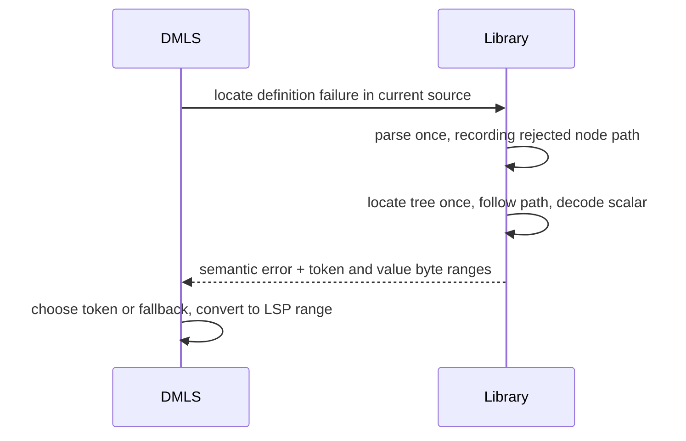

# Schema diagnostics carry what the resolver already knows

Two schema errors make the reader do work the library has already done:

- A **constraint conflict** names the keywords that disagree (`min` and
  `max`) but not their values. The reader has to open each declaration, which
  may be several imports away, to learn that the inherited minimum is 10 and
  the use-site maximum is 5.
- A **grammar error in a standalone schema file** is located in DMLS by
  *guessing*. DMLS reparses every string scalar under the definition until one
  reproduces the same error message and span. This only works as long as the
  message wording and the traversal order stay the same.

DMLS is Darkmatter's language server: it supplies editor diagnostics and
completion through the Language Server Protocol (LSP). A named type is a
reusable schema definition; a use site is a declaration that references it.
A constraint limits the values that type accepts, such as a minimum length.

This feature makes the library carry both facts as typed data. A third,
smaller change makes DMLS's partial-input continuation scanner agree with the
library's YAML scalar rules.

## Conflict participants carry their constraint

### Today

In the **darkmatter** library,
[`merge_constraints`](../../lib/src/markdown/schemas/resolve.rs) combines
inherited and use-site constraints. It holds each conflicting `Constraint`
next to its `SchemaConstraintOrigin` (the `Tagged` pair), but the error
constructor in that module keeps only the origins:

```rust
SchemaError::ConstraintConflict {
    name, kind, site,
    constraints: Vec<SchemaConstraintOrigin>, // keyword, source, path, occurrence, span
}
```

All three renderers have only the keyword to show:

| Renderer | Today |
| -------- | ----- |
| `Display` | ``tags: contradictory bounds on named type `slug`: `min` in ./types.yaml and `max` in the inline $schema`` |
| terminal `StatusBlock` | `min at [slug] in ./types.yaml` |
| DMLS related information | `` `max` is declared here `` |

### Decided

- `ConstraintConflict.constraints` becomes a list of the **darkmatter**
  library's planned
  [`SchemaConstraintParticipant`](../../lib/src/markdown/schemas/simplified/source.rs),
  with fields `origin: SchemaConstraintOrigin` and `constraint: Constraint`,
  in the existing merge order (inherited first).
  `SchemaConstraintOrigin` itself is unchanged, because source maps and other
  errors use it without a value.
- The participant's `constraint` is **the value that took part in the
  conflict**:

  | Kind | Participant value |
  | ---- | ----------------- |
  | `Bounds` | the surviving (strictest) bound of each side, for example `min(10)` and `max(5)` |
  | `Default` | each `default(…)` as declared |
  | `Options` | the named type's option set and the use site's option set |
  | `Scheme` | the inherited scheme list **as it was before this intersection**, and the use site's list |

  `Scheme` needs care. Today `merge_constraints` narrows the inherited list
  in place (`existing.retain(…)`) and only then finds it empty. The
  inherited participant must be captured before the narrowing, or it would
  always render as `scheme()`.

  For repeated successful intersections, this inherited value can be narrower
  than the text at its origin. Keep the existing origin selection: it locates
  the declaration that introduced the group, while the participant records
  the effective value at the failing merge. DMLS describes such a value as
  `` `scheme(https)` is the effective constraint from this declaration ``;
  it must not claim that narrowed text was authored verbatim.
  Use this wording for every scheme participant, including an unchanged
  list, so rendering does not need a source reread or another provenance flag.

  Bounds retain the origin of the surviving stricter bound and its existing
  position in the inherited-then-use-site stream; equal bounds keep the first
  origin. Defaults retain their typed JSON values before comparison, including
  the item-versus-container reconciliation path. Numeric normalization still
  decides equality; this feature changes no merge rules.

  Options require both canonical sets, including
  `Constraint::Options(empty_set)` when the named type declares bare
  `alphanumeric`. The empty set points at that type declaration using the
  existing synthetic origin; it must not be omitted for lacking an authored
  option token. In DMLS, when this empty option participant has no constraint
  token span, use its origin's definition span for the related location.
  File watching and related-location lookup continue to read
  each participant's `origin`, including through referenced-schema wrappers
  and recursive named-type resolution.
- One canonical renderer formats a single constraint. In the **darkmatter**
  library, expose `Constraint::to_schema_text(ty: Option<SimplifiedType>)`
  through the existing
  [constraint serializer](../../lib/src/markdown/schemas/simplified/serialize.rs).
  All conflict renderers pass `None`: the four conflict kinds carry enough
  typed information to render without reconstructing the enclosing type.
  Messages never hand-format values.

  The formatter must cover options rather than forwarding them into the
  current `write_constraint` branch that panics. Render an option participant
  as `alphanumeric(allow-dashes)` (canonical option order), or `alphanumeric`
  for the empty set; do not invent an `options(...)` grammar keyword.
  Preserve JSON scalar identity in defaults: string `"3"` and number `3`
  must display differently, as must string `"null"` and null. Share the
  serializer's quoting and escaping rules, correcting ambiguous default
  quoting there as part of this change.

  Values constructible only through Rust, such as object or array defaults,
  remain fully represented in typed data. Render them defensively as
  `default(<compact JSON>)`; this diagnostic representation does not add
  compound defaults to the authored schema grammar or promise a grammar
  round trip for those values.
- Renderers show values:

  ```text
  tags: contradictory bounds on named type `slug`: `min(10)` in ./types.yaml and `max(5)` in the inline $schema
  ```

  The `StatusBlock` lines become `` `min(10)` at [slug] in ./types.yaml ``,
  and DMLS related information says `` `max(5)` is declared here ``.
- Escape line breaks, tabs, and other control characters in the rendered
  constraint before putting it in a message. Shorten only that constraint
  excerpt to at most 160 Unicode scalar values, including a final `…` when
  shortened. Use the same excerpt in `Display`, terminal output, and DMLS
  related information; keep paths and sources outside that limit. The
  structured field always holds the full `Constraint`. Terminal output still
  uses biscuit-terminal's `StatusBlock` and `Prose` escaping, so schema text
  cannot become terminal markup.

Reader's note: the current single-constraint writer deliberately excludes
options, and the conflict renderer has no existing value-shortening helper.
The explicit rules above replace those two assumptions in the draft. They
keep all three renderers consistent without expanding the schema language.

## Grammar failures report where they happened

### Today

In the **dmls** package,
[`standalone_type_definition_diagnostic`](../../dmls/src/diagnostics/frontmatter.rs)
builds diagnostics for malformed standalone definitions. It parses the document
with serde, then builds a `FrontmatterAst`. For each definition it calls the
**darkmatter** library's
[`parse_property_definition`](../../lib/src/markdown/schemas/simplified/mod.rs).
When that parser fails with `SchemaError::Grammar { span, message, .. }`, where
`span` is the range *within the failing type string*, DMLS searches for the
scalar again:

1. locate the standalone payload again;
2. collect **every** string scalar under the definition into a vector, with a
   property name for each;
3. reparse each candidate until one reproduces the same `span` and the same
   `message` text;
4. decode that scalar's YAML presentation (`decode_scalar_node`) to project
   `span` onto authored bytes.

The parser already knew which scalar failed in step 3; that fact was simply
not returned.

### Decided

- The shared semantic parser records the **structural value path** of the
  node it rejected. Reuse the **darkmatter** library's
  [`SchemaSourcePath`](../../lib/src/markdown/schemas/simplified/source.rs),
  which already distinguishes literal property keys from indexed union arms.
  For example, the second arm's `children` property is
  `root().union_arm(1).property("children")`. Indices are zero-based; a key
  containing a dot, slash, bracket, or Unicode character remains one key.
  Never reconstruct a path by splitting `SchemaError::Grammar.property`.

  Carry this path through the existing parser recursion, including mapping
  values, sequence arms, and `$constraints` values. For an error detected
  after several arms have parsed, retain the arm that introduced the
  violation. For example, two individually valid arms with `suggest(...)`
  must identify the second suggestion and its scalar, rather than searching
  for a scalar that fails independently. For a structural failure without a
  scalar token (such as an empty union), retain the rejected node or nearest
  containing value. This is one semantic parser with a richer internal
  failure, not a second grammar or an editor-only validation rule.
- The **darkmatter** library exports this failure type from
  [the source-projection module](../../lib/src/markdown/schemas/simplified/source.rs)
  and the usual schema re-exports:

  ```rust
  pub struct LocatedDefinitionFailure {
      pub path: SchemaSourcePath,
      pub error: SchemaError,
      pub authored_span: Option<Range<usize>>,
      pub value_span: Option<Range<usize>>,
  }
  ```

  `error` is the original semantic error, retaining its variant, property,
  message, and decoded span. `path` addresses the rejected node in the supplied
  YAML root. `authored_span` is the projected scalar-token range;
  `value_span` is the whole rejected value's range for fallback. Both ranges
  use UTF-8 document bytes, including the caller's `source_offset` exactly
  once. A property-definition call starts its path at that definition; a
  declaration call starts at the declaration; a standalone call includes
  `types` or `$schema` before its definition path. A YAML sequence is followed
  by index, including root-union arms.

  On semantic failure, locate the YAML once and follow the recorded path to
  the rejected node. Project a grammar token through the existing **darkmatter**
  library's
  [`decode_scalar_node`](../../lib/src/markdown/schemas/simplified/yaml_scalar.rs).
  First verify that the located structure aligns with the parsed YAML and
  the decoded scalar equals the semantic string. Preserve the current strict
  schema-locator presentation boundary; do not broaden accepted schema syntax
  to get a more precise diagnostic.

  Reader's note: the source module's header still lists block scalars as
  unsupported, but its locator and current tests support them. Correct that
  stale header during implementation and retain the implemented block-scalar
  behavior. Unsupported multiline quoted siblings still require fallback.

  `authored_span` is `None` for an unsupported presentation, an alias without
  a trustworthy scalar mapping, a structural error with no scalar token, an
  empty decoded range, or a mismatch between the semantic and authored trees.
  Set `value_span` when the rejected value can still be located. If it cannot,
  DMLS retains its enclosing definition, `$schema` value, or document fallback.
  Never substitute another node's token or hide the semantic error because
  projection failed. Source-free parsing never invokes the locator.
- In the **darkmatter** library, change
  [`parse_property_definition_with_source` and `parse_schema_declaration_with_source`](../../lib/src/markdown/schemas/simplified/source.rs)
  to return `Result<SourceAware<T>, LocatedDefinitionFailure>`. On a semantic
  error they now attempt location before returning it. A successful semantic
  parse keeps its existing source-map behavior; a projection-only failure is
  wrapped with the existing projection error. Successful values and source
  maps do not change. Migrate all source-aware callers in this work.

  The source-free property, declaration, and YAML-schema parsers keep
  `Result<_, SchemaError>` by discarding only the internal location metadata.
  The `Grammar` variant and its display text remain unchanged. The deliberate
  change to conflict participants described above still applies.
- Add `locate_standalone_definition_failure(source: &str)` in the **darkmatter**
  library's source-projection module, returning
  `Option<LocatedDefinitionFailure>`. It shares envelope recognition and numeric
  admission with the existing
  [standalone classifier](../../lib/src/markdown/schemas/simplified/standalone.rs),
  rather than inventing another schema-file detector. A pure envelope has
  `$schema` as its only root key; a kinded envelope declares `kind: schema`
  with `types`. Global catalogs remain distinct.

  Within one call, parse the YAML once, parse the payload once using the shared
  semantic parser, and locate the authored tree at most once on failure. Return
  its first definition failure in existing parser traversal order. Mapping
  definitions and definitions inside pure root-union mapping arms are covered.
  Return `None` for valid definitions, unrecognized documents, invalid YAML,
  and outer envelope or declaration-shape failures; the existing outer
  diagnostic path handles those cases. A missing projection does not turn a
  recognized definition failure into `None`.

  Keep the existing standalone classifier's public result and
  `SchemaDocument` wrapping unchanged. DMLS receives the inner semantic error
  through this new helper; callers of the classifier still receive the same
  outer error. Classification, parsing, and location remain passive: no file
  reads, imports, expression evaluation, shell commands, or network access.
- In the **dmls** package, replace the standalone string search with this
  helper. Use `authored_span`, then `value_span`, then the existing enclosing
  value fallback. Delete `grammar_token_span`, `collect_string_scalars`, and
  the separate serde parse in `standalone_type_definition_diagnostic`.
  Reuse any existing frontmatter tree for fallback rather than parsing it
  again just to find an entry.

  Route inline `$schema` preparation failures through the source-aware
  declaration parser, not just the standalone diagnostic branch. The
  declaration API is necessary because a frontmatter `$schema` contains a
  whole schema, not one property definition. The same located failure is
  available to existing `schema` and `type-definition` meta-type diagnostic
  consumers; preserve their union acceptance rules. Keep diagnostic codes,
  severity, message wording, and related information unchanged. DMLS converts
  bytes to the session's negotiated LSP position encoding only at publication.
  When a failure comes from a referenced file, its ranges belong to that file;
  keep the current local-reference primary diagnostic and related-file
  locations rather than applying imported offsets to the current buffer.



## Continuation scanner agrees with the shared scalar decoder

### Today

When a standalone definition is incomplete, the **dmls** package's
[`continued_scalar_holder`](../../dmls/src/providers/frontmatter.rs) finds
the scalar that holds the cursor with a backward scanner. It rejects a holder
value starting with any of `# | > ' " [ { ! & *`. The library's
`decode_scalar_node` explicitly accepts an anchor (`&name`) before a plain
scalar, and the strict schema locator preserves mapping-value anchors. So
`entry: &e string(min(1)` continued on the next line completes correctly once
the schema loads, but not while the user is still typing it.

### Decided

- The backward scan still decides which line holds the value, because the
  indentation rules are still DMLS's for partial input.
- The **darkmatter** library adds `decode_plain_scalar_node` beside the shared
  [scalar decoder](../../lib/src/markdown/schemas/simplified/yaml_scalar.rs).
  It uses the same node-property and plain-scalar decoding implementation as
  `decode_scalar_node`, returning the same decoded map and consumed-end offset,
  but only for a plain scalar. Same-line anchors and tags supported by that
  decoder can precede it; tags are skipped, never interpreted. A quoted or
  block scalar, collection, alias, comment, empty holder, or anchor whose
  scalar starts on a later line does not qualify. The general decoder accepts
  quoted and block scalars too, so its mere success cannot establish that the
  holder is a continuable plain scalar.

  DMLS calls this helper on the candidate's **value start**, using the
  holder's actual indentation (the dash column for a sequence item). Decode
  against the current document, through the continuation line. Pass the actual
  cursor offset into the scanner and require it to fall within the consumed
  scalar, allowing the insertion position immediately after its final byte.
  Decoding only the holder line cannot prove this. Delete the DMLS
  forbidden-prefix list; do not replace it with a second list in the editor.
- Use the decoded map for the schema-expression cursor and replacement range
  when the incomplete buffer has no usable semantic tree. An anchor's name
  and any tag remain outside the edited type text. Complete and incomplete
  buffers must offer the same candidates and replace the same authored token.
  Comments still end a continuation, blank lines retain existing folding,
  and a dedented sibling must not be consumed. Completion does not execute
  the value or load an import just to recognize its scalar presentation.
- The full library cursor query (for partial-input locating) is not built
  here. It would remove DMLS's indentation scanner too, but it is not justified
  by one presentation gap.

## Out of scope

- Display of conflicts other than `ConstraintConflict`, such as union-reference
  rejections.
- Speed work on these paths. Locating failures removes repeated parsing as a side effect,
  but nothing here is judged by latency.
- A schema-wide cursor locator for partial input.

## Implementation surfaces

| Change | Files |
| ---- | ----- |
| Conflict values | Library `schemas/resolve.rs` (all conflict constructors, including item/container defaults), `schemas/resolve/recursive.rs` (shared merge consumers), `schemas/errors.rs` (variant, `Display`, `StatusBlock`), `schemas/simplified/source.rs` (participant type), `schemas/simplified/serialize.rs` (single-constraint renderer), DMLS `diagnostics/named_types.rs` and `overlay/mod.rs` (related locations and watched files), schema re-exports |
| Failure locations | Library `schemas/simplified/mod.rs` and `grammar.rs` (shared failure construction and cross-arm attribution), `simplified/source.rs` (failure projection and public source-aware results), `simplified/standalone.rs` (shared recognition), DMLS `diagnostics/frontmatter.rs` and source-aware consumers in `overlay/named_types.rs`, schema re-exports |
| Continuation completion | Library `schemas/simplified/yaml_scalar.rs` (plain-only decoding helper and re-export), DMLS `providers/frontmatter.rs` (holder selection, cursor mapping, and edits) |

Library paths in this table are under `darkmatter/lib/src/markdown/`; DMLS
paths are under `darkmatter/dmls/src/`. Update constructors, pattern matches,
and tests that consume the changed public results in the same implementation.
Claudine forwards schema failures, so its library tests remain part of
verification even though it currently has no direct `ConstraintConflict`
destructuring in production code.

## Documentation

- `darkmatter/docs/topics/schemas/definition.md`: the constraint-conflict
  examples show values. The "Definitions and use sites" text that names
  `SchemaError::ConstraintConflict` describes the participant list.
- `darkmatter/docs/topics/schemas/definition.md` also documents the new
  located failure and the source-aware result-type change. State the fallback
  boundary, effective-versus-authored scheme distinction, empty options, and
  bounded message excerpt. Update the error-variant table, which currently
  describes a list of origins without their values.
- Review `darkmatter/docs/errors/README.md` against the final error surface
  and update any conflict catalog entry or example present there.
- `darkmatter/dmls/docs/diagnostics.md`: invalid type definitions underline
  the failing token in both standalone files and frontmatter `$schema`;
  conflict related locations show values.
- `darkmatter/docs/topics/schemas/dmls-schema-support.md`: anchored
  continuations complete during partial input.
- Update `.claude/skills/darkmatter/schema.md` and its DMLS/scalar guidance
  with the typed failure result, shared formatter, and plain-scalar helper.
  Public behavior stays documented in `docs/`; neither those pages nor the
  skill should point readers to a feature's lifecycle location.

## Design Decisions

### Carry values beside origins without changing merge behavior

- **Decision:** `ConstraintConflict.constraints` contains participants pairing
  the existing origin with the actual typed constraint. Preserve current
  merge order, equality, tightening, and recursive-resolution behavior.
- **Alternatives considered:**

  - Put values into `SchemaConstraintOrigin`, which also serves value-free locations.
  - Recover values later from source text.
- **Why:** The resolver already holds both fields; source recovery fails
  when a file changes or an effective value differs from its declaration.
- **Downsides:** This deliberately changes a public variant's field type;
  all constructors and consumers must migrate together.

### Describe effective schemes and implicit options honestly

- **Decision:** Preserve the pre-failure effective scheme intersection with
  its existing origin and identify it as effective in related information.
  Represent bare `alphanumeric` as an empty option set located at its type
  declaration, falling back to that definition when no option token exists.
- **Alternatives considered:**

  - Report the original unmerged scheme list.
  - Add the complete merge history.
  - Omit implicit options.
- **Why:** Only the effective intersection explains a conflict after several
  imports; the empty set is a real participant in an option mismatch.
- **Downsides:** A scheme's effective list need not appear verbatim at its
  related location, and the diagnostic does not enumerate every earlier
  successful intersection.

### Share full formatting and bounded message excerpts

- **Decision:** Extend the existing serializer for single-constraint output,
  including canonical options and unambiguous scalar defaults. Share the
  control escaping and 160-character excerpt rule across the three renderers;
  retain full typed data. Programmatic compound defaults use compact JSON
  diagnostic text without expanding the authored grammar.
- **Alternatives considered:**

  - Hand-format values in each consumer.
  - Print unbounded values.
  - Add compound-default syntax to make every constructed value round-trip.
- **Why:** The current writer excludes options and the current conflict path
  has no shortening rule. One formatter prevents diverging messages and
  keeps large or control-bearing values readable.
- **Downsides:** Shortened text is not copyable schema syntax, and callers
  need typed data to inspect the entire value. Serializer quoting fixes can
  change canonical text while preserving its meaning.

### Retain structural failure paths inside the shared parser

- **Decision:** Use `SchemaSourcePath` to carry the rejected YAML node through
  semantic parsing, including errors detected across otherwise valid arms.
  Grammar spans remain relative to their decoded scalar.
- **Alternatives considered:**

  - Match error messages while reparsing candidate strings.
  - Split the error's display property into a path.
  - Add a second editor-specific parser.
- **Why:** Literal keys and sequence indices cannot be reconstructed from a
  display label, and a cross-arm violation cannot be reproduced by parsing
  one arm alone.
- **Downsides:** Parser recursion and cross-arm checks must preserve location
  metadata even though source-free callers discard it.

### Change source-aware errors while preserving source-free contracts

- **Decision:** Property and declaration source-aware APIs return
  `LocatedDefinitionFailure`; source-free APIs retain `SchemaError` and
  existing messages. A standalone diagnostic helper shares envelope and
  numeric parsing, returning inner definition failures while the existing
  classifier preserves its outer `SchemaDocument` errors.
- **Alternatives considered:**

  - Add a location to every `Grammar` variant.
  - Keep old source-aware failures and offer parallel detailed parser APIs.
- **Why:** A failure needs both semantic error and optional authored location;
  the source-aware APIs already own the supplied text. Changing those APIs
  avoids duplicate public parser surfaces without disturbing the many
  source-free consumers.
- **Downsides:** This is an intentional public return-type change for the
  source-aware property and declaration functions; callers must access the
  inner error when they do not need locations.

### Make projection best effort without changing validity

- **Decision:** Project only aligned, verified source nodes. Missing token
  mappings retain the semantic error and the nearest trustworthy whole-value
  fallback. Keep the existing schema presentation boundary, passive parsing,
  byte-coordinate convention, and referenced-file ownership of ranges.
- **Alternatives considered:**

  - Reject semantic failures when location fails.
  - Guess a matching token.
  - Expand the locator to all YAML presentations.
- **Why:** Existing projection tests require conservative fallback, including
  when an unsupported sibling prevents locating the document. More precise
  highlighting must not change which schemas are accepted.
- **Downsides:** Some valid YAML presentations still receive a whole-value
  underline instead of a token underline.

### Recognize plain continuations through the shared decoder

- **Decision:** Add a plain-only library decoding entry point, preserve DMLS's
  backward holder scan, and verify the actual cursor against the decoded
  document range. Use its map for incomplete-buffer edits as well.
- **Alternatives considered:**

  - Accept every successful general scalar decode.
  - Extend the editor's prefix blacklist.
  - Build a complete partial-YAML cursor locator.
- **Why:** The general decoder accepts quoted and block forms, while the
  editor needs plain continuation semantics. Sharing node-property handling
  fixes anchored values without creating another scalar grammar.
- **Downsides:** The indentation scan remains in DMLS, and the library gains
  one narrow public helper. General partial-YAML locating remains outside
  this feature.

### Verify parsing and protocol wiring at their actual boundaries

- **Decision:** Put the full constraint and presentation cases in library
  unit tests, retain representative DMLS protocol sessions in L1, and retain
  the requested real-terminal gate separately. Exercise the existing shipped
  schema corpus and one normal invocation path; add no benchmark or new CI
  environment requirement.
- **Alternatives considered:**

  - Treat all protocol tests as L2.
  - Multiply every representation by a multi-import fixture.
  - Add a timing study for fewer parses.
- **Why:** Repository test rules classify hermetic subprocess sessions as L1.
  Local parser and range assertions directly establish the behavior; this
  change makes no latency promise. Interpret the draft's five-second ceiling
  as the repository's L1 rule; real-terminal tests use their harness deadlines.
- **Downsides:** The tests prove deterministic provenance and messages, not
  a measured speedup or a new claim of evidence from every OS.

## Acceptance and verification

1. **Values in conflicts.** For each kind (`Bounds`, `Default`, `Options`,
   `Scheme`), an L1 test checks the participants' constraints and the
   `Display` text. Each kind includes a multi-hop case: a named type reached
   through two imports, with the inherited conflicting constraint in the far
   file. Reuse the import fixture instead of multiplying all presentation
   cases by all import shapes. Assert origin path, occurrence, span, and merge
   order as well as value. Cover a stricter bound replacing a looser one,
   equal bounds retaining their first origin, and number, length, item-count,
   and key-count bounds in the existing merge table. Existing recursive merge
   tests exercise the same participant construction.

   The scheme cases cover both an immediate empty intersection and a failure
   after a successful narrowing. The options cases include a bare
   `alphanumeric` declaration against a nonempty use-site set and differing
   nonempty sets. Default cases retain normalized numeric equality and
   distinguish strings from numbers/null, including defaults reconciled
   between item and container constraints. Programmatically construct any
   compound default needed to test long values; do not add invalid authored
   schema syntax just to create that fixture.
2. **Consistent, safe messages.** `Display`, the terminal `StatusBlock`, and
   DMLS related information use the same canonical constraint excerpt. Assert
   options do not panic, long Unicode text respects the 160-character rule,
   control characters remain escaped, terminal markup is escaped, and the
   full structured value is intact. A DMLS LSP session shows
   `` `max(5)` is declared here `` at the authored bound and the effective
   scheme wording after an earlier intersection. The bare-options case links
   to the type declaration even without an option token. Existing watched-file
   tests retain every participant's source file through a wrapped error.
3. **No guessing.** `grammar_token_span` and `collect_string_scalars` are
   gone. Library tests assert both failure paths and authored byte ranges
   for nested mapping values and sequence members, including literal keys
   containing dots and brackets. Retain the second-member/same-prefix case,
   and add a sequence such as `[string(suggest(red)), string(suggest(blue))]`:
   each member is valid alone, but the second suggestion violates the
   property's one-suggestion rule. Assert the error targets the second
   candidate. This cross-arm case proves that location does not depend on
   reproducing an error by parsing a single scalar.

   Existing plain, continued-plain, quoted, and block-scalar range tests keep
   their ranges for both standalone envelopes. Keep the unsupported-sibling
   whole-value fallback test. Cover a non-token structural failure (such as
   an empty union), a semantic/source mismatch, and an unprojectable alias
   without fabricating or losing a diagnostic. Existing outer envelope and
   root-union shape diagnostics keep their classification and fallback;
   definition errors inside a root-union mapping arm carry its indexed path.
4. **Frontmatter parity.** A grammar error in an inline frontmatter `$schema`
   definition is underlined at the failing token, including a nested mapping
   and a sequence member. Test the source-aware declaration path, not just
   the property helper. The library returns whole-document byte offsets once;
   DMLS LSP tests retain correct ranges with LF and CRLF, non-ASCII text before
   the token, and negotiated UTF-8 and UTF-16 positions. Representative
   protocol cases prove wiring without repeating the entire library matrix.
   Referenced-file failures never project their byte offsets into the current
   document. Existing meta-type union-acceptance tests stay green.
5. **Anchored continuation.** Completion inside the continuation line of
   `entry: &e string(min(1);` offers the same constraint completions as the
   loaded case and replaces only the requested token, preserving `&e`.
   Exercise an incomplete buffer without a usable semantic tree. Library tests
   distinguish anchored/tagged plain values from quoted/block values,
   collections, aliases, comments, and empty holders. Paired DMLS cases prove
   comment termination, a quoted holder that is not continued, blank-line
   folding, a dedented sibling that is not consumed, and a sequence-item
   holder's indentation. Keep LF/CRLF and negotiated-position coverage in the
   existing completion tests.
6. **Unchanged contracts.** Source-free parsing yields the same semantic
   error variants and messages, and the standalone classifier keeps its
   `SchemaDocument` wrapper. Successful source-aware parses retain their
   existing values and source maps. Extend the passive shipped-schema corpus
   coverage and retain one end-to-end test through the normal CLI invocation
   path using a shipped artifact. Location and completion tests use supplied
   source and isolated fixtures; no shell execution, remote access, or import
   resolution is introduced by the passive APIs.
7. **Package gates.** Run `just test` and `just lint` in `darkmatter/`, and
   `just test` in `claudine/` because it surfaces these errors. DMLS's hermetic
   protocol sessions are L1 tests included by `just test`; they are not
   real-terminal L2 tests. Retain `just test-l2` in `darkmatter/` as the
   requested terminal-regression gate, with harnesses that never gain focus.
   Use nextest through these recipes, keep every L1 test below five seconds,
   and add no latency benchmark. This is a specification-only review;
   these gates are requirements for implementation, not claims of runs during
   this review.
