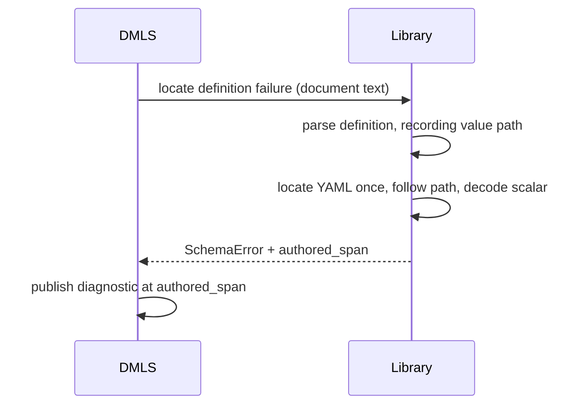

# Schema diagnostics carry what the resolver already knows

Two schema errors make the reader do work the library has already done:

- A **constraint conflict** names the keywords that disagree (`min` and
  `max`) but not their values. The reader has to open each declaration, which
  may be several imports away, to learn that the inherited minimum is 10 and
  the use-site maximum is 5.
- A **grammar error in a standalone schema file** is located in DMLS by
  *guessing*. DMLS reparses every string scalar under the definition until one
  reproduces the same error message and span. This only works as long as the
  message wording and the traversal order stay the same.

This feature makes the library carry both facts as typed data. A third,
smaller change makes DMLS's partial-input continuation scanner agree with the
library's YAML scalar rules.

## A. Conflict participants carry their constraint

### Today

`resolve.rs::merge_constraints` holds each conflicting `Constraint` next to
its `SchemaConstraintOrigin` (the `Tagged` pair), but `MergeSite::conflict`
keeps only the origins:

```rust
SchemaError::ConstraintConflict {
    name, kind, site,
    constraints: Vec<SchemaConstraintOrigin>, // keyword, source, path, occurrence, span
}
```

All three renderers have only the keyword to show:

| Renderer | Today |
| -------- | ----- |
| `Display` | ``tags: contradictory bounds on named type `slug`: `min` in ./types.yaml and `max` in the inline $schema`` |
| terminal `StatusBlock` | `min at [slug] in ./types.yaml` |
| DMLS related information | `` `max` is declared here `` |

### Decided

- `ConstraintConflict.constraints` becomes a list of
  **`SchemaConstraintParticipant { origin: SchemaConstraintOrigin, constraint:
  Constraint }`**, in the existing merge order (inherited first).
  `SchemaConstraintOrigin` itself is unchanged, because source maps and other
  errors use it without a value.
- The participant's `constraint` is **the value that took part in the
  conflict**:

  | Kind | Participant value |
  | ---- | ----------------- |
  | `Bounds` | the surviving (strictest) bound of each side, for example `min(10)` and `max(5)` |
  | `Default` | each `default(…)` as declared |
  | `Options` | the named type's option set and the use site's option set |
  | `Scheme` | the inherited scheme list **as it was before this intersection**, and the use site's list |

  `Scheme` needs care. Today `merge_constraints` narrows the inherited list
  in place (`existing.retain(…)`) and only then finds it empty. The
  inherited participant must be captured before the narrowing, or it would
  always render as `scheme()`.
- One canonical renderer formats a single constraint, so every consumer shows
  the same spelling the schema grammar accepts. It is the existing
  `simplified/serialize.rs::write_constraint`, exposed as
  `Constraint::to_schema_text(ty)` or an equivalent public function. Messages
  never hand-format constraint values.
- Renderers show values:

  ```text
  tags: contradictory bounds on named type `slug`: `min(10)` in ./types.yaml and `max(5)` in the inline $schema
  ```

  The `StatusBlock` lines become `` `min(10)` at [slug] in ./types.yaml ``,
  and DMLS related information says `` `max(5)` is declared here ``.
- A long value (a big `default` object) is shortened in a message line by
  the same rule the `StatusBlock` already uses for long values elsewhere. The
  structured field always holds the full `Constraint`.

## B. Grammar failures report where they happened

### Today

`standalone_type_definition_diagnostic`
(`dmls/src/diagnostics/frontmatter.rs`) parses the document with serde, then
builds a `FrontmatterAst`. For each definition it calls
`parse_property_definition`. When one fails with `SchemaError::Grammar { span,
message }`, where `span` is the range *within the failing type string*,
`grammar_token_span` runs:

1. locate the standalone payload again;
2. collect **every** string scalar under the definition into a vector, with a
   property name for each;
3. reparse each candidate until one reproduces the same `span` and the same
   `message` text;
4. decode that scalar's YAML presentation (`decode_scalar_node`) to project
   `span` onto authored bytes.

The parser already knew which scalar failed in step 3; that fact was simply
not returned.

### Decided

- The grammar parser records the **structural value path** of the scalar it
  was parsing when it failed: the YAML path from the definition's value to that
  scalar, for example `[arm 1] → [key "children"]`. The path travels inside the
  library's error construction; nothing is reparsed to recover it.
- A library function returns a **located definition failure** for a
  standalone schema document:

  ```rust
  pub struct LocatedDefinitionFailure {
      pub key_path: Vec<String>,                     // payload key, definition key
      pub error: SchemaError,                        // unchanged public error
      pub authored_span: Option<Range<usize>>,       // the failing token, in document bytes
  }
  ```

  It locates the YAML once, follows the recorded value path through the
  located tree, and projects `span` through `decode_scalar_node`, the same
  decoder DMLS uses today. `authored_span` is `None` only when the scalar's
  presentation cannot be projected. The plan picks the exact name and module;
  `simplified/source.rs` sits beside `parse_property_definition_with_source`.
- `SchemaError` and its `Display` text are unchanged. Every existing caller of
  `parse_property_definition` keeps its result type.
- DMLS calls the new function and uses `authored_span`. Its current
  whole-value fallback still applies when the span is `None`.
  `grammar_token_span` and `collect_string_scalars` are deleted, and so is the
  separate serde parse in `standalone_type_definition_diagnostic`.
- `parse_property_definition_with_source` no longer returns before building
  its source map when parsing fails. On a grammar failure it returns the same
  location data, so frontmatter `$schema` declarations get the same precise
  token range as standalone files. (Today they fall back to the whole value.)



## C. Continuation scanner agrees with the shared scalar decoder

### Today

When a standalone definition is incomplete, DMLS completion finds the scalar
that holds the cursor with its own backward scanner,
`providers/frontmatter.rs::continued_scalar_holder`. It rejects a holder
value starting with any of `# | > ' " [ { ! & *`. The library's
`decode_scalar_node` explicitly accepts an anchor (`&name`) before a plain
scalar, and the strict schema locator preserves mapping-value anchors. So
`entry: &e string(min(1)` continued on the next line completes correctly once
the schema loads, but not while the user is still typing it.

### Decided

- The backward scan still decides which line holds the value, because the
  indentation rules are still DMLS's for partial input.
- Whether that holder opens a continuable plain scalar is decided by
  `decode_scalar_node` on the candidate holder. Its consumed range must
  cover the cursor. The forbidden-prefix list is deleted.
- The full library cursor query (for partial-input locating) is not built
  here. It would remove DMLS's indentation scanner too, but it is not justified
  by one presentation gap.

## Out of scope

- Display of conflicts other than `ConstraintConflict`, such as union-reference
  rejections.
- Speed work on these paths. Item B removes repeated parsing as a side effect,
  but nothing here is judged by latency.
- A schema-wide cursor locator for partial input.

## Implementation surfaces

| Part | Files |
| ---- | ----- |
| A | `darkmatter/lib/src/markdown/schemas/resolve.rs` (`MergeSite`, `merge_constraints`, option conflicts), `schemas/errors.rs` (variant, `Display`, `StatusBlock`), `schemas/simplified/source.rs` (participant type), `schemas/simplified/serialize.rs` (single-constraint renderer), `dmls/src/diagnostics/named_types.rs`, `dmls/src/overlay/mod.rs`, `schemas/mod.rs` and `simplified/mod.rs` re-exports |
| B | `darkmatter/lib/src/markdown/schemas/simplified/` grammar error construction, `simplified/source.rs`, `dmls/src/diagnostics/frontmatter.rs` |
| C | `darkmatter/dmls/src/providers/frontmatter.rs` |

## Documentation

- `darkmatter/docs/topics/schemas/definition.md`: the constraint-conflict
  examples show values. The "Definitions and use sites" text that names
  `SchemaError::ConstraintConflict` describes the participant list.
- `darkmatter/docs/errors/README.md`, if it catalogs `ConstraintConflict`.
- `darkmatter/dmls/docs/diagnostics.md`: invalid type definitions underline
  the failing token in both standalone files and frontmatter `$schema`;
  conflict related locations show values.
- `darkmatter/docs/topics/schemas/dmls-schema-support.md`: anchored
  continuations complete during partial input.

## Acceptance and verification

1. **Values in conflicts.** For each kind (`Bounds`, `Default`, `Options`,
   `Scheme`), an L1 test checks the participants' constraints and the
   `Display` text. Each test includes a multi-hop case: a named type reached
   through two imports, with the conflicting bound on the far file. The
   `Scheme` case proves the inherited participant is the pre-intersection
   list.
2. **DMLS related information** shows `` `max(5)` is declared here `` in an
   LSP session test.
3. **No guessing.** `grammar_token_span` and `collect_string_scalars` are
   gone. An existing DMLS diagnostic test on a folded, quoted, and plain
   failing scalar still yields the same ranges. A new test fails in the
   *second* member of a sequence whose first member is a valid scalar with
   the same text prefix, which is exactly the case message matching could
   confuse.
4. **Frontmatter parity.** A grammar error in an inline frontmatter `$schema`
   definition is underlined at the failing token, not the whole value.
5. **Anchored continuation.** Completion inside the continuation line of
   `entry: &e string(min(1)` offers the same constraint completions as the
   loaded case. Paired tests cover a comment line (which still ends the scalar)
   and a quoted holder (which is still not continued).
6. `just test`, `just test-l2` (DMLS), and `just lint` pass in `darkmatter/`.
   `claudine/` L1 passes, because Claudine surfaces these errors. No test
   exceeds five seconds.
