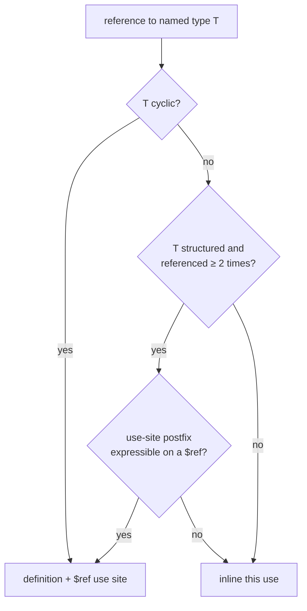

# Share repeated structured named types as definitions

Claudine's combined effective schema payload resolves to about **1.83 MB**,
against the **2 MB** ceiling enforced by
`claudine/lib/tests/l1/claudine_schemas_embedded.rs::embedded_trigger_payloads_resolve_within_two_megabytes`.
Most of that size is not the recursive lifecycle families, which are already
stored once. It is the large *acyclic* helpers around them, such as `entry`,
the action categories, the short-form bundle, and the loop verbs, which are
copied in full at every reference.

One more ordinary helper reference could push the payload over the ceiling.
This feature lets the shared resolver store a repeated structured named type
once, the same way it already stores recursive ones. It also removes a small,
hand-maintained duplication between two Claudine trigger files.

## Today

`resolve.rs::ImportEngine::expand_import` treats a named-type reference in one
of two ways:

| Target | Result |
| ------ | ------ |
| member of `self.cyclic` | a `TypeExpr::Ref` use site; the body is expanded once into the definition table, and the reference postfix is applied by `recursive.rs::apply_reference_postfix` using the definition's `UseSummary` |
| anything else | its cached expansion (`expanded_cache`) is **cloned** and the use-site postfix is applied to the copy |

The cache saves expansion work but not output size. In
`claudine/schemas/lifecycle.yaml`, every `stack` and `item` references
`entry`, which references every action category and the short-form bundle.
The initialization and cancellation profiles have parallel helpers, and
`loop-single` and `loop-bundle` repeat the same generated verb references.
Each copy lands in the effective JSON Schema in full.

The canonical docs state the current rule: "Acyclic named types continue to
be inlined, so recursion removes repeated copies of cyclic bodies without
promising compact output for every possible schema"
(`darkmatter/docs/topics/schemas/definition.md`).

## A. The resolver shares repeated structured definitions

### Which types are shared

A named type is **shared** when all three hold:

1. its expanded body is **structured**: an object, a dictionary, a tuple, or a
   union with at least one structured arm. Primitive aliases such as
   `slug: alphanumeric(allow-dashes)` stay inlined. Their use sites commonly
   narrow them (`slug(min(3))`), and inlining keeps their lowered JSON Schema
   flat and readable;
2. it is referenced from **two or more use sites** in the schema being
   resolved, counted over the whole reachable reference graph, the way
   `discover` already walks it for cycle admission;
3. it is not already cyclic. Cyclic types keep their current path unchanged.

This rule is deterministic and needs no authoring choice. **Rejected:** a
per-type sharing declaration in schema syntax. It would add a choice every
author must make, and the decision belongs to the resolver.

**Rejected:** sharing every named type. That would turn every primitive
alias into a `$ref`, change most lowered schemas in the repository, and make
simple constraint narrowing harder to read, with no payload benefit.

### How a shared type is resolved

- A shared type goes through the same machinery as a cyclic one: its body is
  expanded once into the definition table under its `DefKey`, use-site
  markers are stripped from the body (`strip_use_site_markers`), and each use
  becomes a `TypeExpr::Ref` built from the definition's `UseSummary`. The
  engine's "cyclic" set generalizes to "stored as definitions", with cycle
  admission (`NonDescendingCycle`) still computed from cyclic members only.
- The fast path that skips the two-pass expansion when `cyclic` is empty now
  runs only when **no** type is stored as a definition.
- Use-site rules are exactly those of recursive definitions, as the canonical
  doc already lists. Presence, nullability, descriptions, defaults, and extra
  bounds belong to the use site. Markers written on the definition are
  inherited by every use. A contradiction is a `ConstraintConflict` naming the
  definition first. **A constrained use never changes the shared body.**
- If a use site's postfix cannot be expressed beside a `$ref` under those
  rules, that one use is inlined as today. Sharing is a size optimization and
  never changes what a schema accepts.
- Existing properties are preserved:
  - lexical imports and namespaces;
  - rehoming of `example(...)` paths for definitions authored in another file;
  - baseline and trigger-payload `$defs` merging and rekeying, which already
    handles cyclic definitions;
  - phase projection (`map_bodies`);
  - DMLS traversal, which already follows `Ref`.

### What changes for readers of the output

- Lowered JSON Schema contains more `$defs` entries and `$ref`s. `md schema`
  output, `ResolvedSchema` serialization, and any test that snapshots a
  lowered schema with a repeated structured type change accordingly. These are
  intentional updates, not regressions. Each one is reviewed to confirm the
  accepted/rejected behavior is the same.
- Validation results, error paths, and source positions for instance errors
  are unchanged. A `$ref` changes where JSON Schema reports a keyword
  internally, so diagnostics that map keyword locations back to properties are
  checked explicitly (acceptance 3).

## B. Claudine's document metadata types are declared once

### Today

`claudine/schemas/inline-compose.yaml` repeats the complete `prompt`, `hash`
(shorthand string plus longhand `kind`/`value`/`ignored` object), and
`last_updated` declarations from `claudine/schemas/claudine.yaml`, including
descriptions. A test in `claudine/lib/tests/l1/claudine_schemas.rs` checks
that the inline payload's *lines* are a subset of the main payload's lines,
which is a textual guard rather than a type guard.

### Decided

- A new schema type library, `claudine/schemas/document.yaml`, declares
  `prompt`, `hash`, and `last_updated` once, with their current descriptions.
  It is not added to `linking.yaml`, which has a different purpose.
- Both trigger payloads reference them (`hash: hash@./document.yaml`).
  Presence, the open document behavior, and each trigger's independent
  matching rules are unchanged. The inline trigger stays shadowable on its own.
- The embedded bundle inventory and `claudine/schemas/README.md` list the new
  file. A disk bundle that shadows the embedded one must include it, and the
  complete-disk-bundle documentation says so.
- The line-subset test is replaced by a **resolved-type parity** test: the
  effective `prompt`, `hash`, and `last_updated` types are equal whether
  reached through `claudine.yaml` or `inline-compose.yaml`.
- `hash` is structured and now referenced twice, so it becomes a shared
  definition under part A. This is a useful small fixture for part A's
  behavior.

## Measurement

The goal is headroom, so the result is measured, not assumed.

- Before implementing, the plan records the current resolved byte size of each
  label in the budget test (`claudine.yaml`, `sequence.yaml`, `both`) and
  attributes it to the largest repeated helpers.
- After implementing, the same test reports the new sizes, and
  `PAYLOAD_LIMIT_BYTES` is **lowered** to the new largest size plus 25%
  headroom, rounded up to the next 100 KB. A future helper that duplicates
  output then fails the budget test early, instead of only near 2 MB.
- Cold resolution and validator compilation time for the Claudine payload are
  recorded before and after, so a time regression is visible. No speed claim
  is made.

## Out of scope

- Hand-written JSON Schema, or any Claudine-specific lowering path.
- Changing which lifecycle profiles (ordinary, initialization, cancellation)
  exist, or what each one permits. Sharing must not widen any profile.
- Merging the three profile families into one parameterized type.

## Implementation surfaces

| Part | Files |
| ---- | ----- |
| A | `darkmatter/lib/src/markdown/schemas/resolve.rs` (`ImportEngine`, `expand_import`, `discover`), `resolve/recursive.rs`, `schemas/simplified/definitions.rs`, lowering of `$defs`, and any merge/rekey code that assumes definitions are cyclic |
| B | `claudine/schemas/document.yaml` (new), `claudine/schemas/claudine.yaml`, `claudine/schemas/inline-compose.yaml`, the embedded bundle inventory in `claudine/lib`, `claudine/schemas/README.md`, `claudine/lib/tests/l1/claudine_schemas.rs` |
| Budget | `claudine/lib/tests/l1/claudine_schemas_embedded.rs` |

## Documentation

- `darkmatter/docs/topics/schemas/definition.md`: replace "Acyclic named
  types continue to be inlined" with the sharing rule, update the cycle
  flowchart's "no cycle at all" branch, and add a short example of a shared
  structured type beside a narrowed primitive alias that stays inlined.
- `darkmatter/docs/topics/schemas/schema-triggers.md` or the merge section of
  `definition.md`: shared acyclic definitions merge and rekey like recursive
  ones.
- `claudine/docs` page for the embedded schema bundle, and
  `claudine/schemas/README.md`: the new `document.yaml` library.
- The `darkmatter` and `claudine` skills, where they describe schema lowering
  or the bundle inventory.

## Acceptance and verification

1. **Sharing rule.** L1 tests in `darkmatter`:
   - a structured type referenced twice is one `$defs` entry with two `$ref`s;
   - a structured type referenced once is inlined;
   - a primitive alias referenced many times is inlined;
   - one of two uses carrying `min-keys(1)` gets the bound beside its `$ref`,
     and the other use and the body are unchanged;
   - a use whose postfix is not expressible on a reference is inlined, while
     the type's other uses stay shared.
2. **Acceptance unchanged.** For every repository schema with a newly shared
   type (Claudine's bundle, Darkmatter's shipped schemas, test fixtures), a
   corpus of passing and failing instances gives the same verdicts before and
   after. The existing deep lifecycle-profile diagnostic corpus is part of
   this.
3. **Diagnostics unchanged.** Error paths and source positions for instance
   errors inside a shared definition, reached from two different use sites,
   point at each instance's own location.
4. **Merging.** A trigger payload and a document schema that both use the
   same shared type merge to one definition. Different bodies under one name
   are rekeyed, as cyclic definitions are today.
5. **Claudine parity.** The resolved-type parity test replaces the line-subset
   test. Shadowing tests for `inline-compose.yaml` still pass.
6. **Budget.** The budget test passes with the lowered `PAYLOAD_LIMIT_BYTES`,
   and the before/after sizes and timings are recorded in the implementation
   log.
7. `just test`, `just test-l2`, and `just lint` pass in `darkmatter/` and
   `claudine/`. No test exceeds five seconds.
