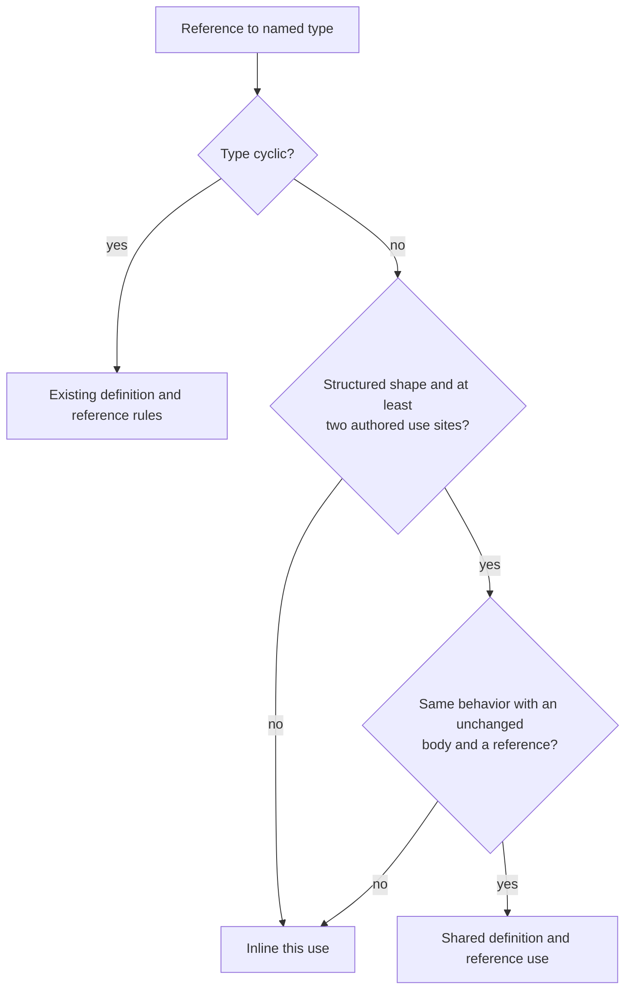

# Share repeated structured named types as definitions

The draft's measurement of Claudine's combined effective schema is about
**1.83 MB**, against the **2 MB** ceiling in
[Claudine's embedded-schema budget test](../../../claudine/lib/tests/l1/claudine_schemas_embedded.rs).
The test measures compact UTF-8 JSON, including the built-in baseline and all
shared definitions. MB here means 1,000,000 bytes. The plan records fresh
before-change figures rather than treating this estimate as its baseline.

Most of that size is not the recursive lifecycle families, which are already
stored once. It comes from helpers such as `entry`, the action categories,
the short-form bundle, and the loop verbs, copied at every reference.

This feature stores repeated structured named types once in Darkmatter's
shared schema resolver. It also removes the hand-maintained duplication of
three metadata declarations between Claudine's trigger files. Success means
smaller effective schemas, a lower enforced byte budget, and unchanged
validation, composition, and editor behavior.

## Today

A named type is **acyclic** when following its references never leads back to
itself. A **use site** is an authored reference to a named type. **Inlining**
copies the type's body into that use; a **definition** stores the body once
and lets uses point to it.

In generated JSON Schema, `$defs` holds reusable bodies and `$ref` points to
one of them. A **union** accepts any one of several types. A **trigger**
applies schema rules when a document's metadata matches its conditions; the
**baseline** supplies default rules before trigger and document rules merge.

Darkmatter's [named-type import resolver](../../lib/src/markdown/schemas/resolve.rs)
handles references in two ways:

| Target | Current result |
| ------ | -------------- |
| Member of a reference cycle | Store its body once; build a reference use with the inherited and locally authored constraints and annotations. |
| Anything else | Clone its cached expansion, then apply the use's constraints and annotations to that copy. |

The cache saves expansion work but not output size. In
[Claudine's lifecycle library](../../../claudine/schemas/lifecycle.yaml),
`stack` and `item` both reach `entry`, which reaches the action categories
and short-form bundle. Initialization and cancellation have parallel helpers,
and the loop forms repeat generated verb references.

The [current type-definition documentation](../../docs/topics/schemas/definition.md#recursive-named-types)
promises that acyclic types are inlined. This feature intentionally changes
the output representation, while preserving what schemas accept and how
consumers interpret them.

## A. The resolver shares repeated structured definitions

### Which types are shared

A named type is selected for sharing when all three conditions hold:

1. Its resolved value shape is **structured**: an object (including a
   pattern-key dictionary), a tuple, an array whose items are structured, or
   a union with at least one structured arm. Classify recursively: an array
   or union arm is structured only through what it contains, so
   `tags: string[]` is not structured, and neither is `ids: "id[]"` where
   `id: [string, number]` is a primitive-only union (a list of a union is
   always written through a named union and `[]`). `entries: "{ name: string }[]"`
   is structured. Follow aliases to classify the shape
   without first building a fully copied expansion. Primitive aliases such
   as `slug: alphanumeric(allow-dashes)`, arrays of primitives, and unions of
   only primitive arms stay inlined; narrowing a use such as `slug(min(3))`
   or `tags(min(1))` remains flat and readable.
2. It has **two or more distinct authored use sites**, counted as below.
3. It is not already cyclic. Cyclic types keep their existing admission and
   reference rules.

The choice is automatic and adds no schema syntax. Callable signatures are
not candidates for sharing.

### Counting references

Count within one import-resolution operation, before expansion. Walk the
root's value declarations and each reachable named definition's body once.
Identify a site by its authoring namespace, full source path (including
union-arm or tuple-slot position), and target definition. If the root walk
and a named-body walk encounter the same authored reference, count it once.
A declaration is not itself a reference.

Two fields pointing at one type count as two sites. Two aliases pointing at
it also count as two. Two uses of a parent do not multiply the single
reference written inside that parent's body. Unreachable library declarations
and references inside callable signatures do not contribute to sharing
counts. Existing cycle admission still examines signatures under its current
rules, including cycles through callable types.

The counted target is Darkmatter's
[namespace-and-name definition key](../../lib/src/markdown/schemas/simplified/definitions.rs)
(`DefKey`), not a name alone or the spelling of an import path. Separate
files with the same type name remain distinct; two paths resolving to the
same namespace do not split a target. Root-union arms retain separate
namespaces. Independently resolved baseline, trigger, and document layers do
not pool counts or run another sharing pass when merged.

### How a shared type is resolved

- Reuse Darkmatter's [definition expansion and use summaries](../../lib/src/markdown/schemas/resolve/recursive.rs).
  Expand each selected body once per expansion pass under its definition key.
  Move property-level markers and annotations to uses under the existing
  rules; keep value constraints and child declarations in the body.
- Track selected definitions separately from cycle membership. Cycle
  admission remains unchanged: after removing every edge that enters a child
  value, any remaining cycle is rejected. Selecting an acyclic type for
  storage must not affect this check.
- The single-pass fast path applies only when no type needs definition
  storage. Otherwise the existing two-pass approach first learns each
  definition's inherited use information and then builds final uses.
- Preserve today's inlined acyclic semantics. Presence, nullability,
  descriptions, defaults, and added bounds belong to each use. Definition
  markers are inherited. A constrained use never changes the shared body.
  Conflicting constraints retain their typed error and inherited-first
  declaration origins, even through aliases.
- Determine explicitly whether a use can preserve those semantics beside a
  reference. If it cannot, inline that one use. Do not catch arbitrary
  resolution or conversion errors and retry them as inlining. Invalid
  schemas must retain their errors rather than becoming valid.
- Selection is fixed for the resolution operation. Fallback does not
  recalculate counts or demote other uses. Lower only definitions reachable
  through surviving references, including references inside other bodies;
  emit no unused JSON definition if every use falls back.
- Preserve the existing 32-level non-repeating import-chain limit even when
  storage removes calls from the inlining stack. Sharing must not make a
  previously rejected deep chain valid.
- Keep lexical imports, namespaces, imported example-file origins, captured
  file-resolution contexts, import dependencies, searched locations, and cache
  invalidation unchanged. Disk, embedded, and reserved shipped imports use
  the same selection rules without adding disk reads to embedded resolution.

### When a use needs inlining

In a type library:

```yaml
kind: schema
types:
    entry: "{ value: string, note: string }(max-keys(1))"
```

Two document properties import it:

```yaml
$schema:
    ordinary: entry@./types.yaml
    annotated: entry(uncounted-keys(note))@./types.yaml
```

The ordinary property counts every key. The annotated property may contain
both `value` and `note`, because `note` does not count toward the inherited
one-key bound. A reference with a sibling constraint cannot undo the bound
already stored inside the definition. Inline `annotated`, merge its exclusion
with the inherited bound, and keep `ordinary` shared. This is a valid schema,
not an error to suppress. If the exclusion set is unchanged, preserve sharing
where the inherited and added bounds can be represented correctly.

Compatibility includes context as well as constraints written after a type. In particular,
preserve union-arm marker inheritance, default conflicts, the limit of one
suggestion declaration per property, and the empty-string sentinel for an
optional file. A reference must not hide an error that flattening the union
would have found, or lose behavior supplied by the union's use context.
Inline such a use when the unchanged body cannot represent it.



### What changes for readers and consumers

Lowered JSON Schema intentionally contains more `$defs` entries and `$ref`s.
Schema CLI output, the JSON returned by resolved-schema APIs, and output
snapshots change accordingly. No new opt-in flag or legacy lowering mode is
introduced.

Definition allocation and JSON key order follow the existing deterministic
traversal, never hash-map iteration. Generated keys remain opaque and contain
no machine paths. Existing merge behavior remains authoritative: reuse equal
bodies where the merge already does so, and rename collisions with different
bodies together with that incoming layer's references. Do not add global
structural deduplication or merge types by name alone. Every reference must
still point to its intended body after baseline, trigger, and root-union
merging, including references between definitions.

All consumers must treat a new acyclic reference like the value it replaces:

- Validation preserves verdicts, problem codes, instance paths, instance
  source positions, and schema-declaration origins. Internal JSON Schema
  keyword paths may move into `$defs`; they must still identify the correct
  declaration rather than a definition's unrelated use.
- Schema rules for launch and completion, required/null behavior, defaults,
  coercion, eager file handling, deferred lifecycle operands, and operand
  validation retain their current results. Property and array-item contexts
  remain distinct; an optional property does not make its list items nullable.
- DMLS, Darkmatter's language server, retains diagnostics, completion, hover,
  and definition navigation at both uses. Traversal follows only references
  needed for the current value or cursor path, without rebuilding fully
  copied trees.

  This feature adds `$ref`s to the schema shapes DMLS walks for frontmatter
  typing, the same walk `2026-10-26-dmls-frontmatter-typing-allocation`
  fixes. That fix lands before this feature, so **this feature re-runs the
  DMLS edit-loop allocation bench** (`cargo bench -p dmls --bench
  pipeline_work_a3`) before and after its own changes and records hover and
  diagnostics bytes in its implementation log. A rise means this feature
  undid part of that fix.
- A document-reachable callable still fails conversion at the use's property
  path; sharing must not conceal it in a definition.

## B. Claudine's document metadata types are declared once

[Claudine's inline-compose trigger](../../../claudine/schemas/inline-compose.yaml)
repeats the `prompt`, `hash`, and `last_updated` declarations and descriptions
from [the main trigger](../../../claudine/schemas/claudine.yaml).
The [metadata parity test](../../../claudine/lib/tests/l1/claudine_schemas.rs)
already compares lowered property fragments, then additionally requires the
inline payload's lines to be a subset of the main payload's lines.

- Add `claudine/schemas/document.yaml`, a `kind: schema` library with `types`
  named `prompt`, `hash`, and `last_updated`, preserving the current
  descriptions, defaults, and shorthand/longhand hash forms. Keep it separate
  from `linking.yaml`, whose types serve linked skills, commands, and agents.
- Both trigger payloads import these declarations, for example
  `hash: hash@./document.yaml`. Preserve optional presence, open document
  behavior, trigger matching, ordering, and independent shadowing of the
  inline trigger. The library itself is not a trigger.
- Add the library to
  [Claudine's embedded bundle inventory](../../../claudine/lib/src/composition/schema/bundle.rs),
  disk test bundles, byte-for-byte inventory checks, and export probes. There
  are now eight trigger/library bundle files and still three trigger files;
  separately embedded host catalogs are unaffected. Complete disk-bundle
  instructions must include the new library, including bundles that shadow
  embedded triggers.
- Replace the textual line-subset assertion with resolved-type parity for
  each of the three properties, retaining the existing behavioral parity
  check. Compare the property and every definition it reaches, independent
  of generated JSON key spelling; comparing two bare reference strings is
  insufficient. Prove the declarations through each trigger independently,
  and through normal effective-schema merging.

**Reader's note:** the triggers resolve independently, so one `hash` import
in each does not qualify it for sharing. The common library removes authored
duplication regardless of output storage. Exercise sharing separately with a
small fixture that imports `hash` into two properties of the same schema;
it must produce one shared definition while accepting both stored hash forms.

## Measurement

Measure headroom without creating a benchmark project.

- Before implementation, record the compact JSON byte sizes for the budget
  test's existing `claudine.yaml`, `sequence.yaml`, and `both` cases, including
  baseline and `$defs`, and identify the largest repeated helpers from their
  output. Use the same inputs and serialization after implementation.
- Let `M` be the new largest size in bytes. Set the checked-in budget to
  `100_000 * ceil((1.25 * M) / 100_000)`. This is a fixed integer constant,
  not a threshold recomputed from the current result during each test. It
  must be lower than the existing 2,000,000-byte budget, and all three cases
  must pass it. With the draft's 1.83 MB estimate, that requires `M` of at
  most 1,520,000 bytes, a reduction of at least about 17%. If the measured
  result cannot produce a constant below 2,000,000, **stop and bring the
  before/after sizes and the largest remaining repeated helpers to the
  author.** Do not extend the resolver beyond this specification, relax the
  formula, or widen profiles to reach the target. The author decides between
  further work and keeping the existing budget.
  Rename the test and comments so they describe the new budget.
- Record cold resolution and validator-compilation time before and after on
  one host, using one quick matched sample for each existing case. Use a
  fresh process for each sample so parsed-schema, baseline, and validator
  caches are cold. Exclude build and process startup time from the recorded
  stages, keep build mode and inputs the same, and name the host OS and build
  mode in the log. These observations reveal a regression; they impose no
  speed claim, timing threshold, extra hosts, or repeated statistical trial.

Record the results in the implementation log. Keep measurement scaffolding
out of routine correctness tests unless it already serves those tests.

## Out of scope

- Hand-written JSON Schema or a Claudine-specific lowering path.
- Changing lifecycle profiles (ordinary, initialization, cancellation), the
  actions each permits, or the parser's execution rules.
- Merging the three profile families into a parameterized type.
- Sharing primitive-only aliases or adding author-controlled sharing syntax.

## Design Decisions

### Automatic sharing of structured values

- **Decision:** Share repeated acyclic objects, dictionaries, tuples, arrays
  of structured items, and unions containing a structured arm. Keep
  primitive-only aliases, arrays of primitives, and callable signatures
  outside automatic sharing.
- **Alternatives considered:**

  - Share every named type.
  - Require a per-type declaration.
  - Share every array, including arrays of primitives.
- **Why:** Containers of structured values cause repeated output. Primitive
  aliases and arrays of primitives have tiny bodies, so a definition can cost
  more bytes than inlining, and their uses commonly carry local narrowing
  (`tags(min(1))`). One recursive rule ("structured through what it
  contains") covers arrays and union arms alike, so no gap is arbitrary.
- **Downsides:** A tiny structured body can cost more bytes as a definition;
  primitive-only repetition, including arrays of primitives, is not reduced.
  No size heuristic is added.

### Authored counts within one resolution

- **Decision:** Count distinct authored references to each namespace-and-name
  target, including root sites, and walk each reachable body once. Do not
  multiply sites by parent uses or pool independently resolved layers.
- **Alternatives considered:**

  - Count fully expanded occurrences.
  - Count only incoming definition-to-definition edges.
  - Share across all merged layers.
- **Why:** The existing graph walks bodies once but does not record root
  references as edges. Explicit counts include two root fields without
  expansion growth or a new coupling between trigger caches.
- **Downsides:** A descendant duplicated only by copying its parent may stay
  inlined. Two separate triggers importing a type once each do not share it.

### Reuse storage without changing cycle or depth rules

- **Decision:** Generalize the existing two-pass definition machinery, while
  retaining separate cycle membership, cycle admission, and the existing
  import-depth protection.
- **Alternatives considered:**

  - Add another lowering path.
  - Use one set for both sharing and cycle admission.
  - Let worklist storage bypass depth checks.
- **Why:** Definition identity, marker summaries, phase projection, and merge
  handling already exist. Sharing is not a reason to change grammar safety.
- **Downsides:** The no-cycle case can now need two passes, and depth checks
  must work independently of which bodies are inlined.

### Preserve semantics with an explicit per-use fallback

- **Decision:** Use a reference only where the unchanged body plus use
  metadata preserves today's inlining behavior; otherwise inline that use.
  Keep selection fixed and omit unreachable JSON definitions.
- **Alternatives considered:**

  - Reject unsupported uses.
  - Catch all conversion errors and retry.
  - Mutate or specialize the stored body per use.
- **Why:** Key exclusions can change inherited count semantics, and unions
  carry context-dependent rules. A sibling constraint cannot undo a stored
  bound. Explicit compatibility keeps invalid schemas invalid.
- **Downsides:** Some repetition remains, and compatibility needs focused
  coverage beyond checking that the JSON Schema compiles.

### Preserve consumer behavior and deterministic output

- **Decision:** Preserve instance diagnostics, declaration origins, phase,
  coercion, lifecycle, and editor behavior. Permit JSON representation and
  internal keyword-path changes, with deterministic keys and existing merge
  collision rules.
- **Alternatives considered:**

  - Promise byte-identical output.
  - Require identical internal keyword paths.
  - Merge definitions globally by shape.
- **Why:** References intentionally change representation, while callers
  depend on the value's behavior and its authored location. Existing merge
  rules already protect layer ownership.
- **Downsides:** Representation-sensitive callers and snapshots must adapt;
  equal shapes in unrelated namespaces can remain separate.

### A common metadata library with independent triggers

- **Decision:** Put the three unchanged metadata declarations in
  `document.yaml`, import them from both triggers, and ship the complete
  eight-file bundle. Test type parity through each trigger and sharing with
  a separate two-use fixture.
- **Alternatives considered:**

  - Put metadata in `linking.yaml`.
  - Merge the triggers.
  - Assume their independent imports count as two shared uses.
- **Why:** Linking has a different purpose, trigger shadowing is independent,
  and counts are local to resolution. Type parity is stronger than matching
  authored lines or reference spellings.
- **Downsides:** Disk bundles gain a required library file; the metadata
  extraction alone does not promise a smaller lowered `hash` fragment.

### Update output snapshots while retaining behavior evidence

- **Decision:** Keep frozen corpus inputs unchanged. Before changing the
  resolver, capture passing/failing instance expectations; update only
  affected output snapshots after those expectations still pass. Retain byte
  equality for entries whose representation is unaffected.
- **Alternatives considered:**

  - Keep the old no-change promise for all acyclic schemas.
  - Regenerate every snapshot without checking behavior.
  - Replace frozen inputs with the current shipped files.
- **Why:** Darkmatter's existing acyclic golden corpus explicitly guards old
  output bytes. This feature intentionally supersedes that representation
  promise, not the frozen inputs or their semantics.
- **Downsides:** The output changes require review entry by entry, including
  digest-backed entries; semantic probes must precede regeneration.

### A fixed lower byte budget

- **Decision:** Adopt the new maximum plus 25% headroom, rounded up to a
  100,000-byte multiple, as a checked-in constant below 2,000,000 bytes.
- **Alternatives considered:**

  - Retain the old ceiling.
  - Compute a fresh limit from every test result.
  - Pick an estimated lower ceiling before measuring.
- **Why:** The existing cases measure the actual effective schemas, and a
  fixed lower limit catches renewed output duplication early.
- **Downsides:** A legitimate future schema addition may require an explicit
  budget update. If the change does not save enough to lower the constant,
  the work stops for an author decision rather than growing in scope.

### Proportional measurement and verification

- **Decision:** Use one quick cold before/after timing sample per existing
  budget case on one host, with no timing gate. Put new correctness coverage
  at the passive library boundary and retain both areas' existing unit,
  terminal, and lint checks plus focused CLI and language-server coverage.
- **Alternatives considered:**

  - A multi-host performance study.
  - Statistical timing thresholds.
  - Terminal tests for passive resolver behavior.
- **Why:** The known risk is output growth shared by all platforms. Stable
  representation assertions prove sharing; existing consumer paths prove
  integration without giving a timing sample more authority than it has.
- **Downsides:** Timings are observations rather than a performance guarantee.
  Existing terminal suites remain part of final verification.

## Implementation surfaces

Paths name the package area and then the file within it.

| Part | Surfaces |
| ---- | -------- |
| Selection and expansion | Darkmatter: `lib/src/markdown/schemas/resolve.rs`, `resolve/graph.rs`, and `resolve/recursive.rs`: root-site counts, shape classification, storage selection, depth protection, use compatibility, and summaries. |
| Definitions and consumers | Darkmatter: `lib/src/markdown/schemas/simplified/definitions.rs`, `simplified/convert.rs`, and existing merge/rekey, phase, coercion, diagnostic, and DMLS consumers. Audit assumptions that definitions imply recursion; change only those affected by sharing. |
| Metadata | Claudine: `schemas/document.yaml` (new), both metadata triggers, `lib/src/composition/schema/bundle.rs`, and bundle/parity tests in `lib/tests/l1/claudine_schemas*.rs`. |
| Budget and representation guards | Claudine: `lib/tests/l1/claudine_schemas_embedded.rs`. Darkmatter: `lib/tests/l1/recursive_schema_golden.rs`, and its `lib/tests/fixtures/recursive_schema_golden/` expected outputs and README. |

## Documentation

- Update every acyclic-inlining promise in
  `darkmatter/docs/topics/schemas/definition.md`, including named imports,
  cycle flow, and limitations. Explain automatic sharing and fallback with a
  compact two-property object example beside a narrowed primitive alias.
- Update `darkmatter/docs/topics/schemas/local-type-references.md` and
  `schema-triggers.md` wherever they describe substitution or definition
  merging. Describe how shared acyclic definitions merge like recursive ones.
- Update `claudine/docs/topics/schemas.md` and
  `claudine/schemas/README.md` for the eight-file bundle and metadata library.
  Keep the README an overview; full disk-bundle instructions belong in docs.
- Update affected source comments and the snapshot-corpus README that promise
  definitions are cyclic only or that every acyclic output stays unchanged.
- Update the `darkmatter` and `claudine` skills where they describe lowering
  or the bundle inventory. User docs state behavior directly and never link
  to this feature's specification.

## Acceptance and verification

1. **Selection and counting.** Darkmatter unit tests prove one definition and
   two references for a repeated structured type, inlining for a single use,
   and inlining for repeated primitives, arrays of primitives (including an
   array of a primitive-only union), and primitive-only unions. Cover
   objects, pattern dictionaries, arrays of objects, tuples, structured
   unions, a union whose only container arm is an array of primitives
   (inlined), aliases,
   two root sites, and two sites in one body. Prove that a repeated parent,
   a root/body revisit, an unused library declaration, and a callable-only
   reference do not inflate counts. Same-named types in separate namespaces
   remain distinct.
2. **Constraints and fallback.** One of two object uses can add
   `min-keys(1)` beside its reference without changing the other use or body.
   The key-exclusion example above accepts the two-key annotated instance
   and rejects it at the ordinary use; only the annotated use is inlined.
   Test all-fallback output for no unused JSON definition. Retain typed
   conflicts and inherited-first origins, array/item constraints, nullable
   unions, default conflicts, suggestion limits, optional-file empty-string
   behavior, invalid callable rejection, and the import-depth/cycle guards.
3. **Acceptance and diagnostics unchanged.** Before implementation, inventory
   affected shipped schemas and frozen fixtures and record expected passing
   and failing instances. Include Claudine's deep lifecycle/profile corpus.
   Reuse those expectations after sharing; output regeneration alone is not
   evidence. For an invalid value reached through each of two uses, preserve
   the problem code, full instance path, line/column, and declaration origin,
   including a nested list item and a missing required field. Internal
   keyword paths may change as described above.
4. **Consumer and merge parity.** Cover schema rules for launch and completion,
   coercion, defaults, eager files, deferred operands, and editor lookup using
   new acyclic definitions. A trigger and document schema using the same
   shared type reuse its equal body under existing merge rules; same-named
   different bodies are rekeyed. Include baseline and root-union merging,
   references between definitions, deterministic output on repeated
   resolution, and unchanged dependency invalidation for an imported type.
5. **Claudine metadata.** The three properties have resolved-type parity
   through either trigger and their effective merge. Cover absent/null
   metadata, both hash forms, and invalid metadata through passive validation
   and Claudine's normal launch-verdict path. The inline trigger's shadowing
   tests still pass; embedded resolution works without disk schemas; a
   complete disk bundle and its inventory/export tests include the new file.
   A two-property fixture importing `hash` produces one shared definition.
6. **Representation and headroom.** Review and update only affected snapshots,
   retain their frozen inputs, and preserve byte equality for unaffected
   entries. The three budget cases pass the fixed lower constant. The
   implementation log records before/after sizes, the chosen constant and
   calculation, and the one-host timing observations.
7. **Final checks.** In both `darkmatter/` and `claudine/`, run `just test`,
   `just test-l2`, and `just lint`. Extend existing passive shipped-artifact
   coverage and add focused checks through the normal schema CLI and DMLS
   request path for diagnostics and editor information at both uses. New
   resolver cases are unit tests; they do not require a terminal or browser.
   Unit tests stay below five seconds. Terminal checks use the repository
   harness without bringing windows to the foreground. All changes preserve
   support for macOS, Linux, native Windows, and WSL2; timing observations do
   not replace correctness checks or introduce new CI environments.
