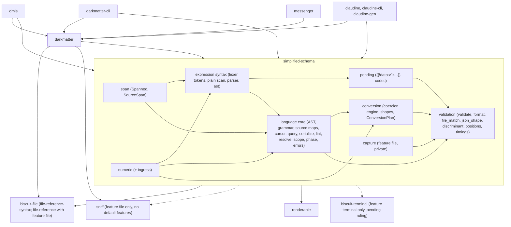

# Boundary Inventory

Task 1.1 of `2026-10-28-extract-simplified-schema` (the plan names the
directory `2026-10-25-…`; the spec lives in the `2026-10-28-…` directory, so
this file is written there). Snapshot taken 2026-10-30 on branch
`feat/schema-narrowing-and-extraction` (HEAD `961dd7f65`). Read-only: no code
was changed, built, or tested to produce it.

Paths below are relative to `darkmatter/lib/src/markdown/` unless they start
with a package directory. "DM" means Darkmatter; "lib" means the new
`simplified-schema` crate. Line counts are `wc -l`.

Decision 2's rule, applied throughout: *a file that calls the expression
evaluator, Markdown scanner, lifecycle, `ComposeContext`, or baseline policy
stays in DM; otherwise it moves.* A file mixing both is **split**.

## Summary of findings that change the plan

These contradict or extend decision 2's owner table, or decisions 4–7. Each
has a decided home in the tables below; items marked **ruling needed** conflict
with an acceptance criterion and need the author's confirmation before the
phase that touches them.

1. **`file_match.rs` moves, it does not stay.** Moving code calls it:
   `simplified/convert.rs` (`DARKMATTER_MATCH_KEYWORD`,
   `DARKMATTER_MATCH_PROPERTY_KEYWORD`, `file_match_groups`) and
   `simplified/grammar.rs:2723` (`definition_error`, the `match(...)` glob
   check at parse time). It calls no evaluator; its only compose call is the
   pure `resolve_ctx::document_file_context` (see 3). It is a "file-value
   check" in the spec's ownership table, so it moves under the `file` feature
   (the keyword constants, `definition_error`, and `FileMatchGlobs`/`Groups`
   are needed by the core grammar too; see 2).
2. **Ruling needed: the core grammar needs `globset`.** `grammar.rs:2723`
   validates `match(...)` patterns through `biscuit_file::GlobReference::new`,
   which compiles a `globset` matcher. Spec criterion 14 and the Phase 2
   checkpoint require the no-default-features build to exclude `globset`,
   while R3 forbids changing which schemas parse. Decided home (pending
   ruling): put `GlobReference` pattern parsing (`glob/parse.rs`, `glob/error.rs`,
   `GlobReference::new`, `GlobReferenceError`) in `biscuit-file`'s
   `file-reference-syntax` feature with `dep:globset`, keep listing
   (`walkdir`) and root discovery (`gix`) in `file-reference`, and amend the
   minimal-build criterion to "no `gix` or `walkdir`". The alternative (skip the
   glob check without the `file` feature) changes behavior in the minimal
   build.
3. **`compose/expression/resolve_ctx::{document_file_context,
   resolve_document_file_ref}` must move with the format validators.** They
   are pure `biscuit-file` calls (`for_cwd`, `for_trusted_external_cwd`,
   `validate`, `canonicalize_simplified`, `resolve_in_context`), used by
   `format.rs` (eager `file`) and `file_match.rs`, and by DM's expression
   functions. Home: `simplified_schema::file` (feature `file`); DM's
   `resolve_ctx` re-imports them so both sides keep one implementation.
4. **`timings.rs` moves.** `validate.rs:420,595` calls
   `timings::looked_up_validator()` / `timings::compiling()`; the module has no
   host imports. DM keeps `DarkmatterSchemas::validate_timed` and uses the
   library's `ValidationTimings`/`ValidationStage`/`CompileCache`.
5. **`frontmatter_shape.rs` and `completion.rs` are split, not stays.** Only
   `effective_property_shape`/`layered_property_shape` read the baseline
   (`darkmatter_base_schema_ref`) and only the `EffectiveSchema` wrappers in
   `completion.rs` touch host types. The `_in`/`_with_definitions` lookups are
   pure and are the existing path-query surface the facade must preserve
   (section 9).
6. **`coerce.rs` (not in the owner table) is split.** The conversion plan and
   frontmatter coercion move (they are the soft-validation engine). The
   nested-template classifier (`NestedTemplates::find`, `holds_template_syntax`)
   calls `is_deferred_template` + `holds_pending_syntax` and stays in DM.
   `ConversionPlan::marks_operands` calls `bound_operands::marks_operands`, a
   pure keyword scan, which moves next to `DARKMATTER_OPERANDS_KEYWORD`.
7. **`errors.rs` (decision 5: `SchemaError` moves whole) carries terminal
   presentation**: `impl biscuit_terminal::errors::BlockError for SchemaError`
   (lines 562–1282) and `renderable::markdown::code_span` in `Display`. The
   orphan rule stops DM from implementing `BlockError` for a foreign
   `SchemaError`, and `markdown::errors::as_block_error` must return a borrowed
   `&dyn BlockError`. Decided home: an opt-in, non-default lib feature
   (`terminal`, dependency `biscuit-terminal`) holding the existing impl,
   enabled only by DM. **Ruling needed** because the spec places presentation
   in CLI/rendering packages; the alternative is a `#[repr(transparent)]`
   newtype in DM with a `ref-cast`-style borrow in `as_block_error`.
   `renderable` (serde, thiserror, url) is light and becomes a plain lib
   dependency. `markdown::errors::with_glob_hint`/`with_hint_line` (two pure
   string helpers) move to the lib; DM re-exports them.
8. **Pure helpers outside the listed directories must move:**
   `markdown/mapping_orders.rs` (338 lines, `MappingOrders`, used by
   `positions.rs` and `schemas/mod.rs`); the plain `{{ … }}` scan core of
   `compose/expression/lexer.rs` `ExpressionFinder` (needed by the pending codec,
   section 3).
9. **`resolve.rs` hard-codes the shipped namespace.**
   `resolve.rs:339` calls `embedded::reserved_stem` (`Name@darkmatter:<stem>`)
   and resolves through `EmbeddedDocument` tables (`embedded::find`,
   `embedded::SHIPPED`). `embedded.rs` is split: the generic
   supplied-source table (`EmbeddedDocument`, `find`, `resolve_path`,
   `resolve_bundle_path`) moves; the shipped table, `SHIPPED_NAMESPACE`, and
   `EmbeddedSchemaBundle` registration stay, and DM supplies them to the
   resolver as explicit sources.
10. **`SchemaOrigin`/`SchemaOriginKind` move** (`resolve.rs` builds
    `ResolvedSchema.origin`), but `SchemaOrigin::for_trigger` and
    `SchemaOrigin::trigger_source` use `triggers::TriggerSource` and become DM
    free functions (no inherent impls on a foreign type).
11. **`compose/expression/error.rs` stays whole.** Decision 5 expected a syntax
    part; there is none. Syntax errors are `LexerError` (lexer.rs) and
    `ParseError` (parser.rs). `ExpressionError::Parse(String)` and
    `MalformedLiteralToken(TokenError)` stay; `TokenError` moves with the codec
    and DM holds it by value.
12. **Work counters cross the line.** `crate::note_work!` is called by moving
    code (10 counter kinds, section 2). Decided home in section 2.
13. **Decision 6: Darkmatter captures repository roots through `sniff`**
    (section 4); the `file` feature needs `sniff` (no default features).

## 1. Per-file table

Owner: **moves** (to `simplified-schema`), **stays** (in DM), **split**.
"Inline" is the count of `#[test]`/`proptest!` items in the file; L1 tests are
files under `darkmatter/lib/tests/l1/`.

### `schemas/` (top level)

| File | Lines | Owner | Symbols that cross the line | Evidence tests |
| --- | --- | --- | --- | --- |
| `schemas/mod.rs` | 4713 | split | **moves**: `ValidationProblem`, `ValidationProblemKind`, `ValidationProblemCode`, `SCHEMA_{TYPE_MISMATCH,CONSTRAINT,MISSING_REQUIRED,UNKNOWN_KEY,INVALID_FILE_REFERENCE,PREPARE}_CODE`, `JsonPointer`, `FileReferenceDiagnostic`, `CallerFileReferenceProvenance`, `SchemaOrigin`, `SchemaOriginKind`, `SchemaOriginMap`, `authored_node_at`, `schema_declares_property`, `CompiledValidators`, `phase_json_schema`, `merged_trigger_schema` merge core, `wrapped_root_arms`, `json_to_yaml_value`, the lib part of `reset_process_caches_for_bench`. **stays**: `DarkmatterSchemas`, `EffectiveSchema` (all `validate*`, `coerce_frontmatter_with_pending`, `normalize_frontmatter`, `raw_declarations`), baseline (`BASELINE`, `darkmatter_base_schema*`, `darkmatter_shared_baseline`), `ValidationReport`, `PreparationSummary`, `PendingValue`, `PendingValueReason`, `PendingPolicy`, `ValidationOptions`, `scan_pending_values`, `pending_reason`, `awaits_rendering`, `SCHEMA_INVALID_TRIGGER_CODE`, `SchemaOrigin::{for_trigger, trigger_source}`, `positions_for`, `frontmatter_as_json`, `base_dir_for`, `build_origin_map_with_triggers`, `build_dependencies`, `build_advisories` | inline 73 (`claudine_compat_tests`, `phase4_trigger_assembly`); `schemas_validate_table`, `schemas_effective_presence`, `schema_phase_validation`, `schemas_runtime_parity`, `schema_nested_template_deferral`, `schemas_validation_summary`, `report_diagnostics`, `shared_diagnostics` |
| `schemas/about.rs` | 1574 | stays | calls `triggers::grammar::is_match_safe_constraint`; reads lib `parse_yaml_schema`, `to_json_schema`, grammar descriptors | inline 15; `schema_grammar_descriptors` |
| `schemas/advisory.rs` | 65 | moves | `SchemaAdvisory`, `SchemaAdvisoryKind` (built by `resolve.rs`) | none direct; via `meta_schema_phase*` |
| `schemas/bound_operands.rs` | 526 | split | **stays**: `BoundOperands` (lifecycle `validate_action_operands_with`, call binding, `defer_templates`, `decode_leaf`, `is_malformed_template`). **moves**: `marks_operands` (pure scan of `x-darkmatter-operands`, called by `coerce.rs` `ConversionPlan`) | `lifecycle_generated_operands`, `lifecycle_operand_validation` |
| `schemas/catalog.rs` | 1248 | stays | shipped catalogs, `lifecycle::host_profile`, `HostFunctions` | inline 3; `global_catalog`, `host_functions`, `variable_type_projection` |
| `schemas/catalog/discovery_tests.rs` | 335 | stays | lifecycle registry | inline 7 |
| `schemas/catalog/host_function_cache_tests.rs` | 371 | stays | `HostFunctionCatalog` | inline 6 |
| `schemas/clean.rs` | 898 | stays | `Markdown`, `DarkmatterSchemas`, `EffectiveSchema` | inline 5; `clean_*` L1 |
| `schemas/coerce.rs` | 1014 | split | **moves**: `ConversionPlan` (becomes `pub`), `CoercionOutcome`, `coerce_frontmatter`, `coerce_frontmatter_with_pending` (pending key set is a caller fact), `coerce_with_plan`, `coerce_value_against_schema`, `validation_copy*`, `partial_copy`, `relax*`, `annotate_problems`, `NestedTemplates` (data type, `with_settled`, `pointers`, `excuses_problem`), `marks_deferral`. **stays**: `NestedTemplates::find`, `holds_template_syntax` (pending classification) | inline 11; `frontmatter_coercion_engine`, `raw_schema_conversion`, `schemas_union_coerce`, `schemas_core_type_values`, `schemas_runtime_parity` |
| `schemas/completion.rs` | 1203 | split | **moves**: `PathStep`, `AlternativeSite`, `AlternativeKey`, `AlternativeMatcher`, `AlternativeCompletion`, `for_path_in`, `def_at_path`, `alternatives_for_def_in`, `alternative_accepts(_in)`, `alternative_fingerprint`, `root_property_def`, `union_of`, `DefinitionLookup` re-export. **stays**: `impl DefinitionLookup for EffectiveSchema`, `for_property`, `completable_properties`, `for_path`, `for_list_item`, `for_property_value`, `CompletionSuggestion`, `CompletionKind` | inline 22; `recursive_schema_completion`, `schemas_union_completion`, `shared_acyclic_consumers` |
| `schemas/detect.rs` | 886 | stays | `Markdown`, `ComposeSource` | inline 14; `schemas_detect_table` |
| `schemas/discriminant.rs` | 537 | moves | `select_literal_discriminant_arm` | inline 17; `schemas_union_report` |
| `schemas/embedded.rs` | 447 | split | **moves**: `EmbeddedDocument`, `find`, `resolve_path`, `resolve_bundle_path` (generic supplied sources). **stays**: `SHIPPED`, `SHIPPED_NAMESPACE`, `CONTENT_POLICY_PATH`, `reserved_stem`, `shipped_partial`, `EmbeddedSchemaBundle` | inline 8; `tests/embedded_sources.rs`, `schema_embedded_trigger_bundles`, `content_policy_embedded_baseline` |
| `schemas/errors.rs` | 1628 | moves (decision 5) | `SchemaError` (incl. `Trigger*`, `Baseline` variants as data), `GrammarRelated`, `CycleReference`; carries `BlockError` impl (finding 7), `with_glob_hint` | inline 19; `trigger_payload_load_errors`, `schemas_named_import_errors`, `as_block_error_registry` |
| `schemas/example.rs` | 500 | moves | `validate_example_bytes`, `validate_example_object`, `validate_returns_against_target`, `EXAMPLE_ENVELOPE_YAML` | inline 15 |
| `schemas/file_match.rs` | 1107 | moves (finding 1) | `DARKMATTER_MATCH_KEYWORD`, `DARKMATTER_MATCH_PROPERTY_KEYWORD`, `FileMatchGlobs`, `FileMatchGroups`, `PreparedFileMatch`, `definition_error`, `root_union_match_groups`, `FileAlternative`, `file_alternatives`, `file_match_groups`, `file_match_admits`, `match_keyword_factory`, `JudgedIn` | inline 19; `glob_consumers`, `match_keyword_input_matrix`, `schema_roots` |
| `schemas/format.rs` | 1189 | moves | all `DARKMATTER_*_FORMAT`/`_KEYWORD` constants, `register_darkmatter_formats(_with)`, keyword factories, `is_pending_expression_value`, `context_free_path`, `FileReferenceFailure`, `resolve_file_reference_in_context`; reaches `literal_token::decode_leaf`, `holds_pending_syntax`, `parse_condition`, `resolve_document_file_ref` | inline 32; `schemas_literal_expression`, `file_predicates` |
| `schemas/frontmatter_shape.rs` | 528 | split (finding 5) | **moves**: `property_def_at_path(_with_definitions)`, `nested_property_shape(_with_definitions)`, `expression_atom`, `FrontmatterExpressionValue`, `frontmatter_expression_values(_with_definitions)`. **stays**: `effective_property_shape`, `layered_property_shape` (baseline) | inline 3; `dasherized_identifier_compose`, `expression_type_scope` |
| `schemas/json_shape.rs` | 1187 | moves | `shape_from_json_schema` | inline 6; `coercion_translator_conformance`, `recursive_schema_conversion` |
| `schemas/phase.rs` | 231 | moves | `SchemaPhase`, `project`, `project_definitions` | `schema_phase_validation` |
| `schemas/positions.rs` | 525 | split | **moves**: `PositionMap`, `PositionTarget`, `build_position_map`, `locate_in`, `matches_orders` (needs `MappingOrders`). **stays**: `ProblemPositions` (its `Deferred` variant borrows `&Markdown`) | inline 14; `tests/positions.rs`, `tests/lazy_positions.rs`, `diagnostic_positions` |
| `schemas/reference.rs` | 130 | moves | `SchemaReference`, `SchemaReferenceKind`, `classify_schema_reference` (passive `FileReference::new`) | inline 2 |
| `schemas/resolve.rs` | 6770 | moves (split only at the shipped-namespace seam, finding 9) | `ResolvedSchema`, `resolve_schema(_with_roots)`, `resolve_yaml_schema(_with_roots)`, `expand_named_types(_with_locals)`, `check_standalone_named_types`, `named_type_reference_path`, `merge_baseline` (generic layer merge despite the name), `observed::collect`, `ResolvedSchema::searched` (both used by `triggers/`; widen to `pub`) | inline 98; `schemas_named_type_*`, `recursive_schema_*`, `meta_schema_*`, `schemas_union_postfix`, `shared_acyclic_*` |
| `schemas/resolve/graph.rs` | 545 | moves | `ImportEngine` graph | via `resolve.rs` tests; `meta_schema_reference_graph` |
| `schemas/resolve/recursive.rs` | 1080 | moves | recursive expansion | `recursive_schema_types`, `recursive_schema_merge` |
| `schemas/resolve/searched_tests.rs` | 248 | moves | `resolve_yaml_schema_with_roots` (roots are supplied) | inline 11 |
| `schemas/rewrite.rs` | 1510 | stays | compose `path_projection`, `resolve_ctx`, `call_function` | inline 25; `recursive_schema_rewrite`, `schemas_union_rewrite` |
| `schemas/roots.rs` | 334 | stays | schema-root policy | `schema_roots` |
| `schemas/scope.rs` | 599 | moves | `SchemaScope` | inline 6; `scope_site_conformance` |
| `schemas/timings.rs` | 437 | moves (finding 4) | `ValidationTimings`, `ValidationStage`, `CompileCache`, `stage`, `compiling`, `looked_up_validator` | inline 5; `schema_validation_timings` |
| `schemas/validate.rs` | 3218 | moves | `ValidatorCache`, `CACHE_SIZE_ENV`, `DEFAULT_CACHE_SIZE`, `CallerOrigins` (fact from DM), `FileRefAnchors`, `Excused`, `build_structural_validator`, `build_validator_in_context`, `build_validator_with_callers`, `collect_*problems*`, `narrow_discriminated_union_problems`, `resolve_problem_description`, `schema_content_hash`, `error_top_level_key` | inline 63; `schema_cache_validity`, `schemas_alphanumeric_check_cache` |

### `schemas/simplified/`

All move. Two carry host-only test code that stays in DM.

| File | Lines | Owner | Symbols that cross the line | Evidence tests |
| --- | --- | --- | --- | --- |
| `simplified/mod.rs` | 1405 | moves (tests at 1022–1130 stay in DM: they read `darkmatter_base_json_schema`) | whole re-export surface; `SimplifiedSchema` enum becomes `SchemaRoot` (decision 1) | inline 36 |
| `simplified/alphanumeric.rs` | 486 | moves | `AlphanumericOption(s)`, `AsciiCharSet` | inline 8; `schemas_alphanumeric_check_cache` |
| `simplified/convert.rs` | 4333 | moves | `to_json_schema(_with_definitions)`, `DARKMATTER_{DEFERRED,OPERANDS,UNCOUNTED}_KEYWORD`, `DRAFT_2020_12`, `suggestion_target_schema`; reaches `parse_condition`, `file_match`, `format` constants | inline 115; `schemas_convert_snapshots`, `schemas_conjunctive_lowering` |
| `simplified/cursor.rs` | 1256 | moves | `SchemaCursor`, `SchemaCursorRole`, `locate_*_cursor(_in_scalar)`, `is_union_arm_path` | inline 33 |
| `simplified/definitions.rs` | 346 | moves | `DefKey`, `DefNamespace`, `Definition`, `DefinitionOuter`, `DefinitionTable`, `definition_pointer` | inline 2; `shared_acyclic_definitions` |
| `simplified/grammar.rs` | 4604 | moves | `parse_type_expr`, `parse_type_definition`, `Lexer`; reaches `parse_spanned`, `SpannedExpr(Kind)`, numeric, `file_match::definition_error` (finding 2) | inline 108; `schemas_core_type_grammar`, `schemas_grammar_proptest` |
| `simplified/lint.rs` | 313 | moves | `lint_suggestions`, `SuggestionLintProblem`, `SuggestionLintReason` | `suggest_constraint_phase*` |
| `simplified/narrowing.rs` | 341 | moves | narrows clauses; calls `is_string_like` | `flow_sensitive_narrowing` |
| `simplified/query.rs` | 1060 | moves | `suggestions_for_path`, `suggestions_for_def`, `Alternative`, `flattened_alternatives`, `DefinitionLookup`, `resolved_alternatives`, `yaml_double_quote`, `matches_prefix` | inline 32 |
| `simplified/serialize.rs` | 1293 | moves | `serialize_property_atom`, `serialize_property_def` | inline 39 |
| `simplified/signature.rs` | 305 | moves | `duplicate_overload` | inline 5 |
| `simplified/source.rs` | 3323 | moves | `SchemaSourceMap`, `SchemaSourcePath(Segment)`, `SchemaSpanKind`, `SourceAware`, `locate_schema_value`, `locate_frontmatter_value` (`pub(crate)` today; DM needs it, widen), `parse_*_with_source`, `LocatedDefinitionFailure` | inline 15; `schema_yaml_spellings`, `schemas_source_projection` |
| `simplified/standalone.rs` | 465 | moves | `StandaloneSchemaDocument`, `StandaloneSchemaEnvelope`, `SchemaCategory`, `parse_standalone_schema_document` | via `meta_schema_*` |
| `simplified/subtype.rs` | 895 | moves | `is_subtype(_with_definitions)`, `is_definition_subtype*`, `is_string_like` | inline 15 |
| `simplified/types.rs` | 1342 | moves (doc link at 903 to `is_deferred_template` must be reworded) | AST types, `operands_verb`, `LOCAL_REFERENCE` | inline 11 |
| `simplified/yaml_scalar.rs` | 1427 | moves (test at 1164 uses `crate::markdown::FrontmatterMap`; swap for `serde_yaml_ng::Mapping` in the lib) | `decode_scalar*`, `DecodedScalar`, `alias_search_work` | inline 28 |

### `schemas/triggers/` and `schemas/tests/`

| File | Lines | Owner | Symbols that cross the line | Evidence tests |
| --- | --- | --- | --- | --- |
| `triggers/mod.rs` | 50 | stays | — | — |
| `triggers/assemble.rs` | 1287 | stays | uses lib `resolve::ResolvedSchema::searched`, `SchemaSourceId` | inline 13; `trigger_selection_parity` |
| `triggers/discovery.rs` | 1350 | stays | uses lib `resolve::observed::collect`, `timings::stage` | inline 26; `trigger_discovery_recovery` |
| `triggers/envelope.rs` | 497 | stays | `parse_trigger_envelope_from_str` | inline 10; `trigger_envelope_claim` |
| `triggers/finding.rs` | 259 | stays | `InvalidTriggerFinding` | `trigger_payload_load_errors` |
| `triggers/grammar.rs` | 911 | stays | `is_match_safe_constraint` | inline 23; `trigger_match_grammar` |
| `triggers/lint.rs` | 232 | stays | — | inline 12 |
| `triggers/matcher.rs` | 927 | stays | `evaluate_registry` | inline 27; `trigger_input_matrix` |
| `triggers/payload_memo_tests.rs` | 674 | stays | — | inline 20 |
| `tests/mod.rs` | 1256 | stays (exercises `DarkmatterSchemas`, baseline) | `literal_token::encode` at 1059 | inline 53 |
| `tests/clean_quoting.rs` | 520 | stays | `build_resolution_context`, `ComposeSource` | inline 37 |
| `tests/clean_suggestions.rs` | 0 | stays (empty file) | — | — |
| `tests/embedded_sources.rs` | 336 | stays | shipped sources | inline 9 |
| `tests/lazy_positions.rs` | 250 | stays | `work_counters`, `ComposeSource` | inline 10 |
| `tests/positions.rs` | 375 | stays (Markdown-located positions) | `Markdown` | inline 20 |
| `tests/reset_process_caches.rs` | 60 | stays | triggers | inline 1 |

### `coercion/`, `numeric*`, `literal_token.rs`, `span.rs`, `mapping_orders.rs`

| File | Lines | Owner | Symbols that cross the line | Evidence tests |
| --- | --- | --- | --- | --- |
| `coercion/mod.rs` | 204 | moves | `bind`, `bind_with`, `bind_with_marked`, `check_exact`, `accepts_exactly`, `Bound`, `BindOptions`, `Defer` (existing closure type, kept), `MAX_DEPTH`, `compact`, `content_error` | `coercion_core`, `coercion_engine_parity`, `function_binding_conversions` |
| `coercion/engine.rs` | 851 | moves | `note_work!(CoercionFailureBuild)` | as above |
| `coercion/error.rs` | 285 | moves | `ConversionError`, `ValueFailure`, `FailureReason`, `PathSegment`, `render_path` | as above |
| `coercion/shape.rs` | 807 | moves | `Shape` and slot types, `DESCRIPTION_LIMIT` | inline 3 |
| `coercion/union.rs` | 178 | moves | — | as above |
| `numeric.rs` | 464 | moves | `NumericAdmissionError`, `NumberTextError`, `admit_*`, `parse_boolean_word`, `format_number`, `json_number` | inline 8; `numeric_admission` |
| `numeric/ingress.rs` | 578 | moves | `reject_non_finite_json5` (needs `biscuit-file/json5`), `load_admitted_yaml`, `is_yaml_admission_error`, `admit_json_text_numbers` (widen to `pub`; DM's `frontmatter.rs` and compose use them) | inline 6 |
| `literal_token.rs` | 393 | moves (decision 4: **required**, section 3) | whole file: `TOKEN_PREFIX`, `TOKEN_VERSION`, `TokenError`, `LiteralTokenError`, `encode`, `encode_yaml_scalar`, `decode`, `decode_leaf`, `first_token`, `holds_pending_syntax`, `decode_literal_tokens`; needs plain scan from `ExpressionFinder` | inline 12; `literal_token`, `data_origin` |
| `span.rs` | 194 | moves | `Spanned`, `SourceSpan` re-export, `line_of_offset`, `line_col_of_offset`, `newline_offset_table`, `line_at_offset` | inline 9; `span_compat` (also in `biscuit-file/lib/tests/l1/`) |
| `mapping_orders.rs` | 338 | moves (finding 8) | `MappingOrders` | inline in file; `schema_json_key_order` |

### `compose/expression/`

| File | Lines | Owner | Symbols that cross the line | Evidence tests |
| --- | --- | --- | --- | --- |
| `lexer.rs` | 2461 | split | **moves**: `Token`, `ParseMode`, `ComparisonOp`, `LexerError`, `Lexer`, `lex_spanned`, `identifier_prefix_start`, `ExpressionLocation`, `InterpolationLiteral`, `LiteralTokenLocation`, `ExpressionScanResult`, the region-free scan core (`ExpressionFinder::scan` over supplied code regions, `scan_plain`, `find_all_plain`, `is_escaped_opener`). **stays**: `ExpressionFinder::new`/`find_all`/`find_code_regions` (calls `compose::parse_utils::scan_code_regions`, the Markdown scanner) | inline (lexer tests); `backslash_escape_spans`, `expression_regression` |
| `parser.rs` | 2851 | moves | `Parser`, `ParseError`, `parse`, `parse_spanned`, `parse_condition(_spanned)`, `parse_callback(_spanned)`, `INVALID_CALLBACK_CODE`, `PRECEDENCE_TABLE`; `note_work!(ExpressionParse)` | `expression_regression`, `numeric_admission`, `function_binding_registry` |
| `ast.rs` | 783 | moves | `Expr`, `SpannedExpr(Kind)`, `BinaryOp`, `Callback`, `SpannedCallback`, binding patterns | as parser |
| `error.rs` | 918 | stays (finding 11) | holds `TokenError` by value | `compose_expression_failure_contract` |
| `deferred.rs` | 60 | stays | `is_deferred_template`, `is_malformed_template`, `is_deferred_value`, `defer_templates` (pending classification; built from moved `find_all_plain` + `parse`) | `schema_nested_template_deferral`, `coercion_translator_conformance` |
| `resolve_ctx.rs` | 771 | split | **moves**: `document_file_context`, `resolve_document_file_ref`, `same_directory` (finding 3). **stays**: `ResolutionContext`, `resolve_document_file_ref_shape/_target`, `is_remote_url`, `normalize_path_arg` | `file_predicates`, `path_function_contracts` |
| `mod.rs` | 2234 | stays | re-exports; DM keeps `pub use` of moved syntax types for migration | — |
| `absence.rs` | 967 | stays | evaluator | — |
| `binding.rs` | 1640 | stays | evaluator | `binding_contract` |
| `call_binding/mod.rs` | 60 | stays | uses lib `coercion` | `function_call_binding` |
| `call_binding/bind.rs` | 586 | stays | uses lib `bind_with`, `Shape` | as above |
| `call_binding/error.rs` | 291 | stays | holds `ConversionError` | as above |
| `call_binding/registration.rs` | 587 | stays | — | `function_binding_registry` |
| `call_binding/signature.rs` | 272 | stays | uses lib `FunctionType` | as above |
| `call_binding/translate.rs` | 1405 | stays | lib `PropertyDef` → `Shape` | `function_binding_conversions` |
| `call_check.rs` | 1509 | stays | — | `design_time_call_check` |
| `catalog/mod.rs` | 639 | stays | — | `function_catalog_parity` |
| `catalog/roots.rs` | 150 | stays | — | — |
| `catalog/tests.rs` | 739 | stays | — | — |
| `ctx.rs` | 264 | stays | `ContextGroup` | — |
| `diagnostics.rs` | 257 | stays | — | — |
| `equality.rs` | 98 | stays | — | `expression_strict_equality` |
| `file_suggestions.rs` | 460 | stays | — | — |
| `fm_namespace.rs` | 197 | stays | — | `fm_namespace_contract` |
| `functions/*.rs` (21 files: `agentic_cli_generated` 32, `agentic_cli` 144, `cicd` 472, `collections` 246, `composition` 80, `dates` 281, `escape` 341, `fs_tests` 1545, `fs` 1172, `git` 215, `markdown_docs` 9, `mod` 2120, `network` 538, `paths` 34, `predicates` 138, `provider` 497, `pull_requests` 453, `repository` 259, `shell` 201, `skills` 6, `strings` 238, `terminal` 18, `test_hooks` 128) | 9168 total | stays | function runtime; `fs.rs` uses `literal_token` | `pure_function_contracts`, `context_functions` |
| `host/mod.rs` | 597 | stays | — | `host_functions` |
| `host/artifact.rs` | 668 | stays | — | — |
| `iterable.rs` | 284 | stays | — | — |
| `iteration.rs` | 515 | stays | — | — |
| `lint.rs` | 1028 | stays | — | `unknown_identifier_warning` |
| `path_projection.rs` | 237 | stays | — | — |
| `prepared.rs` | 1000 | stays | — | — |
| `scope/mod.rs` | 417 | stays | — | `expression_type_scope` |
| `scope/facts.rs` | 260 | stays | — | — |
| `scope/iterable.rs` | 982 | stays | — | — |
| `scope/lexical.rs` | 208 | stays | — | — |
| `scope/projection.rs` | 722 | stays | — | — |
| `scope/raw.rs` | 299 | stays | — | — |
| `scope/shape.rs` | 702 | stays | — | — |
| `scope/tests.rs` | 151 | stays | — | — |
| `semantics.rs` | 1067 | stays | — | — |

## 2. Crossing sites

Run from inside `schemas/` (and `coercion/`, `numeric*`). Counts are matching
lines, comments included:

| Pattern | `schemas/` | `coercion/` | `numeric*` | Plan's count |
| --- | --- | --- | --- | --- |
| `crate::markdown::compose` | 40 | 0 | 0 | 37 |
| `crate::lifecycle` | 11 | 0 | 0 | 3 |
| `literal_token` | 15 | 0 | 0 | 13 |
| `numeric` (bare word) | 404 | 7 | — | 11 |
| `markdown::numeric` (the intended pattern) | 11 | 4 | — | 11 |
| `coercion` (bare word) | 55 | 4 | — | 11 |
| `markdown::coercion` | 11 | 3 | — | 11 |
| `is_deferred_template` | 4 | 0 | 0 | — |
| `holds_pending_syntax` | 8 | 0 | 0 | — |
| `decode_leaf` | 5 | 0 | 0 | — |
| `literal_token::encode` | 3 | 0 | 0 | — |
| `is_pending_expression_value` | 10 | 0 | 0 | — |

The plan's `crate::lifecycle` count of 3 counted `use` lines only; the 11 include
doc links and test imports. All 11 are in staying files.

### `crate::markdown::compose` (40)

| Site | Symbol | Verdict |
| --- | --- | --- |
| `coerce.rs:53` | `is_deferred_template` | needs a fact (F1) |
| `file_match.rs:474` | `resolve_ctx::document_file_context` | moves (helper moves, finding 3) |
| `rewrite.rs:33,34` (docs), `:47`, `:48`, `:730`, `:731` | `path_projection`, `resolve_ctx`, `call_function` | stays |
| `mod.rs:35`, `:1641` (doc examples) | `RequestSnapshot`, `build_resolution_context` | stays |
| `mod.rs:93` | `Markdown`, `ComposeSource` | stays |
| `mod.rs:411` | `CallerInputRecords` (`with_caller_input_records`) | needs a fact (F3) |
| `mod.rs:1047`, `:1134`, `:1136` | `RawDeclarations` | stays |
| `mod.rs:1585` | `is_malformed_template` (`validate_with_options`) | stays |
| `mod.rs:2382` | `value_origin::authored_shell_candidate` | stays |
| `mod.rs:3782` | `ComposeSource::File` (test) | stays |
| `detect.rs:23` | `ComposeSource` | stays |
| `catalog.rs:28`, `:519` (docs), `:538`, `:590`, `:591`, `:600`, `:617`, `:618` | `BindingView`, `HostFunctions`, `FactsArtifact`, `facts_artifact_path`, `HostFunctionCatalog` | stays |
| `tests/clean_quoting.rs:25`, `:26`, `:51` | `build_resolution_context`, `RequestSnapshot`, `ComposeSource` | stays |
| `tests/lazy_positions.rs:15` | `ComposeSource` | stays |
| `bound_operands.rs:62`, `:63` | `CallBindingError`, `CallErrorKind`, `defer_templates`, `is_malformed_template` | stays |
| `catalog/host_function_cache_tests.rs:13`, `:14` | host function cache | stays |
| `simplified/convert.rs:52` | `parse_condition` | moves (expression syntax, Phase 3) |
| `simplified/types.rs:903` | doc link to `is_deferred_template` | moves; reword doc (link cannot point into DM) |
| `simplified/grammar.rs:102` | `SpannedExpr`, `SpannedExprKind`, `parse_spanned` | moves |
| `format.rs:65` | `resolve_document_file_ref` | moves (finding 3) |
| `format.rs:293`, `:298` | `parse_condition` | moves |
| `format.rs:754`, `:755` (test) | `build_resolution_context`, `RequestSnapshot` | moves; fixture switches to `FileResolutionContext::from_snapshot` |

### `crate::lifecycle` (11)

`catalog.rs:427,649,655,728,763`, `catalog/discovery_tests.rs:11,12,13,92`,
`bound_operands.rs:17,57`: all **stays**.

### `literal_token` (15) and the pending predicates

| Site | Symbol | Verdict |
| --- | --- | --- |
| `coerce.rs:54`, `:312`, `:452` | `holds_pending_syntax` (`NestedTemplates::find`, `holds_template_syntax`) | stays with the classifier (F1) |
| `coerce.rs:312` | `is_deferred_template` | stays with the classifier (F1) |
| `bound_operands.rs:64`, `:264`, `:289` | `decode_leaf` | stays |
| `mod.rs:1328` | `decode_literal_tokens` (`judge_stored`) | stays (calls lib `pending`) |
| `mod.rs:1584`, `:2383`, `:2473` | `holds_pending_syntax` | stays (calls lib `pending`) |
| `format.rs:292`, `:304` | `decode_leaf` in the `expression`/`shell` format closures | moves → **codec required in lib** |
| `format.rs:295`, `:307`, `:326`, `:327` | `is_pending_expression_value` → `holds_pending_syntax` | moves → **codec required in lib** |
| `format.rs:1122–1162` (tests) | `encode`, `is_pending_expression_value` | moves (needs `encode`) |
| `file_match.rs:466` | `holds_pending_syntax` (`admits`) | moves → **codec required in lib** |
| `tests/mod.rs:1059` | `encode` | stays (test of `EffectiveSchema::validate_with_options`) |

### `markdown::coercion` (11) and `markdown::numeric` (11)

Every site moves with its file: `coerce.rs:2,49`, `json_shape.rs:5,20,21,53,143,1107`,
`format.rs:64`, `resolve.rs:1580`; numeric at `resolve.rs:1097,1098,1585`,
`format.rs:281,284`, `simplified/convert.rs:51`, `simplified/serialize.rs:21`,
`simplified/grammar.rs:88,103`, `simplified/standalone.rs:286,287`. One exception:
`bound_operands.rs:61` (`PathSegment`) stays and imports the lib type.

### Crossings outside the five patterns

| Site | Symbol | Verdict |
| --- | --- | --- |
| `resolve.rs:49,339,1304–1389,1726` | `embedded::{reserved_stem, find, EmbeddedDocument}` | needs a fact (F4) |
| `coerce.rs:130` | `bound_operands::marks_operands` | moves (pure scan) |
| `validate.rs:420,595` | `timings::{looked_up_validator, compiling}` | moves (finding 4) |
| `positions.rs:21`, `mod.rs` | `MappingOrders` | moves (finding 8) |
| `positions.rs:391`, `mod.rs` | `extract_frontmatter_block` | moves to `biscuit_file::frontmatter` (Task 1.5) |
| `errors.rs:135`, `format.rs` | `markdown::errors::with_glob_hint` | moves (finding 7) |
| `errors.rs:69` | `renderable::markdown::code_span` | moves; lib depends on `renderable` |
| `errors.rs:562–1282` | `impl BlockError for SchemaError` | needs a fact (F6) |
| `simplified/mod.rs:1078,1129` (tests) | `darkmatter_base_json_schema` | stays (tests move to DM) |
| `frontmatter_shape.rs:74` | `darkmatter_base_schema_ref` | stays (split, finding 5) |
| `completion.rs:56,79` | `EffectiveSchema` | stays (split) |
| 10 moving files | `crate::note_work!` (`AlphanumericCheckCompile`, `AlternativeMatcherPrepare`, `CoercionFailureBuild`, `EffectivePreparation`, `ExpressionParse`, `NamedTypeTableParse`, `PositionKeyComparison`×2, `PositionMapBuild`, `RecursiveTargetTranslate`, `ValidatorCompile`) | needs a fact (F5) |
| `lexer.rs:352` | `compose::parse_utils::scan_code_regions` | needs a fact (F8) |
| `context/request.rs:228–311` | repository capture through `sniff` | needs a fact (F7) |
| `mod.rs:2093,2112` | `SchemaOrigin::{for_trigger, trigger_source}` | stays as DM free functions (finding 10) |

### "Needs a fact" rows and their decided homes

Decision 4 holds for all of them: DM computes the fact before calling the lib.
No new callback trait is introduced; the one closure-typed parameter kept is
the coercion engine's existing `Defer` predicate (`bind_with_marked`), which
already exists and is not a new framework.

| ID | Fact | Computed in DM by | Reaches the lib through |
| --- | --- | --- | --- |
| F1 | Paths of nested `{{ … }}` templates at `deferred` places (`NestedTemplates`) | `NestedTemplates::find` (stays in DM), which calls the lib's public `ConversionPlan::shape` + `bind_with_marked` with `holds_pending_syntax && is_deferred_template` as the marked predicate | a `NestedTemplates` value passed to the lib's host-facing prepared-validation entry (used by `EffectiveSchema::validate_converted`/`validate_instance`); the standalone `validate_strict`/`validate_soft` pass `NestedTemplates::default()` |
| F2 | Settled operand paths of accepted lifecycle calls (`BoundOperands::settled`) | `bound_operands::BoundOperands::bind` (stays) | `NestedTemplates::with_settled` (moves), same entry as F1 |
| F3 | Caller-supplied property origins (`CallerOrigins`) | `DarkmatterSchemas::with_caller_input_records` from compose `CallerInputRecords` | `ValidatorCache::with_caller_origins` (widen from `pub(crate)` to `pub`) |
| F4 | Shipped schema sources and the reserved `darkmatter:` namespace | `embedded::SHIPPED`, `SHIPPED_NAMESPACE`, `EmbeddedSchemaBundle` (stay) | an explicit supplied-source table on the resolver (generic `EmbeddedDocument` list plus an optional reserved-namespace entry); the standalone default has none, so `Name@darkmatter:<stem>` is an unresolved reference outside DM |
| F5 | Work counts | n/a (instrumentation) | lib-owned counters behind a lib `work-counters` feature that DM's `work-counters` feature enables; DM's `work_counters::snapshot()` merges the lib's snapshot |
| F6 | Terminal presentation of `SchemaError` | n/a | opt-in lib feature `terminal` holding the existing `BlockError` impl, enabled only by DM (**ruling needed**, finding 7) |
| F7 | Repository root and package scope catalog for raw-path factories | `discover_repository` → `sniff` | the lib's private `capture` module (feature `file`) calls `sniff` directly and builds the context with `biscuit-file` constructors; `repository_scope_catalog(RepoInfo, root)` moves from `compose/context/repository_scope.rs` into that module so DM and the lib share one projection (section 4) |
| F8 | Markdown code regions excluded from `{{ … }}` scanning | `ExpressionFinder::new` → `parse_utils::scan_code_regions` (stays) | the moved scan core takes the region list as an argument; `scan_plain` passes none |
| F9 | Top-level composition-pending keys | compose pre-shell pass | the existing `composition_pending: &HashSet<String>` argument of `coerce_frontmatter_with_pending` (unchanged) |

## 3. Decision 4 verdict: the `{{!data:v1:…}}` codec

**Required.** Moving code reaches the codec at validation time, inside
`jsonschema` format closures, where DM cannot pre-classify the value without
changing what the validator sees:

| Codec function | Reached by moving code at | Required |
| --- | --- | --- |
| `literal_token::decode_leaf` | `format.rs:292` (`darkmatter-expression` format), `format.rs:304` (`darkmatter-shell` format) | yes |
| `literal_token::holds_pending_syntax` | `format.rs:327` via `is_pending_expression_value` (`format.rs:295,307`); `file_match.rs:466` (`admits`, the `x-darkmatter-match` keyword) | yes |
| `literal_token::encode` | `format.rs:1131,1138–1141` (tests that move with `format.rs`) | yes (tests; also keeps the codec whole) |
| `compose::is_deferred_template` | `coerce.rs:312` in `NestedTemplates::find` only | **no**: the classifier stays in DM (F1) |

`decode_leaf` and `holds_pending_syntax` call `first_token`, which calls
`ExpressionFinder::scan_plain` (`literal_token.rs:150`). So Phase 2.4's
`pending` module must also take the region-free `{{ … }}` scan core from
`lexer.rs` (F8). The scan core depends only on `span::Spanned`.

Decided content of `simplified_schema::pending`: all of `literal_token.rs`
(`TOKEN_PREFIX`, `TOKEN_VERSION`, `TokenError`, `LiteralTokenError`, `encode`,
`encode_yaml_scalar`, `decode`, `decode_leaf`, `first_token`,
`holds_pending_syntax`, `decode_literal_tokens`) plus the plain scan. Dependency:
`base64`. What stays in DM: deciding that a value is pending, origin tracking,
`is_deferred_template`/`is_malformed_template`/`defer_templates`, and the
Markdown-aware `ExpressionFinder::new`. `darkmatter::markdown::literal_token`
remains a DM path (re-export) because Claudine and DM compose use it widely
(`claudine/lib/src/composition/closure/persist.rs`, `file_detail.rs`,
`schema/mod.rs`; DM `compose/frontmatter_interpolation.rs`,
`compose/schema_validation.rs`, `frontmatter.rs`, `cleanup/rules.rs`).

## 4. Decision 6: how Darkmatter captures resolution context

The schema code never captures. `DarkmatterSchemas::new(context)` and every
`resolve_*`/validator builder receive a `FileResolutionContext`. The production
capture is in compose:

1. `RequestSnapshot::from_process()`
   (`compose/context/request.rs:78`): `std::env::current_dir`,
   `biscuit_file::home_dir()`, `biscuit_file::capture_env()`.
2. `build_resolution_context(&snapshot)` (`request.rs:228`) →
   `discover_repository(dir)` (`request.rs:244`) →
   `capture_runtime_context_for_groups(dir, &[ContextGroup::Repo], …)` →
   `sniff::filesystem::git::GitRepo::discover(base_dir)`
   (`compose/context/capture/snapshot.rs:345`, repository root) and
   `sniff::filesystem::repo::detect_repo_structure(root)` (`snapshot.rs:460`,
   packages and package areas).
3. `build_resolution_context_with_catalog` (`request.rs:290`):
   `FileResolutionContext::from_snapshot(dir, home, env)`,
   `.with_repository_scope_catalog(repository_scope_catalog(&RepoInfo, root))`
   (`compose/context/repository_scope.rs:16`, which reads `sniff`'s `RepoInfo`),
   `.add_magic_path_with_tier(…)`, `.for_source_reference(…)`, `.validate()`.

`FileResolutionContext::new(cwd)` (`biscuit-file/.../context.rs:729`) is only a
`from_snapshot` with ambient home/env; it records no repository root or package
catalog (the explicit context never falls back to `gix` discovery). DM uses it
in tests and in a few compose paths (`util.rs:308`, `file_links/discovery.rs:402`
with `find_git_root_from`), not on the request path. `find_git_root_from`
(`compose/util.rs:50`) is a `.git` marker walk used by shell expansion and
file links, not by schema resolution.

**Verdict: yes.** For a raw-path factory to resolve `^`, `@`, and package-area
references the way DM does, the lib's `file` feature needs `sniff`
(`default-features = false`; `filesystem::git` and `filesystem::repo` need no
`sniff` feature). Without `sniff` the factories would capture a context with no
repository root or package catalog and resolve such references differently.
Decision 7's `file = ["dep:sniff", "biscuit-file/file-reference"]` keeps the
`dep:sniff`. The no-default-features build has no `sniff`.

## 5. Decision 7 input: what passive `FileReference` parsing needs

| Item | Needs | Note |
| --- | --- | --- |
| `file_reference/parse.rs` | `url` | `check_url_authority` calls `::url::Url::parse` (line 198). No `gix`, `walkdir`, `globset` |
| `file_reference/mod.rs` | `url` (already `#[cfg(feature = "url")]` on `Resolved::Remote`) | `FileReference::new`, `raw`, `class`, `payload`, `ReferenceKind`, `ResolutionFailure` are passive. All `resolve*`, `candidate_plan*`, `complete_partial*`, `validate_*_candidate` methods call `resolve.rs`/`context.rs` and need gating |
| `file_reference/error.rs` | **`gix`** | `FileReferenceError::Git(Box<gix::discover::Error>)` (line 23). The variant must be `#[cfg(feature = "file-reference")]`; `FileReferenceError` is not `#[non_exhaustive]`, so the variant set differs only in the syntax-only build (default build unchanged) |
| `file_reference/portable/` | nothing extra | uses `parse`, `FileReference`, `FileReferenceError`, `ResolutionFailure`, `crate::try_portable_string`; no `gix`/`walkdir`/`globset` |
| `file_reference/context.rs` | `gix` only in one discovery helper (line 1442) | the lib's core uses `FileResolutionContext` as a data type (`CallerFileReferenceProvenance.origin`, validator anchors). Include the type in the syntax feature and gate only that helper, so `ValidationProblem` keeps one shape across features |
| `file_reference/glob/` | `globset` (`parse.rs`, `roots.rs`), `walkdir` (`list.rs`) | the core grammar needs `GlobReference::new` (finding 2) |

Short answer: passive parse needs `url`, not `gix`/`walkdir`/`globset`; the
schema core additionally needs `GlobReference` pattern parsing (`globset`),
which is the open ruling in finding 2.

## 6. External consumers

Operation classes per spec R6. Mapping of current DM operations:

| Current operation | Class |
| --- | --- |
| `EffectiveSchema::validate`, `validate_with_positions`, `validate_summarized`/`DarkmatterSchemas::validate*` | **soft** (coerces a working copy first) |
| `EffectiveSchema::validate_raw(_with_positions)` | **strict** |
| `validate_for_phase(…, Launch)` | soft |
| `validate_for_phase(…, Completion)` | strict |
| `validate_stored(…, None \| Some(Launch))` | soft (decodes literal tokens first) |
| `validate_stored(…, Some(Completion))` | strict |
| `validate_with_options` | soft, then DM pending-policy filtering |
| `coerce::coerce_frontmatter` | soft (conversion only, no verdict) |
| `coercion::bind` / `bind_with` | soft |
| `coercion::check_exact` / `accepts_exactly` | strict |

### `darkmatter/cli/src` (13 source files)

| File | Symbols | Operation |
| --- | --- | --- |
| `commands/schema/validate.rs` | `DarkmatterSchemas`, `InvalidTriggerFinding`, `SchemaAdvisory`, `SchemaError`, `ValidationProblem(Kind)`, `ValidationTimings` | soft (`validate_summarized`) |
| `commands/schema/assignment.rs` | `DarkmatterSchemas`, `EffectiveSchema`, `DefKey`, `PropertyAtom`, `PropertyDef`, `SchemaShape`, `SimplifiedSchema`, `SimplifiedType`, `TypeExpr` | inspection-only (`effective_for`) |
| `commands/schema/detect.rs` | `SimplifiedSchema`, `DetectOptions`, `detect_schema_with_contexts`, `schema_to_yaml`, `to_json_schema` | inspection-only |
| `commands/schema/about.rs` | `*Descriptor`, `*_descriptors` (about.rs) | inspection-only |
| `commands/schema/triggers.rs` | `DarkmatterSchemas`, `InvalidSchemasDir`, `SchemaRoot(Kind/State)`, `trace_registry` | inspection-only |
| `commands/compose.rs` | `numeric::reject_non_finite_json5`, `SCHEMA_INVALID_TRIGGER_CODE`, `parse_yaml_schema` | inspection-only (numeric admission of `--set` JSON5) |
| `commands/clean.rs` | `CleanSchemaConfig`, `InvalidTriggerFinding` | inspection-only (clean uses raw/strict internally) |
| `commands/clean/json.rs` | `InvalidTriggerFinding`, `span::line_col_of_offset` | inspection-only |
| `commands/trigger_findings.rs` | `InvalidTriggerFinding`, `TriggerSource` | inspection-only |
| `args/target.rs`, `commands/compose/report.rs` | indirect (grouped `darkmatter::markdown::{…}` imports) | inspection-only |

The plan counted 14 files; tests under `darkmatter/cli/tests` add more and are
migrated with their subject.

### `darkmatter/dmls/src` (26 source files)

| File | Symbols | Operation |
| --- | --- | --- |
| `diagnostics/frontmatter.rs` | `literal_token::decode_leaf`, `format::is_pending_expression_value`, `PositionMap`, `SchemaError`, `SchemaOriginKind`, `SuggestionLint*`, `ValidationOptions`, `ValidationProblem(Code)`, `ValidationReport`, `SchemaValueKind/Node`, `classify_schema_reference`, `flow_collection_end`, `SchemaSourcePath(Segment)`, `locate_schema_value`, `LocatedDefinitionFailure`, `LocatedRelated`, `locate_standalone_definition_failure`, `parse_property_definition(_with_source)`, `parse_schema_declaration(_with_source)`, `parse_yaml_schema`, `InvalidTriggerFinding` | soft (`validate_with_options`) |
| `overlay/schema.rs` | `DarkmatterSchemas`, `EffectiveSchema`, `resolve::{ResolvedSchema, merge_baseline, resolve_schema}`, `query::resolved_alternatives`, `DefinitionLookup`, AST types, `SchemaSourceMap`, `StandaloneSchemaDocument/Envelope`, `ValidationStage`, `darkmatter_base_json_schema_ref`, `effective_property_shape`, `mapping_separator`, `TriggerRegistry`, `SchemaAdvisory` | soft (`validate`, line 1200) |
| `overlay/mod.rs` | `SimplifiedSchema::Single`, `parse_trigger_envelope_from_str`, `resolve::check_standalone_named_types`, `SchemaRoots/Kind/State`, `SchemaSourceId`, `StandaloneSchema*`, `ValidationStage`, `LocatedDefinitionFailure`, `SuggestionLintProblem`, `parse_standalone_schema_document`, `SchemaSourcePath`, `SchemaSpanKind` | soft (`validate`, tests in file) |
| `overlay/analysis.rs` | `EffectiveSchema::property_shape`, `completion::{alternative_accepts_in, AlternativeMatcher, DefinitionLookup, alternative_fingerprint}`, `PropertyAtom/Def`, `SchemaShape`, `effective_property_shape` | inspection-only |
| `overlay/named_types.rs` | `resolve::named_type_reference_path`, source-map and AST types, `parse_*` | inspection-only |
| `overlay/suggestions.rs` | `lint_suggestions`, `parse_standalone_schema_document`, `resolve::expand_named_types_with_locals`, `parse_yaml_schema_with_source`, AST types, `SourceSpan` | inspection-only |
| `overlay/registry.rs` | `triggers::*`, `SCHEMA_INVALID_TRIGGER_CODE`, `SchemaRoots*`, `parse_standalone_schema_document` | inspection-only |
| `overlay/expressions.rs` | `catalog::{GlobalCatalog, host_catalogs}`, `serialize_property_atom`, `DecodedScalar`, `decode_scalar`, `PropertyDef`, `TypeExpr`, `SourceSpan` | inspection-only |
| `overlay/event_views.rs` | `catalog::*` (host catalogs, lifecycle profiles), `SourceSpan` | inspection-only |
| `overlay/frontmatter.rs` | `SourceSpan` | inspection-only |
| `providers/frontmatter.rs` | cursor API, `completion::{AlternativeKey, AlternativeSite, DefinitionLookup, alternatives_for_def_in}`, `query::resolved_alternatives`, `serialize_property_*`, descriptors, `darkmatter_base_schema`, `JsonPointer`, `decode_*`, `flattened_alternatives`, `select_literal_discriminant_arm`, `suggestions_for_def` | inspection-only |
| `providers/frontmatter/named_references.rs` | `PropertyDef`, `SchemaSpanKind`, `SimplifiedType` | inspection-only |
| `providers/code_actions.rs` | `DefinitionLookup`, AST types | inspection-only |
| `providers/dsl.rs` | `catalog::*`, `SchemaShape`, `SourceSpan` | inspection-only |
| `providers/formatting.rs` | `CleanSchemaConfig` | inspection-only |
| `diagnostics/named_types.rs` | source-map types, `StandaloneSchemaDocument`, `parse_standalone_schema_document` | inspection-only |
| `diagnostics/codes.rs` | `SCHEMA_*_CODE` | inspection-only |
| `router.rs` | `ValidationStage`, `triggers::{PayloadMemoCounts, PayloadMemoTally}` | inspection-only |
| `validation_timing.rs` | `CompileCache`, `ValidationStage`, `ValidationTimings` | inspection-only |
| `work_counters.rs` | `DefKey` | inspection-only |
| `graph/node.rs`, `graph/substrate.rs`, `providers/semantic_tokens.rs`, `source_map/mod.rs`, `source_map/region.rs`, `wiki/scanner.rs` | `SourceSpan`, `Spanned` | inspection-only |

### Claudine

| File | Symbols | Operation |
| --- | --- | --- |
| `claudine/cli/src/completion/schema_completion/keys.rs` | `EffectiveSchema`, `PropertyDef`, `SchemaArm`, `SimplifiedSchema` | inspection-only |
| `claudine/cli/src/completion/schema_completion/mod.rs` | `DarkmatterSchemas`, `EffectiveSchema`, `completion`, `CompletionSuggestion` | inspection-only |
| `claudine/cli/src/completion/schema_completion/candidates.rs` | `file_match::{FileMatchGlobs, FileMatchGroups, PreparedFileMatch}`, `completion`, `CompletionKind`, `EffectiveSchema` | inspection-only |
| `claudine/cli/src/commands/signals.rs` | `DarkmatterSchemas` | soft (`validate`, line 680) |
| `claudine/cli/src/commands/context/format.rs` | `SimplifiedType` | inspection-only |
| `claudine/gen/src/schema_compat.rs` | `Constraint`, `PropertyAtom`, `PropertyDef`, `SchemaShape`, `SimplifiedSchema`, `SimplifiedType`, `TypeExpr`, `parse_standalone_schema_document`, `parse_yaml_schema` | inspection-only (schema-only: import the lib directly) |
| `claudine/gen/src/inputs.rs` | `DarkmatterSchemas`, `EffectiveSchema`, `PropertyDef`, `SimplifiedSchema`, `coerce` | soft (`validate`, then `coerce::coerce_frontmatter` and keeps both coerced and authored values) |
| `claudine/lib/src/composition/schema/mod.rs` | `literal_token::holds_pending_syntax`, `authored_node_at`, `awaits_rendering`, AST types, `DarkmatterSchemas`, `EffectiveSchema`, `SchemaError`, `SchemaOriginKind`, `ValidationProblem(Code/Kind)`, `PositionMap`, `SchemaPhase`, `ValidationReport` | soft or strict by phase (`validate_for_phase` line 315, `validate` line 322, `validate_stored` lines 907, 1150 with the caller's phase / `None`) |
| `claudine/lib/src/composition/schema/classify.rs` | `PositionMap` | soft/strict by phase (`validate_stored`, line 599) |
| `claudine/lib/src/composition/completion.rs` | `SchemaPhase`, `ValidationProblem(Kind)` | strict (`validate_for_phase(…, Completion)`) |
| `claudine/lib/src/composition/schema/supplied.rs` | `file_match::{FileAlternative, file_alternatives, file_match_admits, root_union_match_groups}`, AST types, `DefinitionTable`, `to_json_schema_with_definitions`, `select_literal_discriminant_arm`, `ValidationProblem` | soft (`validate` on a projected effective schema, line 452) |
| `claudine/lib/src/composition/sequence/formal.rs` | `DarkmatterSchemas::new` | soft (`DarkmatterSchemas::validate(&markdown)`, line 230) |
| `claudine/lib/src/composition/schema/bundle.rs` | `EffectiveSchema`, `EmbeddedSchemaBundle`, `SchemaOriginKind`, `with_embedded_trigger_bundle`, `TriggerSource` | inspection-only (host assembly) |
| `claudine/lib/src/composition/schema/{findings,globals,translate}.rs` | `InvalidTriggerFinding`, `TriggerSource`; `catalog::{GlobalCatalog, GlobalDeclaration, GlobalRequirement}`; `FileReferenceDiagnostic::resolution_failure` | inspection-only |
| `claudine/lib/src/composition/error/{mod,render/mod}.rs` | `SchemaError`, `SimplifiedType`, `FileReferenceDiagnostic::*` | inspection-only |
| `claudine/lib/src/composition/inline_prompt.rs` | `serialize_property_atom`, `PropertyDef`, `SchemaShape`, `SimplifiedSchema`, `DarkmatterSchemas`, `SchemaPhase` | inspection-only |
| `claudine/lib/src/composition/{lifecycle/mod,preflight,sequence/preflight/mod,types,prepare}.rs` | `EffectiveSchema`, `SchemaPhase` | inspection-only (carry the schema to a validating caller) |
| `claudine/lib/src/composition/frontmatter_excerpt.rs` | `mapping_separator` | inspection-only |
| `claudine/lib/src/composition/closure/persist.rs`, `file_detail.rs` | `literal_token::{TOKEN_PREFIX, decode_literal_tokens, encode, encode_yaml_scalar}` | inspection-only (codec) |
| `claudine/lib/src/system_prompt/prepare.rs` | `SimplifiedSchema`, `parse_yaml_schema` | inspection-only |
| `claudine/lib/src/composition/sequence/preflight/reapproval.rs` | grouped `darkmatter::markdown` import only | inspection-only |

### Messenger and others

| File | Symbols | Operation |
| --- | --- | --- |
| `messenger/lib/src/research/load.rs` | `DarkmatterSchemas`, `EffectiveSchema`, `ValidationProblemCode` | soft (`validate`, line 239), then deserializes the **original** frontmatter (line 255) |
| `biscuit-file/lib/tests/l1/span_compat.rs` | `darkmatter::markdown::span` (test) | inspection-only |

No other package imports the extracted surface (the only `content-policy`
hits are spike binaries under its `features/` directory, not package code). Test files in Claudine (`*/tests.rs`, `*_tests.rs`) and DM CLI/DMLS
tests follow their subject files.

Strict-path summary: only `validate_raw*`, `validate_for_phase(Completion)`,
`validate_stored(Some(Completion))`, `check_exact`, `accepts_exactly` are
strict; every external consumer that validates uses a soft path except
`claudine/lib/src/composition/completion.rs` (strict) and the phase-carrying
Claudine paths (strict at completion, soft otherwise).

## 7. Dependency graph

Inside the lib, `conversion` depends on `core` only for the keyword constants
`json_shape` reads; if that edge is unwanted, the constants move into
`conversion`. No module depends on DM. `MappingOrders` sits in `validation`
(positions). `biscuit-file` gains `frontmatter` (unfeatured, Task 1.5).

## 8. Public-symbol inventory

Proposed `simplified_schema` paths for symbols external consumers use today.
DM may re-export at the old path during migration (same type identity).

| Current path (`darkmatter::markdown::…`) | Proposed path |
| --- | --- |
| `schemas::SimplifiedSchema` (enum) | `simplified_schema::SchemaRoot` (decision 1) |
| `schemas::{SchemaShape, SchemaArm, PropertyDef, PropertyAtom, TypeExpr, SimplifiedType, Constraint, PatternKey, DefKey, Definition, DefinitionTable, SchemaDeclaration}` | `simplified_schema::types::*` (re-exported at root) |
| `schemas::{parse_yaml_schema, parse_property_definition, parse_schema_declaration, parse_standalone_schema_document, StandaloneSchemaDocument, StandaloneSchemaEnvelope}` | `simplified_schema::parse::*` |
| `schemas::{to_json_schema, to_json_schema_with_definitions}` | `simplified_schema::json_schema::*` |
| `schemas::simplified::{serialize_property_atom, serialize_property_def}` | `simplified_schema::serialize::*` |
| `schemas::{SchemaSourceMap, SchemaSourcePath, SchemaSourcePathSegment, SchemaSpanKind, SchemaSourceId, SchemaReferenceSite, SourceAware, LocatedDefinitionFailure, LocatedRelated, locate_schema_value, locate_standalone_definition_failure, flow_collection_end, mapping_separator, SchemaValueKind, SchemaValueNode, parse_*_with_source, SchemaConstraintConflictKind, SchemaConstraintParticipant}` | `simplified_schema::source::*` |
| `schemas::{DecodedScalar, decode_scalar, decode_plain_scalar_node}` | `simplified_schema::scalar::*` |
| `schemas::{SchemaCursor, SchemaCursorRole, locate_*_cursor*}` | `simplified_schema::cursor::*` |
| `schemas::{lint_suggestions, SuggestionLintProblem, SuggestionLintReason, suggestions_for_def, flattened_alternatives}`, `schemas::simplified::query::resolved_alternatives`, `schemas::completion::DefinitionLookup` | `simplified_schema::query::*` |
| `schemas::completion::{AlternativeKey, AlternativeSite, AlternativeMatcher, alternatives_for_def_in, alternative_accepts_in, alternative_fingerprint}` | `simplified_schema::query::*` |
| `schemas::select_literal_discriminant_arm` | `simplified_schema::query::select_literal_discriminant_arm` |
| `schemas::classify_schema_reference` | `simplified_schema::reference::classify_schema_reference` |
| `schemas::resolve::{resolve_schema, ResolvedSchema, merge_baseline, expand_named_types_with_locals, check_standalone_named_types, named_type_reference_path}` | `simplified_schema::resolve::*` |
| `schemas::{SchemaError, GrammarRelated, CycleReference}` | `simplified_schema::SchemaError` etc. |
| `schemas::{ValidationProblem, ValidationProblemKind, ValidationProblemCode, JsonPointer, FileReferenceDiagnostic, SCHEMA_*_CODE (6)}` | `simplified_schema::validation::*` |
| `schemas::{PositionMap}`, `schemas::validate::build_position_map` | `simplified_schema::validation::*` |
| `schemas::{SchemaPhase}` | `simplified_schema::SchemaPhase` |
| `schemas::{SchemaOriginKind, SchemaAdvisory}` | `simplified_schema::resolve::*` |
| `schemas::{ValidationStage, ValidationTimings, CompileCache}` | `simplified_schema::timings::*` |
| `schemas::file_match::{FileMatchGlobs, FileMatchGroups, PreparedFileMatch, FileAlternative, file_alternatives, file_match_admits, root_union_match_groups}` | `simplified_schema::file::matching::*` (feature `file`; the grammar-time check is core) |
| `schemas::format::is_pending_expression_value` | `simplified_schema::pending::is_pending_expression_value` |
| `schemas::coerce::coerce_frontmatter` | `simplified_schema::conversion::coerce_frontmatter` |
| `schemas::authored_node_at` | `simplified_schema::validation::authored_node_at` |
| `coercion::*` | `simplified_schema::conversion::*` |
| `numeric::*` (incl. `reject_non_finite_json5`) | `simplified_schema::numeric::*` |
| `literal_token::*` | `simplified_schema::pending::*` (DM keeps `markdown::literal_token` as a re-export) |
| `span::{SourceSpan, Spanned, line_col_of_offset, line_of_offset}` | `simplified_schema::span::*` |
| `compose::expression::{parse, parse_spanned, parse_condition, Expr, SpannedExpr, Lexer, Token, ParseMode, ParseError, LexerError}` | `simplified_schema::expression::*` (DM keeps its re-exports) |

Public symbols that stay in DM: `DarkmatterSchemas`, `EffectiveSchema`,
`ValidationReport`, `PreparationSummary`, `ValidationOptions`, `PendingPolicy`,
`PendingValue`, `PendingValueReason`, `awaits_rendering`,
`darkmatter_base_schema(_ref)`, `darkmatter_base_json_schema(_ref)`,
`reset_process_caches_for_bench` (calls the lib's reset),
`SCHEMA_INVALID_TRIGGER_CODE`, `effective_property_shape`, `CleanSchemaConfig`
and `clean::*`, `detect::*` (`DetectOptions`, `detect_schema_with_contexts`,
`schema_to_yaml`), `about::*` descriptors, `catalog::*`, `roots::*`
(`SchemaRoots`, `SchemaRoot`, `SchemaRootKind`, `SchemaRootState`,
`InvalidSchemasDir`), `triggers::*` (`TriggerRegistry`, `TriggerSource`,
`InvalidTriggerFinding`, `trace_registry`, `evaluate_registry`,
`parse_trigger_envelope_from_str`, `PayloadMemo*`), `EmbeddedSchemaBundle`,
`completion::{for_property, completable_properties, for_path, for_list_item,
for_property_value, CompletionSuggestion, CompletionKind}`,
`rewrite::NormalizationOutcome`, `compose::expression::{is_deferred_template,
is_malformed_template, is_deferred_value, defer_templates, ExpressionFinder}`,
the expression evaluator, function runtime, and `ExpressionError`.

## 9. Query edge cases (current helpers)

No current helper parses a string path such as `people[0].name`; every
helper takes pre-split segments. The facade's string-path parser is therefore
new code, and its results must map onto these segment helpers.

| Case | `simplified::query::suggestions_for_path(schema, &[&str])` | `completion::def_at_path(schema, defs, frontmatter, &[PathStep])` | `frontmatter_shape::property_def_at_path(_with_definitions)(root, frontmatter, &[&str])` |
| --- | --- | --- | --- |
| Empty path | `None` (`split_last()?`) | `None` (`split_first()?`) | `None` (`split_last()?`); `nested_property_shape(…, &[])` returns `Some(root.clone())` |
| Missing match | `None` (unknown property, ancestor not an inline object, or no `suggest(...)`) | `None` when a key leaves the schema or a referenced definition is not in `defs` | `None` |
| Union result | Property union: the first alternative carrying `suggest(...)` (`flattened_alternatives`, `Vec<Alternative>` in declaration order). Root union: the first declaration-order arm that resolves the ancestors and has a suggestion-bearing leaf; arms whose ancestors do not resolve are skipped | Root union: `union_of` over every inline arm declaring the key → `Cow::Owned(PropertyDef::Union(atoms))`, deduplicated; one atom → `PropertyDef::Single`. Nested: narrowed to the arm the authored literal discriminant selects (`select_literal_discriminant_arm`), else union of all object arms declaring the key | Discriminated ancestor narrows to the selected arm; otherwise inline-object arms merge and a leaf in several arms becomes the union of their atoms (`Cow::Owned`); a top-level leaf is `Cow::Borrowed` |
| Literal dotted key vs nested path | No precedence rule: the segment `"a.b"` is the literal key `a.b`, `["a","b"]` is nested (`query.rs` test `dotted_property_name_does_not_collide_with_nested_path`) | Same: `PathStep::Key("a.b")` is literal | Same |
| `[0]` index | Not supported (no index segment) | `PathStep::Index(n)`: after a key → site `Item` (the array element's definition, `AlternativeSite::Item`); a first step that is an index → `None`; an index right after an index → `None`. The index value is used only to find the authored element for discriminant narrowing | Not supported; an array-of-object property is descended through directly (the `[]` is ignored by `merged_inline_object_shape`) |
| `["a.b"]` quoted key | n/a (no string parser); equivalent to the segment `"a.b"` | `PathStep::Key("a.b")` | segment `"a.b"` |
| Reference (recursive/shared named type) | not followed | followed lazily through `DefinitionLookup`, one lookup per reference position; the returned def may itself be a `TypeExpr::Ref` | followed only by `_with_definitions`, one body per segment |

`simplified/cursor.rs` is not a path query: it locates an editor cursor inside
partially typed type-definition text (`SchemaCursor`, `SchemaCursorRole`) and
addresses schema positions with `SchemaSourcePath` segments
(`Property(String)`, `UnionArm(usize)`). It has no empty-path or index
semantics to preserve beyond `SchemaSourcePath::root()` rendering as `<root>`.

Recommended facade mapping: string paths parse into `PathStep`s and are
answered by `def_at_path` (the only helper with index steps and union
narrowing); the empty path returns the existing `None`.
