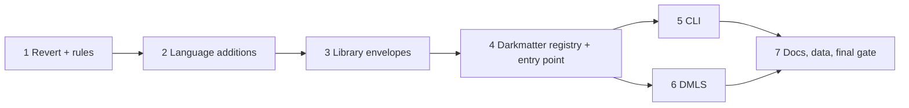

# Plan: Schemas for YAML Documents

Spec: `2026-10-30-yaml-document-schemas/spec.md` (reviewed, every ruling closed).
Areas: `simplified-schema`, `darkmatter` (lib, cli, dmls). Test tier: **L1 only**
(`just test` in the package area, nextest; `just lint`). No L2/L3, no focus-taking
windows, no spike (see rule 28).

## Summary and Definition of Done

### The work

1. **Revert** the earlier kind-table implementation (spec ruling 6), keeping the
   inline root-union parity fix and the three YAML definition files.
2. **Grow the SimplifiedSchema language** (`simplified-schema`): opt-in closed
   roots (`$constraints: { closed: true }`), `non-null`, and declaration
   narrowing options on the `schema` / `type-definition` meta-types
   (`mapping`, `property(name, <type-definition expr>)`, `forms(...)`,
   `declared-required`), with parse, serialize, JSON export, validation,
   layering, subtype and completion agreement.
3. **Own the envelopes in the library**: a `kind: yaml-schema` standalone
   envelope; `simplified-schema/schemas/schema.yaml` and `yaml-schema.yaml`
   compiled in; every direct library load admits its envelope by validating it
   against them, deleting the hand-written structural checks.
4. **Darkmatter registry and selection**: a per-document-context registry of
   `yaml-schema` claims (shipped + the five schema roots), duplicate-claim,
   failed-definition and incomplete-registry policy, source-path identity for
   checkout copies, route selection (claimed `kind` > root `$schema` > none),
   soft validation without baseline or triggers, located semantic checks for
   `schema` / `schema-trigger` / `yaml-schema`, and one library entry point.
5. **Surfaces**: `md schema validate` for `.yaml`/`.yml`; DMLS diagnostics,
   completion and hover in YAML files with workspace-registry refresh.
6. **Docs, skills, and data**: topic pages, skills, `messenger/docs/platforms.yaml`
   without its fences, shipped-schema corpus.

### Definition of done

All spec Acceptance bullets hold, demonstrated by L1 tests named in the phases
below, and:

- `just test` and `just lint` are green in `simplified-schema` and `darkmatter`
  (lib, cli, dmls), and `just test simplified-schema` / `just test darkmatter`
  from the repo root.
- `md schema validate messenger/docs/platforms.yaml` (fences removed) exits `0`
  and validates against `platforms.schema.yaml`; an edit that breaks the roster
  exits `1` with a line/column.
- `md schema validate darkmatter/schemas/schema-trigger.yaml
  simplified-schema/schemas/schema.yaml simplified-schema/schemas/yaml-schema.yaml`
  exits `0` in this checkout (source-path identity, no duplicate claims).
- No hand-written structural envelope check remains (`grep` guard in 3.6).
- Docs describe the shipped behavior; nothing is marked planned.
- The implementation log (`implementation-log.md` in this directory) records
  every departure from the spec (the revert's non-whole-commit shape is one,
  rule 1). The agent's terminal state is "implementation complete, ready for
  review"; it does not move the spec to `_completed`, does not commit unless the
  orchestrator instructs it, and creates nothing under `_unscheduled`.

## Phase 1: Revert the earlier implementation, settle the rules

### Necessary Rules

Each rule is a decision plus the evidence it rests on. Implementers follow them
without re-deciding.

**Revert (spec ruling 6)**

1. **Revert the four commits as working-tree changes, with five carve-outs.**
   Commits (newest first): `8ebb21dd1` (docs), `56f9e1abf` (DMLS), `19184ffe5`
   (CLI + library route), `2133a089f` (shipped kinds). Run
   `git revert --no-commit` on them in that order, then restore these paths to
   `HEAD`:
   - `simplified-schema/lib/src/resolve.rs` and
     `darkmatter/lib/src/markdown/schemas/tests/embedded_sources.rs`: every
     hunk of `19184ffe5` in them is the kept inline-root-union parity fix
     (`an_inline_root_union_prepares_and_a_file_arm_is_refused`; investigation of
     the commit diff).
   - `darkmatter/schemas/schema.yaml`, `darkmatter/schemas/schema-trigger.yaml`,
     `darkmatter/schemas/yaml-schema.yaml`: kept "in this spec's shape" (ruling
     6); they are rewritten in 3.3 / 4.1 and moved in 3.3.
   - `schemas/kind.yaml`: repository data from `2133a089f`, not part of the kind
     table; kept, and 7.4 adds `yaml-schema` to its `kind` enum.
   The orchestrator makes the single revert commit; the implementer leaves the
   result uncommitted (repo rule: never commit unless told). Record in the
   implementation log that the revert is "reverse of four commits minus five
   carve-outs".
2. **Uncommitted edits.** Before reverting, save the docs-escape work: write
   `git diff -- darkmatter/docs/inline/schema-validation.md
   darkmatter/docs/topics/schemas/definition.md
   darkmatter/docs/topics/schemas/dmls-schema-support.md docs/kind-documents.md`
   plus `git diff --no-index /dev/null
   darkmatter/lib/tests/l1/schema_documentation_pages_compose.rs` to
   `darkmatter/features/2026-10-30-yaml-document-schemas/preserved-docs-escape-fix.patch`
   (the spec defers the `{{{ … }}}` fix to a separate docs fix, "Out of scope").
   Then `git checkout HEAD --` every tracked modified path in `git status`
   (16 files: skill `schema.md`, the dmls files, the docs pages, `lib/tests/l1/
   kind_documents.rs`, `lib/tests/l1/main.rs`), delete the untracked
   `schema_documentation_pages_compose.rs`, and only then run the revert.
   Evidence: `git status --short` at planning time; all 16 tracked edits belong to
   the superseded kind-document work (investigation of the diffs).
3. **Files the revert deletes, which later phases must not resurrect by name**:
   `darkmatter/lib/src/markdown/schemas/kind_documents.rs`,
   `darkmatter/lib/tests/l1/kind_documents.rs`,
   `darkmatter/cli/tests/l1/schema_validate_kind_documents.rs`,
   `darkmatter/dmls/src/{diagnostics,overlay}/kind_document.rs`. The replacements
   live in a new module `darkmatter/lib/src/markdown/schemas/yaml_documents/`
   (rule 14) and `dmls/src/overlay/yaml_document.rs`.
4. **`darkmatter/docs/schemas/schema-definition.yaml` returns** (an empty
   placeholder) and `err.yaml` regains its `$schema:` line: that is the pre-feature
   state, and the corpus test re-derives its own expectations in 7.3.

**Language (simplified-schema)**

5. **New `Constraint` variants** in `simplified-schema/lib/src/simplified/types.rs`
   (`Constraint`, `keyword()`): `Closed` (object-level, lives in
   `SchemaShape.constraints`), `NonNull` (property marker), `Mapping`,
   `Forms(Vec<SimplifiedType>)`, `DeclaredRequired`, and
   `Property { name: String, declaration: Box<PropertyDef> }`. Evidence: root and
   root-union arm shapes already carry `SchemaShape.constraints` (types.rs:55),
   and `Deferred`/`Category` show the marker pattern.
6. **Spelling is exactly the spec's table** (ruling 10): `$constraints: { closed:
   true }` (value must be `true`; parsed in `mod.rs::parse_dollar_constraint`
   via `constraints_flag`); `non-null` is a bare hyphenated postfix flag parsed
   in `grammar.rs::parse_one_constraint` beside `not-empty`, valid in either
   constraint list (before or after `[]`), meaning the property itself, as
   `Required` is read; `mapping`, `declared-required` are bare flags;
   `forms(a, b)` takes a nonempty comma list of existing type keywords
   (`SimplifiedType::from_keyword`, types.rs:869); `property(name, expr)` takes an
   identifier then a type expression that must itself be a `type-definition(...)`
   expression (parsed by a dedicated arm that recurses into `parse_type_expr`
   under `MAX_TYPE_NESTING`, grammar.rs:590). Option allow-lists:
   `mapping`, `property` only on `schema`; `forms`, `declared-required` only on
   `type-definition`; `required`, `non-null`, `deferred`, `generated`, `category`
   remain accepted as today. `validate_semantic_constraints`
   (grammar.rs:~1931) and the "requires arguments" arm (~2775) are where the
   allow-lists and arities live. `property` may repeat; `forms` is a set
   (duplicates harmless); `forms()` with no names is a grammar error.
7. **`closed` is accepted at the root, on each root-union arm, and on nested
   inline objects** (a no-op there, since nested objects are already closed,
   convert.rs:1338). Evidence: spec ruling 7 and acceptance ("roots and nested
   objects"). `convert.rs::block_key` / `reject_block_constraints`
   (1357, 1753) currently admit only `min-keys`, `max-keys`, `uncounted-keys`;
   `closed` is added at `ObjectScope::Root` and inline.
8. **Closed root lowering.** `shape_to_object_schema` (convert.rs:321) passes
   `Value::Bool(false)` as additional-properties when the shape carries
   `Closed`, else `true` as today. Pattern-dictionary keys remain admitted
   (`patternProperties` coexists with `additionalProperties:false`). Closure
   is judged after merging imports: lowering runs after named-type imports are
   resolved into the shape, and layering is JSON-level
   (`resolve.rs::merge_layer`, 4028), which unions `properties`. A layer's
   closure is never inherited by another layer: `merge_baseline`'s copy-if-absent
   of `additionalProperties` (resolve.rs:4119) is changed to skip a `false`
   value, and `validate_simple_object_root` (~4165) admits a baseline whose
   `additionalProperties` is `false`. Evidence: closure "belongs to each root"
   (ruling 7).
9. **`non-null` lowering and checks.** Optional atoms are wrapped by
   `wrap_optional_null` (convert.rs:905, `anyOf [null, X]`); an atom marked
   `NonNull` skips the wrap, so JSON Schema rejects `null` while the property
   stays out of `required`. A type whose bare fragment admits null (`unknown`,
   `any`) gets `allOf [{ "not": {"type":"null"} }, fragment]`. Soft conversion
   rejects `null` for a `NonNull` property **before** conversion (a located
   `Type`-kind problem raised in the coercion engine,
   `simplified-schema/lib/src/coercion/shape.rs`, ahead of any conversion).
   Declaration errors (`SchemaError::Grammar`, located on the constraint): any
   top-level union alternative that is `null`, or `unknown`/`any`
   (`PropertyAtom::admits_null`, types.rs:658; for a named reference the check
   runs where the reference is resolved, `resolve.rs`). `required; non-null`
   together are accepted (redundant, harmless). Every `match` over `Constraint`
   without a wildcard gets an arm: `types.rs::keyword`,
   `serialize.rs::write_constraint`, `grammar.rs` (~1944),
   `convert.rs::apply_array_constraints` (~1783),
   `darkmatter/lib/.../call_binding/translate.rs` (~250); markers are stripped
   with `Deferred`/`Category` at convert.rs:1071 and added to
   `resolve.rs::is_union_marker` (3346), `is_array_container_constraint`
   (3355), `recursive.rs::is_use_site_marker` (82) / `is_arm_property_marker`
   (98), `narrowing.rs::has_ordinary_constraints` (107) and the `type_identity`
   marker list (127), `phase.rs:205`.
10. **JSON export and vocabulary.** `closed` lowers to `additionalProperties:
    false`; `non-null` to the absent-or-non-null form of rule 9; `Mapping`,
    `Forms`, `DeclaredRequired`, `Property` extend the payload of the existing
    meta-type keywords (convert.rs:1208-1228 constants, `format.rs:556-610`
    factories, registered in `validate.rs:632-639`) from `true` to an options
    object `{"mapping":true,"forms":["literal","enum"],"declaredRequired":true,
    "property":[{"name":"kind","declaration":{…options…}}]}`; the bare `true`
    payload keeps today's meaning. `schema/export.rs::write_object_constraints`
    (~190) writes `closed`. `docs/topics/custom-vocabulary.md` (tables, lines
    67-99) records the payloads. Evidence: spec ruling 10, "existing
    custom-vocabulary mechanism".
11. **Declaration judging is parse-only and never follows references.**
    `mapping` checks the carrier (YAML mapping). `property(name, T)` over a
    carrier: a mapping carrier is checked directly; a sequence carrier (root
    union) checks every inline mapping arm and skips string (reference) arms;
    a scalar (reference) carrier is skipped. In a checked mapping the property
    must be present (else "must declare `name`") and its declaration value is
    parsed with the existing `parse_property_definition` and judged by `T`.
    `forms(F)`: every top-level union alternative of the parsed declaration is a
    non-array atom whose constructor keyword is in `F`; a named-type reference
    or import alternative passes provisionally (it is verified at preparation by
    rule 12). `declared-required`: the declaration carries `Required` and no
    alternative admits null. Evidence: spec ruling 1 ("parse-only", "must not
    fail merely because it was not inline").
12. **Preparation-time claim extraction.** A new
    `simplified-schema/lib/src/claims.rs` exposes
    `pub fn claimed_values(root: &ResolvedSchema, property: &str) ->
    Result<Vec<String>, ClaimProblem>`. It walks every resolved root arm of the
    lowered export and requires, per arm: an object schema, the property present
    and listed in `required`, no null admission, and `const: <non-empty string>`
    or `enum: [non-empty strings…]` (or `anyOf` of those). It returns the union of
    string choices with repeats removed. `ClaimProblem { arm_index,
    cause: NotObject | Missing | NotRequired | NullAdmitted | NotEnumerable |
    NonStringChoice | EmptyChoice, path }` carries a schema-source path so
    callers locate it on the `kind` line (message: "`kind` must be declared as
    `literal(...)` or `enum(...)`"). Working on the resolved lowering makes
    aliases, imports and file arms uniform, and honors the existing resolver
    cycle diagnostics. Names must not collide with
    `schema_language_ownership_guard.rs`: the function lives in the library only.

**Envelopes and library-owned definitions**

13. **Envelope model.** `StandaloneSchemaEnvelope` (standalone.rs:74) gains
    `YamlSchema`; `admits_top_level_key` admits `kind` for `Tagged` and
    `YamlSchema`. `StandaloneSchemaDocument` gains `kind: StandaloneKind`
    (`Schema | YamlSchema`, `Schema` for Pure). A `yaml-schema` always exports
    (`exports_schema == true`) and carries `types` like `schema` (same metadata
    and named-type namespace, ruling 7). A `yaml-schema` as `$schema` target,
    `Name@file` import source, or embedded `$schema` target is a new
    `SchemaError::SelectedByKind { path, span }` ("`<file>` is a `yaml-schema`;
    it is selected by `kind`, not referenced"). The sites to change together
    (ruling 7 "update ... together"): `resolve.rs::classify_yaml_schema_text`
    (1043-1100), `resolve.rs:1270` (embedded), `named_types_from_text` (2804),
    `resolve/graph.rs:537`, `resolve/inspect.rs:78`, `schema/layer.rs:190,204,553`,
    `schema/export.rs:117,126`, `schema/view.rs:349`; Darkmatter/DMLS:
    `catalog/mod.rs:305`, `dmls/src/overlay/{schema.rs:287-301, suggestions.rs:185,
    registry.rs:99, named_types.rs:286}`, `diagnostics/named_types.rs:420`.
    A `types`-only `kind: schema` stays an import source and an invalid
    `$schema` target; `schema-trigger` stays forbidden as a `$schema` target.
14. **Library admission.** New module `simplified-schema/lib/src/envelope.rs`
    `include_str!`s `../../schemas/schema.yaml` and `../../schemas/yaml-schema.yaml`
    as `pub const ENVELOPE_DEFINITIONS: &[EmbeddedDocument]` (virtual paths
    `simplified-schema/schemas/schema.yaml`, `.../yaml-schema.yaml`, the same
    keying `darkmatter` uses, `embedded.rs`) and prepares them once in a
    `OnceLock` through a private `recognize_standalone_unadmitted` path that
    parses and lowers with no admission (bootstrap order, ruling 2). Public:
    `admit_envelope_text(text, path) -> EnvelopeAdmission` returning the soft-converted document value, its
    position map, and the `ValidationReport`. `recognize_standalone`
    (standalone.rs:343) calls it for every recognized envelope, then reads the
    **converted** copy for `description`, `categories`, `types`, `$schema`
    (ruling 4: "never re-admits the original"). The informal **Pure** envelope
    (no `kind`) is admitted by validating a copy with `kind: schema` inserted
    against `schema.yaml`; recognition (key set decides "is this an envelope",
    standalone.rs ~381) is unchanged. Failures surface as
    `SchemaError::SchemaDocument` with the first problem's span; the full report
    is available through `admit_envelope_text` for Darkmatter. The crate is not
    published (no release entry), so reaching outside `lib/` with `include_str!`
    needs no packaging change; no guard forbids it (`dependency_direction_guard`,
    `context_construction_guard` scan manifests/env access only).
15. **Hand-written checks deleted** (grep guard in 3.6): unknown tagged key
    (standalone.rs ~359-373), "needs `$schema` or `types`" (~376), tagged/pure
    `types` not a mapping (~379, ~391), non-string `description` (~398),
    `categories` not a list (`parse_categories` ~477), the `types` single-shape
    "must be a mapping" (~262), and the explicit `$schema: null` rejection that
    relied on payload parsing stays as an admission outcome. Kept in Rust
    (needs the parsed document): category entry grammar, duplicate and undeclared
    categories (`check_named_types`, 441-475), overload duplicates, suggestion
    lints.
16. **Definition files** (final text; `kind: yaml-schema`, per spec rulings 5, 7, 10):
    - `simplified-schema/schemas/yaml-schema.yaml`: exactly the spec ruling 5
      target (closed root; `description`, `categories`, `types` non-null).
    - `simplified-schema/schemas/schema.yaml`: claims `schema`; root union of two
      closed arms sharing `kind: literal(schema; required)`, `description:
      string(non-null)`, `categories: string`; arm 1
      `$schema: schema(required)` + `types: schema(mapping; non-null)`; arm 2
      `types: schema(mapping; required)` + `$schema: schema(non-null)`.
    - `darkmatter/schemas/schema-trigger.yaml`: keeps its `types`; `$schema` block
      gains `$constraints: { closed: true }`, `match-payload`
      stays `match-expression | match-expression[]`, and `$schema:
      schema(non-null)` (the Rust parser rejects explicit null today,
      `envelope.rs`). `description`/`categories` follow `schema.yaml`. The old
      files move with `git mv` from `darkmatter/schemas/{schema,yaml-schema}.yaml`
      to `simplified-schema/schemas/`.

**Darkmatter registry and selection**

17. **Module and public API** (new, `darkmatter/lib/src/markdown/schemas/yaml_documents/`
    with `registry.rs`, `select.rs`, `semantic.rs`, `load.rs`, `mod.rs`):
    `KindRegistry` (built per context), `KindRegistry::build(context: &FileResolutionContext,
    source: &dyn SchemaRootSource, scope: RegistryScope) -> KindRegistry`
    (never `Result`: failures live inside, rule 19),
    `RegistryScope::{ShippedOnly, WithRoots}`,
    `DarkmatterSchemas::validate_yaml_document(&self, text: &str, path: &Path) ->
    Result<YamlOutcome, SchemaError>` where
    `YamlOutcome::{NoSchema, Validated(YamlValidation)}`,
    `YamlValidation { route: Route::{Kind(String), RootSchema}, report: ValidationReport,
    definition: String /* label */ }`, and a `DarkmatterSchemas::with_kind_registry(Arc<KindRegistry>)`
    builder (DMLS supplies its cached one). `Err` carries load (`SchemaError::YamlDocument…`
    reuse `SchemaDocument` with span) and selection failures (new
    `SchemaError::KindSelection { kind, cause }` with causes `Duplicate { files }`,
    `Reserved { file }`, `Unavailable { file }`, `RootUnreadable { root }`); the CLI
    maps load errors to exit 3 and every `KindSelection`/schema error to 2.
18. **Discovery** reuses `triggers/discovery.rs::enumerate_root_files` and the
    `SchemaRootSource` trait (`root_files`, `root_file_text`; DMLS's own
    implementation supplies unsaved text) over `SchemaRoots::for_document`
    (`roots.rs`), so symlink, case-fold-collision and once-per-root rules are
    inherited. A same-filename file in a later root is **not** shadowed (claims
    decide). Gate: the library never gates; callers pass
    `RegistryScope::WithRoots` only when `context.repository_root().is_some()`
    (CLI, cli validate.rs:278) or the document is inside a workspace (DMLS).
    `schema-triggers` disablement is ignored by the registry. A root that cannot
    be read (`SchemaError::Io` from `SchemaRoots`) is recorded as
    `root_failures` (rule 19), never as an empty root.
19. **Registry state** (ruling 9, decided concretely): `claims: BTreeMap<String,
    Claim>` with `Claim::{Healthy(Arc<Definition>), Duplicate(Vec<PathBuf>),
    Reserved(PathBuf)}` (exact-case keys), plus `incomplete: Vec<Incomplete>`
    (`Incomplete { file, problem }` for a failed definition that revealed no
    claim, malformed YAML in a root, or an unreadable root). Candidate = a
    top-level mapping whose `kind` is the string `yaml-schema`. Build order
    (ruling 2): (1) shipped definitions are prepared by the library's
    unadmitted path; (2) their claims (via rule 12) form the shipped registry;
    (3) filesystem candidates are validated against the shipped `yaml-schema`
    definition, then prepared and their claims extracted with rule 12; a
    candidate whose definition validation or preparation fails reveals a claim
    only if its authored `$schema` has an inline root mapping/union arm whose
    `kind` is an inline `literal`/`enum` (read from the unresolved parse), else
    it is `Incomplete`; (4) only a fully verified candidate becomes `Healthy`.
    Two candidates claiming one kind → `Duplicate` naming both files (sorted
    by path), never search order. A failed definition's own defect is stored on
    the failure and rendered only when that file is validated (so it is
    reported once).
20. **Selection** (`select.rs`), exactly the spec flowchart: root not a mapping →
    `NoSchema`; `kind` is a string (read from the authored value before soft
    conversion; missing, null, non-string claim nothing): `Healthy` → validate
    against that definition only (root `$schema` is then an ordinary property);
    `Duplicate`/`Reserved` → `KindSelection` error; unclaimed and
    `incomplete` is empty → fall through; unclaimed and `incomplete` non-empty →
    `KindSelection::Unavailable` naming the first failed file (by path). No
    claimed kind: root `$schema` key present → resolve it through the
    frontmatter declaration path (`resolve_schema_with_roots`; a present-but-
    invalid value, including `null`, is a schema error, never absence), strip it
    from the validation copy only; absent → `NoSchema`. A document with no
    `kind` and no `$schema` is never affected by registry failures.
21. **Validation** (`validate.rs`): load text with a new `load.rs` wrapper over
    `simplified_schema::numeric::load_admitted_yaml` that (a) strips one leading
    U+FEFF while remembering the byte offset so spans refer to the original
    buffer, (b) rejects a second YAML document and a non-string key as a located
    `SchemaDocument`, and (c) tolerates a leading `---` and trailing `...`.
    Duplicate keys and malformed YAML come from `serde_yaml_ng` already
    (investigation of `load_admitted_yaml`). The validated copy is soft:
    `EffectiveSchema::validate_converted` on the selected schema (the
    `validate_prepared` ladder, mod.rs:884, minus baseline, trigger layers,
    `{{ }}`/`$()` pending scanning, and interpolation), positions from
    `PositionMap::project` over the original text. Whole-value `{{ … }}` and
    `$(…)` strings are therefore ordinary data (a numeric property holding one
    fails). Evidence: `scan_pending_values` applies only in
    `validate_with_options` (mod.rs:1908).
22. **Semantic checks** (`semantic.rs`, run only after definition validation
    passes, on the soft-converted copy): `schema` (categories used in `types`
    declared — moved from `check_named_types`), `schema-trigger` (invalid `$path`
    glob, empty/vacuous `match`, `min-match` bounds — from
    `triggers/grammar.rs`, `lint.rs`), `yaml-schema` (claims extraction via
    rule 12, so `kind: string` fails on the `kind` line). Each returns a
    `ValidationProblem` with `kind: Invalid`, new
    `ValidationProblemCode::KindCheck`, a path and line/column taken from the
    position map; `SchemaError::TriggerMatch` gains `span: Option<Range<usize>>`
    and its constructors in `triggers/grammar.rs` (`path_error` ~244, `located`
    ~305, `parse_min_match` ~423, constraints ~495-572), `triggers/lint.rs` and
    `envelope.rs:115,168` pass the YAML node span via a `PositionMap` lookup
    (the envelope parser stops discarding locations by loading through the
    admitted loader). The same functions serve Markdown trigger discovery
    (warning severity, "skipped trigger" findings, unchanged). Severity in the
    file itself: error. DMLS code constant `dm.schema.kind_check`
    (`dmls/src/diagnostics/codes.rs`), CLI JSON problem `kind: "kind_check"`.
    A user's `yaml-schema` kind has no semantic check; completion and hover come
    from the definition only.
23. **Source-path identity** (ruling 8): the shipped table is keyed by repo-
    relative path (`simplified-schema/schemas/schema.yaml`,
    `simplified-schema/schemas/yaml-schema.yaml`,
    `darkmatter/schemas/schema-trigger.yaml`). A discovered file replaces the
    shipped definition when its path relative to `context.repository_root()`,
    compared as `/`-joined normalized components (Windows-safe, `os` skill), equals
    a table key **and** it claims that table entry's kind; otherwise it is an
    ordinary candidate (a duplicate claim if the kind is shipped). Library
    envelope admission (rule 14) keeps using the compiled copy.
24. **Shipped table in Darkmatter** (`embedded.rs::SHIPPED`): add
    `darkmatter/schemas/schema-trigger.yaml` via `include_str!`; library
    definitions come from `simplified_schema::envelope::ENVELOPE_DEFINITIONS`.
    Shipped schemas reference each other by relative path only (a bare-name
    reference inside is an error). A guard test (4.6) asserts every
    `kind: yaml-schema` file under `darkmatter/schemas/` and
    `simplified-schema/schemas/` is in the table.

**CLI**

25. **`md schema validate` YAML behavior** (`cli/src/commands/schema/validate.rs`,
    `args/target.rs`): a pre-loop **preflight** opens every argument with the
    normal resolver (`crate::io::open_argument`), classifies YAML by the
    **resolved** path's extension (ASCII case-insensitive `.yaml`/`.yml`), and
    — before any assignment write or validation output — exits `64` when any
    assignment is present with any YAML input, or when `--schema` is given with
    any YAML input; unopenable arguments are reported later as today (exit 3).
    The baseline (`load_api`, :186) is not loaded for a YAML-only batch; a mixed
    batch loads it for its Markdown inputs only when `--schema` is absent
    (`--schema` with any YAML is the 64 above). `--disable baseline-schema`
    is accepted. Registry scope = `WithRoots` iff `repository_root().is_some()`.
    Outcomes: `NoSchema` → `FileOutcome::Validated { no_schema: true }` (exit 0,
    same JSON record and pretty text as Markdown no-schema); load failure →
    `FileOutcome::YamlLoadError` (exit 3, JSON `error: "yaml_parse"`); selection
    or schema error → `SchemaError` (exit 2); problems → exit 1; precedence 3, 2, 1
    unchanged (:156-164). Help text for `inputs` says Markdown or YAML.
    Evidence: investigation of validate.rs (:98-129, :186, :156-164), policy.rs.

**DMLS**

26. **Architecture** (`dmls/src/overlay/yaml_document.rs`, replacing the reverted
    kind overlay): routing is by path extension, ASCII case-insensitive, through
    one shared `is_yaml_path` (`overlay/mod.rs:1212`) used by every current copy
    (`overlay/mod.rs:570`, `router.rs:2591`, `overlay/registry.rs:256`,
    `workspace/discover.rs:74`). The `KindRegistry` is prepared on the registry
    worker thread as part of the existing `RegistryNeed::Document` job
    (`registry_jobs.rs`, `RegistryWorker::run_document`), stored per document
    context in `OverlayCache.kind_registries` (key: the context identity already
    used for trigger registries, `overlay/registry.rs::TriggerRegistries`), and
    invalidated by `invalidate_trigger_inputs` / `invalidate_all_trigger_registries`
    (it reads the same five roots, so the existing searched/absent-folder watchers
    in `schema_watch_registration` cover creation, deletion, rename). The document
    overlay (diagnostics/completion/hover) is built on the dispatch thread from the
    installed registry only, with the root-`$schema` route's schema prepared by the
    same dependency-tracking path Markdown uses (`schema_for` +
    `recheck_dependencies`, router.rs:~906) so a changed referenced schema file
    refreshes the open document. DMLS supplies open unsaved definition text through
    its `SchemaRootSource`. The document's own text change recomputes `kind` /
    `$schema` and replaces the whole cached result (no stale diagnostics, completion
    or hover). File-watch globs become case-insensitive:
    `**/*.[yY][aA][mM][lL]`, `**/*.[yY][mM][lL]` (`workspace/watch.rs`).
    `ProblemGrading::KindDocument` (diagnostics/frontmatter.rs) is replaced by a
    `ProblemGrading::YamlDocument` where a missing required key is an error.
    Duplicate parse problems are prevented by publishing the loader's located
    error once and skipping definition validation when loading failed. Completion
    uses the existing recovery tree (`FrontmatterAst::parse_yaml_document`); no
    second validator. Markdown body expression providers are disabled for YAML.
    In a claimed `schema`/`yaml-schema` document, the existing schema-authoring
    providers apply inside `$schema` and `types` values; elsewhere ordinary
    property completion applies. On the `$schema` route, `$schema` is excluded
    from unknown-property diagnostics and offered schema-reference assistance.
    Semantic (`kind_check`) problems are appended from the same library report.
    Byte→position conversion uses `SourceMap::byte_range_to_lsp` (handles
    Unicode and CRLF).

**Scope and process**

27. **Input robustness**: see the matrix section below; it is the default
    outcome plus exceptions.
28. **No spike.** The spec requires no multi-host performance spike and names no
    OS-specific cost; "reuse prepared registries and compiled validators"
    is met structurally by rules 17 and 26 (build once per context, cached by
    sources+context). Wider measurement is not included.
29. **Docs follow code in the same phase** (repo drift rule); the `docs/` tree
    never names this feature. Phase 7 handles skills, README links, the roster
    data file and the corpus.
30. **Test placement**: every `*.rs` under a `tests/l1/` dir must be declared in
    that crate's `main.rs` (`test_layout.rs` rejects an undeclared file). Use the
    test toolkit and nextest through `just test`; no process spawn for in-process
    cases; CLI tests use `CliProcessFixture` (`darkmatter/cli/tests/common`);
    DMLS tests use `LspWorkspace`/`LspFixture` and the `Probe` style of the former
    `kind_document_editor.rs` (recoverable via `git show 56f9e1abf:`), headless.

### Input Robustness Matrix

**Default outcome for every invalid shape:** a located error (file, line,
column from the original buffer), nothing written, no schema applied, and exit
`3` (load) / `2` (schema or selection) / `1` (document validation), per rule 25.
Only exceptions are listed.

*Document shapes — one loader (`yaml_documents/load.rs` over `load_admitted_yaml`;
`.yaml` and `.yml` share it; the library admission and DMLS use the same loader).
Tested once in `darkmatter/lib/tests/l1/yaml_document_loading.rs`, plus wiring
(control + one invalid) in the CLI and DMLS suites:*

| Shape | Outcome |
|---|---|
| control: valid mapping | validates |
| duplicate key | load error (exit 3) |
| non-string mapping key | load error |
| unsupported numeric value | load error |
| malformed YAML | load error, never "unclaimed success" |
| second YAML document | load error |
| leading `---`, trailing `...` | **accepted** (document markers, not frontmatter) |
| BOM, CRLF | **accepted**; spans point into the original buffer |
| scalar / sequence / empty-file root | **`NoSchema`** (valid, unvalidated), not an error |

*Field shapes — selection `kind` (one validator, `select.rs`):* absent / `null` /
number / list / mapping → claims nothing (`NoSchema` or `$schema` route),
**not** an error; empty string `""` → claims nothing (unclaimed string);
`Roster` vs `roster` → different kinds; claimed → definition route.

*Field shapes — fallback root `$schema` (one validator, the frontmatter
declaration resolver):* absent → `NoSchema`; `null` → schema error (exit 2);
number/boolean → schema error; `""` → schema error; inline mapping, root-union
sequence, file reference, JSON Schema file → valid routes. Element shapes of a
union (`[123]`, `["a", 123]`) → schema error, never filtered.

*Field shapes — `non-null` (one validator, the coercion engine):* absent →
valid; `null` → located error before conversion; wrong type → type error;
empty (`""`, `[]`, `{}`) → judged by the type, not treated as absent or null.
Wired fields (control + one invalid each): `description`, `categories`,
`types`, `$schema` of `yaml-schema.yaml`; `$schema` of `schema-trigger.yaml`.

*Field shapes — closed roots:* declared key → valid; undeclared key → located
unknown-key error at the key; pattern-key match → valid; import-declared key →
valid (closure after merge); root-union arm closure is per arm.

*Meta-type declaration options:* `kind` absent / optional / `string` /
`literal(1)` / `literal(true)` / `enum()` empty / `null | literal(a)` → each a
located preparation error; `literal(a; required)`, `enum(a, b; required)`,
`literal(a) | literal(b)` (required) → valid. Root-union with one bad arm → error
naming the arm.

*Code-smell grep before closing each phase:* `serde(default)` on a load-bearing
field; `Option<T>` where absent and null differ (use `Option<Option<T>>` or a
presence deserializer); `filter_map(.. as_str())`, `unwrap_or_default()`, `.ok()`
on a load-bearing parse in the new modules (`envelope.rs`, `claims.rs`,
`yaml_documents/*`, `dmls/overlay/yaml_document.rs`, the CLI route).

### Tasks

**Wave 1** (sequential; it edits the working tree wholesale)

- [x] **1.1 Preserve the docs-escape work**
    - Write `preserved-docs-escape-fix.patch` exactly as in rule 2 (tracked diffs plus the untracked test via `--no-index`).
    - Verify the patch applies with `git apply --check` after the discard in 1.2.
- [x] **1.2 Discard the superseded uncommitted edits**
    - `git checkout HEAD --` the 16 tracked modified paths; delete the untracked compose test file. Never use a wholesale reset.
- [x] **1.3 Revert the four commits**
    - `git revert --no-commit 8ebb21dd1 56f9e1abf 19184ffe5 2133a089f` (in that order), resolve conflicts toward the pre-feature state, then `git checkout HEAD --` the five carve-out paths of rule 1.
    - Risk: the three YAML files were edited after the revert targets (`107abfcd0`, `c4a8de33f`); the carve-out keeps those edits, so their content is intentionally ahead of the reverted Rust.
- [x] **1.4 Restore a compiling baseline**
    - Remove `mod kind_documents;` from `darkmatter/lib/tests/l1/main.rs`, `mod schema_validate_kind_documents;` from `darkmatter/cli/tests/l1/main.rs`, and the kind modules from `dmls`.
    - Run `just test` and `just lint` in `simplified-schema` and `darkmatter`. Expected: green (the corpus and meta-schema tests are back to their pre-feature expectations; `shipped_schema_corpus.rs` must not mention `schema.yaml`/`schema-trigger.yaml` as shipped).
    - Create `implementation-log.md` in this directory recording rule 1's departure and anything restored/skipped.

**Validation checkpoint 1:** `git status` shows no `kind_documents` file anywhere; the preserved patch exists; tests/lint green at the pre-feature baseline.

## Phase 2: SimplifiedSchema language additions

Prerequisite: Phase 1. Rules 5–12. Tests are public-API L1 in
`simplified-schema/lib/tests/l1/` (declare in `main.rs`).

**Wave 1** (sequential — shared files `types.rs`, `grammar.rs`, `serialize.rs`, `mod.rs`)

- [ ] **2.1 Constraint model and grammar**
    - Add the variants of rule 5, their `keyword()` strings, parse arms and allow-lists (rule 6), `$constraints.closed` in `parse_dollar_constraint`, canonical serialization arms (`serialize.rs::write_constraint`), the "requires arguments"/"does not take arguments" arms.
    - Add the declaration errors of rule 9 for `non-null` (null-admitting alternatives) with a located `SchemaError::Grammar`.
    - Add a compile-time arm to every exhaustive `match` listed in rule 9 so the crate and `darkmatter` compile; wildcard-matching sites are updated per rule 9's list.
    - Tests (`declaration_grammar.rs`): parse/serialize round trip of every new spelling including nested `property(kind, type-definition(forms(literal, enum); declared-required))`; every rejection (wrong host type, empty `forms()`, bad `closed: false`, `non-null` with `null | string`, `unknown`).

**Wave 2** (2.2, 2.3, 2.4 run in parallel; they share `convert.rs` but each edits only the functions it names: 2.2 `shape_to_object_schema`/`block_key`/`reject_block_constraints`, 2.3 `atom_to_schema`/`union_property_to_schema`, 2.4 `semantic_type_fragment`; 2.5 and 2.6 follow once all three land)

- [ ] **2.2 Closed roots**
    - Lowering (rule 8): `shape_to_object_schema`, `block_key`/`reject_block_constraints` in `convert.rs`; `merge_baseline` copy rule and `validate_simple_object_root` in `resolve.rs`; `write_object_constraints` in `schema/export.rs`; root-union arms each carry their own closure.
    - Tests (`closed_roots.rs`): control (open root accepts extras); closed root rejects undeclared key at the key; pattern key admitted; import-declared key admitted (closure after merge); closed arm of a root union; closure survives canonical serialization, JSON export (`additionalProperties:false`), and import/export round trip; a closed baseline layer does not close an open receiver; nested `closed: true` is a no-op.
- [ ] **2.3 `non-null`**
    - Lowering, soft-conversion pre-check (rule 9) in `convert.rs` (`atom_to_schema`, `union_property_to_schema`) and `coercion/shape.rs`; markers added to the resolver/narrowing lists of rule 9; `PropertyAtom::admits_null`-based declaration check for references in `resolve.rs`.
    - Tests (`non_null_properties.rs`): the field-shape rows of the matrix (absent valid; `null` rejected under `validate_soft` before conversion and under `validate_strict`; wrong type; empty values); array form `string`; `null | string(non-null)` declaration error; subtype/narrowing treats `non-null` as a marker (not an ordinary constraint).
- [ ] **2.4 Declaration narrowing**
    - Implement rules 10–12: options-object payloads in `format.rs` keyword factories and `validate.rs` registration; parse-only declaration judging per rule 11 (reuse `parse_property_definition` / `parse_schema_declaration`); `claims.rs` per rule 12 and its re-export in `lib.rs`; `json_shape.rs` keeps treating these keywords as `Shape::Any`.
    - Tests (`declaration_narrowing.rs`, `claimed_values.rs`): every row of the "meta-type declaration options" matrix through `validate_*` on a schema using `schema(...)`/`type-definition(...)`; `mapping` rejects a list and a reference scalar for `types`, accepts a mapping, and — independently — a data-value schema still accepts lists; root unions with one bad arm; reference arms are skipped by the meta-check and verified by `claimed_values` (alias, import, local file arm, cycle diagnostic); repeated claims within one definition are harmless.
- [ ] **2.5 Host consumers**
    - `darkmatter/lib/src/markdown/schemas/about.rs`: add `non-null` to `SCHEMA_CONSTRAINT_DESCRIPTORS`, the new `type_options` for `schema`/`type-definition`, and update `constraint_set_matches_descriptor_set` (~1190); `closed` offered as a `$constraints` key in DMLS key completion; `translate.rs` (~1080) and `triggers/matcher.rs` (~383) rebuild the new payload; `lifecycle/schema_projection.rs` (~790) and `compose/context/catalog.rs` (~320) compile and ignore the markers.
    - Tests: update/extend `about.rs` parity test; one `darkmatter` L1 case that a document validates a `non-null` property through `md` frontmatter validation.
- [ ] **2.6 Language docs**
    - `simplified-schema/docs/topics/language/{types,objects-and-named-types,schema-types,schema-documents}.md`, `validation.md`, `conversion.md`, `custom-vocabulary.md` (payload tables): each new constraint with a complete, parseable example; keep the audience a developer new to the repo; a Mermaid diagram for "when is `null` rejected".

**Validation checkpoint 2:** `just test` + `just lint` in `simplified-schema` and `darkmatter` green; the draft `darkmatter/schemas/yaml-schema.yaml` (still at the old path) now **parses** as a standalone schema payload (test in `declaration_grammar.rs` with `include_str!`).

## Phase 3: Library envelopes and definitions

Prerequisite: Phase 2. Rules 13–16.

**Wave 1** (sequential — one module graph)

- [ ] **3.1 `yaml-schema` envelope**
    - Rule 13: new envelope variant and `kind` model, `SchemaError::SelectedByKind`, every classification site listed. Reached only through `kind`.
    - Tests (`yaml_schema_envelope.rs`): a `kind: yaml-schema` file parses as a standalone document (`exports_schema == true`, `types` namespace usable); as `$schema` target, as `Name@file` import source, and as an embedded `$schema` target → `SelectedByKind` naming the file with a span; `types`-only `kind: schema` remains an import source and is an invalid `$schema` target; `kind: roster` data file and `kind: schema-trigger` stay non-targets; `inspect.rs` target inspection reports the new classification.
- [ ] **3.2 Move and rewrite the definitions**
    - `git mv` the two files (rule 16) and write the final text of all three; keep `description` bodies.

**Wave 2** (parallel after 3.2)

- [ ] **3.3 Admission module**
    - Implement `envelope.rs` (rule 14): `OnceLock` bootstrap of the two definitions through the unadmitted path, `admit_envelope_text`, wiring into `recognize_standalone` and the `Pure` path, the converted-copy read. Conversion never stringifies mapping/sequence carriers of `schema`/`type-definition`: add a carrier guard in the coercion engine (`coercion/shape.rs`) that passes those values through untouched, with a test that a `types:` mapping and a `$schema:` sequence survive soft conversion unchanged.
    - Delete the hand-written checks of rule 15.
- [ ] **3.4 Existing-test reconciliation**
    - Update `schema_target_classification.rs`, `schema_files.rs`, `schema_object.rs`, `located_schema_errors.rs` fixtures whose expected messages came from the deleted checks; messages now come from definition problems, still located.
- [ ] **3.5 Bootstrap + admission tests** (`envelope_admission.rs`)
    - Control: unedited `schema.yaml`, `yaml-schema.yaml`, `darkmatter/schemas/schema-trigger.yaml` each admitted (the yaml-schema validating itself); one edit per row: unknown top-level key; `description: null`; `categories: null`; `types: null`; `types: [a, b]`; `$schema: null`; neither `$schema` nor `types`; `types`-only with `$schema` absent; non-string description converts softly (`123` → accepted, text `"123"`), mapping carrier unchanged; Pure informal envelope covers the same rows; direct library loads (factories, `Name@file`) reject a malformed envelope with a located error and no structural check remains in Rust.
    - Add the grep guard to `shipped_corpus.rs`: no `"must be a mapping"`/`admits_top_level_key`-based rejection of those rows in `standalone.rs` outside admission (assert via behavior, not source text where possible; one source-text assertion that the deleted function names are gone).
- [ ] **3.6 Corpus test**
    - `shipped_corpus.rs`: add a test with its own `include_str!` of both library definitions asserting each passes the compiled definition set.
- [ ] **3.7 Docs**
    - `simplified-schema/docs/topics/language/schema-documents.md` (envelopes: `schema`, `yaml-schema`, informal; selected-by-kind rule; who owns the definitions), `selecting-schema-files.md`, `diagnostics.md`.

**Validation checkpoint 3:** `just test`/`just lint` in `simplified-schema` and `darkmatter` green. `darkmatter` still compiles with the shipped files moved (its `embedded.rs` SHIPPED entries are added in Phase 4).

## Phase 4: Darkmatter registry, selection, entry point

Prerequisite: Phase 3. Rules 17–24.

**Wave 1**

- [ ] **4.1 Shipped table and `schema-trigger.yaml`**
    - Rule 24: `include_str!` entry in `embedded.rs::SHIPPED`; re-export library definitions; rule 16 final text for `schema-trigger.yaml`.
    - Tests: `yaml_kind_registry.rs` control: the shipped registry holds claims `schema`, `yaml-schema`, `schema-trigger`; each shipped file validates against the shipped registry, `yaml-schema.yaml` against itself (ruling 2 L1 test).

**Wave 2** (parallel; different files)

- [ ] **4.2 Load + selection + entry point**
    - Rules 20–21: `load.rs`, `select.rs`, `validate.rs`, `DarkmatterSchemas::validate_yaml_document`, `with_kind_registry`; `SchemaError::KindSelection`.
    - Tests (`yaml_document_loading.rs`, `yaml_document_selection.rs`): the full document-shape and field-shape matrices above; route precedence (claimed kind wins, root `$schema` is an ordinary property; `darkmatter.yaml` never validated against its exported globals; a trigger never against its payload); fallback `$schema` stripped from the copy only; no baseline/trigger layering (a `title`/`content_policy` property has only the selected schema's meaning); soft conversion (`"8080"` passes, `"2.5"` for `number(integer)` fails, nothing written back); `{{ 1 }}`/`$(x)` in numeric property fails, in string property passes; spans against original text including BOM/CRLF/Unicode; unrecognized kind with a complete registry → `NoSchema`.
- [ ] **4.3 Registry build, claims, failures**
    - Rules 18–19, 23: discovery over `SchemaRootSource`, duplicate/reserved/incomplete states, source-path identity, root failures.
    - Tests (`yaml_kind_registry.rs`): claim in each of the five roots; two claims of one kind → error naming both files, independent of root order; a repo file claiming a shipped kind → duplicate; a modified copy at the shipped relative path **replaces** it and changes validation with no Rust change (acceptance); same filename, different definition is still a candidate; exact-case kinds; ruling-9 matrix (fails to import → reserved, exit-2 error naming the file; malformed YAML reveals nothing → `Unavailable` for unclaimed kinds, claimed kinds and no-kind documents unaffected; unreadable root (permissions on unix, `#[cfg(unix)]`) → error not empty registry); symlink/case-fold rules inherited; `~/schemas` via the test context's home; `ShippedOnly` scope; a `yaml-schema` whose `kind: string` fails on the `kind` line; the root-union cases of the constructor-narrowing acceptance bullet.
- [ ] **4.4 Semantic checks with spans**
    - Rule 22: `semantic.rs`, `TriggerMatch.span`, `ValidationProblemCode::KindCheck`; Markdown trigger discovery keeps warnings with the now-located message.
    - Tests (`kind_semantic_checks.rs`): invalid `$path` glob located on the glob; empty/vacuous `match`; `min-match` count bounds; undeclared category; definition failure stops semantic checks; semantic problems are errors in-file and warnings in `trigger_discovery_recovery.rs`-style Markdown discovery (extend that test); one report object serves both consumers.
- [ ] **4.5 Guard + corpus**
    - Guard (rule 24) in `shipped_schema_corpus.rs`; extend the corpus test so every shipped and repository schema, trigger, and `yaml-schema` document passes its definition via the registry using source-path identity, producing no manufactured duplicates.
    - Reconcile `meta_schema_phase*.rs`, `trigger_spelling_guard.rs`, `schema_language_ownership_guard.rs` for the new modules.

**Wave 3**

- [ ] **4.6 Library docs**
    - `darkmatter/docs/topics/schemas/definition.md` (selection flow with the spec's Mermaid chart), `authoring-schemas.md` (writing a `yaml-schema`, from the shipped files), `schema-discovery.md`, `schema-triggers.md` (semantic severity), `docs/errors/...` where selection errors are described.

**Validation checkpoint 4:** `just test` + `just lint` for `darkmatter` green; an ad-hoc library test validates `messenger/docs/platforms.yaml` text (fences removed in a temp copy) through `validate_yaml_document`.

## Phase 5: `md schema validate` for YAML

Prerequisite: Phase 4. Rule 25. Parallel with Phase 6.

**Wave 1** (sequential, one file)

- [ ] **5.1 Preflight and routing**
    - Implement rule 25 in `validate.rs` (+ `args/target.rs` help/doc text): preflight, `--schema` usage error, baseline skipped for YAML-only batches, registry scope, outcome mapping, JSON records unchanged.

**Wave 2**

- [ ] **5.2 CLI tests** (`cli/tests/l1/schema_validate_yaml.rs`, declare in `main.rs`)
    - Wiring only (matrix says spawn per loader): per route control + one invalid, asserting rendered line:column and no side effects; exit codes `0` passing/unvalidated, `1` kind semantic check failure, `2` bad `$schema` reference / duplicate claim / reserved kind, `3` malformed YAML; `.YAML`/`.Yml` extensions; `@`-style reference resolving to YAML; `key=value` + YAML → 64 with the earlier Markdown file **not** modified (preflight before writes); `--schema` + YAML → 64; `--disable baseline-schema` accepted; mixed batch precedence 3 > 2 > 1; JSON record for `NoSchema`; baseline env settings ignored for YAML-only (set a broken `BASELINE_SCHEMA`, still exit 0).
- [ ] **5.3 CLI docs**
    - `darkmatter/docs/cli/{index,policy,report-json}.md`, `darkmatter/cli/README.md` (overview + link only), `.claude/skills/darkmatter/cli.md`.

**Validation checkpoint 5:** `just test`/`just lint` in `darkmatter` green (cli crate); manual run of the three definition-file validation command from the Definition of Done exits 0.

## Phase 6: DMLS

Prerequisite: Phase 4. Rule 26. Parallel with Phase 5.

**Wave 1** (sequential)

- [ ] **6.1 Routing + registry worker integration**
    - Shared case-insensitive `is_yaml_path`; case-insensitive watch globs; registry preparation inside `RegistryWorker::run_document`; `OverlayCache.kind_registries`; invalidation wiring; scope isolation (key by context identity; never reuse across workspace/package scope).
- [ ] **6.2 YAML document overlay**
    - `overlay/yaml_document.rs`; remove the reverted kind overlay references; `DocumentOverlay` carries the YAML analysis; `lexical` claim fallback not needed (a parse failure publishes the loader error once).

**Wave 2** (parallel, different files)

- [ ] **6.3 Diagnostics**
    - `diagnostics/frontmatter.rs` + `diagnostics/yaml_document.rs`: `ProblemGrading::YamlDocument`, code `dm.schema.kind_check`, related-information for failures in referenced definitions with the reference marked as failure site, unknown-property exclusion of `$schema` on the fallback route.
- [ ] **6.4 Completion and hover**
    - `providers/frontmatter.rs`: definition-driven completion/hover for both routes; schema-authoring providers inside `$schema`/`types` of claimed `schema`/`yaml-schema`; schema-reference assistance on the fallback `$schema`; Markdown body providers off for YAML; code action `add-missing-required-keys` retained for root keys.
- [ ] **6.5 Tests**
    - `yaml_document_editor.rs` (in-process `Probe`): both routes, diagnostics ranged on key/value, completion, hover, Unicode and CRLF ranges, route change (edit `kind`/`$schema`) clears stale results, schema authoring inside exports.
    - `yaml_document_session.rs` (`LspFixture`, protocol requests, headless): unsaved definition edit (`didChange`) refreshes an open document; dependency creation/deletion via `didChangeWatchedFiles` types 1/3; a created `schemas/roster.yaml` starts claiming; deleting it clears; scope isolation between two workspaces/packages; registry preparation runs off the dispatch thread (compare `server_thread_id`, as `registry_preparation.rs` does); a stdio smoke test extending `standalone_stdio.rs`.
- [ ] **6.6 DMLS docs**
    - `darkmatter/docs/topics/schemas/dmls-schema-support.md`, `docs/lsp/{indexing,configuration,features,frontmatter}.md`, `darkmatter/dmls/docs/{diagnostics,file-references}.md`, `.claude/skills/darkmatter/dmls.md`.

**Validation checkpoint 6:** `just test`/`just lint` in `darkmatter` (dmls crate) green.

## Phase 7: Data, skills, final gate

Prerequisite: Phases 5 and 6.

**Wave 1** (parallel)

- [ ] **7.1 `messenger/docs/platforms.yaml`**
    - Remove the `---` fences and the obsolete fence-workaround comment paragraph; keep the `$schema: ./platforms.schema.yaml` line (no `kind`, so it is the contract). Verify `md schema validate messenger/docs/platforms.yaml` exits 0 and that a deliberate roster break exits 1 (restore after).
    - Any consumer of the file reading frontmatter fences (grep `platforms.yaml` in `messenger/`) is updated to read the whole file; run `just test messenger` and `just lint messenger`.
- [ ] **7.2 Skills**
    - `.claude/skills/darkmatter/{SKILL,schema,cli,dmls,testing}.md` and `.claude/skills/simplified-schema/SKILL.md`: envelope recognition, ownership boundary (library owns `schema`/`yaml-schema` definitions; Darkmatter owns `schema-trigger` and the registry), registry lifecycle, failure policy.
- [ ] **7.3 Corpus + repo documents**
    - Run the corpus over every repository YAML document that carries a recognized `kind`; fix definitions or documents (not the engine) so all pass; reconcile `darkmatter/docs/schemas/err.yaml`/`schema-definition.yaml` pre-feature state.
- [ ] **7.4 Kind catalog docs**
    - `docs/kind-documents.md`: `yaml-schema` as the way to formalize a YAML kind, the roots note (prose, taken from `preserved-docs-escape-fix.patch`'s `docs/kind-documents.md` hunk), and `schemas/kind.yaml` gains `yaml-schema` in its `kind` enum; keep `::doc-list` usage valid. Remaining READMEs get an overview link only.

**Wave 2** (sequential, final)

- [ ] **7.5 Full gate**
    - From the repo root: `just test simplified-schema`, `just test darkmatter`, `just test messenger`, `just lint` for each area; `just ci-local --plan` reviewed for scope (no cell added by this work beyond the touched packages).
    - Re-read this plan against the diff: every spec Acceptance bullet maps to a named test; grep the new modules for the code smells in the matrix section; update comments/docs for every changed behavior; confirm no doc under `docs/` names this feature.
    - Complete `implementation-log.md` and mark the spec `implemented` fields untouched (author moves the spec). Report "implementation complete, ready for review" listing the items a human will want to judge: the registry's `Unavailable` wording, the `schema.yaml` two-arm union error messages, `dm.schema.kind_check` code naming, and the `required; non-null` redundancy decision.

**Validation checkpoint 7 (final):** every item of the Definition of Done verified and recorded in the implementation log.