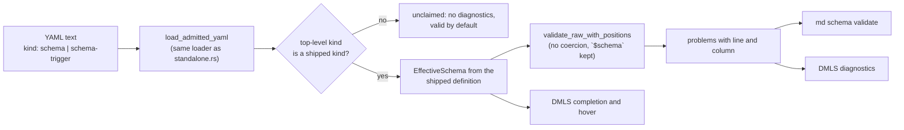

# Plan: Schema Definitions for YAML Documents

## Summary and Definition of Done

### What this feature does

Darkmatter has two formal YAML document kinds, `kind: schema` and
`kind: schema-trigger`, whose rules live only in hand-written Rust
(`simplified-schema/lib/src/simplified/standalone.rs`
`recognize_standalone`, and
`darkmatter/lib/src/markdown/schemas/triggers/envelope.rs`
`parse_trigger_envelope`). The YAML definitions meant to describe them never
shipped, because nothing could apply a schema to a whole YAML document.

This feature adds that mechanism and the two definitions:

1. `darkmatter/schemas/schema.yaml` and `darkmatter/schemas/schema-trigger.yaml`
   are authored, compiled into the binary through the `SHIPPED` table, and
   are themselves `kind: schema` documents that validate against the first.
2. A new library module, `kind_documents`, selects a definition by the YAML
   document's top-level `kind` and validates the whole mapping through the
   same `EffectiveSchema` validator Markdown frontmatter uses, in raw mode
   (no coercion) and with `$schema` kept as data.
3. `md schema validate file.yaml` and DMLS (diagnostics, completion, hover on
   the YAML buffer) call that mechanism.
4. The Rust envelope rules stay for what YAML cannot express; tests tie the
   remaining Rust to the YAML (key sets, `kind` literals, and an
   agreement matrix with the Rust parsers as the oracle).
5. The dangling or empty documentation embeds are fixed.



### Definition of Done

- `darkmatter/schemas/schema.yaml` and `darkmatter/schemas/schema-trigger.yaml`
  exist, are in `embedded::SHIPPED`, and describe the key sets, `kind`
  literals, and required sets of the Rust envelopes (a unit test compares them).
- `DarkmatterSchemas::validate_kind_document` returns a located problem for a
  `kind: schema` or `kind: schema-trigger` YAML document that violates its
  definition, and `None` for any other `kind`.
- An L1 test builds a registry from a modified copy of `schema.yaml`
  (`description` marked required) and shows validation changes with no Rust
  change.
- Both shipped definitions validate against the registry (self-validation); the
  corpus test shows every repository schema and trigger document the Rust
  parsers accept also passes its kind definition.
- `md schema validate` accepts `.yaml`/`.yml` arguments, prints the located
  problems, and exits with the documented codes; L1 CLI tests spawn it once per
  outcome.
- DMLS publishes the kind diagnostics for an open `kind: schema` or
  `kind: schema-trigger` buffer, completes the top-level keys and the `kind`
  value, and hovers a top-level key with its definition's description; L1 DMLS
  tests drive the overlay and providers in-process.
- The `SHIPPED` completeness test exists.
- `darkmatter/docs/schemas/schema-definition.yaml` is deleted;
  `authoring-schemas.md` transcludes the two shipped definitions;
  `docs/kind-documents.md` embeds `schemas/kind.yaml`, which exists.
- Docs (`definition.md`, `authoring-schemas.md`, `dmls-schema-support.md`,
  `inline/schema-validation.md`, `docs/kind-documents.md`), the `darkmatter`
  skill, and code comments that this change drifts are updated in the same
  change.
- `just test` and `just lint` pass in `darkmatter/`; the new L1 tests pass.
  Nothing in `claudine/` changes (no public API is removed or altered).

### Conventions used by every phase

- US English in symbols and prose. Never run `cargo fmt`. Never commit.
- Tests are L1 only (in-process, no terminal or browser windows), registered
  per each crate's test-layout guard (`darkmatter/lib/tests/l1/main.rs`
  declares modules; `darkmatter/dmls/tests/l1/main.rs` declares modules;
  `test_layout.rs` in each crate rejects an unregistered file). Use the
  `rust-testing` skill's fixture rules and `CliProcessFixture` for spawning
  `md`.
- Run the package-area recipes from `darkmatter/`: `just test`, `just lint`.
- An implementation that changes a symbol's behavior revises that symbol's
  `///`/`//!` docs and inline comments in the same change; when a comment and
  the code disagree, the code is right and the comment is fixed.
- Do not create anything under `_unscheduled`, do not move this feature to
  `_completed`, and do not run `just complete`. The terminal state is
  "implementation complete, ready for review". Record progress and departures
  in this feature's `implementation-log.md`.
- Docs under `darkmatter/docs/` never link to or name this feature.

## Phase 1: Rules, Definitions, and Shipping

### Necessary Rules

Each rule is a decision plus its evidence. None is a question.

**Rule 1: the mechanism lives in `darkmatter`, in one new module.**
Create `darkmatter/lib/src/markdown/schemas/kind_documents.rs` and declare it
`pub mod kind_documents;` in `schemas/mod.rs` next to `pub mod triggers;`.
The module needs `EffectiveSchema` (private fields, constructible only inside
`schemas`), `embedded::SHIPPED`, and `DarkmatterSchemas`'s validator cache;
the `darkmatter` skill lists exactly those as "what stays in Darkmatter".
`simplified-schema` gains no code: its standalone parser is the Rust half of
the contract and does not change behavior.

**Rule 2: the shipped kind table is two entries.**
`kind_documents.rs` declares
`SHIPPED_KINDS: &[(&str, &str)] = &[("schema", "darkmatter/schemas/schema.yaml"), ("schema-trigger", "darkmatter/schemas/schema-trigger.yaml")]`.
A unit test asserts every path is in `embedded::SHIPPED`. `ENVELOPE_KIND`
(`"schema-trigger"`, `triggers/envelope.rs`) is the trigger entry's source of
truth; the test asserts the table's trigger key equals it.

**Rule 3: a document selects its definition by exact top-level `kind` string.**
Only a mapping whose `kind` key is a YAML string equal to a table key is
claimed. Absent `kind`, `kind:` (null), a non-string `kind`, an unknown string,
and the retired spelling `trigger-schema` are all unclaimed:
`validate_kind_document` returns `Ok(None)`. Evidence: spec design question 1
("an unknown `kind` is not an error"); `parse_trigger_envelope` already
reports a null/non-string trigger `kind` and `trigger-schema` itself
(`SchemaError::TriggerMatch`/`TriggerRenamed`), so this mechanism does not
duplicate those errors.

**Rule 4: hosts cannot register further kinds; the registry is shipped-only.**
Evidence: the spec's leaning is "Only the shipped kinds apply"; no consumer
(Claudine) has asked, and the repository has no install base to protect if a
registration API is added later. `KindDocuments::from_documents` (Rule 9) is
the one non-shipped constructor and exists for tests.

**Rule 5: the repository `kind` catalog stays documentation, at `schemas/kind.yaml`.**
It is not part of this mechanism (`kind` has dozens of values in the repo and
no definition applies to Markdown by `kind`). `docs/kind-documents.md` embeds
`::code claudine/features/2026-10-28-schema-enhancements/drafts/kind-document.yaml`
(a path that does not exist: the drafts live under
`claudine/features/_completed/…`) and says the schema is "at schemas/kind.yaml",
a file that does not exist (`git ls-files schemas` lists only
`feature-review.yaml` and `suggestion-review.yaml`; the root `CLAUDE.md` also
points at `schemas/kind.yaml`). Create `schemas/kind.yaml` as a `kind: schema`
document with the draft's `description` and its `$schema.kind` enum, with
`schema-target` replaced by `schema-trigger`:
`enum(schema, schema-trigger, sequence, task, index, canonical-documentation; required)`.
The drafts directory is left untouched and nothing references it afterward.

**Rule 6: `name` is dropped from both kinds.**
Evidence: no `kind: schema` document in `darkmatter/schemas`,
`claudine/schemas`, or `content-policy/schemas` has a `name:` key (`git grep -n
"^name:"` finds none); `recognize_standalone` rejects it for a tagged document
("found unsupported keys"); `KNOWN_KEYS` in `envelope.rs` is
`["kind", "match", "$schema"]` and the `schema-triggers.md` page shows `name`
as an unknown key. The drafts' `name` is stale.

**Rule 7: the definitions' content is fixed as follows.**
Keys and required sets are exactly the Rust envelopes':

- `kind: schema` admits `kind`, `$schema`, `types`, `description`, `categories`
  (`StandaloneSchemaEnvelope::admits_top_level_key`); `kind` is required and
  equals `schema`; at least one of `$schema` or `types` is required.
- `kind: schema-trigger` admits `kind`, `match`, `$schema`; `kind` and `match`
  are required; `$schema` is optional (a trigger without one is matcher-only,
  `TriggerEnvelope::payload: Option`). There is no `types` key (the draft's
  `types` is not in `KNOWN_KEYS`; this feature does not change the envelope).
- The trigger `match` structure follows the real grammar in
  `triggers/grammar.rs` (`COMBINATOR_KEYS = all, group, none, min-match`;
  `PATH_KEY = $path`; a property condition is `name: <type expression>`), not
  the drafts' obsolete predicate catalog. A prototype of this structure was run
  through the repository's `md` binary: `group: 5` and `min-match`/`$path`
  shapes validate as expected, a missing `match` reports "match is a required
  property", and `kind "schema-trigger" was expected` locates a wrong `kind`.

Final text of `darkmatter/schemas/schema.yaml`:

```yaml
kind: schema
description: |-
    The definition of a `kind: schema` document: a YAML file that exports a
    document schema (`$schema`), reusable named types (`types`), or both.
$schema:
    - kind: literal(schema; required) -> the document kind that claims this definition
      description: string -> what the schema is for
      categories: string[] -> the category names `category(...)` constraints in `types` may use, each `Name` or `Name -> description`
      $schema: schema(required) -> the exported document schema: an inline mapping or union, or a reference to a schema file
      types: schema -> reusable named types; these names are not document properties
    - kind: literal(schema; required) -> the document kind that claims this definition
      description: string -> what the schema is for
      categories: string[] -> the category names `category(...)` constraints in `types` may use, each `Name` or `Name -> description`
      $schema: schema -> the exported document schema: an inline mapping or union, or a reference to a schema file
      types: schema(required) -> reusable named types; these names are not document properties
```

Final text of `darkmatter/schemas/schema-trigger.yaml`:

```yaml
kind: schema
description: |-
    The definition of a `kind: schema-trigger` document: a YAML file whose
    `match` conditions select the Markdown documents its `$schema` applies to.
types:
    match-expression:
        all: match-expression[] -> every entry must match
        group: match-expression[] -> at least one entry must match
        none: match-expression[] -> no entry may match
        min-match:
            count: number(required) -> how many of `of` must match
            of: match-expression[](required) -> the candidate conditions
        $path: string | string[] -> glob references for the document path; `!` excludes
        <string>: type-definition -> a frontmatter property condition, written as a type expression
    match-payload: match-expression | match-expression[]
$schema:
    kind: literal(schema-trigger; required) -> the document kind that claims this definition
    match: match-payload(required) -> the conditions that select a document: one expression, or a list that must all hold
    $schema: schema -> the schema applied to matching documents; omit it for a matcher-only trigger
```

**Rule 8: validation is raw, over the whole mapping, with `$schema` kept.**
The YAML text is loaded with `simplified_schema::numeric::load_admitted_yaml`
(the loader `recognize_standalone` uses, so duplicate keys, a second YAML
document, and trailing invalid content are rejected identically), converted to
`serde_json::Value`, and validated with
`EffectiveSchema::validate_raw_with_positions`. Raw, because the coercing path
hides real errors: `description: 5` coerces to a string and passes the
frontmatter validator while `recognize_standalone` rejects it (verified with
the repository's `md`). `$schema` is kept because `frontmatter_as_json`
(`schemas/mod.rs`) strips it for Markdown, where it is a reference; in a schema
document it is the exported schema, which `schema(required)` must judge.
Neither baseline (the Markdown `fm` schema) nor trigger discovery applies to a
YAML kind document.

**Rule 9: the public API.**
All in `darkmatter::markdown::schemas::kind_documents` and on
`DarkmatterSchemas`:

```rust
pub struct KindDocuments { /* resolved definitions keyed by kind */ }
impl KindDocuments {
    /// The shipped registry, prepared once per process; panics only if a compiled-in definition fails to prepare (a library bug, as `shipped_baseline` does).
    pub fn shipped() -> &'static KindDocuments;
    /// Tests: a registry from `(kind, path)` entries resolved in `documents` (the same resolver `shipped` uses).
    pub fn from_documents(kinds: &[(&str, &str)], documents: &[EmbeddedDocument<'_>]) -> Result<Self, SchemaError>;
    /// The kind a loaded document claims, or `None` (Rule 3).
    pub fn claimed_kind<'a>(&self, document: &'a serde_json::Value) -> Option<&'a str>;
}
pub struct KindValidation { pub kind: String, pub report: ValidationReport }
impl DarkmatterSchemas {
    pub fn with_kind_documents(self, kinds: KindDocuments) -> Self;
    pub fn effective_for_kind(&self, kind: &str) -> Result<Option<EffectiveSchema>, SchemaError>;
    pub fn validate_kind_document(&self, text: &str, path: &Path) -> Result<Option<KindValidation>, SchemaError>;
}
```

`validate_kind_document` returns `Err(SchemaError::SchemaDocument { path, message: "not valid YAML: …", source: None, span: None })`
for a loader failure (the wording `recognize_standalone` uses), `Ok(None)` for
an unclaimed or non-mapping document, and `Ok(Some(_))` otherwise. Problems
carry line and column: build the `PositionMap` the way
`schemas/mod.rs::positions_for` does for a programmatic document
(`PositionMap::project(text, 0..text.len(), 1, &MappingOrders::collect(&yaml))`,
falling back to `PositionMap::top_level(text, 1)`). `DarkmatterSchemas::new`
keeps its default of the shipped registry (a private `Option<KindDocuments>`
field, `None` meaning shipped). `effective_for_kind` builds the
`EffectiveSchema` from the kind's resolved schema with a new
`pub(super)` constructor in `schemas/mod.rs` that mirrors the baseline-only
arm of `effective_for_with_override` (`CompiledValidators::build(&json_schema,
&self.cache, None, &self.file_resolution_context)`, no triggers, no
document `$schema`). The context is the caller's, never recaptured. The
registry stores `ResolvedSchema` values from
`resolve::prepare_embedded_schema_in(path, documents, "")`.

**Rule 10: diagnostic ranging follows the existing R-5 convention.**
(`diagnostics/frontmatter.rs` module docs): a missing-key or union-arm problem
ranges the parent mapping (the root mapping for a top-level one); an unknown or
wrong-kind key ranges the key; a type, enum, or constraint problem ranges the
value. The library supplies line and column through the `PositionMap`; DMLS
maps problem paths onto its own `FrontmatterAst` entries.

**Rule 11: no Rust envelope rule is deleted; the residual set is recorded and tied.**
Every remaining Rust check either extracts the payload the parser returns or
is inexpressible in the grammar. Evidence, each verified with `md` or the code:
a root schema is always open ("Root schemas always allow extra keys",
`simplified-schema/docs/topics/language/index.md`), so unknown top-level keys
stay a Rust rule; an optional property accepts `null`, so `description:` /
`categories:` / `types:` / `$schema:` set to null stay a Rust rule
(`description must be a string`); the `schema` meta-type accepts a sequence, so
"`types` must be a mapping" stays; category entry grammar, duplicate and
undeclared categories, overload duplicates, and suggestion lints need the
parsed document; and for triggers, match-safe type constraints, the
empty-`match` and vacuity lint, `$path` glob validity and forbidden prefixes,
`min-match` count bounds, null/non-string `kind`, and the retired `any`
combinator and `trigger-schema` kind stay. The single sources already exist
(`admits_top_level_key`, `KNOWN_KEYS`, `ENVELOPE_KIND`), so there is no
duplicated key list to delete. Drift protection is the key-set tie test and the
agreement matrix (Rule 12), plus a `//!` list of the residual rules at the top of
`recognize_standalone`'s module docs and of `envelope.rs`, each pointing at the
shipped YAML definition as the authority for structure.

**Rule 12: the agreement matrix uses the Rust parsers as the oracle.**
Each cell is `(edit, expected YAML validity, expected Rust validity)` against a
real control document. The invariant: YAML-invalid implies Rust-invalid, always.
A cell where YAML is valid and Rust invalid is a **recorded gap** and must carry
the Rule 11 reason in the matrix. When a cell's observed YAML outcome differs
from the matrix, the matrix is corrected only by adding a gap with its reason; a
YAML-invalid and Rust-valid cell is a defect in the definition and is fixed in
the YAML file.

**Rule 13: bootstrapping is by order, not by recursion.**
`KindDocuments::shipped()` prepares the definitions with the standalone resolver
(`prepare_embedded_schema_in`), which never consults the registry. Validation
happens afterwards. A test validates both shipped definitions against the
shipped registry (including `schema.yaml` against itself).

**Rule 14: `md schema validate` routes YAML by file extension.**
In `darkmatter/cli/src/commands/schema/validate.rs`, `validate_one` checks the
extension (`yaml`/`yml`, ASCII case-insensitive) of the opened path: a YAML
argument reads the text, calls `api.validate_kind_document`, and builds the same
`FileOutcome::Validated` the Markdown route builds (`schema_label: None`,
`no_schema: true` when the result is `None`, so an unclaimed document prints
"doesn't have a schema definition so is valid by default"). A YAML load failure
is `FileOutcome::ParseError` (exit 3); a `SchemaError` from preparing a kind is
`FileOutcome::SchemaError` (exit 2); problems exit 1; otherwise 0. The Markdown
baseline (`--schema`, `BASELINE_SCHEMA`) and trigger discovery do not apply to
a YAML argument. `key=value` assignments apply to Markdown frontmatter only: when
any file argument is YAML and an assignment is present, `run_validate` prints
`Error: assignments apply to Markdown frontmatter, not to YAML document <path>`
and exits 64, as it does for other usage errors.

**Rule 15: DMLS adds one overlay state and reuses the frontmatter providers.**
`DocumentOverlay` (`dmls/src/overlay/mod.rs`) gains
`kind_document: Option<Arc<KindDocumentOverlay>>`, computed in
`for_document_timed` before the trigger and standalone branches and attached to
each `DocumentOverlay` that branch returns (the five construction sites, plus
the early frontmatter return, which sets `None`). It is computed whenever the
buffer parses as a YAML mapping claimed by a shipped kind, independent of
whether the Rust envelope also accepts it (the kind diagnostics are the better
report for a structurally bad document). Completion and hover reuse the
frontmatter machinery, which reads `overlay.ast` and
`overlay.analysis.root()` (`providers/frontmatter.rs::known_shape`,
`overlay_ast`): for a claimed document set `overlay.ast` from a new
`FrontmatterAst::parse_yaml_document(text)` (a `parse_yaml` variant whose
`schema_entry()` returns `None`, because in a schema document `$schema` is data
and every `schema_entry()` reader — `diagnostics/frontmatter.rs` lines 168 and
239, `overlay/named_types.rs:43`, `overlay/suggestions.rs:49` — would otherwise
treat it as a reference), set `overlay.schema` to a `SchemaBundle` built from
`DarkmatterSchemas::effective_for_kind`, and build `overlay.analysis` over them.
Diagnostics branch on `overlay.kind_document`: they skip the Markdown
`match &overlay.schema` block (its coercing `validate_with_options`, style, and
expression passes assume frontmatter) and instead run
`diagnostics::kind_document::diagnostics(ctx)`, which converts the report's
problems with the generic problem loop of `schema_problem_diagnostics`
(extracted into a function taking `(ctx, ast, report)` so both callers share
it), using `classify(problem.code, ctx.config.schema.strict)` for code and
severity. The existing standalone and trigger diagnostics still run beside it.
Stale buffers (`overlay.stale`) get no kind diagnostics, as other ranged output
does.

**Rule 16: `SHIPPED` completeness has an explicit exclusion list.**
The test walks `darkmatter/schemas` recursively for `.yaml`/`.yml` and fails for
any file whose `darkmatter/schemas/…` path is neither in `SHIPPED` nor in
`UNSHIPPED`, and fails for an `UNSHIPPED` entry that is gone or is in `SHIPPED`.
`UNSHIPPED` is: `darkmatter/schemas/partials/mutations.yaml` (embedded
separately by `effects/types.rs` `MUTATIONS_SOURCE`) and the four
`darkmatter/schemas/partials/function-examples/*.yaml` (embedded by
`compose/expression/catalog/mod.rs`). Each carries a comment naming its
embedding site. Evidence: those are the only files under the folder that
`SHIPPED` lacks today.

**Rule 17: the corpus check's scope.**
In `darkmatter/lib/tests/l1/shipped_schema_corpus.rs`, walk these directories
with the existing `files_below`: `schemas`, `darkmatter/schemas`,
`darkmatter/docs/schemas`, `claudine/schemas`, `claudine/docs/schemas`,
`claudine/docs/research`, `content-policy/schemas`, `prompts`. For each YAML
file whose loaded `kind` is `schema` and for which
`parse_standalone_schema_document` returns `Ok(Some(_))`, or whose `kind` is
`schema-trigger` and `parse_trigger_envelope_from_str` returns `Ok(Some(_))`,
`validate_kind_document` must return a valid report. Files the Rust parsers
reject (placeholders, drafts, envelope-rejected) are outside the contract. The
test asserts the walk found at least the two new definitions and the three
`claudine/schemas` triggers so an empty walk cannot pass. A repository document
that the Rust parsers accept and the YAML rejects is fixed by correcting the
definition (Rule 12).

**Rule 18: the modified-copy test marks `description` required.**
With an open root, removing `description` from the definition would not change
any verdict (extra keys are allowed), so the spec's example would prove
nothing. The test builds `KindDocuments::from_documents` from `SHIPPED` with
`schema.yaml`'s two `description: string` lines changed to
`description: string(required)`, and shows a document with no `description` is
valid under the shipped registry and invalid under the modified one, with a
problem at the root mapping naming `description`.

**Rule 19: the placeholder and its referrers.**
Delete `darkmatter/docs/schemas/schema-definition.yaml` (empty, 0 bytes).
Remove its `exception(...)` in `shipped_schema_corpus.rs`. Its only reader is
`darkmatter/docs/schemas/err.yaml`, whose header declares
`$schema: ./schema-definition.yaml` and `name: err`; delete those two header
lines (`name` is not a kind key, Rule 6, and the `$schema` points at a deleted
file), and remove `err.yaml`'s `EnvelopeRejected` exception. `err.yaml` then
classifies by content as a `types`-only tagged document; the corpus must pass
for it, and a defect in its `types` that the corpus then reports is fixed in
that file. `authoring-schemas.md:146` transcludes
`::code ^darkmatter/docs/schemas/schema-definition.yaml` and is rewritten in
Phase 5. The unrelated `claudine/features/_completed/…/lowered-corpus.blake3`
lists the path as a closed snapshot and is left alone.

**Rule 20: no spike, no performance measurement.**
The spec names no cost. Validators compile once and are cached in
`SHARED_VALIDATOR_CACHE` (keyed by schema JSON), so DMLS's per-keystroke call
reuses a compiled validator; no figure is needed to choose between designs.

**Rule 21: docs and skills that change.**
`darkmatter/docs/topics/schemas/authoring-schemas.md`,
`darkmatter/docs/topics/schemas/definition.md`,
`darkmatter/docs/topics/schemas/dmls-schema-support.md`,
`darkmatter/docs/inline/schema-validation.md`, `docs/kind-documents.md`,
`.claude/skills/darkmatter/SKILL.md` ("Schema authority"),
`.claude/skills/darkmatter/schema.md`, and `.claude/skills/darkmatter/cli.md`.
`docs/` pages state behavior in their own words and never name this feature.

### Input Robustness Matrix

This feature adds a loader (YAML text to a validated document) and validators
for each definition field. Default outcome, stated once: every invalid shape
produces a located problem (line and column of the key or value, per Rule 10),
runs nothing, fetches nothing, and writes nothing. Only exceptions are listed.

Tested in-process through `DarkmatterSchemas::validate_kind_document` (the
crate's public result), never through private parsers.

**Document shapes (one loader, tested once; `load_admitted_yaml`):**

| Shape | Input | Outcome |
| --- | --- | --- |
| duplicate key | `description: a` twice | `Err(SchemaError::SchemaDocument)`, message contains `duplicate entry` (verified with `md`) |
| trailing or invalid content | `…\n  garbage: [` | `Err`, message starts `not valid YAML` |
| second YAML document | body, `---`, a second mapping | `Err`, message mentions more than one document |
| `k:` null | `kind:` | unclaimed: `Ok(None)` (Rule 3); exception to nothing, it is the unclaimed path |
| not a mapping | top-level sequence or scalar | `Ok(None)` |

**Field shapes.** Fields share validators, so each validator is walked once and
every other field using it gets a control case and one invalid shape:

| Validator | Fields | Walked once on | Shapes and outcomes |
| --- | --- | --- | --- |
| `schema` meta-type | `$schema`, `types` (schema kind), `$schema` (trigger kind) | schema kind `$schema` | absent (with `types` present: valid; with neither: invalid, root problem), wrong type `5`: invalid, empty `{}`: valid, empty `[]`: invalid (Rust agrees), null: exception, accepted when the sibling arm is satisfied |
| `literal(...)` | `kind` | schema kind | absent, null, non-string, other string: all unclaimed (Rule 3) |
| `string` | `description` | schema kind | wrong type `5`: invalid; empty `""`: valid; null: exception, accepted (gap) |
| `string[]` | `categories` | schema kind | whole field `foo`: invalid; one element `[a, 1]`: invalid; every element `[1]`: invalid; empty `[]`: valid; null: exception, accepted (gap) |
| `match-payload` | `match` | trigger kind | absent: invalid; null: invalid (required); whole field `5`: invalid; element wrong type `[1]`: invalid; `[]` and `{}`: valid (gap, Rust rejects the empty or vacuous match) |
| `type-definition` | each property condition under `match` | trigger kind | a type string: valid; `x: 5`: invalid |

Exceptions to the default outcome (YAML accepts, Rust rejects; these are the
recorded gaps and each carries its Rule 11 reason in the matrix):

- explicit null for `description`, `categories`, `types`, `$schema` (schema
  kind), and `$schema` (trigger kind): optional properties admit null.
- unknown top-level keys, including `name`: the root is open.
- `types` as a sequence: the `schema` meta-type accepts sequences.
- empty or vacuous `match`, a retired `any:` combinator (it matches the
  `<string>: type-definition` catch-all), `$path` glob content.

**Code-smell grep before declaring the matrix done** (run over the new module
and the new tests; each hit is justified in a comment or removed):
`rg -n '#\[serde\(default\)\]|unwrap_or_default\(\)|filter_map\(.*as_str\(\)|\.ok\(\)' darkmatter/lib/src/markdown/schemas/kind_documents.rs darkmatter/dmls/src/diagnostics/kind_document.rs darkmatter/cli/src/commands/schema/validate.rs`.

### Wave 1 (parallel: two new files, no shared code)

- [x] **Schema definition.** Write `darkmatter/schemas/schema.yaml` with the exact
  text in Rule 7.
  - Prerequisite: none. Risk: the file must also be a valid `kind: schema`
    standalone document for the corpus and the `md` loader; `md schema validate`
    of a Markdown file that names it as `$schema` is the quick check
    (`kind: schema` plus `types` frontmatter validates; `kind: schemax` reports
    `kind "schema" was expected`).
- [x] **Trigger definition.** Write `darkmatter/schemas/schema-trigger.yaml` with the
  exact text in Rule 7.
  - Risk: recursion (`match-expression` refers to itself) lowers to generated
    `$ref`s; the prototype validated nested `group`/`min-match`/`$path` shapes
    through the repository's `md`.
- [x] **Repository kind catalog.** Write `schemas/kind.yaml` per Rule 5. Repoint
  nothing else in this wave.

### Wave 2 (parallel: after Wave 1; separate files)

- [x] **Register in SHIPPED.** In
  `darkmatter/lib/src/markdown/schemas/embedded.rs` append two
  `EmbeddedDocument` entries (`darkmatter/schemas/schema.yaml`,
  `darkmatter/schemas/schema-trigger.yaml`, each `include_str!` with the
  `../../../../schemas/…` prefix the existing entries use) after the
  `partials/functions.yaml` entry and before `CONTENT_POLICY_PATH`. Update the
  `SHIPPED` doc comment and the exact-list test
  `the_shipped_table_registers_exactly_the_catalog_its_partials_and_policy_schema`
  to include the two paths in that order.
- [x] **SHIPPED completeness test.** Add the test of Rule 16 as a unit test in
  `embedded.rs`'s `tests` module (it can read `env!("CARGO_MANIFEST_DIR")/../schemas`
  and compare against `SHIPPED` paths).
- [x] **Corpus exceptions.** In `shipped_schema_corpus.rs` confirm the two new
  files classify as `Loadable` (no exception entry is added); the test asserts no
  per-folder counts, so nothing else changes.
  Apply Rule 19's exception removals in Phase 5, not here.

### Phase 1 checkpoint

- [x] From `darkmatter/`: `just test` and `just lint` pass. The existing
  corpus and `SHIPPED` tests pass with the two new files; the completeness test
  passes with `UNSHIPPED` as in Rule 16.

## Phase 2: Library Kind-Document Validation

### Input Robustness Matrix

The matrix, default outcome, exceptions, and grep for this phase are the
section of that name in Phase 1. Phase 2 implements the tests that realize it.

### Wave 3 (sequential: one author, one change set in `darkmatter/lib/src`)

- [ ] **EffectiveSchema constructor.** In `schemas/mod.rs` add the
  `pub(super)` constructor of Rule 9 that builds an `EffectiveSchema` from a
  `ResolvedSchema`, mirroring the baseline-only arm of
  `effective_for_with_override` (fields: `simplified`, `definitions`,
  `json_schema`, `validators`, `origins`, `dependencies`, `advisories`, and the
  `OnceLock` caches left empty; no triggers; `base_dir: None`).
- [ ] **Registry module.** Write `kind_documents.rs`: `SHIPPED_KINDS`,
  `KindDocuments::{shipped, from_documents, claimed_kind}`, `KindValidation`,
  and the three `DarkmatterSchemas` methods of Rule 9 (`with_kind_documents`,
  `effective_for_kind`, `validate_kind_document`). Load with
  `load_admitted_yaml`; convert to `serde_json::Value`; claim by Rule 3;
  validate with `validate_raw_with_positions` over positions built per Rule 9.
  Add the module docs (a contract paragraph: passivity, raw mode, `$schema` kept,
  unclaimed outcome) and a Mermaid-free `//!` pointing at the shipped
  definitions as the authority.
- [ ] **Unit tests in the module** (`#[cfg(test)]`, access to private items):
  the Rule 2 table assertions, and the key-set tie test: for each kind, the
  root property names of the shipped definition (union of arms) equal
  `StandaloneSchemaEnvelope::Tagged.admits_top_level_key`-admitted keys minus
  none (schema kind) and `envelope::KNOWN_KEYS` (trigger kind; make it
  `pub(crate)`), the `kind` literal equals `"schema"` and `ENVELOPE_KIND`, and the
  required sets are `{kind}` plus one of `$schema`/`types` (schema) and
  `{kind, match}` (trigger).

### Wave 4 (parallel: separate test files; all use `validate_kind_document`)

- [ ] **Matrix tests.** New `darkmatter/lib/tests/l1/kind_documents.rs`
  (declared in `l1/main.rs`): a control row per kind (valid document gives a
  valid report and `kind` in `KindValidation`); the document-shape table; the
  field-shape table for each validator in the Phase 1 matrix (walk the `schema`
  meta-type once on the schema kind's `$schema`, then control plus one invalid
  for `types` and the trigger's `$schema`); location assertions (line and column
  of the offending key or value for one cell per validator); the exceptions as
  asserted-valid cells. Build each cell from a real control fixture
  (`darkmatter/schemas/schema-trigger.yaml` text for the trigger kind,
  `darkmatter/schemas/schema.yaml` for the schema kind) with one edit.
- [ ] **Agreement matrix.** In the same file or a sibling module, the Rule 12
  table with the Rust oracles
  (`parse_standalone_schema_document`, `parse_trigger_envelope_from_str`); every
  gap row carries its Rule 11 reason; the invariant assertion is YAML-invalid
  implies Rust-invalid.
- [ ] **Bootstrap and modified-copy tests.** Both shipped definitions validate
  against the shipped registry (Rule 13); the Rule 18 modified-copy test through
  `DarkmatterSchemas::with_kind_documents`.
- [ ] **Corpus check.** Extend `shipped_schema_corpus.rs` per Rule 17.

### Wave 5 (parallel: after Wave 4; comment and doc-comment drift)

- [ ] **Residual-rule docs in Rust.** Add the Rule 11 list to the module docs of
  `simplified-schema/lib/src/simplified/standalone.rs` (under "Recognition", one
  sentence naming `darkmatter/schemas/schema.yaml` as the structural authority
  that `darkmatter` validates) and `triggers/envelope.rs`; make no behavior
  change.
- [ ] **Smell grep.** Run the code-smell grep from the Phase 1 matrix section and
  resolve every hit.

### Phase 2 checkpoint

- [ ] From `darkmatter/`: `just test` and `just lint`. The new L1 file, the
  unit tests, and the extended corpus pass.

## Phase 3: `md schema validate` for YAML Documents

### Wave 6 (sequential: one file)

- [ ] **YAML route.** Implement Rule 14 in
  `darkmatter/cli/src/commands/schema/validate.rs`: extension check in
  `validate_one` (or a helper it calls) that reads the text from
  `OpenedArgument::path()`, applies `validate_kind_document`, and maps results to
  `FileOutcome`; the assignment usage error in `run_validate` before any file is
  validated. Update the `run_validate` doc comment (exit codes, YAML behavior)
  and the `validate_one` doc.

### Wave 7 (parallel: after Wave 6; one new CLI test file)

- [ ] **CLI L1 tests.** New test file in `darkmatter/cli/tests/l1/` using
  `CliProcessFixture`: spawn `md schema validate --format json` per outcome only:
  control (valid `kind: schema` file: exit 0, claimed), a structurally invalid
  `kind: schema` file (exit 1, the problem's line and column appear in the
  rendered output), an invalid `kind: schema-trigger` file (missing `match`,
  exit 1), an unclaimed YAML file (exit 0, "valid by default"), a YAML syntax
  error (exit 3), an assignment alongside a YAML file (exit 64). One loader, so
  one document-shape cell (duplicate key) is enough here.

### Phase 3 checkpoint

- [ ] `just test` and `just lint` from `darkmatter/` pass.

## Phase 4: DMLS Diagnostics, Completion, and Hover

### Wave 8 (sequential: foundation in `darkmatter/dmls/src`)

- [ ] **YAML-document AST.** Add `FrontmatterAst::parse_yaml_document` per Rule 15
  in `overlay/frontmatter.rs` with a field that makes `schema_entry()` return
  `None`; update that type's doc comments.
- [ ] **Overlay state.** Add `KindDocumentOverlay` and the
  `DocumentOverlay::kind_document` field; compute it in `for_document_timed`
  before the trigger and standalone branches (Rule 15), building
  `overlay.ast`, a `SchemaBundle` from `effective_for_kind`, and
  `overlay.analysis` over them; attach it at every return site.

### Wave 9 (parallel: disjoint providers)

- [ ] **Diagnostics.** New `darkmatter/dmls/src/diagnostics/kind_document.rs`
  and the branch in `diagnostics_under` per Rule 15; extract the generic problem
  loop of `schema_problem_diagnostics` into a shared function used by both
  callers (no behavior change for Markdown).
- [ ] **Completion and hover.** Verify the existing frontmatter completion and
  hover providers serve a claimed buffer through `overlay.ast` and the bundle:
  top-level keys not yet present (with the definition's `->` descriptions), and
  `kind` value completion (`schema`, `schema-trigger`). Where a provider reads
  `$schema` as a reference (links, definition, `$schema` value hover), it must
  not fire for a claimed buffer because `schema_entry()` is `None`; fix any
  provider that reads the `$schema` key by another route.

### Wave 10 (parallel: new tests in `darkmatter/dmls/tests/l1/`)

- [ ] **Diagnostics tests.** One new test module (declared in `l1/main.rs`)
  driving `OverlayState::for_document` and the diagnostics provider in-process
  over a schema buffer and a trigger buffer: control (no kind diagnostic),
  missing `match` (range: root mapping), wrong `kind` literal (range: the value),
  `description: 5` (range: the value), an invalid YAML buffer (no kind
  diagnostic; the existing parse diagnostic stands), an unclaimed `kind` (no kind
  diagnostics), and the Markdown frontmatter diagnostics unchanged for a `.md`
  buffer.
- [ ] **Completion and hover tests.** Same module: completion at an empty top-level
  line of a `kind: schema` buffer offers `description`, `categories`, `types`,
  `$schema` (and not `kind` when present); `kind: ` value completion offers the two
  kinds; hovering the `description` key returns the definition's description
  text; hovering the `$schema` key does not resolve a reference.
- [ ] **Stdio wiring.** One case in the existing
  `standalone_stdio.rs` pattern showing the diagnostics reach a client for a
  `kind: schema` file with a structurally invalid key.

### Phase 4 checkpoint

- [ ] `just test` and `just lint` from `darkmatter/` pass, including DMLS L1.

## Phase 5: Documentation, Cleanup, and Closure

### Wave 11 (parallel: disjoint files)

- [ ] **Authoring guide.** `authoring-schemas.md`: replace
  `::code ^darkmatter/docs/schemas/schema-definition.yaml` (line 146) and its
  "recursive truth" sentence with transclusions of
  `::code ^darkmatter/schemas/schema.yaml` and
  `::code ^darkmatter/schemas/schema-trigger.yaml`; describe the two kinds from
  them.
- [ ] **Definition topic.** `definition.md`: a section "How a YAML document is
  validated by its `kind`" with the Mermaid diagram of the Summary, a compact
  example per rule (claim, raw mode, `$schema` kept), the unclaimed outcome, and
  the residual-rules list of Rule 11 for a developer with no repository context.
- [ ] **DMLS docs.** `dmls-schema-support.md`: diagnostics, completion, and hover
  in schema YAML files, with the ranging of Rule 10.
- [ ] **CLI docs.** `darkmatter/docs/inline/schema-validation.md`: the YAML route
  of Rule 14 (exit codes, no baseline or triggers, assignments rejected).
- [ ] **Kind catalog doc.** `docs/kind-documents.md`: change the `::code` line to
  `::code ^schemas/kind.yaml` and keep its prose accurate to Rule 5.
- [ ] **Skills.** Update `.claude/skills/darkmatter/SKILL.md` ("Schema authority"
  paragraph), `schema.md`, and `cli.md` for the mechanism, the API names of
  Rule 9, and the YAML route.

### Wave 12 (sequential: after Wave 11)

- [ ] **Placeholder removal.** Apply Rule 19: delete
  `darkmatter/docs/schemas/schema-definition.yaml`, remove the two
  `shipped_schema_corpus.rs` exceptions, edit `err.yaml`'s header, rerun the
  corpus. Fix any defect the corpus reports in `err.yaml`.
- [ ] **Drift sweep.** `git grep -n "schema-definition.yaml\|kind-document.yaml"`
  outside closed specs and `lowered-corpus.blake3`; nothing in current docs or
  code references the placeholder or the drafts. Search the docs and code
  comments this change touched for stale statements (for example "an empty
  placeholder", "recursive truth").
- [ ] **Implementation log.** Fill
  `darkmatter/features/2026-10-30-yaml-document-schemas/implementation-log.md`
  with what landed, any departure from this plan, and the verification run.

### Phase 5 checkpoint (final)

- [ ] From `darkmatter/`: `just test`, `just test-l2` is not required (no
  terminal behavior changed), `just lint` passes.
- [ ] Every Definition of Done bullet is demonstrably true; the feature is
  left in `darkmatter/features/` as "implementation complete, ready for review".