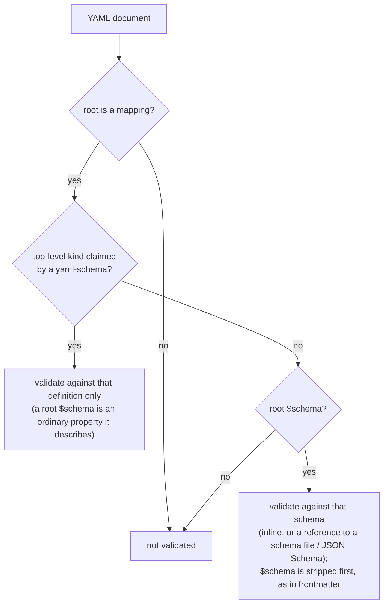

# Schemas for YAML Documents

## Problem

Markdown frontmatter can be held to a schema: a `$schema` property names one
(inline or by reference), and schema triggers apply others. A YAML document
cannot. `md schema validate` reads only Markdown frontmatter, and DMLS offers
no schema diagnostics, completion, or hover in a YAML file.

Authors already work around this. `messenger/docs/platforms.yaml` is a plain
YAML data file whose header says:

> The `---` fences are required: `md schema validate` reads only frontmatter,
> and an unfenced file is reported "valid by default" without validation.

The two YAML kinds Darkmatter does understand, `kind: schema` and
`kind: schema-trigger`, are recognized by hand-written Rust parsers. There is
no way for anyone else to declare a YAML document kind and have its documents
checked.

### Revision note

The first version of this spec (same date) framed the work as validating the
two schema kinds against shipped definitions, and that is what was
implemented: a hard-coded two-entry kind table, a YAML route in
`md schema validate`, and a DMLS overlay for those two kinds. It did not hold
any other YAML document to a schema, and it changed no accept/reject outcome
(the Rust parsers stayed the oracle). This revision replaces that framing.
What of the earlier implementation is kept, reshaped, or removed is
[Design ruling 6](#6-what-of-the-earlier-implementation-is-kept--closed).

## Goal

A YAML document is held to the contract of a schema, by `md` and by DMLS,
through the same validator Markdown frontmatter uses, when either:

1. its top-level `kind` is claimed by a recognized `yaml-schema`, or
2. it has a root `$schema` (and no recognized `kind`).

## Design (settled)

### 1. The `yaml-schema` kind

A `yaml-schema` document defines a YAML document kind. It has largely the
structure of a `kind: schema` document, but it describes **only whole YAML
documents**, selected by their `kind`.

- Its `$schema` is the schema it **exports**: the contract every document of
  the claimed kind must meet. This is the same role `$schema` already has in a
  `kind: schema` file.
- The exported schema must declare its `kind` property as enumerable: a
  `literal(...)` (claims one kind) or an `enum(...)` (claims each listed
  value). The claimed kinds are those values, unioned across arms when the
  exported schema is a root union.
- Two `yaml-schema` documents that claim the same kind in one document context
  are an error, including a repository file that claims a shipped kind.

Darkmatter ships three, in `darkmatter/schemas/`, compiled into the binary:

| File | Claims | Defines |
|---|---|---|
| `schema.yaml` | `schema` | schema documents |
| `schema-trigger.yaml` | `schema-trigger` | trigger documents |
| `yaml-schema.yaml` | `yaml-schema` | `yaml-schema` documents, including itself |

```yaml
# darkmatter/schemas/schema-trigger.yaml
kind: yaml-schema
types:
    match-expression: { … }
    match-payload: match-expression | match-expression[]
$schema:
    kind: literal(schema-trigger; required) -> the document kind that claims this definition
    match: match-payload(required)
    $schema: schema
```

A user kind looks the same:

```yaml
# <repo>/schemas/roster.yaml
kind: yaml-schema
$schema:
    kind: literal(roster; required)
    roster_version: literal(1; required)
    platforms: platform[](required)
```

### 2. Discovery

`yaml-schema` documents are found in the shipped set plus the **document's**
five schema roots, the same roots triggers use: `SCHEMAS_DIR`, the package
`schemas/`, the package area `schemas/`, the repository `schemas/`, and
`~/schemas`. Discovery is passive and per document context, as for triggers.

### 3. How a YAML document selects its schema



- **A recognized `kind` wins.** The claiming definition alone validates the
  file. A root `$schema` is then a property like any other, and the
  definition says what it is. For the three shipped kinds it is the exported
  schema, so `darkmatter.yaml` (`kind: schema`) is never validated against the
  globals it exports, and a trigger never against its payload.
- **Otherwise a root `$schema` is the contract**, exactly as in Markdown
  frontmatter: an inline schema or a reference to a `schema` file (or a JSON
  Schema file). `platforms.yaml` drops its `---` fences and is validated as
  written.
- A YAML file with neither, or whose root is not a mapping, is not validated.
  An unrecognized `kind` is not an error.

```yaml
# platforms.yaml: no kind, so $schema is the contract
$schema: ./platforms.schema.yaml
roster_version: 1

# roster.yaml: kind is claimed, so only the roster definition applies
kind: roster
roster_version: 1
```

### 4. Surfaces

- `md schema validate` accepts `.yaml` and `.yml` files and reports through
  the same problem codes, exit codes, and output formats as frontmatter.
- DMLS provides diagnostics, completion, and hover in a YAML file selected by
  either route, ranged on the offending key or value, with the same
  `dm.schema.*` codes as frontmatter.
- The library exposes one entry point that takes a YAML document and its
  context and returns the selected schema's validation report.

### 5. Shipped and filesystem schemas behave identically

A schema compiled into the binary behaves exactly as the same file on disk.
Shipped schemas reference each other by relative path only; a bare-name
reference inside a shipped schema is an error (it would depend on the
consumer's schema roots). Closing the embedded path's remaining refusals
(whole-file references, file-reference union arms, inline and catalog root
unions, `example(...)`) is a separate fix; this feature needs only what the
three shipped `yaml-schema` files use.

## Design rulings

Each ruling is marked **closed** (decided, with the ruling) or **open** (with
a recommendation).

### 1. Declaring the claimed `kind` (the "abstract" constraint) — closed

`yaml-schema.yaml` must require that a `yaml-schema`'s exported schema declare
`kind` as a `literal(...)` or `enum(...)`. That is a constraint on a **type
expression**, which SimplifiedSchema cannot state today: `schema` and
`type-definition` accept any declaration. The draft writes it as an
`enum(required) | literal(required)` union, by analogy with an abstract type
that a concrete definition (`kind: literal(schema; required)`) satisfies.

Two levels of `kind` must be kept apart:

```yaml
kind: yaml-schema                     # ① this document's own kind: a string
$schema:
    kind: literal(schema; required)   # ② the claimed kind: a type expression
```

The constraint applies to ②. In the current draft it sits beside `$schema` in
each arm, so it describes ①.

**Ruling (2026-10-31): narrow the `type-definition` meta-type.** A
declaration can be required to use given type constructors, so
`yaml-schema.yaml` states the rule itself (syntax illustrative; the concrete
spelling is settled in planning):

```yaml
# yaml-schema.yaml
$schema:
    kind: literal(yaml-schema; required)
    $schema: schema(required; property(kind, type-definition(literal | enum; required)))
```

`schema.yaml`'s `kind: literal(schema; required)` passes; `kind: string` fails
with an ordinary located diagnostic. The addition is general (any meta-schema
can require a declaration's form) and lives in `simplified-schema`.

Rejected: abstract types as a language concept (larger, with no other
consumer yet), and keeping the rule in Rust (one more rule the definition
cannot express).

### 2. Bootstrapping `yaml-schema.yaml` — closed

`yaml-schema.yaml` is both the definition of `yaml-schema` documents and one
of them, so it claims `yaml-schema` and validates itself.

**Ruling (2026-10-31): no special case.** The registry reads every file's
claim from its ②, `yaml-schema.yaml` included. Recursion is broken by order:

1. every shipped definition is prepared by the standalone resolver, which
   parses and lowers it and never consults the registry;
2. the registry is built from their claims;
3. documents are validated, the shipped definitions included.

An L1 test validates all three shipped files against the registry,
`yaml-schema.yaml` against itself. A repository file that also claims
`yaml-schema` is a duplicate claim like any other.

Rejected: a built-in Rust claim for `yaml-schema`, which would leave the
file's own `kind: literal(yaml-schema)` unchecked.

### 3. Coercion: soft or strict — closed

Frontmatter uses soft validation: a value that converts without changing its
meaning is accepted, and constraints are never repaired.

```yaml
# schema: { port: number, retries: number(integer) }
port: "8080"     # passes (means 8080)
retries: "2.5"   # error (not an integer)
```

A YAML file is never composed, so the conversion decides only whether the
file passes; a program reading it still sees the string `"8080"`.

**Ruling (2026-10-31): soft, as in frontmatter.** A schema means the same
thing wherever it is applied: a frontmatter `$schema`, a YAML `$schema`, or a
`yaml-schema` kind. Validation writes nothing back.

Rejected: strict (one schema would accept a value in Markdown and reject it
in YAML), and a strict opt-in (a setting nobody has asked for; it can be
added later without changing the default).

### 4. Rules the definitions cannot express — closed

The Rust parsers of schema and trigger files enforce rules the grammar cannot
state, so those files are checked twice and produce overlapping diagnostics.
The rules are of two classes.

Structural (shape):

```yaml
kind: schema
name: foo        # unknown key: passes (a root schema is open), Rust rejects
description:     # null: passes (an optional property accepts null), Rust rejects
types: [a, b]    # a list: passes (`schema` accepts lists), Rust rejects
```

Semantic (meaning): an invalid `$path` glob, an empty or vacuous `match`,
`min-match` count bounds, a category used in `types` that is not declared.

**Ruling (2026-10-31): grow the grammar for structural rules; keep semantic
rules in Rust.** Two general additions to `simplified-schema`:

- **closed objects**: a schema, root included, can forbid keys it does not
  declare (a user's `roster` kind rejects a mistyped `platfroms:`);
- **non-null optional properties**: a property may be absent but not `null`.

"`types` must be a mapping" is a narrowing of the `schema` meta-type, the same
mechanism as [ruling 1](#1-declaring-the-claimed-kind-the-abstract-constraint--closed).
With these, the shipped definitions state the whole shape and the Rust
parsers' structural checks are deleted. The semantic rules stay in Rust,
documented as checks beyond the definition, and reach `md` and DMLS the same
way:

1. **Located.** Every semantic check returns a typed problem with a source
   span taken from the YAML loader's position map, exactly as a definition
   problem does. (Today `SchemaError::TriggerMatch` carries only a message,
   so an invalid `$path` glob is published at the file or line start; it
   gains a span.)
2. **One report.** The library's kind-document entry point returns the
   definition's problems and the kind's semantic problems together; `md
   schema validate` and DMLS both project from that report, with the same
   codes, severities, and ranges. The two sets cover disjoint rules, so
   nothing is deduplicated.
3. **Only Darkmatter's kinds have semantic checks.** `schema`,
   `schema-trigger`, and `yaml-schema` each have a check that runs after
   their definition passes. A user's `yaml-schema` kind has no Rust code;
   its definition is its whole contract.
4. **Completion and hover come from the definition only.** Semantic checks
   add diagnostics and nothing else.
5. **Severity is judged where the defect is.** In the file itself a semantic
   problem is an **error**, like a definition problem: `md schema validate`
   fails on a trigger with an invalid `$path` glob, and DMLS marks the glob.
   A Markdown document the broken trigger would have matched is not itself
   wrong, so it keeps today's skipped-trigger **warning**. (Rejected: a
   warning in both places, which passes a broken trigger; an error in both,
   which lets one bad trigger in `~/schemas` break unrelated documents.)

Rejected: growing the grammar for semantic rules too (custom validators in
the language, for rules only Darkmatter's own kinds need), and changing
nothing (keeps the double check and its deduplication code).

### 5. The shape of `yaml-schema.yaml` — closed

The first draft had four defects: its arms declared `schema` where
`yaml-schema` documents export `$schema`; its root union's string arms
(`- schema-led`) parse as file references, not type names; its `types:` was a
list where a mapping is required; and its `types-led` arm made `$schema`
optional, so such a document would claim no kind.

**Ruling (2026-10-31): one shape, `$schema` required.** A types-only library
is a `kind: schema` file, so the union and its named types go. The target
file, written to `darkmatter/schemas/yaml-schema.yaml`:

```yaml
kind: yaml-schema
description: |-
    The definition of a `kind: yaml-schema` document: a YAML file that defines
    a YAML document kind. Its `$schema` is the contract every document of the
    claimed kind must meet.
$schema:
    kind: literal(yaml-schema; required) -> the document kind that claims this definition
    description: string -> what the kind is for
    categories: string[] -> the category names `category(...)` constraints in `types` may use, each `Name` or `Name -> description`
    $schema: schema(required; property(kind, type-definition(literal | enum; required))) -> the contract for documents of the claimed kind; its `kind` declaration names the kinds claimed
    types: schema -> reusable named types for `$schema`; these names are not document properties
```

It has the shape of `schema-trigger.yaml` and passes its own definition
([ruling 2](#2-bootstrapping-yaml-schemayaml--closed)). The `$schema` line
uses [ruling 1](#1-declaring-the-claimed-kind-the-abstract-constraint--closed)'s
narrowing, and the closed-object and non-null markers of
[ruling 4](#4-rules-the-definitions-cannot-express--closed) are added once
their spelling is settled; until that grammar lands the file does not parse,
so the plan lands the grammar before anything reads this file.

### 6. What of the earlier implementation is kept — closed

The earlier implementation (about 2,600 lines across the library kind
registry, the `md schema validate` YAML route, the DMLS YAML overlay, and
about 1,300 lines of tests) encodes the superseded design: a hard-coded
two-kind table, raw validation, and deduplication of definition diagnostics
against the Rust envelope's.

**Ruling (2026-10-31): revert it, then build from this spec.** One revert
commit undoes the earlier implementation's commits, and its uncommitted
review-cycle edits are discarded. Kept:

- the inline root-union support for embedded schemas in
  `simplified-schema` (a parity fix, independent of this design);
- `darkmatter/schemas/schema.yaml`, `schema-trigger.yaml`, and
  `yaml-schema.yaml` in this spec's shape.

The `{{{ … }}}` escapes of inline-code examples in the documentation are
redone as a separate docs fix on the reverted pages. The reverted commits stay
in history for reference.

Rejected: keeping and reshaping components (each brings its old tests and
assumptions), and deciding per component during planning (defers the
decision).

## Out of scope

- Escaping `{{ … }}` examples in inline code across the documentation (a
  docs fix; inline code spans are interpolated by design).
- The embedded-schema refusals beyond what the shipped `yaml-schema` files use
  ([Design 5](#5-shipped-and-filesystem-schemas-behave-identically)).
- JSON and TOML documents.

## Acceptance

- `darkmatter/schemas/yaml-schema.yaml` exists; `schema.yaml`,
  `schema-trigger.yaml`, and `yaml-schema.yaml` are `kind: yaml-schema`, are
  shipped, and each passes its claiming definition (`yaml-schema.yaml`
  itself).
- A `yaml-schema` in any of the five schema roots claims its kind for
  documents in that context; two claims of one kind are an error naming both
  files.
- A YAML document with a claimed `kind` is validated by that definition only;
  one with no claimed `kind` and a root `$schema` is validated by that schema;
  one with neither is not validated. `messenger/docs/platforms.yaml` validates
  without `---` fences.
- Both routes give `md schema validate` and DMLS diagnostics ranged on the
  offending key or value, and DMLS completion and hover in the file.
- Editing a shipped `yaml-schema` file changes validation on the next build
  with no Rust change; an L1 test proves it against a modified copy.
- Every shipped and repository schema, trigger, and `yaml-schema` document
  passes its definition (the shipped-schema corpus test).

## Documentation

- `darkmatter/docs/topics/schemas/definition.md`: how a YAML document selects
  its schema, with the flow above.
- `darkmatter/docs/topics/schemas/authoring-schemas.md`: writing a
  `yaml-schema`, shown from the shipped definitions.
- `darkmatter/docs/topics/schemas/dmls-schema-support.md`: diagnostics,
  completion, and hover in YAML documents.
- `docs/kind-documents.md`: `yaml-schema` as the way to formalize a YAML
  document kind.
