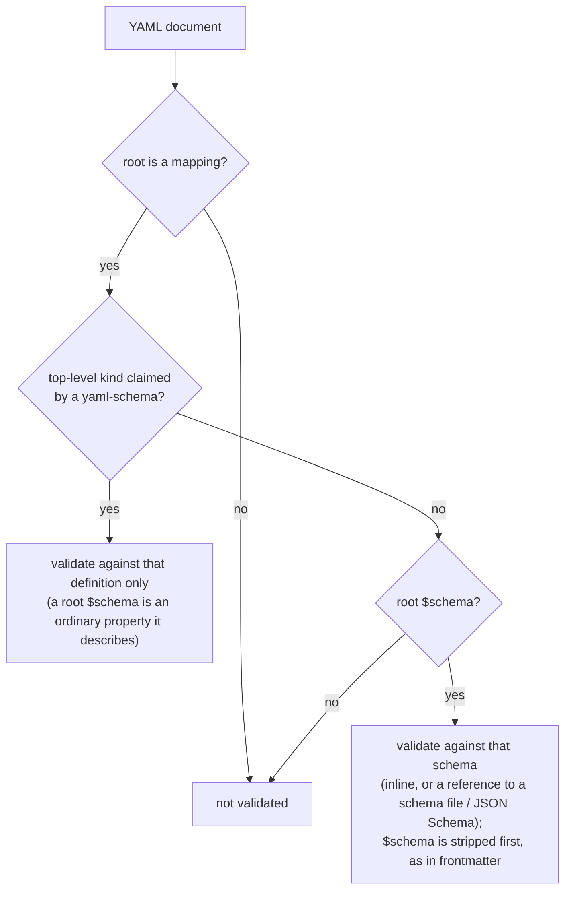

# Schemas for YAML Documents

## Problem

Markdown frontmatter can be held to a schema: a `$schema` property names one
(inline or by reference), and schema triggers apply others. A YAML document
cannot. `md schema validate` reads only Markdown frontmatter, and DMLS offers
no schema diagnostics, completion, or hover in a YAML file.

Authors already work around this. `messenger/docs/platforms.yaml` is a plain
YAML data file whose header says:

> The `---` fences are required: `md schema validate` reads only frontmatter,
> and an unfenced file is reported "valid by default" without validation.

The two YAML kinds Darkmatter does understand, `kind: schema` and
`kind: schema-trigger`, are recognized by hand-written Rust parsers. There is
no way for anyone else to declare a YAML document kind and have its documents
checked.

### Revision note

The first version of this spec (same date) framed the work as validating the
two schema kinds against shipped definitions, and that is what was
implemented: a hard-coded two-entry kind table, a YAML route in
`md schema validate`, and a DMLS overlay for those two kinds. It did not hold
any other YAML document to a schema, and it changed no accept/reject outcome
(the Rust parsers stayed the oracle). This revision replaces that framing.
What of the earlier implementation is kept, reshaped, or removed is
[Design ruling 6](#6-what-of-the-earlier-implementation-is-kept--closed).

## Goal

A YAML document is held to the contract of a schema, by `md` and by DMLS,
through the same validator Markdown frontmatter uses, when either:

1. its top-level `kind` is claimed by a recognized `yaml-schema`, or
2. it has a root `$schema` (and no recognized `kind`).

## Design

### 1. The `yaml-schema` kind

A `yaml-schema` document defines a YAML document kind. It has largely the
structure of a `kind: schema` document, but it describes **only whole YAML
documents**, selected by their `kind`.

- Its `$schema` is the schema it **exports**: the contract every document of
  the claimed kind must meet. This is the same role `$schema` already has in a
  `kind: schema` file.
- The exported schema must declare its `kind` property as enumerable: a
  `literal(...)` (claims one kind) or an `enum(...)` (claims each listed
  value). The claimed kinds are those values, unioned across arms when the
  exported schema is a root union.
- Two `yaml-schema` documents that claim the same kind in one document context
  are an error, including a repository file that claims a shipped kind.
  The one exception is a checkout's own copy of a shipped definition
  ([ruling 8](#8-shipped-definitions-in-a-source-checkout--closed)); identical
  filenames alone never establish that two definitions are the same source.

Three are shipped, compiled into the binary. The two envelopes that belong to
the SimplifiedSchema language live with the library
([ruling 4](#4-rules-the-definitions-cannot-express--closed)); the trigger
envelope is Darkmatter's:

| File | Home | Claims | Defines |
|---|---|---|---|
| `schema.yaml` | `simplified-schema/schemas/` | `schema` | schema documents |
| `yaml-schema.yaml` | `simplified-schema/schemas/` | `yaml-schema` | `yaml-schema` documents, including itself |
| `schema-trigger.yaml` | `darkmatter/schemas/` | `schema-trigger` | trigger documents |

```yaml
# darkmatter/schemas/schema-trigger.yaml
kind: yaml-schema
types:
    match-expression: { … }
    match-payload: match-expression | match-expression[]
$schema:
    kind: literal(schema-trigger; required) -> the document kind that claims this definition
    match: match-payload(required)
    $schema: schema
```

A user kind looks the same:

```yaml
# <repo>/schemas/roster.yaml
kind: yaml-schema
types:
    platform:
        name: string(required)
$schema:
    kind: literal(roster; required)
    roster_version: literal(1; required)
    platforms: platform[](required)
```

### 2. Discovery

`yaml-schema` documents are found in the shipped set plus the **document's**
five schema roots, the same roots triggers use: `SCHEMAS_DIR` (the folder
itself), the package `schemas/`, the package area `schemas/`, the document
context's tree-root `schemas/` (`base_dir()/schemas`), and `~/schemas`.
Do not substitute the process directory or walk ancestors.

Reuse Darkmatter's [schema-root enumeration](../../lib/src/markdown/schemas/triggers/discovery.rs):
regular YAML files directly inside each root, deterministic filename order,
no recursive scan, and the existing symlink and filename-collision rules.
A root reached more than once is searched once. Unlike trigger filename
shadowing, a different definition with the same filename is still a candidate:
kind claims, rather than filenames, decide conflicts. Compare claimed kind
strings exactly, including case; `roster` and `Roster` are different kinds.

Filesystem discovery uses the existing repository/workspace gate: `md`
discovers inside a repository, and DMLS inside a workspace. Shipped kinds
remain available everywhere, and an explicit root `$schema` still works
outside those gates. Disabling `schema-triggers` stops trigger matching;
it does not disable kind definitions or change a recognized `$schema` from
data into a contract. Schema-file lookup continues to use the shared
selector and its existing policy.

Discovery and preparation may read local schema sources through the one
captured document context. Validation over the prepared registry performs
no discovery or reference loading. Neither phase executes expressions,
runs commands, fetches remotes, or writes files. DMLS supplies cached source
text, including open unsaved definitions, through the same discovery path.
Checkout copies follow [ruling 8](#8-shipped-definitions-in-a-source-checkout--closed) and failures
[ruling 9](#9-a-discovered-definition-that-cannot-be-prepared--closed).

### 3. How a YAML document selects its schema



- **A recognized `kind` wins.** The claiming definition alone validates the
  file. A root `$schema` is then a property like any other, and the
  definition says what it is. For the three shipped kinds it is the exported
  schema, so `darkmatter.yaml` (`kind: schema`) is never validated against the
  globals it exports, and a trigger never against its payload.
- **Otherwise a root `$schema` is the contract**, using Markdown
  frontmatter’s declaration syntax and reference resolution: an inline mapping,
  root union, or reference to a schema export (including a JSON Schema file). `platforms.yaml` drops its `---` fences and is validated as
  written.
- A YAML file with neither, or whose root is not a mapping, is not validated.
  An unrecognized `kind` is not an error when registry preparation succeeded.
  A failed registry or an ambiguous claim must not silently fall through to
  another route and report success.
- Selection examines the authored `kind` string before soft conversion.
  Missing, null, or non-string `kind` values claim nothing; they may still be
  checked by an explicit root `$schema`. A present but invalid `$schema`
  (including null) on this fallback route is a schema error, not absence.
- Whole YAML documents receive **no Markdown baseline or trigger layers** on
  either route. This deliberately differs from Markdown frontmatter, whose
  globals and matching triggers describe composed Markdown. A YAML property
  named `title` or `content_policy` has only its selected schema's meaning.
  An explicit `$schema` is removed from the validation copy only, keeping
  the source map and document unchanged. In the claimed-kind route it stays.

```yaml
# platforms.yaml: no kind, so $schema is the contract
$schema: ./platforms.schema.yaml
roster_version: 1

# roster.yaml: kind is claimed, so only the roster definition applies
kind: roster
roster_version: 1
```

### 4. Surfaces

- `md schema validate` accepts `.yaml` and `.yml` files and reports through
  the same problem codes, exit codes, and output formats as frontmatter.
- DMLS provides diagnostics, completion, and hover in a YAML file selected by
  either route, ranged on the offending key or value, with the same
  `dm.schema.*` codes as frontmatter.
- The library exposes one entry point that takes a YAML document and its
  context and returns the selected schema's validation report.

#### Whole-file parsing and command behavior

A `.yaml` or `.yml` argument (any ASCII letter case) selects whole-file YAML
parsing after the normal file-argument resolver opens it. A leading `---`
is a YAML document-start marker, not a Markdown frontmatter boundary.
Exactly one YAML document is allowed; an optional terminating `...` is
allowed, but a second document is rejected. Use the shared admitted-YAML
loader and numeric model: duplicate keys, non-string mapping keys,
unsupported numeric values, and malformed YAML are located load errors,
even when no schema can be selected. Accept BOM and CRLF consistently with
standalone schemas. A valid scalar or sequence root is unvalidated, as the
selection flow states; this feature does not add schemas for such roots.

Report unvalidated input as **no schema selected**, using the existing
`no_schema` result, rather than implying that a contract was checked.
Preserve the command's exit codes: `0` for a passing or unvalidated input,
`1` for document validation failures (including kind semantic checks), `2`
for schema preparation or selection failures, and `3` for input/open/parse
failures. Mixed input batches retain precedence `3`, then `2`, then `1`.
Existing JSON result records remain the contract; do not invent a separate
YAML output format.

Assignments such as `key=value` remain Markdown-only and produce usage
error `64` with any YAML input, including a reference that resolves to YAML;
resolve and preflight the input batch before any assignment writes occur.
The built-in baseline and baseline environment settings are not loaded for
YAML-only invocations. An explicit `--schema` baseline with YAML is a usage
error rather than a silently ignored contract; mixed batches using that
option must be split. `--disable baseline-schema` is harmless for YAML.
Markdown inputs retain their current baseline and trigger behavior.

#### Passive values and source positions

Soft validation converts a copy using the shared SimplifiedSchema engine;
it never persists conversions or applies frontmatter shell/interpolation
stages. Whole-value `{{ ... }}` and `$(...)` strings are ordinary YAML data,
not pending values that bypass validation. A numeric property holding either
string fails; a string property may accept it as text. Relative file-valued
properties are checked in the data document's context; references inside a
definition resolve in that definition's source context.

Diagnostic spans refer to the original buffer, including after soft
conversion or removing the fallback `$schema`. Missing-property problems
point to the enclosing mapping, and unknown-property problems to the key.
Keep typed causes and source origins for invalid declarations and imports;
a failure in a referenced definition is related information at that source,
with the reference in the consuming document marked as the failure site.
DMLS converts original byte spans to protocol positions, including Unicode
and CRLF. A parse failure cannot be reported as an unclaimed success.

#### Editor lifetime

Reuse DMLS's [workspace registry worker](../../docs/lsp/indexing.md)
and per-document contexts. Prepare and compile outside the request dispatch
thread, and reuse the result while its sources and context are unchanged.
Watch definitions, imported dependencies, and searched missing locations;
creation, deletion, rename, or an unsaved edit must refresh affected open
YAML documents. A changed or removed `kind` or `$schema` must clear stale
schema diagnostics, completion, and hover. Never reuse a registry from
another workspace or package scope.

Completion and hover describe the selected definition. In a claimed schema
kind, `$schema` and `types` are authored schema declarations: retain the
existing schema-authoring providers within those values while offering
ordinary data properties elsewhere. In fallback data YAML, exclude the
selection-only `$schema` key from unknown-property diagnostics and offer
schema-reference assistance there. Do not enable Markdown body expression
providers in YAML. Incomplete YAML uses the existing recovery tree for
completion; it must not run a second validator with different acceptance
rules or publish the same parse problem twice.

### 5. Shipped and filesystem schemas behave identically

A schema compiled into the binary behaves exactly as the same file on disk.
Shipped schemas reference each other by relative path only; a bare-name
reference inside a shipped schema is an error (it would depend on the
consumer's schema roots). Closing the embedded path's remaining refusals
(whole-file references, file-reference union arms, inline and catalog root
unions, `example(...)`) is a separate fix; this feature needs only what the
three shipped `yaml-schema` files use.

## Design rulings

The following decisions establish the intended behavior. Every ruling is
closed; the language spelling is fixed by
[ruling 10](#10-syntax-of-the-new-language-constraints--closed).

### 1. Declaring the claimed `kind` (the "abstract" constraint) — closed

`yaml-schema.yaml` must require that a `yaml-schema`'s exported schema declare
`kind` as a `literal(...)` or `enum(...)`. That is a constraint on a **type
expression**, which SimplifiedSchema cannot state today: `schema` and
`type-definition` accept any declaration. The draft writes it as an
`enum(required) | literal(required)` union, by analogy with an abstract type
that a concrete definition (`kind: literal(schema; required)`) satisfies.

Two levels of `kind` must be kept apart:

```yaml
kind: yaml-schema                     # ① this document's own kind: a string
$schema:
    kind: literal(schema; required)   # ② the claimed kind: a type expression
```

The constraint applies to ②. In the current draft it sits beside `$schema` in
each arm, so it describes ①.

**Ruling (2026-10-31): narrow the `type-definition` meta-type.** A
declaration can be required to use given type constructors, so
`yaml-schema.yaml` states the rule itself (spelling from
[ruling 10](#10-syntax-of-the-new-language-constraints--closed)):

```yaml
# yaml-schema.yaml
$schema:
    kind: literal(yaml-schema; required)
    $schema: schema(required; property(kind, type-definition(forms(literal, enum); declared-required)))
```

`schema.yaml`'s `kind: literal(schema; required)` passes; `kind: string` fails
with an ordinary located diagnostic. This constraint must inspect the
**declaration**, not validate a sample `kind` value: the property must exist,
be required, and denote a nonempty finite set of nonempty strings. Reject
numeric, boolean, or null literals and declarations made optional by a
null-admitting union. No kind-name regular expression is introduced.

Every resolved root-union arm must be an object schema meeting that rule.
Collect all its string choices; repeating a choice within one definition
is harmless, while a different definition claiming it conflicts. Named
aliases and local file arms resolve during preparation through the existing
resolver, with the existing cycle diagnostics. The meta-type check itself
remains parse-only: it neither follows those references nor expands imports.
Preparation checks claims on the resolved declarations and reports an
unverifiable or invalid arm instead of ignoring it. A source declaration
hidden behind a reference must not fail merely because it was not inline.

The addition is general: any meta-schema can require a declaration’s form.
It lives in `simplified-schema`.

Rejected: abstract types as a language concept (larger, with no other
consumer yet), and keeping the rule in Rust (one more rule the definition
cannot express).

### 2. Bootstrapping `yaml-schema.yaml` — closed

`yaml-schema.yaml` is both the definition of `yaml-schema` documents and one
of them, so it claims `yaml-schema` and validates itself.

**Ruling (2026-10-31): no special case.** The registry reads every file's
claim from its ②, `yaml-schema.yaml` included. Recursion is broken by order:

1. every shipped definition is prepared by the standalone resolver, which
   parses and lowers it and never consults the registry;
2. the registry is built from their claims;
3. shipped definitions validate against the completed shipped registry;
4. filesystem candidates validate against the shipped `yaml-schema`
   definition, then resolve and verify their exported claims before they
   can be installed in a context registry;
5. documents validate against that prepared registry.

Do not trust an invalid candidate's prepared export as an active definition.
The claim and failure policy below determines how to retain its failure
without installing it.

An L1 test validates all three shipped files against the registry,
`yaml-schema.yaml` against itself. A repository file that also claims
`yaml-schema` is a duplicate claim like any other.

Rejected: a built-in Rust claim for `yaml-schema`, which would leave the
file's own `kind: literal(yaml-schema)` unchecked.

### 3. Coercion: soft or strict — closed

Frontmatter uses soft validation: a value that converts without changing its
meaning is accepted, and constraints are never repaired.

```yaml
# schema: { port: number, retries: number(integer) }
port: "8080"     # passes (means 8080)
retries: "2.5"   # error (not an integer)
```

A YAML file is never composed, so the conversion decides only whether the
file passes; a program reading it still sees the string `"8080"`.

**Ruling (2026-10-31): soft, as in frontmatter.** A schema means the same
thing wherever it is applied: a frontmatter `$schema`, a YAML `$schema`, or a
`yaml-schema` kind. Validation writes nothing back.

Rejected: strict (one schema would accept a value in Markdown and reject it
in YAML), and a strict opt-in (a setting nobody has asked for; it can be
added later without changing the default).

### 4. Rules the definitions cannot express — closed

The Rust parsers of schema and trigger files enforce rules the grammar cannot
state, so those files are checked twice and produce overlapping diagnostics.
The rules are of two classes.

Structural (shape):

```yaml
kind: schema
name: foo        # unknown key: passes (a root schema is open), Rust rejects
description:     # null: passes (an optional property accepts null), Rust rejects
types: [a, b]    # a list: passes (`schema` accepts lists), Rust rejects
```

Semantic (meaning): an invalid `$path` glob, an empty or vacuous `match`,
`min-match` count bounds, a category used in `types` that is not declared.

**Ruling (2026-10-31): grow the grammar for structural rules; keep semantic
rules in Rust.** Two general additions to `simplified-schema`:

- **closed objects**: a schema, root included, can forbid keys it does not
  declare (a user's `roster` kind rejects a mistyped `platfroms:`);
- **non-null optional properties**: a property may be absent but not `null`.

"`types` must be a mapping" is a narrowing of the `schema` meta-type, the same
mechanism as [ruling 1](#1-declaring-the-claimed-kind-the-abstract-constraint--closed).
With these, the shipped definitions state the whole shape.

**Ruling (2026-10-31): `simplified-schema` owns the envelope definitions.**
A library user loads schema files directly (`SimplifiedSchema` factories,
`Name@file` imports) without Darkmatter, so envelope admission must live in
the library, and the library cannot depend on Darkmatter. The `kind: schema`
and `kind: yaml-schema` envelopes are part of the SimplifiedSchema language,
so their definitions, `schema.yaml` and `yaml-schema.yaml`, live in
`simplified-schema/schemas/` and are compiled into the library. The library
admits every envelope, on every path, by validating it against them; the
hand-written structural checks are deleted, leaving one authority. The
library bootstraps its own two definitions in
[ruling 2](#2-bootstrapping-yaml-schemayaml--closed)'s order. Darkmatter's
registry takes those two from the library and adds `schema-trigger.yaml`
(triggers are a Darkmatter concept) and the discovered files.

Whole-file validation checks the definition first; only on success does it
run the kind's semantic checks, on the accepted, softly converted copy. It
never re-admits the original text after accepting its converted view, so
optional scalar metadata that soft validation converts cannot produce a
contradictory outcome. Authored schema declarations and their source spans
are preserved: conversion never stringifies mapping or sequence meta-type
carriers.

Rejected: keeping the structural checks in the parsers beside the
definitions with an agreement test (every rule twice, held together only by
the test), and leaving direct loads unchecked (a malformed schema file would
import silently).

The semantic rules stay in Rust, documented as checks beyond the
definition, and reach `md` and DMLS the same way:

1. **Located.** Every semantic check returns a typed problem with a source
   span taken from the YAML loader's position map, exactly as a definition
   problem does. (Today `SchemaError::TriggerMatch` carries only a message,
   so an invalid `$path` glob is published at the file or line start; it
   gains a span.)
2. **One report.** The library's kind-document entry point returns the
   definition's problems and the kind's semantic problems together; `md
   schema validate` and DMLS both project from that report, with the same
   codes, severities, and ranges. Structural failures stop semantic checks;
   successful structural validation produces only additional semantic
   problems, so nothing is deduplicated.
3. **Only Darkmatter's kinds have semantic checks.** `schema`,
   `schema-trigger`, and `yaml-schema` each have a check that runs after
   their definition passes. A user's `yaml-schema` kind has no Rust code;
   its definition is its whole contract.
4. **Completion and hover come from the definition only.** Semantic checks
   add diagnostics and nothing else.
5. **Severity is judged where the defect is.** In the file itself a semantic
   problem is an **error**, like a definition problem: `md schema validate`
   fails on a trigger with an invalid `$path` glob, and DMLS marks the glob.
   A Markdown document the broken trigger would have matched is not itself
   wrong, so it keeps today's skipped-trigger **warning**. (Rejected: a
   warning in both places, which passes a broken trigger; an error in both,
   which lets one bad trigger in `~/schemas` break unrelated documents.)

Rejected: growing the grammar for semantic rules too (custom validators in
the language, for rules only Darkmatter's own kinds need), and changing
nothing (keeps the double check and its deduplication code).

### 5. The shape of `yaml-schema.yaml` — closed

The first draft had four defects: its arms declared `schema` where
`yaml-schema` documents export `$schema`; its root union's string arms
(`- schema-led`) parse as file references, not type names; its `types:` was a
list where a mapping is required; and its `types-led` arm made `$schema`
optional, so such a document would claim no kind.

**Ruling (2026-10-31): one shape, `$schema` required.** A types-only library
is a `kind: schema` file, so the union and its named types go. The target
file (drafted in `darkmatter/schemas/yaml-schema.yaml`; its home is
`simplified-schema/schemas/` under ruling 4):

```yaml
kind: yaml-schema
description: |-
    The definition of a `kind: yaml-schema` document: a YAML file that defines
    a YAML document kind. Its `$schema` is the contract every document of the
    claimed kind must meet.
$schema:
    kind: literal(yaml-schema; required) -> the document kind that claims this definition
    description: string(non-null) -> what the kind is for
    categories: string[](non-null) -> the category names `category(...)` constraints in `types` may use, each `Name` or `Name -> description`
    $schema: schema(required; property(kind, type-definition(forms(literal, enum); declared-required))) -> the contract for documents of the claimed kind; its `kind` declaration names the kinds claimed
    types: schema(mapping; non-null) -> reusable named types for `$schema`; these names are not document properties
    $constraints: { closed: true }
```

It has the shape of `schema-trigger.yaml` and passes its own definition
([ruling 2](#2-bootstrapping-yaml-schemayaml--closed)). The `$schema` line
uses [ruling 1](#1-declaring-the-claimed-kind-the-abstract-constraint--closed)'s
narrowing and [ruling 4](#4-rules-the-definitions-cannot-express--closed)'s
closed-root and non-null constraints, spelled per
[ruling 10](#10-syntax-of-the-new-language-constraints--closed). Until that
grammar lands the file does not parse, so the plan lands the grammar before
anything reads this file.

### 6. What of the earlier implementation is kept — closed

The earlier implementation (about 2,600 lines across the library kind
registry, the `md schema validate` YAML route, the DMLS YAML overlay, and
about 1,300 lines of tests) encodes the superseded design: a hard-coded
two-kind table, raw validation, and deduplication of definition diagnostics
against the Rust envelope's.

**Ruling (2026-10-31): revert it, then build from this spec.** One revert
commit undoes the earlier implementation's commits, and its uncommitted
review-cycle edits are discarded. Kept:

- the inline root-union support for embedded schemas in
  `simplified-schema` (a parity fix, independent of this design);
- `schema.yaml`, `schema-trigger.yaml`, and `yaml-schema.yaml` in this spec's
  shape (`schema.yaml` and `yaml-schema.yaml` move to
  `simplified-schema/schemas/` under ruling 4).

The `{{{ … }}}` escapes of inline-code examples in the documentation are
redone as a separate docs fix on the reverted pages. The reverted commits stay
in history for reference.

The revert is the first implementation step. Before executing it, identify
the exact commits and inspect their changes; preserve unrelated extraction
and reference-navigation work. Discard only the uncommitted edits that
belong to the earlier implementation, file by file, never the working tree
wholesale. If a commit mixes retained and superseded work, reverse only the
superseded changes and record that departure from a whole-commit revert in
the implementation log.

Rejected: keeping and reshaping components (each brings its old tests and
assumptions), and deciding per component during planning (defers the
decision).

### 7. Language and resolver compatibility — closed

**Decision (2026-10-31): extend schema envelopes explicitly, without making
arbitrary kinded data into schema files.** Today the standalone parser in
`simplified-schema` admits an informal export or `kind: schema`, so changing
the three shipped definitions to `kind: yaml-schema` otherwise makes them
unloadable. Add `yaml-schema` to that parser's supported envelopes, with the
same metadata and named-type namespace as `schema` and a required export.
The lower-level parser admits its structure without consulting a kind
registry; claim verification is a separate preparation step.

A `yaml-schema` is reached **only through `kind`**: it is neither a `$schema`
target nor a `Name@file` import source, and naming it in either place is a
schema error saying it is selected by `kind`. Types shared between a YAML
kind and Markdown go in a `kind: schema` file that both import; a
`yaml-schema` may import from one through its own `types`. (Rejected: an
import source only, which duplicates what `kind: schema` provides; and both,
which lets one file be applied by `kind` to YAML and by `$schema` to
Markdown.) A `types`-only `kind: schema` remains valid for imports
but invalid as a `$schema` target. An ordinary `kind: roster` data file is
still not a standalone schema target. A `schema-trigger` remains forbidden
as a `$schema` target, including when discovery skipped it as invalid.
Keep the existing Draft 2020-12 JSON target checks. Update target inspection,
resolver classification, DMLS reference assistance, and the shipped corpus
together; do not fix only the registry's private loader.

The new constraints are opt-in and obey these compatibility rules:

- Existing roots remain open. (Nested inline objects are already closed, as
  `additionalProperties: false`, so closure is new only at the root.) A
  closed root admits its explicitly declared properties and existing
  pattern-dictionary matches; other keys fail validation. Closure belongs to
  each root, including each root-union arm. Lower and merge closure
  using the shared object/layering machinery so sibling declarations and
  resolved imports are visible before unknown keys are rejected.
- Existing optional properties still accept null. The new absent-but-non-null
  marker distinguishes a missing key from an explicit null and rejects null
  **before** soft conversion. Combining it with a type that explicitly admits
  null is a declaration error; it must not silently override the existing
  rule that null-admitting types are optional. Apply it to optional envelope
  metadata, `types`, and trigger payloads where the current parsers reject
  explicit null. Leave ordinary user schemas unchanged unless they opt in.
- A mapping-only narrowing of `schema` checks a declaration's **carrier**
  (its authored YAML representation), not the kind of value that its exported
  schema accepts. `types` must be a mapping of valid named definitions;
  `$schema` may still be a mapping, reference, or root union. Constructor
  narrowing of `type-definition` examines the type it declares instead.
- Parsing, canonical serialization, JSON Schema export, validation, type
  queries, subtype checks, layering, and DMLS completion/hover must agree on
  the new constraints. Preserve them through import and export round trips;
  expose any custom JSON Schema vocabulary through the existing mechanism.
  Do not implement host-only validation rules with no library representation.

These are intentional language additions in `simplified-schema`, not new
Darkmatter-only spellings; their syntax is
[ruling 10](#10-syntax-of-the-new-language-constraints--closed).

### 8. Shipped definitions in a source checkout — closed

In this repository the shipped definitions also exist on disk, in
`darkmatter/schemas/` and `simplified-schema/schemas/`, which are package-area
schema roots for documents under those areas. Without a rule, each shipped
kind is claimed twice there, and the project's own YAML files fail the
duplicate-claim rule in every worktree.

**Ruling (2026-10-31): identity by source path.** The compiled-in table keys
each shipped definition by its repository-relative path. A discovered file at
**that same repository-relative path** that claims **that same kind** is the
source of the shipped definition: it **replaces** the compiled-in copy for
documents in that context and is not a duplicate. Every other claim of a
shipped kind (a `~/schemas/schema.yaml`, a repository's own file claiming
`schema-trigger`) remains a duplicate-claim error. Filenames alone never
establish identity.

```text
darkmatter/schemas/schema-trigger.yaml   claims schema-trigger  → the source copy; replaces the built-in
<repo>/schemas/my-trigger.yaml           claims schema-trigger  → duplicate claim: error
~/schemas/schema.yaml                    claims schema          → duplicate claim: error
```

It needs no configuration, works in every worktree, and an edited definition
takes effect in that checkout immediately, in `md` and DMLS. Library envelope
admission ([ruling 4](#4-rules-the-definitions-cannot-express--closed)) uses
the compiled-in copy, so while `schema.yaml` or `yaml-schema.yaml` is being
edited, whole-file reports follow the disk copy and direct library loads
follow the binary until it is rebuilt.

Rejected: explicit registration by tests or a development setting (every
worktree and test must opt in, or the repository's own files fail); always
rejecting disk claims (the checkout fails, and definitions cannot be tried
before a rebuild); collapsing byte-identical copies (an edit becomes a
conflict exactly when it should apply).

### 9. A discovered definition that cannot be prepared — closed

A broken `yaml-schema` either reveals its claim and then fails (an import
cannot be resolved) or is too broken to reveal one (malformed YAML). Silently
skipping it would let a previously checked document pass as "no schema
selected".

**Ruling (2026-10-31): keep healthy definitions, reserve failed claims, and
mark the registry incomplete.**

- Healthy definitions in the same context keep working.
- A claim revealed by a failed definition is **reserved**: a document whose
  `kind` is that claim gets a schema-selection error (exit `2`) naming the
  failed definition, never unvalidated success.
- A failed definition that revealed no claim marks the registry
  **incomplete**. A document whose `kind` no healthy definition claims then
  gets "schema selection unavailable" naming the failed file, not "no schema
  selected". A document with no `kind`, or a `kind` a healthy definition
  claims, is unaffected.
- The failed definition's own defect is an error when that file is validated
  or opened ([ruling 4](#4-rules-the-definitions-cannot-express--closed),
  point 5), reported once, not repeated on every document.
- Markdown documents are unaffected.

Under every outcome: an unreadable root is a preparation error, never an
empty registry; a duplicate claim is an error naming both files, never
resolved by search order; DMLS never keeps an earlier successful selection
after a failure.

```text
schemas/roster.yaml fails to import    → data with kind: roster   → exit 2, names roster.yaml
schemas/broken.yaml reveals no claim   → data with kind: inventory (unclaimed) → "selection unavailable"
                                       → data with kind: schema    → validated as usual
```

Rejected: failing the whole registry (one bad file in `~/schemas` blocks
every claimed-kind document everywhere), and skipping with a warning as
triggers do (a document of the failed kind passes unchecked with exit `0`).

### 10. Syntax of the new language constraints — closed

Two facts shape the syntax. Nested inline objects are already closed (they
lower to `additionalProperties: false`); only a root is open, with no opt-in.
And the language already reserves a carrier for object-level constraints,
the `$constraints` block, recognized only inside authored schema objects and
never in user data, with flags written `name: true`.

**Ruling (2026-10-31): extend the existing surfaces.**

| Need | Spelling | Follows |
|---|---|---|
| Close a root, or one root-union arm | `$constraints: { closed: true }` in that mapping | the existing `$constraints` flag form |
| Optional, but not null | `string(non-null)` | hyphenated postfix constraints (`min-keys`) |
| `types` must be a mapping | `schema(mapping)` | an option of the `schema` meta-type |
| A declaration's type is a literal or an enum | `type-definition(forms(literal, enum))` | an option of the `type-definition` meta-type |
| The declaration itself is `required` | `type-definition(declared-required)` | as above |
| An exported schema declares property X that way | `schema(property(kind, <type-definition expr>))` | an option of the `schema` meta-type |

Inside `schema(...)` and `type-definition(...)` every option judges the
**declaration**, never a value: `declared-required` is about the declaration,
while plain `required` keeps meaning "the property must be present".

```yaml
# simplified-schema/schemas/yaml-schema.yaml
kind: yaml-schema
$schema:
    kind: literal(yaml-schema; required)
    description: string(non-null)
    categories: string[](non-null)
    $schema: schema(required; property(kind, type-definition(forms(literal, enum); declared-required)))
    types: schema(mapping; non-null)
    $constraints: { closed: true }
```

A `yaml-schema` whose exported schema declares `kind: string` fails at
preparation, on the `kind` line: "`kind` must be declared as `literal(...)`
or `enum(...)`".

Rules that come with the spelling:

- **closure is judged after merging**: imported and layered properties count
  as declared before unknown keys are rejected;
- **`non-null` with a null-admitting type** (`null | string(non-null)`) is a
  declaration error;
- **`property(...)` behind a reference** (`$schema: ./other.yaml`) is checked
  at preparation against the resolved declaration; validation stays passive;
- **JSON Schema export**: `closed` lowers to `additionalProperties: false` and
  `non-null` to excluding `null`; the declaration options have no JSON Schema
  equivalent and use the existing custom-vocabulary mechanism.

Rejected: other spellings for the same structure (`strict`, `not-null`), new
reserved keys beyond `$constraints`, and keeping the checks in Rust (ruling 4).

## Out of scope

- Escaping `{{ … }}` examples in inline code across the documentation (a
  docs fix; inline code spans are interpolated by design).
- The embedded-schema refusals beyond what the shipped `yaml-schema` files use
  ([Design 5](#5-shipped-and-filesystem-schemas-behave-identically)).
- JSON and TOML documents.

## Acceptance

- `simplified-schema/schemas/schema.yaml`,
  `simplified-schema/schemas/yaml-schema.yaml`, and
  `darkmatter/schemas/schema-trigger.yaml` are `kind: yaml-schema`, are
  shipped, and each passes its claiming definition (`yaml-schema.yaml`
  itself).
- A `yaml-schema` in any of the five schema roots claims its kind for
  documents in that context; two claims of one kind are an error naming both
  files.
- A YAML document with a claimed `kind` is validated by that definition only;
  one with no claimed `kind` and a root `$schema` is validated by that schema;
  one with neither is not validated. `messenger/docs/platforms.yaml` validates
  without `---` fences.
- Both routes give `md schema validate` and DMLS diagnostics ranged on the
  offending key or value, and DMLS completion and hover in the file.
- Editing a shipped `yaml-schema` file changes validation on the next build
  with no Rust change; an L1 test proves it against a modified copy.
- Every shipped and repository schema, trigger, and `yaml-schema` document
  passes its definition (the shipped-schema corpus test). Use ruling 8's
  source-path identity so the corpus does not manufacture duplicate claims.
- Constructor narrowing rejects optional/non-string kind declarations and
  accepts valid finite claims across root unions and imports.
- Direct library loads (factories and `Name@file` imports) reject a malformed
  `schema` or `yaml-schema` envelope through the library-owned definitions,
  with no hand-written structural check remaining.
- Opt-in closure and non-null optional properties work at roots and nested
  objects, preserve current defaults, and survive canonical serialization,
  JSON export, imports, and layering. Test mapping-only `types` independently
  from the schema of data values.
- Shared library and normal `md schema validate` tests cover both selection
  routes, route precedence, unknown kinds, bad schema references, duplicate
  claims, and ruling 9's incomplete-registry outcomes. Cover parse/load errors,
  null versus missing values, conversion failures, unvalidated outcomes,
  assignment rejection, baseline options, and mixed-batch exit precedence.
- DMLS tests cover unsaved definition edits and dependency creation/deletion,
  scope isolation, route changes clearing stale results, schema authoring
  inside exports, and Unicode/CRLF ranges. Exercise diagnostics, completion,
  and hover through normal protocol requests; no focused windows are needed.
- Passive corpus tests parse the shipped artifacts, and end-to-end command
  tests use real definitions. These are L1 tests under the monorepo toolkit;
  use the package `just test` recipes and nextest. No new terminal/browser
  test tier or multi-host performance spike is required. Reuse prepared
  registries and compiled validators rather than scanning or compiling on
  each editor request.

## Documentation

- `darkmatter/docs/topics/schemas/definition.md`: how a YAML document selects
  its schema, with the flow above.
- `darkmatter/docs/topics/schemas/authoring-schemas.md`: writing a
  `yaml-schema`, shown from the shipped definitions.
- `darkmatter/docs/topics/schemas/dmls-schema-support.md`: diagnostics,
  completion, and hover in YAML documents.
- `docs/kind-documents.md`: `yaml-schema` as the way to formalize a YAML
  document kind.
- SimplifiedSchema's language, schema-document, validation, and custom
  vocabulary pages: the new constraints and `yaml-schema` envelope, with
  complete parseable examples after the syntax decision.
- Darkmatter's CLI validation reference and DMLS workspace-indexing and
  configuration pages: YAML selection, discovery controls, unvalidated
  outcomes, exit codes, baseline options, and refresh behavior.
- `messenger/docs/platforms.yaml`: remove the obsolete fence-workaround
  comment when the whole-file route lands and verify the roster through it.
- Darkmatter and SimplifiedSchema agent skills: envelope recognition,
  ownership boundaries, and registry lifecycle. Keep README changes to a
  concise overview/link if public behavior needs announcing; topic pages
  remain authoritative.
