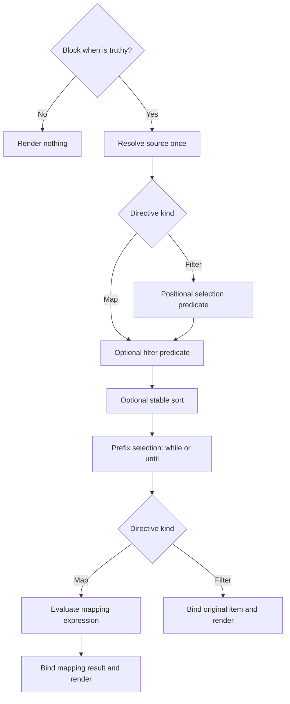

# Map and Filter Directives

## Objective

Add `::map` / `::end-map` and `::filter` / `::end-filter` so authors can render
collections through repeated Markdown bodies. Both directives support typed
sources, lexical locals, destructuring, conditional execution, stable sorting,
prefix selection, nested directives, and existing shell-template approval.

Map transforms retained items before exposing them to the body. Filter selects
items and exposes their original values. Their shared behavior must have one
implementation, one type model, and consistent library, CLI, and DMLS behavior.

This specification records the design decisions for implementation. The current
user-facing behavior belongs in:

- [Map directive](../../docs/inline/map.md)
- [Filter directive](../../docs/inline/filter.md)

Those documents remain marked **Planned** until implementation is delivered.

## Scope and Boundaries

In scope:

- Both directive grammars and their shared structural parser and execution.
- Typed lexical bindings under the reserved `local` namespace.
- Shared anonymous-function parsing, shallow destructuring, and object-expression
  shorthand needed by directive functions.
- Source-type validation, type propagation, diagnostics, DMLS completion and hover.
- Existing transclusion, provenance, request context, policy, and shell approval
  integration, including directive-local argument types.
- Request-wide expansion limits and meaningful cross-platform acceptance tests.
- Documentation and skill updates reflecting the delivered behavior.

Out of scope:

- A separate expression evaluator or permission system.
- First-class function values, stored closures, arbitrary assignment, or mutation
  of document state through iteration bindings.
- Nested destructuring patterns, default destructuring values, and rest bindings.
- Automatic per-item error recovery, implicit separators, or multi-key sorting.
- Implementing expression-level `map()` / `filter()` merely to implement these
  rendering directives.

### Relationship to expression functions

`2026-11-01-map-and-filter-expression` describes expression functions and a
narrower initial lambda grammar. Coordinate shared parser and scope work with
that feature; do not create a competing callback AST, lookup stack, or type
checker. Directive callbacks are another explicitly permitted callback surface,
not first-class values. The directive contract additionally requires both arrow
spellings, shallow patterns, typed item/result propagation, object iteration,
and explicit `local.*` access. Its body binding semantics are distinct from an
expression function's return value.

Do not silently widen the expression functions' input signatures or rewrite
that specification's historical decisions. Record shared implementation work
and any departure in this feature's implementation log, and keep the current
topic documentation accurate.

## Authoring Contract

### R1 — Grammar and defaults

```md
::map <source> "<pattern> => <expression>" <options>
body
::end-map

::filter <source> "<pattern> => <predicate>" <options>
body
::end-filter
```

The quoted positional function is optional. There is no `fn=` option. `->` and
`=>` have identical semantics in every directive callback, including option
callbacks. Parse them through the shared expression machinery, with arrows
binding the complete callback body, including ternaries and nested calls.
Reuse existing identifier and quoting rules; do not split arrows inside string
literals or nested expression syntax.

Sources are variable/property references in the enclosing scope, written
without `{{ }}`: `items`, `fm.items`, `ctx.packages`, `team.members`, and
`local.team.members`. Namespace catalog declarations, not example names,
determine actual types. Arbitrary source function calls are not required by
this feature.

| Directive | Omitted positional function | Body value |
| --- | --- | --- |
| `::map` | `i => i` | Mapping result bound through its parameter pattern |
| `::filter` | `i => true` | Retained original item bound through its parameter pattern |

In particular, an omitted filter predicate retains falsey items. An explicit
`i => i` filters them out. A null element inside a collection is an actual item;
it is not the same as a null collection.

| Shared option | Contract |
| --- | --- |
| `when="expression"` | Block-level condition, enabled when omitted |
| `filter="pattern => predicate"` | Per-item selection; retain all when omitted |
| `sort="pattern => key"` | Optional key selector over selected original items |
| `sort-order="desc"` | Descending instead of default ascending order |
| `while="pattern => predicate"` | Stop before the first falsey result |
| `until="pattern => predicate"` | Stop before the first truthy result |

On `::filter`, its positional predicate runs first and `filter=` is an
additional short-circuiting condition. A falsey positional predicate prevents
the additional predicate from evaluating. An option's parameter name does not
change the body's binding name. `while` and `until` are mutually exclusive.
Option position does not change semantic operation order. Invalid option
combinations and malformed callback syntax must produce located diagnostics,
not silently select one meaning.

### R2 — Typed collections and absence

Sources must have a statically known iterable type from the effective schema,
namespace/global declarations, or enclosing local bindings. Literal frontmatter
contents alone do not satisfy the declaration requirement.

- Arrays and tuples yield elements, preserving declared element types. Tuple
  iteration combines its possible element types.
- Objects yield `{key: string, value: any}` entries. Both fields exist even when
  the value is null. Preserve a more specific declared value type; heterogeneous
  object properties contribute a union rather than always degrading to `any`.
- `any[]` establishes iterability; `any` alone does not.
- Unions of iterable alternatives are allowed. Optional and nullable iterables
  are allowed without a guard.
- A union containing a non-null scalar alternative needs narrowing to iterable
  alternatives at the iteration site. Use existing type-scope guard facts.
- Missing/null sources and empty collections render nothing. An undeclared
  source is still a static typing problem. Required frontmatter properties
  remain subject to ordinary schema validation.
- A reached non-null scalar source fails composition.

Preserve the planned recovery identifiers `untyped-map-variables` and
`untyped-filter-variables`, with matching library policy controls. They waive
only the static source-typing requirement. Route them through the existing
policy registry; do not invent another exceptions engine. Runtime shape checks,
expression errors, and shell authorization still apply.

### R3 — Binding patterns and transformation

A pattern is a single identifier or shallow object pattern, such as
`{key,value}`. Object-expression shorthand `{key,value}` means
`{key: key, value: value}`. Pattern fields must exist; a present null field is
not a missing field. Reject provably incompatible shapes statically and check
uncertain shapes at runtime.

For map, bind the input to the pattern while evaluating the mapping expression,
then bind the result to the same pattern for the body. For example:

```md
::map people "person => person.name"
- {{person}}
::end-map
```

Inside the function, `person` is the input object. Inside the body it has the
resulting name's type. `{key,value} => {key, value: upper(value)}` exposes the
transformed fields. `{key,value} => value` fails if the returned scalar cannot
satisfy the object pattern.

For filter, bind the input to evaluate the predicate, test its result using
existing truthiness, and retain the original input bindings for the body:

```md
::filter people "person -> person.active"
- {{person.name}}
::end-filter
```

The body receives the person, not the predicate's boolean or other truthy
result. Preserve the input's declared type and use the shared narrowing engine
where predicate guards prove refinements; never substitute the predicate
result type for the item's type. No independent predicate-narrowing logic is
authorized.

### R4 — Local namespace and ownership

All directive-local bindings live in the reserved `local` namespace:

| Read | Meaning |
| --- | --- |
| `foo` | Nearest local binding, otherwise normal lookup |
| `local.foo` | Nearest local binding only |
| `fm.foo` | Frontmatter property regardless of local shadowing |

Binding presence determines shadowing: null does not fall through. Inner locals
may shadow outer locals and frontmatter properties. Unshadowed outer locals
remain accessible. Leaving a scope restores the outer meaning. Reserved
namespaces and registered host globals cannot be shadowed.

Resolve the block gate and source in the enclosing scope before introducing the
new item binding. Each option callback has an independent parameter scope over
the enclosing scope; another callback's parameter must not leak into it. Body
bindings derive only from the positional pattern, or default `i`.

Bindings never modify frontmatter or leak into siblings. Use immutable lexical
scope frames in the existing binding/evaluation/type-scope model. Explicit and
implicit local reads must agree in runtime, passive validation, hover,
completion, and undeclared-property diagnostics.

Transclusion targets, conditions, and explicit child parameters may read locals.
A child document does not automatically inherit the local frames. Pass iteration
values using existing transclusion `set` options, preserving their origin.
Existing frontmatter inheritance continues unchanged.

### R5 — Execution sequence and laziness



`when` is an ordinary block-level expression using existing truthiness. Evaluate
it once before resolving the source. A falsey result prevents all runtime source
and item evaluation but does not disable passive validation or authorization.

All selection predicates, sorting selectors, and stopping predicates receive
original items. Selection precedes sorting; sorting precedes prefix selection.
An item rejected during selection cannot stop the sequence. For `[1, 2, 3, 4]`,
`while="i => i < 3"` and `until="i -> i == 3"` both render `1, 2` when other
selection retains everything. Neither renders the stopping item.

Without sorting, fuse the stages lazily: reaching a stopping boundary prevents
later selection predicates from evaluating. With sorting, selection and key
computation must inspect the collection before prefix selection. Compute each
selected item's key once; do not evaluate expressions inside a comparator.

Parse callbacks once, resolve the source once per invocation, and evaluate each
applicable predicate once per reached item. Transform and render retained items
in order. An inner directive is invoked separately for each reached enclosing
iteration. Observable effect order must follow these rules; do not parallelize
callbacks or reorder their effects.

### R6 — Ordering and sort keys

Arrays and tuples retain element order. Objects retain insertion order, including
key order in authored YAML. Filtering preserves relative order. Preserve this
contract through loading, overrides, value conversion, and composition across
macOS, Linux, native Windows, and WSL2.

Sorting is stable in both directions. Equal keys preserve their previous order;
implementing descending order by reversing a sorted list would violate this.
Numbers compare numerically. Strings compare case-sensitively using a
locale-independent ordering. Authors may normalize keys with `lower(...)`.
Missing/null keys, mixed numeric/string keys, and object/array keys are errors.
Do not coerce numeric-looking strings into numeric keys. Retain original indices
or keys separately from output positions for diagnostics.

### R7 — Structural composition and provenance

One Markdown-aware structural parser/traversal handles map, filter, and
conditional regions. Complete document frontmatter preparation first. Evaluate
outer gates before entering nested regions; inner gates see enclosing iteration
bindings. Do not add a global map-expansion pass independent of conditional
block structure.

Carry scope, authored source spans, data provenance, request context, and
iteration identity through later body interpolation, shell, and transclusion
processing. Repeated bodies are authored templates, not concatenated strings
to rediscover as directives. Iterations do not rerun frontmatter or start a new
root composition request. Child file references use the existing request-owned
resolution context and FileReference path, never recaptured CWD or environment.

Preserve the existing inserted-data rule: produced values cannot introduce
executable interpolation, closers, directives, or code fences that hide authored
instructions. Authored replacements retain their existing semantics. Explicit
`as_markdown()` retains its existing composition and permission contract. This
feature does not prohibit ordinary Markdown rendering of inserted content.

### R8 — Passive checking and shell authorization

Map/filter validation is schema and expression analysis. It performs no callback
I/O, shell execution, or network effects. Check all authored surfaces, including
skipped bodies, through existing passive call checks. A runtime gate does not
excuse statically invalid authored calls.

All authored shell commands require explicit whitelist permission regardless of
conditions and selection. Existing shell machinery remains the only owner of
authorization, approval presentation, template matching, argument validation,
blacklists, and execution membership.

For a `pkg: string` local, `::shell just test {{pkg}}` requests approval for the
typed shape presented as `just test {string}`. Preflight needs the local type,
not enumeration of values or execution of callbacks. The approved shape covers
iterations; each reached execution validates actual arguments through existing
template checks. A value cannot add operators, redirection, or commands.

Unknown local types permitted by a recovery do not automatically establish a
valid shell placeholder type. Unsupported templates fail through existing shell
diagnostics, never acquire approval from a schema or guard. Commands in
transcluded children retain the same authorization rules and explicit parameter
typing. Dynamic child discovery must retain the existing approval-before-execution
invariant; do not execute callbacks during passive analysis to discover targets.

### R9 — Failure policy, budgets, and diagnostics

Missing/null sources, empty collections, and empty selections render nothing.
Reached non-iterable scalars, predicate failures, mapping/destructuring failures,
invalid sort keys, and stopping-expression failures fail composition. Body
operations retain their established failure policies and explicit recoveries.
There is no automatic skip-on-error behavior and no successful partial map/filter
result after failure. Earlier effects are not rolled back.

Both directives share request-wide budgets across nesting and transclusion:

- Visited source items, including items rejected by selection. Count once per
  invocation's source-item visit, not once per pipeline stage.
- Generated output, bounding expansion even with small collections.

Exhaustion fails composition. Nested invocations must not reset the budgets.
Existing transclusion depth limits remain separate. Final defaults, configuration
surface, and exact generated-byte accounting must be settled before runtime
implementation; see the implementation decisions below.

Library-owned typed diagnostics preserve the underlying error, authored file,
line/column, expression span, and nested iteration path. Use original indices
or keys after sorting, for example `teams[2] → members[4]`. Static defects report
once per authored site; runtime failures include the exposing iteration. Integrate
with existing warning identity, CLI policy, report-json, and DMLS projection;
never reconstruct codes or provenance from formatted messages.

### R10 — Markdown boundaries

Openers and closers occupy their own lines. Closers accept trailing whitespace
only. Ignore directive-looking content in fenced and indented code blocks.
Retain Markdown container context for lists and blockquotes. All region kinds
must nest correctly; crossing boundaries are errors. An unexpected closer names
its location and the still-open inner region; an unclosed region retains its
opening location.

Repeat the authored body's whitespace, including its newline and blank lines,
without implicit separators. Preserve indentation. An empty directive removes
its own region without inserting a placeholder or blank line. Preserve surrounding
text and use the established cleanup stages afterward.

## Implementation Architecture

The following are integration points, not instructions to create parallel layers:

| Existing owner | Required change |
| --- | --- |
| `compose/page_blocks/` and `compose/parse_utils.rs` | Shared typed structural regions, Markdown container handling, matched closers, source spans |
| `compose/expression/{lexer,parser,ast}.rs` | Shared callback parsing, both arrows, shallow patterns and required object expressions |
| `compose/expression/binding.rs`, `scope/`, and catalog roots | Reserved `local`, lexical frames, source/item/result typing, normal shadowing rules |
| Shared static read inventory and absence tracking | Recognize parameter/body locals; do not misreport them as frontmatter or host-global reads |
| `compose/call_precheck.rs` and DMLS consumers | Discover directive expressions and body scopes without executing them |
| `compose/body_origin.rs` and `pipeline/phases.rs` | Preserve per-iteration scope, source origin, data ranges, and stage ordering |
| `compose/shell_expansion/template/` | Project local types into existing approved templates and runtime argument checks |
| Transclusion preparation and nested composition | Explicit local handoff, preserved request authority and shared budgets |
| `compose/report_diagnostics.rs`, policy registry, and DMLS projection | Shared typed errors, recovery controls, source locations and iteration context |

Use one collection-region executor parameterized by whether the positional
callback selects or transforms. Reuse one iterator adapter for arrays, tuples,
and object entries, with original positions and declared types alongside values.
Do not build separate map/filter engines whose scope or error behavior can drift.

The library already enables `serde_json`'s `preserve_order` feature. Verify the
whole value path rather than adding an unrelated ordered-map representation.
Use the repository's numeric admission/comparison infrastructure for numeric
keys. Retain existing rendering components and file-resolution machinery.

## Acceptance Criteria and Verification

The implementation is complete only when both directives satisfy the same
shared corpus with their documented difference in selection versus transformation.
Use table-driven cases that assert behavior, not snapshots of internal structures.

| Area | Required evidence |
| --- | --- |
| Grammar | Both arrows in every callback position; omitted callbacks; quoted strings containing arrows; nested calls/ternaries; malformed patterns and closers |
| Map semantics | Identity, scalar projection, object transformation, result-pattern failure, mapped result type in the body |
| Filter semantics | Truthy selection; original item/type in body; omitted predicate retains falsey items; explicit identity removes falsey items; extra `filter=` short-circuits |
| Sources | Frontmatter, namespace and enclosing-local sources; arrays, tuples, objects, unions, nullable/optional sources, null elements, untyped recovery and invalid scalars |
| Locals | Explicit `local` and `fm`, implicit precedence, null shadowing, outer-local capture, shadow restoration, protected names and sibling isolation |
| Destructuring | Typed dictionary values, heterogeneous values, null versus missing fields, input/result incompatibility and no first-class callback values |
| Gates and laziness | False `when` prevents runtime source work; excluded items do not reach later stages; stopping excludes its boundary item; no later callbacks without sorting |
| Sorting | Original-item keys, ascending/descending, stable ties, source/object order, locale-independent strings, null/mixed/unsupported key errors and one key evaluation |
| Stage composition | Map in filter, filter in map, nested conditionals on both sides, scopes survive later interpolation and transclusion without rerunning frontmatter |
| Data provenance | Inserted interpolation/directive/closer/fence text stays data; authored directives still run; explicit nested composition retains its established behavior |
| Transclusion | Local target and `set` parameters, no implicit local inheritance, preserved child resolution context and original diagnostics |
| Shell approval | One typed template covers iterations; denied template stays denied even in false branches; actual arguments checked; selection cannot authorize commands |
| Markdown | Exact newlines and blank lines, empty removal, surrounding text, nested list/block-quote containers, fenced/indented code and mismatched boundaries |
| Limits | Shared nested map/filter/child budgets, rejected items counted, no stage double counting, large-output rejection and unchanged transclusion-depth enforcement |
| Diagnostics/editor | Original source/key after sorting, nested iteration path, static errors once, library/CLI/report-json/DMLS code and span agreement, scoped completion/hover |
| Existing behavior | Page blocks, expression functions, source provenance, shell templates, schema validation and transclusion regressions remain green |

Include a passive shipped-artifact corpus check and an end-to-end invocation
through the normal `md compose` route. Put executable examples under stable
fixtures; tests must declare repository reads in the forms the CI input scanner
understands. Do not turn internal prompts into mandatory test inputs.

These checks are primarily L1: use the area's nextest-backed `just test` and
`just lint` recipes. Use `CliProcessFixture` for CLI processes and the shared
Test Toolkit (`tools/test-toolkit/README.md`), including its native argument
recorder to prove shell argument boundaries without POSIX-only scripts. Use
controlled effect handlers/counters for evaluation-order tests. Do not require
real network services, a particular host repository, or interactive approval.

DMLS checks must prove analysis does no I/O-producing callback evaluation.
Only add real terminal/browser checks for behavior that cannot be proved at L1;
use the established tier recipe and ensure no window gains focus. Validate
cross-platform behavior on macOS, Linux, native Windows, and WSL2 through the
repository's normal evidence workflow. Do not add speculative CI cells or run
workspace-wide checks for a Darkmatter-only change.

## Delivery and Documentation Requirements

Implementation must update documentation in the same change that delivers the
behavior. Both directive documents must be reviewed in full, not merely have a
status marker removed:

1. Update `darkmatter/docs/inline/map.md` to describe the actual shipped grammar,
   behavior, examples, failure policy, options, limits, and library/CLI controls.
2. Update `darkmatter/docs/inline/filter.md` to describe the actual shipped
   behavior, explicitly preserving original items rather than predicate results.
3. In **both files**, create or update YAML frontmatter with
   `kind: canonical-documentation`, and remove the **Planned** notice only when
   their implementation is complete.
4. Synchronize `darkmatter/docs/iterables.md`, pipeline, expression/local-scope,
   page-block, shell-approval, policy, and DMLS topic documentation wherever
   the delivered behavior changes their contracts. Update the relevant Darkmatter
   skill topics and the README overview as warranted. Document dependency changes
   if implementation introduces or removes any crates.
5. Keep topic docs independent of feature lifecycle paths: they must not link to
   or name this feature directory. This spec may link to topic docs.
6. Record implementation departures in the implementation log and correct current
   docs; do not rewrite this specification to disguise a departure.

The final review must explicitly verify both directive files have the required
`kind` and contain no stale planned behavior or inconsistent examples. The
agent's implementation endpoint is ready for review; only the author closes the
review cycle and moves the feature into the completed lifecycle directory.

## Remaining Implementation Decisions

The behavioral contract above is the default for implementation. Settle these
bounded details before implementing the affected paths, and reflect the resulting
public contract in the topic docs:

- Select iteration/output limit defaults and library/CLI configuration using
  representative workloads. Define exact output accounting across nested
  expansion so neither repeated copying nor shared children bypasses the limit.
- Specify remaining sort option validation details, including unsupported
  scalar key kinds, explicit ascending spelling, and `sort-order` without `sort`.
- Choose diagnostic identities and final library recovery API spellings through
  existing registries rather than copying placeholder enum names from prose.
- Resolve dynamically selected child-document discovery using existing approval
  mechanisms while preserving passive analysis and approval-before-execution.
  Do not use this case to introduce map/filter-specific shell permissions.
