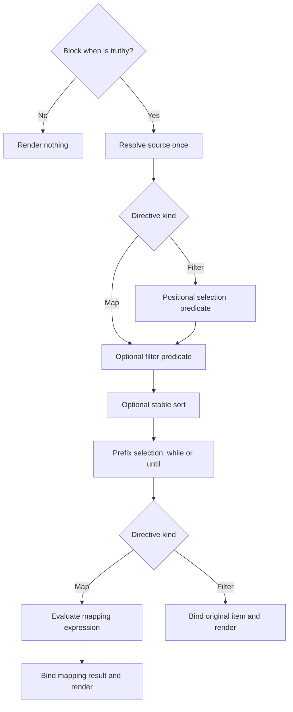

# Map and Filter Directives

## Objective

Add `::map` / `::end-map` and `::filter` / `::end-filter` so authors can render
collections through repeated Markdown bodies. Both directives support typed
sources, lexical locals, destructuring, conditional execution, stable sorting,
prefix selection, nested directives, and existing shell-template approval.

Map transforms retained items before exposing them to the body. Filter selects
items and exposes their original values. Their shared behavior must have one
implementation, one type model, and consistent behavior in the library, CLI,
and Darkmatter Language Server (DMLS).

This specification records the design decisions for implementation. The current
user-facing behavior belongs in:

- [Map directive](../../docs/inline/map.md)
- [Filter directive](../../docs/inline/filter.md)

Those documents remain marked **Planned** until implementation is delivered.

**Review note (2026-10-27):** This review fills in grammar, scope, shell-template,
and failure-handling details against the current implementation. The shared
block scanner already owns shell blocks as well as conditional blocks; that
ownership and existing shell caching must survive this feature. The author
settled composition order, dynamic child discovery, and expansion budgets.
No product rulings remain open; implementation has not started.

## Scope and Boundaries

In scope:

- Both directive grammars and their shared structural parser and execution.
- Typed lexical bindings under the reserved `local` namespace.
- Shared anonymous-function parsing, shallow destructuring, and object-expression
  shorthand needed by directive functions.
- Source-type validation, type propagation, diagnostics, DMLS completion and hover.
- Existing transclusion, provenance, request context, policy, and shell approval
  integration, including directive-local argument types.
- Request-wide expansion limits and meaningful cross-platform acceptance tests.
- Documentation and skill updates reflecting the delivered behavior.

Out of scope:

- A separate expression evaluator or permission system.
- First-class function values, stored closures, arbitrary assignment, or mutation
  of document state through iteration bindings.
- Nested destructuring patterns, default destructuring values, and rest bindings.
- Automatic per-item error recovery, implicit separators, or multi-key sorting.
- Implementing expression-level `map()` / `filter()` merely to implement these
  rendering directives.

### Relationship to expression functions

`2026-11-01-map-and-filter-expression` defines expression functions using the
same arrows, binding patterns, local namespace, iterable entries, type
projection, and iteration accounting. Coordinate shared parser and scope work;
do not create a competing callback AST, lookup stack, or type checker. Both
consumers use retainable immutable lexical frames, with immediate expression
callbacks borrowing views and later directive stages retaining scope handles.

Directive callback slots are an explicitly permitted syntax surface, not
first-class values. Unlike expression functions, directives accept declared
source references, provide optional callback defaults, and render bodies.
Expression functions accept arbitrary iterable expressions, require callbacks,
and return arrays. Only directive map binds the result back through the input
pattern for its body; expression map returns that result directly.

Record shared implementation work and any departure in this feature's
implementation log, and keep the current topic documentation accurate.

**Reconciliation after review:** The shared scanner, shell-template timing,
cache compatibility, source/pattern grammar, sort validation, and container
rules from the architecture review are accepted. The expression feature now
shares this grammar and scope model; ordinary shadowing is no longer an open
policy question. The author selected document-wide composition stages and
extension of existing composition preflight for dynamic child discovery.
The author also selected the budget defaults, cumulative expansion accounting,
and positive library/CLI controls recorded in R9. The proposed restriction to
passively enumerable literal targets was not adopted.

**Dependency boundary:** `2026-10-27-schema-narrowing-metadata` is a separate,
non-blocking metadata migration. Implement this feature against the existing
registered `NarrowingFact` API, including true-implies `file` for both file
predicates. Schema-authored narrowing syntax and host-artifact changes are not
prerequisites and do not require a temporary or duplicate fact registry.

## Authoring Contract

### R1 — Grammar and defaults

```md
::map <source> "<pattern> => <expression>" <options>
body
::end-map

::filter <source> "<pattern> => <predicate>" <options>
body
::end-filter
```

The quoted positional function is optional. There is no `fn=` option. `->` and
`=>` have identical semantics in every directive callback, including option
callbacks. Parse them through the shared expression machinery, with arrows
binding the complete callback body, including ternaries and nested calls.
Reuse existing identifier and quoting rules; do not split arrows inside string
literals or nested expression syntax.

Sources are variable/property references in the enclosing scope, written
without `{{ }}`: `items`, `fm.items`, `ctx.packages`, `team.members`, and
`local.team.members`. Namespace catalog declarations, not example names,
determine actual types. In this release, a source is one identifier followed
by zero or more dotted identifiers, using the expression lexer's identifier
rules (including dashed names). Calls, operators, interpolation delimiters,
and bracket access are rejected at this position. This bounds the source
grammar without restricting expressions inside callbacks.

The positional callback, when present, immediately follows the source and
precedes named options. Each option occurs at most once; unknown names,
duplicate options, surplus positional arguments, and bare option flags are
errors even in a skipped region. Callback and condition values must be quoted;
use the shared directive cursor's single/double-quote and escape rules. For
example, `"person => person.name == 'Ada'"` keeps expression string quotes
distinct from the outer directive quotes. Decode the outer value once, parse
the expression once, and retain an offset map back to the authored bytes so
escaped quotes do not shift editor diagnostics. Openers cannot span lines.

| Directive | Omitted positional function | Body value |
| --- | --- | --- |
| `::map` | `i => i` | Mapping result bound through its parameter pattern |
| `::filter` | `i => true` | Retained original item bound through its parameter pattern |

In particular, an omitted filter predicate retains falsey items. An explicit
`i => i` filters them out. A null element inside a collection is an actual item;
it is not the same as a null collection.

| Shared option | Contract |
| --- | --- |
| `when="expression"` | Block-level condition, enabled when omitted |
| `filter="pattern => predicate"` | Per-item selection; retain all when omitted |
| `sort="pattern => key"` | Optional key selector over selected original items |
| `sort-order="asc"` or `sort-order="desc"` | Ascending by default; requires `sort=` |
| `while="pattern => predicate"` | Stop before the first falsey result |
| `until="pattern => predicate"` | Stop before the first truthy result |

On `::filter`, its positional predicate runs first and `filter=` is an
additional short-circuiting condition. A falsey positional predicate prevents
the additional predicate from evaluating. An option's parameter name does not
change the body's binding name. `while` and `until` are mutually exclusive.
Option position does not change semantic operation order. Invalid option
combinations and malformed callback syntax must produce located diagnostics,
not silently select one meaning.

Option names and ordering values are case-sensitive. An empty callback or
condition is invalid. An empty source collection does not suppress grammar or
option errors.

### R2 — Typed collections and absence

Sources must have a statically known iterable type from the effective schema,
namespace/global declarations, or enclosing local bindings. Literal frontmatter
contents alone do not satisfy the declaration requirement.

- Arrays and tuples yield elements, preserving declared element types. Tuple
  iteration combines its possible element types.
- Objects yield `{key: string, value: any}` entries. Both fields exist even when
  the value is null. Preserve a more specific declared value type; heterogeneous
  object properties contribute a union rather than always degrading to `any`.
- `any[]` establishes iterability; `any` alone does not.
- Unions of iterable alternatives are allowed. Optional and nullable iterables
  are allowed without a guard.
- A union containing a non-null scalar alternative needs narrowing to iterable
  alternatives at the iteration site. Use existing type-scope guard facts.
- Missing/null sources and empty collections render nothing. An undeclared
  source is still a static typing problem. Required frontmatter properties
  remain subject to ordinary schema validation.
- A reached non-null scalar source fails composition.

Use the shared schema meaning of `any`/`unknown`; neither spelling implies a
collection shape. Named types resolve through the owning effective schema's
definitions. An open object's undeclared entries remain unknown, rather than
being incorrectly limited to the union of its explicitly declared properties.
Object iteration includes its actual own entries only, not absent optional
schema properties. Tuple types retain their existing schema representation;
this feature does not add a tuple runtime value alongside JSON arrays.

Check the source under the true side of its own `when`, in addition to enclosing
guards. Thus a shared type predicate may establish iterability for that source.
A false gate does not excuse a provably invalid source declaration or call;
passive checking uses the shared narrowing rules without running the guard.

Preserve the planned recovery identifiers `untyped-map-variables` and
`untyped-filter-variables`, with matching library policy controls. They waive
only the static source-typing requirement. Route them through the existing
policy registry; do not invent another exceptions engine. Runtime shape checks,
expression errors, and shell authorization still apply.

A recovery does not turn a known scalar declaration into an iterable. For an
unknown source it permits runtime shape discovery, yielding unknown array
elements or `{key: string, value: unknown}` object entries. Report the recovery
warning once at the authored source site, not per iteration, and honor a request
that blocks that warning before executing more expressions.

Both `is_file_type(value)` and `file_exists(value)` establish `file` suitability
on their true side through the shared predicate registration. `file_exists`
additionally checks existence at evaluation time; that observation does not
make subsequent reads infallible. Its false side cannot exclude the file type,
since a valid reference may be absent. Unknown values do not satisfy a file
requirement without a declaration or a proven refinement.

Refine the actual checked binding, not another evaluation of an identical
read-side expression. In particular, checking `file_exists(frontmatter(t,
'include'))` does not automatically validate a later independent
`frontmatter(t, 'include')` read. Prepared values may carry facts about themselves;
do not implicitly memoize arbitrary callbacks to manufacture that identity.
Type suitability does not itself identify which child documents preflight must
inspect; composition preflight discovers those values under the settled rule
in R8 below.

### R3 — Binding patterns and transformation

A pattern is a single identifier or shallow object pattern, such as
`{key,value}`. Object-expression shorthand `{key,value}` means
`{key: key, value: value}`. Pattern fields must exist; a present null field is
not a missing field. Reject provably incompatible shapes statically and check
uncertain shapes at runtime.

Only nonempty shorthand patterns such as `{key,value}` are supported. Fields
must be distinct identifiers; aliases (`{name: person}`), quoted/computed keys,
array patterns, and parenthesized/multiple parameters are outside this grammar.
Extra item fields are allowed and ignored by the pattern. Each identifier must
also satisfy the protected-name rules below. Object-expression shorthand is
lowered to the existing object-expression form and preserves field order; it
does not introduce a new runtime object kind. Existing duplicate-key and
no-trailing-comma rules still apply to object expressions and patterns.

For map, bind the input to the pattern while evaluating the mapping expression,
then bind the result to the same pattern for the body. For example:

```md
::map people "person => person.name"
- {{person}}
::end-map
```

Inside the function, `person` is the input object. Inside the body it has the
resulting name's type. `{key,value} => {key, value: upper(value)}` exposes the
transformed fields. `{key,value} => value` fails if the returned scalar cannot
satisfy the object pattern.

For filter, bind the input to evaluate the predicate, test its result using
existing truthiness, and retain the original input bindings for the body:

```md
::filter people "person -> person.active"
- {{person.name}}
::end-filter
```

The body receives the person, not the predicate's boolean or other truthy
result. Preserve the input's declared type and use the shared narrowing engine
where predicate guards prove refinements; never substitute the predicate
result type for the item's type. No independent predicate-narrowing logic is
authorized.

Apply selection facts to original-item bindings, using their binding identity
even when two callbacks use different names. Keep only refinements the shared
engine can prove. A map's result is a new binding: facts about the input cannot
be transferred just because its body reuses the same parameter spelling.
Do not sample the first runtime item to infer a body type. Unknown mapping
results stay unknown and use the existing uncertain-call diagnostics.

### R4 — Local namespace and ownership

All directive-local bindings live in the reserved `local` namespace:

| Read | Meaning |
| --- | --- |
| `foo` | Nearest local binding, otherwise normal lookup |
| `local.foo` | Nearest local binding only |
| `fm.foo` | Frontmatter property regardless of local shadowing |

Binding presence determines shadowing: null does not fall through. Inner locals
may shadow outer locals and frontmatter properties. Unshadowed outer locals
remain accessible. Leaving a scope restores the outer meaning. Reserved
namespaces and registered host globals cannot be shadowed.

`local` is a new reserved expression root shared with expression callbacks.
Outside any active lexical scope it has no bindings: `local.foo` reads
absent/null and never falls back to frontmatter. Inside an expression callback,
its parameter bindings remain available even outside a directive body. Access an existing frontmatter key named `local`
through `fm.local`; hosts must rename a global named `local` before registering
it. Update the root catalog, binding classification, host collision checks,
and their tests together. This is an intentional namespace change, not a
silent reinterpretation of a host global. Merely enumerating `local` bindings
for editor completion must perform no runtime observations.

Resolve the block gate and source in the enclosing scope before introducing the
new item binding. Each option callback has an independent parameter scope over
the enclosing scope; another callback's parameter must not leak into it. Body
bindings derive only from the positional pattern, or default `i`.

Bindings never modify frontmatter or leak into siblings. Use immutable lexical
scope frames in the existing binding/evaluation/type-scope model. Explicit and
implicit local reads must agree in runtime, passive validation, hover,
completion, and undeclared-property diagnostics.

The implicit and explicit spelling of one local share a binding identity.
Facts about `fm.person` cannot narrow a local `person`, and facts about an outer
`person` cannot narrow an inner binding with the same name. `local` follows
nearest-name lookup; there is no depth-qualified escape to a shadowed outer
binding. Authors needing both values must use distinct names. Ordinary local
shadowing has no advisory in either directives or expression callbacks.

Transclusion targets, conditions, and explicit child parameters may read locals.
A child document does not automatically inherit the local frames. Pass iteration
values using existing transclusion `set` options, preserving their origin.
Existing frontmatter inheritance continues unchanged.

### R5 — Execution sequence and laziness



`when` is an ordinary block-level expression using existing truthiness. Evaluate
it once before resolving the source. A falsey result prevents all runtime source
and item evaluation but does not disable passive validation or authorization.

All selection predicates, sorting selectors, and stopping predicates receive
original items. Selection precedes sorting; sorting precedes prefix selection.
An item rejected during selection cannot stop the sequence. For `[1, 2, 3, 4]`,
`while="i => i < 3"` and `until="i -> i == 3"` both render `1, 2` when other
selection retains everything. Neither renders the stopping item.

Without sorting, fuse the stages lazily: reaching a stopping boundary prevents
later selection predicates from evaluating. With sorting, selection and key
computation must inspect the collection before prefix selection. Compute each
selected item's key once; do not evaluate expressions inside a comparator.

When sorting, visit items in source order and compute a selected item's key
immediately after its selection predicates pass, before visiting the next
item. Stop at the first selection/key failure. Without sorting, evaluate
selection, the stopping predicate, and mapping in that order for each item
before visiting the next. Capture the resolved source value for this invocation;
later observations or nested work cannot replace the collection being iterated.

Parse callbacks once, resolve the source once per invocation, and evaluate each
applicable predicate once per reached item. Transform retained items and prepare
their authored bodies in order. An inner directive is invoked separately for
each reached enclosing iteration. Do not parallelize callbacks or reorder their
effects. Finish structural callback evaluation and body preparation before
ordinary body interpolation, then run the existing shell, link-resolution,
transclusion, cleanup, and normalization stages. A body's shell or transclusion
work does not finish before the next item callback starts; it runs later.

### R6 — Ordering and sort keys

Arrays and tuples retain element order. Objects retain insertion order, including
key order in authored YAML. Filtering preserves relative order. Preserve this
contract through loading, overrides, value conversion, and composition across
macOS, Linux, native Windows, and WSL2.

Sorting is stable in both directions. Equal keys preserve their previous order;
implementing descending order by reversing a sorted list would violate this.
Numbers compare numerically. Strings compare case-sensitively using Rust's
locale-independent string ordering, without Unicode normalization. Authors may
normalize keys with `lower(...)`. Keys must all be numbers or all be strings.
Missing/null keys, booleans, mixed numeric/string keys, and object/array keys are errors.
Do not coerce numeric-looking strings into numeric keys. Retain original indices
or keys separately from output positions for diagnostics.

Validate every selected key, including a single-item collection. Empty selections
do not evaluate the selector. Reject a provably unsupported key type passively;
uncertain key types receive the same runtime checks. Do not reuse expression
relational operators for strings: those operators have numeric-coercion behavior.

### R7 — Structural composition and provenance

One Markdown-aware structural parser/traversal handles map, filter, conditional,
and shell-block regions. Extend Darkmatter's existing
[shared block scanner](../../lib/src/markdown/compose/block_pairs.rs), which
already pairs `::block` and `::shell-block` with `::end-block`; do not leave
shell blocks on a separate stack. Complete document frontmatter preparation first. Evaluate
outer gates before entering nested regions; inner gates see enclosing iteration
bindings. Do not add a global map-expansion pass independent of conditional
block structure.

Carry scope, authored source spans, data provenance, request context, and
iteration identity through later body interpolation, shell, and transclusion
processing. Repeated bodies are authored templates, not concatenated strings
to rediscover as directives. Iterations do not rerun frontmatter or start a new
root composition request. Child file references use the existing request-owned
resolution context and biscuit-file's
[FileReference](../../../biscuit-file/lib/src/file_reference/mod.rs) resolver,
which interprets file references in that context; never recapture the working
directory or environment.

Text replacement remains document-scoped and precedes structural evaluation;
it is not reapplied to each item. Cleanup, heading normalization, and root-only
link normalization retain their existing scope, rather than running once per
repeated item. The shared traversal must obey enabled operations and the
frontmatter-only projection: discovery may prepare collection values needed
for its graph, but must not execute repeated bodies or enable operations the
caller disabled. Frontmatter-only requests do not traverse collection bodies.
Record the collection operation in the existing operation registry, rather than
using a second pipeline driver. The document-wide scheduling decision below
is settled.

Preserve the existing inserted-data rule: produced values cannot introduce
executable interpolation, closers, directives, or code fences that hide authored
instructions. Authored replacements retain their existing semantics. Explicit
`as_markdown()` retains its existing composition and permission contract. This
feature does not prohibit ordinary Markdown rendering of inserted content.

### R8 — Passive checking and shell authorization

Map/filter validation is schema and expression analysis. It performs no callback
I/O, shell execution, or network effects. Check all authored surfaces, including
skipped bodies, through existing passive call checks. A runtime gate does not
excuse statically invalid authored calls.

All authored shell commands require explicit whitelist permission regardless of
conditions and selection. Existing shell machinery remains the only owner of
authorization, approval presentation, template matching, argument validation,
blacklists, and execution membership.

For a `pkg: string` local, `::shell just test {{pkg}}` requests approval for the
template `just test {{ string }}` in the existing rule syntax. Preflight needs the local type,
not enumeration of values or execution of callbacks. The approved shape covers
iterations; each reached execution validates actual arguments through existing
template checks. A value cannot add operators, redirection, or commands.

Any placeholder that reads an iteration local, directly or through an
expression, is an execution-time value and makes its command template-only.
Extend the existing per-placeholder timing and template-required machinery;
do not register locals as host globals or treat their lack of a discovery-time
value as `MissingValue`. Discovery checks syntax and projects types without
running callbacks, including in empty collections and false branches. It still
checks unrelated, approval-time placeholders normally. At execution, a null
local is missing and fails through existing shell input diagnostics.

Project declared local constraints and shared guard refinements into the same
template validator used for document values. A numeric local still uses the
existing broad `string` approval hole with its numeric validator; it does not
create a persisted `number` hole type. Bare and explicit local reads must project
identically. Preserve the existing broad scalar fallback for unknown types:
an untyped-source recovery may use that fallback, but it cannot make null or a
container valid as a shell argument, or supply a narrower approval type.

Unsupported templates fail through existing shell
diagnostics, never acquire approval from a schema or guard. Commands in
transcluded children retain the same authorization rules and explicit parameter
typing. Dynamic child discovery must retain the existing approval-before-execution
invariant; do not execute callbacks during passive analysis to discover targets.

#### Settled dynamic child discovery ruling

Extend existing composition preflight, which already evaluates expressions to
discover targets. Schema validation and DMLS analysis remain passive. Preflight
may enumerate typed collections and evaluate discovery-supported expressions
needed to identify child targets, including target-producing callbacks. It may
therefore read files for items that rendering later skips; it does not execute
their shell commands or compose their bodies.

For example, a declared `chapters: file[](required)` populated by
`chapters: "{{ find_files('./chapters/*.md') }}"` supports:

```md
::map chapters
::file {{i}}
::end-map
```

Inspect candidate children before collection conditions, selection, or stopping
can exclude them. Preserve condition-blind approval recursively, including when
explicit local parameters passed into a child determine that child's targets.
Types and refinements still establish suitability; discovery does not make an
unknown value satisfy a file requirement.

Preserve existing rejection of targets dependent on pending shell output or
other execution results discovery cannot faithfully produce. Extend dependency
tracking through collection sources, callbacks, and locals so an indirect read
cannot bypass that rejection. Reuse existing dynamic/unevaluated-shape errors
where their typed meaning fits, identifying the authored target and dependency
during preflight rather than deferring the explanation to execution.

Retain discovered graph metadata with enough authored-site and iteration-scope
identity to distinguish repeated targets and child parameter scopes. Existing
target graph reuse is not a promise to cache arbitrary callback results or
rendered bodies. Runtime targets must match the discovered graph in their
scope; a newly encountered target fails rather than receiving late approval.
This adds neither a literal-target-only restriction nor an explicit target-list
declaration or a new permission mode. Types never grant shell permission.

**Compatibility note:** Repeating a shell command does not promise repeated
process execution. The existing request-wide shell result cache still applies;
membership, argument validation, and blacklists are checked before reuse.
Authors needing a fresh process each time use the existing `::shell --no-cache`
or `::shell-block no_cache=true` control. This feature adds no implicit cache
bypass and no directive-specific approval syntax. These rules also cover every
logical command in a repeated shell block.

### R9 — Failure policy, budgets, and diagnostics

Missing/null sources, empty collections, and empty selections render nothing.
Reached non-iterable scalars, predicate failures, mapping/destructuring failures,
invalid sort keys, and stopping-expression failures fail composition. Body
operations retain their established failure policies and explicit recoveries.
There is no automatic skip-on-error behavior and no successful partial map/filter
result after failure. Earlier effects are not rolled back.

Preserve ordinary expression behavior inside callbacks: a function that returns
null has not failed, and an explicitly handled expression error follows its
existing handler. An unhandled directive failure stops further callbacks in that
invocation. Collection typing, pattern, and ordering failures must remain fatal
through lenient transclusion rather than become a successful notice. Explicit
expression handlers retain their existing treatment of ordinary nested
composition errors. Budget exhaustion is request-fatal and cannot be absorbed
by an `as_markdown(...)` fallback. Ordinary child read failures keep their
established policy. Preserve warnings collected before failure in the compose report.

Both directives share request-wide budgets across nesting and transclusion:

- **100,000 visited source items** by default, including items rejected by
  selection. Count once per invocation's source-item visit, not once per stage.
- **16 MiB (16,777,216 bytes) of cumulative UTF-8 expansion work** by default,
  bounding generated output even with small collections.

Exhaustion fails composition. Nested invocations must not reset the budgets.
Existing transclusion depth limits remain separate. Charge an item before
evaluating its first predicate: the stopping item counts, later unvisited items
do not, and sorting visits every source item. Even an empty body consumes visits.
Check output growth before allocation/append rather than after constructing an
oversized string. Use checked arithmetic and shared request-owned counters,
including for concurrent children, expression map/filter calls, and explicit
nested composition. Preflight does not consume execution budgets. These limits
bound collection expansion; they do not cap internal allocation by arbitrary
expression handlers or a subprocess before its output reaches the document.
Existing operation-specific limits continue to apply.

Charge bytes when materialized into a collection expansion, including authored
body text and inserted expression, shell, and child output. Charge nested output
again when copied into an enclosing expansion, and cached fragments whenever
inserted into an expansion. Ordinary pipeline passes and buffer reallocations
do not add charges; neither do unrelated source text or preflight copies.
Expression result arrays are values, not rendered-output bytes. For example,
a 1 MiB inner expansion copied into an outer expansion consumes 2 MiB of
expansion work, even if the final output is only 1 MiB. An exactly full budget
succeeds; fail before an append that would exceed it.

Expose positive limits through library options and `md compose` flags
`--max-iteration-visits` and `--max-expansion-bytes`, with identical defaults.
The byte flag takes an integer byte count. Reject zero, negative, and overflowing
values; provide no unlimited setting or recovery. Include configured limits in
composition identity and preserve them through nested requests. Standalone
expression evaluation uses the same default visit limit and configurable
session-owned counter; nested calls never acquire fresh allowances. Concrete
Rust option/builder names follow existing library conventions.

Reusing cached content must not avoid budget charges or replay a result for a
different lexical binding. Preserve existing cache ownership and include all
semantic inputs when caching scoped work; a parsed body/callback may be shared,
but evaluated local values may not be reused merely because authored bytes
match. No new persistent collection-result cache is required.

Library-owned typed diagnostics preserve the underlying error, authored file,
line/column, expression span, and nested iteration path. Use original indices
or keys after sorting, for example `teams[2] → members[4]`. Static defects report
once per authored site; runtime failures include the exposing iteration. Integrate
with existing warning identity, CLI policy, report-json, and DMLS projection;
never reconstruct codes or provenance from formatted messages.

### R10 — Markdown boundaries

Openers and closers occupy their own lines. Closers accept trailing whitespace
only. Ignore directive-looking content in fenced and indented code blocks.
Retain Markdown container context for lists and blockquotes. Determine code
indentation relative to its Markdown container, not by trimming every line.
All region kinds
must nest correctly; crossing boundaries are errors. An unexpected closer names
its location and the still-open inner region; an unclosed region retains its
opening location.

A `::shell-block` inside a map/filter body repeats as an authored shell template;
its `::end-block` closes that shell block, never the surrounding collection.
Collection openers inside a shell-block command body are invalid: this release
does not introduce a control language inside shell commands. Existing conditional
and shell-block parsing otherwise keeps its established behavior.

Quoted `> ::map` / `> ::end-map` and filter pairs are active within their matching
blockquote container, and preserve its markers when repeating content. Match
the full container ancestry, including quote depth; a closer outside that
container cannot close an inner region. Keep quoted `> ::block` examples literal,
as they are today. **Reader's note:** A common scanner does not imply common
activation rules. Activating existing quoted conditional examples would execute
documentation that currently renders as text. This feature deliberately preserves
that behavior and the existing active quoted shell-block behavior. A quoted
`::end-block` closes an active quoted shell block; it stays literal when it
belongs to a quoted conditional example. An author
who needs a condition in a quoted collection can use its `when=` option.

Repeat the authored body's whitespace, including its newline and blank lines,
without implicit separators. Preserve indentation. An empty directive removes
its own region without inserting a placeholder or blank line. Preserve surrounding
text and use the established cleanup stages afterward.

Recognize LF and CRLF line boundaries and a closer at end of file without a
final newline. Preserve the loaded body's line endings during repetition; do
not promise to reverse any normalization performed by the loader. Diagnostics
continue to reference authored source positions, including with multibyte text.

## Implementation Architecture

The following are integration points in the **darkmatter library**, except where
the CLI or **dmls** language-server package is named. Extend these owners rather
than creating parallel layers:

| Existing owner | Required change |
| --- | --- |
| [Block scanner](../../lib/src/markdown/compose/block_pairs.rs), [page blocks](../../lib/src/markdown/compose/page_blocks/mod.rs), and [directive cursor](../../lib/src/markdown/compose/parse_utils.rs) | Shared typed structural regions including shell blocks, Markdown container handling, matched closers, source spans |
| [Expression parser](../../lib/src/markdown/compose/expression/parser.rs) and [syntax tree](../../lib/src/markdown/compose/expression/ast.rs) | Shared callback parsing, both arrows, shallow patterns and required object shorthand |
| [Bindings](../../lib/src/markdown/compose/expression/binding.rs), [TypeScope](../../lib/src/markdown/compose/expression/scope/mod.rs), and [root catalog](../../lib/src/markdown/compose/expression/catalog/roots.rs) | Reserve `local` and add lexical identity and source/item/result types to the existing lookup and type system |
| [Static read inventory and absence tracking](../../lib/src/markdown/compose/expression/absence.rs) | Recognize parameter/body locals; do not misreport them as frontmatter or host-global reads |
| [Call precheck](../../lib/src/markdown/compose/call_precheck.rs) and dmls [completion](../../dmls/src/providers/completion.rs)/[hover](../../dmls/src/providers/hover.rs) | Discover directive expressions and body scopes without executing them; offer only bindings visible at the cursor |
| [Body provenance](../../lib/src/markdown/compose/body_origin.rs), [pipeline phases](../../lib/src/markdown/compose/pipeline/phases.rs), and [operation registry](../../lib/src/markdown/compose/pipeline/operations.rs) | Preserve per-iteration scope, source origin, data ranges, enabled operations, and stage ordering |
| [Shell template typing](../../lib/src/markdown/compose/shell_expansion/template/typing.rs) and [candidate preparation](../../lib/src/markdown/compose/shell_expansion/template/candidate.rs) | Project local types into existing approval shapes, delayed placeholders, and runtime argument checks |
| [Preflight collection](../../lib/src/markdown/compose/preflight/collect.rs) and [transclusion phase](../../lib/src/markdown/compose/pipeline/phases.rs) | Explicit local handoff, preserved request authority, graph discovery and shared budgets |
| [Diagnostic reporting](../../lib/src/markdown/compose/report_diagnostics.rs), CLI [policy registry](../../cli/src/args/policy.rs), and dmls [codes](../../dmls/src/diagnostics/codes.rs) | Shared typed errors, recovery controls, source locations and iteration context |

Use one collection-region executor parameterized by whether the positional
callback selects or transforms. Reuse one iterator adapter for arrays, tuples,
and object entries, with original positions and declared types alongside values.
Do not build separate map/filter engines whose scope or error behavior can drift.

The library already enables `serde_json`'s `preserve_order` feature. Verify the
whole value path rather than adding an unrelated ordered-map representation.
Use the repository's numeric admission/comparison infrastructure for numeric
keys. Retain existing rendering components and file-resolution machinery.

Traverse a captured source without cloning its whole value per item. Without
sorting, do not allocate an intermediate collection of rejected items. Sorting
may retain selected values or references and one key per selected item. Reuse
the parsed body across iterations while retaining separate immutable binding
frames and iteration identities. These are implementation constraints, not a
new benchmark project; no performance spike is required by this specification.

## Acceptance Criteria and Verification

The implementation is complete only when both directives satisfy the same
shared corpus with their documented difference in selection versus transformation.
Use table-driven cases that assert behavior, not snapshots of internal structures.

| Area | Required evidence |
| --- | --- |
| Grammar | Both arrows in every callback position; omitted callbacks; quoted strings containing arrows; nested calls/ternaries; malformed patterns and closers |
| Map semantics | Identity, scalar projection, object transformation, result-pattern failure, mapped result type in the body |
| Filter semantics | Truthy selection; original item/type in body; omitted predicate retains falsey items; explicit identity removes falsey items; extra `filter=` short-circuits |
| Sources | Frontmatter, namespace and enclosing-local sources; arrays, tuples, objects, unions, nullable/optional sources, null elements, untyped recovery and invalid scalars |
| Locals | Explicit `local` and `fm`, implicit precedence, null shadowing, outer-local capture, shadow restoration, protected names and sibling isolation |
| Destructuring | Typed dictionary values, heterogeneous values, null versus missing fields, input/result incompatibility and no first-class callback values |
| Gates and laziness | False `when` prevents runtime source work; excluded items do not reach later stages; stopping excludes its boundary item; no later callbacks without sorting |
| Sorting | Original-item keys, ascending/descending, stable ties, source/object order, locale-independent strings, null/mixed/unsupported key errors and one key evaluation |
| Stage composition | Map in filter, filter in map, nested conditionals on both sides, scopes survive later interpolation and transclusion without rerunning frontmatter |
| Data provenance | Inserted interpolation/directive/closer/fence text stays data; authored directives still run; explicit nested composition retains its established behavior |
| Transclusion | Local target and `set` parameters, no implicit local inheritance, preserved child resolution context and original diagnostics |
| Shell approval | One typed template covers iterations; denied template stays denied even in false branches; actual arguments checked; selection cannot authorize commands |
| Markdown | Exact newlines and blank lines, empty removal, surrounding text, nested list/block-quote containers, fenced/indented code and mismatched boundaries |
| Child discovery | Read-side typed collection discovery; skipped candidates inspected; recursive local parameters; indirect execution-dependent targets rejected; iteration scopes distinguish repeated targets; new runtime targets rejected without late approval |
| Limits | Shared nested map/filter/child budgets, rejected items counted, no stage double counting, large-output rejection and unchanged transclusion-depth enforcement |
| Diagnostics/editor | Original source/key after sorting, nested iteration path, static errors once, library/CLI/report-json/DMLS code and span agreement, scoped completion/hover |
| Existing behavior | Page blocks, expression functions, source provenance, shell templates, schema validation and transclusion regressions remain green |

The corpus must also cover the review's integration boundaries:

- Duplicate/unknown options, both explicit sort orders, ordering without a
  selector, empty expressions, malformed quoting, and escaped/multibyte spans.
- Named/open-object source types; absent optional object fields; a source
  narrowed by its own gate; recovery on unknown versus known scalar types.
- Different callback names referring to the same original item; a mapped result
  that must not inherit input guard facts; explicit and implicit local aliases;
  the reserved-root catalog and a host trying to register `local`.
- A repeated shell block with its own closer; quoted conditional examples that
  stay literal; mismatched quote/list containers; LF, CRLF, and no final newline.
- Template-only local placeholders, ordinary unrelated missing placeholders,
  numeric validators behind broad string holes, unknown scalar fallback, null
  arguments, default shell-cache reuse, and each existing no-cache spelling.
- Collection failures inside lenient transclusion and explicit nested composition,
  blocked warnings before further effects, and budget accounting on cache reuse.
- Frontmatter-only requests and operation subsets that must not accidentally
  execute collection callbacks, plus the settled document-wide ordering and
  condition-blind dynamic-child discovery cases.
- Identical library/CLI defaults, positive custom limits, invalid limits,
  exactly-full success, failure before an excessive append, nested copied-output
  charges, cached insertions, and no charges for ordinary stage passes or
  preflight copies. Expression arrays must not count as rendered bytes.

Include a passive shipped-artifact corpus check and an end-to-end invocation
through the normal `md compose` route. Put executable examples under stable
fixtures; tests must declare repository reads in the forms the CI input scanner
understands. Do not turn internal prompts into mandatory test inputs.

These checks are primarily L1: use the area's nextest-backed `just test` and
`just lint` recipes. Use `CliProcessFixture` for CLI processes and the shared
Test Toolkit (`tools/test-toolkit/README.md`), including its native argument
recorder to prove shell argument boundaries without POSIX-only scripts. Use
controlled effect handlers/counters for evaluation-order tests. Do not require
real network services, a particular host repository, or interactive approval.

DMLS checks must prove analysis does no I/O-producing callback evaluation.
Only add real terminal/browser checks for behavior that cannot be proved at L1;
use the established tier recipe and ensure no window gains focus. Validate
cross-platform behavior on macOS, Linux, native Windows, and WSL2 through the
repository's normal evidence workflow. Do not add speculative CI cells or run
workspace-wide checks for a Darkmatter-only change.

## Delivery and Documentation Requirements

Implementation must update documentation in the same change that delivers the
behavior. Both directive documents must be reviewed in full, not merely have a
status marker removed:

1. Update `darkmatter/docs/inline/map.md` to describe the actual shipped grammar,
   behavior, examples, failure policy, options, limits, and library/CLI controls.
2. Update `darkmatter/docs/inline/filter.md` to describe the actual shipped
   behavior, explicitly preserving original items rather than predicate results.
3. In **both files**, create or update YAML frontmatter with
   `kind: canonical-documentation`, and remove the **Planned** notice only when
   their implementation is complete.
4. Synchronize `darkmatter/docs/iterables.md`, pipeline, expression/local-scope,
   page-block, shell-approval, policy, and DMLS topic documentation wherever
   the delivered behavior changes their contracts. Update the relevant Darkmatter
   skill topics and the README overview as warranted. Document dependency changes
   if implementation introduces or removes any crates.
5. Keep topic docs independent of feature lifecycle paths: they must not link to
   or name this feature directory. This spec may link to topic docs.
6. Record implementation departures in the implementation log and correct current
   docs; do not rewrite this specification to disguise a departure.

The final review must explicitly verify both directive files have the required
`kind` and contain no stale planned behavior or inconsistent examples. The
agent's implementation endpoint is ready for review; only the author closes the
review cycle and moves the feature into the completed lifecycle directory.

## Settled Pipeline Ruling — 2026-10-27

The author selected the existing document-wide stage model. Prepare frontmatter
once, then evaluate structural regions and collection callbacks with their
scopes. Prepare each retained body without restarting composition per item.
Next interpolate those bodies, run the existing body shell stages, resolve
links, compose child transclusions, and perform the existing cleanup and
normalization stages. Child processing retains established concurrency and
output placement; completion order of child effects is not promised.

For two retained items A and B, both callbacks run before either body's ordinary
shell directive. Callback B therefore cannot observe a change made by body A's
later shell command. If callback B fails, neither body's shell stage has run;
if body A's shell command fails, callback B has already evaluated. Explicit
expression effects, including an `as_markdown()` called from a callback, execute
when that expression is evaluated; they are not deferred merely because body
shell/transclusion directives are deferred.

Collection operations participate independently in the existing operation
registry. Preserve frontmatter-only requests and caller-disabled operations;
collection enablement is not implicitly tied to conditional-block enablement.

## Remaining Implementation Details

Choose diagnostic identities and final library recovery API spellings through
the existing registries. New warning codes belong in the library's diagnostic
catalog and must appear consistently in CLI policy, structured compose reports,
and DMLS. Keep diagnostic wording and locations useful without requiring the
reader to know this spec's section labels. The product rulings are settled;
keep topic docs synchronized as implementation lands before declaring it ready
for review.
