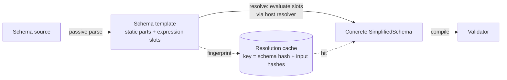

---
$schema:
    status: |-
        enum(
            draft-spec,
            finalized-spec,
            planned,
            implemented,
            review-findings,
            human-in-the-loop,
            completed,
            on-hold,
            abandoned
        ) -> an indicator of progress for this specification
    reviewed: boolean -> indicates whether the specification file has been reviewed by another agent from the one which created the spec
    reviewed_by: string -> the agent and model used in the spec review
    reviewed_on: date -> the date the spec was reviewed
    review_iterations: number -> the number of implementation reviews have taken place in the review/fix cycle
    clarified: boolean -> indicates whether the specification was built -- _in part_ -- with the 'clarify.md' prompt
    implemented: boolean -> indicates whether this spec's plan has been implemented
    implemented_by: string -> the agent who implemented the plan
kind: feature
created: 2026-11-04
status: draft-spec
needs_rulings: true
required_rulings:
    - >-
        R1 — Schema-expression authorization: approve the recommended model
        under "Which expressions may resolve automatically?" (automatic pure
        expressions and fingerprinted local reads only after an explicit host
        trust opt-in, with shell, remote, and volatile operations left unresolved
        until an explicit operation authorizes them), or select explicit
        composition only with DMLS consuming supplied snapshots, or every
        expression through existing approval policies. This determines whether
        enabling editor support authorizes background local-file reads and
        whether effectful schema slots are supported by explicit operations.
        The same model must govern md schema validate, md clean, reference
        checks, pre-flight walks, DMLS, and library callers. Recommendation:
        approve the first model; trust must be granted by the host or user,
        never by repository-controlled schema or workspace configuration.
        Evidence: the specification explicitly reserves this safety choice for
        the author; darkmatter/dmls/src/config/mod.rs::SchemaConfig and
        ExpressionsConfig expose no schema-evaluation trust control, while
        ShellConfig only selects a shell-policy path;
        darkmatter/lib/src/markdown/compose/context/options.rs::ComposeOptions::for_reference_check
        restricts existing composition operations but establishes no authorization
        for dynamic schema resolution. Existing code therefore supplies no
        product contract from which to infer this permission.
area: darkmatter
reviewed: true
reviewed_by: codex/gpt-6.1-sol
reviewed_on: 2026-11-07
clarified: true
implemented: false
review_iterations: 0
related:
    - 2026-10-28-extract-simplified-schema
    - 2026-11-04-composition-errors
depends-on:
    - 2026-11-04-loading-data
    - 2026-11-05-render-surface
---

# Dynamic Schema Types

Let the expression engine take part in defining a schema. At minimum,
`enum(...)` members and `suggest(...)` candidates must be computable from an
expression. The goal is **broad** support: anywhere a schema author writes a
type expression should eventually accept a `{{ … }}` expression.

This remains a **draft** until the focused investigations report and the author
resolves the safety and trigger-loading choices under Open Questions. The
author decisions under Rulings remain in force. Its main job is to determine
how dynamic types can run safely with good performance. Narrowing where
expressions may appear is the **last resort**. It is considered only if the spikes show that
no caching or resolution strategy keeps validation and DMLS responsive.

## Motivation

A schema often repeats a list that already lives in a data file. The
motivating case is `claudine/docs/research/sandboxing/providers/sandboxing.yaml`:

```yaml
types:
    os: enum({{ as_csv(claudine/docs/os.yaml) }}; required)
```

Today this fails when the schema loads:

```text
invalid SimplifiedSchema for property os:
expected `,`, `;`, or `)` in enum members, found `a`
```

That file is committed, so the shipped-schema corpus test
`every_kinded_schema_artifact_passes_its_definition_through_the_registry`
currently excludes it. The carve-out fails once the file validates; this
feature removes it when passive template admission works.

In the simplified-schema package,
[`parse_enum_members`](../../../simplified-schema/lib/src/simplified/grammar.rs)
parses enum members as strings,
and schema handling is deliberately passive: parsing, validation, trigger
matching, completion, and hover perform no I/O and evaluate no expressions.
With 2026-11-04-loading-data, the intended spelling becomes:

```yaml
types:
    os: enum({{ load_data("../../../os.yaml", "string[]") }}; required)
```

The replacement uses `../../../os.yaml` because the schema is in
`claudine/docs/research/sandboxing/providers/`. A bare
`claudine/docs/os.yaml` would be relative to that folder, not the repository
root. The implementation updates the shipped schema to this spelling.

## The tension to resolve

Four existing guarantees push against dynamic types. The spikes must keep
each one or replace it with something equally strong:

1. **Passive schemas.** Schema parsing and validation do not execute anything.
   A schema found by trigger discovery — even in DMLS, just by opening a
   folder — must not be able to run code or touch the network unasked.
2. **Validator caching.** In the darkmatter package,
   [`DarkmatterSchemas`](../../lib/src/markdown/schemas/mod.rs) prepares
   validators through a
   process-wide `SHARED_VALIDATOR_CACHE` keyed on the schema and its resolution
   context. A long-running host (Claudine) composes many documents against a
   few schemas and relies on this.
3. **DMLS latency.** Completion, hover, and diagnostics run on every edit and
   must not wait on file reads or expression evaluation on the hot path.
4. **The extraction boundary.** 2026-10-28-extract-simplified-schema moved the
   schema language into the host-neutral `simplified-schema` library. That
   library owns the *passive* expression parser but has **no evaluator**:
   evaluation, function registration, and lookup stay in Darkmatter.

## Proposed model (to be validated by the spikes)

Split schema loading into a passive phase and an explicit, cached
**resolution** phase:



- **Parse stays passive.** The grammar accepts a `{{ … }}` slot where a member
  list (and later, other type positions) is allowed, checks its syntax, and
  records its span. Nothing is evaluated. Editor features keep working on the
  template.
- **Resolution is the only effectful step.** `simplified-schema` defines a
  host hook (a resolver trait). Darkmatter implements it with its evaluator.
  The result must have the shape the slot requires (defined below), or
  resolution fails with the slot's span. A factory that passively parses a
  template must not resolve it implicitly.
- **Resolution is cached by its inputs.** The cache key is the schema content
  hash plus a fingerprint of everything evaluation read (file content hashes
  via `biscuit-hash`, environment values, `ctx.*` groups). A warm hit avoids
  evaluation and recompilation; establishing that the
  recorded inputs are unchanged may still require I/O. DMLS does that work
  outside completion, hover, and diagnostic requests.
- **Evaluation context is the schema's, not the document's.** Relative paths
  resolve against the schema file. One schema then resolves once for every
  document that uses it within an equivalent schema context, preserving
  validator sharing. Imported definitions retain their defining file's context,
  not the importing schema's folder. Derive each context from the caller's
  captured request through biscuit-file's `FileReference` and context APIs;
  never recapture process state.

## Required semantics

These rules make the existing author decisions implementable. They do not
approve effectful evaluation during discovery or editor requests.

### Slot boundaries and result values

A slot is one complete list element, for example
`enum(none, {{ load_data("../../../os.yaml", "string[]") }}; required)`.
Multiple slots and literal elements may alternate. Flatten each returned
array one level, preserving declaration order and array order. A scalar,
null result, mapping, or nested array is a positioned resolution error; an
empty returned array contributes no candidates. The final enum or suggestion
list must contain at least one candidate.

- Enum slots return **strings only**, matching the existing enum value
  domain. There is no implicit conversion of numbers, booleans, or null to
  enum members. Authors who want conversion request it in the expression or
  in `load_data`'s explicit contract.
- Suggestion slots return scalar candidates. Strings use the existing
  target-directed suggestion interpreter; native numbers use the shared
  numeric model and canonical numeric text, and booleans/null use their
  literal text. Interpret that text exactly as a literal candidate for the
  target type. Thus a string suggestion `true` remains a string, and an
  invalid numeric suggestion is retained for linting rather than becoming a
  schema-load error. Existing eligibility, one-list-per-property, union,
  array-item, and stricter `alphanumeric` rules still apply.
- Apply the author's duplicate decision after candidate interpretation:
  when a list contains slots, keep the first occurrence of each interpreted
  candidate, including collisions between slots. Leave duplicate handling
  for entirely static lists unchanged. This intentionally relaxes dynamic
  suggestion lists relative to the static duplicate-error contract.

**Reader's note:** requiring strings for dynamic enums corrects the earlier
“array of scalars” wording; it does not introduce typed enums. Broader slot
positions remain a goal. Returned values are inserted into the typed schema
representation, never concatenated into schema source and reparsed. A data
string containing commas, `; required`, or `{{ … }}` stays one literal value
and cannot introduce a constraint or another evaluation.

Reuse the simplified-schema package's
[expression scanner](../../../simplified-schema/lib/src/expression/scan.rs)
for quote- and brace-balanced slot boundaries. Quoted literal text containing
`{{` remains literal. Parsing records the expression and authored source
mapping, including quoted and block YAML carriers; it must not introduce a
second closing-delimiter rule.

### Passive templates and concrete snapshots

In simplified-schema, the
[`SimplifiedSchema` object](../../../simplified-schema/lib/src/schema/mod.rs)
is the caller-facing schema representation. Its factories must accept valid
unresolved templates without lowering them eagerly. Pure inspection and
SimplifiedSchema YAML export preserve expressions without evaluating them.
JSON Schema export, validator preparation, conversion, and layering that
requires lowering return a typed unresolved-schema error until explicit
resolution succeeds. A type query must expose pending information rather
than report a partial member list as complete.

The explicit resolver produces a separate immutable concrete snapshot; a
failed or canceled resolution never mutates the template or publishes a
partially resolved schema. Re-resolving starts from the template, not from
last time's substituted values. Calls that resolve another dynamic schema
(for example through a data contract) share the active resolution stack and
report a typed cycle error rather than recurse indefinitely or wait on their
own cache entry. Preserve the existing whole-property layer
precedence and resolve before Darkmatter merges lowered layers. Static
schemas retain their current fast path and validator sharing.

When resolving a named definition, retain its origin through imports and
aliases. Reject `fm.*` and other document/runtime-only
bindings (including lifecycle state) passively in every expression branch,
not merely when evaluation reaches them. `ctx.*` and environment access refer
to the derived schema request context. Baseline and kind-definition slot
prohibitions apply through imports as well as inline declarations; an ordinary
`kind: schema` envelope is still allowed to contain a template.

An unresolved template is neither an invalid template nor a validated document.
Passive schema-definition checks judge template syntax without resolving it;
a command asked to validate document values against an unresolved schema
reports an unavailable check and cannot report success. The
[`shipped-schema corpus`](../../lib/tests/l1/shipped_schema_corpus.rs) in
Darkmatter remains passive: remove the sandboxing carve-out when template
admission works, and prove resolved document validation separately through
explicit composition. Otherwise that corpus would either execute expressions
or reject every intentionally unresolved template.

### Cache correctness and refresh

The read set supplied by 2026-11-04-loading-data identifies resources; it is
not a fingerprint and cannot by itself validate a cache entry. Resolution
must additionally record the exact bytes or observations used, including
transitive schema imports, missing-file probes, and captured context values.
Hash bytes with biscuit-hash while reading them, rather than reopening a file
after evaluation and potentially labeling an old result with new bytes.
Retain dependencies on failures so creation or repair can trigger a retry.

Cache selection includes schema source revisions, defining-file identity,
resolution roots and magic-root bindings, relevant captured context, and
resolver/function-catalog version. Check current permissions before using a
cached result; a result produced with remote or shell permission grants no
permission to another request. Never persist secret environment values as
cache-key text. Replay expression-read dependencies into the current command's
read set on a cache hit, preserving the loading-data contract.

A command pins one concrete snapshot for each equivalent schema context.
Approved effectful resolution must share the command's data runtime and
read set; passes with fewer permissions cannot borrow an approved result to
circumvent their own policy. Integrate with loading-data's existing memo
invalidation after commands mutate files. Whether that also requires a new
schema snapshot before another validation must be settled with the safety
choice below; a known-stale schema must not silently validate new values.

For DMLS, watch actual dependencies regardless of extension, including missing
candidates and imported schemas. Refresh unsaved data/schema buffers through
the existing source-buffer mechanism, and reject an older worker result when
a newer edit has arrived. Publish a concrete snapshot atomically. During a
refresh, last-good values may support explicitly stale completion/hover, but
must not produce current “valid” diagnostics. On first load or refresh failure,
retain syntax diagnostics and report pending/failed resolution; never silently
substitute an unconstrained schema. Environment/context changes need an
explicit refresh or a new captured request; file events alone cannot detect
them.

## Spikes

Use one host and a quick sample for the performance work. Share the baseline
and cache/refresh prototype across the investigations; do not repeat the same
measurements for every design question. Reuse existing measurements when they
already answer the question. Safety, API ownership, and grammar breadth are
design reviews, not separate performance exercises. Each investigation ends
with a recommendation, not a prototype merged to `main`. No cross-OS benchmark
or statistical gate is required.

### S1. Baseline and budget

Measure today's cold and warm cost for schema load, validator compile, and
validation (`md schema validate`, `md compose`, DMLS diagnostics). From those
numbers, set the budgets the other spikes are judged against. A proposed
comparison: show warm overhead against a static schema and cold resolution
against validator compilation. Treat those as comparisons to explain costs,
not pass/fail thresholds for a quick sample.

### S2. Input-fingerprinted resolution cache

Prototype the resolution cache. Record every input an evaluation touches and
key on those inputs. File and URL reads come from the read set that
2026-11-04-loading-data delivers under “Read set”; it holds no content hashes, and it
does not cover environment values or `ctx.*` groups, which still come through
the existing demand-driven context capture. Measure hit rate and cost across a Claudine-style many-document run. Decide
whether the cache is process-wide (like the validator cache), persisted on
disk, or both.

### S3. Invalidation and DMLS

Determine how DMLS learns that an input changed (the watch-directories
mechanism, file events, or a fingerprint check on save). This spec owns using
the read set for DMLS invalidation; 2026-11-04-loading-data provides the library
read set only, and DMLS today watches only `.md` and `.yaml` files. Resolution must run
off the request path: DMLS serves the last resolved schema and marks it stale
until a fresh one is ready. Measure added latency on completion and hover.

### S4. Function determinism classes

Classify catalog functions as **pure** (same inputs → same output),
**input-reading** (fingerprintable: `load_data`, `file_exists`), or
**volatile** (time, git state, untracked network state, shell execution).
Pure and input-reading slots are cacheable only when every dependency and permission is accounted for.
`load_data` may read either a local file or a URL, so classify the actual
invocation and all transitive calls, not just the function name. Decide
whether volatile slots get a TTL, resolve on every use, or are rejected. This classification describes caching, not permission
to evaluate. Only rejecting volatile functions would count as narrowing.

### S5. Safety and approval

Decide when resolution is allowed to run. Options to evaluate: resolution is
allowed only for slots whose functions are pure or local-input-reading, while
shell and remote reads go through the existing approval and `--allow host=`
flows; or a schema with an effectful slot can be discovered but stays
unresolved until an explicit request (for example `md compose`) approves it.
Trigger discovery and DMLS must never cause an unapproved effect, and neither
must a pass that runs ahead of composition: the reference check
(`ComposeOptions::for_reference_check`, also behind `md graph` and
`md validate refs`), which holds no remote permission and runs no shell, and the
pre-flight walk. Decide what each of those does with an unresolved slot.

### S6. Lazy and partial resolution

Measure whether resolving only the slots a given document reaches — and
compiling static parts once, with dynamic parts substituted later — is a
material win over resolving the whole schema up front.

### S7. Extraction boundary

Specify the resolver trait in `simplified-schema` and the template type it
operates on. The extraction (2026-10-28-extract-simplified-schema) has landed
in code, so the hook is added to that library's public surface and must keep
it host-neutral: no Darkmatter types and no dependency from
`simplified-schema` back to Darkmatter. Slots must be resolved before layers reach
`EffectiveSchema`'s merge of already-lowered schemas; report whether that merge can stay
as it is, or whether it should move up to `SimplifiedSchema`.

### S8. Breadth

Starting from the `enum`/`suggest` slots, evaluate which other positions can
accept a slot at no extra cost: `literal(...)`, `default(...)`, numeric bounds
(`min`/`max`), pattern constraints, and whole type expressions (a slot that
yields a `type-definition`). For each position, state its expected result
shape, admission rules, and diagnostics; a whole type must use the existing
passive type-definition parser and import rules. Only positions that the
baseline, caching, and resolution investigations show cannot meet the budget
are candidates for narrowing.

## Minimum requirements

Whatever the spikes conclude, the finalized spec must deliver:

- **M1.** `enum(...)` members from a `{{ … }}` slot that yields an array of
  strings, mixable with the `; required` / `default(...)` tail.
- **M2.** `suggest(...)` candidates from a slot, on every type where
  `suggest` is allowed today.
- **M3.** Slot syntax errors and wrong result shapes are positioned schema
  errors, reported in `md schema validate` and DMLS like any other schema
  error. They follow the diagnostic position rule: a line and column only when
  proven, otherwise null, never a placeholder. A slot whose `load_data` fails
  keeps that failure's `dm.data.*` code and `data_location`. The primary source
  is the authored slot in its defining file, including an imported file; data
  positions remain secondary. Preserve typed causes rather than wrapping them
  into an unstructured schema-load message.
- **M4.** `sandboxing.yaml` uses the schema-relative spelling above, is admitted
  passively as a template, and validates its documents after explicit
  resolution. The shipped-schema corpus carve-out is removed.
- **M5.** No guarantee from "The tension to resolve" is lost without an
  explicit, documented replacement.

## Verification and delivery

Before implementation planning, record the investigation outcomes in this
spec and resolve Open Questions. Keep this draft status until then. The
implementation must cover:

- Passive parse, query, and export without evaluation; slots in imported and
  recursive types; round-trip template export and reparse; static-schema parity.
- Mixed literals/slots, duplicate normalization, empty lists, wrong shapes,
  delimiter-like data, suggestions' existing lint rules, and authored ranges.
- A normal `md compose` invocation using the real sandboxing schema and OS
  data, plus `md schema validate` and DMLS behavior for unresolved schemas.
- Cache reuse and invalidation on source/data/import changes, missing-file
  creation, context changes, permission changes, and failures. Prove that a
  cache hit preserves the command read set and does not rerun the evaluator.
- Trigger discovery, kind selection, reference checks, and pre-flight walks
  performing no unapproved evaluation. DMLS requests do no I/O or evaluation;
  stale worker results and unsaved edits cannot overwrite newer snapshots.

Use package-area `just test` and `just lint` for simplified-schema and
Darkmatter, including the library's minimal-feature checks. Editor workers
and CLI invocation tests use ordinary isolated tests; no focused terminal or
browser windows are needed. Update current language, schema, composition,
and DMLS topic docs and the affected skills when implementation lands. The
spec remains an active document for author review; agents do not move it to
`_completed`.

## Open Questions

### Which expressions may resolve automatically?

Local reads can expose files through completion values, and background work
can still run dangerous code. Function cacheability does not grant permission.
The current draft leaves this choice to the safety investigation.

1. **Recommend: automatically resolve pure expressions and fingerprinted local
   reads only in a trusted, explicitly enabled host context.** Keep shell,
   remote, and volatile operations unresolved until an explicit operation
   authorizes them. Pros: supports the motivating data-file case and responsive
   editors without granting effects merely by opening a folder. Cons: requires
   a documented enable/refresh control and pending-state UI. This best preserves
   the existing passive discovery guarantee while enabling useful local data.
2. **Resolve only on explicit composition, with DMLS consuming a supplied
   snapshot.** Pros: the simplest permission boundary; no editor evaluator.
   Cons: candidates remain unavailable until composition and snapshots need an
   explicit refresh route.
3. **Permit every expression through existing approval policies.** Pros: broad
   expression support immediately. Cons: background prompts are unsuitable for
   DMLS, volatile inputs weaken cache reuse, and mutation requires an exact
   rule for when the pinned schema is replaced. Before choosing this, specify
   non-interactive refusal behavior and post-mutation validation order.

Whichever option is selected, specify behavior for `md schema validate`,
`md clean`, reference checks, pre-flight walks, DMLS, and library callers;
none may silently omit a dynamic constraint or trigger evaluation as a side
effect of passive validation. Shell expansion syntax is not automatically
part of the expression grammar; supporting it in slots requires an explicit
syntax and policy decision.

### How do trigger payloads carry unresolved templates?

Darkmatter's current
[`trigger assembly`](../../lib/src/markdown/schemas/triggers/assemble.rs)
lowers and compiles every payload during discovery. Accepting templates
requires an intentional change to this contract, even when matching stays
passive.

1. **Recommend: retain valid templates in the registry and resolve only selected
   payloads at an authorized boundary.** Pros: preserves passive matching and
   avoids executing irrelevant schemas. Cons: compilation errors depending on
   slot results surface later; the registry needs a pending payload state.
   This fits the explicit resolution model with the least automatic work.
2. **Resolve all permitted templates in a background registry build.** Pros:
   candidates are ready before matching. Cons: reads inputs for unused schemas
   and requires the trust and cancellation rules above.
3. **Initially reject slots in trigger payloads.** Pros: preserves the current
   registry representation. Cons: prevents automatic application of dynamic
   schemas and narrows the feature. Choose only if the investigation shows the
   other approaches are impractical, and document that scope restriction.

Retain the existing handling of genuinely invalid discovered triggers. A valid
but unresolved template must not be mislabeled as a broken trigger, silently
skipped, or treated as an empty schema.

## Rulings

- **Q1. Decided (2026-11-06): literal and dynamic members mix.** Each slot's array is
  flattened into the list, so a literal `none` beside a slot that loads
  `[macOS, Linux, Windows]` means `enum(none, macOS, Linux, Windows; required)`. `suggest(...)` works the same way. A
  member duplicated between a literal and a slot is kept once rather than rejected, so
  a changed data file cannot break a schema. Literals stay visible to the editor before
  the slot resolves.
- **Q2. Decided (2026-11-06): callers work with the struct, and JSON Schema is derived.**
  `SimplifiedSchema` holds literal members and unresolved slots, and resolving is the
  only effectful step. Conversion to JSON Schema is lossy and remains an explicit export,
  derived and cached as today. On an unresolved schema, `to_json_schema` and validation
  return a typed error, as a function-typed property already does; there is no
  placeholder output, because a passive caller has the struct.
- **Q3. Decided (2026-11-06): a slot evaluates in the schema's context only.** `fm.*` in
  a slot is a schema error. One schema then resolves once for every document that uses
  it, and no slot relies on values it is about to validate. A document's inline `$schema`
  resolves relative paths against that document. This can be relaxed later without
  breaking a document.
- **Q4. Decided (2026-11-06): no slots in the baseline or in kind definitions.** A slot
  in either is a schema error, and a kind claim holding one is reported as broken. These
  load without a document asking for them, so they stay free of evaluation, and kind
  selection stays passive. This does not affect an ordinary `kind: schema` document named
  by `$schema`, such as `sandboxing.yaml`. It can be relaxed later without breaking a
  document.
