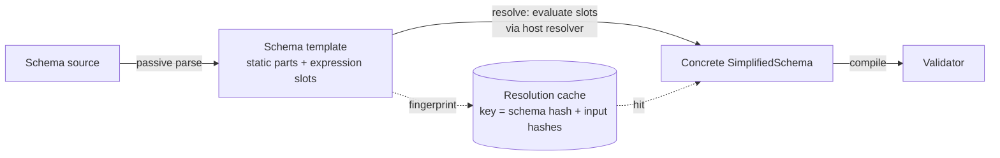

---
$schema:
    status: |-
        enum(
            draft-spec,
            finalized-spec,
            planned,
            implemented,
            review-findings,
            human-in-the-loop,
            completed,
            on-hold,
            abandoned
        ) -> an indicator of progress for this specification
    reviewed: boolean -> indicates whether the specification file has been reviewed by another agent from the one which created the spec
    reviewed_by: string -> the agent and model used in the spec review
    reviewed_on: date -> the date the spec was reviewed
    review_iterations: number -> the number of implementation reviews have taken place in the review/fix cycle
    clarified: boolean -> indicates whether the specification was built -- _in part_ -- with the 'clarify.md' prompt
    implemented: boolean -> indicates whether this spec's plan has been implemented
    implemented_by: string -> the agent who implemented the plan
kind: feature
created: 2026-11-04
status: draft-spec
area: darkmatter
reviewed: false
clarified: true
implemented: false
review_iterations: 0
related:
    - 2026-10-28-extract-simplified-schema
    - 2026-11-04-composition-errors
depends-on:
    - 2026-11-04-loading-data
    - 2026-11-05-render-surface
---

# Dynamic Schema Types

Let the expression engine take part in defining a schema. At minimum,
`enum(...)` members and `suggest(...)` candidates must be computable from an
expression. The goal is **broad** support: anywhere a schema author writes a
type expression should eventually accept a `{{ … }}` expression.

This is a **draft** with no open rulings: it stays a draft until the spikes report. Its
main job is to frame the spikes that decide how dynamic types can run with good
performance. Narrowing where expressions may
appear is the **last resort**. It is considered only if the spikes show that
no caching or resolution strategy keeps validation and DMLS responsive.

## Motivation

A schema often repeats a list that already lives in a data file. The
motivating case is `claudine/docs/research/sandboxing/providers/sandboxing.yaml`:

```yaml
types:
    os: enum({{ as_csv(claudine/docs/os.yaml) }}; required)
```

Today this fails when the schema loads:

```text
invalid SimplifiedSchema for property os:
expected `,`, `;`, or `)` in enum members, found `a`
```

That file is committed, so the shipped-schema corpus test
`every_kinded_schema_artifact_passes_its_definition_through_the_registry`
carves it out until M4 lands. The carve-out fails once the file validates, and
M4 removes it.

`parse_enum_members` (`simplified-schema/lib/src/simplified/grammar.rs`)
accepts only literal members,
and schema handling is deliberately passive: parsing, validation, trigger
matching, completion, and hover perform no I/O and evaluate no expressions.
With 2026-11-04-loading-data, the intended spelling becomes:

```yaml
types:
    os: enum({{ load_data("claudine/docs/os.yaml", "string[]") }}; required)
```

## The tension to resolve

Four existing guarantees push against dynamic types. The spikes must keep
each one or replace it with something equally strong:

1. **Passive schemas.** Schema parsing and validation do not execute anything.
   A schema found by trigger discovery — even in DMLS, just by opening a
   folder — must not be able to run code or touch the network unasked.
2. **Validator caching.** `DarkmatterSchemas` compiles each schema once into a
   process-wide `SHARED_VALIDATOR_CACHE` keyed on the schema and its resolution
   context. A long-running host (Claudine) composes many documents against a
   few schemas and relies on this.
3. **DMLS latency.** Completion, hover, and diagnostics run on every edit and
   must not wait on file reads or expression evaluation on the hot path.
4. **The extraction boundary.** 2026-10-28-extract-simplified-schema moved the
   schema language into the host-neutral `simplified-schema` library. That
   library owns the *passive* expression parser but has **no evaluator**:
   evaluation, function registration, and lookup stay in Darkmatter.

## Proposed model (to be validated by the spikes)

Split schema loading into a passive phase and an explicit, cached
**resolution** phase:



- **Parse stays passive.** The grammar accepts a `{{ … }}` slot where a member
  list (and later, other type positions) is allowed, checks its syntax, and
  records its span. Nothing is evaluated. Editor features keep working on the
  template.
- **Resolution is the only effectful step.** `simplified-schema` defines a
  host hook (a resolver trait). Darkmatter implements it with its evaluator.
  The result must have the shape the slot requires (`enum` and `suggest` slots
  need an array of scalars), or schema loading fails with the slot's span.
- **Resolution is cached by its inputs.** The cache key is the schema content
  hash plus a fingerprint of everything evaluation read (file content hashes
  via `biscuit-hash`, environment values, `ctx.*` groups). A warm hit costs a
  hash comparison, not an evaluation.
- **Evaluation context is the schema's, not the document's.** Relative paths
  resolve against the schema file. One schema then resolves once for every
  document that uses it, which preserves validator sharing (guarantee 2).

## Spikes

Each spike reports measured numbers on the shipped schema corpus and on one
synthetic heavy case. Each one ends with a recommendation, not a prototype
merged to `main`.

### S1. Baseline and budget

Measure today's cold and warm cost for schema load, validator compile, and
validation (`md schema validate`, `md compose`, DMLS diagnostics). From those
numbers, set the budgets the other spikes are judged against. A proposed
default: warm overhead within noise of a static schema, and a cold resolution
cost no larger than one validator compile.

### S2. Input-fingerprinted resolution cache

Prototype the resolution cache. Record every input an evaluation touches and
key on those inputs. File and URL reads come from the read set that
2026-11-04-loading-data delivers (its R8); it holds no content hashes, and it
does not cover environment values or `ctx.*` groups, which still come through
the existing demand-driven context capture. Measure hit rate and cost across a Claudine-style many-document run. Decide
whether the cache is process-wide (like the validator cache), persisted on
disk, or both.

### S3. Invalidation and DMLS

Determine how DMLS learns that an input changed (the watch-directories
mechanism, file events, or a fingerprint check on save). This spec owns using
the read set for DMLS invalidation; 2026-11-04-loading-data provides the library
read set only, and DMLS today watches only `.md` and `.yaml` files. Resolution must run
off the request path: DMLS serves the last resolved schema and marks it stale
until a fresh one is ready. Measure added latency on completion and hover.

### S4. Function determinism classes

Classify catalog functions as **pure** (same inputs → same output),
**input-reading** (fingerprintable: `load_data`, `file_exists`), or
**volatile** (time, git state, network, `$()`). Pure and input-reading slots
are cacheable. Decide whether volatile slots get a TTL, resolve on every use,
or are rejected. This classification is metadata for caching, not a scope
limit. Only rejecting volatile functions would count as narrowing.

### S5. Safety and approval

Decide when resolution is allowed to run. Options to evaluate: resolution is
allowed only for slots whose functions are pure or local-input-reading, while
shell and remote reads go through the existing approval and `--allow host=`
flows; or a schema with an effectful slot can be discovered but stays
unresolved until an explicit request (for example `md compose`) approves it.
Trigger discovery and DMLS must never cause an unapproved effect, and neither
must a pass that runs ahead of composition: the reference check
(`ComposeOptions::for_reference_check`, also behind `md graph` and
`md validate refs`), which holds no remote permission and runs no shell, and the
pre-flight walk. Decide what each of those does with an unresolved slot.

### S6. Lazy and partial resolution

Measure whether resolving only the slots a given document reaches — and
compiling static parts once, with dynamic parts substituted later — is a
material win over resolving the whole schema up front.

### S7. Extraction boundary

Specify the resolver trait in `simplified-schema` and the template type it
operates on. The extraction (2026-10-28-extract-simplified-schema) has landed
in code, so the hook is added to that library's public surface and must keep
it host-neutral: no Darkmatter types and no dependency from
`simplified-schema` back to Darkmatter. Slots must be resolved before layers reach
`EffectiveSchema`'s merge of already-lowered schemas; report whether that merge can stay
as it is, or whether it should move up to `SimplifiedSchema`.

### S8. Breadth

Starting from the `enum`/`suggest` slots, evaluate which other positions can
accept a slot at no extra cost: `literal(...)`, `default(...)`, numeric bounds
(`min`/`max`), pattern constraints, and whole type expressions (a slot that
yields a `type-definition`). Only positions that the S1–S6 results show cannot
meet the budget are candidates for narrowing.

## Minimum requirements

Whatever the spikes conclude, the finalized spec must deliver:

- **M1.** `enum(...)` members from a `{{ … }}` slot that yields an array of
  scalars, mixable with the `; required` / `default(...)` tail.
- **M2.** `suggest(...)` candidates from a slot, on every type where
  `suggest` is allowed today.
- **M3.** Slot syntax errors and wrong result shapes are positioned schema
  errors, reported in `md schema validate` and DMLS like any other schema
  error. They follow the diagnostic position rule: a line and column only when
  proven, otherwise null, never a placeholder. A slot whose `load_data` fails
  keeps that failure's `dm.data.*` code and `data_location`.
- **M4.** `sandboxing.yaml` (in the M1 spelling above) loads and validates its
  documents, and the shipped-schema corpus carve-out for it is removed.
- **M5.** No guarantee from "The tension to resolve" is lost without an
  explicit, documented replacement.

## Rulings

- **Q1. Decided (2026-11-06): literal and dynamic members mix.** Each slot's array is
  flattened into the list, so a literal `none` beside a slot that loads
  `[macOS, Linux, Windows]` means `enum(none, macOS, Linux, Windows; required)`. `suggest(...)` works the same way. A
  member duplicated between a literal and a slot is kept once rather than rejected, so
  a changed data file cannot break a schema. Literals stay visible to the editor before
  the slot resolves.
- **Q2. Decided (2026-11-06): callers work with the struct, and JSON Schema is derived.**
  `SimplifiedSchema` holds literal members and unresolved slots, and resolving is the
  only effectful step. Conversion to JSON Schema is lossy and remains an explicit export,
  derived and cached as today. On an unresolved schema, `to_json_schema` and validation
  return a typed error, as a function-typed property already does; there is no
  placeholder output, because a passive caller has the struct.
- **Q3. Decided (2026-11-06): a slot evaluates in the schema's context only.** `fm.*` in
  a slot is a schema error. One schema then resolves once for every document that uses
  it, and no slot relies on values it is about to validate. A document's inline `$schema`
  resolves relative paths against that document. This can be relaxed later without
  breaking a document.
- **Q4. Decided (2026-11-06): no slots in the baseline or in kind definitions.** A slot
  in either is a schema error, and a kind claim holding one is reported as broken. These
  load without a document asking for them, so they stay free of evaluation, and kind
  selection stays passive. This does not affect an ordinary `kind: schema` document named
  by `$schema`, such as `sandboxing.yaml`. It can be relaxed later without breaking a
  document.
