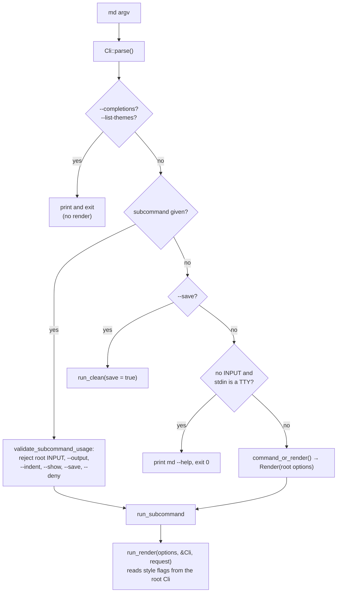
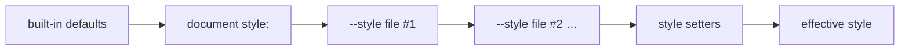

---
$schema:
    status: |-
        enum(
            draft-spec,
            finalized-spec,
            planned,
            implemented,
            review-findings,
            human-in-the-loop,
            completed,
            on-hold,
            abandoned
        ) -> an indicator of progress for this specification
    reviewed: boolean -> indicates whether the specification file has been reviewed by another agent from the one which created the spec
    reviewed_by: string -> the agent and model used in the spec review
    reviewed_on: date -> the date the spec was reviewed
    review_iterations: number -> the number of implementation reviews have taken place in the review/fix cycle
    clarified: boolean -> indicates whether the specification was built -- _in part_ -- with the 'clarify.md' prompt
    implemented: boolean -> indicates whether this spec's plan has been implemented
    implemented_by: string -> the agent who implemented the plan
kind: feature
created: 2026-11-05
status: finalized-spec
area: darkmatter
owner: Ken Snyder <ken@ken.net>
reviewed: true
reviewed_by: codex/gpt-6.1-sol
reviewed_on: 2026-11-06
clarified: true
review_iterations: 2
completed: true
implemented: true
implemented_by: claude/opus
packages:
    - darkmatter-cli
    - darkmatter
related:
    - 2026-11-04-composition-errors
depends-on:
    - 2026-11-04-composition-errors
    - 2026-11-04-loading-data
    - 2026-11-06-dotted-paths
next_spec: 2026-11-05-dynamic-schema-types
---

# The `md render` Surface: One Render Command, and `--style`

`md` renders a Markdown file when you give it no subcommand (`md notes.md`),
and it also has an explicit `md render` subcommand. The two are documented as
the same thing, but they are not: about forty style flags work only in the
first form, a few flags make `md` with no subcommand do something that is not rendering at
all, and the two forms differ when there is no input.

This feature does two things:

1. **Makes `md` with no subcommand mean exactly `md render`.** Same options, same
   defaults, same behavior. Options that are truly global stay global; every
   render or style option moves onto `md render`.
2. **Replaces the forty style flags with `name=value` style setters**, such as
   `style.margin=4` or `style="{ max-width: 50 }"`, which mirror the `style:`
   frontmatter, and one **`--style <FILE>`** option for a reusable style file.

This spec is **finalized**: the author's rulings are marked **Decided**.

A **Decided** note records a ruling the owner made, on 2026-11-05 while clarifying
`2026-11-04-composition-errors` or on the date it gives; it is not up for re-discussion
in review.

## Review notes

This inline review preserves the owner’s decisions. It corrects JSON5
examples, separates layer precedence from shorthand precedence, and adds
requirements for parser construction, file context, errors, and migration.
The 2026-11-06 review also aligns duplicate-key handling with the shared data
readers and defines which custom-schema values reach rendering.

The behavior inventory below was refreshed on 2026-11-06, after
`2026-11-04-composition-errors` completed. The current
[output and width contract](../../docs/cli/output-and-width.md) and
[data-output contract](../../docs/cli/data-contracts.md) remain authoritative.

## Scope

| Package | Why |
|---|---|
| `darkmatter-cli` | the root/`render` argument definitions, dispatch, `--style` parsing, style setters and their completion, removal of the old flags |
| `darkmatter` | the style model the CLI lowers into (`CliStyleClaims` is replaced by a `style:` layer), and any shorthand keys added to the `style:` schema |

**Out of scope.** `--width` and `--output` were delivered by
`2026-11-04-composition-errors` (width is a CLI-wide constraint, output is
CLI-wide selection). This spec redesigns neither; where an inventory below
mentions them, it is only to say where they sit today.

## Terms

| Term | Meaning here |
|---|---|
| **subcommand** | the first word after `md` that names an action: `render`, `compose`, `clean`, ... |
| **root** | `md` itself, before any subcommand; a "root flag" is one clap defines on the top-level `Cli` struct |
| **root alias** | the shortcut that lets `md notes.md` mean `md render notes.md` |
| **global option** | a clap argument declared with `global = true`, accepted before or after any subcommand (`-v`, `--debug`, `--code-block` today) |
| **clap** | the Rust argument-parsing crate `md` uses; its "derive" form turns struct fields into flags |
| **`style:` frontmatter** | the YAML block in a document that sets layout and colors, documented in `docs/topics/layouts-and-style.md` |
| **JSON5** | JSON with identifier keys, single quotes, trailing commas, and comments; hyphenated keys and string values still require quotes in JSON5 itself, though a style value also accepts YAML flow syntax (see [Style setters](#style-setters)) |
| **style setter** | a `key=value` argument whose key is a dotted path under `style.`, such as `style.ul.padding-left=4` |
| **style layer** | one source of explicitly set style fields: the document, one `--style` file, or the combined style setters; fields omitted by that source stay unset |
| **normalization** | expanding shorthands and equivalent spellings to the same full field paths before combining sources |
| **shell completion** | the candidates your shell offers when you press Tab; `md` uses clap's dynamic completion engine (`COMPLETE=zsh md`) |

## Decisions

> **Decided (1). A CLI with subcommands has no "root command".** A root alias
> is allowed for ergonomics, but it must always be an **exact** alias of one
> named subcommand. For `md`, `md` with no subcommand is exactly `md render`: the same
> options, defaults, and behavior. Every current divergence between `md` and
> `md render` is a defect. Truly global options (`-v`/`--verbose`, `--debug`,
> `--magic-root`, `--completions`) stay global; render and style options move
> off the root onto `md render`.

> **Decided (2). `md render` is the rich rendering surface for Markdown.**
> Width (`--width`) is a core, CLI-wide constraint owned by
> `2026-11-04-composition-errors`. The other style constraints are a design of
> `md render` specifically, not a general rule for every command.

> **Decided (3), amended 2026-11-06. `--max-width` is removed as a pattern.**
> `md render` takes style attributes as `name=value`, mirroring the `style:`
> frontmatter, and `--style` names a file:
>
> ```sh
> md render notes.md style="{ max-width: 50, margin: 4 }"
> md render notes.md style.max-width=50
> md render notes.md --style=style.yaml
> ```
>
> The attributes needed include `max-width`, `margin` (all sides), and
> `ml`/`mr`/`mt`/`mb`.

> **Decided (4), amended 2026-11-06. Each style key also has a `key=value`
> setter,** for example `md render notes.md style.ul.padding-left=4`. It replaces
> the dasherized flag (`--style-ul-padding-left 4`) this decision first named.
> Setters are not flags, so `--help` stays compact with nothing to hide, and
> shell completion offers them from the schema. The dot also removes an ambiguity
> a dash cannot: `style.code-block.line-numbers` has one reading.

> **Decided (5). Until this spec lands,** `2026-11-04-composition-errors`
> keeps `--max-width` on `md render`.

The general rule that a root alias shares one subcommand’s behavior applies to every CLI in the monorepo, not only
`md`. It is recorded here because `md` is the first CLI it changes; the
`cli` skill records it for the rest (see [Documentation](#documentation)).

## Today's Behavior

### How dispatch works

`Cli` (`cli/src/args/cli.rs`) flattens `RenderOptions`
(`cli/src/args/render.rs`: `[INPUT]`, `--output`, `--show`, `--max-width`,
`--indent`, `--deny`, `--feature`) at the root, and `Command::Render` holds a second copy
of the same `RenderOptions`. Everything else that affects rendering (themes,
margins, alignment, ...) is a field of `Cli` itself, so it exists **only at
the root**.



`run_render` reads the style flags from the root `Cli`
(`style_claims::cli_style_claims(cli)`, `cli.theme`, `cli.mermaid`,
`cli.line_numbers`, ...), never from the `render` subcommand. That is why the
explicit form cannot take them. It also reads `cli.width` and `cli.verbose` to
resolve its output, so removing `&Cli` has to carry those across.

### Divergences between `md` and `md render`

Observed 2026-11-05 with the installed `md 0.1.0`, confirmed against the source,
and rechecked 2026-11-06. Rows 3 and 10 are kept, marked resolved, so that row
numbers cited elsewhere stay stable.

| # | Divergence | `md …` | `md render …` | Where |
|---|---|---|---|---|
| 1 | Style, theme, and layout flags (the [inventory](#root-style-flags) below) are root-only | `md doc.md --margin 4` works | `md render doc.md --margin 4` fails: `unexpected argument '--margin'` | `cli.rs` fields; `render.rs`, `style_claims.rs` read `Cli` |
| 2 | The same flags are accepted **before** the subcommand and silently ignored by every subcommand, including `--max-width`, which is a `RenderOptions` field | `md --margin 4 toc doc.md` and `md --max-width 40 toc doc.md` succeed and ignore the flag | n/a | `validate_subcommand_usage` (`commands/mod.rs`) checks only six options |
| 3 | **Resolved by `2026-11-04-composition-errors`.** `md compose` accepts only Markdown and the data family, so `md compose --output html` is a usage error and no compose path reads style flags | n/a | n/a | `args/output.rs::COMPOSE_TARGETS` |
| 4 | `--save` makes `md` with no subcommand a **clean**, not a render | `md --save doc.md` = `md clean --save doc.md` | `md render doc.md --save` fails | `main.rs` (`cli.save` branch) |
| 5 | `--list-themes` is root-only and is not a render | `md --list-themes` lists themes | `md render --list-themes` fails | `main.rs` |
| 6 | No input on a terminal | `md` prints `md --help` and exits 0, even with `--output json`, where the data contract promises one value | `md render` fails: "No input file provided" | `main.rs` vs `io::load_document` |
| 7 | `--feature` is accepted in both places and the lists are **combined** | `md --feature a render doc.md --feature b` turns on both | — | `Cli::command_or_render` |
| 8 | The other `RenderOptions` given at the root **and** with a subcommand are a usage error | `md --output html render doc.md` fails | — | `validate_subcommand_usage` |
| 9 | Help shows different options | `md --help` lists every style flag | `md render --help` lists only `RenderOptions` and global options | clap derive |
| 10 | **Resolved by `2026-11-04-composition-errors`.** `--width` is a real global option and behaves the same in both forms | n/a | n/a | `args/cli.rs` |

Rows 7 and 8 contradict each other: one root render option merges with the
subcommand's, the others conflict with it.

`docs/cli/render.md` describes the style flags as "Global Flags Relevant to
`render`". They are not global in clap's sense (only `--code-block` is), so
the page is wrong today: `md render doc.md --theme dracula` fails.

### Root style flags

These are the root fields of `Cli` that shape rendering, with the `style:`
frontmatter key each one overrides. "None" means no frontmatter key exists.

| Flag (aliases) | Value | `style:` key | Notes |
|---|---|---|---|
| `-m`, `--margin` | cells | `page.{left,right,top,bottom}-margin` | no single key |
| `--mx` | cells | `page.left-margin` + `page.right-margin` | |
| `--my` | rows | `page.top-margin` + `page.bottom-margin` | |
| `--mt` (`--margin-top`) | rows | `page.top-margin` | |
| `--mb` (`--margin-bottom`) | rows | `page.bottom-margin` | |
| `--ml` (`--margin-left`) | cells | `page.left-margin` | frontmatter also accepts `2ch`, `10%` |
| `--mr` (`--margin-right`) | cells | `page.right-margin` | same |
| `--padding` | cells | `page.{left,right,top,bottom}-padding` | no single key |
| `--px` | cells | `page.left-padding` + `page.right-padding` | |
| `--py` | rows | `page.top-padding` + `page.bottom-padding` | |
| `--pt` (`--padding-top`) | rows | `page.top-padding` | |
| `--pb` (`--padding-bottom`) | rows | `page.bottom-padding` | |
| `--pl` (`--padding-left`) | cells | `page.left-padding` | |
| `--pr` (`--padding-right`) | cells | `page.right-padding` | |
| `--page-bg` (`--page-background`) | `transparent\|subtle\|pronounced` | `page.background` | |
| `--page-bg-color` | color | `page.bg-color` | |
| `--max-width` | cells, > 0 | `page.max-width` | a `RenderOptions` field, so also on `md render`; frontmatter also accepts `ch`, `%` |
| `--width` | width | none | a real global option delivered by `2026-11-04-composition-errors`; stays; not a style flag |
| `--line-numbers [BOOL]` | bool | none | code-block gutters |
| `--alignment` | `left\|center\|right` | `page.alignment` | broadcast to every component |
| `--align-images` | alignment | `images.alignment` | |
| `--align-lists` | alignment | `ul`/`ol`/`li` `.alignment` | no single key |
| `--align-ul` / `--align-ol` / `--align-li` | alignment | `ul.alignment` / `ol.alignment` / `li.alignment` | |
| `--align-block-quotes` | alignment | `block-quote.alignment` | |
| `--align-tables` | alignment | `table.alignment` | |
| `--align-code-blocks` | alignment | `code-block.alignment` | |
| `--fill` | `full\|pad=N\|indent=N\|max=N\|explicit=N` | none | lowers to `width`, `max-width`, or padding on every component |
| `--fill-images`, `--fill-lists`, `--fill-ul`, `--fill-ol`, `--fill-li`, `--fill-block-quotes`, `--fill-tables`, `--fill-code-blocks` | fill | none | as `--fill`, for one component or the list group |
| `--theme` | theme name | none | prose theme |
| `--code-theme` | theme name | `page.code.theme` | |
| `--code-block` (global) | `inverse\|dark\|light\|same` | none | also read by `md schema about` |
| `--list-themes` | — | not style | prints the theme list |
| `--mermaid` | — | none | render behavior, not presentation |
| `--save` | — | not render | `md clean --save` |

When drafted that was 43 root fields, 38 of them style or layout; `--max-width`
has since moved to `RenderOptions` and `--width` has become a shared control, so
treat this table, not the count, as the migration list. `--feature`, the other
render behavior switch, already lives in `RenderOptions`.

The CLI value grammar is narrower than the frontmatter's: CLI margins and
`--max-width` are bare cell counts, while `style:` accepts `2ch` and `10%`.
Moving to `--style` gives the command line the frontmatter grammar for free.

### How CLI style beats frontmatter today

`style_claims::cli_style_claims` copies the root fields into the library's
`CliStyleClaims` (`lib/src/style/cli_claims.rs`), a 40-field struct of
`Option`s. `apply_style_frontmatter` then applies the document's `style:`
and the `*_overrides_from_claims` functions stop it from overwriting any
field the user set on the command line. The override is field by field:
`md guide.md --mx 6` keeps the document's `top-margin` and `max-width`.
Inside the flags, the more specific one wins: `--margin` is applied first,
then `--mx`/`--my`, then `--mt`/`--ml`/..., and likewise for alignment and
fill.

`--max-width` has two paths today, and the replacement must retire both: the
root value through `style_claims.rs` into `CliStyleClaims`, and the explicit
subcommand's value applied directly after `style:` in `commands/render.rs`.

## Problem

1. **The default is not `md render`.** A user who learns `md doc.md --margin 4`
   and then writes `md render doc.md --margin 4` in a script gets a usage
   error (rows 1, 9). The documentation says the two are the same.
2. **`md` with no subcommand does things that are not rendering.** `--save` cleans and
   writes a file; `--list-themes` lists themes (rows 4, 5). A user cannot
   predict from `md render --help` what `md` will do.
3. **Root flags leak into other commands.** Style flags before any subcommand
   are accepted and silently ignored (row 2). A silently ignored flag looks like
   it worked.
4. **The flag surface does not scale.** Each new style property means one or
   more new flags, a new `CliStyleClaims` field, an override bit, and
   documentation in two places. 38 flags already cover only part of what
   `style:` can say: there is no flag for colors, borders, horizontal rules,
   hyperlinks, or any component `max-width`.
5. **Two style vocabularies drift.** The flags (`--mx`, `--align-tables`,
   `--fill-ul`) and the frontmatter (`page.left-margin`, `table.alignment`)
   name the same things differently and accept different value grammars.

## Design

### `md` is `md render`

`md` with no subcommand runs `md render`. There is one command and one set of options,
`RenderOptions`, and the root `Cli` adds only the global options to it.

- `RenderOptions` gains everything `run_render` reads: `--style`, the style
  setters, and `--mermaid`.
- The `darkmatter-cli` render handler takes prepared render options, the
  resolved output context, and the request. It never reads a root argument
  structure, so a root field cannot introduce a hidden rendering option.
- Render options given at the root **and** with a subcommand are a usage
  error, with no exceptions. `--feature` stops being combined (row 7).
- The root owns shared controls (`-v`/`--verbose`, `--debug`, `--width`),
  launch configuration (`--magic-root`), and help/version/completion actions,
  as well as the shared render definition used for the alias. Keep the
  existing placement rules: `--magic-root` is root-only and repeatable;
  it is deliberately **not** a clap global because clap would otherwise
  lose repeated values split across command levels. `--completions` remains
  a root action. This refactor does not make either option accepted after a
  subcommand. The owner’s word “global” means shared responsibility here,
  not a request to change those parsing rules.

`RenderOptions` stays one derived `clap::Args` struct,
flattened at the root and held by `Command::Render`, and ordinary `Cli::parse()`
keeps working. Its `[INPUT]` positional becomes `[ARGS]...`, as `md compose`'s
already is, and one shared function classifies those tokens into the input and
the setters (see [Style setters](#style-setters)). Setters are not clap arguments,
so nothing is added to the command at runtime.

Distinguish an explicitly supplied option from a clap default when checking
whether root render arguments precede a subcommand. Reject, for example,
`md --feature a render doc.md` and `md style='{}' toc doc.md`, even if the
explicit `render` has no duplicate option. Shared controls do not count as
render arguments. Root help presents commands, shared controls, `--style`,
and the alias usage line; other render details belong in `md render --help`.

Respect `--` for positional inputs; `md -- render` renders a file named
`render`. Do not rewrite arguments by scanning for command words.
Preserve which positional tokens followed `--` for the shared classifier;
a vector of token strings alone loses that distinction. Keep native OS argument
values intact for file inputs rather than converting every token to lossy text.
Only recognized setters require text parsing. Test the command-name and
setter-looking file examples against the actual parser, not only the classifier.

Resolve shared output options once at dispatch and pass the resolved output
context and request to the render handler. Removing `&Cli` must not lose
`--width`, verbosity, output diagnostics, or request configuration. Theme
fallbacks and terminal capabilities come from that output context, including
its plain-output behavior, rather than being detected again downstream.

### `--style`

> **Decided (2026-11-06). A flag names a file, and `name=value` sets a value.**

`--style` takes a file reference. The file is JSON, JSON5, YAML, or TOML, and holds a
dictionary valid for the Darkmatter `style` property. The option is repeatable, and
later files merge over earlier ones.

```sh
md render notes.md --style=style.yaml                # the whole file
md render notes.md --style=style@style.yaml          # the `style` key of that file
md render notes.md --style=theme.dark@style.yaml     # a nested key
md render notes.md --style=style@@/shared.yaml       # an offset into a magic path
md render notes.md --style=@/shared.yaml             # a magic path, no offset
md render notes.md --style=./user@host.yaml          # a file with `@` in its name
```

```yaml
# style.yaml, for --style=style.yaml
max-width: 50
margin-left: 4
bad-mojo: true    # warned about and ignored
```

**Reading the reference.** First classify the whole argument passively with
biscuit-file's [`FileReference`](../../../biscuit-file/lib/src/file_reference/mod.rs).
An explicit relative, absolute, home, magic, repository, vault, or URL reference
keeps every `@` as part of that reference; URLs are then refused by the local-only
rule. This includes native Windows paths, whose separator may be `\`.
For an implicit relative reference only, a nonleading first `@` separates an
offset from the remaining file reference when the text before it contains no
path separator (`/` or `\`). Thus `themes/user@host.yaml` remains a file path.
Parse the offset with the shared
`PropertyPath` parser from `2026-11-06-dotted-paths`, then parse the remaining
reference through `FileReference`; an empty offset or file part fails, with no
fallback to another interpretation. The offset uses the shared rules for escaped
dots and existing array indexes. A file whose name would read as an offset needs
`./`, as a file named `a=b.md` already does. Classification performs no lookup.

**Rules.**

| Case | Result |
|---|---|
| A key the effective schema does not allow | excluded with a warning, and the allowed keys still apply; `--deny style` makes it fatal |
| No non-null value remains after excluded keys are removed, including `{}` and `{ table: { bad: 1 } }` | fails |
| An allowed key with an invalid value (`max-width: abc`) | fails: continuing would render the wrong thing |
| The offset key is missing or not a mapping | fails, naming the key and the file |
| `--style="{ margin: 4 }"` | fails as a file input, with a hint to use the inline setter `style="{ margin: 4 }"` |

A failure here is a run failure: see
[Style input preparation and errors](#style-input-preparation-and-errors).

**Precedence.**

| Rule | Decision |
|---|---|
| Shape | the `style:` frontmatter shape, plus every `page` key and the short forms at the top level (`max-width`, `margin-left`, `margin`, `mx`, `ml`, ...), which apply to `page` |
| Precedence | defaults < document `style:` < `--style` files, in order < style setters |
| Merge | key by key, deep; a key you do not set keeps the document's value |



Each source is a separate style layer containing only the fields it sets. **Normalize each layer before
merging it with another.** Within a layer, `margin` expands to four sides,
`mx`/`my` override the corresponding pairs, and `ml`/`mr`/`mt`/`mb` override
one side; padding works the same way. Then merge canonical fields in the
order above. Resolving shorthands only after merging would incorrectly let
a document’s `ml: 6` defeat a CLI `margin: 2`.

Top-level page keys and nested `page` keys normalize to the same fields.
Reject duplicate spellings of the same specific field in one object, such
as `ml` together with `page.margin-left`. A shorthand plus a more specific
field is valid. Exact duplicate object keys follow the shared reader or value
parser's format rules; JSON files keep the last value, as specified by
`2026-11-04-loading-data`. Do not add a style-only parsing mode or change those
readers globally. Preserve option occurrence and source information long enough
to identify an offending layer and key.

**Reader's note.** Earlier review wording required every duplicate object key
to fail. That conflicted with the data-loading dependency's JSON file contract.
Inline objects use the shared setter parser's duplicate-key rejection; style
files use their data reader's rules. This review retains those shared behaviors
and still rejects distinct spellings that normalize to the same field; those are style
ambiguities the file reader cannot detect.

The style setters form one final layer regardless of their position among
`--style` occurrences. Within that layer, expand shorthands by specificity;
repeating the same key uses its last value. Thus `style.ml=6 style.margin=2`
still yields left 6 and other sides 2. `style="{...}"` is the setter at the path
`style`, so `style="{ margin: 2 }" style.ml=6` resolves the same way. Across separate
`--style` files, later files win even if earlier layers used a more
specific shorthand. No omitted value or parser default becomes an override.

Keep the normalized layers sparse until merging is complete. In particular,
the Darkmatter library's [`ComponentBorder`](../../lib/src/style/schema/common.rs)
materializes border defaults when deserialized. Deserializing each layer first
would make `table.border.left=false` erase an earlier border's color or weight.
Merge explicitly present object members before producing the final typed border.
This same rule applies to any nested type that supplies defaults while parsing.

The repeated-path rule applies to a whole-object setter too:
`style='{ margin: 2 }' style='{ max-width: 50 }'` retains only the second
`style` value, plus any separately supplied, more specific setters. Distinct
paths that normalize to the same specific field, such as `style.ml=2` and
`style.page.margin-left=3`, fail as duplicate spellings rather than depending
on argument order. Repeating `style.ml` itself still keeps its last value.

Use nonnegative integer row counts for vertical page spacing, retaining the
existing `u16` range; horizontal spacing keeps its existing length grammar.
All-sides `margin`/`padding` and vertical pair shorthands must accept only
values valid for every side they set. For example `margin: '10%'` is invalid;
`mx: '10%'` is valid. The page content cap must resolve to a positive width.

**Cross-field constraints.** Keep existing exclusions such as component
`width` versus `max-width`. Reject a layer explicitly setting both. When a
later layer sets either member, remove the inherited other member before
validating the effective style; a CLI `table.width` can replace a document’s
`table.max-width` without inheriting an invalid pair. Objects merge
recursively, arrays and scalar values replace; a union value changing shape
(for example a scalar border becoming an object) replaces that whole value.
In CLI layers, strip null-valued fields before merging: `null` is absence,
not a reset instruction; zero and `false`
are explicit values where their field permits them. A present CLI root must
be an object; a scalar or `null` root is invalid. Reset syntax is out of scope.

These are render-layer merge rules, not changes to the shared property editor.
In particular, a nested border setter may select the border's object form after
a scalar border value; that explicit style-union rule must not make ordinary
`md set` or `md compose` traversal replace scalar parents implicitly. Reuse the
shared path and value parsers, with style normalization owned by Darkmatter.

In the `darkmatter` library,
[`StyleFrontmatter`](../../lib/src/style/schema/mod.rs) is the typed sparse
render style. Normalize and merge through the library’s shared style path,
then apply the effective values during tree construction and page-frame
assembly. Do not mutate the document’s authored frontmatter or serialized
Markdown to inject CLI overrides. Preserve the one context-aware tree build
and one target fold; no HTML repair or terminal decoration pass is added.

> **Decided (2026-11-06). `--alignment` is removed; `style.alignment` means every
> component.** It is the same key as `style.page.alignment`, in every source.

```yaml
# document
style:
    table:
        alignment: left
```

```sh
md render doc.md style.alignment=center                              # everything centers, the table too
md render doc.md style.alignment=center style.table.alignment=right  # the table is right; the rest center
```

Each source expands `alignment` into its components before sources merge, using the
existing targets, and a specific key in the same source beats the broad one. So a
document holding both `page.alignment: center` and `table.alignment: left` keeps its
table left, as it does today, while a later source's `alignment` overrides it.


`--align-*` go with the other removed flags.

Remove the library's [`CliStyleClaims`](../../lib/src/style/cli_claims.rs) and its
claim-derived overrides once alignment, component overrides, relative stylesheet origins, and the
fill replacements have coverage on the new path. Preserve origins separately from typed
presentation values where a field refers to a file.

The shared schema also contains `style.markdown`, whose cleanup rules are
accepted and validated but never lowered into rendering policy. It has no field in
`StyleFrontmatter`; retain it through validation separately. A CLI cleanup-rule
override does not change rendering's existing guarded cleanup or its `--indent`
behavior, and never edits or saves the input. Do not inject the CLI style layer
into authored frontmatter or cleanup options. This preserves current rendering;
it does not remove the cleanup already performed before rendering.

### Style key names

> **Decided (2026-11-06). Page margin and padding keys use CSS order,** one spelling
> with the new component keys and with CSS.

| Today | After |
|---|---|
| `page.left-margin`, `right-margin`, `top-margin`, `bottom-margin` | `page.margin-left`, `margin-right`, `margin-top`, `margin-bottom` |
| `page.left-padding`, `right-padding`, `top-padding`, `bottom-padding` | `page.padding-left`, `padding-right`, `padding-top`, `padding-bottom` |

The rename reaches the embedded schema, `descriptor::SCHEMA`, `style/schema/page.rs`,
the parser, tests, golden fixtures, and docs. The old spellings are removed rather than
deprecated, so they become unknown keys, whose warning should suggest the new name. The
snake-case aliases of the old names go with them. Other names, such as `bg-color`, are
unchanged.

### Style setters

Every supported canonical style value path can be set with a `key=value`
argument, spelled from its path and joined with `.`:

| Setter | Same as |
|---|---|
| `style.margin=4` | `style="{ margin: 4 }"` |
| `style.max-width=80` | `style="{ 'max-width': 80 }"` |
| `style.table.alignment=center` | `style="{ table: { alignment: 'center' } }"` |
| `style.page.bg-color=slate-900` | `style="{ page: { 'bg-color': 'slate-900' } }"` |

**Recognizing one.** A token is a setter when the text before its first `=` is `style`
or starts with `style.`; every other token is the input.

```sh
md render notes.md style.ul.padding-left=4      # input plus one setter
md style.margin=2 notes.md style.ml=6           # order does not matter
md render notes.md style="{ max-width: 50, margin-left: 4 }"   # several at once
md render ./style.draft=old.md                  # a file: `./` makes it a path
md render -- style.draft=old.md                 # a file: nothing after `--` is a setter
```

- More than one input is a usage error, as it is for `md compose`.
- A setter before a subcommand is a render argument there, so it is a usage
  error like any other: `md style.margin=4 toc doc.md` exits 2.
- A setter is judged by the document's effective schema, like any other frontmatter
  value (see [Style input preparation and errors](#style-input-preparation-and-errors)).
  A misspelled prefix such as `stlye.ul.x=4` is not
  recognized as a setter, so it fails as an input that does not resolve; that
  message should suggest the setter when the token has a `=` and a `.`.
- The path grammar and its parser come from `2026-11-06-dotted-paths`, which also
  gives `md compose` dotted setters. The spelling is shared and the effect differs:
  `md compose` overrides a frontmatter value, which reaches the composed output,
  while a style setter here is a one-time render override that never touches the
  document.

**Values.** The value is the text after the first `=`, read as the key's declared
type through the same conversion engine that reads frontmatter
(`simplified_schema::coercion`), so `4` is a number and `slate-900` a string.
Built-in style keys use the shared parser's declared-type path from
`2026-11-06-dotted-paths`; custom schema fields and pattern-admitted fields use
that parser's applicable type or unknown-value rules. A string containing
expression syntax is never executed.

A value starting with `{` is read as JSON5, then as YAML flow syntax, so hyphenated
keys need no quotes inside the shell's quotes: `style="{ max-width: 50 }"`. Bare
`{a:1}` stays an object because JSON5 reads it first. That parser lives in
`2026-11-06-dotted-paths`, so `md compose` and `md set` read such values too.

- Canonical kebab-case spellings only. Deprecated snake-case aliases have no
  setter.
- Compound values are accepted too: `style.table.border=thin` and
  `style.table.border='{ left: true, right: false }'` both set the border;
  `style.table.border.left=false` sets one nested field. Open objects such as
  `page.meta` take a whole-object JSON5 value, not unbounded nested paths. Nested
  fields override their containing compound value within the setter layer. If the
  parent is scalar, a nested field switches to the object arm.
- Booleans always take a value: `style.code-block.line-numbers=false`.
- Cleanup-rule setters under `style.markdown.*` follow the shared schema and
  remain accepted without rendering effects, just like those keys in frontmatter.
  The style reference explains that these rules belong to `md clean`.

**Completion** comes from the document's effective schema, through the completer in
`2026-11-06-dotted-paths`, with the same rules for what it reads.

```text
md render doc.md style.<Tab>                  page. table. ul. code-block. ...
md render doc.md style.ul.<Tab>               alignment= max-width= padding-left= ...
md render doc.md style.ul.alignment=<Tab>     left center right
```

`md render` needs no catalog of its own, because `style` is part of that schema.
`--style=<Tab>` completes files with the `json`, `json5`, `yaml`, `yml`, and `toml`
extensions.

### What leaves the root

| Today | After | Ruling |
|---|---|---|
| the 38 style and layout flags | `--style` and style setters on `md render` (and therefore on `md` with no subcommand); each old flag is an unknown argument | 1, 8 |
| `--theme`, `--code-theme`, `--code-block`, `--line-numbers` | style keys `page.theme`, `page.code.theme`, `page.code.mode`, `code-block.line-numbers` | — |
| `--mermaid` | a plain `md render` flag | — |
| `--save` | removed; it is an unknown flag like any other, with no special message | — |
| `--list-themes` | a new subcommand, `md list-themes` | — |
| `--max-width` | removed; `style="{ 'max-width': N }"` or `style.max-width=N` (Decided 3 and 5) | 8 |
| `--width` | unchanged: a global option on the root | — |
| `-v`, `--debug`, `--magic-root`, `--completions` | unchanged placement rules; magic roots and completion generation stay root-only | — |

> **Decided (2026-11-06). A removed flag is an unknown argument,** with clap's ordinary
> error and no custom message. `docs/cli/render.md` holds the migration table.

### Style input preparation and errors

**Review requirement.** Inline style parsing and validation are passive:
no expressions, shell expansion, imports, composition, remote requests, or
stylesheet reads. Validate all explicitly supplied CLI layers even if a
later layer would override a bad value. Keep document warnings and their
original positions; a CLI override must not conceal an authored unknown or
deprecated key. Cross-field validation of the effective style happens after
normalization and merging. A style applicable only to HTML may be valid for
terminal output without being used there; lack of target applicability is
not an unknown-key error.

> **Decided (2026-11-06). `style` is treated like the rest of the frontmatter.** A
> setter is judged by the document's effective schema, exactly as `md compose` judges
> one, whether it targets `style` or anything else.

Nested objects in a schema are closed, so an undeclared key is an error, not a warning.
A schema can open one with a pattern key, and then the same setter is simply valid:

```yaml
$schema:
    style:
        foo: string
        "<string>": unknown
```

| Setter, with no schema of the document's own | Result |
|---|---|
| `md render doc.md style.magin=4` | fails: `magin` is not a valid property under `style` |
| `md render doc.md style.margin=abc` | fails: `abc` is not a number |
| `md render doc.md style="{ margin: "` | fails: the value is not an object |

These are ordinary schema failures, with the same codes and exit status as `md compose`:
`dm.schema.unknown_key` or `dm.schema.type_mismatch`, exit 1, and one envelope for a data
output. They are checked before anything renders. A failure from a setter names the
property and its parent in plain words and suggests the nearest valid key; schema-aware
completion is the main defense against the typo in the first place. Use the shared
runtime style validator as well, including apply-time constraints, because the schema
alone does not enforce all width exclusions. Preserve informational `KnownButInactive`
notices as the current parser does. Report the setter and canonical key path.

Resolve the document's effective schema once, from its original frontmatter
and request context, before applying render overrides. Use the existing passive
schema assembly, including baseline, triggers, and document declarations; do
not compose the document to obtain a schema. Render overrides do not rewrite
`$schema`, rerun trigger selection, or affect expression evaluation. Completion
uses that same selection rule, with the dependency's advisory fallbacks.

Validate each CLI layer as a sparse override: check the fields it supplies,
without treating omitted required fields as missing in that layer. Check
required style fields against the combined style value, then validate runtime
constraints on the normalized rendering fields. This lets one file supply
`page.color` and a setter supply a required `page.theme` without making each
source a complete style document. Invalid supplied values still fail even
when another source replaces them.

Within the combined setter layer, discard superseded occurrences of the same
exact path before conversion, as the shared setter parser does. This differs
from validating separate files even when later files override them: a repeated
argument replaces one assignment, while each file remains a checked input.

**A document that declares `style` replaces the built-in definition,** as it does for
any property, so `$schema: { style: { foo: string } }` makes `style.margin=4` an error
and leaves completion with `foo` alone. This feature does not change schema layering.
Custom values belong in their own top-level property, which is already open.

Schema admission and rendering support are separate checks. Values admitted
only by a custom schema are retained during validation and merging but do not
become new rendering features. Do not warn that such admitted keys are unknown,
and do not feed them to the built-in style walker as unknown fields. A known
rendering field must still satisfy its runtime contract even if the document
schema widens its type: admitting `page.max-width: abc` cannot make it renderable.
The runtime descriptor identifies supported fields; it is not a second source
of setter completion. Completion may therefore offer an admitted custom field
that has no rendering effect, and the style documentation must explain this.

**What is already in the document stays a warning.** `md render` warns about an unknown
`style:` key in frontmatter, and `--deny style` makes it fatal, as today. `md compose`
stays an error, because it produces a document, while `md render` only shows one. The
warning changes in one way: it asks the effective schema what counts as unknown, so a key
allowed by `"<string>": unknown` no longer warns.

**A data file is more lenient, on purpose.** It may hold keys for other purposes or
versions, and it has no schema enforcing what it contains, so a key the schema does not
allow is excluded with a warning, while an allowed key with a wrong value is still an
error. The warning goes to stderr, or to `diagnostics` for a data output, where stderr
stays empty.

For the empty-file check, a non-null schema-admitted leaf counts as supplied
even if it is a cleanup rule, custom metadata, or inactive on the chosen target.
For example `{ markdown: { unwrap: true } }` succeeds without changing cleanup,
and an admitted `{ foo: 'bar' }` succeeds without changing rendering. Empty
containers and nulls do not count; `{ page: {} }` and `{ page: { color: null } }`
fail. Apply this check to each file before later layers are merged, so an
overridden file is not mistaken for an empty one. Inline `style='{}'` remains
a valid no-op; the empty-file safeguard belongs only to `--style` files.

Prepare and validate explicitly supplied styles for every output target,
including Markdown and the data family, so a bad setter never appears to
succeed merely because no styled page was needed. Plain Markdown and a data
result's `document` retain their existing source-output behavior: CLI styles
neither enter the serialized frontmatter nor create a page or read CSS there.
Keep the existing target-dependent handling of authored style warnings;
explicit CLI warnings and failures are always reported. Run preparation only
after the report sink is available for data output, and complete it before
printing a document or opening an artifact for `--show`.

Opening and reading a `--style` file is execution. Missing, unreadable,
unsupported-format, or invalid-content files, and the failing cases in the `--style`
rules above, fail with exit 1 and the existing run diagnostics. Its unknown-key warnings
are ordinary diagnostics: on stderr, or in `diagnostics` for a data output. For `--output json|json5|yaml|toml`, return the
one failed result and keep stderr empty, as required by the data-output
contract. Retain the typed file-reference `failure:` information. Do not
turn these failures into pre-parse exit-2 messages. Stylesheet reads occur
only when preparing a target that uses them and follow the same run-error
contract.

### File context of a style file

A style file holds the style value at its root or at its offset, for example `page:`
and `table:`. A Markdown file with frontmatter is not a style file. Select JSON, JSON5,
YAML, or TOML by extension through biscuit-file's readers and `detect_from_extension`,
which `2026-11-04-loading-data` makes public; reject other extensions, including the
JSONL, CSV, and TSV ones it adds, extra YAML documents, and non-object values. Do not
recursively load other style files. `--style -` is rejected: stdin is reserved for the
Markdown input.

In `darkmatter-cli`, use
[`io::open_argument`](../../cli/src/io/mod.rs) to open the reference through
biscuit-file’s [`FileReference`](../../../biscuit-file/lib/src/file_reference/mod.rs)
and the existing request’s launch context. Derive the style-file context
from that opening reference; do not capture another process directory,
repository observation, or home directory. Style files are local only: reject HTTP(S)
style-file inputs without making a network
request. Remote style-file transport would need a separate authorization
and cache design.

Track the source context of a winning file-valued style field such as
`page.stylesheet`: document values use the document context, inline CLI
values and setters use the launch context, and file-supplied values use
that style file’s context. The context belongs to the field that wins the
merge, not to the last style file opened. Resolving an asset must preserve
FileReference diagnostics and the existing distinction between a local CSS
read and a remote stylesheet link emitted for the browser; this feature does
not fetch a linked remote stylesheet. The Markdown input’s images keep their
own document context. No additional host discovery or network permission is
introduced by accepting a style file.

### Removal and migration boundaries

The old spellings are intentional removals; the layout behavior they control
must be retained or explicitly approved for removal. Build a migration table
covering every removed flag and visible alias, including global/group
broadcasts and the value-dependent fill spellings. A replacement may be a
complete `--style` object affecting several buckets, rather than one flag.
Never advertise a nonequivalent replacement as exact.

Command-local options of the same name are untouched, because each command simply
declares its own: `md schema about --code-block light`, `md code-block --theme dracula`,
and `md clean --save` stay valid. `REMOVED_FLAGS` gains no entries for this change, and
its existing entries stay.

## Rulings

### 1. Which flags fold into `--style`?

> **Decided (2026-11-06). Presentation folds, behavior stays.** The test is
> "would a document author pin it in the document?"

| Today | After |
|---|---|
| `--theme` | new key `page.theme` |
| `--code-theme` | existing key `page.code.theme` |
| `--code-block` | new key `page.code.mode`, default `inverse` |
| `--line-numbers` | new key `code-block.line-numbers` |
| `--mermaid`, `--feature` | stay plain `md render` flags |

`md schema about` is not a render and keeps a `--code-block` of its own. Define
prose theme and code-theme name validation, and explicit `false` for line
numbers. Resolve defaults after merging, including code-theme fallback from the
effective prose theme; an omitted CLI value must not override the document. Keep
existing per-fence and direct-component precedence above page defaults. Extend
the embedded schema, runtime descriptors, typed models, validation, and
terminal/browser lowering together; do not add schema-only keys that the renderer
cannot use.

**Alignment** has component keys, but global and list-group flags are
broadcasts; replacing `--align-lists` needs values for `ul`, `ol`, and `li`.

> **Decided (2026-11-06). `--fill` migrates into real style properties.** Add
> `padding-left` and `padding-right` to the shared component style, in the schema,
> typed model, parser, and terminal and browser lowering.

| Today | After |
|---|---|
| `max=40` | `style.table.max-width=40` |
| `explicit=50` | `style.table.width=50` |
| `full` | `style="{ table: { width: 'auto', padding: 0 } }"` |
| `pad=4` | `style="{ table: { padding: 0, 'padding-left': 4, 'padding-right': 4 } }"` |
| `indent=4` | `style="{ ul: { padding: 0, 'padding-left': 4 } }"`, or `padding-right` for a right-aligned component; use both sides for a centered component |

- `full` needs no reset syntax: setting `width` removes an inherited `max-width`
  under the cross-field rule above.
- `indent`'s automatic side is given up: the caller names the side.
- `pad` and `indent` reset padding before setting the horizontal sides, matching
  the old fill operation's replacement of the whole padding value. Setting only
  the sides would incorrectly retain inherited vertical padding. Component
  `padding` expands before `padding-left`/`padding-right` within each layer, just
  as page spacing shorthands do.
- The broadcast `--fill max=60` has no single replacement; list each component,
  or keep the list in a style file.
- [`PageComponent::ALL`](../../lib/src/layout/types.rs) also includes horizontal rules,
  hyperlinks, and disclosures, which only the global `--fill` reached. Measured
  2026-11-06: hyperlinks showed no change from any mode, and disclosures use the shared
  component style, so they take the keys above. For rules, `max` and `explicit` already
  match `hr.max-width` and `hr.width`, and `full` showed no change from the default.

> **Decided (2026-11-06). `hr` gains real padding, and its schema lists only what it
> honors.** `pad` and `indent` move a rule in a terminal (`--fill pad=4` gives 4 cells in,
> 42 wide), and no style key could say so. Add `padding`, `padding-left`, and
> `padding-right` to [`HrStyle`](../../lib/src/style/schema/hr.rs), which takes the same
> padding replacement as the table above; the lowering already exists through the
> component policy. Remove `margin`, `border`, `emphasis`, and `word-wrap` from `hr` in the
> [embedded schema](../../schemas/partials/style.yaml): `HrStyle` has no field for them, so
> they validate and do nothing, and Tab would offer them.

### 2. The shape of a style value

> **Decided (2026-11-06).** The frontmatter shape, plus every `page` key and the short
> forms at the top level, added to the shared `style:` schema, so a value pastes between
> the command line and a document. See [`--style`](#--style).

A shorthand and its long form in the same object resolve most-specific-wins (`ml` over
`margin`), and `page.margin-left` and top-level `ml` are the same key (setting both is a
validation error).

### 3. Precedence and merge

> **Decided (2026-11-06). Merge key by key.** A source changes only the keys it names:
> CLI over document, later `--style` files over earlier ones, setters over files. A
> setter that overrides a file does so silently; that is the "shared file plus one
> tweak" use.

Normalization happens before each layer merge, as specified under `--style`. Layer order
decides which source wins; shorthand specificity resolves overlapping keys only within
one layer.

### 4. Style files

> **Decided (2026-11-06).** `--style` always names a file; see [`--style`](#--style).
> CSS files are the separate draft `2026-11-06-css-style-files`.

### 5. Validation and error reporting

> **Decided (2026-11-06).** See
> [Style input preparation and errors](#style-input-preparation-and-errors).

### 6. Where the setter key list comes from

> **Decided (2026-11-06), following from question 5.** The document's effective schema,
> through `simplified_schema::completion`. No separate catalog is needed.

The schema and the runtime parser must still agree: test representative values through
the runtime validator and assert the resulting typed value or expected cleanup-rule
validation result, because serde success alone can ignore unknown fields. Cover union
scalar and object branches and open objects. `descriptor::SCHEMA` stays the parser's own
list; do not add a third.

### 7. Non-render behaviors on the root

`md doc.md --save` cleans a file; `md --list-themes` lists themes. Neither is a
render, so neither can be an option of `md render` without breaking
the owner’s requirement that `md` with no subcommand perform rendering.

> **Decided (2026-11-06). `md render` has no `--save`.** `md doc.md --save` and
> `md render doc.md --save` both fail as an unknown argument, because `md` with no
> subcommand is `md render`. To keep rendered output, use the shell:
> `md render doc.md --output html > doc.html`.

> **Decided (2026-11-06). `md clean --save` and `md set --save` stay.** Only commands
> that edit a file have `--save`. `>` cannot replace them: `md clean doc.md > doc.md`
> empties the file before `md` reads it, and exits 0.

> **Decided (2026-11-06). Themes are listed by `md list-themes`.** The `--list-themes`
> flag is removed. A file named `list-themes` needs `./list-themes`, as a file named
> `render` does.

Implement it through the existing `darkmatter-cli` command-output path, with a
`COMMAND_LEAVES` row, an output schema, and a schema-conformance test, so it takes
`--output` like every other command. Keep the current list's contents and order, and its
exit status. A data output is a list of `{ name, description }`.

### 8. Naming conflicts and removed spellings

Setters are not flags, so they cannot collide with one. A file whose name starts
`style.` and contains `=` needs `./` or `--`.

**Old spellings.** `--margin-top`, `--padding-left`, `-m`, and the other visible aliases
are removed with the flags, as unknown arguments. The migration table gives their
replacements (`--mt` → `style.mt=N`, `--align-tables` → `style.table.alignment=VALUE`,
`--fill-ul max=40` → `style.ul.max-width=40`).

### 9. What else reads the root today

- **`md compose`** no longer has an HTML or `markdown-plus` output
  (`2026-11-04-composition-errors` decided compose always writes Markdown), so
  it takes no `--style`. Rendering a composed document with overrides is a pipe:
  `md compose doc.md | md render - --output html --style …`. That decision
  leaves one cost for this spec's documentation to state: a Markdown pipe cannot
  preserve the original document path. Stdin has the request's launch context,
  which may differ from the source document's directory, so relative assets may
  resolve differently or fail.
- **`md schema about`** reads global `--code-block`; it keeps a local flag of
  that name (see “Which flags fold into `--style`?”).

### 10. No input, and help

> **Decided (2026-11-06). With no input on a terminal, `md` and `md render` both print
> `md --help` to stderr and exit 1.** It is a failure, so stdout stays empty. A data
> output returns its one failure envelope instead, with exit 1 and empty stderr.

With redirected stdin, both consume it, including the same treatment of empty input.
Explicit `-` means stdin in both forms. Shared options alone, such as `md -v`, are still
no input. No code path reads stdin just to decide which spelling applies.

`md --help`, `md --version`, and root completion generation remain CLI
actions. Root help lists commands, shared controls, and the `--style` entry,
plus: “`md [INPUT] [OPTIONS]` is `md render [INPUT] [OPTIONS]`; see
`md render --help`.” Explicit `md render --help` describes rendering. Both
help forms omit per-key style setters. Files named like commands require
`./render` or `-- render`; do not resolve an argument as a file before clap
has determined its role.

## Acceptance Criteria

- For every valid render argument sequence, `md <args>` and `md render
  <args>` produce equal prepared render options, the same diagnostics and
  exit status, and byte-identical output under the same captured environment.
  Explicit root help/version/completion actions are the documented exceptions.
- `run_render` reads nothing from the root `Cli`; the root defines only the
  shared controls, launch configuration, CLI actions, and the shared render
  definition with its existing placement rules.
- Render options before a subcommand are a usage error (exit 2), including
  `--feature`.
- `md render doc.md style="{ 'max-width': 50, margin: 4 }"` sets a
  50-cell maximum content width and four-cell horizontal/four-row vertical
  margins; it does not force short content to fill 50 cells. Available width
  still bounds the box according to the existing output-width contract.
- `style.margin=4` gives the same output as `style="{ margin: 4 }"`.
- A setter or `--style` file that sets one key keeps the document's other `style:` keys.
- Sparse border overrides keep earlier color and weight values; parser defaults
  never erase fields supplied by another layer. Repeated whole-object setters
  and equivalent-path conflicts behave as specified under `--style`.
- `--style=style@style.yaml` applies that key's value, and each row of the `--style`
  rules table has a test, in JSON, JSON5, YAML, and TOML where the format matters.
- `page.margin-left` and its siblings are accepted, and `page.left-margin` warns as an
  unknown key that suggests the new name.
- `md render --help` and `md --help` list `--style` and no per-key style entry.
- Completing `md render style.` offers style paths and `style.ul.alignment=`
  offers its enum values, in each supported shell or with any shell limit
  recorded; completing `md render --` offers no per-key flag.
- Each removed flag exits 2 as an unknown argument, and
  completion does not offer it.
- An undeclared key or wrong value type in a setter fails with the matching
  `dm.schema.*` code and exit 1, names the key path, and renders nothing; the same key
  under a `"<string>": unknown` schema succeeds with no warning. A style file follows the
  `--style` rules.
- A frontmatter key `style.magin` warns under `md render` and fails under `md compose`;
  with `"<string>": unknown` declared, neither reports it.
- `md list-themes` lists themes, and `md doc.md --save` and `md --list-themes` fail, as
  decided under
  “Non-render behaviors on the root”.
- `CliStyleClaims` and claim-derived override machinery are removed only
  after equivalent effective-style behavior is covered, or the author-approved
  losses and retained machinery are explicitly recorded.
- No-input handling, stdin, command-name inputs, and argument terminators
  behave the same for both render spellings, as decided under “No input, and help”.
- Styles do not alter authored frontmatter or change rendering's existing cleanup;
  plain and data output retain their existing capability and stream contracts.
- Invalid style values, style-file failures, and stylesheet execution failures
  exit 1 with the existing structured failure result when data output is selected.
- The migration retains valid command-local `--save`, `--theme`, and
  `--code-block` spellings. Completion never executes style preparation or
  reads a style file.
- `style.hr.padding-left=4` moves a rule as `--fill indent=4` did, and `style.hr.margin=4`
  fails as an unknown property. The migration table covers every old broadcast target.

## Tests

All L1 unless noted. Use the monorepo test toolkit and nextest through
`just test` from the darkmatter area; run changed terminal integration
coverage through `just test-l2`. L2 tests must not activate windows, and any
browser assertions use headless browser automation. Keep fixtures within
the current testing and CI input-discovery conventions; no new CI matrix or
performance gate is required by this feature.

- **Parity, generated** (`cli/tests/l1/render_alias_parity.rs`): iterate
  `md render`'s arguments from the clap command, plus setters from the effective
  style schema, use representative values from the shared type information
  (plus explicit valid combinations for conflicts), and assert that `md …` and
  `md render …` parse to equal `RenderOptions`. A new render option is
  covered without editing the test’s option inventory. Assert effective
  values as well as parsing: serde success alone cannot prove a setter reached
  rendering. Help/version early exits are tested separately.
- **Parity, end to end:** a styled fixture rendered through
  `md FILE --style …` and `md render FILE --style …` with
  `--output markdown-plus` gives identical bytes.
- **Root isolation:** typed render handler/preparation APIs take resolved
  render/output/request data, not `&Cli`. A source-scan guard is optional
  supplementary evidence, not the sole proof of isolation.
- **Help:** `md --help` and `md render --help` contain `--style` and no
  per-key style line (extend `cli/tests/l1/help.rs`).
- **Completion:** in-process through `clap_complete::engine::complete`:
  `style.` yields `style.page.`; `style.ul.` yields `style.ul.padding-left=`;
  `style.ul.alignment=` yields its values; `--` yields no per-key flag. Each
  supported shell uses the scripts and completion-after-`=` evidence provided
  by `2026-11-06-dotted-paths`; add render-specific wiring coverage here without
  duplicating that dependency's whole shell matrix. No test takes focus.
- **Setters:** classification (`./`, `--`, more than one input, a setter before a
  subcommand, a value holding `=`, a suggestion for a misspelled prefix); semantic
  schema/parser/typed-value agreement; compound and union branches, booleans,
  strings, cleanup rules, open metadata, and repeat semantics.
- **Merge:** frontmatter `page.max-width: 96` plus `style="{ ml: 6 }"`
  keeps `max-width` 96; `style="{ margin: 2 }" style.ml=6` gives left 6,
  others 2. Also test document `ml: 6` overridden by CLI `margin: 2`,
  later broad shorthand over earlier specific shorthand, reordered setters,
  nested duplicate spellings, width-mode replacement, null absence,
  explicit zero/false, and `style.alignment` overriding a document's `table.alignment`, unless the same source
  also sets `table.alignment`.
- **Sparse values:** partial border objects preserve earlier weight and color;
  required style fields can be supplied by different layers; equivalent-path
  conflicts fail, while repeated exact paths and whole-object setters retain
  their specified last value. Distinguish scalar-to-object style-union selection
  from ordinary property-editor traversal.
- **Validation:** `style="{ magin: 4 }"`, `style="{ margin: "`, and
  `style.margin=abc` each exit 1 with the matching `dm.schema.*` code and the key path. Parse every
  valid inline example in this spec through the shared JSON5/YAML-flow value
  parser; test duplicate keys, wrong root types,
  invalid overridden layers, vertical-length limits, and forbidden width pairs.
- **Custom schemas and output targets:** an admitted custom key has no unknown-key
  warning and no rendering effect; widening a known field's schema cannot bypass
  its runtime validation. Schema selection uses the original document and performs
  no composition. Bad CLI styles fail for Markdown and every data format as well
  as styled outputs; source outputs perform no stylesheet read and never serialize
  the CLI layer. An admitted cleanup-only file, a null-only file, an empty nested
  mapping, and an inline empty object follow their different documented rules.
- **File form:** `--style ./dark.yaml`, `--style style@dark.yaml`, and
  `--style '@dark.json5'` apply in a controlled magic-root context. Cover
  each format and its duplicate-key policy, offsets (including escaped dots and
  existing array indexes), `@` in explicit paths, native Windows path syntax,
  relative CSS paths from document/inline/file origins,
  field-origin preservation across multiple files, stdin Markdown plus local
  style, malformed files, missing files, unsupported extensions, `--style -`,
  and remote style-file refusal without a network request. Check data-output
  failures for exit 1, exactly one stdout value, and empty stderr.
- **Removed flags:** each removed flag and visible alias exits 2 as an unknown argument
  on `md render`, and is not offered by completion; command-local survivors keep working.
- **Existing layout tests** (`layout_flags.rs`, `layout_alignment.rs`,
  `layout_fill.rs`, and the L2 `level2_layout_dimensions.rs`,
  `level2_horizontal_rules.rs`, `level2_code_block_styling.rs`, and other L2
  files that pass style flags) are rewritten onto `--style` with the same
  expected output for retained behavior. Approved behavior removals must be
  identified individually. Include deterministic plain/terminal and HTML
  coverage in addition to MarkdownPlus parity; any browser geometry checks
  are headless. Verify output-width interaction with an explicit available
  width and verify no-input cases without waiting for an interactive terminal.

## Documentation

- **`darkmatter/docs/cli/output-and-width.md` and `data-contracts.md`:**
  migrate the render-only `--max-width` examples to `--style` and retain the
  distinction between available output width and a page content cap; document
  style input errors and any new theme-list result.
- **`darkmatter/schemas/partials/style.yaml`:** update the embedded style
  schema, runtime descriptor/model, and parser together for accepted new keys;
  keep DMLS completion, hover, and validation passive and aligned.
- **`darkmatter/docs/cli/render.md`:** the migration table for every removed flag;
  state the alias rule; replace "Global
  Flags Relevant to `render`" with `--style`, the precedence, style setters (with
  a completion example), and the remaining render flags.
- **`darkmatter/docs/cli/clean.md` and `.claude/skills/darkmatter/cleanup.md`:** remove
  the `md FILE --save` shorthand.
- **`darkmatter/docs/cli/index.md`:** the `md --help` sample and the usage
  line; the alias rule in the opening paragraph.
- **`darkmatter/docs/topics/layouts-and-style.md`:** rewrite "CLI Overrides"
  around `--style`; add the accepted shorthand and presentation keys to the
  frontmatter sections. Explain sparse merging, repeated whole-object setters,
  the per-format duplicate-key rules, and the distinction between admitting a
  custom style value and implementing a rendering feature. State that CLI
  cleanup-rule values have no effect on render's existing cleanup.
- **`darkmatter/docs/rendering/style.md`, `rendering/mermaid.md`,
  `rendering/code-highlighting.md`:** replace old flag spellings.
- **`darkmatter/docs/cli/policy.md`:** `--deny style` makes a `--style` file's excluded
  keys and a document's unknown `style:` keys fatal; setters are already errors.
- **`darkmatter/cli/README.md`:** examples.
- **`.claude/skills/darkmatter/cli.md`, `rendering.md`, `terminal.md`:** the
  `RenderOptions` and `CliStyleClaims` paragraphs.
- **`.claude/skills/cli/`:** the root-alias rule is already recorded there and
  in `docs/cli-best-practices.md`. Add that shared controls keep their documented
  placement rules, and point at the parity test as the way to enforce it; do not
  refactor unrelated CLIs in this change.
