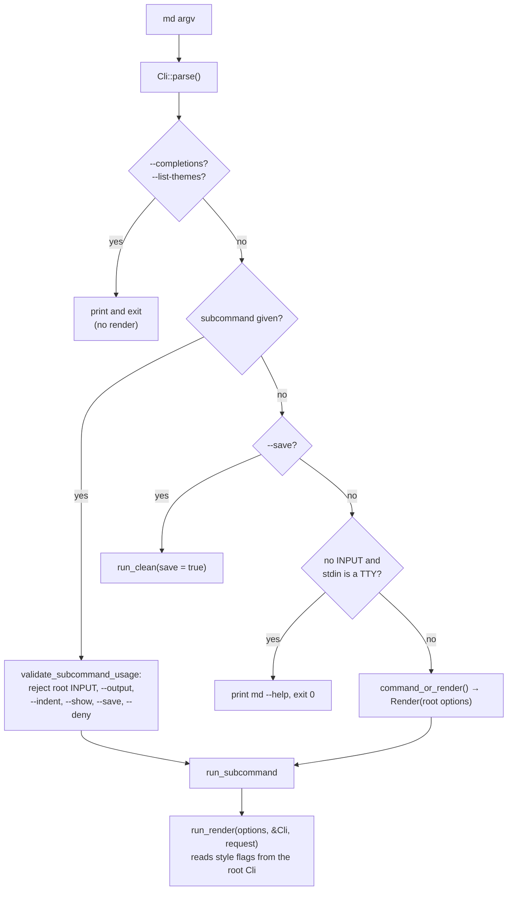
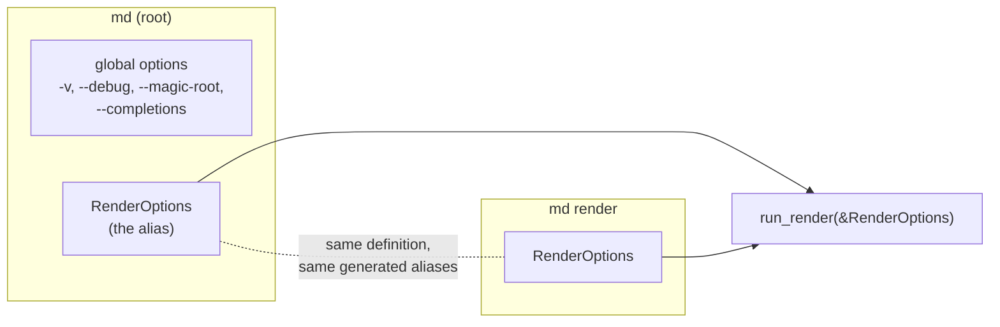
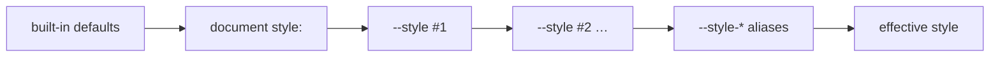

---
$schema:
    status: |-
        enum(
            draft-spec,
            finalized-spec,
            planned,
            implemented,
            review-findings,
            human-in-the-loop,
            completed,
            on-hold,
            abandoned
        ) -> an indicator of progress for this specification
    reviewed: boolean -> indicates whether the specification file has been reviewed by another agent from the one which created the spec
    reviewed_by: string -> the agent and model used in the spec review
    reviewed_on: date -> the date the spec was reviewed
    review_iterations: number -> the number of implementation reviews have taken place in the review/fix cycle
    clarified: boolean -> indicates whether the specification was built -- _in part_ -- with the 'clarify.md' prompt
    implemented: boolean -> indicates whether this spec's plan has been implemented
    implemented_by: string -> the agent who implemented the plan
kind: feature
created: 2026-11-05
status: draft-spec
area: darkmatter
owner: Ken Snyder <ken@ken.net>
reviewed: false
implemented: false
packages:
    - darkmatter-cli
    - darkmatter
related:
    - 2026-11-04-composition-errors
---

# The `md render` Surface: One Render Command, and `--style`

`md` renders a Markdown file when you give it no subcommand (`md notes.md`),
and it also has an explicit `md render` subcommand. The two are documented as
the same thing, but they are not: about forty style flags work only in the
first form, a few flags make bare `md` do something that is not rendering at
all, and the two forms differ when there is no input.

This feature does two things:

1. **Makes bare `md` an exact alias of `md render`.** Same options, same
   defaults, same behavior. Options that are truly global stay global; every
   render or style option moves onto `md render`.
2. **Replaces the forty style flags with one `--style` option** that takes a
   JSON5 object mirroring the `style:` frontmatter, plus hidden,
   per-key convenience flags such as `--style-margin 4`.

This is a **draft**. The open questions at the end must be settled before the
spec is finalized.

**How to read the markers.** A **Decided** note records a ruling the owner
made on 2026-11-05 while clarifying `2026-11-04-composition-errors`; it is not
up for re-discussion in review. **Proposed** marks a design detail the drafter
chose that the owner has not ruled on.

## Scope

| Package | Why |
|---|---|
| `darkmatter-cli` | the root/`render` argument definitions, dispatch, `--style` parsing, generated hidden aliases, removal of the old flags |
| `darkmatter` | the style model the CLI lowers into (`CliStyleClaims` is replaced by a `style:` layer, **Proposed**), and any shorthand keys added to the `style:` schema |

**Out of scope.** `--width` and `--output` are owned by
`2026-11-04-composition-errors` (width is a CLI-wide constraint, output is
CLI-wide selection). This spec moves neither and designs neither; where an
inventory below mentions them, it is only to say where they sit today.

## Terms

| Term | Meaning here |
|---|---|
| **subcommand** | the first word after `md` that names an action: `render`, `compose`, `clean`, ... |
| **root** | `md` itself, before any subcommand; a "root flag" is one clap defines on the top-level `Cli` struct |
| **root alias** | the shortcut that lets `md notes.md` mean `md render notes.md` |
| **global option** | a clap argument declared with `global = true`, accepted before or after any subcommand (`-v`, `--debug`, `--code-block` today) |
| **clap** | the Rust argument-parsing crate `md` uses; its "derive" form turns struct fields into flags |
| **`style:` frontmatter** | the YAML block in a document that sets layout and colors, documented in `docs/topics/layouts-and-style.md` |
| **JSON5** | JSON with relaxed syntax: unquoted keys, single quotes, trailing commas, comments |
| **dasherized alias** | a flag spelled from a style key path, such as `--style-max-width` for the `max-width` key |
| **shell completion** | the candidates your shell offers when you press Tab; `md` uses clap's dynamic completion engine (`COMPLETE=zsh md`) |

## Decisions

> **Decided (1). A CLI with subcommands has no "root command".** A root alias
> is allowed for ergonomics, but it must always be an **exact** alias of one
> named subcommand. For `md`, bare `md` is exactly `md render`: the same
> options, defaults, and behavior. Every current divergence between `md` and
> `md render` is a defect. Truly global options (`-v`/`--verbose`, `--debug`,
> `--magic-root`, `--completions`) stay global; render and style options move
> off the root onto `md render`.

> **Decided (2). `md render` is the rich rendering surface for Markdown.**
> Width (`--width`) is a core, CLI-wide constraint owned by
> `2026-11-04-composition-errors`. The other style constraints are a design of
> `md render` specifically, not a general rule for every command.

> **Decided (3). `--max-width` is removed as a pattern.** `md render` packs all
> style attributes under `--style <json|json5>`, mirroring the `style:`
> frontmatter:
>
> ```sh
> md render notes.md --style "{ max-width: 50, margin: 4 }"
> ```
>
> The attributes needed include `max-width`, `margin` (all sides), and
> `ml`/`mr`/`mt`/`mb`.

> **Decided (4). Each style key also has a dasherized flag,** for example
> `md render notes.md --style-margin 4`. These flags are **not** shown in
> `--help` (to keep help compact) but **are** offered by shell completion.

> **Decided (5). Until this spec lands,** `2026-11-04-composition-errors`
> keeps `--max-width` on `md render`.

The general rule in decision 1 applies to every CLI in the monorepo, not only
`md`. It is recorded here because `md` is the first CLI it changes; the
`cli` skill records it for the rest (see [Documentation](#documentation)).

## Today's Behavior

### How dispatch works

`Cli` (`cli/src/args/cli.rs`) flattens `RenderOptions`
(`cli/src/args/render.rs`: `[INPUT]`, `--output`, `--show`, `--indent`,
`--deny`, `--feature`) at the root, and `Command::Render` holds a second copy
of the same `RenderOptions`. Everything else that affects rendering (themes,
margins, alignment, ...) is a field of `Cli` itself, so it exists **only at
the root**.



`run_render` reads the style flags from the root `Cli`
(`style_claims::cli_style_claims(cli)`, `cli.theme`, `cli.mermaid`,
`cli.line_numbers`, ...), never from the `render` subcommand. That is why the
explicit form cannot take them.

### Divergences between `md` and `md render`

Observed 2026-11-05 with the installed `md 0.1.0` and confirmed against the
source.

| # | Divergence | `md …` | `md render …` | Where |
|---|---|---|---|---|
| 1 | Style, theme, and layout flags (the [inventory](#root-style-flags) below) are root-only | `md doc.md --margin 4` works | `md render doc.md --margin 4` fails: `unexpected argument '--margin'` | `cli.rs` fields; `render.rs`, `style_claims.rs` read `Cli` |
| 2 | The same flags are accepted **before** the subcommand and silently ignored by most subcommands | `md --margin 4 toc doc.md` succeeds and ignores `--margin` | n/a | `validate_subcommand_usage` (`commands/mod.rs`) checks only six options |
| 3 | …except `md compose --output html\|markdown-plus`, which honors them | `md --margin 4 compose doc.md --output html` applies the margin | n/a | `commands/compose.rs` passes `&Cli` to `html_artifact` |
| 4 | `--save` makes bare `md` a **clean**, not a render | `md --save doc.md` = `md clean --save doc.md` | `md render doc.md --save` fails | `main.rs` (`cli.save` branch) |
| 5 | `--list-themes` is root-only and is not a render | `md --list-themes` lists themes | `md render --list-themes` fails | `main.rs` |
| 6 | No input on a terminal | `md` prints `md --help` and exits 0 | `md render` fails: "No input file provided" | `main.rs` vs `io::load_document` |
| 7 | `--feature` is accepted in both places and the lists are **combined** | `md --feature a render doc.md --feature b` turns on both | — | `Cli::command_or_render` |
| 8 | The other `RenderOptions` given at the root **and** with a subcommand are a usage error | `md --output html render doc.md` fails | — | `validate_subcommand_usage` |
| 9 | Help shows different options | `md --help` lists every style flag | `md render --help` lists only `RenderOptions` and global options | clap derive |
| 10 | `--width` stub is root-only (always an error) | `md doc.md --width 80` → "not supported" | `md render doc.md --width 80` → unknown argument | `parsers::reject_width_flag` (owned by the fix) |

Rows 7 and 8 contradict each other: one root render option merges with the
subcommand's, the others conflict with it.

`docs/cli/render.md` describes the style flags as "Global Flags Relevant to
`render`". They are not global in clap's sense (only `--code-block` is), so
the page is wrong today: `md render doc.md --theme dracula` fails.

**Adjacent defect found while researching.** `md code-block` reads
`cli.render.show` (`commands/code_block.rs`), the root's `--show`. That value
can never be true: `md --show code-block …` is rejected by
`validate_subcommand_usage`, and `code-block` declares no `--show` of its own.
The code path is unreachable. It is caused by the same root-option sharing
this spec removes, so this spec fixes it (see open question 9).

### Root style flags

These are the root fields of `Cli` that shape rendering, with the `style:`
frontmatter key each one overrides. "None" means no frontmatter key exists.

| Flag (aliases) | Value | `style:` key | Notes |
|---|---|---|---|
| `-m`, `--margin` | cells | `page.{left,right,top,bottom}-margin` | no single key |
| `--mx` | cells | `page.left-margin` + `page.right-margin` | |
| `--my` | rows | `page.top-margin` + `page.bottom-margin` | |
| `--mt` (`--margin-top`) | rows | `page.top-margin` | |
| `--mb` (`--margin-bottom`) | rows | `page.bottom-margin` | |
| `--ml` (`--margin-left`) | cells | `page.left-margin` | frontmatter also accepts `2ch`, `10%` |
| `--mr` (`--margin-right`) | cells | `page.right-margin` | same |
| `--padding` | cells | `page.{left,right,top,bottom}-padding` | no single key |
| `--px` | cells | `page.left-padding` + `page.right-padding` | |
| `--py` | rows | `page.top-padding` + `page.bottom-padding` | |
| `--pt` (`--padding-top`) | rows | `page.top-padding` | |
| `--pb` (`--padding-bottom`) | rows | `page.bottom-padding` | |
| `--pl` (`--padding-left`) | cells | `page.left-padding` | |
| `--pr` (`--padding-right`) | cells | `page.right-padding` | |
| `--page-bg` (`--page-background`) | `transparent\|subtle\|pronounced` | `page.background` | |
| `--page-bg-color` | color | `page.bg-color` | |
| `--max-width` | cells, > 0 | `page.max-width` | frontmatter also accepts `ch`, `%` |
| `--width` | — | none | always an error; owned by `2026-11-04-composition-errors` |
| `--line-numbers [BOOL]` | bool | none | code-block gutters |
| `--alignment` | `left\|center\|right` | `page.alignment` | broadcast to every component |
| `--align-images` | alignment | `images.alignment` | |
| `--align-lists` | alignment | `ul`/`ol`/`li` `.alignment` | no single key |
| `--align-ul` / `--align-ol` / `--align-li` | alignment | `ul.alignment` / `ol.alignment` / `li.alignment` | |
| `--align-block-quotes` | alignment | `block-quote.alignment` | |
| `--align-tables` | alignment | `table.alignment` | |
| `--align-code-blocks` | alignment | `code-block.alignment` | |
| `--fill` | `full\|pad=N\|indent=N\|max=N\|explicit=N` | none | lowers to `width`, `max-width`, or padding on every component |
| `--fill-images`, `--fill-lists`, `--fill-ul`, `--fill-ol`, `--fill-li`, `--fill-block-quotes`, `--fill-tables`, `--fill-code-blocks` | fill | none | as `--fill`, for one component or the list group |
| `--theme` | theme name | none | prose theme |
| `--code-theme` | theme name | `page.code.theme` | |
| `--code-block` (global) | `inverse\|dark\|light\|same` | none | also read by `md schema about` |
| `--list-themes` | — | not style | prints the theme list |
| `--mermaid` | — | none | render behavior, not presentation |
| `--save` | — | not render | `md clean --save` |

That is 43 root fields, 38 of them style or layout. `--feature`, the other
render behavior switch, already lives in `RenderOptions`.

The CLI value grammar is narrower than the frontmatter's: CLI margins and
`--max-width` are bare cell counts, while `style:` accepts `2ch` and `10%`.
Moving to `--style` gives the command line the frontmatter grammar for free.

### How CLI style beats frontmatter today

`style_claims::cli_style_claims` copies the root fields into the library's
`CliStyleClaims` (`lib/src/style/cli_claims.rs`), a 40-field struct of
`Option`s. `apply_style_frontmatter` then applies the document's `style:`
and the `*_overrides_from_claims` functions stop it from overwriting any
field the user set on the command line. The override is field by field:
`md guide.md --mx 6` keeps the document's `top-margin` and `max-width`.
Inside the flags, the more specific one wins: `--margin` is applied first,
then `--mx`/`--my`, then `--mt`/`--ml`/..., and likewise for alignment and
fill.

## Problem

1. **The alias is not an alias.** A user who learns `md doc.md --margin 4`
   and then writes `md render doc.md --margin 4` in a script gets a usage
   error (rows 1, 9, 10). The documentation says the two are the same.
2. **Bare `md` does things that are not rendering.** `--save` cleans and
   writes a file; `--list-themes` lists themes (rows 4, 5). A user cannot
   predict from `md render --help` what `md` will do.
3. **Root flags leak into other commands.** Style flags before any subcommand
   are accepted and silently ignored (row 2), except by `compose`'s HTML
   output (row 3). A silently ignored flag looks like it worked.
4. **The flag surface does not scale.** Each new style property means one or
   more new flags, a new `CliStyleClaims` field, an override bit, and
   documentation in two places. 38 flags already cover only part of what
   `style:` can say: there is no flag for colors, borders, horizontal rules,
   hyperlinks, or any component `max-width`.
5. **Two style vocabularies drift.** The flags (`--mx`, `--align-tables`,
   `--fill-ul`) and the frontmatter (`page.left-margin`, `table.alignment`)
   name the same things differently and accept different value grammars.

## Design

### One definition, two spellings

> **Proposed.** `md render`'s arguments are defined once. The root `Cli`
> carries that same definition plus the global options and nothing else, so
> `md X` and `md render X` parse to the same `RenderOptions` for every `X`.



- `RenderOptions` gains everything `run_render` reads: `--style`, the hidden
  `--style-*` aliases, and whichever render-behavior flags are not folded into
  `--style` (open question 1).
- `run_render` takes only `&RenderOptions` and the request. It never reads a
  root field, so the root cannot carry anything `render` lacks.
- Render options given at the root **and** with a subcommand are a usage
  error, with no exceptions. `--feature` stops being combined (row 7).
- The root keeps only global options: `-v`/`--verbose`, `--debug`,
  `--magic-root`, `--completions`, plus clap's `--help` and `--version`.

**Proposed** mechanism: the hidden aliases are generated at runtime (see
[Hidden aliases](#hidden-dasherized-aliases)), so the derive structs alone
cannot express them. One function, `with_render_args(clap::Command) ->
clap::Command`, adds them; `md`'s command factory applies it to the root and
to the `render` subcommand, and both `Cli::parse` and
`CompleteEnv::with_factory` use that factory. The [parity
test](#tests) holds the two spellings together.

### `--style`

`--style` takes a JSON5 object whose shape mirrors the `style:` frontmatter.
It is repeatable; later values merge over earlier ones.

```sh
# page frame
md render notes.md --style "{ max-width: 80, margin: 2 }"

# a component bucket, same keys as frontmatter
md render notes.md --style "{ table: { alignment: center, max-width: '80%' } }"

# several --style values merge key by key
md render notes.md --style "{ margin: 2 }" --style "{ ml: 6 }"
```

**Proposed** rules (each one is an open question below):

| Rule | Proposal | Open question |
|---|---|---|
| Shape | the `style:` frontmatter shape, plus page shorthand keys at the top level (`max-width`, `margin`, `mx`, `ml`, ...) that apply to `page` | 2 |
| Precedence | defaults < document `style:` < `--style` (in order) < `--style-*` aliases | 3 |
| Merge | key by key, deep; a key you do not set keeps the document's value | 3 |
| Files | a value that does not start with `{` is a file reference | 4 |
| Validation | the same parser as `style:` frontmatter; any problem is a usage error naming the key | 5 |

The precedence, as a picture:



Each arrow is a key-by-key deep merge: the right side replaces only the keys
it sets. After the merge, the shorthands resolve as they do today, the most
specific key winning: `margin` sets all four sides, `mx` overrides left and
right, `ml` overrides left.

**Proposed.** The CLI lowers `--style` and the aliases into a
`StyleFrontmatter` layer and merges it over the document's `style:` before
applying it. `CliStyleClaims`, its 40 fields, and the
`*_overrides_from_claims` override bits are removed: one style model, one
apply path, so a key that works in frontmatter works on the command line.

### Hidden dasherized aliases

Every style key the schema accepts also gets a flag spelled from its path,
prefixed `--style-` and joined with `-`:

| Flag | Same as |
|---|---|
| `--style-margin 4` | `--style "{ margin: 4 }"` |
| `--style-max-width 80` | `--style "{ max-width: 80 }"` |
| `--style-table-alignment center` | `--style "{ table: { alignment: center } }"` |
| `--style-page-bg-color slate-900` | `--style "{ page: { bg-color: 'slate-900' } }"` |

- They are not listed by `md render --help` or `md --help`.
- Shell completion offers them (open question 6 chooses how).
- The value is read as the key's type through the same conversion engine
  that reads frontmatter (`simplified_schema::coercion`), so `4` is a number
  and `slate-900` a string. **Proposed.**
- They are generated from the style schema, so a new key gets its flag with
  no CLI change, and a removed key loses it (open question 6).

### What leaves the root

| Today | After | Open question |
|---|---|---|
| the 38 style and layout flags | `--style` / `--style-*` on `md render` (and therefore on bare `md`); each old flag is a usage error naming its replacement | 1, 8 |
| `--theme`, `--code-theme`, `--mermaid`, `--line-numbers`, `--code-block` | on `md render`, as `--style` keys or as plain render flags | 1 |
| `--save` | removed; `md clean --save` | 7 |
| `--list-themes` | not a root flag | 7 |
| `--width` | wherever `2026-11-04-composition-errors` puts it | — |
| `-v`, `--debug`, `--magic-root`, `--completions` | unchanged, global | — |

Removed flags use the existing `main.rs::REMOVED_FLAGS` mechanism: each is
rejected before parsing with "`--mx` was removed with no alias; use
`--style-mx`", so completion never offers it.

## Open Questions

### 1. Which flags fold into `--style`?

`--theme`, `--code-theme`, `--code-block`, `--line-numbers`, `--mermaid`, and
`--feature` all change rendered output. Which of them are "style"?

| Option | Pros | Cons |
|---|---|---|
| **A. Only what has a `style:` key today** (`--code-theme` → `page.code.theme`, plus margins, padding, background, alignment); the rest stay plain `render` flags | no schema change; smallest step | `--theme` and `--line-numbers` stay as separate flags, though an author would also want them in frontmatter |
| **B. Presentation folds, behavior stays.** Fold A plus `--theme` (new `page.theme`), `--code-block` (new `page.code.mode`), `--line-numbers` (new `code-block.line-numbers`); keep `--mermaid` and `--feature` as render flags | one rule a reader can apply: "would a document author pin it in frontmatter?"; frontmatter gains the same reach | adds three schema keys; `md schema about` reads `--code-block` and would need its own flag |
| **C. Everything into `--style`** | one option | `--mermaid` and features are rendering behavior, not style, and have no frontmatter meaning |

**Recommendation: B.** The test "would an author pin it in the document?"
separates presentation from behavior. `md schema about` keeps a
`--code-block` of its own (it is not a render).

**Alignment and fill.** Alignment maps directly to component `alignment`
keys. `--fill` has no key: `max=` is `max-width`, `explicit=` is `width`,
`pad=` is symmetric padding, but `indent=` is one-sided padding that depends
on alignment. **Recommendation:** drop the fill vocabulary and use the keys it
lowers to; `indent=N` becomes `left-margin` (the `ul` bucket already has
it), and the owner confirms the loss of right-aligned indent is acceptable.

### 2. The shape of `--style`

The owner's example, `{ max-width: 50, margin: 4 }`, is flat, while
`style:` frontmatter is bucketed (`page.max-width`, `page.left-margin`) and
has no `margin` or `ml` key.

| Option | Pros | Cons |
|---|---|---|
| **A. Exactly the frontmatter shape** | one vocabulary, already validated | the example does not parse; `--style "{ page: { left-margin: 4 } }"` is long to type |
| **B. Frontmatter shape plus top-level page shorthands, added to the shared `style:` schema** (`margin`, `mx`/`my`, `mt`/`mb`/`ml`/`mr`, `padding` and `p*`, `max-width`, `background`, `bg-color`, `color`, `alignment` at the top level mean `page.*`) | the example works; a `--style` value pastes into frontmatter and back unchanged | frontmatter gains a second spelling for page keys; the schema must say which wins when both are set |
| **C. Shorthands only on the CLI**, lowered onto the frontmatter shape | frontmatter untouched | two vocabularies again (problem 5); a value cannot be pasted into a document |

**Recommendation: B.** Copy-paste parity between the command line and the
document is the point of mirroring `style:`. A shorthand and its long form in
the same object resolve most-specific-wins (`ml` over `margin`), and
`page.left-margin` and top-level `ml` are the same key (setting both is a
validation error).

### 3. Precedence and merge

| Option | Pros | Cons |
|---|---|---|
| **A. Key-by-key deep merge; CLI over document; later `--style` over earlier; aliases over `--style`** | matches today's field-level override; scripts can pass a base `--style` and a user can override one key | aliases and `--style` naming the same key resolve silently |
| **B. As A, but an alias and a `--style` that set the same key with different values is a usage error** | no silent choice | breaks the "base plus override" use |
| **C. Replace, not merge:** a `--style` bucket replaces the document's whole bucket | simple to explain | `--style "{ table: { alignment: center } }"` would drop the document's `table.max-width`; differs from today |

**Recommendation: A.** It is what users already get from the flags, and
"the more specific spelling wins" matches the shorthand rule.

### 4. May `--style` name a file?

| Option | Pros | Cons |
|---|---|---|
| **A. Inline only** | nothing to resolve | long styles live in shell history |
| **B. A value starting with `{` (after whitespace) is inline JSON5; anything else is a `FileReference`** resolved in the launch context and read as JSON, JSON5, YAML, or TOML by extension (biscuit-file) | reusable style files; `@`/`^`/`&` work like every other `md` file argument | one more resolution path to test; a file named `{x}.json` needs `./` |
| **C. An explicit prefix** (`--style @dark.yaml` only) | unambiguous | `@` already means a magic path in the reference grammar |

**Recommendation: B.** It follows the CLI rule that every file argument opens
through `io::open_argument`. A missing file is a `FileReference` failure with
its `failure:` row, not "invalid JSON".

### 5. Validation and error reporting

Frontmatter `style:` problems are warnings unless `--deny style` is set.

| Option | Pros | Cons |
|---|---|---|
| **A. Same parser and same policy as frontmatter** (warn; `--deny style` makes it fatal) | one behavior | a typo on the command line (`--style "{ magin: 4 }"`) renders without it, which looks like it worked |
| **B. Same parser (`style::from_frontmatter` path), but every problem in a CLI value is a usage error (exit 2)** naming the option and the key path, such as ``--style: unknown key `magin` (did you mean `margin`?)`` | typos fail where they were typed; frontmatter keeps its policy | the CLI is stricter than the document |
| **C. Validate against the SimplifiedSchema `style` partial (`schemas/partials/style.yaml`) as well** | the schema DMLS uses | the runtime parser is authoritative for cross-field rules (`width` vs `max-width`); two validators can disagree |

**Recommendation: B**, using the runtime parser only. A JSON5 syntax error
reports the line and column inside the value. Hidden aliases fail the same
way (`--style-margin abc`: expected a number).

### 6. Generating the hidden aliases

**Where the key list comes from.**

| Option | Pros | Cons |
|---|---|---|
| **A. Walk the `style` partial schema** (every scalar leaf; skip open objects like `page.meta`) | the schema already lists every key; DMLS uses it too | the partial is SimplifiedSchema, not the Rust structs; the two can disagree |
| **B. A key table in the `darkmatter` style module**, tested against both the structs and the partial | one Rust list, cheap at startup | a third list to keep in step |
| **C. Hand-written clap args** | no generation | drifts by construction |

**Recommendation: A,** with a test that every generated path deserializes
into `StyleFrontmatter` (so the schema and the parser cannot drift
unnoticed), and a test that no two paths produce the same flag name.

**How clap hides them but completion keeps them.** clap_complete 4.6's
dynamic engine (`engine/complete.rs`) returns hidden candidates only when no
visible candidate matches what was typed. So:

| Option | Help | Completion |
|---|---|---|
| **A. `Arg::hide(true)`** | hidden | offered once the prefix matches only hidden flags, so `--style-<Tab>` lists them and `--st<Tab>` shows only `--style` |
| **B. `hide_short_help(true)` + `hide_long_help(true)`** | hidden from `-h` and `--help` | always offered, because `is_hide_set()` is false |

**Recommendation: A.** `--style-<Tab>` is the natural discovery path and keeps
`--<Tab>` short. Verify with a test against the pinned clap_complete version.

**How many.** Every scalar leaf gives roughly a hundred flags.
**Recommendation:** generate them all, since they are hidden, rather than
choose a subset that needs its own rule.

### 7. Non-render behaviors on the root

`md --save` cleans a file; `md --list-themes` lists themes. Neither is a
render, so neither can be an option of `md render` without breaking
decision 1's intent.

| Behavior | Option | Recommendation |
|---|---|---|
| `--save` | **A.** remove; usage error "use `md clean --save`". **B.** keep as `md render --save` meaning clean | **A.** A render option that writes the file is surprising; `md clean --save` already exists |
| `--list-themes` | **A.** new `md themes` subcommand. **B.** `md render --list-themes`. **C.** remove; completion already lists theme names | **A.** It is its own action, prints to stdout, and can take `--output` like every other command |

### 8. Naming conflicts and removed spellings

All generated flags share the `--style-` prefix, and no current render flag
starts with it (`--show`, `--output`, `--indent`, `--deny`, `--feature`), so
no generated flag collides with an existing one. Two risks remain:

- **A new render flag named `--style-…`** would shadow a generated alias. The
  uniqueness test covers this.
- **Old spellings.** `--margin-top`, `--padding-left`, `-m`, and the other
  visible aliases are removed with the flags. **Recommendation:** each enters
  `REMOVED_FLAGS` with its exact replacement (`--mt` → `--style-mt`,
  `--align-tables` → `--style-table-alignment`, `--fill-ul max=40` →
  `--style-ul-max-width 40`) rather than staying as a silent alias.

### 9. What else reads the root today

- **`md compose --output html|markdown-plus`** honors root style flags
  (row 3) and root `--feature`. Decision 2 makes style a design of
  `md render`. **Option A:** compose uses only the document's `style:`;
  `md compose doc.md | md render - --output html --style …` covers the rest.
  **Option B:** compose also takes `--style`. A's cost: a stdin document has
  no file context, so page-relative assets (images, `page.stylesheet`) do not
  resolve. **Recommendation: A,** and the open question in
  `2026-11-04-composition-errors` about compose's human outputs decides
  whether that cost matters.
- **`md code-block`** reads the unreachable root `--show`. **Recommendation:**
  delete the read; whether `code-block` gets its own `--show` belongs with
  that fix's `--output` work.
- **`md schema about`** reads global `--code-block`. Covered by open
  question 1.

### 10. Bare `md` with no arguments, and help

An exact alias means `md` on a terminal with no input should do what
`md render` does. Two things are not render invocations, though:

- **`md` with no arguments at all.** **Option A:** print root help, as today;
  `md render` with no input fails as today. **Option B:** both fail with the
  same usage error. **Recommendation: A.** No arguments is not a render
  request, the same way `md --help` is not; any render argument (a flag, a
  file, `-`) makes it one, and then the two forms behave the same.
- **`md --help`** describes the CLI (commands and global options), not
  `render`. **Recommendation:** it lists the commands, the global options,
  and one line: "`md [INPUT] [OPTIONS]` is `md render [INPUT] [OPTIONS]`;
  see `md render --help`." This also keeps root help compact.

## Acceptance Criteria

- For every option `md render` accepts, `md <args>` and `md render <args>`
  parse to the same `RenderOptions` and produce byte-identical output.
- `run_render` reads nothing from the root `Cli`; the root defines only the
  global options and the shared render definition.
- Render options before a subcommand are a usage error (exit 2), including
  `--feature`.
- `md render doc.md --style "{ max-width: 50, margin: 4 }"` renders with a
  50-cell content box and a 4-cell margin on every side.
- `--style-margin 4` gives the same output as `--style "{ margin: 4 }"`.
- A `--style` that sets one key keeps the document's other `style:` keys.
- `md render --help` and `md --help` list `--style` and no `--style-*` flag.
- Completing `md render --style-` offers the generated flags; completing
  `md render --` does not.
- Each removed flag exits 2 with a message naming its replacement, and
  completion does not offer it.
- An unknown key or wrong value type in `--style` or an alias exits 2 and
  names the key path.
- `md --save` and `md --list-themes` behave as open question 7 decides.
- `CliStyleClaims` is gone, or the decision to keep it is recorded
  (**Proposed** removal).

## Tests

All L1 unless noted.

- **Parity, generated** (`cli/tests/l1/render_alias_parity.rs`): iterate
  `md render`'s arguments from the clap command (including the hidden
  aliases), build a sample value for each, and assert that `md …` and
  `md render …` parse to equal `RenderOptions`. A new render option is
  covered without editing the test.
- **Parity, end to end:** a styled fixture rendered through
  `md FILE --style …` and `md render FILE --style …` with
  `--output markdown-plus` gives identical bytes.
- **Root isolation:** a source-scan guard that `commands/render.rs` and
  `render.rs` take no `&Cli`.
- **Help:** `md --help` and `md render --help` contain `--style` and no
  `--style-` line (extend `cli/tests/l1/help.rs`).
- **Completion:** in-process through `clap_complete::engine::complete`:
  `--style-` yields `--style-margin` and `--style-max-width`; `--` yields
  neither.
- **Alias generation:** every generated path deserializes into
  `StyleFrontmatter`; no two paths produce the same flag; each schema leaf
  has a flag.
- **Merge:** frontmatter `page.max-width: 96` plus `--style "{ ml: 6 }"`
  keeps `max-width` 96; `--style "{ margin: 2 }" --style-ml 6` gives left 6,
  others 2.
- **Validation:** `--style "{ magin: 4 }"`, `--style "{ margin: "`, and
  `--style-margin abc` each exit 2 with the key path or position.
- **File form** (if open question 4 chooses B): `--style ./dark.yaml` and
  `--style '@dark.json5'` apply; a missing file shows its `failure:` row.
- **Removed flags:** each `REMOVED_FLAGS` entry for this change exits 2 with
  its replacement.
- **Existing layout tests** (`layout_flags.rs`, `layout_alignment.rs`,
  `layout_fill.rs`, and the L2 `level2_layout_dimensions.rs`,
  `level2_horizontal_rules.rs`, `level2_code_block_styling.rs`, and other L2
  files that pass style flags) are rewritten onto `--style` with the same
  expected output, which is the evidence the migration lost nothing.

## Documentation

- **`darkmatter/docs/cli/render.md`:** state the alias rule; replace "Global
  Flags Relevant to `render`" with `--style`, the precedence, the hidden
  aliases (one sentence and a completion example), and the remaining render
  flags.
- **`darkmatter/docs/cli/index.md`:** the `md --help` sample and the usage
  line; the alias rule in the opening paragraph.
- **`darkmatter/docs/topics/layouts-and-style.md`:** rewrite "CLI Overrides"
  around `--style`; add any shorthand keys and any keys added by open
  question 1 to the frontmatter sections.
- **`darkmatter/docs/rendering/style.md`, `rendering/mermaid.md`,
  `rendering/code-highlighting.md`:** replace old flag spellings.
- **`darkmatter/docs/cli/policy.md`:** what `--deny style` means for
  `--style` (open question 5).
- **`darkmatter/cli/README.md`:** examples.
- **`.claude/skills/darkmatter/cli.md`, `rendering.md`, `terminal.md`:** the
  `RenderOptions` and `CliStyleClaims` paragraphs.
- **`.claude/skills/cli/`:** the general rule from decision 1 (no root
  command; a root alias is an exact alias of one subcommand; truly global
  options only at the root), with the parity test as the way to enforce it.
