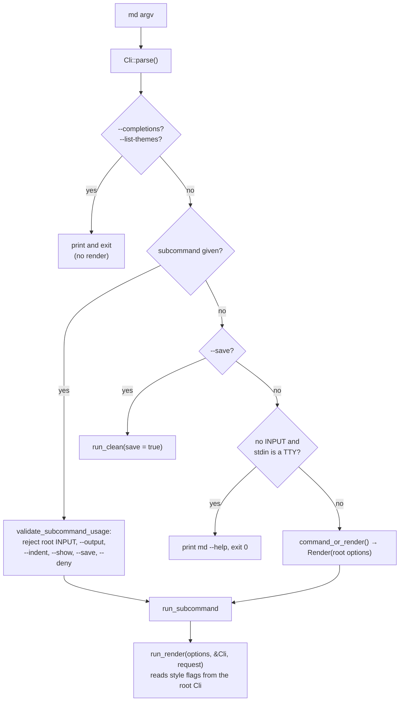
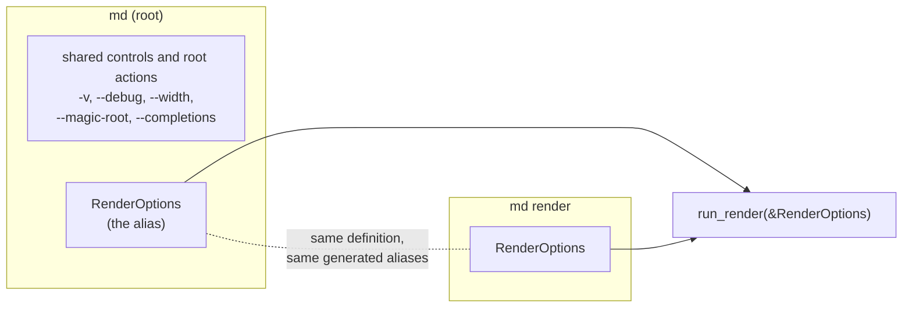
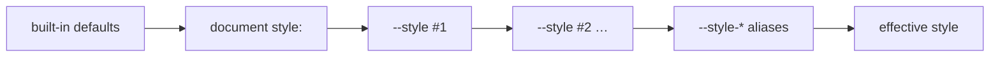

---
$schema:
    status: |-
        enum(
            draft-spec,
            finalized-spec,
            planned,
            implemented,
            review-findings,
            human-in-the-loop,
            completed,
            on-hold,
            abandoned
        ) -> an indicator of progress for this specification
    reviewed: boolean -> indicates whether the specification file has been reviewed by another agent from the one which created the spec
    reviewed_by: string -> the agent and model used in the spec review
    reviewed_on: date -> the date the spec was reviewed
    review_iterations: number -> the number of implementation reviews have taken place in the review/fix cycle
    clarified: boolean -> indicates whether the specification was built -- _in part_ -- with the 'clarify.md' prompt
    implemented: boolean -> indicates whether this spec's plan has been implemented
    implemented_by: string -> the agent who implemented the plan
kind: feature
created: 2026-11-05
status: draft-spec
area: darkmatter
owner: Ken Snyder <ken@ken.net>
reviewed: true
reviewed_by: codex/gpt-6.1-sol
reviewed_on: 2026-11-05
review_iterations: 0
implemented: false
packages:
    - darkmatter-cli
    - darkmatter
related:
    - 2026-11-04-composition-errors
---

# The `md render` Surface: One Render Command, and `--style`

`md` renders a Markdown file when you give it no subcommand (`md notes.md`),
and it also has an explicit `md render` subcommand. The two are documented as
the same thing, but they are not: about forty style flags work only in the
first form, a few flags make bare `md` do something that is not rendering at
all, and the two forms differ when there is no input.

This feature does two things:

1. **Makes bare `md` an exact alias of `md render`.** Same options, same
   defaults, same behavior. Options that are truly global stay global; every
   render or style option moves onto `md render`.
2. **Replaces the forty style flags with one `--style` option** that takes a
   JSON5 object mirroring the `style:` frontmatter, plus hidden,
   per-key convenience flags such as `--style-margin 4`.

This is a **draft**. The open questions at the end must be settled before the
spec is finalized.

**How to read the markers.** A **Decided** note records a ruling the owner
made on 2026-11-05 while clarifying `2026-11-04-composition-errors`; it is not
up for re-discussion in review. **Proposed** marks a design detail the drafter
chose that the owner has not ruled on.

## Review notes

This inline review preserves the owner’s decisions. It corrects JSON5
examples, separates layer precedence from shorthand precedence, and adds
requirements for parser construction, file context, errors, and migration.
Recommendations in **Open Questions** remain choices for the author; they
are not approvals to change behavior. In particular, removing fill behavior,
adding new presentation keys, accepting style files, and adding a theme-list
command require the choices described there before implementation.

The behavior inventory below was refreshed on 2026-11-06, after
`2026-11-04-composition-errors` completed. The current
[output and width contract](../../docs/cli/output-and-width.md) and
[data-output contract](../../docs/cli/data-contracts.md) remain authoritative.

## Scope

| Package | Why |
|---|---|
| `darkmatter-cli` | the root/`render` argument definitions, dispatch, `--style` parsing, generated hidden aliases, removal of the old flags |
| `darkmatter` | the style model the CLI lowers into (`CliStyleClaims` is replaced by a `style:` layer, **Proposed**), and any shorthand keys added to the `style:` schema |

**Out of scope.** `--width` and `--output` were delivered by
`2026-11-04-composition-errors` (width is a CLI-wide constraint, output is
CLI-wide selection). This spec redesigns neither; where an inventory below
mentions them, it is only to say where they sit today.

## Terms

| Term | Meaning here |
|---|---|
| **subcommand** | the first word after `md` that names an action: `render`, `compose`, `clean`, ... |
| **root** | `md` itself, before any subcommand; a "root flag" is one clap defines on the top-level `Cli` struct |
| **root alias** | the shortcut that lets `md notes.md` mean `md render notes.md` |
| **global option** | a clap argument declared with `global = true`, accepted before or after any subcommand (`-v`, `--debug`, `--code-block` today) |
| **clap** | the Rust argument-parsing crate `md` uses; its "derive" form turns struct fields into flags |
| **`style:` frontmatter** | the YAML block in a document that sets layout and colors, documented in `docs/topics/layouts-and-style.md` |
| **JSON5** | JSON with identifier keys, single quotes, trailing commas, and comments; hyphenated keys and string values still require quotes |
| **dasherized alias** | a flag spelled from a style key path, such as `--style-max-width` for the `max-width` key |
| **style layer** | one source of explicitly set style fields: the document, one `--style` occurrence, or the combined hidden aliases; fields omitted by that source stay unset |
| **normalization** | expanding shorthands and equivalent spellings to the same full field paths before combining sources |
| **shell completion** | the candidates your shell offers when you press Tab; `md` uses clap's dynamic completion engine (`COMPLETE=zsh md`) |

## Decisions

> **Decided (1). A CLI with subcommands has no "root command".** A root alias
> is allowed for ergonomics, but it must always be an **exact** alias of one
> named subcommand. For `md`, bare `md` is exactly `md render`: the same
> options, defaults, and behavior. Every current divergence between `md` and
> `md render` is a defect. Truly global options (`-v`/`--verbose`, `--debug`,
> `--magic-root`, `--completions`) stay global; render and style options move
> off the root onto `md render`.

> **Decided (2). `md render` is the rich rendering surface for Markdown.**
> Width (`--width`) is a core, CLI-wide constraint owned by
> `2026-11-04-composition-errors`. The other style constraints are a design of
> `md render` specifically, not a general rule for every command.

> **Decided (3). `--max-width` is removed as a pattern.** `md render` packs all
> style attributes under `--style <json|json5>`, mirroring the `style:`
> frontmatter:
>
> ```sh
> md render notes.md --style "{ 'max-width': 50, margin: 4 }"
> ```
>
> The attributes needed include `max-width`, `margin` (all sides), and
> `ml`/`mr`/`mt`/`mb`.

> **Decided (4). Each style key also has a dasherized flag,** for example
> `md render notes.md --style-margin 4`. These flags are **not** shown in
> `--help` (to keep help compact) but **are** offered by shell completion.

> **Decided (5). Until this spec lands,** `2026-11-04-composition-errors`
> keeps `--max-width` on `md render`.

The general rule that a root alias shares one subcommand’s behavior applies to every CLI in the monorepo, not only
`md`. It is recorded here because `md` is the first CLI it changes; the
`cli` skill records it for the rest (see [Documentation](#documentation)).

## Today's Behavior

### How dispatch works

`Cli` (`cli/src/args/cli.rs`) flattens `RenderOptions`
(`cli/src/args/render.rs`: `[INPUT]`, `--output`, `--show`, `--max-width`,
`--indent`, `--deny`, `--feature`) at the root, and `Command::Render` holds a second copy
of the same `RenderOptions`. Everything else that affects rendering (themes,
margins, alignment, ...) is a field of `Cli` itself, so it exists **only at
the root**.



`run_render` reads the style flags from the root `Cli`
(`style_claims::cli_style_claims(cli)`, `cli.theme`, `cli.mermaid`,
`cli.line_numbers`, ...), never from the `render` subcommand. That is why the
explicit form cannot take them. It also reads `cli.width` and `cli.verbose` to
resolve its output, so removing `&Cli` has to carry those across.

### Divergences between `md` and `md render`

Observed 2026-11-05 with the installed `md 0.1.0`, confirmed against the source,
and rechecked 2026-11-06. Rows 3 and 10 are kept, marked resolved, so that row
numbers cited elsewhere stay stable.

| # | Divergence | `md …` | `md render …` | Where |
|---|---|---|---|---|
| 1 | Style, theme, and layout flags (the [inventory](#root-style-flags) below) are root-only | `md doc.md --margin 4` works | `md render doc.md --margin 4` fails: `unexpected argument '--margin'` | `cli.rs` fields; `render.rs`, `style_claims.rs` read `Cli` |
| 2 | The same flags are accepted **before** the subcommand and silently ignored by every subcommand, including `--max-width`, which is a `RenderOptions` field | `md --margin 4 toc doc.md` and `md --max-width 40 toc doc.md` succeed and ignore the flag | n/a | `validate_subcommand_usage` (`commands/mod.rs`) checks only six options |
| 3 | **Resolved by `2026-11-04-composition-errors`.** `md compose` accepts only Markdown and the data family, so `md compose --output html` is a usage error and no compose path reads style flags | n/a | n/a | `args/output.rs::COMPOSE_TARGETS` |
| 4 | `--save` makes bare `md` a **clean**, not a render | `md --save doc.md` = `md clean --save doc.md` | `md render doc.md --save` fails | `main.rs` (`cli.save` branch) |
| 5 | `--list-themes` is root-only and is not a render | `md --list-themes` lists themes | `md render --list-themes` fails | `main.rs` |
| 6 | No input on a terminal | `md` prints `md --help` and exits 0, even with `--output json`, where the data contract promises one value | `md render` fails: "No input file provided" | `main.rs` vs `io::load_document` |
| 7 | `--feature` is accepted in both places and the lists are **combined** | `md --feature a render doc.md --feature b` turns on both | — | `Cli::command_or_render` |
| 8 | The other `RenderOptions` given at the root **and** with a subcommand are a usage error | `md --output html render doc.md` fails | — | `validate_subcommand_usage` |
| 9 | Help shows different options | `md --help` lists every style flag | `md render --help` lists only `RenderOptions` and global options | clap derive |
| 10 | **Resolved by `2026-11-04-composition-errors`.** `--width` is a real global option and behaves the same in both forms | n/a | n/a | `args/cli.rs` |

Rows 7 and 8 contradict each other: one root render option merges with the
subcommand's, the others conflict with it.

`docs/cli/render.md` describes the style flags as "Global Flags Relevant to
`render`". They are not global in clap's sense (only `--code-block` is), so
the page is wrong today: `md render doc.md --theme dracula` fails.

### Root style flags

These are the root fields of `Cli` that shape rendering, with the `style:`
frontmatter key each one overrides. "None" means no frontmatter key exists.

| Flag (aliases) | Value | `style:` key | Notes |
|---|---|---|---|
| `-m`, `--margin` | cells | `page.{left,right,top,bottom}-margin` | no single key |
| `--mx` | cells | `page.left-margin` + `page.right-margin` | |
| `--my` | rows | `page.top-margin` + `page.bottom-margin` | |
| `--mt` (`--margin-top`) | rows | `page.top-margin` | |
| `--mb` (`--margin-bottom`) | rows | `page.bottom-margin` | |
| `--ml` (`--margin-left`) | cells | `page.left-margin` | frontmatter also accepts `2ch`, `10%` |
| `--mr` (`--margin-right`) | cells | `page.right-margin` | same |
| `--padding` | cells | `page.{left,right,top,bottom}-padding` | no single key |
| `--px` | cells | `page.left-padding` + `page.right-padding` | |
| `--py` | rows | `page.top-padding` + `page.bottom-padding` | |
| `--pt` (`--padding-top`) | rows | `page.top-padding` | |
| `--pb` (`--padding-bottom`) | rows | `page.bottom-padding` | |
| `--pl` (`--padding-left`) | cells | `page.left-padding` | |
| `--pr` (`--padding-right`) | cells | `page.right-padding` | |
| `--page-bg` (`--page-background`) | `transparent\|subtle\|pronounced` | `page.background` | |
| `--page-bg-color` | color | `page.bg-color` | |
| `--max-width` | cells, > 0 | `page.max-width` | a `RenderOptions` field, so also on `md render`; frontmatter also accepts `ch`, `%` |
| `--width` | width | none | a real global option delivered by `2026-11-04-composition-errors`; stays; not a style flag |
| `--line-numbers [BOOL]` | bool | none | code-block gutters |
| `--alignment` | `left\|center\|right` | `page.alignment` | broadcast to every component |
| `--align-images` | alignment | `images.alignment` | |
| `--align-lists` | alignment | `ul`/`ol`/`li` `.alignment` | no single key |
| `--align-ul` / `--align-ol` / `--align-li` | alignment | `ul.alignment` / `ol.alignment` / `li.alignment` | |
| `--align-block-quotes` | alignment | `block-quote.alignment` | |
| `--align-tables` | alignment | `table.alignment` | |
| `--align-code-blocks` | alignment | `code-block.alignment` | |
| `--fill` | `full\|pad=N\|indent=N\|max=N\|explicit=N` | none | lowers to `width`, `max-width`, or padding on every component |
| `--fill-images`, `--fill-lists`, `--fill-ul`, `--fill-ol`, `--fill-li`, `--fill-block-quotes`, `--fill-tables`, `--fill-code-blocks` | fill | none | as `--fill`, for one component or the list group |
| `--theme` | theme name | none | prose theme |
| `--code-theme` | theme name | `page.code.theme` | |
| `--code-block` (global) | `inverse\|dark\|light\|same` | none | also read by `md schema about` |
| `--list-themes` | — | not style | prints the theme list |
| `--mermaid` | — | none | render behavior, not presentation |
| `--save` | — | not render | `md clean --save` |

When drafted that was 43 root fields, 38 of them style or layout; `--max-width`
has since moved to `RenderOptions` and `--width` has become a shared control, so
treat this table, not the count, as the migration list. `--feature`, the other
render behavior switch, already lives in `RenderOptions`.

The CLI value grammar is narrower than the frontmatter's: CLI margins and
`--max-width` are bare cell counts, while `style:` accepts `2ch` and `10%`.
Moving to `--style` gives the command line the frontmatter grammar for free.

### How CLI style beats frontmatter today

`style_claims::cli_style_claims` copies the root fields into the library's
`CliStyleClaims` (`lib/src/style/cli_claims.rs`), a 40-field struct of
`Option`s. `apply_style_frontmatter` then applies the document's `style:`
and the `*_overrides_from_claims` functions stop it from overwriting any
field the user set on the command line. The override is field by field:
`md guide.md --mx 6` keeps the document's `top-margin` and `max-width`.
Inside the flags, the more specific one wins: `--margin` is applied first,
then `--mx`/`--my`, then `--mt`/`--ml`/..., and likewise for alignment and
fill.

`--max-width` has two paths today, and the replacement must retire both: the
root value through `style_claims.rs` into `CliStyleClaims`, and the explicit
subcommand's value applied directly after `style:` in `commands/render.rs`.

## Problem

1. **The alias is not an alias.** A user who learns `md doc.md --margin 4`
   and then writes `md render doc.md --margin 4` in a script gets a usage
   error (rows 1, 9). The documentation says the two are the same.
2. **Bare `md` does things that are not rendering.** `--save` cleans and
   writes a file; `--list-themes` lists themes (rows 4, 5). A user cannot
   predict from `md render --help` what `md` will do.
3. **Root flags leak into other commands.** Style flags before any subcommand
   are accepted and silently ignored (row 2). A silently ignored flag looks like
   it worked.
4. **The flag surface does not scale.** Each new style property means one or
   more new flags, a new `CliStyleClaims` field, an override bit, and
   documentation in two places. 38 flags already cover only part of what
   `style:` can say: there is no flag for colors, borders, horizontal rules,
   hyperlinks, or any component `max-width`.
5. **Two style vocabularies drift.** The flags (`--mx`, `--align-tables`,
   `--fill-ul`) and the frontmatter (`page.left-margin`, `table.alignment`)
   name the same things differently and accept different value grammars.

## Design

### One definition, two spellings

> **Proposed.** `md render`'s arguments are defined once. The root `Cli`
> carries that same definition plus the global options and nothing else, so
> both spellings produce the same render options for every render argument
> sequence. Explicit subcommands and root help/completion requests are not
> render argument sequences.



- `RenderOptions` gains everything `run_render` reads: `--style`, the hidden
  `--style-*` aliases, and whichever render-behavior flags are not folded into
  `--style` (the “Which flags fold into `--style`?” open question).
- The `darkmatter-cli` render handler takes prepared render options, the
  resolved output context, and the request. It never reads a root argument
  structure, so a root field cannot introduce a hidden rendering option.
- Render options given at the root **and** with a subcommand are a usage
  error, with no exceptions. `--feature` stops being combined (row 7).
- The root owns shared controls (`-v`/`--verbose`, `--debug`, `--width`),
  launch configuration (`--magic-root`), and help/version/completion actions,
  as well as the shared render definition used for the alias. Keep the
  existing placement rules: `--magic-root` is root-only and repeatable;
  it is deliberately **not** a clap global because clap would otherwise
  lose repeated values split across command levels. `--completions` remains
  a root action. This refactor does not make either option accepted after a
  subcommand. The owner’s word “global” means shared responsibility here,
  not a request to change those parsing rules.

**Proposed mechanism.** Build one clap command factory that augments both
root rendering and explicit `render` with the same arguments, including
hidden style aliases. In `darkmatter-cli`, the current
[`Cli`](../../cli/src/args/cli.rs) is the derived argument structure and
[`RenderOptions`](../../cli/src/args/render.rs) holds shared render options.
Runtime-added arguments are not automatically captured into derived fields.
Parse through the augmented command’s `try_get_matches_from`, extract the
alias values from `ArgMatches`, then construct the typed invocation through
`FromArgMatches` plus that extraction. Ordinary `Cli::parse()` builds the
derive-only command and must not bypass this factory. Tests, dynamic
completion, and generated shell completions use this same factory.

Distinguish an explicitly supplied option from a clap default when checking
whether root render arguments precede a subcommand. Reject, for example,
`md --feature a render doc.md` and `md --style '{}' toc doc.md`, even if the
explicit `render` has no duplicate option. Shared controls do not count as
render arguments. Root help presents commands, shared controls, `--style`,
and the alias usage line; other render details belong in `md render --help`.

A command word in a consumed value is never a subcommand:
`md --style-page-code-theme render notes.md` treats `render` as the theme
value. Respect `--` for positional inputs; `md -- render` renders a file
named `render`. Do not rewrite arguments by scanning for command words.

Resolve shared output options once at dispatch and pass the resolved output
context and request to the render handler. Removing `&Cli` must not lose
`--width`, verbosity, output diagnostics, or request configuration. Theme
fallbacks and terminal capabilities come from that output context, including
its plain-output behavior, rather than being detected again downstream.

### `--style`

`--style` takes a JSON5 object whose shape mirrors the `style:` frontmatter.
It is repeatable; later values merge over earlier ones.

```sh
# page frame
md render notes.md --style "{ 'max-width': 80, margin: 2 }"

# a component bucket, same keys as frontmatter
md render notes.md --style "{ table: { alignment: 'center', 'max-width': '80%' } }"

# several --style values merge key by key
md render notes.md --style "{ margin: 2 }" --style "{ ml: 6 }"
```

**Proposed** rules (each one is an open question below):

| Rule | Proposal | Open question |
|---|---|---|
| Shape | the `style:` frontmatter shape, plus page shorthand keys at the top level (`max-width`, `margin`, `mx`, `ml`, ...) that apply to `page` | 2 |
| Precedence | defaults < document `style:` < `--style` (in order) < `--style-*` aliases | 3 |
| Merge | key by key, deep; a key you do not set keeps the document's value | 3 |
| Files | a value that does not start with `{` is a file reference | 4 |
| Validation | shared runtime validation; inline syntax/type/key errors are usage errors, while file execution failures retain the run-error contract | 5 |

The precedence, as a picture:



Each source is a separate style layer containing only the fields it sets. **Normalize each layer before
merging it with another.** Within a layer, `margin` expands to four sides,
`mx`/`my` override the corresponding pairs, and `ml`/`mr`/`mt`/`mb` override
one side; padding works the same way. Then merge canonical fields in the
order above. Resolving shorthands only after merging would incorrectly let
a document’s `ml: 6` defeat a CLI `margin: 2`.

Top-level page keys and nested `page` keys normalize to the same fields.
Reject duplicate spellings of the same specific field in one object, such
as `ml` together with `page.left-margin`. A shorthand plus a more specific
field is valid. Duplicate exact object keys must be rejected before a JSON
map silently discards one. Preserve option occurrence and source information
long enough to identify the offending layer and key.

The hidden aliases form one final layer regardless of their position among
`--style` occurrences. Within that layer, expand shorthands by specificity;
repeating the same flag uses its last value. Thus `--style-ml 6
--style-margin 2` still yields left 6 and other sides 2. Across separate
`--style` layers, later layers win even if earlier layers used a more
specific shorthand. No omitted value or parser default becomes an override.

Use nonnegative integer row counts for vertical page spacing, retaining the
existing `u16` range; horizontal spacing keeps its existing length grammar.
All-sides `margin`/`padding` and vertical pair shorthands must accept only
values valid for every side they set. For example `margin: '10%'` is invalid;
`mx: '10%'` is valid. The page content cap must resolve to a positive width.

**Cross-field constraints.** Keep existing exclusions such as component
`width` versus `max-width`. Reject a layer explicitly setting both. When a
later layer sets either member, remove the inherited other member before
validating the effective style; a CLI `table.width` can replace a document’s
`table.max-width` without inheriting an invalid pair. Objects merge
recursively, arrays and scalar values replace; a union value changing shape
(for example a scalar border becoming an object) replaces that whole value.
In CLI layers, strip null-valued fields before merging: `null` is absence,
not a reset instruction; zero and `false`
are explicit values where their field permits them. A present CLI root must
be an object; a scalar or `null` root is invalid. Reset syntax is out of scope.

**Proposed shared path.** In the `darkmatter` library,
[`StyleFrontmatter`](../../lib/src/style/schema/mod.rs) is the typed sparse
render style. Normalize and merge through the library’s shared style path,
then apply the effective values during tree construction and page-frame
assembly. Do not mutate the document’s authored frontmatter or serialized
Markdown to inject CLI overrides. Preserve the one context-aware tree build
and one target fold; no HTML repair or terminal decoration pass is added.

Removal of the library’s
[`CliStyleClaims`](../../lib/src/style/cli_claims.rs), which currently records
explicit CLI fields, is proposed only after all behavior it protects has a
replacement. In particular, page alignment broadcasts, component overrides,
relative stylesheet origins, and fill behavior need coverage. A merged tree
alone does not solve page alignment: a CLI page-alignment broadcast must
beat a document’s component alignment, while a component alignment in the
same or later layer beats that broadcast. Expand broadcasts into component
claims within each layer, before the cross-layer merge, using the existing
broadcast targets. Preserve origins separately from typed presentation
values where a field refers to a file.

The shared schema also contains `style.markdown`, whose cleanup rules are
accepted and validated but never read by rendering. It has no field in
`StyleFrontmatter`; retain it through validation separately and preserve its
existing lack of rendering effects. `--style` must not clean or save a file.

### Hidden dasherized aliases

Every supported canonical style value path gets a flag spelled from its path,
prefixed `--style-` and joined with `-`:

| Flag | Same as |
|---|---|
| `--style-margin 4` | `--style "{ margin: 4 }"` |
| `--style-max-width 80` | `--style "{ 'max-width': 80 }"` |
| `--style-table-alignment center` | `--style "{ table: { alignment: 'center' } }"` |
| `--style-page-bg-color slate-900` | `--style "{ page: { 'bg-color': 'slate-900' } }"` |

- They are not listed by `md render --help` or `md --help`.
- Shell completion offers them (the “Generating the hidden aliases” open question chooses how).
- The value is read as the key's type through the same conversion engine
  that reads frontmatter (`simplified_schema::coercion`), so `4` is a number
  and `slate-900` a string. **Proposed.**
- Generate canonical kebab-case spellings only. Deprecated snake-case aliases
  do not create flags. Read the embedded schema without filesystem or
  network discovery; any parsed catalog can be reused within the process.
- Generate compound-value flags too: `--style-table-border thin` and
  `--style-table-border "{ left: true, right: false }"` both set the border;
  `--style-table-border-left false` sets one nested field. Open objects such
  as `page.meta` get a whole-object flag taking JSON5, not unbounded nested
  flags. The same normalization rules resolve compound and nested flags;
  nested fields override their containing compound value within the alias
  layer. If the parent is scalar, a nested field switches to the object arm.
- Every alias requires exactly one argument, including booleans (`false`
  remains false); accept both `--flag VALUE` and `--flag=VALUE`. Strings such
  as `slate-900` and `40ch` are passed as text, not parsed as bare JSON5
  expressions. Numbers, booleans, unions, and compound values bind through
  the declared type and shared conversion engine, then the runtime style
  validator. A string containing expression syntax is never executed.
- Cleanup-rule aliases under `--style-markdown-*` follow the shared schema
  and remain accepted without rendering effects, just like those keys in
  frontmatter. Help in the style reference and completion descriptions
  explain that these rules belong to `md clean`.
- See **Generating the hidden aliases** in Open Questions for the catalog
  source choice and completion behavior.

### What leaves the root

| Today | After | Open question |
|---|---|---|
| the 38 style and layout flags | `--style` / `--style-*` on `md render` (and therefore on bare `md`); each old flag is a usage error naming its replacement | 1, 8 |
| `--theme`, `--code-theme`, `--mermaid`, `--line-numbers`, `--code-block` | on `md render`, as `--style` keys or as plain render flags | 1 |
| `--save` | removed; `md clean --save` | 7 |
| `--list-themes` | not a root flag | 7 |
| `--max-width` | removed; `--style "{ 'max-width': N }"` or `--style-max-width N` (Decided 3 and 5) | 8 |
| `--width` | unchanged: a global option on the root | — |
| `-v`, `--debug`, `--magic-root`, `--completions` | unchanged placement rules; magic roots and completion generation stay root-only | — |

Removed flags use a command-aware extension of the existing `darkmatter-cli`
[`REMOVED_FLAGS`](../../cli/src/main.rs) rejection mechanism: each is
rejected before parsing with "`--mx` was removed with no alias; use
`--style-mx`", so completion never offers it.

### Style input preparation and errors

**Review requirement.** Inline style parsing and validation are passive:
no expressions, shell expansion, imports, composition, remote requests, or
stylesheet reads. Validate all explicitly supplied CLI layers even if a
later layer would override a bad value. Keep document warnings and their
original positions; a CLI override must not conceal an authored unknown or
deprecated key. Cross-field validation of the effective style happens after
normalization and merging. A style applicable only to HTML may be valid for
terminal output without being used there; lack of target applicability is
not an unknown-key error.

Inline syntax, unknown keys, deprecated spellings, and invalid typed values
are usage errors (exit 2, stderr, no stdout value), regardless of `--deny`.
Use the shared runtime style validator, including apply-time constraints;
calling its parser alone does not enforce all width exclusions. Constraints
that depend on an opened file, the effective merged sources, or resolved
output geometry are run failures (exit 1), not late parser errors. Only
constraints decidable from inline arguments alone produce exit 2. Preserve
informational `KnownButInactive` notices as the current parser does rather
than promoting every notice to an error. Report the `--style` occurrence or
alias and canonical key path; syntax errors include line and column.

If style files are approved, opening and reading them is execution. Missing,
unreadable, unsupported-format, or invalid-content files fail with exit 1
and the existing run diagnostics. For `--output json|yaml|toml`, return the
one failed result and keep stderr empty, as required by the data-output
contract. Retain the typed file-reference `failure:` information. Do not
turn these failures into pre-parse exit-2 messages. Stylesheet reads occur
only when preparing a target that uses them and follow the same run-error
contract.

### File context if style files are approved

A style file contains the **style value itself**, for example `page:` and
`table:` at its root, not a wrapper with a `style:` property. A Markdown
file with frontmatter is not a style file. Select JSON, JSON5, YAML, or TOML
by extension through biscuit-file’s existing readers; reject unsupported
extensions, extra YAML documents, and non-object roots. Do not recursively
load other style files. A whitespace-trimmed value beginning with `{` is
inline; all other values are reference candidates, and a literal file name
beginning with `{` needs a `./` prefix. Do not retry failed inline JSON5 as a
file path. `--style -` is rejected: stdin is reserved for the Markdown input.

In `darkmatter-cli`, use
[`io::open_argument`](../../cli/src/io/mod.rs) to open the reference through
biscuit-file’s [`FileReference`](../../../biscuit-file/lib/src/file_reference/mod.rs)
and the existing request’s launch context. Derive the style-file context
from that opening reference; do not capture another process directory,
repository observation, or home directory. Local style files only are
proposed here: reject HTTP(S) style-file inputs without making a network
request. Remote style-file transport would need a separate authorization
and cache design.

Track the source context of a winning file-valued style field such as
`page.stylesheet`: document values use the document context, inline CLI
values and aliases use the launch context, and file-supplied values use
that style file’s context. The context belongs to the field that wins the
merge, not to the last style file opened. Resolving an asset must preserve
FileReference diagnostics and the existing distinction between a local CSS
read and a remote stylesheet link emitted for the browser; this feature does
not fetch a linked remote stylesheet. The Markdown input’s images keep their
own document context. No additional host discovery or network permission is
introduced by accepting a style file.

### Removal and migration boundaries

The old spellings are intentional removals; the layout behavior they control
must be retained or explicitly approved for removal. Build a migration table
covering every removed flag and visible alias, including global/group
broadcasts and the value-dependent fill spellings. A replacement may be a
complete `--style` object affecting several buckets, rather than one flag.
Never advertise a nonequivalent replacement as exact.

The rejection code must understand command ownership and argument values.
`md schema about --code-block light` and `md code-block --theme dracula`
remain legal if those command-local options are retained. `md clean --save`
remains legal. Check `--flag=value`, the removed short `-m` forms supported
by today’s parser, and the `--` terminator. A consumed argument value such
as `--style-page-meta '{ title: "--margin" }'` is not a removed flag. A flat
scan of every token in the current rejection helper cannot safely implement
this migration.

## Open Questions

### 1. Which flags fold into `--style`?

`--theme`, `--code-theme`, `--code-block`, `--line-numbers`, `--mermaid`, and
`--feature` all change rendered output. Which of them are "style"?

| Option | Pros | Cons |
|---|---|---|
| **A. Only what has a `style:` key today** (`--code-theme` → `page.code.theme`, plus margins, padding, background, alignment); the rest stay plain `render` flags | no schema change; smallest step | `--theme` and `--line-numbers` stay as separate flags, though an author would also want them in frontmatter |
| **B. Presentation folds, behavior stays.** Fold A plus `--theme` (new `page.theme`), `--code-block` (new `page.code.mode`), `--line-numbers` (new `code-block.line-numbers`); keep `--mermaid` and `--feature` as render flags | one rule a reader can apply: "would a document author pin it in frontmatter?"; frontmatter gains the same reach | adds three schema keys; `md schema about` reads `--code-block` and would need its own flag |
| **C. Everything into `--style`** | one option | `--mermaid` and features are rendering behavior, not style, and have no frontmatter meaning |

**Recommendation: B.** The test “would an author pin it in the document?”
separates presentation from behavior. `md schema about` keeps a
`--code-block` of its own (it is not a render). Before approving this
schema expansion, define prose theme and code-theme name validation,
`page.code.mode`’s default of `inverse`, and explicit `false` for line
numbers. Resolve defaults after merging, including code-theme fallback
from the effective prose theme; an omitted CLI value must not override the
document. Keep existing per-fence and direct-component precedence above
page defaults. Extend the embedded schema, runtime descriptors, typed
models, validation, and terminal/browser lowering together; do not add
schema-only keys that the renderer cannot use.

**Alignment and fill need a separate author choice.** Alignment has
component keys, but global and list-group flags are broadcasts; replacing
`--align-lists` needs values for `ul`, `ol`, and `li`. Fill is more than a
width shortcut. In the `darkmatter` library,
[`apply_cli_claims`](../../lib/src/style/cli_claims.rs) lowers `indent=N`
to alignment-dependent **padding**, and `full` resets width, max-width,
and padding. A left margin is not an equivalent replacement, even for a
left-aligned component. Current shared component spacing is scalar and
cannot express all of these edge-specific values.

| Option | Pros | Cons |
|---|---|---|
| **A. Add edge-specific component padding and an explicit, documented way to clear an inherited width cap in the shared style model; migrate each fill value into those fields** | retains layout capabilities; one style vocabulary | expands the shared schema and needs terminal/browser support; callers must spell the appropriate edge for their alignment |
| **B. Add a shared structured fill property with today’s fill modes, resolved after alignment** | closest behavioral migration, including alignment-dependent indent | retains a second layout vocabulary inside the new style API |
| **C. Remove unsupported fill behavior with an explicit breaking-change note** | smallest implementation | loses one-sided indentation and reset behavior; existing layout assertions cannot all stay unchanged |

**Recommendation: A.** It fits the long-term goal of one style model and
expresses actual layout properties. The author must approve the shared
padding and reset design before removal; until then, removal of the fill
claim implementation is blocked. Do not assume the general no-reset rule
for CLI nulls supplies this missing reset operation. If the author chooses
C, name each lost behavior and revise acceptance tests rather than weakening
them silently.

### 2. The shape of `--style`

The owner's example, `{ 'max-width': 50, margin: 4 }`, is flat, while
`style:` frontmatter is bucketed (`page.max-width`, `page.left-margin`) and
has no `margin` or `ml` key.

| Option | Pros | Cons |
|---|---|---|
| **A. Exactly the frontmatter shape** | one vocabulary, already validated | the example does not parse; `--style "{ page: { 'left-margin': 4 } }"` is long to type |
| **B. Frontmatter shape plus top-level page shorthands, added to the shared `style:` schema** (`margin`, `mx`/`my`, `mt`/`mb`/`ml`/`mr`, `padding` and `p*`, `max-width`, `background`, `bg-color`, `color`, `alignment` at the top level mean `page.*`) | the example works; a `--style` value pastes into frontmatter and back unchanged | frontmatter gains a second spelling for page keys; the schema must say which wins when both are set |
| **C. Shorthands only on the CLI**, lowered onto the frontmatter shape | frontmatter untouched | two vocabularies again (problem 5); a value cannot be pasted into a document |

**Recommendation: B.** Copy-paste parity between the command line and the
document is the point of mirroring `style:`. A shorthand and its long form in
the same object resolve most-specific-wins (`ml` over `margin`), and
`page.left-margin` and top-level `ml` are the same key (setting both is a
validation error).

### 3. Precedence and merge

| Option | Pros | Cons |
|---|---|---|
| **A. Key-by-key deep merge; CLI over document; later `--style` over earlier; aliases over `--style`** | matches today's field-level override; scripts can pass a base `--style` and a user can override one key | aliases and `--style` naming the same key resolve silently |
| **B. As A, but an alias and a `--style` that set the same key with different values is a usage error** | no silent choice | breaks the "base plus override" use |
| **C. Replace, not merge:** a `--style` bucket replaces the document's whole bucket | simple to explain | `--style "{ table: { alignment: 'center' } }"` would drop the document's `table.max-width`; differs from today |

**Recommendation: A**, with normalization before each layer merge, as
specified under `--style`. Layer order decides which source wins;
shorthand specificity resolves overlapping keys only within one layer.

### 4. May `--style` name a file?

| Option | Pros | Cons |
|---|---|---|
| **A. Inline only** | nothing to resolve | long styles live in shell history |
| **B. A value starting with `{` (after whitespace) is inline JSON5; anything else is a `FileReference`** resolved in the launch context and read locally as JSON, JSON5, YAML, or TOML by extension (biscuit-file) | reusable style files; `@`/`^`/`&` work like every other `md` file argument | one more resolution path to test; a file named `{x}.json` needs `./` |
| **C. An explicit prefix** (`--style @dark.yaml` only) | unambiguous | `@` already means a magic path in the reference grammar |

**Recommendation: B**, limited to local files and the input/error/context
rules above. Reusable styles are useful, but opening one must not add a
network authorization path or redirect document assets. A missing file is
a run failure carrying the existing file-reference diagnostics.

### 5. Validation and error reporting

Frontmatter unknown/deprecated keys are warnings unless `--deny style` is
set; malformed typed values and application errors already have their own
failure paths. Preserve that distinction.

| Option | Pros | Cons |
|---|---|---|
| **A. Same parser and same policy as frontmatter** (warn; `--deny style` makes it fatal) | one behavior | a typo on the command line (`--style "{ magin: 4 }"`) renders without it, which looks like it worked |
| **B. Same parser (`style::from_frontmatter` path), but inline CLI syntax, unknown/deprecated keys, and invalid values are usage errors (exit 2)** naming the option and the key path, such as ``--style: unknown key `magin` (did you mean `margin`?)`` | typos fail where they were typed; frontmatter keeps its policy | the CLI is stricter than the document |
| **C. Validate against the SimplifiedSchema `style` partial (`schemas/partials/style.yaml`) as well** | the schema DMLS uses | the runtime parser is authoritative for cross-field rules (`width` vs `max-width`); two validators can disagree |

**Recommendation: B**, using the shared parser and application constraints,
with the informational-notice and file-error distinctions specified above.
A JSON5 syntax error
reports the line and column inside the value. Hidden aliases fail the same
way (`--style-margin abc`: expected a number).

### 6. Generating the hidden aliases

**Where the key list comes from.**

| Option | Pros | Cons |
|---|---|---|
| **A. Walk the embedded `style` partial schema** (scalar leaves plus whole compound/open-object values; stop descending at open objects like `page.meta`) | the schema already lists every key; DMLS uses it too | the partial is SimplifiedSchema, not the Rust structs; the two can disagree |
| **B. Extend the existing `darkmatter` runtime descriptor catalog**, tested against the structs and partial | already used by the parser; cheap at startup | compound branches need richer descriptors; the schema still needs agreement tests |
| **C. Hand-written clap args** | no generation | drifts by construction |

**Recommendation: A**, with semantic coverage against the runtime path,
not just successful serde deserialization (which can ignore unknown fields).
The `darkmatter` library already has a parser catalog,
[`descriptor::SCHEMA`](../../lib/src/style/descriptor.rs); do not introduce
a third hand-maintained list. Test representative values through the runtime
validator and assert the resulting typed value or expected cleanup-rule
validation result. Cover union scalar and object branches and open objects.
Every generated path must be recognized, and no two paths or existing
arguments may produce the same flag. New keys need no handwritten clap
argument, but still need schema/model/descriptor/rendering agreement.

**How clap hides them but completion keeps them.** The lockfile pins
clap_complete 4.6.2. The draft expects its dynamic
engine to offer hidden candidates when no visible candidate matches the
typed prefix; verify that behavior against this pinned version before
relying on it. The implementation alternatives are:

| Option | Help | Completion |
|---|---|---|
| **A. `Arg::hide(true)`** | hidden | offered once the prefix matches only hidden flags, so `--style-<Tab>` lists them and `--st<Tab>` shows only `--style` |
| **B. `hide_short_help(true)` + `hide_long_help(true)`** | hidden from `-h` and `--help` | always offered, because `is_hide_set()` is false |

**Recommendation: A.** `--style-<Tab>` is the natural discovery path and keeps
`--<Tab>` short. Verify with a test against the pinned clap_complete version.

**How many.** Generate every supported canonical path using the rules
above, including compound and cleanup-rule paths; do not hard-code a count.
No performance spike is required for this bounded in-memory command setup.
If implementation reveals a material startup cost, record the observed
cost before proposing additional measurement.

### 7. Non-render behaviors on the root

`md --save` cleans a file; `md --list-themes` lists themes. Neither is a
render, so neither can be an option of `md render` without breaking
the owner’s requirement that bare `md` perform rendering.

| Behavior | Option | Recommendation |
|---|---|---|
| `--save` | **A.** remove; usage error "use `md clean --save`". **B.** keep as `md render --save` meaning clean | **A.** A render option that writes the file is surprising; `md clean --save` already exists |
| `--list-themes` | **A.** new `md themes` subcommand. **B.** `md render --list-themes`. **C.** remove; completion already lists theme names | **A.** It is its own action; define its data shape, schema, and completion before implementation |

If a theme-list command is chosen, implement it through the existing
`darkmatter-cli` command-output path, with command-leaf registration, an
output schema, and a schema-conformance test. Specify whether the result
lists prose themes, code themes, or both; **recommendation:** preserve the
current list’s content and ordering, with explicit categories if it already
distinguishes them. Keep the current command’s exit status and stream rules.

### 8. Naming conflicts and removed spellings

All generated flags share the `--style-` prefix, and no current render flag
starts with it (`--show`, `--output`, `--indent`, `--deny`, `--feature`), so
no generated flag collides with an existing one. Two risks remain:

- **A new render flag named `--style-…`** would shadow a generated alias. The
  uniqueness test covers this.
- **Old spellings.** `--margin-top`, `--padding-left`, `-m`, and the other
  visible aliases are removed with the flags. **Recommendation:** each enters
  `REMOVED_FLAGS` with its exact replacement (`--mt` → `--style-mt`,
  `--align-tables` → `--style-table-alignment`, `--fill-ul max=40` →
  `--style-ul-max-width 40`) rather than staying as a silent alias.

### 9. What else reads the root today

- **`md compose`** no longer has an HTML or `markdown-plus` output
  (`2026-11-04-composition-errors` decided compose always writes Markdown), so
  it takes no `--style`. Rendering a composed document with overrides is a pipe:
  `md compose doc.md | md render - --output html --style …`. That decision
  leaves one cost for this spec's documentation to state: a Markdown pipe cannot
  preserve the original document path. Stdin has the request's launch context,
  which may differ from the source document's directory, so relative assets may
  resolve differently or fail.
- **`md schema about`** reads global `--code-block`. Covered by the “Which flags
  fold into `--style`?” open question.

### 10. Bare `md` with no arguments, and help

The owner requires exact render behavior for both spellings. The current
root-only no-input help shortcut contradicts that requirement.

| Option | Pros | Cons |
|---|---|---|
| **A. Both forms use the existing render no-input behavior** | preserves the owner’s exact-alias rule; smallest change | bare `md` on a terminal no longer prints root help automatically |
| **B. Both forms show render help when stdin is a terminal and no input was given** | exact parity with a friendlier empty invocation | changes the explicit command’s current failure behavior |
| **C. Bare `md` shows root help, explicit `md render` fails** | preserves current behavior | requires the owner to amend the exact-alias decision |

**Recommendation: A.** On a terminal, both forms report the same missing-input
failure through the existing run-output contract. With redirected stdin,
both consume it, including the same treatment of empty input. Explicit `-`
means stdin in both forms. Shared options alone, such as `md -v`, do not
restore the root-only help shortcut. No code path reads stdin just to decide
which alias applies.

`md --help`, `md --version`, and root completion generation remain CLI
actions. Root help lists commands, shared controls, and the `--style` entry,
plus: “`md [INPUT] [OPTIONS]` is `md render [INPUT] [OPTIONS]`; see
`md render --help`.” Explicit `md render --help` describes rendering. Both
help forms omit per-key style aliases. Files named like commands require
`./render` or `-- render`; do not resolve an argument as a file before clap
has determined its role.

## Acceptance Criteria

- For every valid render argument sequence, `md <args>` and `md render
  <args>` produce equal prepared render options, the same diagnostics and
  exit status, and byte-identical output under the same captured environment.
  Explicit root help/version/completion actions are the documented exceptions.
- `run_render` reads nothing from the root `Cli`; the root defines only the
  shared controls, launch configuration, CLI actions, and the shared render
  definition with its existing placement rules.
- Render options before a subcommand are a usage error (exit 2), including
  `--feature`.
- `md render doc.md --style "{ 'max-width': 50, margin: 4 }"` sets a
  50-cell maximum content width and four-cell horizontal/four-row vertical
  margins; it does not force short content to fill 50 cells. Available width
  still bounds the box according to the existing output-width contract.
- `--style-margin 4` gives the same output as `--style "{ margin: 4 }"`.
- A `--style` that sets one key keeps the document's other `style:` keys.
- `md render --help` and `md --help` list `--style` and no `--style-*` flag.
- Completing `md render --style-` offers the generated flags; completing
  `md render --` does not.
- Each removed flag exits 2 with a message naming its replacement, and
  completion does not offer it.
- An unknown key or wrong value type in inline `--style` or an alias exits 2
  and names the key path; content errors in a style file use the run-error
  contract below.
- `md --save` and `md --list-themes` behave as decided under
  “Non-render behaviors on the root”.
- `CliStyleClaims` and claim-derived override machinery are removed only
  after equivalent effective-style behavior is covered, or the author-approved
  losses and retained machinery are explicitly recorded.
- No-input handling, stdin, command-name inputs, and argument terminators
  behave the same for both render spellings, as the author selects above.
- Styles do not alter authored frontmatter or make rendering run cleanup;
  plain and data output retain their existing capability and stream contracts.
- Inline invalid styles exit 2; style-file and stylesheet execution failures
  exit 1 with the existing structured failure result when data output is selected.
- The migration retains valid command-local `--save`, `--theme`, and
  `--code-block` spellings. Completion never executes style preparation or
  reads a style file.

## Tests

All L1 unless noted. Use the monorepo test toolkit and nextest through
`just test` from the darkmatter area; run changed terminal integration
coverage through `just test-l2`. L2 tests must not activate windows, and any
browser assertions use headless browser automation. Keep fixtures within
the current testing and CI input-discovery conventions; no new CI matrix or
performance gate is required by this feature.

- **Parity, generated** (`cli/tests/l1/render_alias_parity.rs`): iterate
  `md render`'s arguments from the clap command (including the hidden
  aliases), use representative values from the shared type information
  (plus explicit valid combinations for conflicts), and assert that `md …` and
  `md render …` parse to equal `RenderOptions`. A new render option is
  covered without editing the test’s option inventory. Assert effective
  values as well as parsing: serde success alone cannot prove a dynamic
  alias reached rendering. Help/version early exits are tested separately.
- **Parity, end to end:** a styled fixture rendered through
  `md FILE --style …` and `md render FILE --style …` with
  `--output markdown-plus` gives identical bytes.
- **Root isolation:** typed render handler/preparation APIs take resolved
  render/output/request data, not `&Cli`. A source-scan guard is optional
  supplementary evidence, not the sole proof of isolation.
- **Help:** `md --help` and `md render --help` contain `--style` and no
  `--style-` line (extend `cli/tests/l1/help.rs`).
- **Completion:** in-process through `clap_complete::engine::complete`:
  `--style-` yields `--style-margin` and `--style-max-width`; `--` yields
  neither.
- **Alias generation:** semantic schema/parser/typed-value agreement;
  compound and union branches, booleans, strings, cleanup rules, open metadata,
  required values, repeat semantics, `--flag=value`, and flag-name collisions.
- **Merge:** frontmatter `page.max-width: 96` plus `--style "{ ml: 6 }"`
  keeps `max-width` 96; `--style "{ margin: 2 }" --style-ml 6` gives left 6,
  others 2. Also test document `ml: 6` overridden by CLI `margin: 2`,
  later broad shorthand over earlier specific shorthand, reordered alias
  flags, nested duplicate spellings, width-mode replacement, null absence,
  explicit zero/false, and alignment broadcasts across source layers.
- **Validation:** `--style "{ magin: 4 }"`, `--style "{ margin: "`, and
  `--style-margin abc` each exit 2 with the key path or position. Parse every
  valid JSON5 example in this spec; test duplicate keys, wrong root types,
  invalid overridden layers, vertical-length limits, and forbidden width pairs.
- **File form** (if local style files are approved under “May `--style` name a file?”): `--style ./dark.yaml` and
  `--style '@dark.json5'` apply in a controlled magic-root context. Cover
  each approved format, relative CSS paths from document/inline/file origins,
  field-origin preservation across multiple files, stdin Markdown plus local
  style, malformed files, missing files, unsupported extensions, `--style -`,
  and remote style-file refusal without a network request. Check data-output
  failures for exit 1, exactly one stdout value, and empty stderr.
- **Removed flags:** each `REMOVED_FLAGS` entry for this change exits 2 with
  its replacement; command-local survivors, consumed flag-like values,
  `--`, equals forms, and removed short aliases retain the specified behavior.
- **Existing layout tests** (`layout_flags.rs`, `layout_alignment.rs`,
  `layout_fill.rs`, and the L2 `level2_layout_dimensions.rs`,
  `level2_horizontal_rules.rs`, `level2_code_block_styling.rs`, and other L2
  files that pass style flags) are rewritten onto `--style` with the same
  expected output for retained behavior. Approved behavior removals must be
  identified individually. Include deterministic plain/terminal and HTML
  coverage in addition to MarkdownPlus parity; any browser geometry checks
  are headless. Verify output-width interaction with an explicit available
  width and verify no-input cases without waiting for an interactive terminal.

## Documentation

- **`darkmatter/docs/cli/output-and-width.md` and `data-contracts.md`:**
  migrate the render-only `--max-width` examples to `--style` and retain the
  distinction between available output width and a page content cap; document
  style input errors and any new theme-list result.
- **`darkmatter/schemas/partials/style.yaml`:** update the embedded style
  schema, runtime descriptor/model, and parser together for accepted new keys;
  keep DMLS completion, hover, and validation passive and aligned.
- **`darkmatter/docs/cli/render.md`:** state the alias rule; replace "Global
  Flags Relevant to `render`" with `--style`, the precedence, the hidden
  aliases (one sentence and a completion example), and the remaining render
  flags.
- **`darkmatter/docs/cli/index.md`:** the `md --help` sample and the usage
  line; the alias rule in the opening paragraph.
- **`darkmatter/docs/topics/layouts-and-style.md`:** rewrite "CLI Overrides"
  around `--style`; add the accepted shorthand and presentation keys to the
  frontmatter sections.
- **`darkmatter/docs/rendering/style.md`, `rendering/mermaid.md`,
  `rendering/code-highlighting.md`:** replace old flag spellings.
- **`darkmatter/docs/cli/policy.md`:** what `--deny style` means for
  `--style` (the “Validation and error reporting” open question).
- **`darkmatter/cli/README.md`:** examples.
- **`.claude/skills/darkmatter/cli.md`, `rendering.md`, `terminal.md`:** the
  `RenderOptions` and `CliStyleClaims` paragraphs.
- **`.claude/skills/cli/`:** the root-alias rule is already recorded there and
  in `docs/cli-best-practices.md`. Add that shared controls keep their documented
  placement rules, and point at the parity test as the way to enforce it; do not
  refactor unrelated CLIs in this change.
