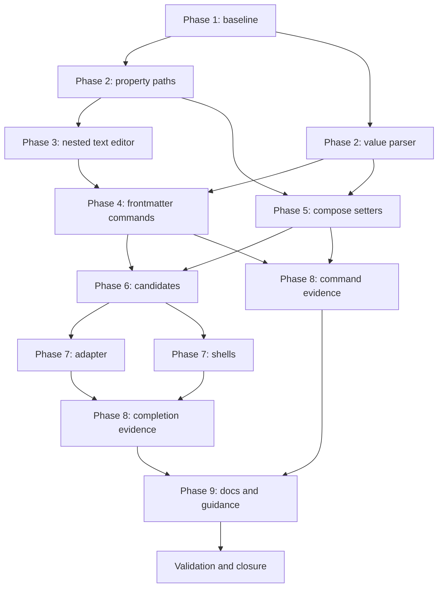

# Dotted Property Paths Implementation Plan

## Summary and Definition of Done

Give `md get`, `md set`, `md rm`, and `md compose` one way to name a value inside frontmatter, a `PropertyPath`, plus schema-driven shell completion for those paths and their values. Add one shared value parser. Teach the frontmatter text editor to change nested nodes. Replace `md compose`'s early setter map with an ordered plan that is bound per document through its declared types.

Success means every acceptance criterion in the spec has executable coverage; path syntax is parsed in one place; a failed edit leaves the source bytes unchanged; a nested edit keeps comments on its siblings; and Tab offers keys and values from the document's effective schema without evaluating anything. Run `just test` and `just lint` in `darkmatter/`, `simplified-schema/`, and `biscuit-file/`. Leave the feature active and ready for review, without committing or moving lifecycle directories.

2026-11-04-composition-errors, the one prerequisite, is complete. `md render` style setters are out of scope; 2026-11-05-render-surface wires them to `PropertyPath`, the value parser, and the completer. 2026-11-04-loading-data runs next and also edits `commands/compose.rs`.

Finish a phase before starting the next. Tasks within a phase may use separate agents with the stated file ownership. An agent runs its focused checks; the final phase runs the complete area suites once after integration.

## Necessary Rules

1. **Add `PropertyPath` to simplified-schema.** New module `simplified-schema/lib/src/property_path.rs`, exported from `lib.rs`. `PropertyPath::parse(&str) -> Result<PropertyPath, PropertyPathError>` keeps the argument as written and its decoded segments. `\.` and `\\` are the two escapes, matched left to right; a `\` before anything else is literal. The whole argument `''` is one empty top-level segment; an empty segment in a longer path (`a.`, `.a`, `a..b`) is `PropertyPathError::EmptySegment`. Printing is canonical, and `parse(print(segments)) == segments`. Nothing trims or normalizes. Evidence: the spec's grammar section; the crate already owns `PathStep` (`completion.rs`) and `JsonPointer` (`validation.rs`), which stay unchanged.

2. **Resolve segments against a value, never from text.** Add `PropertyPath::resolve(&self, root) -> Resolved` in the same module, walking a `serde_json::Value` or a frontmatter map's top level. On an array, a segment is an index only in canonical form (`0`, or no leading zero and all ASCII digits), parsed with `checked` arithmetic so a huge number is out of range and never wraps or panics. `01`, signs, and `-` are not indexes and behave as out of range. On a mapping every segment is a key, so `0` and `00` differ. A present `null` or scalar cannot be traversed. `Resolved` holds typed steps (`Key`, `Index`) up to where the walk stopped, and converts to `PathStep` and `JsonPointer`. Evidence: `completion.rs:110` and `validation.rs:176`; the spec says conversion needs the traversal, not the text.

3. **Keep one pure edit module beside it.** In `property_path.rs`, add `set_at`, and a `RemovalPlan` for `remove_at`, operating on the parsed value, with `PathEditError::{ParentNotContainer { path, found }, IndexOutOfRange { path, len }, NumberUnderMissingParent { path }, Missing { path }}`. `set_at` creates missing mapping parents; an all-digit segment under a missing parent is `NumberUnderMissingParent`, even if a schema suggests an array. Replacing a whole `null` or scalar by naming its own path is allowed. Replacing keeps the key's position, and new keys append. Removal leaves emptied parents. Evidence: the Parents table in the spec; `serde_json` here has `preserve_order` (`simplified-schema/lib/Cargo.toml:35`).

4. **Syntax failures are usage errors; everything else is a run failure.** A `PropertyPathError` in a command handler returns `Cli::command().error(ValueValidation, ...)`; `main` already exits 2 on a `clap::Error` (`cli/src/main.rs:73`). A `PathEditError` or a rejected value goes through `CommandRun::finish` as exit 1. Evidence: `docs/cli/data-contracts.md`, where exit 2 means nothing ran.

5. **Add the shared value parser to simplified-schema.** New module `simplified-schema/lib/src/setter_value.rs`. `SetterValue::parse(raw) -> Result<SetterValue, SetterValueError>` tries JSON5 for the whole text. A value starting with `{` that JSON5 rejects is tried as YAML flow syntax through `numeric::load_admitted_yaml`, accepting exactly one flow mapping and rejecting tags and block documents. Other syntax rejection is text. It records `Text { raw }`, `Quoted(String)` decoded once, `Null`, or `Container(Value)`, and keeps the raw spelling for scalars. Empty input is the empty string, as today. Evidence: `cli/src/commands/compose.rs:72` is the logic it replaces; the crate already depends on biscuit-file's `json5` and `yaml` features (`Cargo.toml:41`), and the schema-language ownership guard keeps this out of Darkmatter.

6. **Admit container values at the token level.** A parsed container with a duplicate key, a non-finite number, an inexact integer, or underflow fails with `SetterValueError`, never falling back to text. Today `meta={a:1,a:2}` silently keeps the last value, `{a:NaN}` becomes a string, and `{a:9007199254740993}` passes inexact (all observed 2026-11-06). `Json5` deserializes into `serde_json::Value`, so duplicates and spelling are gone by then. Add a token walk beside the existing wrapper in biscuit-file, `json5_scan(text) -> Json5Scan { duplicate_key, numbers }`, using the `json_five` tokenizer, and `numeric::admit_json5_text_numbers` beside `admit_json_text_numbers` (`numeric/ingress.rs:305`). 2026-11-04-loading-data reuses both. YAML flow uses `load_admitted_yaml`, which already rejects duplicates and inadmissible numbers; separate its syntax errors, which fall back to text, from admission errors, which fail. A bare undeclared `NaN` or `9007199254740993` stays text as today, because the spec applies admission to parsed containers.

7. **Bind through the declared type in one function.** `SetterValue::bind(&self, declared: Option<&Shape>) -> Value`. With a declared shape, `Text` goes through `coercion::bind` as a string, so `1.10` under `string` is `"1.10"`, `5` under `number` is `5`, `02134` under `numberlike` stays text, and `On` under `boolish` stays text. If conversion fails, keep the raw text, so schema validation reports it. With no declaration, use today's JSON5 guess. `Container` values go through binding recursively without adding a text-to-container conversion to the engine. Evidence: `coercion/mod.rs:130`; a frontmatter `count: "5"` under `number` already composes as `5` (observed 2026-11-06). The declared definition comes from `completion::def_at_path`, which returns a `PropertyDef`; `Shape`s for one come from Darkmatter's existing `shape_from_property_def_with_definitions` (`compose/expression/call_binding/translate.rs:153`). So the Darkmatter caller translates, and simplified-schema only receives the `Shape`.

8. **Add a nested text editor beside the top-level one.** New module `darkmatter/lib/src/markdown/hash/path_edit.rs`, using the private helpers in `hash/write.rs` (`line_spans`, `locate_all_nodes`, `serialize_entry`, `detect_newline`). `edit_frontmatter_paths(source, expected: &FrontmatterMap, edits: &[PathEdit]) -> Result<String, PathEditRefusal>`. It locates nested block-mapping and block-sequence nodes, replaces a node in place, appends a new key inside its parent at the parent's child indent, and removes a node with its own lines. It keeps every byte outside the selected node and the separators needed to keep the container valid. It refuses source forms it cannot edit safely, including flow collections, aliases on the walked path, an indented root, and multi-line scalars it cannot bound. Evidence: `restore_properties_text` (`write.rs:88`) replaces whole top-level nodes, so editing `author.name` through it drops comments on `author`'s other children; `locate_frontmatter_leaves` (`write.rs:552`) handles existing string leaves only.

9. **Verify every edit against the expected values before any write.** After a text edit, reparse the result and compare every value to `expected`, the map the pure edit produced. A difference outside the named paths is `PathEditRefusal::WouldChangeUnnamed`, an error with no fallback; this is the alias case `ensure_unmanaged_values_kept` (`write.rs:201`) already detects at the top level. `PathEditRefusal::UnsupportedForm` falls back to whole-frontmatter serialization, which is also verified against `expected`. Both are computed before opening the destination. Update `edited_text` (`cli/src/commands/frontmatter.rs:236`) and its doc comment. The body changes only under the existing explicit width reflow.

10. **`md get` stays schema-free and flat.** `requested_value` parses each argument, resolves it, and returns `""` for anything missing or unreachable. A single path gives the bare value, and several give a flat object keyed by the arguments as written. An explicit `null` stays `null`. Parse every argument before loading the document, so a malformed path fails first. Evidence: `frontmatter.rs:48`, and `just/review.just`, whose top-level calls must not change.

11. **`md set` validates what it changed.** Parse the value with rule 5, then apply it to a copy. A bare `DarkmatterSchemas` has no baseline or trigger discovery, so reuse the assembly `md schema validate` uses (`load_api` in `cli/src/commands/schema/validate.rs`), and resolve each document state's effective schema with it. A broken applicable schema fails with no write. Bind with rule 7. Validate the document before and after with `EffectiveSchema::validate` (`schemas/mod.rs:1163`). Compare problems on `(instance_path, code, property)`, never on `message`, which embeds instance values, or on `line` and `column`; `ValidationProblem` has no `PartialEq` (`validation.rs:26`). A problem's target is its `instance_path` segments plus `property` when present, because required and unknown-key problems point at the parent. Block on any problem whose target is at or under the changed path, by segment-wise prefix, or on any problem that is new after the edit. This gives the spec's ancestor and union behavior without a second validator, and an unrelated missing `title` never blocks. Setting `$schema` checks only that the value is a valid reference (`classify_schema_reference`), and skips the rest. Validation here is passive: it normalizes no eager file value and evaluates nothing. Evidence: `frontmatter.rs:83` writes with no schema today.

12. **`md rm` plans against the original, then removes.** Parse all paths and resolve each against the unedited document. A missing target cancels the whole command. Two paths resolving to one target, or an ancestor with its descendant, is an error with no write. Remove array elements highest index first, using original indexes, so `items.0 items.2` on `[a,b,c,d]` leaves `[b,d]` in either order. `removed` keeps argument order, and `remaining` stays the surviving top-level keys. Evidence: `frontmatter.rs:160`, and the `rm.yaml` shape, which is unchanged.

13. **Classify setter tokens in one function.** `compose::setters::classify_token(&str) -> TokenClass` in the library, used by execution and completion. Split at the first `=`. The key parses as a `PropertyPath`, whose first segment follows `[A-Za-z_][A-Za-z0-9_-]*`, and whose later segments follow it or are all digits, with `\.` decoded into a literal dot. An empty key (`=value`) stays today's setter syntax error, `setter key must not be empty`. Anything else is a path, so `./foo=bar.md`, `9key=value`, `@x=1.md`, `a..b=1`, and `a.=1` are paths, and `a.b=c.md` becomes a setter. Evidence: `parse_compose_setter` (`cli/src/commands/compose.rs:44`), which this replaces.

14. **Replace the setter map with an ordered plan.** `parse_compose_positionals` returns `Vec<RawSetter { argument, path, raw }>` in command-line order, for undotted setters too. `compose.rs:362` stops merging them into the `--set` map. Add `ComposeOptions::with_setters`. A `SetterPlan` in `compose/setters.rs` resolves overlaps before any document is read: compare decoded paths; the same path takes its last value; order ancestors before descendants, keeping command-line order at equal depth. An ancestor whose value is a scalar or `null` together with a descendant fails in both argument orders. Overridden duplicates need only valid syntax. Evidence: the spec's overlap rules; the map loses order, spelling, and provenance.

15. **Apply the plan right after schemas are prepared, per document.** `prepare_frontmatter_for_compose` (`compose/util.rs:160`) stays infallible and unchanged apart from no longer seeing shorthand setters. At each of its callers (`pipeline/mod.rs:399`, `preflight/collect.rs:610,1258`), call new `setters::apply_setter_plan(markdown, options, &prepared_schemas, &mut provenance) -> MarkdownResult<()>` directly after `prepare_schemas`, and before caller-file projection (`pipeline/mod.rs:410`). The two preflight sites have no prepared schemas at that point, so with a non-empty plan each calls `prepare_schemas` once with its own registry; the pipeline site reuses its existing one. Steps: return at once for an empty plan, so ordinary runs pay nothing; clone the document and apply the plan with raw guesses to get the provisional overlay; ask `PreparedSchemas::effective_for(&overlay)` for its schema (`schema_validation.rs:219`), which reuses the discovered triggers rather than rediscovering them (`effective_schema_for` would run discovery a second time, and `TRIGGER_DISCOVERY_COUNT` pins that count); bind each surviving value once; apply to the real frontmatter. Setters can't name `$schema` under rule 13, and `--set` has already been applied, so the prepared schema set is valid for the overlay. `data_overrides` are applied earlier in this order but must keep winning, so skip a setter whose first segment one of them names. There is no retry. The final schema stage reports anything that still fails. Evidence: the spec's decision on selecting a schema.

16. **Setters keep reaching transcluded children, bound per document.** `md compose p.md v=7` changes a child's `v` today (observed 2026-11-06), because options flow down. Keep that. Binding per document means each one reads a setter through its own schema, which is also the document that validates it. A nested setter that hits a scalar parent or out-of-range index in a child fails the run and names that child. This case isn't covered by the spec; record it in the implementation log as a planning decision for review.

17. **Keep provenance and caller origins correct for nested values.** Call `data.clear_key` for each setter's top-level key only when the setter names that whole key; a descendant must clear only its own path, through `DataPaths`' `ValuePathSegment` paths (`value_origin.rs:68`). `CallerInputRecords` (`context/options.rs:53`) is keyed by top-level name, so a record for `author` would treat authored `author.avatar` as caller input and resolve it against the wrong directory. Extend it so a setter's origin covers only its own path, and include the plan in `caller_input_records` (`schema_validation.rs:899`). Update `attribute_frontmatter_failure` (`pipeline/mod.rs:1095`) so a failure in a setter's value names the setter. Pending values keep their rules: a setter's `{{ }}` stays an authored template, as a top-level setter is today.

18. **Report setter failures with their own code.** Add `MarkdownError::Setter { argument, path, reason }` and project it in `compose/report_diagnostics.rs` as `dm.setter.invalid` with `source: null`, plus the argument and resolved path in the message. A command-line value has no authored line or column, so never attribute it to the on-disk scalar. These are errors, so they stay out of `COMPOSE_DIAGNOSTIC_CODES`. Add the code to `docs/cli/data-contracts.md` and `docs/errors/composition-problems.md`. Schema failures keep `dm.schema.*`.

19. **Add one neutral candidate function.** `schemas::completion::path_candidates(&PathQuery) -> Vec<PathCandidate { insert, help, kind }>`, where `kind` is `Descend`, `Assign`, `Select`, or `Value`. Inputs are an optional `EffectiveSchema`, a frontmatter value, a `PathCommand`, the typed prefix, and the earlier setter paths. At the root, enumerate `EffectiveSchema::property_shape(&[], frontmatter)` (`schemas/mod.rs:1147`), since `completable_properties` lists only completable types and `for_path_in` requires a first key. Below the root use `for_path`. A valid effective schema is never unioned with baseline suggestions. Implement the spec's tables for keys per command, spelling, values per type, and ordering, with a literal tag narrowing through the overlay frontmatter. Pattern markers are never offered, and a dynamic slot offers nothing. Use each value's label rather than its YAML insertion text, and apply path escaping before any shell quoting.

20. **The CLI adapter reads process arguments; the library never does.** New `cli/src/args/path_completion.rs` with an `ArgValueCompleter` for `md compose`'s args and `md get`, `md set`, and `md rm` paths and `md set`'s value. It gets its words from one shared `completion_shells::recover_words()`, the only reader of `std::env::args_os` and `_CLAP_COMPLETE_INDEX`, which rejoins bash's split `key`, `=`, `value` and adjusts the cursor index. It uses only words before the cursor, and takes `--magic-root` from them. It finds the input with rule 13, builds one `RequestSnapshot` through `cli/src/request.rs`, and opens the document through `io::open_argument`. It never reads stdin. Every failure means fewer candidates and no output: a document that does not parse gives the baseline, and a schema that fails to resolve gives document keys and the baseline, never a partial schema. Remote `$schema` needs no new denial, because `effective_for` already errors with `Remote schemas are not supported` and makes no request (observed 2026-11-06); pin that with a test. A `file` value uses a general file completer rather than `complete_markdown_files`. Check `context_construction_guard.rs` and `path_lookup_guard.rs` pass, and extend an allow list only with a stated reason.

21. **Replace the shell scripts only where they fail.** Change `main.rs:68` to `CompleteEnv::with_factory(Cli::command).shells(Shells(&[...]))` with custom `EnvCompleter`s in new `cli/src/completion_shells.rs`. Bash splits at `=` (`COMP_WORDBREAKS`) and suppresses a space only for `=/:`; its `write_complete` must rejoin `key`, `=`, `value` through `recover_words()` (rule 20), so the engine and the adapter see the same words, emit the value alone since bash replaces only the last piece, and its registration must add `.` to the no-space rule. Zsh special-cases only `/`, so its registration must not add a space after `.` or `=`. Verify fish and elvish, and keep their built-ins if they work. Keep PowerShell's built-in unless native Windows evidence shows otherwise. Registration scripts are adapted from `clap_complete` 4.6.2's, whose output format has no stability promise, so pin the behavior with the subprocess tests in Phase 8 and note the version in a comment. A shell that cannot complete after `=` still completes keys, and the limit is documented.

22. **Test by tier and keep tests hermetic.** Parser and walker cases are in-process in their crates. CLI cases use `CliProcessFixture` with fixture-owned documents, schemas, and home, registered in `cli/tests/l1/main.rs`. Shell word shapes are L1 subprocess tests through `COMPLETE=<shell> md -- ...`. Script-sourcing tests gate with `expect_level!` per the `rust-testing` skill, selected per platform, and an absent shell is recorded as unproven rather than passing. Real Tab round trips are L2 with `require_level!` and a named backend, never taking focus. Tests read no live repository files.

## Phase 1: Contract Baseline

- [x] **Contract baseline**
  - Create `implementation-log.md` beside this plan, recording these rules, the planning decision in rule 16, and one correction to the spec: `--set` replaces a top-level key whole (`util.rs:188`; observed 2026-11-06), and only `--state` deep-merges (`util.rs:176`). The spec's phrase "recursive merge behavior of those older options" therefore describes `--state`. Neither changes.
  - Confirm `just test` passes at baseline in the three area packages.
  - Checkpoint: every later task has its types, ownership, and outcomes above.

## Phase 2: Paths and Values

- [x] **Property paths**
  - Own `simplified-schema/lib/src/property_path.rs` and `lib.rs`, including the value parser task's export line. Implement rules 1–3 with their error types. Test escapes, round trips (trailing backslash, literal dots, `\\.` sequences), the empty top-level key, `a.`/`.a`/`a..b`, Unicode and whitespace, `items.01`, a 40-digit index, numeric mapping keys, scalar and `null` traversal, parent creation, `NumberUnderMissingParent`, key order on replace, and emptied parents.

- [x] **Value parser**
  - Own `simplified-schema/lib/src/setter_value.rs`, `numeric::admit_json5_text_numbers`, and biscuit-file's `json5_scan`. Implement rules 5–7. `json_five` 0.3.1 exports `tokenize_str`, whose `tok_spans` slice key and number spellings from the source.
  - Test `{a:1}` and `{ max-width: 50 }` as objects, quoted strings decoding once, `null`, `1.10` under `string` and `string | number`, `numberlike`, `boolish`, duplicates and `NaN` and inexact integers in both JSON5 and YAML flow containers, `{ a:1, max-width: 2 }` reading `a:1` as a key, a tagged YAML value, a block document, and text that parses as neither.
  - Checkpoint: the schema ownership and dependency-direction guards pass.

## Phase 3: Nested Text Editor

- [x] **Nested text editor**
  - Own `darkmatter/lib/src/markdown/hash/path_edit.rs` and the visibility changes it needs in `hash/write.rs`. Implement rules 8–9 and export through `hash/mod.rs`.
  - Test comments inside a shared parent, sibling scalar spelling, appending to a block mapping at its indent, replacing in a block sequence, removing the last child, LF and CRLF, a flow collection falling back, an anchor whose edit changes an alias elsewhere being refused with no fallback, an indented root, and the read/write/read round trip.

## Phase 4: Frontmatter Commands

- [ ] **Frontmatter commands**
  - Own `cli/src/commands/frontmatter.rs` and `cli/tests/l1/get_set_rm.rs`. Implement rules 4 and 9–12, with `md set` and `md compose` both using the shared parser. Update the doc comments on `requested_value`, `set_value`, `rm_value`, and `edited_text`.
  - Test each row of the spec's grammar, Parents, and `md set` validation tables, multi-path `get`, `'$schema'`, `''`, `'a\.b'`, `rm` conflicts and original indexes, exit 2 with no read for a malformed path, and source bytes unchanged after every failure. Confirm `conforms_*` tests for `get.yaml`, `set.yaml`, and `rm.yaml` pass with no schema change.

## Phase 5: Compose Setters

- [ ] **Compose setters**
  - Own new `lib/src/markdown/compose/setters.rs`, `compose/util.rs`, the three call sites that gain `apply_setter_plan`, `context/options.rs`, `value_origin.rs`, the caller-record paths in `schema_validation.rs`, `report_diagnostics.rs`, `cli/src/commands/compose.rs`, and the dispatch in `cli/src/commands/mod.rs`. Implement rules 13–18. Remove `parse_compose_setter`, `parse_shorthand_value`, and the map parameter; move their tests.
  - Test `author.name=Alice` keeping siblings and reaching expressions, undotted setters behaving as before, precedence over `--set` and `--state`, both argument orders of whole-object plus descendant, both orders of scalar ancestor plus descendant, repeated paths, `items.9=x`, `a.b=c.md` versus `./a.b=c.md`, `version=1.10` under `string`, a `lang=rust edition=1.10` trigger in both orders, a `--set` replacing `$schema`, a trigger on a converted type failing clearly, `dm.schema.unknown_key` under a closed object versus none under `"<string>": unknown`, a child document binding through its own schema, an authored file value beside a setter keeping its own origin, a setter's `{{ }}`, and `dm.setter.invalid` with `source: null`.
  - Run the reference-check and preflight paths through the same fixtures, because both prepare frontmatter.
  - Checkpoint: `compose_state_set` and the composition-errors tests pass unchanged apart from the documented value differences.

## Phase 6: Completion Candidates

- [ ] **Candidates**
  - Own `lib/src/markdown/schemas/completion.rs` additions. Implement rule 19, with in-process tests for every row of the spec's key, spelling, and value tables, ordering, deduplication by decoded path, a literal tag narrowing, a replaced baseline property, a separate `$schema` file, values containing spaces, quotes, `$`, backslashes, and `=`, and a dynamic-slot-shaped declaration offering nothing.

## Phase 7: Completion Adapter and Shells

- [ ] **Adapter**
  - Own `cli/src/args/path_completion.rs`, `cli/src/args/completion.rs`, and the `add = ArgValueCompleter` lines in `cli/src/args/command.rs`. Implement rule 20, including words after the cursor being ignored, invalid earlier setters being ignored silently, and no stdin read.

- [ ] **Shells**
  - Own `cli/src/completion_shells.rs` and `cli/src/main.rs:68`. Implement rule 21.
  - Measure one release-build completion on a representative document and record it in the log. This is one sample, not a gate.

### Input Robustness Matrix

The matrix applies to the value parser, the one new input reader. Default: invalid input produces a typed failure, writes nothing, and runs nothing after it. Exceptions: syntax rejection is text, then judged by the declared type; an empty value is `""`; `null` is accepted only where the type permits it; scalar spelling is kept. Test each once through public results rather than per command: JSON5 and YAML flow containers with absent, `null`, wrong-type, and empty fields, mixed and all-invalid arrays, and a valid text-to-number conversion, to distinguish conversion from filtering. Grep the changed loaders for `unwrap_or_default`, `.ok()`, and `filter_map` on load-bearing parse paths, and record any intentional exception.

## Phase 8: Prove Input and Execution Contracts

- [ ] **Completion evidence**
  - Own `cli/tests/l1/path_completion.rs`, plus L2 `cli/tests/level2/level2_path_completion.rs`.
  - In L1, assert each shell's word shape, bash's split in both versions' forms, no diagnostic on stdout or stderr for a broken document or schema, and no evaluation or request: a document with a frontmatter command writing a sentinel file, an interpolated value, and a remote `$schema` leaves no sentinel and still offers local keys. Assert the no-read limit through `work_counters`.
  - In L2, run `style.pa<Tab>` through `ce<Tab>` to `style.page.alignment=center` in bash and zsh with no stray space. Fish and elvish join where the backend supports them. Record bash 3.2, fish, elvish, and PowerShell results or mark them unproven.

- [ ] **Command evidence**
  - Own `cli/tests/l1/property_paths.rs` and `cli/tests/l1/main.rs`, including the completion task's registration. Map every spec acceptance criterion to a named test in the log, and add a real CLI case for any that only has an in-process test and needs command wiring: exit status, envelope, persistence, or failure with no mutation.

## Phase 9: Documentation and Guidance

- [ ] **Current documentation**
  - Own `darkmatter/docs/cli/get.md`, `set.md`, `rm.md`, `compose.md`, `index.md`, `docs/topics/frontmatter.md`, `docs/cli/data-contracts.md`, `docs/errors/composition-problems.md`, and `simplified-schema/docs/` pages for the path type and value parser. Replace "does not evaluate dotted paths" and the key grammar. Remove `compose.md:94`'s claim that `--set` takes dot-notation, and the statement that setters merge into the `--set` map. Add migration examples for the value changes, a section on what completion reads, and any per-shell limit. Write for a developer new to this repository. No page names this feature.

- [ ] **Guidance**
  - Own `.claude/skills/darkmatter/cli.md`, `frontmatter.md`, `completion`-related notes in `schema.md`, `.claude/skills/simplified-schema/`, `.claude/skills/biscuit-file/` for `json5_scan`, and `.claude/skills/os/` for any shell or Windows fact learned the hard way.

## Phase 10: Validation and Closure

These tasks run in order.

- [ ] **Integrated validation**
  - Run `just test` and `just lint` from `darkmatter/`, `simplified-schema/`, and `biscuit-file/`, and `just test-l2` from `darkmatter/` for the new target. Run `cargo check --all-targets -p claudine -p claudine-cli` because `ComposeOptions` changes beside them. Use `cargo --color=never`; do not run `cargo fmt` or `cargo test`.
  - Keep tests portable across macOS, Linux, native Windows, and WSL2, including the `.\dir\.config=1.md` classification under `#[cfg(windows)]`. Label the other operating systems unexecuted in the log; they run under the repository's scheduled CI.

- [ ] **Closure evidence**
  - Run `git diff --check`, review changed behavior comments, and confirm the schema ownership, context construction, path lookup, and output conformance guards passed. Update the log with test names, the release measurement, per-shell results, and any departure from the spec. Check off tasks and report implementation complete, ready for review. Leave commits, pushes, and lifecycle movement outside this plan.

## Dependency Graph

The critical path runs through the nested text editor and compose setters, the two largest tasks.

## Risks

| Level | Category | Description | Affected | Mitigation |
|---|---|---|---|---|
| HIGH | technical | Nested text editing in a line-based YAML editor has many source forms | Phase 3 | Refuse what cannot be proven; rule 9 verifies every result before a write, and fallback is the behavior the commands had before |
| HIGH | scope | Setter application adds a fallible step to the pipeline, preflight, and reference check, ahead of caller-file projection | Phase 5 | No extra work for an empty plan; run all three paths in tests; composition-errors tests are the regression guard |
| MEDIUM | technical | Nested caller origins change a top-level-keyed record used for file resolution | Phase 5 | Test an authored file value beside a setter; keep top-level behavior identical |
| MEDIUM | dependency | Custom `EnvCompleter` scripts copy `clap_complete` 4.6.2 internals with no stability promise | Phase 7 | Subprocess tests fail on an upgrade; only bash and zsh are replaced |
| MEDIUM | technical | Per-document binding evaluates an effective schema for an overlay of each transcluded document when setters are present | Phase 5 | Only with a non-empty plan; it reuses each document's prepared schemas and the validator cache, with no second trigger discovery |
| LOW | scope | Setters reaching children can now fail on a child's scalar parent | Phase 5 | Names the child; recorded as a decision for review |

## Package Changes

No new crates. `json_five` is already a biscuit-file optional dependency, and `clap_complete`, `serde_yaml_ng`, and `serde_json` are already in use. `docs/dependencies.md` is unchanged.