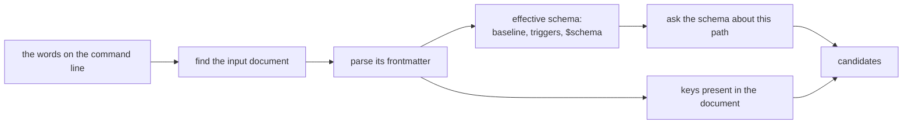

---
$schema:
    status: |-
        enum(
            draft-spec,
            finalized-spec,
            planned,
            implemented,
            review-findings,
            human-in-the-loop,
            completed,
            on-hold,
            abandoned
        ) -> an indicator of progress for this specification
    reviewed: boolean -> indicates whether the specification file has been reviewed by another agent from the one which created the spec
    reviewed_by: string -> the agent and model used in the spec review
    reviewed_on: date -> the date the spec was reviewed
    review_iterations: number -> the number of implementation reviews have taken place in the review/fix cycle
    clarified: boolean -> indicates whether the specification was built -- _in part_ -- with the 'clarify.md' prompt
    implemented: boolean -> indicates whether this spec's plan has been implemented
    implemented_by: string -> the agent who implemented the plan
kind: feature
created: 2026-11-06
status: finalized-spec
area: darkmatter
owner: Ken Snyder <ken@ken.net>
reviewed: false
clarified: true
implemented: false
review_iterations: 0
packages:
    - darkmatter-cli
    - darkmatter
    - simplified-schema
related:
    - 2026-11-05-render-surface
    - 2026-10-25-positional-args
depends-on:
    - 2026-11-04-composition-errors
next_spec: 2026-11-04-loading-data
---

# Dotted Property Paths

Give every `md` command one way to name a value inside frontmatter: a dotted
path such as `style.page.max-width`.

```sh
md get doc.md style.page.max-width            # 96
md set doc.md style.page.max-width 50 --save  # edits the nested key
md rm doc.md style.page.max-width             # removes the nested key
md compose doc.md author.name=Alice           # overrides one nested value
```

Today each of these fails or does something surprising. This spec comes first in
its pipeline because `2026-11-05-render-surface` spells its per-key style setters
in this grammar (`md render doc.md style.ul.padding-left=4`), and shell completion
for those setters builds on the completer this spec adds.

This spec is **finalized**: the author's rulings of 2026-11-06 are marked **Decided**
below. **Proposed** marks an implementation detail the drafter chose, which planning
may refine.

## Today's behavior

Observed 2026-11-06.

| Command | Result |
|---|---|
| `md get doc.md style.page.max-width` | prints `""`; `get` looks up top-level keys by exact name (`docs/cli/get.md`) |
| `md set doc.md style.page.max-width 50` | writes a new literal top-level key, `style.page.max-width: 50`, beside the real `style:` block |
| `md rm doc.md style.page.max-width` | fails: property not found; `rm` removes top-level keys only |
| `md compose doc.md nested.deep=7` | `expected at most one input path`: a `.` in a key makes `parse_compose_setter` read the token as a path |
| `md compose doc.md --set 'a.b=1'` | fails: `--set` takes a JSON object |

Reusable pieces already exist:

- `simplified_schema::completion::{PathStep, def_at_path}` walks a schema by key
  and index.
- `simplified_schema::validation::JsonPointer` is the data-position path that
  diagnostics report.
- `hash::locate_frontmatter_leaves` and `FrontmatterPathSegment` address a nested
  leaf for an in-place edit.
- `parse_compose_positionals` already separates one input from `key=value` tokens.

## Scope

| In scope | Out of scope |
|---|---|
| The path grammar and one shared parser | `md render`'s style setters: `2026-11-05-render-surface` wires them to its style layer |
| `md get`, `md set`, `md rm` nested reads and edits | Paths in expressions, which already have their own grammar |
| `md compose` dotted setters | `--state` and `--set`, which keep taking JSON objects |
| Schema-driven shell completion for paths and values | Positional parameter mapping: `2026-10-25-positional-args` |

## Design

### The grammar

A path is one or more segments joined by `.`:

```text
style.page.max-width
author.name
_private.key
```

A segment is any text without an unescaped `.`, so `md get doc.md '$schema'` keeps
working. `md compose` setters are stricter because they must tell a setter from a
file path: each segment of a setter key follows the existing grammar,
`[A-Za-z_][A-Za-z0-9_-]*`, or is a whole number, and a token that does not fit is a
path. Its first segment must follow the grammar, so `9key=value` stays a path.

> **Decided (2026-11-06). `.` always separates, and `\.` escapes it.** A path has
> one meaning whatever the document holds, and every key is reachable.

```sh
md get doc.md style.page.max-width        # the nested value, always
md get doc.md 'style\.page\.max-width'    # a real top-level key with dots in its name
md rm doc.md 'style\.page\.max-width'     # cleans up such a key
```

`\.` is the one escape, and a `\` before anything else is an ordinary character.
Every key can be reached by `md get`, `md set`, and `md rm`. A `md compose` setter
can name a dotted key too (`'a\.b=1'`); a key its grammar excludes still needs
`--set`, as it does today.

> **Decided (2026-11-06). A number addresses an existing array element.** The value
> being walked decides what a segment means: on an array `0` is an index, and on a
> mapping it is the key `"0"`. Appending is not part of this spec.

```sh
md get doc.md items.1.name              # b
md set doc.md items.1.name z --save     # edits that one value
md compose doc.md items.1.name=z        # overrides it for this run
md rm doc.md items.0                    # removes it; the next element becomes items.0
```

| Out-of-range case | Result |
|---|---|
| `md get` | missing, so it prints `""` like any other missing path |
| `md set`, `md compose` | an error naming the array's length; nothing is written |
| `md rm` | an error, like removing any absent key |

**Proposed.** One type, `PropertyPath`, parses and prints paths for every consumer,
in `simplified-schema` beside `PathStep` and `JsonPointer`, with conversions to
both. No command splits on `.` itself.

### Parents

> **Decided (2026-11-06). A path command never destroys or removes anything you
> did not name.**

| Case | Result |
|---|---|
| A missing parent, `md set doc.md author.name Ken` | created: `author: { name: Ken }` |
| A number under a missing parent, `items.0.name` with no `items` | an error: the path cannot say whether `0` is an element or a key |
| A parent that cannot hold the key, `author.name` where `author: Ken` | an error naming the parent's type; nothing is written |
| Removing the last child, `md rm doc.md style.page.max-width` | the parent stays, as `style: { page: {} }` |

A value can still be replaced on purpose by naming it:
`md compose doc.md 'author={name:"Bob"}'`.

### Reading: `md get`

`md get doc.md style.page.max-width` returns the value at that path. A missing path
keeps today's contract: an empty string in `plain` output and the same missing-key
behavior in data output. An existing top-level key is reached exactly as before, so
`md get doc.md title` is unchanged, including every `just/review.just` call.

### Editing: `md set` and `md rm`

Both edit the nested value and leave sibling keys alone, in place and with the
existing `--save` and output behavior. The `property` field of the `md set` result
and the `removed` and `remaining` lists of the `md rm` result carry the path as
written.

### Setting: `md compose`

`md compose doc.md author.name=Alice` overrides one nested value and keeps
`author`'s other keys. A setter is classified as today, with `.` added to the key
grammar, and takes its place in the documented precedence: it still overrides
`--state` and `--set`. A token with `/` or `:` in its key is still a path, so
`./foo=bar.md` is unaffected. A file named `a.b=c.md` now needs `./`, as `a=b.md`
already does.

### Values and overlapping setters

Today `md compose doc.md version=1.10` yields `1.1` even when the schema declares
`version: string`, and `md set` reads JSON while `md compose` reads JSON5, so
`{a:1}` is a string to one and an object to the other.

> **Decided (2026-11-06). One value parser, the declared type first, and the more
> specific path wins.**

- `md set` and `md compose` share one parser: JSON5 with a string fallback.
- A value starting with `{` that JSON5 rejects is tried as YAML flow syntax before that
  fallback, so `style="{ max-width: 50 }"` works without quoting a hyphenated key.
  Nearly every style key has a hyphen, and a quoted key inside shell quotes is easy to
  get wrong. JSON5 goes first because YAML would read `{a:1}` as a key named `a:1`, and
  a mix such as `{ a:1, max-width: 2 }` does read that way, surfacing `a:1` as an unknown
  key.
- **A declared key** passes its raw text through the conversion engine frontmatter
  uses (`simplified_schema::coercion`), so `version=1.10` under `version: string` is
  `"1.10"`, and `count=5` under `count: number` is `5`. `md compose` therefore needs
  the document's schema while applying setters, not only afterward.
- **An undeclared key** keeps today's guess: `count=5` is the number `5`.
- A wrong value still fails schema validation, as `count=abc` does today.

**The schema decides whether a setter is valid.** The frontmatter root is open, so an
undeclared top-level key is fine; a declared nested object is closed, so
`author.mistake=1` is `dm.schema.unknown_key`, unless the schema opens it with a pattern
key such as `"<string>": unknown`. Nothing is special about any key, `style` included.

Overlapping setters resolve by specificity, whatever their order; the same exact path
given twice takes the last value.

```sh
md compose doc.md 'author={name:"Ann",email:"a@x"}' author.name=Bob
md compose doc.md author.name=Bob 'author={name:"Ann",email:"a@x"}'
# both give { name: "Bob", email: "a@x" }
```

### Shell completion

Pressing Tab on a path walks the schema one level at a time, so a user can discover
what a document accepts without opening it:

```text
md compose doc.md <Tab>                       author. style. title=  (plus files and flags)
md compose doc.md style.<Tab>                 style.page. style.table. style.ul. ...
md compose doc.md style.page.<Tab>            style.page.alignment= style.page.max-width= ...
md compose doc.md style.page.alignment=<Tab>  left center right
md get doc.md st<Tab>                         style. status
md set doc.md style.page.alignment <Tab>      left center right
```

> **Decided (2026-11-06). Completion reads the document and what its schema needs.**
> Without them, a document's own `$schema` and triggers would never reach Tab.

Completion is **advisory and passive**. It evaluates no expression, runs no command,
uses no network, and writes nothing. Whatever it cannot work out, it leaves out; it
never prints an error into the prompt, and validation stays the judge of what is
actually allowed.

#### Where the information comes from



Sources, strongest first. Each one only adds candidates, so losing one degrades the
list rather than breaking it:

| Source | Gives | Available when |
|---|---|---|
| The document's **effective schema** (`DarkmatterSchemas::effective_for`): the runtime baseline, schema triggers, and its `$schema` | declared keys, their descriptions, and value candidates | an input document resolves |
| The document's **own frontmatter** | keys it already has, including undeclared ones | an input document parses |
| The **runtime baseline** alone | global keys such as `style.*` | always; it is compiled in |

With no resolvable input (for example `md compose <Tab>`, or input from stdin), only
the baseline is offered, alongside the usual file and flag candidates.

The schema question is already answered by a pure function:
`simplified_schema::completion::for_path_in` takes a resolved schema, its definitions,
the frontmatter, and a `PathStep` path, and returns keys and scalar values, opening
recursive and shared named types only as far as the path goes. `def_at_path` gives the
definition at a path. DMLS is built on these too, so Tab and the editor agree.
**Proposed:** add one function in `darkmatter::markdown::schemas::completion` that
returns neutral candidates for a `PropertyPath`, and map them to
`CompletionCandidate` in the CLI. The DMLS provider types stay in DMLS.

#### Which keys each command offers

| Command | Offers | Why |
|---|---|---|
| `md compose` | schema keys, then keys present | an override may set a key the document omits |
| `md set` | schema keys, then keys present | as above |
| `md get` | keys present, then schema keys | reading a key that is absent only prints empty |
| `md rm` | keys present only | removing an absent key is an error |

Keys already given as setters on the same line are not offered again.

#### How a candidate is spelled

| The path's type | Candidate | After accepting it |
|---|---|---|
| object, or a union with an object arm | `style.page.` | no space; Tab continues |
| anything else, in a `key=value` command | `title=` | no space; the value comes next |
| anything else, in `get`, `set`, `rm` | `title` | a space |
| array | `items.`, then the document's existing indexes (`items.0.`) | no space |
| open object such as `page.meta`, whose keys are not declared | `style.page.meta=` | no space; stops descending |
| object with a pattern key (`"<string>": unknown`) | its declared keys only; the pattern accepts anything, so it offers nothing | as above |

Where the shell can show it, the schema's description (`-> ...` in a type) becomes the
candidate's help text. Required keys sort first, then declaration order.

#### Which values are offered

| The key's type | Candidates |
|---|---|
| `enum(...)`, `literal(...)` | the members |
| `suggest(...)` | the suggestions, which stay advisory |
| `boolean` | `true`, `false` |
| `file` and its forms | file paths, using the existing file completer |
| a union | the candidates of each arm, deduplicated |
| `string`, `number`, `unknown`, an object | nothing; the shell's default applies |
| a slot from `2026-11-05-dynamic-schema-types` | nothing; completion never resolves a slot |

A literal tag narrows a union: if the document, or a setter earlier on the line, has
`kind: rust`, the keys and values of the `kind: rust` arm are offered. `for_path_in`
does this from the frontmatter it is given, so completion passes the document's
frontmatter with the line's earlier setters applied.

#### What it may read, and how fast

Completion runs on every Tab. Reads are limited to the input document and the files
resolving its schema needs, each read once. Remote schema references are skipped
without a request. A schema that fails to resolve contributes nothing; the document's
own keys and the baseline remain.

Resolving the small test document's schema took 58 ms in a debug build
(`md schema detect`, 2026-11-06). **Proposed budget:** no perceptible pause for a
typical document; measure a representative release build while implementing, and
record it. A completion that needs more than the document and its schema files is a
defect.

#### Three facts about the shells that shape this

These come from reading `clap_complete` 4.6.2 and running it on 2026-11-06.

1. **A completer only receives the current token.** `ValueCompleter::complete` gets
   `current` and nothing else, so it cannot see the input document. The completer must
   recover the other words from the process arguments (`md -- md compose doc.md ...`),
   and take `--magic-root` values from there, to resolve the document the way the real
   command would.
2. **Bash splits tokens at `=`.** `=` is in `COMP_WORDBREAKS`, so
   `style.page.alignment=ce` arrives as three words: `style.page.alignment`, `=`, `ce`.
   `COMPLETE=bash md -- md compose a.md x = ""` currently offers files and flags, not
   values. Bash also replaces only the last piece, so its candidates must be `center`,
   not `style.page.alignment=center`. Zsh, fish, PowerShell, and elvish are expected
   to pass the whole token; each is proven by test.
3. **Only some suffixes suppress the trailing space.** Bash's script suppresses it for
   `=`, `/`, and `:`, not for `.`, and zsh's special-cases only `/`, so accepting
   `style.` would add a space and end the path. Fish's behavior is to be verified.

**Proposed:** keep the built-in scripts where they work, and supply custom
`EnvCompleter`s through `CompleteEnv::shells` where they do not (at least bash, for
facts 2 and 3, and zsh, for fact 3). Fact 2 is a parsing concern too: the completer
rejoins `key`, `=`, `value` before asking the schema. Bash 3.2, which macOS ships, is
tested as well as bash 5, since the script takes a different path below version 4. If
a shell cannot complete after `=`, keys still complete there and the limit is
documented in `docs/cli/index.md`.

### What `2026-11-05-render-surface` receives

- `PropertyPath`, so `style.ul.padding-left` means one thing everywhere, including the
  offset in `--style=theme.dark@style.yaml`.
- The shared value parser, for `style="{ max-width: 50 }"`.
- The completer and its shell handling. `style` is part of the effective schema, so
  `md render` needs no catalog of its own and no new shell work.
- The per-shell proof of completing after `=`.

## Acceptance criteria

- `md get`, `md set`, and `md rm` read, edit, and remove a nested value, and leave
  siblings, key order, comments, and line endings as the existing edit path does.
- `md set doc.md a.b 1` never writes a literal `a.b` top-level key;
  `md set doc.md 'a\.b' 1` does, and `md get` and `md rm` reach it the same way.
- `md compose doc.md a.b=1` overrides one nested value and keeps its siblings, and
  the override is visible to expressions and schema validation.
- Every top-level `md get`, `md set`, `md rm`, and `md compose` call with no dot
  behaves byte-identically, except the decided value changes: `md set` reading JSON5,
  and a declared key keeping its text.
- `./a.b=c.md` is a path; `a.b=c.md` is a setter; `md get doc.md '$schema'` still works.
- `items.1.name` reads and edits that element, a number on a mapping is that key, and
  each out-of-range row under [The grammar](#the-grammar) has a test.
- Each row under [Parents](#parents) has a test, and a failed edit writes nothing.
- `version=1.10` under `version: string` is `"1.10"`, `count=5` under `count: number`
  and with no schema are both `5`, and `md set` and `md compose` read `{a:1}` alike.
- Both orders of `'author={...}' author.name=Bob` give the same result.
- `author.mistake=1` under a closed `author` fails with `dm.schema.unknown_key`, and the
  same setter under `"<string>": unknown` succeeds.
- `{ max-width: 50 }` and `{a:1}` both read as objects, and a value that is neither JSON5
  nor YAML flow stays a string.
- Each output schema these commands use still passes its conformance test.
- `PropertyPath` is the only code splitting a path on `.`.
- Completion, for each row of the tables under
  [Shell completion](#shell-completion): keys per command, candidate spelling, and
  values per type, including a required key sorting first and a literal tag narrowing
  a union, using a document whose `$schema` is a separate file.
- Completion performs no evaluation, command, or network request, proven by a document
  with a frontmatter command, an interpolated value, and a remote `$schema`; those
  contribute nothing and produce no error.
- A document that does not parse, a schema that fails to resolve, and no input each
  still complete, from whichever sources remain.
- `style.pa<Tab>` then `ge.<Tab>` then `alignment=<Tab>` then `ce<Tab>` produces
  `style.page.alignment=center` with no stray space in bash 5, bash 3.2, zsh, fish,
  PowerShell, and elvish, or the documented limit for that shell.

## Tests

- **L1, in process:** the candidate function, with no shell involved, for every
  table row and fallback above.
- **L1, subprocess:** each shell's word shape through `COMPLETE=<shell> md -- ...`,
  including bash's split `key`, `=`, `value`. No terminal is opened.
- **L1, script:** the generated scripts source without error where the shell is
  installed; a missing shell is skipped by the existing tier rules, never passed.
- **L2:** a real-terminal Tab round trip in bash and zsh through the test harness,
  without taking focus. PowerShell runs on the Windows test rig per the `os` skill.

## Documentation

- `darkmatter/docs/cli/get.md`, `set.md`, `rm.md`, and `compose.md`: replace "does not
  evaluate dotted paths" and the key grammar with the new rules; add examples.
- A section on property paths and completion in `darkmatter/docs/cli/index.md`, linked
  from each, including what completion reads and any per-shell limit.
- `.claude/skills/darkmatter/cli.md` and `.claude/skills/simplified-schema/`.
