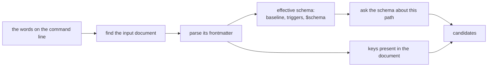

---
$schema:
    status: |-
        enum(
            draft-spec,
            finalized-spec,
            planned,
            implemented,
            review-findings,
            human-in-the-loop,
            completed,
            on-hold,
            abandoned
        ) -> an indicator of progress for this specification
    reviewed: boolean -> indicates whether the specification file has been reviewed by another agent from the one which created the spec
    reviewed_by: string -> the agent and model used in the spec review
    reviewed_on: date -> the date the spec was reviewed
    review_iterations: number -> the number of implementation reviews have taken place in the review/fix cycle
    clarified: boolean -> indicates whether the specification was built -- _in part_ -- with the 'clarify.md' prompt
    implemented: boolean -> indicates whether this spec's plan has been implemented
    implemented_by: string -> the agent who implemented the plan
kind: feature
created: 2026-11-06
status: finalized-spec
area: darkmatter
owner: Ken Snyder <ken@ken.net>
reviewed: true
reviewed_by: codex/gpt-6.1-sol
reviewed_on: 2026-11-06
clarified: true
implemented: true
review_iterations: 4
completed: true
packages:
    - darkmatter-cli
    - darkmatter
    - simplified-schema
related:
    - 2026-11-05-render-surface
    - 2026-10-25-positional-args
depends-on:
    - 2026-11-04-composition-errors
next_spec: 2026-11-04-loading-data
implemented_by: claude/opus
---

# Dotted Property Paths

Give the frontmatter commands and `md compose` one way to name a value inside
frontmatter: a dotted path such as `style.page.max-width`.

```sh
md get doc.md style.page.max-width            # 96
md set doc.md style.page.max-width 50 --save  # edits the nested key
md rm doc.md style.page.max-width             # removes the nested key
md compose doc.md author.name=Alice           # overrides one nested value
```

Today each of these fails or does something surprising. This spec comes first in
its pipeline because `2026-11-05-render-surface` spells its per-key style setters
in this grammar (`md render doc.md style.ul.padding-left=4`), and shell completion
for those setters builds on the completer this spec adds.

This spec is **finalized**: the author's rulings of 2026-11-06 are marked **Decided**
below. **Proposed** marks an implementation detail the drafter chose, which planning
may refine.

## Today's behavior

Observed 2026-11-06.

| Command | Result |
|---|---|
| `md get doc.md style.page.max-width` | prints `""`; `get` looks up top-level keys by exact name (`docs/cli/get.md`) |
| `md set doc.md style.page.max-width 50` | writes a new literal top-level key, `style.page.max-width: 50`, beside the real `style:` block |
| `md rm doc.md style.page.max-width` | fails: property not found; `rm` removes top-level keys only |
| `md compose doc.md nested.deep=7` | `expected at most one input path`: a `.` in a key makes `parse_compose_setter` read the token as a path |
| `md compose doc.md --set 'a.b=1'` | fails: `--set` takes a JSON object |

Reusable pieces already exist:

- `simplified_schema::completion::{PathStep, def_at_path}` walks a schema by key
  and index.
- `simplified_schema::validation::JsonPointer` is the data-position path that
  diagnostics report.
- Darkmatter's [leaf locator](../../lib/src/markdown/hash/write.rs)
  addresses existing string leaves for an in-place edit; it is not a general
  editor for insertion, deletion, numbers, or containers. Extend the sanctioned
  frontmatter editing facilities rather than creating a second YAML editor.
- `parse_compose_positionals` already separates one input from `key=value` tokens.

## Scope

| In scope | Out of scope |
|---|---|
| The path grammar and one shared parser | `md render`'s style setters: `2026-11-05-render-surface` wires them to its style layer |
| `md get`, `md set`, `md rm` nested reads and edits | Paths in expressions, which already have their own grammar |
| `md compose` dotted setters | `--state` and `--set`, which keep taking JSON objects |
| Schema-driven shell completion for paths and values | Positional parameter mapping: `2026-10-25-positional-args` |

## Design

### The grammar

A path is one or more segments joined by `.`:

```text
style.page.max-width
author.name
_private.key
```

A segment is any text without an unescaped `.`, so `md get doc.md '$schema'` keeps
working. `md compose` setters are stricter because they must tell a setter from a
file path: each segment of a setter key follows the existing grammar,
`[A-Za-z_][A-Za-z0-9_-]*`, or is a whole number, and a token that does not fit is a
path. Its first segment must follow the grammar, so `9key=value` stays a path.

> **Decided (2026-11-06). `.` always separates, and `\.` escapes it.** A path has
> one syntactic interpretation whatever the document holds.
>
> **Decided (2026-11-06). `\\` is a literal backslash.** It makes a key ending in a
> backslash usable as a parent: `'C:\\.name'` is `name` under the key `C:\`. Escape pairs
> match left to right, and `parse(print(segments)) == segments`.

```sh
md get doc.md style.page.max-width        # the nested value, always
md get doc.md 'style\.page\.max-width'    # a real top-level key with dots in its name
md rm doc.md 'style\.page\.max-width'     # cleans up such a key
```

`\.` and `\\` are the two escapes, and a `\` before anything else is an ordinary
character, so ordinary paths and keys such as `C:\dir` need no change. These escapes are
property-key syntax only; file references and their platform-specific separators are
unaffected.
The whole argument `''` addresses an empty top-level key, as it does today. An empty
segment within a longer path (`a.`, `.a`, `a..b`) is a syntax error: a leftover
trailing dot from completion, or a typo, must not write a key named `""`. A nested
empty key is reached by replacing its parent. Whitespace and Unicode in keys are
preserved without trimming or normalization; shell quoting is separate from
property-path parsing.

An `md compose` setter can name a dotted key too (`'a\.b=1'`): validate the decoded key segments while
allowing the literal dots represented by `\.`. Empty segments and other excluded
characters still need an object supplied through `--set`. On native Windows, where `\`
is a path separator, `dir\.config=1.md` therefore reads as a setter, so such a file needs
`.\dir\.config=1.md`. Split a setter at its
first `=` only; the rest belongs to its value. Object keys inside `--state` and
`--set` remain literal keys, so `--set '{"a.b":1}'` addresses a dotted top-level
key, while `--set '{"a":{"b":1}}'` supplies a nested object. Neither option gains
property-path interpretation.

> **Decided (2026-11-06). A number addresses an existing array element.** The value
> being walked decides what a segment means: on an array `0` is an index, and on a
> mapping it is the key `"0"`. Appending is not part of this spec.

```sh
md get doc.md items.1.name              # b
md set doc.md items.1.name z --save     # edits that one value
md compose doc.md items.1.name=z        # overrides it for this run
md rm doc.md items.0                    # removes it; the next element becomes items.0
```

| Out-of-range case | Result |
|---|---|
| `md get` | missing, so it prints `""` like any other missing path |
| `md set`, `md compose` | an error naming the array's length; nothing is written |
| `md rm` | an error, like removing any absent key |

On arrays, only canonical ASCII decimal digits denote an index, as in JSON Pointer: `0`
and `10` are indexes, while `01`, signs, fractions, and `-` are not, so one element has
exactly one spelling. A segment that is not an index behaves like an out-of-range one.
Parse without overflow: an arbitrarily large decimal index is out of range, not a
wrapped index or a panic. On mappings, `0` and `00` remain different string keys.
A present `null`, like a scalar, cannot be traversed. `get` returns missing for an
unreachable descendant, while mutations report the failing parent or index.
Replacing the whole `null` or scalar by naming its path is allowed.

**Proposed.** One new `PropertyPath` type in `simplified-schema` owns parsing and
canonical printing. The parser consumes the argument after the shell has removed
its quoting, and reports syntax failures as usage errors (exit status 2); missing
targets, invalid parent types, and rejected values are execution failures (exit
status 1) through the existing command report. Preserve decoded string segments
until walking an actual value: a numeric segment alone cannot determine whether the next step is a
mapping key or an array index. Conversion to that package's
[`PathStep`](../../../simplified-schema/lib/src/completion.rs) (used to query a
schema) or [`JsonPointer`](../../../simplified-schema/lib/src/validation.rs)
(used in diagnostics) therefore needs the resolved traversal, not just the text.
Keep these existing path types and expression syntax unchanged. No consumer of
this new CLI grammar splits on `.` itself; unrelated expression, diagnostic, and
schema-query grammars are outside that restriction. Preserve the original
argument separately for result fields and error messages.

### Parents

> **Decided (2026-11-06). A path command never destroys or removes anything you
> did not name.**

| Case | Result |
|---|---|
| A missing parent, `md set doc.md author.name Ken` | created: `author: { name: Ken }` |
| A number under a missing parent, `items.0.name` with no `items` | an error: the path cannot say whether `0` is an element or a key, even when a schema suggests one |
| A parent that cannot hold the key, `author.name` where `author: Ken` | an error naming the parent's type; nothing is written |
| Removing the last child, `md rm doc.md style.page.max-width` | the parent stays, as `style: { page: {} }` |

A value can still be replaced on purpose by naming it:
`md compose doc.md 'author={name:"Bob"}'`.

### Reading: `md get`

`md get doc.md style.page.max-width` returns the value at that path. A missing path
keeps today's contract: the value is `""` in JSON and a blank line in `plain`
output. An explicit `null` stays `null` in data output. Multiple requested paths
produce a flat object keyed by the arguments as written, not a reconstructed
nested object: `md get doc.md author.name title` gives
`{"author.name":"Alice","title":"Notes"}`. A malformed path is a failure rather
than a missing value; existing output envelopes, exit statuses, `--compact`, and
stdin support remain unchanged. An existing ordinary top-level key is reached as
before, so
`md get doc.md title` is unchanged, including every `just/review.just` call.

### Editing: `md set` and `md rm`

`md set` prints the edited document unless `--save` is supplied; `md rm` always
saves a file and has no `--save` flag or stdin mode. Preserve these contracts.
The `property` field of the `md set` result and the `removed` list of the `md rm`
result carry paths as written. **`remaining` continues to list the surviving
top-level keys in document order**, not all nested leaves. This keeps its existing
meaning for scripts.

Plan all removals against the original document before changing it. Duplicate
paths that resolve to the same target, or an ancestor together with its descendant,
are errors with no write. Disjoint array removals use original indexes:
`md rm doc.md items.0 items.2` on `[a,b,c,d]` leaves `[b,d]` in either argument
order. Remove siblings from highest index downward; `removed` retains argument
order. A missing target or any other invalid edit cancels the entire command.
Removing the last array item leaves `[]`, just as the last mapping child leaves
`{}`. Mapping deletion preserves the order of surviving keys.

**Reader's note: nested formatting needs new editing support.** The existing
Darkmatter CLI [frontmatter writer](../../cli/src/commands/frontmatter.rs)
rewrites changed top-level properties. Calling it with `author` for an
`author.name` edit would discard comments and scalar spelling on `author`'s other
children. Extend the shared Darkmatter frontmatter editor to target nested nodes,
including additions and removals, and preserve bytes outside the selected node
and the separators or indentation needed to keep its container valid. New keys
append within their parent; replacing a node preserves its position. The body
stays unchanged unless the caller explicitly requested the existing width reflow.

For source forms the editor cannot safely change, preserve the documented
whole-frontmatter serialization fallback only when reparsing proves that every
unnamed value is unchanged. An alias or anchor that changes an unnamed value is
an error, never a reason to bypass that check. Test comments inside a shared
parent, flow collections, LF/CRLF, and anchor/alias dependencies. Compute and
verify the complete result before opening the destination for a write; a rejected
edit leaves the input bytes unchanged. This does not promise crash-safe file
replacement or introduce a new hash-stamping policy.

### Setting: `md compose`

`md compose doc.md author.name=Alice` overrides one nested value and keeps
`author`'s other keys. A setter is classified as today, with `.` added to the key
grammar, and takes its place in the documented precedence: it still overrides
`--state` and `--set`. A token with `/` or `:` in its key is still a path, so
`./foo=bar.md` is unaffected. A file named `a.b=c.md` now needs `./`, as `a=b.md`
already does. Setters may precede or follow the input document. Execution and
completion must use the same classification, including escaped dots, magic file
references, `-`, and explicit relative or absolute paths.

Retain an ordered list of raw setter arguments until the document and its schema
are available. The current early conversion into a map loses numeric spelling and
argument provenance; expanding dotted names into that map is not sufficient.
Apply paths to the effective document after existing defaults and `--set` merging,
without changing the recursive merge behavior of those older options. Naming a
whole object with a shorthand setter replaces that object intentionally; changing
one descendant preserves all other children. Specificity applies within the
shorthand layer only: a shorthand `author={...}` still outranks a more specific
value supplied by `--set`.

### Values and overlapping setters

Today `md compose doc.md version=1.10` yields `1.1` even when the schema declares
`version: string`, and `md set` reads JSON while `md compose` reads JSON5, so
`{a:1}` is a string to one and an object to the other.

> **Decided (2026-11-06). One value parser, the declared type first, and the more
> specific path wins.**

- `md set` and `md compose` share one parser: JSON5 with a string fallback.
- A value starting with `{` that JSON5 rejects is tried as YAML flow syntax before that
  fallback, so `style="{ max-width: 50 }"` works without quoting a hyphenated key.
  Nearly every style key has a hyphen, and a quoted key inside shell quotes is easy to
  get wrong. JSON5 goes first because YAML would read `{a:1}` as a key named `a:1`, and
  a mix such as `{ a:1, max-width: 2 }` does read that way, surfacing `a:1` as an unknown
  key.
- **A declared key** passes its raw text through the conversion engine frontmatter
  uses (the `simplified-schema` package's
  [conversion engine](../../../simplified-schema/lib/src/coercion/mod.rs)), so
  `version=1.10` under `version: string` is
  `"1.10"`, and `count=5` under `count: number` is `5`. `md compose` therefore needs
  the document's schema while applying setters, not only afterward.
- **An undeclared key** keeps today's guess: `count=5` is the number `5`.
- In `md compose`, a wrong value still fails schema validation.
- In `md set`, see the decision below.

> **Decided (2026-11-06). `md set` validates what it changed.** The new value is converted
> and checked against its declared type, along with any ancestor object or union
> constraints needed to determine that type. Problems elsewhere in the document never
> block an edit, so `md set` stays a repair tool.

| On a document with `count: number` and a missing required `title` | Result |
|---|---|
| `md set a.md count 5` | writes |
| `md set a.md count abc` | fails; nothing is written |
| `md set a.md title Notes` | writes, repairing the document |

- A malformed or unreadable applicable schema fails with an explanation and no write;
  it never silently switches how the value is read.
- Schema resolution stays local and passive: eager file values are not normalized, and
  no expression or shell value is evaluated.
- Setting `$schema` checks only that the new value is a valid schema reference, not the
  rest of the document against it.
- `md rm` stays structural and may remove a required key, and `md get` stays schema-free.

The declared-type branch needs an exact input policy. An explicitly JSON5-quoted
string is decoded once (`'"Alice"'` becomes `Alice`, not text containing quotes).
Unquoted scalar text goes to the shared conversion engine as text, so
`string | number` keeps `1.10` as `"1.10"`, `numberlike` keeps `02134` as text,
and `boolish` keeps `On` as text. Native `null` remains null and is accepted only
where the type permits it. For object and array types, parse container syntax
before recursive conversion; the engine itself must not acquire a new
text-to-container conversion. Preserve existing union ambiguity and constraint
rules. Parsed container numbers have already lost their source spelling:
`'author={version:1.10}'` cannot promise `"1.10"` for a nested string field;
quote that nested value or use `author.version=1.10` to retain it.

Use the admitted JSON5 and YAML parsers and `simplified-schema`'s numeric checks;
do not let an invalid parsed number become a rounded value. Syntax rejection can
fall back to text, but a parsed container with duplicate keys, a non-finite number,
an inexact integer, or underflow must fail rather than bypass admission by becoming
a string. Declared text inputs remain text before numeric admission. The YAML
fallback accepts exactly one flow mapping, not a block document or extra YAML
documents. It must not execute tags, expressions, or shell syntax. Both parsing
paths preserve mapping order. The shared parser belongs below the CLI so the
render feature can reuse it; document selection and effects remain host policy.

> **Decided (2026-11-06). Setters are applied to a temporary copy to select the schema,
> then each is read once.** A setter can change which schema applies: with a trigger
> matching `lang: enum(rust; required)`, `md compose doc.md lang=rust edition=1.10` reads
> `edition` through the trigger's schema, so it stays `"1.10"`.

Build the copy from the document, existing defaults and object overrides, and the whole
specificity-ordered setter plan, wherever the input path occurs on the line. Parse
structural literals passively and keep raw scalar spelling. Resolve the schema with the
same captured request and schema roots as composition, then bind each value once. There
is no retry: if the normal composition stages later reject the result, for example because
a trigger that matches a converted type selected differently, report that failure with a
clear explanation. Completion uses the same procedure on the words before the cursor and
silently falls back when resolution cannot finish. Pending selectors stay pending under
the existing pipeline rules. Do not evaluate expressions to discover a setter's
type or move composition effects ahead of the existing passive call check.
Pending expression and shell values retain the existing composition rules;
`md set` and completion never execute them.

**The schema decides whether a compose setter is valid.** The frontmatter root
is open by default, so an undeclared top-level key is normally fine; an explicitly
closed root still rejects it. A declared nested object is closed by default, so
`author.mistake=1` is `dm.schema.unknown_key`, unless the schema opens it with a pattern
key such as `"<string>": unknown`. Nothing is special about any key, `style` included.

Overlapping setters resolve by specificity, whatever their order; the same exact path
given twice takes the last value. Compare decoded paths, not their raw spelling;
a literal dotted key is distinct from several nested segments. Apply ancestors
before descendants, preserving command-line order among independent paths at the
same depth. Replacements retain key positions, and new sibling keys append in that
order. An ancestor replacement that is a scalar or `null` cannot also accept a
child setter: both argument orders fail without producing a partial result.
Bounds are checked against the array after any ancestor replacement. Validate the
final combined value rather than rejecting a required child that a more specific
setter supplies. Overridden duplicate values need not pass type conversion, but
every argument must still have valid path syntax. Resolve identity against the
container established by ancestor setters before binding the surviving value.

```sh
md compose doc.md 'author={name:"Ann",email:"a@x"}' author.name=Bob
md compose doc.md author.name=Bob 'author={name:"Ann",email:"a@x"}'
# both give { name: "Bob", email: "a@x" }
```

### Shell completion

Pressing Tab on a path walks the schema one level at a time, so a user can discover
what a document accepts without opening it:

```text
md compose doc.md <Tab>                       author. style. title=  (plus files and flags)
md compose doc.md style.<Tab>                 style.page. style.table. style.ul. ...
md compose doc.md style.page.<Tab>            style.page.alignment= style.page.max-width= ...
md compose doc.md style.page.alignment=<Tab>  left center right
md get doc.md st<Tab>                         style. status
md set doc.md style.page.alignment <Tab>      left center right
```

> **Decided (2026-11-06). Completion reads the document and what its schema needs.**
> Without them, a document's own `$schema` and triggers would never reach Tab.

Completion is **advisory and passive**. It evaluates no expression, runs no command,
uses no network, and writes nothing. Whatever it cannot work out, it leaves out; it
never prints an error into the prompt, and validation stays the judge of what is
actually allowed.

#### Where the information comes from



Use the effective schema when it resolves; use the compiled baseline as a fallback
when it does not. Never union baseline type/value suggestions back into a valid
effective schema: a document may intentionally override a baseline declaration.
Document keys supplement the chosen schema according to the command table below:

| Source | Gives | Available when |
|---|---|---|
| The document's **effective schema** (Darkmatter's [`effective_for`](../../lib/src/markdown/schemas/mod.rs), which assembles the applicable schema): the runtime baseline, schema triggers, and its `$schema` | declared keys, their descriptions, and value candidates | an input document resolves |
| The document's **own frontmatter** | keys it already has, including undeclared ones | an input document parses |
| The **runtime baseline** alone | global keys such as `style.*` | always; it is compiled in |

A source with a partial key prefix uses that prefix as text, not as an invalid
finished path. In particular a trailing dot asks for children, even though the same
text is a syntax error once the command runs. At the root,
enumerate schema properties directly: the existing schema path query requires a
first key and is not itself a root-key enumerator.

With no resolvable input (for example `md compose <Tab>`, or input from stdin), only
the baseline is offered, alongside the usual file and flag candidates.

The schema question is already answered by a pure function:
`simplified_schema::completion::for_path_in` takes a resolved schema, its definitions,
the frontmatter, and a `PathStep` path, and returns keys and scalar values, opening
recursive and shared named types only as far as the path goes. `def_at_path` gives the
definition at a path. DMLS is built on these too, so Tab and the editor agree.
**Proposed:** add one function in `darkmatter::markdown::schemas::completion` that
returns neutral candidates for a `PropertyPath`, and map them to
`CompletionCandidate` in the CLI. The DMLS provider types stay in DMLS.

#### Which keys each command offers

| Command | Offers | Why |
|---|---|---|
| `md compose` | schema keys, then keys present | an override may set a key the document omits |
| `md set` | schema keys, then keys present | as above |
| `md get` | keys present, then schema keys | reading a key that is absent only prints empty |
| `md rm` | keys present only | removing an absent key is an error |

Keys already given as setters before the cursor are not offered again after
path decoding. A parent whose child has been set remains available for completing
other children. Ignore words after the cursor when constructing completion state;
editing in the middle of a command must not apply later setters.

#### How a candidate is spelled

| The path's type | Candidate | After accepting it |
|---|---|---|
| object, or a union with an object arm | `style.page.` to descend, and `style.page=` in a setter command to replace the whole object | no space |
| anything else, in a `key=value` command | `title=` | no space; the value comes next |
| an existing node in `get`, `set`, `rm`, including an object or array | `title` or `items` to select the whole node; also offer descent for containers | a space for the whole node; none for descent |
| array | `items.` to descend through existing indexes; use `items.0.` only for a container item and `items.0=` for a scalar setter; also offer `items=` for whole-array replacement | no space; completed read/remove scalar paths take a space |
| open object such as `page.meta`, whose keys are not declared | whole-object assignment, plus descent through keys already present | no invented key names |
| object with a pattern key (`"<string>": unknown`) | declared keys and keys already present; never the pattern marker itself | as above |

Where the shell can show it, the schema's description (`-> ...` in a type) becomes the
candidate's help text. Required schema keys sort first, then declaration order;
frontmatter-only keys follow in document order for `compose` and `set`. For `get`,
present keys come first in document order, followed by absent schema keys; `rm`
uses document order only. Deduplicate by decoded path,
retaining schema descriptions, and preserve this order in shell adapters.

Escape property-path punctuation before applying the shell's quoting rules. The
YAML insertion strings returned by the schema helper are not automatically safe
command-line text: enum values containing spaces, quotes, `$`, backslashes, or
`=` must arrive at `md` as one value and decode to the intended scalar. Offer only
keys the receiving command's grammar can express. A value completer for a `file`
property must include ordinary files, not only the Markdown extensions used for
input-document completion. File-value completion may enumerate the requested
local directory; it never opens or executes candidate files.

#### Which values are offered

| The key's type | Candidates |
|---|---|
| `enum(...)`, `literal(...)` | the members |
| `suggest(...)` | the suggestions, which stay advisory |
| `boolean` | `true`, `false` |
| `file` and its forms | file paths, using the existing file completer |
| a union | the candidates of each arm, deduplicated |
| `string`, `number`, `unknown`, an object | nothing; the shell's default applies |
| a slot from `2026-11-05-dynamic-schema-types` | nothing; completion never resolves a slot |

A literal tag narrows a union: if the document, or a valid setter before the cursor, has
`kind: rust`, the keys and values of the `kind: rust` arm are offered. `for_path_in`
does this from the frontmatter it is given, so completion passes the document's
frontmatter with the line's earlier setters applied. Later edits to an ancestor
must not undo the specificity rule; the completion overlay uses the same ordered edit plan as execution.
Dynamic slots that require composition remain unresolved.

#### What it may read, and how fast

Completion runs on every Tab. Reads are limited to the input document and the files
resolving its schema needs, each read once. Remote schema references are skipped
without a request. A schema that fails to resolve contributes nothing; the document's
own keys and the baseline remain.

The permitted reads also include the configured local schema-root discovery needed
to find triggers, and ordinary file/directory enumeration when completing a file
argument or file-typed value. "Each read once" means each distinct schema/document
content file once per completion invocation, including repeated imports; it is not
a ban on the metadata probes needed to select a schema. No unrelated repository
scan or persistent cache write is allowed. Enforce remote denial before any fetch,
even if command-line host permissions would allow normal composition. Completion
must not consume stdin. Earlier setters affect only a temporary copy: retain valid,
passively parseable ones and ignore incomplete or invalid ones without diagnostics.
A failed effective-schema assembly falls back to document keys and the compiled
baseline; it must not relabel a partially assembled schema as authoritative.

Resolving the small test document's schema took 58 ms in a debug build
(`md schema detect`, 2026-11-06). **Proposed budget:** no perceptible pause for a
typical document; measure a representative release build while implementing, and
record it. This is one quick release-build sample on one host, not a benchmark
suite, cross-platform performance gate, or statistical threshold. The debug
`md schema detect` result is context, not a measurement of completion. Verify
read/effect limits with observable operations rather than timing assertions.

#### Three facts about the shells that shape this

These come from reading `clap_complete` 4.6.2 and running it on 2026-11-06.

1. **A completer only receives the current token.** `ValueCompleter::complete` gets
   `current` and nothing else, so it cannot see the input document. The CLI
   completion adapter must recover the other words from the process arguments (`md -- md compose doc.md ...`),
   and honor the cursor position and `--magic-root` values there. Construct one
   request snapshot at CLI entry and derive the document context through the normal
   file-argument opener. Pass that context down; library code must not read process
   arguments, recapture the working directory, or reinterpret file references.
2. **Bash splits tokens at `=`.** `=` is in `COMP_WORDBREAKS`, so
   `style.page.alignment=ce` arrives as three words: `style.page.alignment`, `=`, `ce`.
   `COMPLETE=bash md -- md compose a.md x = ""` currently offers files and flags, not
   values. Bash also replaces only the last piece, so its candidates must be `center`,
   not `style.page.alignment=center`. Zsh, fish, PowerShell, and elvish are expected
   to pass the whole token; each is proven by test.
3. **Only some suffixes suppress the trailing space.** Bash's script suppresses it for
   `=`, `/`, and `:`, not for `.`, and zsh's special-cases only `/`, so accepting
   `style.` would add a space and end the path. Fish's behavior is to be verified.

**Proposed:** keep the built-in scripts where they work, and supply custom
`EnvCompleter`s through `CompleteEnv::shells` where they do not (at least bash, for
facts 2 and 3, and zsh, for fact 3). Fact 2 is a parsing concern too: the completer
rejoins `key`, `=`, `value` before asking the schema. Bash 3.2, which macOS ships, is
tested as well as bash 5, since the script takes a different path below version 4. If
a shell cannot complete after `=`, keys still complete there and the limit is
documented in `docs/cli/index.md`.

### What `2026-11-05-render-surface` receives

- `PropertyPath`, so `style.ul.padding-left` means one thing everywhere, including the
  offset in `--style=theme.dark@style.yaml`.
- The shared value parser, for `style="{ max-width: 50 }"`.
- The completer and its shell handling. `style` is part of the effective schema, so
  `md render` needs no catalog of its own and no new shell work.
- The per-shell proof of completing after `=`.

## Acceptance criteria

- `md get`, `md set`, and `md rm` read, edit, and remove a nested value, and leave
  sibling values and source bytes under the nested-edit and safe-fallback rules above.
- `md set doc.md a.b 1` never writes a literal `a.b` top-level key;
  `md set doc.md 'a\.b' 1` does, and `md get` and `md rm` reach it the same way.
- `md compose doc.md a.b=1` overrides one nested value and keeps its siblings, and
  the override is visible to expressions and schema validation.
- Ordinary top-level calls retain their output and save contracts. Intentional
  differences are JSON5/YAML-flow values for `md set`, declared-type scalar
  conversion, explicit whole-object replacement by shorthand setters, the
  multi-remove conflict policy, and rejection of invalid admitted container values.
  The `\\` escape and `md set` validating what it changed must also be documented; do not claim universal byte identity.
- `./a.b=c.md` is a path; `a.b=c.md` is a setter; `md get doc.md '$schema'` still works.
- `items.1.name` reads and edits that element, a number on a mapping is that key, and
  each out-of-range row under [The grammar](#the-grammar) has a test.
- Each row under [Parents](#parents) has a test, and a failed edit writes nothing.
- `version=1.10` under `version: string` is `"1.10"`, `count=5` under `count: number`
  and with no schema are both `5`, and `md set` and `md compose` read `{a:1}` alike.
- Both orders of `'author={...}' author.name=Bob` give the same result.
- `author.mistake=1` under a closed `author` fails with `dm.schema.unknown_key`, and the
  same setter under `"<string>": unknown` succeeds.
- `{ max-width: 50 }` and `{a:1}` both read as objects. A syntactically rejected
  value stays a string unless the declared type rejects it; admission errors in
  parsed containers remain failures.
- Each output schema these commands use still passes its conformance test.
- Only `PropertyPath` parses the new property-path grammar. Context-aware adapters
  distinguish array indexes from numeric mapping keys and retain typed paths in
  diagnostics. Existing expression and schema-query grammars remain unchanged.
- `parse(print(segments)) == segments` holds for trailing backslashes, literal dots, and
  `\\.` sequences.
- Cover the empty top-level key, syntax errors for `a.`, `.a`, and `a..b`, Unicode keys,
  escaped dots, numeric mapping keys versus array indexes, `items.01` as a non-index,
  huge indexes, scalar/null traversal, original-index array removals,
  ancestor/descendant removal conflicts, and both orders of a scalar ancestor
  setter with a descendant. Failed edits leave the source bytes unchanged.
- Multi-path `get` keeps a flat result; `rm.remaining` lists top-level keys. Nested
  edits preserve comments on siblings within the same parent, and an alias change
  to an unnamed value is refused. Persisted edits pass a read/write/read round trip.
- `md set` on the three rows of the validation table behaves as stated, a broken schema
  fails with no write, and setting `$schema` does not validate the rest of the document.
- `lang=rust edition=1.10` under a trigger on `lang` reads `edition` through that trigger's
  schema in either argument order, and a `--set` that replaces `$schema` selects the same
  way; a trigger that matches a converted type fails with a clear explanation, never a
  retry.
- Quoted strings decode once; `numberlike`, `boolish`, and scalar unions follow the
  shared conversion rules; invalid numeric/container admission cannot fall back to
  text. Existing pending-value and caller-origin rules are retained.
- A setter failure names its original argument and resolved path. Command-line
  values have no authored document line or column; never attribute an override's
  invalid value to the old on-disk scalar. Use the existing output envelope and
  diagnostic machinery from the composition-errors prerequisite.
- Completion, for each row of the tables under
  [Shell completion](#shell-completion): keys per command, candidate spelling, and
  values per type, including a required key sorting first and a literal tag narrowing
  a union, using a document whose `$schema` is a separate file.
- Completion performs no evaluation, command, or network request, proven by a document
  with a frontmatter command, an interpolated value, and a remote `$schema`; those
  remain unevaluated, the remote schema is not fetched, and no diagnostic text
  reaches the prompt. Verify denied network and absent command execution through
  observable test seams; valid local sibling information remains available.
- A document that does not parse, a schema that fails to resolve, and no input each
  still complete, from whichever sources remain.
- `style.pa<Tab>` then `ge.<Tab>` then `alignment=<Tab>` then `ce<Tab>` produces
  `style.page.alignment=center` with no stray space in bash 5, bash 3.2, zsh, fish,
  PowerShell, and elvish, or the documented limit for that shell.

## Tests

- **L1, in process:** the candidate function, with no shell involved, for every
  table row and fallback above.
- **L1, subprocess:** each shell's word shape through `COMPLETE=<shell> md -- ...`,
  including bash's split `key`, `=`, `value`. No terminal is opened.
- **L1, script:** generated scripts source without error in each environment that
  provides the shell. An L1 prerequisite uses `expect_level!`; it cannot silently
  skip. Select platform-specific tests deliberately and record absent-shell
  coverage as unproven. A shell limit is a measured limitation with a documented
  fallback, not an excuse to count an unrun test as passing.
- **L1, command behavior:** parser/walker cases run in process; a few real CLI
  cases prove command wiring, persistence, output envelopes, and failure without
  mutation through Darkmatter's `CliProcessFixture`. Use fixture-owned documents,
  schemas, home/config, and request contexts. No ambient user configuration.
- **L2:** a real-terminal Tab round trip in bash and zsh through the test harness,
  without taking focus, through `just test-l2` and the shared test harness. Gate
  with `require_level!` and a named backend. PowerShell behavior needs native
  Windows evidence per the `os` skill; WSL2 is separate Linux-path evidence.

## Documentation

- `darkmatter/docs/cli/get.md`, `set.md`, `rm.md`, and `compose.md`: replace "does not
  evaluate dotted paths" and the key grammar with the new rules; add examples.
- A section on property paths and completion in `darkmatter/docs/cli/index.md`, linked
  from each, including what completion reads and any per-shell limit.
- `darkmatter/docs/topics/frontmatter.md`: nested edit safety and formatting
  fallback boundaries; `.claude/skills/darkmatter/frontmatter.md` alongside the CLI
  skill. The current public `fm_get`/`fm_insert` literal-key APIs are unchanged;
  add separately named path operations if library consumers need them.
- `simplified-schema/docs/`: the property-path type, its context-dependent
  conversions, and the shared setter-value adapter; `.claude/skills/darkmatter/cli.md`
  and `.claude/skills/simplified-schema/`.
- Document intentional compatibility changes with migration examples. In
  `compose.md`, remove the existing suggestion that `--set` interprets dotted
  keys: it continues to accept an object with literal keys.
- Topic pages describe the behavior directly and never link to this feature spec.
