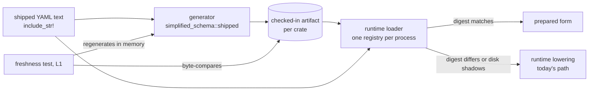

---
$schema:
    status: |-
        enum(
            draft-spec,
            finalized-spec,
            planned,
            implemented,
            review-findings,
            human-in-the-loop,
            completed,
            on-hold,
            abandoned
        ) -> an indicator of progress for this specification
    reviewed: boolean -> indicates whether the specification file has been reviewed by another agent from the one which created the spec
    reviewed_by: string -> the agent and model used in the spec review
    reviewed_on: date -> the date the spec was reviewed
    review_iterations: number -> the number of implementation reviews have taken place in the review/fix cycle
    clarified: boolean -> indicates whether the specification was built -- _in part_ -- with the 'clarify.md' prompt
    implemented: boolean -> indicates whether this spec's plan has been implemented
    implemented_by: string -> the agent who implemented the plan
kind: feature
created: 2026-11-11
status: draft-spec
area: darkmatter
owner: Ken Snyder <ken@ken.net>
reviewed: false
clarified: false
implemented: false
review_iterations: 0
packages:
    - simplified-schema
    - darkmatter
    - darkmatter-cli
    - claudine
    - claudine-cli
---

# Precompiled shipped schemas

Every `md`, `claudine`, and `dmls` process, and every test process, rebuilds
the same schemas from YAML text before it does any real work. The text is
compiled into the binary, so the result is the same on every run. This spec
moves that work to a generation step that runs when the schema text changes,
checks the result in beside the text, and loads it at startup instead.

It also removes four smaller per-process costs in the same code path, and
replaces the nine separate caches that hold shipped schema results today with
one.

## Why

### What it costs today

Measured on 2026-11-11 on macOS (Apple silicon) with the Time Profiler.
Inclusive times overlap: a parent includes its children.

| Run | Build | Total | Shipped-schema work |
| --- | --- | --- | --- |
| `md compose` on a three-line document | debug | 240 ms | 184 ms in "build options"; 150 ms of it is the shipped baseline |
| `md compose` on a three-line document | release | 50 ms | 37 ms in "build options" |
| `claudine compose --goose prompts/clarify.md --dry-run` | debug | 1.2 s | about 520 ms (breakdown below) |

The Claudine run, by function (debug, inclusive):

| Function | Time | Shipped and constant? |
| --- | --- | --- |
| `resolve_launch_schema` | 603 ms | partly: contains the next five rows plus the effective-schema compile |
| trigger discovery (`scan_with_embedded`, `load_embedded_trigger`) | 392 ms | yes |
| `enforce_compiles` (trigger payload compile check) | 141 ms | yes |
| `prepare_embedded_catalog_declaration` (the `fm` baseline) | 133 ms | yes |
| `envelope::admit_recognized` | 106 ms | yes, for shipped documents |
| `shipped_named_types` | 81 ms | yes |
| `build_position_map` | 81 ms | yes for shipped documents; only needed for diagnostics |
| `schema_digest` / `canonical_json` (validator cache key) | 56 ms | no: hashes the merged schema each run |
| `validate_simple_object_schema` | 56 ms | yes, for shipped payloads |
| expression function catalog (`load_catalog`) | 29 ms | yes |
| effective-schema compile (`build_validator_with`) | 230 ms | no: depends on the document |
| shell approval | 186 ms | no; out of scope |

### Why it matters for tests

Nextest runs every test in its own process, so in-process caches never carry
over from one test to the next. Each Darkmatter test that builds compose options
pays the baseline again (about 150 ms in a debug build). Each Claudine CLI test
pays about 520 ms for every `claudine` it spawns, and many spawn two to four. On
a busy host that CPU time multiplies: on 2026-11-11 the Claudine L1 suite had
185 to 218 tests over the 5 s budget under load. Run alone, the ones checked took
1.3 to 2.8 s.

### Why it matters at runtime

A trivial `md compose` in a release build spends three quarters of its 50 ms
preparing shipped schemas. `claudine` pays the same baseline plus its own bundle
on every launch, and `dmls` pays it at startup.

## Terms

- **Shipped source**: schema text compiled into a binary with `include_str!`.
  Today these are:
    - Simplified Schema's envelope definitions (`ENVELOPE_DEFINITIONS`)
    - Darkmatter's `SHIPPED` partials, including `fm.yaml` and
      `functions.yaml`, plus `schema-trigger.yaml`
    - Content Policy's editor schema, which `fm.yaml` imports
    - Claudine's eight-file bundle (`CLAUDINE_SCHEMA_FILES`)
- **Prepared form**: everything a run derives from a shipped source before it
  reads a user document: the lowered JSON Schema, the SimplifiedSchema shape
  and definition table, named-type tables, envelope admission results, the
  trigger matcher, and the checks those results already passed.
- **Artifact**: a checked-in file holding the prepared form of one crate's
  shipped sources.
- **Shadowing**: a disk schema file of the same name in a schema root replaces
  an embedded one (`claudine/docs/topics/schemas.md`). This must keep working.

## Design

### One generator, one format, one loader

All three crates use one mechanism from `simplified-schema`, the lowest crate
that owns the lowering. Darkmatter and Claudine do not get their own.

- **Generator.** `simplified_schema::shipped` exposes a function that takes a
  crate's shipped sources and the artifacts of the crates below it, runs
  today's lowering, and returns the prepared form. It reuses the existing
  functions (`lower_embedded_schema`, `prepare_embedded_catalog_declaration`,
  envelope admission, trigger assembly, the compile and merge-compatibility
  checks). It never adds a second lowering path. Darkmatter-specific steps
  (trigger assembly, the catalog) are supplied by Darkmatter through a small
  trait, so the dependency direction stays as it is.
- **Format.** Compact JSON written with `serde_json`, with every map in a
  deterministic order. The output is byte-stable, so freshness is a byte
  comparison, and a change shows up as a diff a reviewer can read. Mark the
  artifacts `linguist-generated` in `.gitattributes`. Serde support is added
  to the types the prepared form contains (`SchemaShape`, `DefinitionTable`,
  `NamedTypes`, `EnvelopeAdmission` results, trigger matchers).
- **Header.** Each artifact records the format version, the digest of every
  shipped source it was built from (`biscuit-hash`), and the digests of the
  lower crates' artifacts it read.
- **Loader.** One runtime loader in `simplified-schema` reads an artifact
  once per process (`include_str!`, then deserialize on first use) and checks
  the source digests against the texts compiled into the same binary. If they
  match, it serves the prepared form. If they differ, it falls back to runtime
  lowering, which is today's code, and records a work counter so a test can
  prove the fallback never runs in a fresh tree.
- **Shadowing.** The loader is consulted only for the embedded text. When a
  disk file shadows an embedded one, discovery takes today's disk path
  unchanged. The existing memo key (`EMBEDDED_LOADED`, keyed by bundle, name,
  and text) is how the loader is found, so shadowing needs no new branch.

### Where the artifacts live and how they are refreshed

| Crate | Artifact | Covers |
| --- | --- | --- |
| `simplified-schema` | `simplified-schema/lib/generated/shipped.json` | envelope definitions |
| `darkmatter` | `darkmatter/lib/generated/shipped.json` | `SHIPPED` partials, `fm` baseline, function catalog, effects catalog, `schema-trigger.yaml`, the shipped `KindRegistry` seed, Content Policy's editor schema |
| `claudine` | `claudine/lib/generated/shipped.json` | the Claudine bundle's triggers, payloads, and globals catalog |

- `just shipped-schemas`, run from the repository root, regenerates all three
  in dependency order (simplified-schema, then Darkmatter, then Claudine). Each
  area's justfile has the same recipe for its own artifact.
- Each crate has one L1 freshness test, named
  `shipped_artifact_is_fresh`. It regenerates the artifact in memory and
  byte-compares it with the checked-in file. On a mismatch it fails with the
  command to run. This test is also the equality proof: the prepared form a
  process loads is exactly what runtime lowering produces.
- A change to a shipped YAML file already schedules its crate, because the
  text is compiled in, so CI runs the freshness test without new
  `test-inputs` declarations. A change to Darkmatter's partials schedules
  Claudine through its reverse dependency, so a stale Claudine artifact is
  caught as well.

### One shipped registry per process (DRY)

These per-purpose `OnceLock`/`LazyLock` caches each hold part of the prepared
form today. They are replaced by reads from the loader's registry, so there is
one place that holds shipped results:

| Today | File |
| --- | --- |
| envelope `DEFINITIONS` | `simplified-schema/lib/src/envelope.rs` |
| `SHIPPED_NAMED_TYPES` (shipped entries only; file entries stay) | `simplified-schema/lib/src/resolve.rs` |
| `BASELINE`, `INLINE_BASELINE` | `darkmatter/lib/src/markdown/schemas/mod.rs` |
| catalog `CATALOG` | `darkmatter/lib/src/markdown/schemas/catalog.rs` |
| `shipped_kind_definitions` `DEFINITIONS` | `darkmatter/lib/src/markdown/schemas/embedded.rs` |
| `KindRegistry` `SHIPPED` and `PREPARED` | `darkmatter/lib/src/markdown/schemas/yaml_documents/registry.rs` |
| expression function `CATALOG` | `darkmatter/lib/src/markdown/compose/expression/catalog/mod.rs` |
| effects `CATALOG` | `darkmatter/lib/src/effects/types.rs` |
| globals `CATALOG` | `claudine/lib/src/composition/schema/globals.rs` |

`EMBEDDED_LOADED` stays, because it also memoizes disk-shadowed results, but
it asks the registry before it lowers.

### What stays at runtime

- Merging the shipped layers with the document's own `$schema` and compiling
  the effective schema with `jsonschema`. These depend on the document.
  Compiled `jsonschema` validators cannot be serialized.
- Everything for disk schemas, user `$schema` files, and template (`{{ … }}`)
  payloads.
- Diagnostics. Their text, codes, and positions must not change.

## Additional improvements in the same path

### 1. Position maps only when something needs a position

`envelope::admit_recognized` builds a position map for every admitted
document, even when it found no problem. Trigger envelopes and YAML documents
do the same. Make the map lazy: keep the source text, and build the map the
first time a problem, hover, or projection asks for a location. This applies to
user documents as well as shipped ones, and removes most of the 81 ms above.
Positions in every diagnostic stay byte-identical, which a test proves over the
existing diagnostic fixtures.

### 2. Validator cache keys from layer digests

`ValidatorCache::shared_schema_digest` serializes and hashes the merged schema
(`canonical_json`) the first time it sees each `Arc`. In a new process that
happens every run, for a schema whose shipped layers make up almost all of
its size. Compute the effective schema's cache key from the digests of its
layers: the shipped layers' digests come from the artifact, and only the
document's own layer is hashed. A full canonical hash stays available for any
schema built without layer digests. The two keys must never collide for
different schemas: a key built from layer digests carries a different domain
tag.

### 3. Checks that move to generation

These checks run on every launch today and always pass for shipped sources.
They run once at generation instead, and the artifact exists only if they pass:

- `enforce_compiles` for embedded trigger payloads (141 ms)
- `validate_simple_object_schema` and `enforce_merge_compatible` for embedded
  payloads (56 ms)
- `validate_baseline_schema` for the shipped baseline

For disk and shadowing files they keep running unchanged.

### 4. Test fixtures that work around the cost

Some Claudine CLI fixtures seed a reduced schema to avoid expanding the full
lifecycle bundle; for example, `CliProcessFixture::seed_inline_metadata_schema`
is used by eight test files. For each such fixture, read its history and
comments. Where the reduced schema exists only for speed, remove it so the test
covers the shipped schemas. Where it exists because the test is about shadowing
or a custom schema, keep it. Record each decision in the implementation log.

## Decisions

### Checked-in artifacts, not `build.rs`

A `build.rs` in each crate would need `simplified-schema` (and, for Claudine,
Darkmatter) as a build dependency. `simplified-schema` alone has about 425
transitive dependencies, and build dependencies are compiled a second time
for the host profile. That adds minutes to every cold test build, which defeats
the purpose. A checked-in artifact costs nothing to build, and the freshness
test provides the same guarantee a build step would.

### Not a runtime disk cache

A cache written to disk on first use would not help tests: every test fixture
uses its own home directory, so every test would start cold. It would also put
file I/O inside schema validation, which Darkmatter's boundaries require to be
passive.

### Not test-profile optimization overrides

Raising `opt-level` for these crates in `[profile.test]` would only shrink the
cost, would slow test builds, and would leave production startup unchanged.

## Out of scope

- Shell approval (186 ms in the Claudine run) and other composition stages.
- Serializing compiled `jsonschema` validators.
- Release packaging changes.

## Phases

1. **Generator, format, loader, and freshness test in `simplified-schema`.**
   Serde support on the prepared-form types; the `shipped` module; the
   envelope definitions moved onto it; the `shipped-schemas` recipe; the
   fallback work counter.
2. **Darkmatter.** Its artifact; the `fm` baseline, `SHIPPED` partials, kind
   definitions, function and effects catalogs, and Content Policy's editor
   schema served from the registry; its caches replaced; the generation-time
   checks (improvement 3).
3. **Claudine.** Its artifact; the bundle and globals catalog served from the
   registry; shadowing tests still passing.
4. **Lazy positions and layer-digest cache keys** (improvements 1 and 2).
5. **Fixture review** (improvement 4) and documentation.

Phases 2 and 3 depend on 1. Phase 4 depends only on 1 and may run in parallel
with 2 and 3.

## Verification and completion criteria

Measure on a quiet host (load average below the core count), on a debug build
and a release build, before and after, with the median of five runs. Record
the numbers in the implementation log.

- **Targets**
    - `md compose` on a three-line document: no more than 90 ms in a debug build
      (from 240 ms) and 20 ms in a release build (from 50 ms).
    - `claudine compose --goose prompts/clarify.md --dry-run` in the frozen-prompt
      fixture: no more than 650 ms in a debug build (from 1.2 s).
    - Claudine and Darkmatter L1 suites on a quiet host: no test over 5 s. Also
      report the change in the summed test durations from the JUnit reports.
- **Equality.** Each crate's `shipped_artifact_is_fresh` passes, and a mutated
  shipped file makes it fail with the regeneration command.
- **Fallback.** A test proves a normal run records zero runtime lowerings of
  embedded sources, and a test with a deliberately stale artifact proves the
  fallback runs and still produces correct validation.
- **Shadowing.** The existing tests where a disk `claudine.yaml` or
  `document.yaml` shadows the embedded one pass unchanged, and one new test
  proves a shadowed file is lowered from disk while its unshadowed siblings
  come from the artifact.
- **Diagnostics.** Every existing diagnostic and position assertion passes
  unchanged. Lazy positions are covered by one test per entry point that reports
  a position (envelope admission, trigger envelope, YAML document).
- **Cache keys.** A test proves two different documents over the same shipped
  layers get different validator keys, and the same document gets the same key
  in two processes.
- **No new I/O.** The loader reads only compiled-in text; the source-scan guards
  pass.
- **OS.** Artifacts are byte-identical when generated on macOS, Linux, and
  Windows. Line endings are normalized in the generator, and `.gitattributes`
  pins the artifacts to LF.

## Documentation to update when this lands

- `simplified-schema/docs/`: a topic page for shipped artifacts covering what
  they hold, how to regenerate them, the freshness test, and the fallback.
- `darkmatter/docs/`: the schema topic that describes the shipped baseline and
  embedded bundles, plus position maps.
- `claudine/docs/topics/schemas.md`: how the bundle is prepared, and that
  shadowing is unchanged.
- The `simplified-schema`, `darkmatter`, and `claudine` skills: the regenerate
  command and the rule that a shipped YAML change requires
  `just shipped-schemas`.
- `rust-testing` skill `test-speed.md`: shipped-schema preparation as a known
  cause, now removed.
