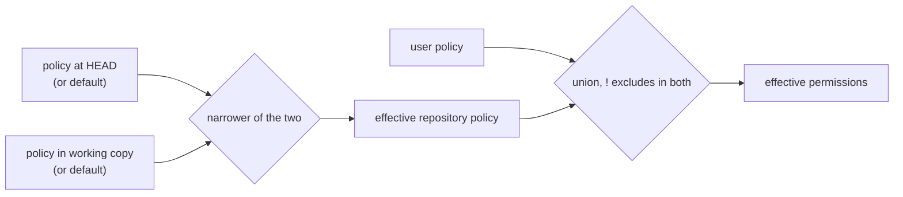
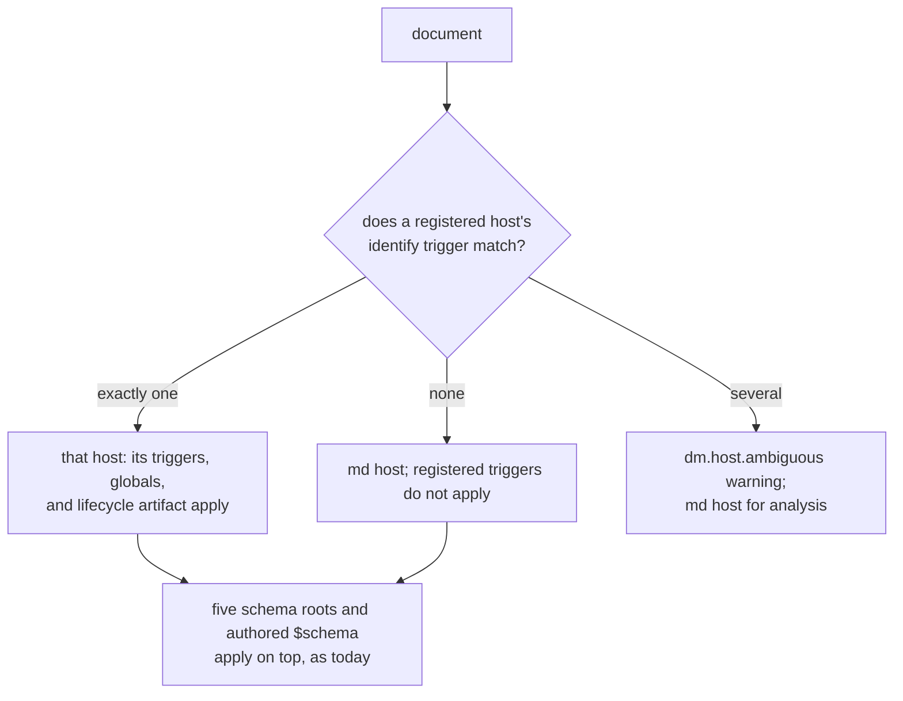

# Darkmatter configuration, permissions, and host registration

## Summary

Darkmatter has no configuration file of its own. Its user and repository
settings are spread across single-purpose files: `.darkmatter-shell-whitelist`,
`.darkmatter-shell-blacklist`, `~/.config/darkmatter/schema-read-policy`, and
DMLS's `.dmls.toml`. A program that builds on Darkmatter, such as Claudine,
has no supported way to tell the passive readers (`md`, DMLS) about its
schemas, globals, and lifecycle events.

This feature adds:

1. **A Darkmatter configuration file** at user scope (`~/.darkmatter.yaml`)
   and repository scope (`{repo-root}/.darkmatter.yaml`), described by a
   shipped SimplifiedSchema, so DMLS edits it with completion, hover, and
   diagnostics.
2. **One `permissions` block** holding three separate policies: which files a
   schema may read (`file-read`), which shell commands may run
   (`shell-commands`), and whether URLs may be fetched (`network`). It
   replaces the whitelist, blacklist, and grant-store files. The whole block
   can point at another program's configuration, so a Claudine user finds
   their permissions in Claudine's file.
3. **A commit rule for repository permissions.** A repository's
   configuration widens permissions only through committed content;
   restrictions apply immediately.
4. **Defaults that callers can rely on.** Every configuration property has a
   `default(...)` in the schema, and a `required` schema property with a
   `default(...)` satisfies its contract when absent. Validation reports which
   defaults it relied on, and composition fills them in.
5. **`md init`**, matching `claudine init`, and a warning when no user
   configuration exists.
6. **One owner for schema document kinds.** `simplified-schema` takes over
   `schema-trigger` (with trigger discovery, schema roots, and the
   `KindRegistry`) from Darkmatter, so it owns all three kinds: `schema`,
   `yaml-schema`, and `schema-trigger`.
7. **Host registration.** A program registers its schema triggers, global
   catalog, and lifecycle artifact with Darkmatter. The registered schemas
   apply only to documents that a registered trigger identifies as belonging
   to that program, and that program becomes the document's lifecycle host.

The five schema roots (`SCHEMAS_DIR`, package, package area, repository root,
`~/schemas`) stay unchanged. They are for repository authors' own schemas and
are never a registration route for a program.

## Problem

### Claudine documents outside `claudine/`

A Claudine document outside the `claudine/` package area, for example:

```yaml
---
sequence:
  - name: one
    prompt: hi
initialize:
  - say: "{{ seq.name }}"
start:
  - say: "{{ seq.name }}"
---
```

DMLS (reproduced 2026-11-12) reports `dm.expression.undeclared_property` on
`seq` in `initialize` and says nothing about `start`. Inside `claudine/`, the
same document is clean. The reasons:

- DMLS learns about Claudine only from files in the document's schema roots:
  the eight trigger and library files, `globals.yaml` (which declares `seq`,
  `loop`, and `group`), and `globals.lifecycle.json` (events, renames, verbs).
  Only a document in the `claudine/` package area reaches them.
- With no host found, DMLS treats the document as an `md` document.
  `initialize` is a Darkmatter event, so its expressions are checked, and
  `seq` really is undeclared under `md`. `start` is not an `md` event, so it
  is unchecked plain frontmatter.
- No diagnostic says the host was not found. `dm.lifecycle.incomplete_analysis`
  fires only when a host catalog is found but its artifact is unusable.

The documented workaround, copying Claudine's files into `~/schemas`, makes
that root a registration route and leaves copies that drift from the binary.

### Shell policy

Darkmatter and Claudine already share one rule store. Claudine calls
Darkmatter's `shell_expansion::store`, so both read `.darkmatter-shell-whitelist`
and `.darkmatter-shell-blacklist`, with the same line grammar (`exact
<command>`, `prefix <command>`, `template <shape>`, `#` comments). They differ
in which directory holds the files:

| Reader | Policy directory |
|---|---|
| `md` (`resolve_policy_paths`) | repository root, else home, else the document's directory |
| Claudine (`harness_orch/shell_options.rs`, `system_prompt/prepare.rs`) | repository root, else the document's directory (never home) |
| DMLS (`overlay/shell.rs`) | `shell.policy_path` from `.dmls.toml`, else none |

Outside a repository the two programs read different files, and there is
never both a user list and a repository list. A repository's whitelist file
also takes effect as soon as it is edited, so an agent can widen its own
shell permissions by writing to it.

### Schema read permissions

Schema slots (`{{ … }}` inside a schema) may read files and URLs. Today each
read is approved by one of: a line in `~/.config/darkmatter/schema-read-policy`
(`allow file …`, `allow dir …`, `deny …`, `allow url …`, `allow site …`); the
**automatic grant**, which lets a slot read any file in its own repository
whose content matches the committed version; or an interactive prompt. That
store sits apart from the shell policy only because the shell files were not
user-level when it was designed (`2026-11-05-dynamic-schema-types`, Q8). The
original intent was a user-level policy beside the shell rules. A real
configuration file makes that possible.

The automatic grant also applies the Git-status idea to the wrong file. The
intent was that the **policy file's** status matters: an uncommitted change
to a repository's policy must not grant anything until it is committed.

## Goals

- A Claudine document gets Claudine's schemas, globals, and lifecycle events
  in DMLS and `md` wherever it lives, once Claudine is registered, with no
  copied files and no `SCHEMAS_DIR`.
- A document that is not a Claudine document is unaffected by Claudine's
  registration.
- One `permissions` block per scope, shared by `md`, DMLS, and Claudine, and
  found by a Claudine user in Claudine's configuration.
- No repository change widens a permission until it is committed.
- Every configuration property's default lives in the schema, and every
  reader takes it from there.
- The configuration file is validated by a shipped SimplifiedSchema, and
  every problem is reported with its file and position.

## Non-goals

- Changing the five schema roots, trigger grammar, or shadowing rules.
- Protecting a user from a cloned repository whose committed permissions are
  hostile. The risk is documented, with this repository's CI check as an
  example mitigation (section 2.7).
- Fine-grained network permissions (per host or URL). `network` is `allow` or
  `deny` for now.
- Running a registered host's actions in `md`. Registration is passive (see
  "`md compose` of an identified document" in section 6).
- Improving Claudine's dry run. `md compose` on a Claudine document is
  useful today partly because `claudine --dry-run` falls short; that is
  Claudine's to fix separately.
- Folding `.dmls.toml` into `.darkmatter.yaml`. Only `shell.policy_path`
  moves.
- Reorganizing Claudine's configuration beyond what this feature needs; that
  is `2026-09-30-configuration`.

## Design

### 1. The configuration file

| Scope | Path |
|---|---|
| user | `~/.darkmatter.yaml` (home from `biscuit_file::home_dir()`) |
| repository | `{repo-root}/.darkmatter.yaml` |

The file is a YAML mapping described by a shipped schema
(`darkmatter/schemas/darkmatter-config.yaml`). DMLS selects that schema for
both paths, so the file gets completion, hover (including each property's
default), and diagnostics. It is read once per request and captured in the
request's context, as with every other request input; no downstream resolver
reads it again. A file that fails validation is an error for any command
that reads the failing property, never a silent fall back to the default.

```yaml
permissions:
    file-read: <pattern[]>
    shell-commands: <rule[]>
    network: allow | deny
register: <manifest-reference[]>
```

The schema is closed: an unknown key is an error, and a new setting goes into
the schema first. Every property carries a `default(...)` (section 3), and
Darkmatter, Claudine, and DMLS read defaults from the schema rather than
hard-coding them.

### 2. Permissions

`permissions` holds three separate policies. They never share entries: a
file pattern never approves a command, and a command rule never approves a
read.

#### 2.1 `file-read`

Which files a schema slot may read (`load_data`, contract imports,
`validate_schema`, `file_exists`, `find_files`, …). Nothing is readable
unless an entry allows it.

Entries are glob references (the grammar `$path` and `match()` use):

- **Relative patterns are relative to the document doing the read**, as for
  transclusion. `./*.yaml` means "YAML files beside the reading document".
- **`&` is the repository root** (`&**/*.yaml`). `^` keeps its biscuit-file
  meaning (the nearest package, package area, then repository) and is
  allowed too.
- **A `!` entry carves out of the allows.** A path is readable without
  asking when some positive entry admits it and no `!` entry does. An
  excluded path is simply not permitted: it prompts, or fails with
  `dm.schema.slot_approval_required` where nothing can prompt, like any
  other read no entry covers. It is not a deny list:

  ```yaml
  permissions:
      file-read:
          - "&**/*.yaml"
          - "!&secrets/**"
  ```

- **Absolute paths are rejected**, because they are not portable. `~/` is
  allowed at user scope. `{{VAR}}/…` is allowed when `VAR` is a declared
  portable variable (`PORTABLE_ENV_VARIABLES`, as biscuit-file's
  `PortablePath` defines it); any other variable is an error.
- **Repository-scope entries must stay inside the repository.** At
  repository scope, `~/`, `..` that leaves the repository, and a `{{VAR}}`
  whose expansion lands outside it are errors. A symlink is judged by where
  it points.
- **`find_files` needs no folder permission.** It lists the folders its
  pattern names and returns only the files `file-read` admits. The grant
  store's separate `allow dir` permission for listings is retired.

**Defaults.** Both defaults allow the same text formats: `txt`, `text`, `md`,
`csv`, `tsv`, `json`, `json5`, `yaml`, `yml`, and `toml`, one entry per
extension:

| Scope | Default |
|---|---|
| user | `./*.<ext>`: files beside the reading document |
| repository | `&**/*.<ext>`: files anywhere in the repository |

#### 2.2 `shell-commands`

Which shell commands may run without a prompt. Entries use today's rule
grammar, one rule per entry: `exact <command>`, `prefix <command>`, and
`template <shape>`. A `!` entry carves out of the allows, as in `file-read`:
a command it matches is not pre-approved and goes through the normal prompt.

**The only blacklist is the built-in one.** It is compiled into Darkmatter,
and nothing configures, extends, or overrides it: no `shell-commands` entry,
approval, cached decision, or `--yolo`. A command it matches is always
refused. The user-editable `.darkmatter-shell-blacklist` was never meant to
exist and is retired (its rules migrate to `!` entries; see section 5).

```yaml
permissions:
    shell-commands:
        - prefix ls
        - exact ps -e
        - template git add {{ string }}
        - "!prefix git push --force"
```

**Default:** none: every command prompts (or fails without a terminal).

#### 2.3 `network`

Whether a schema slot or a composition (`::file`, `::code`, read-side
functions) may fetch a URL. `allow` permits every URL, and `deny` permits
none. **Default:** `deny`, today's behavior. `--allow host=HOST` still allows
one host for one run under `deny`, and changes nothing under `allow`.
In Claudine, `network` governs the reads Darkmatter makes while composing; it
says nothing about the agent's own network access.

#### 2.4 Override semantics

A list a user writes **replaces** that scope's default; it is never merged
with it. A repository that writes `file-read: ["&docs/**/*.md"]` can read only
Markdown under `docs/`. Its default `&**/*.<ext>` entries are gone. An
explicit empty list (`file-read: []`) denies everything at that scope. A
property that is absent keeps its default.

#### 2.5 Combining scopes

Inside a repository, the effective permission is the union of the two
scopes, each after its own override: a read or command allowed by the user
scope or by the repository scope is allowed. A `!` entry in either scope
excludes at both. `network` takes the more restrictive value: `deny` in
either scope is `deny`. Outside a repository only the user scope applies.

#### 2.6 The commit rule

A repository's permissions widen only through committed content. Each
repository-scope policy is computed twice: once from the file at `HEAD` (or
the default, when `HEAD` has no file), and once from the working copy (or the
default, when there is no working-copy file). The effective repository policy
takes the narrower of the two:

- a read or a command is allowed only when **both** versions allow it
  (judged per path or per command, so the two versions need not share
  entries);
- a `!` entry in **either** version excludes;
- `network` is `allow` only when both versions say `allow`.

So an uncommitted edit that adds an entry or removes a `!` has no effect
until it is committed, and an uncommitted edit that removes an entry or adds
a `!` applies at once. The user-scope file is the user's own and is not
subject to this rule. The commit rule reads the committed file from the
request's captured repository observation, never from a fresh capture.



The automatic grant is retired. Its job (in-repository reads with no prompt)
is done by the repository default, under the commit rule.

#### 2.7 The cloned-repository risk

The commit rule guards against unreviewed local changes, including an agent
widening its own permissions. It does not protect against a cloned
repository whose **committed** configuration is hostile. Its `file-read`
cannot leave the repository, but its `shell-commands` can approve any command.

The docs state this risk plainly and show one mitigation, the one this
repository adopts: a CI check that compares every `permissions` block in the
change (`.darkmatter.yaml`, and Claudine's configuration) with the base
branch. It reports any widening (a new allow entry or rule, a removed `!`, or
`network: deny` → `allow`) and requires a manual approval from someone
allowed to merge before the change can merge. The check runs only when one
of those files changes.

#### 2.8 Pointing at another program's configuration

The whole block can be a file reference (`biscuit_file::FileReference`,
resolved against the configuration file's directory) to another YAML file
whose own `permissions` property holds the block:

```yaml
# ~/.darkmatter.yaml on a host with Claudine
permissions: ~/.claudine/config.yaml
```

```yaml
# ~/.claudine/config.yaml
permissions:
    file-read:
        - "./*.yaml"
    shell-commands:
        - prefix ls
        - exact ps -e
    network: deny
```

Many users, perhaps most, know Claudine and never deal with Darkmatter
directly. A Claudine user looking for their permissions should find them in
Claudine's configuration, not in a file named after a library they may never
have heard of. So when Claudine is set up, it owns the block and Darkmatter's
configuration points at it. The grammar, matching, and persistence code stay
Darkmatter's; only the storage location moves.

Because one program then writes into another's file, the reference form must
meet all of these:

1. **One type.** The `permissions` type is defined once, in Darkmatter's
   configuration schema. The host's configuration schema imports it (for
   example `permissions@darkmatter:config`) and never declares it again. A
   malformed entry fails with the same message and code whether `md`, DMLS,
   or the host reads it.
2. **Only the owned key changes.** When Darkmatter saves an approval (the
   prompt's "always allow" choices), it edits only the affected list inside
   `permissions`. Every other key, comment, blank line, key order, and
   quoting style stays unchanged. The edit reuses Darkmatter's in-place YAML
   leaf editing. A test round-trips a commented host configuration through
   read → approve → read and compares every byte outside the list.
3. **Atomic, re-read writes.** Every write reads the file just before
   editing, writes a temporary file in the same directory, and renames it
   over the original. A concurrent writer's change is never lost, and a
   reader never sees a partial file. If the file changed between the read and
   the rename, the write retries from a fresh read.
4. **The result must still validate.** Darkmatter validates the edited text
   against the `permissions` type before the rename. An edit that would leave
   it invalid is refused, the original file is untouched, and the approval is
   reported as not saved. It still applies to the current run.
5. **The host's own writers keep the block.** Every host writer (Claudine's
   `claudine init` and configuration editor) re-reads the file before saving
   and keeps keys and comments it does not manage. Claudine's configuration
   editor (`cli/src/commands/config_tui/`) holds the whole file as a
   `ClaudineConfig` struct and saves it back, so it has to change.
6. **A missing or invalid target is an error, never an empty policy.** When
   the referenced file is missing, unreadable, invalid YAML, or has no
   `permissions` mapping, every reader reports an error naming both files and
   the repair (`md init --inline` writes the block back inline). No reader
   falls back to defaults or to an empty policy, either of which could widen
   or silently revoke permissions. A command that needs the block stops.
7. **No chains.** The target's `permissions` must be a mapping. A second
   reference is an error naming both files.

At repository scope the same applies with `{repo-root}/.darkmatter.yaml` and
`{repo-root}/.claudine/config.yaml`, and the commit rule applies to the
target file.

#### 2.9 Setup handshake

| Situation | Result |
|---|---|
| only Darkmatter | `md init` writes `~/.darkmatter.yaml` with `permissions` inline |
| Darkmatter set up after Claudine | `claudine init` already wrote `~/.darkmatter.yaml` with the reference; `md init` leaves it |
| Claudine set up after Darkmatter | `claudine init` moves the inline block into `~/.claudine/config.yaml`, then rewrites `~/.darkmatter.yaml` to reference it |
| neither file exists | whichever `init` runs first creates `~/.darkmatter.yaml` |

`claudine init` writes its own file first and Darkmatter's second. A failure
between the two leaves the original inline block in force. `md init` and
`claudine init` write the defaults explicitly, so the user sees them; with
override semantics (2.4) that is the same policy as leaving them absent.

### 3. Defaults

#### 3.1 Configuration defaults

Every configuration property declares its default with `default(...)` in the
shipped schema. `md`, DMLS, and Claudine read the default from the schema;
none hard-codes it. DMLS shows it on hover.

#### 3.2 A `required` property with a default

A `required` property whose definition has `default(...)` satisfies its
contract when absent: validation passes and reports the default it relied on.
This is a SimplifiedSchema rule, so every consumer gets it.

`ValidationSuccess` gains the list of defaults it relied on:

```rust
pub struct ValidationSuccess<'input> {
    pub value: Cow<'input, Value>,
    pub advisories: Vec<SchemaAdvisory>,
    /// Required properties that were absent and passed through their
    /// `default(...)`, in validator order. Empty for an unconditional pass.
    pub defaults: Vec<AppliedDefault>,
}

pub struct AppliedDefault {
    pub path: PropertyPath,
    pub value: Value,
}
```

An empty `defaults` is an unconditional pass, and a non-empty one is a pass
that depends on defaults (`{ foo: 4, bar: "my-default" }`).

- **Soft validation** returns `value` owned, with the defaults inserted, the
  same way it returns a converted value today.
- **Strict validation** never changes the value. It returns the input
  borrowed and lists the defaults, so the caller decides whether to apply
  them.
- **Nested properties.** A required property with a default inside an object
  passes when absent only if the object exists; a missing parent is the
  parent's own question.
- **Optional properties** with a default are unchanged: still optional,
  never filled, and the default stays metadata.
- A default written as a schema slot (`default({{ n }})`) passes only once
  the slot resolves; while it is pending, validation reports the slot as
  pending, as today.

#### 3.3 Composition fills defaults

Darkmatter's composition applies the defaults validation reports, before
anything reads the frontmatter after validation (frontmatter shell
expansion, pass-2 interpolation, the body). Consequences:

- **Narrowing.** A required property with a default is never missing, so an
  expression that uses it is not warned about as possibly null. DMLS treats
  it as present.
- **Claudine's `prompt_for_missing`** prompts only for required properties
  without a default. A default answers before any prompt does.
- The docs that say defaults "are not applied as runtime values"
  (`darkmatter/docs/topics/schemas/authoring-schemas.md`) are corrected, and
  `simplified-schema/docs/topics/global-type-constraints.md` (whose
  `required`, `eager`, `default(value)`, and `suggest` sections are empty
  today) is written.

### 4. `md init` and a missing configuration

`md init` creates `~/.darkmatter.yaml` (and, with `--repo`, the repository
file) with every property written at its default. It follows `claudine init`'s
behavior where the two overlap, and the setup handshake (2.9) where Claudine
is present.

When there is no user configuration file, every command still runs on the
schema's defaults and reports one warning,
`dm.config.missing`, naming the path and the command that creates it
(`md init`, or `claudine init` from Claudine):

- formatted output: on stderr;
- data output (`--output json`, …): in the result's `diagnostics`, with stderr
  empty, as for every `md` data output;
- DMLS: one editor notification per session.

A repository without `.darkmatter.yaml` is normal and is not warned about.

### 5. Migrating the legacy files (temporary)

A temporary migration runs when the configuration is loaded. Until the next
few releases have shipped, it converts any legacy policy file it finds for a
scope whose configuration lacks the matching property, then deletes the old
file:

| Legacy file | Becomes |
|---|---|
| `.darkmatter-shell-whitelist` (repository root, or home for user scope) | `permissions.shell-commands` entries |
| `.darkmatter-shell-blacklist` | `!` entries in `permissions.shell-commands`. A migrated rule now prompts instead of refusing; the notice says so |
| `~/.config/darkmatter/schema-read-policy` | `allow file`/`allow dir` lines under home → `file-read` entries with `~/`; `deny` lines → `!` entries |

A line the new format cannot express (an absolute path outside home, an
`allow url` or `allow site` line) is dropped with a notice naming it. `network`
stays at its default, `deny`. Files Claudine created in a document's own
directory (its old fallback) are not migrated. There is no ongoing
formalism. The migration and its notice are removed after a few releases,
and anything it missed is re-created by hand.

### 6. Host registration

#### What a registration names

A registration points at a **host manifest**: one file the host program
installs that names everything a passive reader needs:

```yaml
# ~/.darkmatter.yaml
register:
  - ~/.claudine/darkmatter-host.yaml
```

```yaml
# ~/.claudine/darkmatter-host.yaml (written by Claudine)
kind: darkmatter-host
host: claudine
version: 0.42.0
identify: ./schemas/claudine-document.yaml   # schema-trigger: "this is a Claudine document"
triggers:                                    # applied only to identified documents
  - ./schemas/claudine.yaml
  - ./schemas/inline-compose.yaml
  - ./schemas/sequence.yaml
globals: ./schemas/globals.yaml              # host global catalog (seq, loop, group)
lifecycle: ./schemas/globals.lifecycle.json  # events, renames, verbs
facts: []                                    # host function artifacts, when any
```

Relative paths resolve against the manifest. Library files the triggers
import (`action.yaml`, `lifecycle.yaml`, …) sit beside them and resolve
through their ordinary relative imports.

#### Identification decides the host

A host's schemas apply only after its **identifying trigger** matches. That
trigger is an ordinary `schema-trigger` envelope, so it has no new grammar.
Its `$schema` payload may be empty.



The identifying trigger must match only on keys the `md` host does not own.
A document with only `initialize:` belongs to `md` and to Claudine alike, so
`initialize` cannot identify Claudine. Claudine's identifying keys are
`sequence`, `start`, `blocked`, `success`, `failure`, `loop`, `prompt`,
`agent`, and `model`. When a registration loads, Darkmatter refuses an
identifying trigger that would match a document carrying only
Darkmatter-owned keys (`dm.host.identify_too_broad`).

This replaces DMLS's "first host catalog in the schema roots" host selection.
A host catalog found in a schema root (the `claudine/` package area today)
still works and is checked after registrations, so no repository breaks
during migration.

#### Layering

For an identified document, the schema layers are, from lowest to highest:

1. Darkmatter baseline
2. the host's triggers (registration order within the host)
3. triggers from the five schema roots
4. the document's `$schema`

A repository author's root trigger can therefore refine or override a
registered host. A root trigger file with the same name as a host trigger
does **not** shadow it. Shadowing stays within the root chain, because
registration is a separate source.

#### Keeping the manifest current

The host program writes the manifest and its files; they are never copied by
hand. Claudine writes them from its embedded copies (the same texts behind
`lib/generated/shipped.json`) during `claudine init`, and on each launch it
compares the manifest's `version` and content hash with its own and rewrites
them when they differ. An upgraded binary therefore refreshes its
registration on its next run, and the lifecycle artifact's existing
`catalog_hash` check still catches a partial write. The launch-time refresh
rewrites only Claudine's own manifest, never `~/.darkmatter.yaml`.

#### `md compose` of an identified document

With Claudine registered, `md compose` validates a Claudine document against
Claudine's schemas and composes it as usual. Its lifecycle stacks run under
the `md` host, which ignores verbs it does not provide, and `md` runs nothing
that belongs to the identified host. It reports one notice,
`dm.host.foreign_document`, naming the host and suggesting its own command
(`claudine compose`). The notice follows the same output rules as every
`md` diagnostic: on stderr for formatted output, in `diagnostics` for a data
output.

#### Diagnostics

| Code | Severity | When |
|---|---|---|
| `dm.host.registration` | warning | a `register` entry fails to load (missing manifest, bad file, refused lifecycle artifact). Analysis continues without that host |
| `dm.host.identify_too_broad` | warning | an identifying trigger can match on Darkmatter-owned keys alone |
| `dm.host.ambiguous` | warning | two hosts identify the same document |
| `dm.host.foreign_document` | notice | `md compose` composes a document a registered host identifies |
| `dm.lifecycle.unknown_host` | warning | a document uses top-level keys that are lifecycle events of no registered host and are not `md` events, and no host was identified. Fixes the silent fallback described under Problem |

#### Scopes

`register` lists from user and repository scope are concatenated, user
first. A repository may register a host (a team's in-house tool). Because
registration is passive (types, events, and verb shapes only), a repository
registration grants nothing that a repository's `schemas/` folder cannot
already do.

### 7. Simplified Schema owns every schema document kind

Today the three schema document kinds have two owners:

| Kind | Owner today |
|---|---|
| `schema` | `simplified-schema` (`simplified-schema/schemas/`, envelope admission) |
| `yaml-schema` | `simplified-schema` |
| `schema-trigger` | Darkmatter (`darkmatter/schemas/schema-trigger.yaml`, `markdown/schemas/triggers/`) |

Darkmatter also owns the pieces a trigger needs: the five schema roots
(`schemas/roots.rs`), embedded bundles (`schemas/embedded.rs`), and the
`KindRegistry` that selects a schema for a whole YAML document. None of this
is about Markdown. The trigger modules import only Darkmatter's own schema
modules. Their other inputs (`FileResolutionContext`, `GlobReference`,
package and package-area detection) come from `biscuit-file` and `sniff`,
which `simplified-schema` already depends on (`sniff` optionally).

All three kinds move to `simplified-schema`, along with what a trigger needs
to be discovered and matched:

- the `schema-trigger` envelope definition and its grammar, matcher, lint,
  findings, discovery, assembly, and prepared payloads;
- `SchemaRoots` and the root search order;
- `EmbeddedSchemaBundle` and embedded-bundle resolution;
- the `KindRegistry` and kind selection for whole YAML documents;
- the identifying trigger and host-ambiguity rules from section 6, which are
  trigger semantics.

Darkmatter keeps what is about Markdown documents and composition:
`DarkmatterSchemas`, the baseline, `EffectiveSchema` and its layering into a
document's validation, the shipped Darkmatter catalog, the configuration
file, and everything lifecycle-related (host catalogs, lifecycle artifacts,
`EventRegistry`). The host manifest loader is split the same way. Its trigger
fields load through `simplified-schema`, and its `globals`, `lifecycle`, and
`facts` fields load in Darkmatter.

This move comes first (Phase 0), so registration is built once, in its final
home. It is behavior-preserving. Diagnostic codes (`dm.schema.invalid_trigger`
and the rest), `md schema triggers` output, and the shipped artifacts'
contents stay the same. The ownership guards (`schema_ownership`,
dependency-direction, and context-construction guards) and the
`simplified-schema` and `darkmatter` skills are updated to the new boundary.
The artifact chain (`just shipped-schemas`) is regenerated, and
`PREPARATION_REVISION` is bumped where code that prepares an artifact moved.

### 8. Consumers

| Consumer | Reads |
|---|---|
| `md` (every command that composes, validates, or cleans) | `permissions`; registrations for validation and lifecycle analysis |
| DMLS | `permissions` (replacing `shell.policy_path`); registrations for diagnostics, completion, and hover; the configuration schema for both `.darkmatter.yaml` files; watches both files and the registered manifests |
| Claudine | `permissions` through Darkmatter's API (its own policy-root rules removed); writes its manifest and, in `claudine init`, the configuration entries |

Claudine's runtime does not read its own registration: it keeps registering
in-process (`claudine_registry()`, the embedded bundle). The registration
exists for passive readers.

## Decisions

Decided with the author on 2026-11-13:

- **Where the permissions live.** When Claudine is set up, Claudine's
  configuration holds the `permissions` block and Darkmatter's references it
  (2.8).
- **File location.** `~/.darkmatter.yaml` and `{repo-root}/.darkmatter.yaml`.
  The separate grant store is retired into `permissions.file-read` (2.1, 5).
- **The commit rule** governs the repository policy file, not the files it
  permits. It narrows immediately and widens only on commit (2.6). Requiring
  a push is out of scope for now.
- **Setup** happens in `md init` and `claudine init` (2.9, 4).
- **Overrides replace defaults** (2.4). Scopes combine by union (2.5).
- **`network`** is `allow`/`deny`, default `deny`, with `--allow host=HOST` as a
  per-run override (2.3).
- **Defaults** come from the schema, and a required property with a default
  passes when absent (3).
- **Migration** is a temporary, self-deleting conversion (5).
- **`.dmls.toml`** is not folded in.
- **`md compose` of an identified document** composes it, runs nothing of the
  host's, and reports `dm.host.foreign_document` (section 6).
- **`permissions` is a mapping** of three keys, not a list of single-key
  entries, so each policy has one address (`permissions.file-read`) and a key
  cannot repeat.
- **The only blacklist is the built-in one** (2.2). `!` entries carve out of
  a scope's allows and prompt like any uncovered read or command; they never
  refuse on their own. With no user-configurable deny left, the prompts'
  "always deny" choices (the schema-read prompt's "Always deny this file")
  are removed; "deny for this run" stays.

## Open questions

None at this revision.

## Relationship to Claudine's configuration

Phase 2 cannot land before `2026-09-30-configuration` provides:

- `~/.claudine/config.yaml` and `{repo-root}/.claudine/config.yaml` in YAML
  (today JSON5 in `config.json`), described by a SimplifiedSchema whose
  properties carry their defaults, with migration of existing `config.json`
  files;
- a `permissions` property typed by importing Darkmatter's type (2.8,
  requirement 1). Claudine's configuration has no shell policy today, per
  that spec's inventory;
- writers that preserve keys and comments they do not manage (2.8,
  requirement 5).

Phases 0, 1, 3, 4, and 5 do not depend on it.

## Phases

0. **Schema-kind ownership.** Move `schema-trigger`, schema roots, embedded
   bundles, and the `KindRegistry` into `simplified-schema` (section 7), with
   no behavior change. Update guards, skills, and docs, and regenerate the
   shipped artifacts.
1. **Configuration file and defaults.** The configuration schema with its
   defaults; the loader and request-context capture; validation diagnostics;
   DMLS schema selection for both files; `md init`; `dm.config.missing`.
   SimplifiedSchema's required-with-default rule and `ValidationSuccess::defaults`
   (3.2); composition filling defaults and DMLS narrowing (3.3).
2. **Permissions.** Requires `2026-09-30-configuration`. `file-read`,
   `shell-commands`, and `network` with override and union rules; the commit
   rule; the reference form with every requirement in 2.8 tested; the setup
   handshake; retiring the automatic grant, `allow dir`, the grant store,
   the user-editable shell blacklist, and the prompts' "always deny" choices;
   switching Claudine and DMLS to the same resolution; the temporary
   migration (5).
3. **Host registration (library and `md`).** Manifest loader, identifying
   trigger and its breadth check, host selection and layering, and the
   diagnostics.
4. **DMLS.** Registration-driven host selection, file watching, and
   `dm.lifecycle.unknown_host`.
5. **Claudine.** Manifest writer and launch-time refresh, `claudine init`
   registration, and the identifying trigger
   (`claudine/schemas/claudine-document.yaml`). Narrow `claudine.yaml`'s
   `match` so it no longer selects on `initialize` alone.
6. **CI permission-widening check** for this repository (2.7): report any
   widening of a `permissions` block and require manual approval from a
   merge-eligible reviewer.
7. **Docs.** A `darkmatter/docs/topics/configuration.md` page, including the
   cloned-repository risk and this repository's mitigation; a permissions
   page replacing the grant-store and whitelist sections of `schema-slots.md`
   and `pre-flight-checks.md`; corrections to `authoring-schemas.md` and
   `global-type-constraints.md` (3.3); updates to `host-artifact.md`,
   `dmls-schema-support.md`, and Claudine's `schemas.md` (removing the
   copy-to-`~/schemas` instructions).
