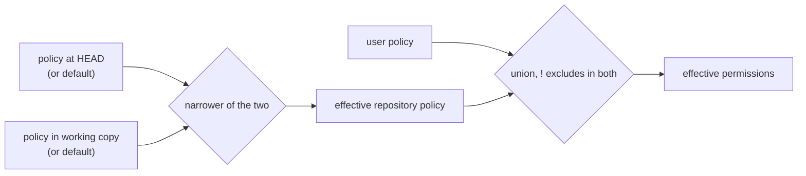
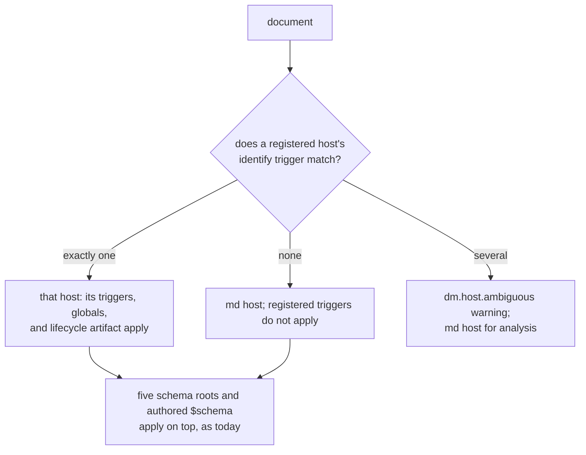

# Darkmatter configuration, permissions, and host registration

## Summary

Darkmatter has no configuration file of its own. Its user and repository
settings are spread across single-purpose files: `.darkmatter-shell-whitelist`,
`.darkmatter-shell-blacklist`, `~/.config/darkmatter/schema-read-policy`, and
DMLS's `.dmls.toml`. A program that builds on Darkmatter, such as Claudine,
has no supported way to tell the passive readers (`md`, DMLS) about its
schemas, globals, and lifecycle events.

This feature adds:

1. **A Darkmatter configuration file** at user scope (`~/.darkmatter.yaml`)
   and repository scope (`{repo-root}/.darkmatter.yaml`), described by a
   shipped SimplifiedSchema, so DMLS edits it with completion, hover, and
   diagnostics.
2. **One `permissions` block** holding three separate policies: which files a
   schema may read (`file-read`), which shell commands may run
   (`shell-commands`), and whether URLs may be fetched (`network`). It
   replaces the whitelist, blacklist, and grant-store files. The whole block
   can point at another program's configuration, so a Claudine user finds
   their permissions in Claudine's file.
3. **A commit rule for repository permissions.** A repository's
   configuration widens permissions only through committed content;
   restrictions apply immediately.
4. **Defaults that callers can rely on.** Every configuration property has a
   `default(...)` in the schema, and a `required` schema property with a
   `default(...)` satisfies its contract when absent. Validation reports which
   defaults it relied on, and composition fills them in.
5. **`md init`**, matching `claudine init`, and a warning when no user
   configuration exists.
6. **One owner for schema document kinds.** `simplified-schema` takes over
   `schema-trigger` (with trigger discovery, schema roots, and the
   `KindRegistry`) from Darkmatter, so it owns all three kinds: `schema`,
   `yaml-schema`, and `schema-trigger`.
7. **Host registration.** A program registers its schema triggers, global
   catalog, and lifecycle artifact with Darkmatter. The registered schemas
   apply only to documents that a registered trigger identifies as belonging
   to that program. That program becomes the document's lifecycle host for
   passive analysis; the executing program still owns runtime behavior.

The five schema roots stay unchanged: `SCHEMAS_DIR`, package, package area,
file-tree root (`base_dir()`, the repository root inside a repository), and
`~/schemas`. They are for repository authors' own schemas and
are never a registration route for a program.

## Problem

### Claudine documents outside `claudine/`

A Claudine document outside the `claudine/` package area, for example:

```yaml
---
sequence:
  - name: one
    prompt: hi
initialize:
  - say: "{{ seq.name }}"
start:
  - say: "{{ seq.name }}"
---
```

DMLS (reproduced 2026-11-12) reports `dm.expression.undeclared_property` on
`seq` in `initialize` and says nothing about `start`. Inside `claudine/`, the
same document is clean. The reasons:

- DMLS learns about Claudine only from files in the document's schema roots:
  the eight trigger and library files, `globals.yaml` (which declares `seq`,
  `loop`, and `group`), and `globals.lifecycle.json` (events, renames, verbs).
  Only a document in the `claudine/` package area reaches them.
- With no host found, DMLS treats the document as an `md` document.
  `initialize` is a Darkmatter event, so its expressions are checked, and
  `seq` really is undeclared under `md`. `start` is not an `md` event, so it
  is unchecked plain frontmatter.
- No diagnostic says the host was not found. `dm.lifecycle.incomplete_analysis`
  fires only when a host catalog is found but its artifact is unusable.

The documented workaround, copying Claudine's files into `~/schemas`, makes
that root a registration route and leaves copies that drift from the binary.

### Shell policy

Darkmatter and Claudine already share one rule store. Claudine calls
Darkmatter's `shell_expansion::store`, so both read `.darkmatter-shell-whitelist`
and `.darkmatter-shell-blacklist`, with the same line grammar (`exact
<command>`, `prefix <command>`, `template <shape>`, `#` comments). They differ
in which directory holds the files:

| Reader | Policy directory |
|---|---|
| `md` (`resolve_policy_paths`) | repository root, else home, else the document's directory |
| Claudine (`harness_orch/shell_options.rs`, `system_prompt/prepare.rs`) | repository root, else the document's directory (never home) |
| DMLS (`overlay/shell.rs`) | `shell.policy_path` from `.dmls.toml`, else none |

Outside a repository the two programs read different files, and there is
never both a user list and a repository list. A repository's whitelist file
also takes effect as soon as it is edited, so an agent can widen its own
shell permissions by writing to it.

### Schema read permissions

Schema slots (`{{ … }}` inside a schema) may read files and URLs. Today each
read is approved by one of: a line in `~/.config/darkmatter/schema-read-policy`
(`allow file …`, `allow dir …`, `deny …`, `allow url …`, `allow site …`); the
**automatic grant**, which lets a slot read any file in its own repository
whose content matches the committed version; or an interactive prompt. That
store sits apart from the shell policy only because the shell files were not
user-level when it was designed (the schema-read approval decision in
`2026-11-05-dynamic-schema-types`). The original intent was a user-level policy beside the shell rules. A real
configuration file makes that possible.

The automatic grant also applies the Git-status idea to the wrong file. The
intent was that the **policy file's** status matters: an uncommitted change
to a repository's policy must not grant anything until it is committed.

## Goals

- A Claudine document gets Claudine's schemas, globals, and lifecycle events
  in DMLS and `md` wherever it lives, once Claudine is registered, with no
  copied files and no `SCHEMAS_DIR`.
- A document that is not a Claudine document is unaffected by Claudine's
  registration.
- One `permissions` block per scope, shared by `md`, DMLS, and Claudine, and
  found by a Claudine user in Claudine's configuration.
- No repository change widens a permission until it is committed.
- Every configuration property's default lives in the schema, and every
  reader takes it from there.
- The configuration file is validated by a shipped SimplifiedSchema, and
  every problem is reported with its file and position.

## Non-goals

- Changing the five schema roots, trigger grammar, or shadowing rules.
- Protecting a user from a cloned repository whose committed permissions are
  hostile. The risk is documented, with this repository's CI check as an
  example mitigation (section 2.7).
- Fine-grained network permissions (per host or URL). `network` is `allow` or
  `deny` for now.
- Running a registered host's actions in `md`. Registration is passive (see
  "`md compose` of an identified document" in section 6).
- Improving Claudine's dry run. `md compose` on a Claudine document is
  useful today partly because `claudine --dry-run` falls short; that is
  Claudine's to fix separately.
- Folding `.dmls.toml` into `.darkmatter.yaml`. Only `shell.policy_path`
  moves.
- Reorganizing Claudine's configuration beyond the format change, the
  `permissions` property, and the writers in section 9. The rest of that
  cleanup (scope asymmetry, inconsistent readers, the configuration editor's
  coverage) stays with `2026-09-30-configuration`.

## Design

### 1. The configuration file

| Scope | Path |
|---|---|
| user | `~/.darkmatter.yaml` (home from `biscuit_file::home_dir()`) |
| repository | `{repo-root}/.darkmatter.yaml` |

The file is one YAML mapping; duplicate keys and multiple YAML documents
are errors. It is described by a shipped schema
(`darkmatter/schemas/darkmatter-config.yaml`). DMLS selects that schema for
both paths, so the file gets completion, hover (including each property's
default), and diagnostics. It is read once per request and captured in the
request's context, as with every other request input; no downstream resolver
reads it again. Loading is passive: configuration and registration files are
local data, never templates, shell input, or remote fetches. Configuration
validation does not use repository triggers or the permissions it is loading;
the shipped configuration schema is the authority. This avoids asking for a
permission before its policy can be read.

Syntax errors stop every consumer of that file. A well-formed file's errors
are attributed to the affected top-level setting: a broken registration
must not prevent permission evaluation, and invalid permissions must not
silently authorize an operation. DMLS reports all errors without executing
or repairing anything. A file that fails validation is an error for any command
that reads the failing property, never a silent fall back to the default.

```yaml
permissions:
    file-read: <pattern[]>
    shell-commands: <rule[]>
    network: allow | deny
register: <manifest-reference[]>
```

The schema is closed: an unknown key is an error, and a new setting goes into
the schema first. Every property carries a `default(...)` (section 3), and
Darkmatter, Claudine, and DMLS read defaults from the schema rather than
hard-coding them. `register` defaults to `[]`. `permissions` defaults to an
empty mapping whose omitted children receive their scope's defaults. The
file-read default is scope-dependent: the shipped schema exports separate
user and repository configuration types that share the same permissions
shape but declare the respective defaults. Explicit `null` is invalid for
these settings; it does not mean missing or reset to defaults.

### 2. Permissions

`permissions` holds three separate policies. They never share entries: a
file pattern never approves a command, and a command rule never approves a
read.

#### 2.1 `file-read`

Which files a schema slot may read (`load_data`, contract imports,
`validate_schema`, `file_exists`, `find_files`, …). Nothing is readable
unless an entry allows it.

Entries are glob references (the grammar `$path` and `match()` use):

- **Relative patterns are relative to the document doing the read**, as for
  transclusion. `./*.yaml` means "YAML files beside the reading document".
- **`&` is the repository root** (`&**/*.yaml`). `^` keeps its biscuit-file
  meaning (the nearest package, package area, then repository) and is
  allowed too.
- **A `!` entry carves out of the allows.** A path is readable without
  asking when some positive entry admits it and no `!` entry does. An
  excluded path is simply not permitted: it prompts, or fails with
  `dm.schema.slot_approval_required` where nothing can prompt, like any
  other read no entry covers. It is not a deny list:

  ```yaml
  permissions:
      file-read:
          - "&**/*.yaml"
          - "!&secrets/**"
  ```

- **Absolute paths are rejected**, because they are not portable. `~/` is
  allowed at user scope. `{{VAR}}/…` is allowed when `VAR` is a declared
  portable variable (`PORTABLE_ENV_VARIABLES`, as biscuit-file's
  `PortablePath` defines it); any other variable is an error.
- **Repository-scope entries must stay inside the repository.** At
  repository scope, `~/`, `..` that leaves the repository, and a `{{VAR}}`
  whose expansion lands outside it are errors. A symlink is judged by where
  it points.
- **`find_files` needs no folder permission.** It lists the folders its
  pattern names and returns only the files `file-read` admits. The grant
  store's separate `allow dir` permission for listings is retired.

**Defaults.** Both defaults allow the same text formats: `txt`, `text`, `md`,
`csv`, `tsv`, `json`, `json5`, `yaml`, `yml`, and `toml`, one entry per
extension:

| Scope | Default |
|---|---|
| user | `./*.<ext>`: files beside the reading document |
| repository | `&**/*.<ext>`: files anywhere in the repository |

#### 2.2 `shell-commands`

Which shell commands may run without a prompt. Entries use today's rule
grammar, one rule per entry: `exact <command>`, `prefix <command>`, and
`template <shape>`. A `!` entry carves out of the allows, as in `file-read`:
a command it matches is not pre-approved and goes through the normal prompt.

**The only blacklist is the built-in one.** It is compiled into Darkmatter,
and nothing configures, extends, or overrides it: no `shell-commands` entry,
approval, cached decision, or `--yolo`. A command it matches is always
refused. The user-editable `.darkmatter-shell-blacklist` was never meant to
exist and is retired (its rules migrate to `!` entries; see section 5).

```yaml
permissions:
    shell-commands:
        - prefix ls
        - exact ps -e
        - template git add {{ string }}
        - "!prefix git add secrets"
```

**Default:** none: every command prompts (or fails without a terminal).

#### 2.3 `network`

Whether a schema slot or a composition (`::file`, `::code`, read-side
functions) may fetch a URL. `allow` permits every URL, and `deny` permits
none. **Default:** `deny`, today's behavior. `--allow host=HOST` still allows
one host for one run under `deny`, and changes nothing under `allow`.
In Claudine, `network` governs the reads Darkmatter makes while composing; it
says nothing about the agent's own network access.

#### 2.4 Override semantics

A list a user writes **replaces** that scope's default; it is never merged
with it. A repository that writes `file-read: ["&docs/**/*.md"]` can read only
Markdown under `docs/`. Its default `&**/*.<ext>` entries are gone. An
explicit empty list (`file-read: []`) pre-approves nothing at that scope. A
property that is absent keeps its default.

#### 2.5 Combining scopes

Inside a repository, the effective permission is the union of the two
scopes, each after its own override: a read or command allowed by the user
scope or by the repository scope is allowed unless either scope excludes it.
A `!` entry in either scope removes pre-approval at both scopes; a current-run
approval can still permit the operation. The built-in shell blacklist always
wins. Thus a repository's `file-read: []` does not revoke the user's allows;
a repository wanting to prompt for a path must also exclude that path.

`network` takes the more restrictive value: `deny` in either scope is `deny`.
Outside a repository only the user scope applies. An absent scope file still
contributes its defaults. Consequently, setting only the repository's
`network: allow` leaves network access denied while the user setting is
`deny`; both must be `allow` for blanket network access in a repository.
The explicit per-run `--allow host=HOST` exception still applies.

`network: allow` changes consent, not transport safeguards. Every fetch,
redirect, and cache hit still passes through biscuit-file's `FetchPolicy`;
redirect destinations are checked too, and no non-HTTP(S) transport is added.
A schema-slot URL read uses this same effective network decision rather than
requiring a second, retired grant-store approval.

#### 2.6 The commit rule

A repository's permissions widen only through committed content. Each
repository-scope policy is computed twice: once from the file at `HEAD` (or
the default, when `HEAD` has no file), and once from the working copy (or the
default, when there is no working-copy file). The effective repository policy
takes the narrower of the two:

- a read or a command is allowed only when **both** versions allow it
  (judged per path or per command, so the two versions need not share
  entries);
- a `!` entry in **either** version excludes;
- `network` is `allow` only when both versions say `allow`.

So an uncommitted edit that adds an entry or removes a `!` has no effect
until it is committed, and an uncommitted edit that removes an entry or adds
a `!` applies at once. The user-scope file is the user's own and is not
subject to this rule. The commit rule reads the committed file from the
request's captured repository observation, never from a fresh capture.

The committed and working-copy policies are resolved independently,
including the reference in each version. A committed reference is followed
using that same commit's target bytes, not the current working-copy target.
Changing an inline block to a reference, redirecting a reference, deleting a
file, or changing its target is therefore subject to the same intersection.
Repository references must resolve to a file within that repository, with no
home, remote, or out-of-tree symlink target. An invalid or missing explicitly
referenced target is an error, not the absent-file default. A repository with
no commit uses the missing-file default for its committed side. Failure to
read repository state is an error, never permission to use the working copy
alone. Read Git objects in process through the existing repository facilities.

**Reader's note:** this rule limits the repository's contribution. User-level
allows still apply through the union, and an agent able to edit user settings
or create a commit is outside this protection. The feature is not an agent
sandbox.



The automatic grant is retired. Its job (in-repository reads with no prompt)
is done by the repository default, under the commit rule.

#### 2.7 The cloned-repository risk

The commit rule guards against unreviewed local changes, including an agent
widening its own permissions. It does not protect against a cloned
repository whose **committed** configuration is hostile. Its `file-read`
cannot leave the repository, but its `shell-commands` can approve any command.

The docs state this risk plainly and show one mitigation, the one this
repository adopts: a CI check that compares every `permissions` block in the
change (`.darkmatter.yaml`, and Claudine's configuration) with the base
branch. It reports any widening (a new allow entry or rule, a removed `!`, or
`network: deny` → `allow`) and requires a manual approval from someone
allowed to merge before the change can merge. The comparison includes both
versions of references and their targets,
removed properties or files that restore defaults, and changed scope defaults;
it does not compare entry counts. General glob and command-template
containment need not be solved: an edit not provably equivalent or narrowing
is reported as potentially widening. Moving an unchanged inline policy to a
reference should compare the resolved blocks, avoiding a false widening.
The check runs only when those policy inputs or the checker change, with no
new OS test matrix. It must use trusted checker code, and it must not add
policy to `ci-gate`, whose existing job is only to combine blocking job
results.

**Approval is a GitHub deployment environment**, `permission-widening`:

- The job runs the trusted checker first. A change that narrows or leaves
  permissions unchanged passes without waiting. A change that may widen them
  targets the environment, and the job pauses until a reviewer approves the
  run.
- **Eligible reviewers** are the environment's required reviewers, kept equal
  to the people allowed to merge (today the repository owner). GitHub's
  "prevent self-review" setting stays off: this repository has one
  collaborator, every commit is authored as that person, and what the gate
  needs is a deliberate human approval, not a second person.
- **An approval covers one workflow run**, and so one commit. A new commit
  that still may widen starts a new run that needs a new approval. Removing a
  reviewer affects only runs still waiting.
- The job is one more blocking job whose result `ci-gate` folds in. A run
  awaiting approval is pending, so `ci-gate` waits rather than fails.

A pull-request review cannot serve here: GitHub never lets a pull request's
author approve it, and the only eligible reviewer authors every pull request.
That rules out a review-based check and a required code-owner review.

The docs state the limit plainly: anyone holding the approver's GitHub
credentials, including an agent using `gh` with that token, can approve the
run. The gate makes a widening visible and deliberate; it does not make it
impossible for someone with those credentials.

#### 2.8 Pointing at another program's configuration

The whole block can be a file reference (`biscuit_file::FileReference`,
resolved against the configuration file's directory) to another YAML file
whose own `permissions` property holds the block:

```yaml
# ~/.darkmatter.yaml on a host with Claudine
permissions: ~/.claudine/config.yaml
```

```yaml
# ~/.claudine/config.yaml
permissions:
    file-read:
        - "./*.yaml"
    shell-commands:
        - prefix ls
        - exact ps -e
    network: deny
```

Many users, perhaps most, know Claudine and never deal with Darkmatter
directly. A Claudine user looking for their permissions should find them in
Claudine's configuration, not in a file named after a library they may never
have heard of. So when Claudine is set up, it owns the block and Darkmatter's
configuration points at it. The grammar, matching, and persistence code stay
Darkmatter's; only the storage location moves.

Because one program then writes into another's file, the reference form must
meet all of these:

1. **One type.** The `permissions` type is defined once, in Darkmatter's
   configuration schema. The host's configuration schema imports it (for
   example `permissions@darkmatter:darkmatter-config`) and never declares it
   again. A
   malformed entry fails with the same message and code whether `md`, DMLS,
   or the host reads it.
2. **Only the owned key changes.** When Darkmatter saves an approval (the
   prompt's "always allow" choices), it edits only the affected list inside
   `permissions`. Every other key, comment, blank line, key order, and
   quoting style stays unchanged. The edit reuses Darkmatter's in-place YAML
   leaf editing where it supports the operation; its existing
   [frontmatter path editor](../../lib/src/markdown/hash/path_edit.rs) in the
   Darkmatter package edits Markdown envelopes, so plain YAML files and
   insertion of missing mapping/list nodes need explicit support, not a
   fabricated Markdown wrapper. A test round-trips a commented host
   configuration through
   read → approve → read and compares every byte outside the list.
3. **Atomic, re-read writes.** Every write reads the file just before
   editing, writes a temporary file in the same directory, and atomically
   replaces the original using a cross-platform replacement operation. All
   Darkmatter and host writers share a per-target interprocess lock held
   across re-read, edit, validation, and replacement; lock identity uses the
   resolved target so two references cannot acquire independent locks for
   the same file. Cooperating writers therefore preserve each other's edits.
   Re-check the input before replacement and refuse or retry if an external
   edit is observed. A plain check followed by rename cannot guarantee that
   an uncooperative editor never races the write; do not claim otherwise.
   A failed replacement leaves the original intact and removes the temporary
   file. Never delete the destination first to make a Windows rename succeed.
4. **The result must still validate.** Darkmatter validates the edited text
   against the `permissions` type before the rename. An edit that would leave
   it invalid is refused, the original file is untouched, and the approval is
   reported as not saved. It still applies to the current run.
5. **The host's own writers keep the block.** Every host writer (Claudine's
   `claudine init` and configuration editor) re-reads the file before saving
   and keeps keys and comments it does not manage. Claudine's configuration
   editor (`cli/src/commands/config_tui/`) holds the whole file as a
   `ClaudineConfig` struct and saves it back, so it has to change.
6. **A missing or invalid target is an error, never an empty policy.** When
   the referenced file is missing, unreadable, invalid YAML, or has no
   `permissions` mapping, every reader reports an error naming both files and
   the repair (`md init --inline` writes the block back inline). No reader
   falls back to defaults or to an empty policy, either of which could widen
   or silently revoke permissions. A command that needs the block stops.
7. **No chains.** The target's `permissions` must be a mapping. A second
   reference is an error naming both files.

At repository scope the same applies with `{repo-root}/.darkmatter.yaml` and
`{repo-root}/.claudine/config.yaml`, and the commit rule applies to the
target file, as well as the referring file, using section 2.6.

Persisted approvals go to user scope by default, following its reference if
present. They never silently edit a repository's committed policy. Materialize
that scope's existing defaults before adding the first entry to an omitted
list, because an explicit list replaces defaults. Save schema-file approvals
using a portable exact-file reference (escape glob metacharacters), not a
broader directory pattern. If an exclusion still matches, explain that the
approval was not made persistent; do not silently remove the exclusion.
Current-run approvals are explicit exceptions to the captured policy and do
not trigger a reload of configuration halfway through composition.

#### 2.9 Setup handshake

| Situation | Result |
|---|---|
| only Darkmatter | `md init` writes `~/.darkmatter.yaml` with `permissions` inline |
| Darkmatter set up after Claudine | `claudine init` already wrote `~/.darkmatter.yaml` with the reference; `md init` leaves it |
| Claudine set up after Darkmatter | `claudine init` moves the inline block into `~/.claudine/config.yaml`, then rewrites `~/.darkmatter.yaml` to reference it |
| neither file exists | whichever `init` runs first creates `~/.darkmatter.yaml` |

`claudine init` writes its own file first and Darkmatter's second. A failure
between the two leaves the original inline block in force. `md init` and
`claudine init` write the defaults explicitly, so the user sees them; with
override semantics (2.4) that is the same policy as leaving them absent.
Setup is idempotent: preserve existing authored values, comments, and register
entries, and add Claudine's entry once by resolved manifest identity. If both
an inline Darkmatter block and a Claudine block exist and differ, stop the
transfer with a diagnostic naming both files; do not choose or union them.
The user can retain the inline block until they reconcile them. Take the
same writer locks during transfer in a consistent path order.

`md init --repo` also creates a repository file only when a repository was
captured; otherwise it fails without writing. `md init --inline` is an
explicit repair: replace a reference with its resolved block, or with clearly
reported defaults if its target cannot be read. It preserves other keys and
states that defaults may change permissions. Repeated ordinary `md init`
never resets an existing policy or performs this repair implicitly.

### 3. Defaults

#### 3.1 Configuration defaults

Every configuration property declares its default with `default(...)` in the
shipped schema. `md`, DMLS, and Claudine read the default from the schema;
none hard-codes it. DMLS shows it on hover.

#### 3.2 A `required` property with a default

A `required` property whose definition has `default(...)` satisfies its
contract when absent: validation passes and reports the default it relied on.
This is a SimplifiedSchema rule, so every consumer gets it.

The SimplifiedSchema package's
[`ValidationSuccess`](../../../simplified-schema/lib/src/outcome.rs), which
returns a validated value and advisories, gains the list of defaults it
relied on. Update its constructors and all direct consumers, including
Darkmatter, DMLS, Claudine, and other workspace callers; do not add a separate
Darkmatter-only defaulting implementation:

```rust
pub struct ValidationSuccess<'input> {
    pub value: Cow<'input, Value>,
    pub advisories: Vec<SchemaAdvisory>,
    /// Required properties that were absent and passed through their
    /// `default(...)`, in validator order. Empty for an unconditional pass.
    pub defaults: Vec<AppliedDefault>,
}

pub struct AppliedDefault {
    pub path: PropertyPath,
    pub value: Value,
}
```

An empty `defaults` is an unconditional pass, and a non-empty one is a pass
that depends on defaults (`{ foo: 4, bar: "my-default" }`).

- **Soft validation** returns `value` owned, with the defaults inserted, the
  same way it returns a converted value today. When no conversion or default
  insertion is needed, preserve today's borrowed result. Existing
  `is_converted()` callers must be audited: an owned result may now mean
  default insertion without a type conversion.
- **Strict validation** never changes the value. It returns the input
  borrowed and lists the defaults, so the caller decides whether to apply
  them.
- **Nested properties.** A required property with a default inside an object
  passes when absent only if the object exists; a missing parent is the
  parent's own question.
- **Optional properties** with a default are unchanged: still optional,
  never filled, and the default stays metadata.
- A default written as a schema slot (`default({{ n }})`) passes only once
  the slot resolves; while it is pending, validation reports the slot as
  pending, as today.

A default is not a waiver of validation. Before accepting an absent required
property, validate its resolved default strictly against the complete
property contract, including constraints and nested required children. A
wrong-typed or constraint-breaking default is a schema error with its schema
location. Default processing is passive and never resolves a slot, reads an
example, or performs an eager file operation. Explicit `null` is present and
is judged by the declared type; it never triggers a missing-value default.
The existing rule that a nullable property is optional remains unchanged.

For unions, judge complete candidate values, not a mixture of defaults from
several branches. Accept only an unambiguous candidate (identical candidates
count as one); conflicting successful candidates produce a located
ambiguity diagnostic instead of choosing whichever branch runs first.
Apply parent defaults before nested defaults, and return a stable property
path order for reproducible diagnostics. Required-with-default remains an
intentional SimplifiedSchema validation rule; exported JSON Schema's
`default` is only an annotation, so external JSON Schema validators do not
automatically share this behavior. Document that limit rather than claiming
that every third-party validator fills or accepts the defaults.

#### 3.3 Composition fills defaults

Darkmatter's composition applies the defaults validation reports, before
anything reads the frontmatter after validation (frontmatter shell
expansion, pass-2 interpolation, the body). Consequences:

- **Narrowing.** A required property with a default is never missing, so an
  expression that uses it is not warned about as possibly null. DMLS treats
  it as present.
- **Claudine's `prompt_for_missing`** prompts only for required properties
  without a default. A default answers before any prompt does.
- The docs that say defaults "are not applied as runtime values"
  (`darkmatter/docs/topics/schemas/authoring-schemas.md`) are corrected, and
  `simplified-schema/docs/topics/global-type-constraints.md` (whose
  `required`, `eager`, `default(value)`, and `suggest` sections are empty
  today) is written.

Default insertion changes only the composed value, never the authored
file. Revalidate the complete candidate before downstream stages; attribute
an inserted value's error to its schema default rather than inventing an
authored position. Keep the existing passive validation APIs read-only.

### 4. `md init` and a missing configuration

`md init` creates `~/.darkmatter.yaml` (and, with `--repo`, the repository
file) with every property written at its default. It follows `claudine init`'s
behavior where the two overlap, and the setup handshake (2.9) where Claudine
is present.

When there is no user configuration file, every command still runs on the
schema's defaults and reports one warning,
`dm.config.missing`, naming the path and the command that creates it
(`md init`, or `claudine init` from Claudine):

- formatted output: on stderr;
- data output (`--output json`, …): in the result's `diagnostics`, with stderr
  empty, as for every `md` data output;
- DMLS: one editor notification per session.

A repository without `.darkmatter.yaml` is normal and is not warned about.

### 5. Migrating the legacy files (temporary)

A temporary migration runs at the first configuration load by a writing CLI
(`md` or Claudine), using the captured request context, before its effective
configuration is finalized. It does not recapture the environment or
repository. Passive library
validation and DMLS never migrate or delete files; they report that `md init`
can perform the migration. Until the next
few releases have shipped, it converts any legacy policy file it finds for a
scope whose configuration lacks the matching property, then deletes the old
file:

| Legacy file | Becomes |
|---|---|
| `.darkmatter-shell-whitelist` (repository root, or home for user scope) | `permissions.shell-commands` entries |
| `.darkmatter-shell-blacklist` | `!` entries in `permissions.shell-commands`. A migrated rule now prompts instead of refusing; the notice says so |
| `~/.config/darkmatter/schema-read-policy` | `allow file`/`allow dir` lines under home → `file-read` entries with `~/`; `deny` lines → `!` entries |

A line the new format cannot express (an absolute path outside home, an
`allow url` or `allow site` line) is dropped with a notice naming it. `network`
stays at its default, `deny`. Files Claudine created in a document's own
directory (its old fallback) are not migrated. There is no ongoing
formalism. The migration and its notice are removed after a few releases,
and anything it missed is re-created by hand.

Conversion uses the same locked, comment-preserving writer as saved
approvals. First save and re-read the new policy successfully, then delete
only legacy files whose source bytes still match the migrated snapshot.
A crash or partial write leaves the legacy source available; repeating the
migration neither duplicates rules nor overwrites an explicitly configured
property. Mixed allow and blacklist files are converted as one shell-policy
unit so the first write cannot suppress migration of the second file.
Publish notices, including every dropped line and changed denial, through
the normal diagnostics channel; data output still keeps stderr empty.
DMLS removes `shell.policy_path` from its active settings contract and gives
a diagnostic with the replacement location if it remains in `.dmls.toml`.
The temporary migration's removal must be explicit in release notes; this
spec does not add a permanent second policy loader.

### 6. Host registration

#### What a registration names

A registration points at a **host manifest**: one file the host program
installs that names everything a passive reader needs:

```yaml
# ~/.darkmatter.yaml
register:
  - ~/.claudine/darkmatter-host.yaml
```

```yaml
# ~/.claudine/darkmatter-host.yaml (written by Claudine)
kind: darkmatter-host
format_version: 1
host: claudine
version: 0.42.0
identify: ./schemas/claudine-document.yaml   # schema-trigger: "this is a Claudine document"
triggers:                                    # applied only to identified documents
  - ./schemas/claudine.yaml
  - ./schemas/inline-compose.yaml
  - ./schemas/sequence.yaml
globals: ./schemas/globals.yaml              # host global catalog (seq, loop, group)
lifecycle: ./schemas/globals.lifecycle.json  # events, renames, verbs
functions: []                                # function catalog + matching facts pairs
# functions:
#   - catalog: ./schemas/functions.yaml
#     facts: ./schemas/functions.facts.json
```

Relative paths resolve against the manifest. Library files the triggers
import (`action.yaml`, `lifecycle.yaml`, …) sit beside them and resolve
through their ordinary relative imports. `functions` pairs each signature
catalog with its facts artifact, preserving the existing host-function
catalog/hash checks; a facts path alone cannot declare function signatures.
No handler is installed and no executable path is accepted.

Ship and validate the closed `darkmatter-host` envelope before reading its
members. `format_version` selects the manifest format; `version` is the host
release, not the format. All manifest and import references are local
`FileReference` values bound to the captured context. Refuse remote members
without fetching them. Paths are anchored at the manifest or importing
file, while `$path` predicates are judged in the analyzed document's
context. Each read is retained once for that request. A bad registration
never becomes a partially installed lifecycle host.

#### Identification decides the host

A host's schemas apply only after its **identifying trigger** matches. That
trigger is an ordinary `schema-trigger` envelope, so it has no new grammar.
Its `$schema` payload may be empty.



The identifying trigger must match only on keys the `md` host does not own.
A document with only `initialize:` belongs to `md` and to Claudine alike, so
`initialize` cannot identify Claudine. Claudine's identifying keys are
`sequence`, `start`, `blocked`, `success`, `failure`, `loop`, `prompt`,
`agent`, and `model`. When a registration loads, Darkmatter admits an
identifying trigger only when every successful alternative requires at least one non-null,
host-specific top-level key. Empty, optional-only, shared-event-only, and
path-only alternatives are refused (`dm.host.identify_too_broad`). Use the
existing trigger parser and presence rules; if this property cannot be
proved for a predicate, refuse it with a repair hint rather than attempting
general schema satisfiability. A non-null key with the wrong type still
identifies the host, so its schema can report the type error.

Claudine's root trigger must also stop selecting solely on `cancelled` or
`finalize`, which Darkmatter owns, as well as on `initialize`. Merely
removing `initialize` leaves the same bug under the other shared events.
Retain those events in the selected payload; only the identification match
narrows.

This replaces DMLS's "first host catalog in the schema roots" host selection.
A host catalog found in a schema root (the `claudine/` package area today)
still works as a compatibility fallback only if no registration identifies
the document and no registered identities are ambiguous. One matching
registered host takes precedence over every legacy root catalog. An
ambiguous registration never falls through to an arbitrary root host.
Duplicate entries resolving to the same manifest are loaded once; distinct
manifests claiming the same `host` identifier must agree in content or are
reported as conflicting registrations, not resolved by discovery order.

#### Layering

For an identified document, the schema layers are, from lowest to highest:

1. Darkmatter baseline
2. the host's matching triggers (the order listed in its manifest)
3. triggers from the five schema roots
4. the document's `$schema`

A repository author's root trigger can therefore refine or override a
registered host. A root trigger file with the same name as a host trigger
does **not** shadow it. Shadowing stays within the root chain, because
registration is a separate source. Report each applied layer's origin in
schema inspection output, and avoid applying an identical trigger twice when
its registered copy is also visible in a root. This uses resolved identity
and content, not a basename match. Preserve the existing relative-import
anchor for every layer.

The selected profile is for analysis and typing, not runtime authority.
Claudine's in-process host remains authoritative when Claudine runs a
request; repository registration cannot replace its executable behavior.

#### Keeping the manifest current

The host program writes the manifest and its files; they are never copied by
hand. The example above shows a single revision's layout; published paths
include the immutable revision directory described below. Claudine writes
them from its embedded copies (the same texts behind
`lib/generated/shipped.json`) during `claudine init`, and on each launch it
compares the manifest's `version` and content hash with its own and rewrites
them when they differ. An upgraded binary therefore refreshes its
registration on its next run, and the lifecycle artifact's existing
`catalog_hash` check still catches a partial write. The launch-time refresh
rewrites only Claudine's own manifest, never `~/.darkmatter.yaml`.

Publish each host revision into an immutable version/content-named directory,
then atomically replace the stable manifest pointing at it last. This avoids
readers mixing a new trigger with an old catalog: the lifecycle catalog hash
alone cannot detect that mismatch. Use biscuit-hash for content identity.
Retain the previous directory for readers already holding the old manifest;
cleanup is outside the request path and must not remove a live revision.
If refresh fails, report it and leave the last complete published revision
available. Never fall back to a partially written revision.

#### `md compose` of an identified document

With Claudine registered, `md compose` validates a Claudine document against
Claudine's schemas and composes its Markdown body. Analyze frontmatter
with the identified host's profile, including its renamed events and globals,
so its schema's rejection of `composed` does not conflict with the `md`
runtime. Execute only shared, unrenamed events (`initialize`, `cancelled`,
`finalize`) under `md`'s own parse options and bindings, ignoring unprovided
verbs as today. Do not execute host-only events (`start`, `blocked`,
`success`, `failure`), tasks, agents, or host function handlers. A shared
stack whose executable expression needs an unavailable host value fails
normally; analysis does not manufacture a runtime `seq` or `group`.

**Reader's note:** registration supplies type information, never executable
behavior. This explicit separation preserves the author's decision that
`md compose` remains useful on Claudine documents without impersonating a
Claudine run. It reports one notice,
`dm.host.foreign_document`, naming the host and suggesting its own command
(`claudine compose`). The notice follows the same output rules as every
`md` diagnostic: on stderr for formatted output, in `diagnostics` for a data
output.

#### Diagnostics

| Code | Severity | When |
|---|---|---|
| `dm.host.registration` | warning | a `register` entry fails to load (missing manifest, bad file, refused lifecycle artifact). Analysis continues without that host |
| `dm.host.identify_too_broad` | warning | an identifying trigger can match on Darkmatter-owned keys alone |
| `dm.host.ambiguous` | warning | two hosts identify the same document |
| `dm.host.foreign_document` | notice | `md compose` composes a document a registered host identifies |
| `dm.lifecycle.unknown_host` | warning | no host was identified, but a key is a known host-only event from an installed catalog or a registration whose identity match failed. Name the candidate host and repair. Arbitrary application keys are not guessed to be events |

#### Scopes

`register` lists from user and repository scope are concatenated, user
first. A repository may register a host (a team's in-house tool). Because
registration is passive (types, events, and verb shapes only), a repository
registration grants nothing that a repository's `schemas/` folder cannot
already do. Registration cannot approve reads, commands, network access,
or lifecycle effects. Unrelated documents do not receive its globals or
function declarations.

DMLS watches both configuration files, resolved permission targets, manifests,
and every loaded schema/catalog/artifact dependency. Watch parent directories
for missing files and atomic replacements too. Invalidate affected document
analysis on changes, additions, or deletion; an invalid new revision produces
diagnostics, never silent use of stale host facts. Reuse unchanged parsed
profiles, with file observations scoped to each analysis request. Startup,
file watching, completion, and hover never write configuration or refresh a
host install.

### 7. Simplified Schema owns every schema document kind

Today the three schema document kinds have two owners:

| Kind | Owner today |
|---|---|
| `schema` | `simplified-schema` (`simplified-schema/schemas/`, envelope admission) |
| `yaml-schema` | `simplified-schema` |
| `schema-trigger` | Darkmatter (`darkmatter/schemas/schema-trigger.yaml`, `markdown/schemas/triggers/`) |

Darkmatter also owns the pieces a trigger needs: the five schema roots
(`schemas/roots.rs`), embedded bundles (`schemas/embedded.rs`), and the
`KindRegistry` that selects a schema for a whole YAML document. None of this
is about Markdown. The trigger modules import only Darkmatter's own schema
modules. Their other inputs (`FileResolutionContext`, `GlobReference`,
package and package-area detection) come from `biscuit-file` and `sniff`,
which `simplified-schema` already depends on (`sniff` optionally).

All three kinds move to `simplified-schema`, along with what a trigger needs
to be discovered and matched:

- the `schema-trigger` envelope definition and its grammar, matcher, lint,
  findings, discovery, assembly, and prepared payloads;
- `SchemaRoots` and the root search order;
- `EmbeddedSchemaBundle` and embedded-bundle resolution;
- the `KindRegistry` and kind selection for whole YAML documents;
- the identifying trigger and host-ambiguity rules from section 6, which are
  trigger semantics.

Darkmatter keeps what is about Markdown documents and composition:
`DarkmatterSchemas`, the baseline, `EffectiveSchema` and its layering into a
document's validation, the shipped Darkmatter catalog, the configuration
file, and everything lifecycle-related (host catalogs, lifecycle artifacts,
`EventRegistry`). Host identification accepts a caller-supplied set of
Darkmatter-owned keys; `simplified-schema` must not embed the `md` catalog or depend on Darkmatter.
The root enumeration and embedded bundle APIs take supplied context and
sources; optional filesystem discovery remains behind the library's `file`
feature, preserving its text-only build. The host manifest loader is split
the same way. Its trigger fields load through `simplified-schema`, and its
`globals`, `lifecycle`, and `functions` fields load in Darkmatter.

This move comes first (Phase 1), so registration is built once, in its final
home. The ownership move preserves existing behavior; the new identification
rules are added in the registration phase. Diagnostic codes
(`dm.schema.invalid_trigger` and the rest), `md schema triggers` output, and the shipped artifacts'
contents stay the same. The ownership guards (`schema_ownership`,
dependency-direction, and context-construction guards) and the
`simplified-schema` and `darkmatter` skills are updated to the new boundary.
The artifact chain (`just shipped-schemas`) is regenerated, and
`PREPARATION_REVISION` is bumped where code that prepares an artifact moved.

### 8. Consumers

| Consumer | Reads |
|---|---|
| `md` (every command that composes, validates, or cleans) | `permissions`; registrations for validation and lifecycle analysis |
| DMLS | `permissions` (replacing `shell.policy_path`); registrations for diagnostics, completion, and hover; the configuration schema for both `.darkmatter.yaml` files; watches both files and the registered manifests |
| Claudine | `permissions` through Darkmatter's API (its own policy-root rules removed); writes its manifest and, in `claudine init`, the configuration entries |

Claudine's runtime does not read its own registration: it keeps registering
in-process (`claudine_registry()`, the embedded bundle). The registration
exists for passive readers.

### 9. Claudine's configuration

The `permissions` reference (2.8) and the setup handshake (2.9) need
Claudine's configuration in YAML, typed by a SimplifiedSchema, with writers
that keep what they do not manage. This feature delivers that change; it
changes the file's format, not its organization.

#### Format and location

| Scope | Today | After |
|---|---|---|
| user | `~/.claudine/config.json` (JSON5) | `~/.claudine/config.yaml` |
| repository | `{repo-root}/.claudine/config.json` | `{repo-root}/.claudine/config.yaml` |

Every existing property keeps its name, type, scope, and meaning, as the
`2026-09-30-configuration` inventory records them. The one addition is
`permissions` (below).

#### Schema

A shipped schema (`claudine/schemas/claudine-config.yaml`) describes both
files. It is closed, gives every property its `default(...)` (3.1), and is
what DMLS selects for both paths, so a Claudine user gets completion, hover,
and diagnostics in their configuration. Claudine's loader validates against
it and reports each problem with file and position; its Rust deserialization
stays as the typed read behind that check.

`permissions` is typed by importing Darkmatter's type
(`permissions@darkmatter:config`, 2.8 requirement 1). It is never declared
again in Claudine's schema. Its scope rules (2.4–2.6) are Darkmatter's, so a
repository's `.claudine/config.yaml` widens permissions only through
committed content, exactly as `.darkmatter.yaml` does.

#### Converting `config.json` (temporary)

A temporary conversion, removed after a few releases like the one in
section 5, runs when Claudine loads its configuration:

| Files present | Result |
|---|---|
| `config.json` only | written to `config.yaml` (same values), then `config.json` renamed to `config.json.bak`; one notice names both files and says JSON5 comments were not carried over |
| `config.yaml` only | used |
| both | `config.yaml` is used; a warning says `config.json` is ignored |
| a pre-2026 per-provider `config.json` | renamed to `.bak` and ignored, as today |

A conversion that fails (unreadable, invalid JSON5, a value the schema
rejects) leaves `config.json` untouched and stops with an error naming it.

#### Writers

`claudine init` and the configuration editor (`cli/src/commands/config_tui/`)
write through Darkmatter's in-place YAML leaf editing, the same path 2.8
requires of Darkmatter's own writes. They re-read the file before each save,
change only the keys they manage, and keep every other key, comment, blank
line, and key order. The configuration editor today holds the whole file as a
`ClaudineConfig` struct and saves it back; that changes to per-key edits.

#### Readers

Every reader moves to `config.yaml`: the loader (`lib/src/dispatch/loader.rs`),
the runaway guard's direct reads, `claudine init`, the configuration editor,
and shell completion (which today lists a `config.json5` no reader opens).
Claudine's docs that name `config.json` are updated.

## Decisions

Decided with the author on 2026-11-13:

- **Where the permissions live.** When Claudine is set up, Claudine's
  configuration holds the `permissions` block and Darkmatter's references it
  (2.8).
- **File location.** `~/.darkmatter.yaml` and `{repo-root}/.darkmatter.yaml`.
  The separate grant store is retired into `permissions.file-read` (2.1, 5).
- **The commit rule** governs the repository policy file, not the files it
  permits. It narrows immediately and widens only on commit (2.6). Requiring
  a push is out of scope for now.
- **Setup** happens in `md init` and `claudine init` (2.9, 4).
- **Overrides replace defaults** (2.4). Scopes combine by union (2.5).
- **`network`** is `allow`/`deny`, default `deny`, with `--allow host=HOST` as a
  per-run override (2.3).
- **Defaults** come from the schema, and a required property with a default
  passes when absent (3).
- **Migration** is a temporary, self-deleting conversion (5).
- **`.dmls.toml`** is not folded in.
- **`md compose` of an identified document** composes it, runs nothing of the
  host's, and reports `dm.host.foreign_document` (section 6).
- **`permissions` is a mapping** of three keys, not a list of single-key
  entries, so each policy has one address (`permissions.file-read`) and a key
  cannot repeat.
- **The only blacklist is the built-in one** (2.2). `!` entries carve out of
  a scope's allows and prompt like any uncovered read or command; they never
  refuse on their own. With no user-configurable deny left, the prompts'
  "always deny" choices (the schema-read prompt's "Always deny this file")
  are removed; "deny for this run" stays.
- **One spec for both programs** (decided 2026-11-14). Claudine's move to a
  YAML configuration, its `permissions` property, and its writers are part of
  this feature (section 9), not a prerequisite. `2026-09-30-configuration`
  keeps the rest of Claudine's configuration cleanup.
- **Permission widening is approved through a deployment environment**
  (decided 2026-11-14): `permission-widening`, reviewers equal to those who
  may merge, self-review allowed, one approval per run (2.7).

## Open Questions

None at this revision.

## Phases

1. **Schema-kind ownership.** Move `schema-trigger`, schema roots, embedded
   bundles, and the `KindRegistry` into `simplified-schema` (section 7), with
   no behavior change. Update guards, skills, and docs, and regenerate the
   shipped artifacts.
2. **Configuration files and defaults.** Darkmatter's configuration schema
   with its defaults; the loader and request-context capture; validation
   diagnostics; DMLS schema selection for both files; `md init`;
   `dm.config.missing`. Claudine's configuration in YAML (section 9): its
   schema, the temporary `config.json` conversion, writers that edit per key,
   and every reader moved to `config.yaml`.
   SimplifiedSchema's required-with-default rule and `ValidationSuccess::defaults`
   (3.2); composition filling defaults and DMLS narrowing (3.3).
3. **Permissions.** `file-read`,
   `shell-commands`, and `network` with override and union rules; the commit
   rule; the reference form with every requirement in 2.8 tested; the setup
   handshake; retiring the automatic grant, `allow dir`, the grant store,
   the user-editable shell blacklist, and the prompts' "always deny" choices;
   switching Claudine and DMLS to the same resolution; the temporary
   migration (5).
4. **Host registration (library and `md`).** Manifest loader, identifying
   trigger and its breadth check, host selection and layering, and the
   diagnostics.
5. **DMLS.** Registration-driven host selection, file watching, and
   `dm.lifecycle.unknown_host`.
6. **Claudine.** Manifest writer and launch-time refresh, `claudine init`
   registration, and the identifying trigger
   (`claudine/schemas/claudine-document.yaml`). Narrow `claudine.yaml`'s
   `match` so shared `initialize`, `cancelled`, or `finalize` keys alone
   cannot select it.
7. **CI permission-widening check** for this repository (2.7): the trusted
   checker, and the `permission-widening` environment job that pauses a run
   which may widen permissions until a reviewer approves it. Creating the
   environment and its reviewer list is a repository-settings change the
   author makes or approves.
8. **Docs.** A `darkmatter/docs/topics/configuration.md` page, including the
   cloned-repository risk and this repository's mitigation; a permissions
   page replacing the grant-store and whitelist sections of `schema-slots.md`
   and `pre-flight-checks.md`; corrections to `authoring-schemas.md` and
   `global-type-constraints.md` (3.3); updates to `host-artifact.md`,
   `dmls-schema-support.md`, and Claudine's `schemas.md` (removing the
   copy-to-`~/schemas` instructions).

## Verification and completion criteria

Implementation is ready for review when the following behaviors are covered
through the existing package test recipes and the normal CLI/editor paths.
Use the repository's Test Toolkit and nextest; passive cases are unit tests,
not real-terminal tests. Real-terminal tests must not take window focus.

- **Configuration and permissions:** user/repository absence, explicit empty
  lists, scope-specific defaults, exclusions, malformed/duplicate keys, no
  commit, and errors reading Git state. Compare committed and working-copy
  policies for additions, deletions, reference redirection, and inline/reference
  conversion. Cover symlink escape and portable path identity on macOS,
  Linux, native Windows, and WSL2 using the shared file-reference APIs.
- **Permission enforcement:** schema reads and listings, URL reads and
  redirects (including cached bodies), and shell chains/templates take the
  same decision in `md`, Claudine, and DMLS. The built-in blacklist wins over
  every approval path. Passive analysis never prompts or executes anything.
- **Persistence:** repeated read → approve → read and init → init preserve
  unmanaged text; two cooperating writers retain both edits. Exercise failed
  replacement, missing referenced targets, interrupted setup/migration, and
  changed legacy inputs without deleting unconverted source data.
- **Defaults:** strict versus soft results, invalid defaults, nested parents,
  explicit null, pending slots, conflicting union candidates, stable reported
  paths, composition ordering, prompting, and editor narrowing agree. Test
  shared-library behavior and the normal composition path, not only a helper.
- **Registration:** the motivating Claudine example works outside its package
  area; a document with shared events only stays an `md` document. Cover
  malformed and overlapping registrations, duplicate identities, legacy
  fallback, layering/import anchors, unavailable foreign runtime globals,
  immutable publication, and editor invalidation on atomic replacement or
  deletion. No registration performs effects or installs function handlers.
- **Ownership and artifacts:** the text-only SimplifiedSchema build remains
  supported, ownership/dependency guards reflect the move, and the shipped
  corpus and end-to-end consumers accept the regenerated artifact chain.
- **Diagnostics and documentation:** both formatted and data outputs follow
  their existing contracts, warnings are emitted once per request, and the
  configuration, permissions, defaults, host registration, and affected skills
  describe the implemented behavior. No performance spike is required for
  this design; retain existing caching and measure only a demonstrated issue.
