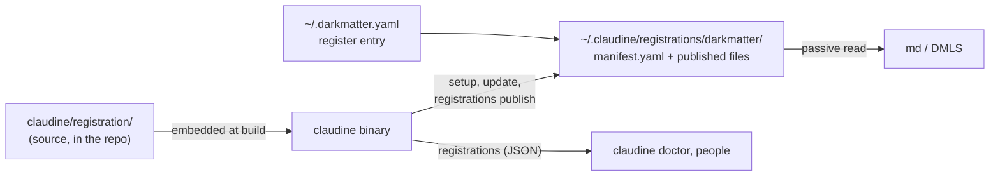

# Host registration v2

This spec covers the registration contract shared by Darkmatter and
Claudine. Darkmatter loads the registration for its `md` command and the
Darkmatter language server (DMLS). Claudine supplies and publishes the
files they read. The changes land together and build on SimplifiedSchema's
YAML kind definitions and object composition rules.

## Why this exists

Host registration lets `md` and DMLS type a host's documents (Claudine's, for
example) without running the host. Investigating a failed `claudine sequence`
pre-flight showed several problems with how it works today:

1. **The registration entry was missing.** `~/.claudine/darkmatter-host.yaml`
   existed, but `~/.darkmatter.yaml` had `register: []` and an inline
   `permissions` block. Claudine refreshed the manifest at startup and
   left the missing entry undetected.
2. **Versioned revision folders pile up.** Each publish writes
   `~/.claudine/darkmatter-host/<version>-<digest>/schemas/`, and nothing
   removes old ones. A separate set of files lets readers finish loading a
   release while another is published. Keeping every release indefinitely is
   unnecessary.
3. **Every `claudine` command checks the published files** and republishes
   when they are stale. That puts filesystem work on every command for
   something that changes only at install or upgrade.
4. **`claudine/schemas/` serves two audiences.** It mixes schemas that help
   inside this repository with schemas shipped to every user, so the embed
   list is kept by hand and still points at the deleted
   `sequence-types.yaml`. Repository-only files such as `review.yaml`
   belong outside the published bundle.
5. **The identifying trigger is a separate file with a special role.**
   `claudine-document.yaml` only decides which documents are Claudine's. The
   triggers already say that through their own `match:`.
6. **Trigger order decides overlaps silently.** When two of a host's triggers
   declare the same property, the later one in the manifest wins, with no
   diagnostic.
7. **Globals have no file kind of their own.** `globals.yaml` is a
   `kind: schema` whose `$schema` is a map of namespaces, which reads like a
   document schema but is not one.

## Overview



## Decisions

### 1. Source folder: `claudine/registration/`

- The build enumerates the regular YAML files in `claudine/registration/`
  recursively and embeds them in sorted repository-relative path order.
  Reject unexpected files, symlinks, and paths that collide on
  case-insensitive filesystems. Cargo must rebuild when a file is added,
  changed, moved, or removed. Keep the folder's explanation in
  `claudine/docs/`.
- Allowed file kinds are:

  | `kind` | Use |
  |---|---|
  | `schema-trigger` | Selects and types Markdown documents |
  | `yaml-schema` | Defines a YAML document kind, such as `kind: sequence` |
  | `namespace-schema` | Declares one expression global |
  | `schema` with `types` and no `$schema` | Supplies reusable types |

  Reject any other kind or a `kind: schema` with a `$schema` both in
  Claudine's build check and when Darkmatter loads a registration. Function
  catalogs and generated artifacts have separate manifest fields.
- A file reference in a registered schema resolves through biscuit-file's
  [`FileReference`](../../../biscuit-file/lib/src/file_reference/mod.rs),
  which interprets the authored path relative to its declaring file. Allow
  explicit relative references to listed members within the bundle and
  supported built-in Darkmatter schema references. Apply this to indirect
  imports, schema payload references, and file-backed examples. Reject
  unlisted targets, paths that escape after resolution, and remote
  references. A portable bundle cannot rely on search roots, environment
  variables, or a checkout. Bundle the types that inline composition uses
  from [content-policy's schema](../../../content-policy/schemas/content-policy.yaml),
  including required imports. Verify the copy against its source.
- Extend the `schema-trigger` envelope to admit an optional `description`
  (a string) and an optional `types` table, alongside `kind`, `match`, and
  `$schema`. A trigger's `types` are local to that trigger: its `$schema`
  can name them, and other files cannot import them (shared types still
  belong in a types-only library). The envelope stays closed to every
  other key except `name` (below). This applies to every trigger,
  registered or not, so update the trigger definition in
  `simplified-schema/schemas/schema-trigger.yaml` and trigger discovery
  together.
- Admit an optional `name` on `schema-trigger` files and on types-only
  `kind: schema` libraries (the two kinds the drafts give one), and update
  `schema-trigger.yaml` and `schema.yaml` in `simplified-schema/schemas/`.
  - It is a kebab-case identifier: lowercase letters, digits, and inner
    single dashes, starting with a letter (`inline-compose-schema`).
  - It must be unique among the files of one registration, and among the
    files of one schema root. A duplicate is reported on both files.
  - It is a display label, never a reference: imports and every other
    lookup still use the file path. Diagnostics, `md schema triggers`, and
    the `claudine registrations` listing show it beside the path, for
    example `inline-compose-schema (schemas/inline-composition.yaml)`.
    `claudine registrations` adds it to each `file` and `file_details`
    entry as an optional `name`.
  - A file without one is shown by its path alone, as today.
- Repair the draft triggers' match
  conditions and broken imports before shipping them. For example,
  `composition.yaml` needs a real `match` and a defined
  `common-attributes` type. `inline-composition.yaml` uses `group` for
  alternatives and needs qualifying required keys in each branch.
- Leave repository-only schemas, such as `review.yaml`, in
  `claudine/schemas/`. Move registration-only files out of schema discovery
  so another copy cannot apply as an ordinary trigger. Update repository
  references to moved types and point Claudine's own composition and sequence
  validation at the same embedded definitions.
- Retire `globals.yaml`. Namespace schemas (see 4) replace it, and
  `claudine/schemas/globals.yaml` and its `globals.lifecycle.json` are
  deleted. Darkmatter's legacy host-catalog discovery, which reads a
  `globals.yaml` and `globals.lifecycle.json` found in a schema root for a
  host that is not registered, is removed with it: Claudine is the only
  host that used it, so the `Legacy` host-selection result goes too.
- Regenerate `claudine/lib/generated/shipped.json` and the lifecycle
  artifact from the same sources through `just shipped-schemas`. Keep
  the installed binary, the generator, and the build check on one inventory.
  Verify the bundle in isolation from the repository and user schema roots.
  Check Claudine's own compose, inline-compose, and sequence entry points
  against the embedded definitions as part of the migration.

### 2. Published layout and who writes it

The stable entry point is
`~/.claudine/registrations/darkmatter/manifest.yaml`. The manifest points
to a complete set of published files. Preserve the source tree's relative
paths within that set so imports work.

```text
~/.claudine/registrations/darkmatter/
├── manifest.yaml           lists every member and its BLAKE3 digest
├── globals.lifecycle.json
└── schemas/…               the files of claudine/registration/
```

There is one member tree at fixed paths. There are no release or
version folders.

- **Publishing.** Take the publisher lock. Write each changed member to a
  temporary name beside it and rename it into place (with retry for
  Windows file replacement). Delete members no longer in the inventory.
  Write the manifest last, the same way. An identical publish writes
  nothing.
- **Reading.** The loader hashes the exact bytes it uses for each member
  and compares them with the manifest's digest. On any mismatch or
  missing member it reads the manifest again once and retries if the
  manifest changed. If the files still do not match, it refuses the host
  with a located `dm.host.registration` diagnostic. A reader therefore
  never accepts a mix of two publishes. At worst it reports the host as
  briefly unavailable during an upgrade.
- **Interruption.** A publish that stops partway leaves files that do not
  match the manifest, so the host is unavailable until the next publish.
  `claudine doctor` reports this state and `doctor --fix` repairs it by
  publishing again. A stray temporary file left by an interrupted rename is
  removed by the next publish.

- Claudine setup and the hidden `claudine registrations publish` command
  publish the bundle. Call the hidden command from Claudine's
  `just install` and from future update and doctor repair flows. Remove
  the startup refresh from Claudine's normal commands. Darkmatter and
  DMLS continue to read the installation passively, and doctor will
  inspect the installed files on demand.
- Serialize cooperating publishers. An identical publish is a no-op.
  Readers use one complete release or report a registration failure.
  The publisher must account for interruption, concurrent readers, and
  retry, including file replacement on Windows.
- The publisher owns its output. Doctor can compare installed files with
  the embedded bytes and report edits that repair will replace. Continue
  to use ordinary Darkmatter schema roots to override Markdown trigger
  properties. Those overrides still have higher precedence than the
  registered trigger layer.
- Make republishing and upgrading separate from editing configuration.
  Setup and doctor repair publish first, then replace Claudine's old entry
  in the user configuration. Clean up the old default manifest and
  revision tree only after the configuration change succeeds. Limit
  cleanup to Claudine-owned paths. Report a symlink or junction that
  obstructs publication or cleanup and leave its target alone. Preserve
  unrelated registrations.

### 3. Manifest format 2

```yaml
# ~/.claudine/registrations/darkmatter/manifest.yaml
kind: darkmatter-host
format_version: 2
host: claudine
version: "0.1.0"
files:
    - ./schemas/composition.yaml
    - ./schemas/inline-composition.yaml
    - ./schemas/formal-sequence-file.yaml
    - ./schemas/sequence.yaml
    - ./schemas/seq.yaml
    - ./schemas/group.yaml
    - ./schemas/loop.yaml
    - ./schemas/lifecycle-events.yaml
    - ./schemas/shared.yaml
lifecycle: ./globals.lifecycle.json
functions: []
digests:
    ./schemas/composition.yaml: "<64 hex digits>"
    # … one entry per member above, including the lifecycle artifact
    ./globals.lifecycle.json: "<64 hex digits>"
```

- `digests` maps every member path (each `files` entry, the lifecycle
  artifact, and each function catalog and facts file) to the BLAKE3 hash of
  its exact bytes, as 64 lowercase hexadecimal digits, computed with
  biscuit-hash. A member without a digest, or a digest without a member,
  refuses the manifest.

- The envelope is closed. Require each field above, including the integer
  version `2` and an explicit `functions: []` for a host with no function
  catalogs. The encoder includes every bundled library. The loader
  classifies each `files` member by its own `kind` and rejects duplicates
  after resolving paths. Resolve local member references from the manifest
  directory using its captured file context. The same bundle boundary
  covers the separately listed lifecycle file and function pairs. Report
  the failed field and source location.
- `files` order has no effect on loading, layering, or host agreement.
  Compute the host's content revision from the normalized manifest meaning
  and addressed member bytes, sorting the unordered file list. Preserve
  equivalent installs' identity when copied to another root. Continue to
  collapse equal claims and report conflicting claims for the same host.
- Remove `identify`, `triggers`, and `globals`. Keep the `functions`
  catalog and facts pairs and their freshness checks until
  `2026-11-22-expression-and-mutation-schemas` replaces them.
- Update Darkmatter's [manifest envelope](../../schemas/darkmatter-host.yaml).
  Refuse format 1 with a `dm.host.registration` warning that explains
  format 2 and points the user to the host's setup or update command.
  Reinstalling Claudine and rerunning setup is the supported way to refresh
  the user entry. Report obsolete repository entries so their owners can
  update them.
- Preserve all-or-nothing loading, dependency tracking, and diagnostic
  locations. Registering a host continues to supply analysis information
  only. A manifest or its files cannot grant permissions, fetch remote
  resources, install handlers, or run host code. Reuse existing schema
  preparation rules for deferred expressions and the existing grant check
  wherever a consumer explicitly evaluates a permitted template. Validate
  the resulting member references against the same bundle boundary.

### 4. `kind: namespace-schema`

A namespace schema declares one host namespace (the global a host's
expressions read, such as `seq` or `loop`):

```yaml
kind: namespace-schema
namespace: loop
$schema:
    count: "number(integer; min(1)) -> The one-based iteration."
    is_first: "boolean -> Whether this is the first iteration."
types: {}
```

- Require `kind`, `namespace`, and a mapping-valued `$schema`. Allow
  `description` and local `types` under a closed envelope. Resolve the
  payload as one object with the namespace file as the import and diagnostic
  origin. Use the expression parser's root identifier rules. Reject names
  reserved by Darkmatter's global and expression binding rules. Report a
  reserved name on its declaration and a duplicate on both declarations.
- Assemble the namespace definitions into one host global catalog. Preserve
  namespace descriptions, named type scopes, property locations, and
  lifecycle availability. A namespace schema registers one global and does
  not become a general-purpose `$schema` target or a YAML document kind
  selector. Ship its kind definition with SimplifiedSchema so the CLI and
  DMLS can check its envelope and payload.
- **Reader note.** The current lifecycle artifact verifies the exact bytes of
  one `globals.yaml` file. With separate namespace files, use a new
  lifecycle artifact format version for manifest format 2. Retain the
  event data shape. Define `catalog_hash` as the BLAKE3 hash, through
  biscuit-hash, of a canonical JSON map from each namespace file's
  bundle-relative slash-separated path to the BLAKE3 hash of its exact
  bytes. Include every transitive bundled file used by those namespace
  definitions in the map. Read and hash the same bytes used to prepare the
  catalog. Generate and verify the hash with the same library code. The
  older artifact version and its single-file byte check are removed with
  legacy discovery.
- Refuse missing, malformed, or stale artifacts, a host name mismatch, and
  event bindings that name an undeclared host namespace. Retain the existing
  rules for Darkmatter's own bindings. Moving availability to a `when`
  property is future work.

### 5. Selecting a document's host

- For Markdown, choose a host when any of its registered triggers matches
  the document's authored frontmatter and path. Use the same match result
  to decide which payloads apply. When more than one host matches, or
  competing manifests for the same host match, keep the existing ambiguity
  behavior and diagnostics.
- Every registered trigger must pass SimplifiedSchema's
  [`admit_identifying_trigger`](../../../simplified-schema/lib/src/triggers/identify.rs),
  which proves that each matching alternative requires a non-null top-level
  key outside Darkmatter's baseline properties, event keys, and globals.
  Shared events, path tests, and exclusions alone can't identify a host.
  Reject the entire registration with `dm.host.identify_too_broad` on the
  offending trigger.
- Evaluate ordinary trigger conditions, including required literal values.
  The old identifying evaluator treated a required property as present for
  any non-null value, so it would treat `kind: other` as a match for
  `kind: literal(sequence; required)`. Ordinary matching still requires
  the value `sequence`. For Claudine fields that identify by presence, carry
  forward the existing alternatives covering each non-null YAML type. This
  keeps malformed values such as `sequence: 42` in Claudine's validation.
  A document with only shared events still uses Darkmatter's types.
- For YAML, explicitly include registered `yaml-schema` definitions in the
  kind lookup used by `md schema validate` and the DMLS YAML analysis. Reuse
  today's rules to determine which kind or kinds a definition claims.
  Built-in and local definitions retain precedence and their existing
  failure rules. Consult registered definitions only for a kind that
  lookup can establish is unclaimed. A selected kind still takes
  precedence over the document's root `$schema`, as in existing YAML
  validation. When that tier is needed, multiple
  different definitions claiming the same kind give a kind-selection error
  naming the competing definitions. A selected registered definition
  identifies its host for YAML schema analysis. YAML is checked as a whole
  document and receives no Markdown trigger layer or lifecycle execution.
  Include the registration revision in DMLS's YAML contract cache identity
  and refresh those contracts when the registration changes.

### 6. When two of a host's triggers declare the same property

Resolve named types and object composition before comparing declarations.
Use SimplifiedSchema's
[`is_definition_subtype_with_definitions`](../../../simplified-schema/lib/src/simplified/subtype.rs),
which compares property types including unions and resolved references. It
ignores constraints, presence, defaults, and descriptions. Compare those
separately before using the relation to choose a complete declaration.

| Underlying type comparison | Result |
|---|---|
| Exactly one type is narrower | Use its full declaration when all other rules and metadata agree |
| Types are equivalent both ways | Coalesce identical resolved declarations |
| Types are incomparable, or remaining rules or metadata differ | Report a conflict |

For example, `agent: enum(claude, codex)` narrows `agent: string` when
their other settings agree. A required string and an optional enum
conflict because using the enum would change presence as well as type.
Compare effective null admission, constraints, defaults, descriptions,
and examples, including nested rules where the underlying shape is
equivalent. Keep the winning declaration's source location. Choose the
lexically first bundle path to represent identical declarations. For
three or more declarations, check every pair so that a narrower third
declaration cannot hide a conflict between two broader ones.

- Use the same checked merge for every consumer. Compare only payloads of
  triggers that matched, including properties inherited through
  `$extends`. Cache reusable results by host revision and matched trigger
  set. Any comparison that depends on deferred values must use the existing
  preparation rules and cannot be cached across different resolved inputs.
- Support one root union among the matching payloads. Merge ordinary
  properties into each arm independently, preserving arm order and the
  relationship among properties inside each arm. A key defines an
  alternative if some arms omit it or its resolved declaration differs
  by arm. Keep those
  keys, such as inline composition's `prompt` and `sections`, owned by the
  union. When multiple payloads contribute, refuse multiple
  root unions, nondefault root constraints, or a competing declaration of
  an alternative-defining key. Move shared fields to a types library and
  use `$extends` to give one trigger ownership of a compound rule.
  Inline composition requires the selected arm's `prompt` or `sections`
  value and allows the other key to be absent or null.
- Report `dm.host.trigger_conflict` on the document with the host, affected
  property or root rule, and both trigger paths. Treat it as a schema
  preparation error. Validation and composition fail, and DMLS shows the
  error and omits schema features that need the failed layer. A higher
  layer does not clear the conflict.
- Keep the established precedence after the host layer is successfully
  built. Ordinary schema-root triggers override it, and the document's
  own `$schema` overrides both. Preserve duplicate-file suppression and
  the existing `--disable schema-triggers` behavior. Claudine's in-process
  host bindings remain authoritative when it runs its own documents.

### 7. DMLS groups registration reloads

DMLS watches registration files across workspace boundaries. A burst of
change notifications can arrive in several batches. Group changes to a
configuration's registration inputs across batches and queue an off-thread
reload once they have been quiet for a settle window. The window is one
named constant with an initial value of 300 ms. That value is a common
editor-debounce starting point, not a measurement: a publish writes about a
dozen small files, and the window only needs to outlast one publish. Tune
it after measuring a real publish. Ordinary document edits and unrelated
configuration invalidation continue on their existing schedules. Keep the
existing save fallback for editors that cannot watch the relevant folders.

- Track the manifest, dependencies, missing candidates, and the directories
  needed to observe creation, deletion, and replacement. Update watches
  and reanalyze affected open Markdown and YAML documents when the latest
  load completes. A newer queued load supersedes results from an older
  in-flight load. An unchanged revision needs no reanalysis.
- Keep the last loaded view during the short wait. If the completed reload
  finds the current registration broken, clear that host view and publish
  the located warning. When files are restored, refresh the view and clear
  the warning. The publishing protocol provides consistency for concurrent
  reads, including command-line reads that have no debounce.
- Test the reload timing with a controlled clock or queue. Exercise a burst
  spanning batches, a newer change during a load, and a repair that
  clears stale diagnostics.

### 8. Hidden `claudine registrations` command

Lists, prints, and publishes what Claudine registers. It reads the same
embedded set used by the publisher. Listing and inspection work without an
installed registration and report what the running binary would publish.
The output is JSON.

```yaml
$schema:
    registrations:
        - "function(() => file[])"
        - "function((filepath: string) => file_details)"
types:
    file_kind: enum(manifest, schema-trigger, schema, yaml-schema, namespace-schema, lifecycle)
    file:
        kind: file_kind(required) -> the file's kind within the registration
        filepath: string(required) -> published path relative to the registration root, using forward slashes
        hash: string(required) -> XXH64 of the exact published bytes, as 16 lowercase hexadecimal digits
        name: string -> the file's optional display name, when it declares one
    file_details:
        kind: file_kind(required)
        filepath: string(required)
        hash: string(required)
        name: string
        contents: string(required)
```

- `claudine registrations` prints a `file[]` sorted by `filepath`, including
  the manifest and lifecycle artifact. Use biscuit-hash, seed 0, for
  these fingerprints. Hex text preserves all 64 bits in JSON consumers.
- `claudine registrations <filepath>` accepts a path exactly as listed
  and prints its `file_details`. An unknown path exits nonzero. Lookup
  uses the embedded inventory and requires no filesystem path resolution.
  The published files are UTF-8, so decoding `contents` and re-encoding
  it as UTF-8 reproduces the bytes that were hashed.
- `claudine registrations publish` publishes without changing the user
  configuration. It prints a JSON list in the same shape after a
  successful publish, including when the installation was already
  current. On failure it exits nonzero and reports the cause on stderr.
- Expose the inventory in the Claudine library so doctor can inspect it
  without spawning a command. Anything in the publication root that is
  not an inventory member (other than a leftover temporary file from an
  interrupted rename) is a stray file for doctor to report.

### 9. Setup and Darkmatter's configuration

Keep the sequence documented in
[Claudine's configuration guide](../../../claudine/docs/topics/configuration.md#darkmatters-permissions).
Publish first, complete the permissions handshake, and register the
manifest last. Continue to write through the existing locked config
transaction. Replace only entries that resolve to Claudine's known old
default manifest, including equivalent spellings. Deduplicate the new
entry and preserve other registrations, comments, and settings. Register
the new manifest even when an existing permissions conflict leaves the
inline block in force. If publishing fails, leave the existing
configuration in place.

Verify the following using temporary home and repository directories:

- `md init` on an existing configuration preserves registration entries
  and a `permissions` reference to Claudine's configuration.
- Setup copies an inline block to an absent or matching destination and
  registers the new manifest even with `register: []`. When the
  destination has a different block or Darkmatter points to another
  file, preserve the existing permissions and report the conflict where
  the handshake already does.
- Setup is safe to rerun after an interrupted config write. An old
  reference is replaced even if the old manifest is missing, and a
  repository-owned entry is not rewritten by user setup.

## Removed

- `claudine/schemas/claudine-document.yaml` and the manifest's `identify`
  field.
- Manifest format 1, its `triggers` and `globals` fields, and `globals.yaml`.
- Darkmatter's legacy host-catalog discovery and the `Legacy` host-selection
  result, along with lifecycle artifact format 1.
- Claudine’s old `~/.claudine/darkmatter-host.yaml` entry point and
  versioned revision folders.
- The per-command registration refresh.
- The hand-kept embed list in `claudine/lib/src/composition/schema/bundle.rs`.

## Documentation to update

- `darkmatter/docs/topics/host-registration.md`: manifest format 2, host
  selection without `identify`, the trigger rule, overlap narrowing, the
  reload behavior, and registered YAML kind selection.
- `claudine/docs/topics/schemas.md` and `claudine/schemas/README.md` (the
  latter cut down to what `claudine/schemas/` now is): the registration
  folder, the published layout, who writes it, hand edits.
- `claudine/docs/topics/configuration.md`: the new manifest path in setup.
- `claudine/docs/cli/`: the hidden `registrations` command, documented for
  maintainers.
- `simplified-schema/docs/topics/language/schema-documents.md`: the
  `namespace-schema` kind and what it can define.
- The affected package READMEs, the Darkmatter, Claudine, and
  SimplifiedSchema repo skills, and affected caller skills such as
  `use-dmls`. Run `just publish-skills` in each area with a caller skill
  change.

## Phases

1. **SimplifiedSchema and Darkmatter:** after object composition is ready
   is ready, implement the envelope and
   kind, catalog and artifact loading, Markdown and YAML host selection,
   trigger merging, and DMLS reloads. Verify with fixture hosts.
2. **Claudine:** migrate and check the embedded inventory, regenerate the
   artifacts, then wire up publication, installation, the inventory
   command, and setup. Remove the startup refresh and exercise the normal
   composition and sequence commands against the new bundle.
3. **Docs and skills:** update the listed sources alongside the behavior
   each phase changes.

## Acceptance criteria

- A complete bundle works outside this checkout. Missing or unlisted
  imports, path escapes, duplicate members or namespaces, stale artifacts,
  and invalid trigger matches refuse the host with source locations.
  Reordering `files` produces the same host revision and schema.
- A Markdown file with only shared events stays with Darkmatter. A wrong
  literal kind fails the trigger match, and malformed Claudine-specific
  values still receive Claudine validation. Different hosts identifying
  a document produce ambiguity. A registered YAML kind validates through
  the CLI and DMLS with the same precedence and collision behavior.
- Check equivalent declarations, strict narrowing, constraint and presence
  conflicts, a three-way overlap, and conflicting triggers that never
  match together. Valid inline composition accepts exactly one of
  `prompt` or `sections`; another matching trigger cannot loosen that
  rule. Repository overrides still apply to a successfully prepared layer.
- Interrupt publication and overlap it with a reader and a second
  publisher. No reader accepts files that do not match the manifest's
  digests, an interrupted publish leaves the host refused until the next
  publish, and a retry converges
  on the embedded inventory. An identical publish leaves the manifest
  and member timestamps alone. DMLS reloads the new view and clears
  repaired warnings without a restart.
- Compare inventory paths, hashes, and details with published bytes.
  Verify setup and ordinary Claudine commands through their normal entry
  points, including that ordinary commands neither read nor refresh the
  published bundle.
