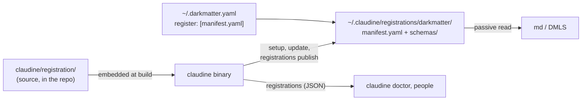

# Host registration v2

This spec spans `darkmatter/` (the manifest format, host selection, trigger
merging, DMLS) and `claudine/` (what it registers and how it publishes). The
two sides change the same contract, so they land together.

## Why this exists

Host registration lets `md` and DMLS type a host's documents (Claudine's, for
example) without running the host. Investigating a failed `claudine sequence`
pre-flight showed several problems with how it works today:

1. **The registration was silently missing.** `~/.claudine/darkmatter-host.yaml`
   existed, but `~/.darkmatter.yaml` had `register: []` and an inline
   `permissions` block. Nothing reported it, and nothing repaired it: each
   Claudine launch refreshes its manifest but never touches
   `~/.darkmatter.yaml`.
2. **Versioned revision folders pile up.** Each publish writes
   `~/.claudine/darkmatter-host/<version>-<digest>/schemas/`, and nothing
   removes old ones. There is only ever one `claudine` binary per host, so
   the versions protect against nothing.
3. **Every `claudine` command checks the published files** and republishes
   when they are stale. That puts filesystem work on every command for
   something that changes only at install or upgrade.
4. **`claudine/schemas/` serves two audiences.** It mixes schemas that help
   inside this repository with schemas shipped to every user, so the embed
   list is kept by hand and has drifted (`review.yaml` is in the folder but
   not embedded; `sequence-types.yaml` was deleted from the folder but is
   still embedded).
5. **The identifying trigger is a separate file with a special role.**
   `claudine-document.yaml` only decides which documents are Claudine's. The
   triggers already say that through their own `match:`.
6. **Trigger order decides overlaps silently.** When two of a host's triggers
   declare the same property, the later one in the manifest wins, with no
   diagnostic.
7. **Globals have no file kind of their own.** `globals.yaml` is a
   `kind: schema` whose `$schema` is a map of namespaces, which reads like a
   document schema but is not one.

## Overview



## Decisions

### 1. Source folder: `claudine/registration/`

- **Everything in `claudine/registration/` is registered, and nothing else
  is.** The build embeds the whole folder by enumerating it (a build script
  or an equivalent compile-time listing), so there is no hand-kept list to
  drift. The folder holds registration files only; its explanation lives in
  `claudine/docs/`, not in a README inside it.
- Allowed file kinds:

  | `kind:` | Use |
  |---|---|
  | `schema-trigger` | types the documents its `match:` selects |
  | `yaml-schema` | defines a YAML document kind (for example, `kind: sequence` files) |
  | `namespace-schema` | defines one host namespace (see 4) |
  | `schema` with `types` and **no** `$schema` | a library of reusable types for the other files |

  A `kind: schema` with a `$schema`, or any other kind, fails the build test
  and is refused by Darkmatter when loading a registration.
- Files may import only each other (relative paths within the folder) and
  Darkmatter's built-in schemas (`name@darkmatter:…`). An import that leaves
  the folder breaks once the files are published, so it fails the build
  test. (The current draft `inline-composition.yaml` imports
  `content-policy/schemas/…`; it must vendor or drop that import.)
- `claudine/schemas/` becomes an ordinary repository schemas folder: schemas
  that help when editing this repository, discovered by Darkmatter's normal
  schema search, never embedded or published. Files that exist only for
  registration move to `claudine/registration/`, and `claudine-document.yaml`
  is deleted.
- The generated companion artifacts (today `claudine/lib/generated/shipped.json`
  and `globals.lifecycle.json`) are regenerated from `claudine/registration/`
  by `just shipped-schemas`. The lifecycle artifact keeps its current format
  in this spec; it is published beside the schemas and named in the manifest
  (see 3).

### 2. Published layout and who writes it

```text
~/.claudine/registrations/darkmatter/
├── manifest.yaml
└── schemas/            the files of claudine/registration/, same relative paths
```

- **No version folders.** One binary per host means one set of files.
- **Who writes:** Claudine's setup, the future `claudine update`, and the
  hidden `claudine registrations publish` (which `just install` in the
  Claudine area calls, so a development install republishes too). **No other
  command reads or writes these files.** The per-command refresh in
  `claudine/cli/src/main.rs` (around `HostRevision::claudine()` and
  `registration::publish`) is removed.
- **How:** each file is written to a temporary name in its folder and renamed
  into place, so a reader never sees a truncated file. A file not in the
  embedded set is deleted. The manifest is written last.
- **Hand edits** are allowed but unsupported. Publishing overwrites them
  without asking, and `claudine doctor` reports a modified file as "modified,
  will be replaced on the next publish." The supported way to customize a
  registered schema is a trigger in one of Darkmatter's schema locations
  (`SCHEMAS_DIR`, `~/schemas`, a repository `schemas/` folder), which already
  layers above the registered ones.
- **Old layout:** there are no users to migrate, so publishing simply deletes
  `~/.claudine/darkmatter-host.yaml` and `~/.claudine/darkmatter-host/`, and
  setup (and `doctor --fix`) replaces the old `register` entry with the new
  one.

### 3. Manifest format 2

```yaml
# ~/.claudine/registrations/darkmatter/manifest.yaml (written by Claudine)
kind: darkmatter-host
format_version: 2
host: claudine
version: "0.1.0"
files:
    - ./schemas/claudine.yaml
    - ./schemas/inline-composition.yaml
    - ./schemas/formal-sequence-file.yaml
    - ./schemas/sequence.yaml
    - ./schemas/seq.yaml
    - ./schemas/group.yaml
    - ./schemas/loop.yaml
    - ./schemas/lifecycle-events.yaml
lifecycle: ./schemas/globals.lifecycle.json
functions: []
```

- `files` lists every registered file. Darkmatter loads exactly these and
  classifies each one by its own `kind:`. **The order of `files` means
  nothing** (see 5).
- `identify`, `triggers`, and `globals` are gone. `lifecycle` and `functions`
  stay as they are today; `functions` is replaced by
  `2026-11-22-expression-and-mutation-schemas`.
- Format 1 is removed in the same change. Darkmatter refuses a format 1
  manifest with a `dm.host.registration` warning that names format 2.
- The envelope schema `darkmatter/schemas/darkmatter-host.yaml` is updated
  to match.

### 4. `kind: namespace-schema`

A namespace schema declares one host namespace (the global a host's
expressions read, such as `seq` or `loop`):

```yaml
kind: namespace-schema
namespace: loop
$schema:
    count: "number(integer; min(1)) -> The one-based iteration."
    is_first: "boolean -> Whether this is the first iteration."
types: {}
```

- `namespace` is required and must be a valid expression identifier.
- A host may not declare a namespace `md` owns (`fm`, `ctx`, `current`,
  `env`, `err`, `timing`), and may not declare the same namespace twice. Each
  is a `dm.host.registration` error naming both files.
- The namespace files together replace `globals.yaml`. Which events may read
  each namespace stays in the generated lifecycle artifact. A `when` property
  that moves that decision into the file is a later spec.
- The `kind: namespace-schema` definition ships with simplified-schema's
  other kind definitions (`simplified-schema/schemas/`), so DMLS checks
  namespace files like any other schema file.

### 5. A document's host, without an identifying trigger

- A document belongs to a registered host when **at least one of the host's
  triggers matches it**. The ambiguity rules are unchanged: two hosts
  matching one document is `Ambiguous`.
- The safety rule the identifying trigger enforced now applies to **every
  registered trigger**: each `match:` alternative must require at least one
  non-null top-level key that `md` does not own
  (`simplified-schema/lib/src/triggers/identify.rs`). A registered trigger
  that fails it makes the whole registration unusable, with a
  `dm.host.identify_too_broad` warning naming the trigger file. Refusing the
  whole host, rather than dropping one trigger, keeps a host from being
  half-applied.
- `kind` is not a key `md` owns (it is not in Darkmatter's baseline schema),
  so a match on `kind: literal(sequence; required)` identifies a document.
  A test pins this down.
- `yaml-schema` files are selected by `kind` as they are today. A YAML
  document a host's `yaml-schema` claims also belongs to that host.

### 6. When two of a host's triggers declare the same property

Darkmatter applies a host's matching triggers as one layer. When two of them
declare the same top-level property, it compares the two declarations with
SimplifiedSchema's `is_subtype` (types only):

| `a` ⊆ `b` | `b` ⊆ `a` | Result |
|---|---|---|
| yes | no | `a` is narrower: `a` applies |
| no | yes | `b` is narrower: `b` applies |
| yes | yes | equivalent: allowed only if the declarations are identical (constraints, `required`, default, description); otherwise a conflict |
| no | no | conflict |

```yaml
# claudine.yaml
agent: string
# inline-composition.yaml
agent: enum(claude, codex)    # narrower, so it applies whichever file is listed first
```

- A conflict is a `dm.host.trigger_conflict` error on the document, naming
  both trigger files and the property. It is judged among the triggers that
  actually matched, because two triggers that never match the same document
  may declare the same name differently. The result is cached by the set of
  matched triggers.
- The outcome never depends on order, which is why the manifest's `files`
  order means nothing.
- Objects with different fields and arrays with different items are never
  subtypes, so they are conflicts. Merging constraints between equivalent
  types is not attempted.
- **Scope:** only between triggers of the same host. Layering between layers
  is unchanged: repository triggers override host triggers, and the
  document's own `$schema` overrides both.

### 7. DMLS waits for registration changes to settle

DMLS already watches every registration file and reloads on change
(`darkmatter/docs/topics/host-registration.md`, "Changes are followed without
a restart"). Today it merges events per path within one batch
(`darkmatter/dmls/src/workspace/watch.rs`, `coalesce_changes`), so a publish
that spans several batches reloads several times, and a reload partway
through can read old and new files together.

- Changes to registration-watched paths (configuration files, manifests,
  their files) are debounced: DMLS reloads once, about 300 ms after the last
  such change. The exact window is a tunable constant.
- Document edits are not debounced by this; only registration reloads are.

### 8. Hidden `claudine registrations` command

Lists, prints, and publishes what Claudine registers. It reads the same
embedded set the publish step writes, so the two cannot disagree. Output is
JSON.

```yaml
$schema:
    registrations:
        - function(() => file[])
        - "function((filepath: string) => file_details)"
types:
    file_kind: enum(manifest, schema-trigger, schema, yaml-schema, namespace-schema, lifecycle)
    file:
        kind: file_kind(required) -> the file's kind within the registration
        filepath: string(required) -> relative to the registration root
        hash: string(required) -> xxHash (XXH64, hex) of the exact contents, via biscuit-hash
    file_details:
        kind: file_kind(required)
        filepath: string(required)
        hash: string(required)
        contents: string(required)
```

- `claudine registrations` prints `file[]`, the manifest included.
- `claudine registrations <filepath>` prints that file's `file_details`; an
  unknown path is an error with a non-zero exit.
- `claudine registrations publish` writes the files (see 2).
- The hash is a hex string, not a JSON number: a 64-bit number is rounded by
  `jq`, JavaScript, and many other parsers.
- Binary `contents` (images, audio) may be needed later. It would add an
  encoding field; it is not part of this spec.

### 9. Setup and Darkmatter's configuration

The setup sequence stays as documented in
`claudine/docs/topics/configuration.md` (publish, write Claudine's config and
complete the `permissions` handshake, register the manifest), with the new
manifest path. Two behaviors are pinned down by tests, because this host
showed both broken:

- `md init` run on an existing `~/.darkmatter.yaml` keeps every `register`
  entry and a `permissions` reference to Claudine's configuration.
- Setup run when `~/.darkmatter.yaml` already exists with an inline
  `permissions` block and no `register` entry ends with the block moved and
  the entry added.

## Removed

- `claudine/schemas/claudine-document.yaml` and the manifest's `identify`
  field.
- Manifest format 1, its `triggers` and `globals` fields, and `globals.yaml`.
- `~/.claudine/darkmatter-host.yaml` and the versioned revision folders.
- The per-command registration refresh.
- The hand-kept embed list in `claudine/lib/src/composition/schema/bundle.rs`.

## Documentation to update

- `darkmatter/docs/topics/host-registration.md`: manifest format 2, host
  selection without `identify`, the trigger rule, overlap narrowing, the
  debounce.
- `claudine/docs/topics/schemas.md` and `claudine/schemas/README.md` (the
  latter cut down to what `claudine/schemas/` now is): the registration
  folder, the published layout, who writes it, hand edits.
- `claudine/docs/topics/configuration.md`: the new manifest path in setup.
- `claudine/docs/cli/`: the hidden `registrations` command, documented for
  maintainers.
- `simplified-schema/docs/topics/language/schema-documents.md`: the
  `namespace-schema` kind.
- The `darkmatter`, `claudine`, and `use-dmls` skills, then
  `just publish-skills` where a caller skill changed.

## Phases

1. **Darkmatter:** manifest format 2, the `namespace-schema` kind, host
   selection without `identify`, the per-trigger safety rule, overlap
   narrowing, the DMLS debounce. Tested with fixture hosts.
2. **Claudine:** the `claudine/registration/` folder and its build-time
   embedding and build test, the namespace files replacing `globals.yaml`,
   regenerated artifacts, the new publish layout, removal of the
   per-command refresh, the `registrations` command, the setup tests in 9.
3. **Docs and skills** as listed above.

## Open questions

- **The `schema-trigger` envelope.** It accepts only `kind`, `match`, and
  `$schema` today; `md schema validate` ignores a trigger that also has
  `description`, `types`, or `name`. The draft registration files use all
  three. Either the envelope admits `description` and `types` (and possibly
  `name`) in this spec, or the drafts move their types into a types-only
  library and drop the extra keys.
- **Legacy host catalogs.** Darkmatter still falls back to a `globals.yaml`
  plus `globals.lifecycle.json` found in schema roots for a host that is not
  registered. Claudine no longer needs it. Remove it here, or leave it for a
  later cleanup?
- **Debounce window.** 300 ms is a starting point; confirm or adjust once it
  runs in an editor.
