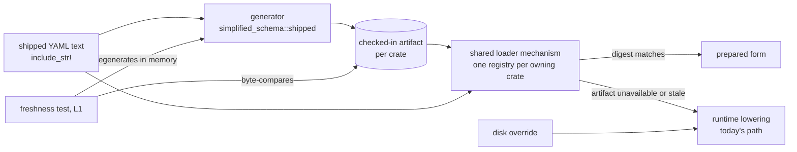

---
$schema:
    status: |-
        enum(
            draft-spec,
            finalized-spec,
            planned,
            implemented,
            review-findings,
            human-in-the-loop,
            completed,
            on-hold,
            abandoned
        ) -> an indicator of progress for this specification
    reviewed: boolean -> indicates whether the specification file has been reviewed by another agent from the one which created the spec
    reviewed_by: string -> the agent and model used in the spec review
    reviewed_on: date -> the date the spec was reviewed
    review_iterations: number -> the number of implementation reviews have taken place in the review/fix cycle
    clarified: boolean -> indicates whether the specification was built -- _in part_ -- with the 'clarify.md' prompt
    implemented: boolean -> indicates whether this spec's plan has been implemented
    implemented_by: string -> the agent who implemented the plan
kind: feature
created: 2026-11-11
status: finalized-spec
area: darkmatter
owner: Ken Snyder <ken@ken.net>
reviewed: true
reviewed_by: codex/gpt-6.1-sol
reviewed_on: 2026-11-11
needs_rulings: false
clarified: false
implemented: true
review_iterations: 2
packages:
    - simplified-schema
    - darkmatter
    - darkmatter-cli
    - claudine
    - claudine-cli
implemented_by: "claude/opus"
completed: true
---

# Precompiled shipped schemas

Processes that use schemas in `md`, `claudine`, and `dmls`, and tests that
exercise those paths, rebuild the same schemas from YAML text on first use.
The text is compiled into the binary, so the result is the same on every run. This spec
moves that work to a generation step that runs when the schema text changes,
checks the result in beside the text, and loads it at startup instead.

It also removes four smaller per-process costs in the same code path, and
consolidates caches of shipped schema data into one lazily loaded registry
per owning crate. Compiled validators and request-specific caches remain separate.
DMLS is a consumer to verify through its schema and editor tests; this design
does not add a separate DMLS artifact.

## Why

### What it costs today

Measured on 2026-11-11 on macOS (Apple silicon) with the Time Profiler.
Inclusive times overlap: a parent includes its children.

| Run | Build | Total | Shipped-schema work |
| --- | --- | --- | --- |
| `md compose` on a three-line document | debug | 240 ms | 184 ms in "build options"; 150 ms of it is the shipped baseline |
| `md compose` on a three-line document | release | 50 ms | 37 ms in "build options" |
| `claudine compose --goose prompts/clarify.md --dry-run` | debug | 1.2 s | about 520 ms (breakdown below) |

The Claudine run, by function (debug, inclusive):

| Function | Time | Shipped and constant? |
| --- | --- | --- |
| `resolve_launch_schema` | 603 ms | partly: contains the next five rows plus the effective-schema compile |
| trigger discovery (`scan_with_embedded`, `load_embedded_trigger`) | 392 ms | yes |
| `enforce_compiles` (trigger payload compile check) | 141 ms | yes |
| `prepare_embedded_catalog_declaration` (the `fm` baseline) | 133 ms | yes |
| `envelope::admit_recognized` | 106 ms | yes, for shipped documents |
| `shipped_named_types` | 81 ms | yes |
| `build_position_map` | 81 ms | yes for shipped documents; only needed for diagnostics |
| `schema_digest` / `canonical_json` (validator cache key) | 56 ms | no: hashes the merged schema each run |
| `validate_simple_object_schema` | 56 ms | yes, for shipped payloads |
| expression function catalog (`load_catalog`) | 29 ms | yes |
| effective-schema compile (`build_validator_with`) | 230 ms | no: depends on the document |
| shell approval | 186 ms | no; out of scope |

### Why it matters for tests

Nextest runs every test in its own process, so in-process caches never carry
over from one test to the next. Each Darkmatter test that builds compose options
pays the baseline again (about 150 ms in a debug build). Each Claudine CLI test
pays about 520 ms for every `claudine` it spawns, and many spawn two to four. On
a busy host that CPU time multiplies: on 2026-11-11 the Claudine L1 suite had
185 to 218 tests over the 5 s budget under load. Run alone, the ones checked took
1.3 to 2.8 s.

### Why it matters at runtime

A trivial `md compose` in a release build spends three quarters of its 50 ms
preparing shipped schemas. `claudine` pays the same baseline plus its own bundle
on every launch, and `dmls` pays it at startup.

## Terms

- **Shipped source**: schema text compiled into a binary with `include_str!`.
  Today these are:
    - Simplified Schema's [envelope definitions](../../../simplified-schema/lib/src/envelope.rs)
    - Darkmatter's [embedded source table](../../lib/src/markdown/schemas/embedded.rs),
      including the global catalog and its partials, plus the separately
      embedded `schema-trigger.yaml` definition
    - Darkmatter's effects catalog, `darkmatter/schemas/partials/mutations.yaml`,
      embedded separately from that source table
    - Content Policy's editor schema, which `fm.yaml` imports
    - Claudine's [eight-file trigger bundle](../../../claudine/lib/src/composition/schema/bundle.rs)
      and its separately embedded [host globals catalog](../../../claudine/lib/src/composition/schema/globals.rs)
- **Prepared form**: everything a run derives from a shipped source before it
  reads a user document: the lowered JSON Schema, the SimplifiedSchema shape
  and definition table, named-type tables, envelope admission results, the
  trigger matcher, and the checks those results already passed.
- **Artifact**: a checked-in file holding the prepared form of one crate's
  shipped sources.
- **Shadowing**: a disk schema file of the same name in a schema root replaces
  an embedded one (`claudine/docs/topics/schemas.md`). This must keep working.

## Design

### One generator, one format, one loader

All three crates use a shared artifact mechanism from `simplified-schema`,
the lowest crate that owns schema lowering. The owning crate supplies its
source inventory, prepared data, and uncached preparation function. There is
no global registration step or dependency from Simplified Schema back to its
hosts.

- **Generator.** The proposed `simplified_schema::shipped` module owns the
  common header, encoding, compatibility checks, and loading helpers.
  Simplified Schema prepares language data; Darkmatter prepares trigger and
  catalog data; Claudine supplies its bundle and host catalog to Darkmatter.
  Reuse the existing preparation functions through an explicit uncached route.
  Generation and freshness tests must bypass artifacts and process memos for
  their entire dependency chain; loading yesterday's artifact is not proof
  that today's lowering still produces it. A callback suffices where host
  preparation is needed; introduce a trait only if the implementation needs one.
- **Format.** JSON with a final LF, a stable layout, and deterministic ordering.
  Sort unordered metadata; preserve authored property, definition, category,
  overload, trigger, and union order wherever consumers observe it. Encode
  ordered mappings as ordered pairs if necessary rather than sorting away
  their order. Use owned serializable records where runtime types contain
  static references, locks, or compiled objects; do not leak deserialized
  strings to manufacture static lifetimes. Add Serde derives to existing data
  types only where their representation already fits. Mark artifacts
  `linguist-generated` in `.gitattributes`.
- **Header.** Record a wire-format version, a preparation revision for the
  owning crate, source identities and digests, lower-artifact digests, and
  any feature or configuration inputs that change preparation. Source hashes
  use exact compiled text bytes through `biscuit-hash`'s xxHash API, matching
  existing schema cache hashing; existing LF checkout
  rules apply to sources and artifacts. A lowering or admission behavior
  change requires the affected preparation revision to change even when YAML
  is unchanged. Dependency identities include their preparation revisions.
- **Loader.** Deserialize on first use and validate the header before exposing
  any prepared entry. Validate lower artifacts against their current compiled
  sources and revisions too: matching a stale lower artifact's bytes is not
  sufficient. A source mismatch, dependency mismatch, unsupported version,
  malformed JSON, or unusable record discards the owning artifact and runs
  ordinary preparation from the compiled sources. Never mix accepted entries
  with stale entries from that artifact. Retain existing errors if ordinary
  preparation fails; a stale artifact alone introduces no user warning or
  panic. Record the fallback reason and work through the existing optional
  work-counter instrumentation, without an environment-variable switch.
- **Eligibility.** A prepared bundle entry is selected by bundle identity,
  document identity, and matching source/dependency content. A caller-supplied
  bundle with the same name and different text is not a shipped-artifact hit.
  Unregistered bundles keep today's runtime path.

Host-owned prepared entries reach lower-level consumers explicitly. Extend
Darkmatter's [EmbeddedSchemaBundle](../../lib/src/markdown/schemas/embedded.rs),
which carries a host's embedded trigger texts, with an optional prepared-data
descriptor supplied by Claudine. Likewise, Simplified Schema's
[ShippedSources](../../../simplified-schema/lib/src/embedded.rs), which supplies
the reserved named-type namespace, can carry a descriptor supplied by Darkmatter.
Keep the existing constructors as source-only paths for arbitrary callers.
Descriptors use the shared format and verified identities; a bundle name alone
never finds host data through a hidden process-wide registration. This keeps
preparation reusable without adding a reverse dependency or an initialization
order requirement.

### Overrides and request-specific state

Reader's note: precompilation changes how embedded data is prepared, not which
schema wins. In Darkmatter's [trigger discovery](../../lib/src/markdown/schemas/triggers/discovery.rs),
files in schema roots claim filenames before embedded bundles are appended.
Even a non-trigger or invalid file can suppress the embedded trigger with that
name. Keep this selection and its existing findings before artifact lookup.

Imports within a surviving embedded trigger resolve only among its bundle's
texts, plus the reserved `darkmatter:` namespace. They do not pick up a disk
file that happens to share an imported filename. For example, a disk
`document.yaml` suppresses that embedded trigger; it does not replace the
embedded `lifecycle.yaml` imported by another surviving trigger. Custom bundle
text changes, however, invalidate the entry and all entries that depend on it.

Darkmatter's [YAML kind registry](../../lib/src/markdown/schemas/yaml_documents/registry.rs)
has a different replacement rule: a checkout definition at the shipped
repository-relative path can replace that shipped definition. Preserve that
rule, duplicate-kind handling, and unsaved editor-buffer invalidation. Only
the immutable shipped seed belongs in an artifact, never a registry of a
particular workspace.

Artifacts contain no working directory, home, absolute host path, captured
file-resolution context, filesystem probe result, editor snapshot, or runtime
binding availability. Bind trigger path matching and file validators to the
caller's existing request context after loading. Loading and generation use
supplied compiled texts only; neither adds schema-root scanning or I/O to
passive schema operations.

### Bootstrap and validator compilation

Simplified Schema's [envelope admission](../../../simplified-schema/lib/src/envelope.rs)
uses definitions that are themselves schema documents. Its current bootstrap
parses those definitions without admitting them against themselves. Keep that
bootstrap for uncached generation and fallback, then check the definitions
against their prepared contracts during generation. The generator must not
re-enter its own registry initializer.

The artifacts hold lowered schemas and typed metadata, not compiled
`jsonschema` validators. Envelope admission and any other operation that
actually validates data still compile a validator lazily when needed. Moving
a successful shipped payload's compile check to generation removes that check
from launch; it does not make validator compilation generally disappear.
Use the same draft, custom formats, keywords, and validator options for the
generation check and runtime compilation. The shared mechanism must continue
to work with Simplified Schema's `--no-default-features` build, without pulling
in host or CLI dependencies.

### Where the artifacts live and how they are refreshed

| Crate | Artifact | Covers |
| --- | --- | --- |
| `simplified-schema` | `simplified-schema/lib/generated/shipped.json` | envelope definitions |
| `darkmatter` | `darkmatter/lib/generated/shipped.json` | `SHIPPED` partials, `fm` baseline, function catalog, effects catalog, `schema-trigger.yaml`, the shipped `KindRegistry` seed, Content Policy's editor schema |
| `claudine` | `claudine/lib/generated/shipped.json` | the Claudine bundle's triggers, payloads, and globals catalog |

- `just shipped-schemas`, run from the repository root, regenerates all three
  in dependency order (simplified-schema, then Darkmatter, then Claudine). Each
  area's justfile has the same recipe for its own artifact; it checks lower
  artifacts first and names the root command if they are stale. Generation
  commands must build even when their current artifact is malformed or stale.
  Land initial artifacts with the code that embeds them, so a missing output
  never creates a circular build prerequisite. Validate all outputs before
  replacing any file; do not write partially generated JSON.
- Each crate has one L1 freshness test, named
  `shipped_artifact_is_fresh`. It regenerates the artifact in memory and
  byte-compares it with the checked-in file. On a mismatch it fails with the
  command to run. It checks fresh preparation of the entire dependency chain,
  not lower artifacts trusted as inputs. A round-trip check also compares the
  deserialized prepared data with uncached preparation, including ordered
  metadata. Freshness alone does not prove that runtime consumers use it.
- A change to a shipped YAML file already schedules its crate, because the
  text is compiled in, so CI runs the freshness test without new
  declarations for the owning package. An unchanged reverse dependency is
  compile-checked, not unit-tested: that does not catch a stale Claudine
  artifact after a Darkmatter change. Downstream freshness tests must spell
  the exact transitive source and artifact inputs they depend on in the forms
  recognized by [the test-input planner](../../../docs/cicd/test-inputs.md).
  Add exact cross-package code paths to the `source-inputs` list under
  `[package.metadata.ci.tests]` when their preparation behavior affects output. Verify
  the resolved plan schedules those freshness tests for representative source,
  YAML, and artifact-only changes. Use existing narrowed test-input cells;
  do not add a new CI job or schedule every dependent's full suite.

### One shipped registry per owning crate

These per-purpose `OnceLock`/`LazyLock` caches each hold part of the prepared
form today. Their data moves behind their owning crate's registry. Sharing
immutable entries avoids repeatedly deserializing or deep-cloning a bundle;
loading envelope definitions must not initialize every host catalog. Keep
existing accessors as views where callers need them:

| Today | File |
| --- | --- |
| envelope `DEFINITIONS` | `simplified-schema/lib/src/envelope.rs` |
| `SHIPPED_NAMED_TYPES` (shipped entries only; file entries stay) | `simplified-schema/lib/src/resolve.rs` |
| `BASELINE`, `INLINE_BASELINE` | `darkmatter/lib/src/markdown/schemas/mod.rs` |
| catalog `CATALOG` | `darkmatter/lib/src/markdown/schemas/catalog.rs` |
| `shipped_kind_definitions` `DEFINITIONS` | `darkmatter/lib/src/markdown/schemas/embedded.rs` |
| `KindRegistry` `SHIPPED` and `PREPARED` | `darkmatter/lib/src/markdown/schemas/yaml_documents/registry.rs` |
| expression function `CATALOG` | `darkmatter/lib/src/markdown/compose/expression/catalog/mod.rs` |
| effects `CATALOG` | `darkmatter/lib/src/effects/types.rs` |
| globals `CATALOG` | `claudine/lib/src/composition/schema/globals.rs` |

Darkmatter's embedded-trigger memo in
[discovery.rs](../../lib/src/markdown/schemas/triggers/discovery.rs) stays for
custom embedded bundles; it does not memoize disk results. It asks the owning
registry before lowering eligible shipped entries. The named-type memo in
Simplified Schema's [resolver](../../../simplified-schema/lib/src/resolve.rs)
also accepts host-supplied source tables, so retain that behavior for unregistered
sources. Compiled-validator caches and the YAML kind registry's workspace
state remain separate from immutable prepared data. Preserve the existing
cold-cache benchmark reset contract for the new registries and memos.

### What stays at runtime

- Merging the shipped layers with the document's own `$schema` and compiling
  the effective schema with `jsonschema`. These depend on the document.
  Compiled `jsonschema` validators are not part of the artifact format.
- Everything for disk schemas, user `$schema` files, and template (`{{ … }}`)
  payloads.
- Diagnostics. Their text, codes, and positions must not change.

## Additional improvements in the same path

### 1. Position maps only when something needs a position

Simplified Schema's [envelope admission](../../../simplified-schema/lib/src/envelope.rs)
builds a position map even after successful admission. Avoid that work until a
problem, hover, or projection requests coordinates. Darkmatter already defers
ordinary Markdown validation positions through
[ProblemPositions](../../lib/src/markdown/schemas/positions.rs); retain that
implementation and extend deferral only to the remaining eager paths.

Use one source snapshot and one map per snapshot. Lazy holders that are shared
between threads must remain safe to share; retain the original authored bytes,
including CRLF and BOM offsets, until a position is requested. Keep the existing
coordinate contract: 1-based lines and UTF-8 byte columns, with spans in the
original source. Normalizing text before locating a diagnostic is forbidden.

The public `positions` field on Simplified Schema's
[EnvelopeAdmission](../../../simplified-schema/lib/src/envelope.rs) currently
exposes a concrete map.
Preserve that public field by making Simplified Schema's
[PositionMap](../../../simplified-schema/lib/src/positions.rs) capable of
deferring its internal construction, rather than silently returning an empty
map or forcing all callers onto a new field type. Its lookups and clones must
observe the same original source and computed result. Prepared shipped entries
can retain a source identity and bind the compiled text when loaded, so maps
need not inflate the JSON artifact. Existing diagnostics, hover ranges, and
projection positions must remain unchanged.

### 2. Validator cache keys from layer digests

Simplified Schema's [ValidatorCache](../../../simplified-schema/lib/src/validate.rs)
currently serializes and hashes a merged schema once per shared allocation.
Allow the merge path to supply a digest derived from already prepared layers,
so shipped data does not need to be serialized again on each launch.

The key is a typed, versioned identity built with `biscuit-hash` from an
unambiguously encoded ordered list of layer digests, their merge roles, and
the merge algorithm revision. Order matters: a document override must not
share a key with a baseline or trigger applied in another order. Hash every
non-shipped input, including disk trigger payloads, resolved imports, and the
authored schema; the document's frontmatter values are not schema inputs unless
they resolve a schema template. Include resolved template results, launch or
completion phase changes, and every transformation after merging, or fall back
to the existing canonical hash of the final schema when that provenance is
unavailable. Retain the canonical route for schemas constructed by other APIs.

Use separate key variants for canonical-schema and layered identities, rather
than reducing both domain tags into an indistinguishable `u64`. Ordinary hash
collision risk remains the same cache tradeoff as today; a domain tag cannot
promise that different hashes never collide. Merge-order and validation-phase differences must be represented in the key
whenever they change the effective schema.

The existing digest also classifies whether a validator depends on file
resolution (`judges_files`). Preserve that classification conservatively and
keep the request context, base directory, fallback directory, and caller
origins in context-dependent validator keys. A false positive only costs a
cache miss; a false negative can validate a file against the wrong directory.
Context-free schemas must retain their existing cross-document reuse.

### 3. Checks that move to generation

These checks run on every launch today and always pass for shipped sources.
They run once at generation instead, and the artifact exists only if they pass:

- `enforce_compiles` for embedded trigger payloads (141 ms)
- `validate_simple_object_schema` and `enforce_merge_compatible` for embedded
  payloads (56 ms)
- `validate_baseline_schema` for the shipped baseline

Skip these checks only for entries from an accepted artifact. Fallback,
custom bundles, disk files, and shadowing files run the original checks. A
failed generation check fails the command without replacing the artifact;
there is no serialized "checks passed" flag that unrecognized input can set.

### 4. Test fixtures that work around the cost

Some Claudine CLI fixtures seed a reduced schema to avoid expanding the full
lifecycle bundle; for example, `CliProcessFixture::seed_inline_metadata_schema`
is used by eight test files. For each such fixture, read its history and
comments. Where the reduced schema exists only for speed, remove it so the test
covers the shipped schemas. Where it exists because the test is about shadowing
or a custom schema, keep it. Record each decision in the implementation log.

## Decisions

### Checked-in artifacts, not `build.rs`

Using these preparation libraries from `build.rs` would add them as build
dependencies, potentially building large portions of the graph for the host
as well as the target. Checked-in artifacts avoid adding that build step.
They still cost binary space and first-use deserialization. Freshness tests
enforce current output in tested trees; compatibility checks and runtime
fallback preserve correctness in local builds where generation was forgotten.

### Not a runtime disk cache

A cache written to disk on first use would not help tests: every test fixture
uses its own home directory, so every test would start cold. It would also put
file I/O inside schema validation, which Darkmatter's boundaries require to be
passive.

### Not test-profile optimization overrides

Raising `opt-level` for these crates in `[profile.test]` would only shrink the
cost, would slow test builds, and would leave production startup unchanged.

## Out of scope

- Shell approval (186 ms in the Claudine run) and other composition stages.
- Serializing compiled `jsonschema` validators.
- Release packaging changes.

## Phases

1. **Generator, format, loader, and freshness test in `simplified-schema`.**
   Serde support on the prepared-form types; the `shipped` module; the
   envelope definitions moved onto it; the `shipped-schemas` recipe; the
   fallback work counter.
2. **Darkmatter.** Its artifact; the `fm` baseline, `SHIPPED` partials, kind
   definitions, function and effects catalogs, and Content Policy's editor
   schema served from the registry; its caches replaced; the generation-time
   checks (improvement 3).
3. **Claudine.** Its artifact; the bundle and globals catalog served from the
   registry; shadowing tests still passing.
4. **Lazy positions and layer-digest cache keys** (improvements 1 and 2).
5. **Fixture review** (improvement 4) and documentation.

Phase 2 depends on Phase 1; Phase 3 depends on Phases 1 and 2 because Claudine
uses Darkmatter's host preparation. The lazy-position work in Phase 4 can
start after Phase 1; its layer-key integration depends on the merge paths
updated in Phases 2 and 3. Phase 5 follows the integrated implementation.
Each phase updates the relevant API comments and topic docs alongside its
behavior changes. Record implementation decisions and any departure from
this snapshot in `implementation-log.md` beside this spec.

## Verification and completion criteria

The existing measurements establish the cost and justify this design; no
additional performance spike is required. For implementation verification,
keep the existing quick before/after sample on one quiet host: debug and
release builds, median of five runs. Record the host, commands, build settings,
and numbers in the implementation log. Do not add multi-OS timing gates or
new benchmark workloads. Timing targets below are local performance goals;
deterministic work counters prove removal of the identified preparation work.

- **Targets**
    - `md compose` on a three-line document: no more than 90 ms in a debug build
      (from 240 ms) and 20 ms in a release build (from 50 ms).
    - `claudine compose --goose prompts/clarify.md --dry-run` in the frozen-prompt
      fixture: no more than 650 ms in a debug build (from 1.2 s).
    - Claudine and Darkmatter L1 suites on a quiet host: no test over 5 s. Also
      report the change in the summed test durations from the JUnit reports.
- **Equality.** Each crate's `shipped_artifact_is_fresh` passes, and a mutated
  source in an isolated in-memory source table makes it fail with the
  regeneration command. Do not mutate repository files to exercise failure.
  Verify ordered metadata and prepared-data round trips.
- **Fallback.** A test proves a normal run records zero runtime lowerings of
  embedded sources, and a test with a deliberately stale artifact proves the
  fallback runs and still produces correct validation. Cover source and
  dependency mismatches, incompatible revisions, malformed artifact data,
  and a custom bundle reusing a shipped bundle name. Use injected artifact
  bytes and sources rather than mutable production globals. Fresh runtime
  runs must also skip the moved compile/merge checks, while fallback runs them.
- **Shadowing.** The existing tests where a disk `claudine.yaml` or
  `document.yaml` shadows the embedded one pass unchanged, and one new test
  proves a shadowed file is lowered from disk while its unshadowed siblings
  come from the artifact. Preserve the distinction between disk filename
  suppression and imports inside surviving embedded triggers. Retain YAML
  kind-registry checkout replacement and unsaved-buffer invalidation tests.
- **Diagnostics.** Every existing diagnostic and position assertion passes
  unchanged. Lazy positions are covered by one test per entry point that reports
  a position (envelope admission, trigger envelope, YAML document), including
  valid sources that build no map until queried. Existing CRLF, BOM, Unicode,
  missing-key, and alias diagnostic fixtures retain their original coordinates.
- **Cache keys.** Different effective schemas, reordered override layers,
  changed disk imports, resolved templates, and launch/completion variants
  cannot reuse a wrong validator. Identical schema inputs have stable keys
  across processes; different data documents using that same schema can share
  a structural validator. Context-dependent schemas remain isolated by file
  resolution context and caller origins. Check canonical-route fallback too.
- **No new I/O.** The loader reads only compiled-in text; the source-scan guards
  pass.
- **Portability.** Artifacts contain portable virtual identities and no native
  host paths, timestamps, or machine-sized integer encodings. Existing LF
  rules apply without rewriting authored text at runtime. Freshness tests
  compare against the same checked-in bytes wherever ordinary coverage runs
  (macOS, Linux, native Windows, and WSL2); no new OS matrix is required.
- **Checks.** Run `just test` and `just lint` in Simplified Schema, Darkmatter,
  and Claudine for their affected code, including Simplified Schema's minimal
  feature build and DMLS schema/editor tests. Use nextest through the canonical
  recipes and the repository test toolkit. Headless subprocess tests belong
  in L1; no real terminal or browser needs to gain focus.

## Human in the loop

**None.** Planning, implementation, and the review/fix cycle run without
stopping for the author. There are no open questions and no rulings to record
(`needs_rulings: false`).

The decisions only the author could make are settled above: checked-in
artifacts rather than `build.rs` or a runtime disk cache, JSON as the initial
wire format, the scope and non-goals, and the verification bar. Everything else
is a technical choice the planner or implementer makes.

The planner and implementer are pre-authorized to decide, without a ruling:

- internal names, module layout, record shapes, and whether a callback or a
  trait carries host preparation
- which existing types gain Serde derives and which get owned mirror records
- the exact work counters and fallback-reason values
- which test fixtures from improvement 4 are simplified, using the rule given
  there
- switching the artifact wire format to a binary Serde format already in the
  workspace, with a wire-format version bump, if JSON deserialization alone
  keeps a timing target out of reach
- the order of tasks within a phase, and splitting a phase when its
  verification needs that

Record each such decision, with the alternatives considered, in
`implementation-log.md`. These are informational: they do not belong in
`human_in_the_loop`, and they reach `human_review_items` only if they pass the
review rules' "worth the author's time" test. If the code makes a decision
in this spec impossible as written, choose the option closest to its intent,
record the departure in the log, and make the docs match what was built. Do
not stop for it.

## Documentation to update when this lands

- `simplified-schema/docs/`: a topic page for shipped artifacts covering what
  they hold, how to regenerate them, the freshness test, and the fallback.
- `darkmatter/docs/`: the schema topic that describes the shipped baseline and
  embedded bundles, plus position maps.
- `claudine/docs/topics/schemas.md`: how the bundle is prepared, and that
  shadowing is unchanged.
- The `simplified-schema`, `darkmatter`, and `claudine` skills: the regenerate
  command and the rule that a shipped YAML change requires
  `just shipped-schemas`.
- `rust-testing` skill `test-speed.md`: describe the remaining runtime compile
  cost and stale-artifact fallback; claim the shipped preparation cost removed
  only after the work-counter and timing evidence confirms it.
- DMLS schema-support topic: how immutable shipped data is reused while
  workspace definitions and unsaved buffers keep their current invalidation.
- Area `docs/dependencies.md` files if generator or serialization dependencies
  change. Keep READMEs as overviews that link to the topic documentation.
