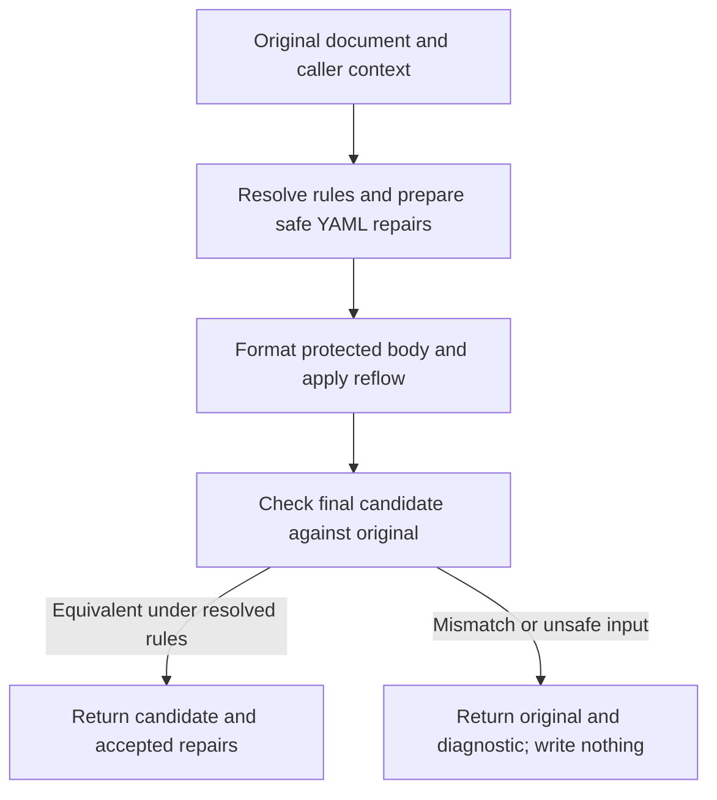

# Clean Fidelity and Formatting Rules

## Problem

Darkmatter's Markdown cleanup promises to "fix common formatting noise without
changing meaning" ([`docs/cli/clean.md`](../../docs/cli/clean.md)). Two
in-repo consumers call the library cleanup directly; neither invokes the other:

- the `md` CLI: `md clean` and `md FILE --save`
  ([`cli/src/commands/clean.rs`](../../cli/src/commands/clean.rs))
- DMLS `textDocument/formatting`
  ([`dmls/src/providers/formatting.rs`](../../dmls/src/providers/formatting.rs)).
  `format_text` calls `Markdown::cleanup*` in-process, plus `reflow_to_width`
  when it is configured, and returns one whole-document `TextEdit`. Its module
  docs say "Frontmatter and directive lines pass through untouched." That is
  not true today.

DMLS cleans a document **only** when the client sends
`textDocument/formatting`. In practice that means an explicit "Format
Document", or format-on-save in an editor where DMLS is the selected Markdown
formatter. DMLS advertises no range, on-type, or `willSaveWaitUntil`
formatting. Neither the VS Code nor the Zed extension makes DMLS the default
formatter or turns on format-on-save.

There are four problems.

1. **Cleanup changes the CommonMark structure of plain Markdown.** Block
   content inside list items gets pushed out of its item. Lists split in two,
   and prose and nested lists become code blocks. No Darkmatter syntax is
   needed to trigger this.
2. **Cleanup ignores Darkmatter directives.** It parses the body as plain
   CommonMark. A column-0 directive line right after a paragraph counts as a
   _lazy continuation_ of that paragraph, so the serializer moves it into the
   container (`> ::end-block`, `    ::block …`). Compose no longer sees it as a
   directive, and the document fails to compose.
3. **The defaults rewrite things an author chose.** Every default entry point
   passes `IncidentalNewlineMode::Strip`, so authored hard wraps are joined.
   DMLS has no setting to stop this. The serializer's
   `increment_ordered_list_bullets: true` option renumbers a deliberate
   `1. 1. 1.` list to `1. 2. 3.`.
4. **Nothing can be controlled per document, and the two consumers behave
   differently.** The only controls are CLI flags and a DMLS workspace config
   (`cleanup` variant, `fixed_width`). Frontmatter repair is orchestrated inside
   the CLI (`cli/src/commands/clean/frontmatter_repair.rs`), so DMLS formatting
   never repairs frontmatter.

Found in a real file: running `md clean` on `prompts/commit.md` (blob
`464e2d90e`) gives a document with an unclosed `::block`, a blockquote pushed
out of a list item, a sub-list that changed its parent, a fenced example that
moved out of its list item, and every hard-wrapped paragraph joined into one
line.

### Reproductions

Every case below was run through `md clean` on 2026-10-11. "Structure" means
the HTML from the CommonMark reference renderer (`commonmark` 0.31.2) for the
input and for the output. Whitespace-only lines are written `·` here.

| # | Severity | Input | `md clean` output | Effect |
| --- | --- | --- | --- | --- |
| E1 | content → code | `4. step\n\n    > lead:\n    > \n    > - a\n    > - b\n\n5. next\n` | `4. step\n····\n>    lead:\n> \n>     - a\n>       - b\n\n5. next\n` | The blockquote leaves item 4, the ordered list splits in two, and the list inside the quote becomes an indented **code block** (`<pre><code>- a  - b`) |
| D1 | content → code | `1. top\n    - Example:\n\n        ```\n        code\n        ```\n\n        after\n2. next\n` | the fence moves from column 8 to column 5, with `········` lines around it | The fence leaves the `Example:` item, and the paragraph `after` becomes a **code block** |
| C1 | structure | `- item:\n\n    > {{message}}\n\n- next\n` | `- item:\n····\n>   {{message}}\n\n- next\n` | The blockquote leaves the item, and the list splits into two lists around a top-level quote |
| A1 | compose fails | `::block when="a"\n\n> note\n::end-block\n` | `…\n> note\n> ::end-block\n` | The CommonMark HTML is the same, but `md compose` now fails: "Add a matching `::end-block` directive to close the region" |
| B1 | directive moved | `1. first\n::block when="m"\n    - nested\n::end-block\n2. second\n` | `1. first\n    ::block when="m"\n\n    - nested\n        ::end-block\n\n2. second\n` | The directive lines are re-indented, one to column 8 (indented-code territory), and blank lines are added next to them |
| F1 | whitespace | `> a\n>\n> b\n` | `> a\n> \n> b\n` | A trailing space is added. Cleanup removes authored trailing whitespace elsewhere, yet adds its own here and in the whitespace-only lines of C1/D1/E1 |

### Root causes

These are hypotheses for the implementer to confirm; they are not yet proven.

- **Directive-blind parse.** `cleanup_content_internal`
  ([`lib/src/markdown/cleanup/mod.rs`](../../lib/src/markdown/cleanup/mod.rs))
  hides only _opaque directive bodies_ (`protect_opaque_directive_bodies`).
  Directive _lines_ reach pulldown-cmark as ordinary text. CommonMark's
  lazy-continuation rule then puts them inside the preceding paragraph's
  container, and `pulldown-cmark-to-cmark` writes that container's prefix in
  front of them. Compose's recognizer (`scan_darkmatter_directives`,
  [`compose/directives_api.rs`](../../lib/src/markdown/compose/directives_api.rs))
  does not accept a `> ` prefix for those lines, so their recognition changes.
  Block-pair scanning separately supports quoted shell blocks; protection must
  share each family's existing recognition rules rather than introduce a new
  directive grammar.
- **Container prefixes lost for non-paragraph children of list items.**
  `pulldown-cmark-to-cmark` and the string passes that follow it
  (`fix_list_indentation`, `restore_list_markers`,
  `extract_additional_paragraph_contexts` in
  [`cleanup/lists.rs`](../../lib/src/markdown/cleanup/lists.rs)) re-indent
  paragraph lines by list-item context. They do not keep the item's
  continuation indent on blockquote, fenced-code, or nested-list lines inside
  that item. Those lines drop to the wrong column (E1, C1, D1), and the indent
  that was meant for them is left behind as a whitespace-only line.
- **No output check.** Nothing compares cleanup's output with its input, so a
  change in meaning is written to disk, or returned as an LSP edit, without
  anyone noticing.

## Design

The fix has two parts. **Invariants** are guarantees that every run of
cleanup keeps, whatever the configuration. **Rules** are the formatting a
document opts into or out of under `style.markdown`.

### Invariants (always on, not configurable)

1. **Directive lines are fixed points.** Every line that compose's directive
   scanners recognize comes out of cleanup byte-for-byte unchanged, including
   its line terminator, at the same column, in the same order, and in the same
   container. Absolute line numbers may change when earlier prose is formatted.
   Protection covers every family, including disclosure boundaries and quoted
   `::shell-block` regions. Shell-block bodies are opaque; a `::shell` line
   carries its command on that line. Expression tokens (`{{ … }}`, escaped
   expressions, and body shell expressions) retain their exact source spelling
   and order; cleanup never evaluates them or splits inside them. Cleanup never
   adds or removes a container prefix
   (`>`, list indent) on a directive line. It never inserts blank lines next to
   one either: in B1, a blank line after `::block` would turn the tight list
   into a loose one once compose removes the directive. Ordinary Markdown
   _between_ `::block` and `::end-block` is still formatted.
2. **CommonMark structure is invariant.** Rules may change spelling only. No
   rule may change which container each block is in, block kinds, the
   ordered-list start number, or code-block content. Inline meaning also stays
   unchanged: links, images, emphasis, hard breaks, raw HTML, and task state.
   Two narrow, intentional exceptions are allowed: an explicitly selected
   `list-item-padding` or `list-interior-padding` value may change whether a
   list is tight or loose (see [List spacing](#list-spacing)), and
   `default-language` may add an info string to an unlabeled fence. These
   exceptions are checked against the resolved rules, never ignored globally.
3. **No trailing whitespace is introduced.** A whitespace-only line or a
   trailing space appears in the output only if it was in the input at the same
   logical position. Bytes inside fenced or indented code are preserved.
4. **Fidelity guard.** After the rules run, the output is compared with the
   input (see [Decision: guard on structure,
   fail closed](#decision-guard-on-structure-fail-closed)). If they are not
   equivalent, cleanup returns the input **unchanged** and reports one
   diagnostic, `clean.fidelity-fallback`, naming the first diverging block (line
   and column in the input, plus the kind of difference).
   - Human CLI output prints the diagnostic to stderr. `--json` includes it
     only in the existing version-1 envelope and keeps stderr empty. The
     envelope reports `changed: false`, `applied: []`; even accepted candidate
     frontmatter repairs are discarded. Without `--save`, human mode emits
     the original document; `--save` writes nothing. A fidelity refusal is a
     report-only finding and exits `0`; unrepaired invalid YAML remains an
     error and exits `1`.
   - DMLS returns no edits and shows the diagnostic through
     `window/showMessage` at `Warning` level, so a format-on-save that declined
     is visible rather than silent.
   - Invariants 1–3 are the real fix. The guard is the backstop that turns any
     _remaining_ serializer bug into "not cleaned" instead of "corrupted".

### Rules: `style.markdown`

These keys are optional (missing or `null` means no document override) and
are added to the embedded baseline schema
([`docs/schemas/darkmatter.yaml`](../../docs/schemas/darkmatter.yaml)) under
the existing `style` root, so DMLS completes and validates them like any other
`style.*` key:

```yaml
style:
    markdown:
        frontmatter: "boolean(default(true)) -> Apply non-destructive frontmatter repairs."
        table-layout: "boolean(default(true)) -> Pad table cells so columns line up."
        fixed-width:
            - "number(integer; min(1); max(1000)) -> Unwrap, then re-wrap prose to this display width."
            - "boolean(default(false)) -> false: never re-wrap; true: re-wrap to 120."
        unwrap: "boolean(default(false)) -> Join single line breaks inside paragraphs."
        indentation: "enum(preserve, 2, 4, 8; default(4)) -> Spaces per nested-list level; preserve leaves list indentation as authored."
        ordered-lists: "boolean(default(true)) -> Renumber ordered lists that are neither uniform nor sequential."
        list-padding: "boolean(default(true)) -> Ensure one blank line before and after every list."
        list-item-padding: "enum(preserve, none, one; default(preserve)) -> Blank lines between sibling items of the same list."
        list-interior-padding: "enum(preserve, none, except-nested-lists, all; default(preserve)) -> Blank lines between an item's first line and the blocks nested inside it."
        default-language: "string(default(text); suggest(text, plain)) -> Language added to unlabeled code fences; an empty string adds none."
```

The exact schema DSL spelling is the implementer's to get right; the types and
defaults above are the decision. YAML indentation values are integers `2`, `4`,
or `8`, or the string `preserve`; quoted numerals are not silently coerced.
Defaults are runtime rule defaults, not values inserted into frontmatter. They
remain available when the baseline is disabled or replaced. A document schema
may constrain these keys further but cannot authorize unsupported rule values.

The `style:` runtime parser and descriptor catalog must also recognize
`markdown` and validate its leaves. Rendering accepts valid cleanup settings
without treating them as unknown or inactive render styles, including under
`--strict-style`; rendering does not run cleanup. DMLS completion and validation
use the same declarations as the library. Updating only the YAML catalog is
insufficient.

| Key | Default | Behavior | Example |
| --- | --- | --- | --- |
| `frontmatter` | `true` | Applies the deterministic, safety-proven repairs that `md clean` performs today. `false` leaves the frontmatter block byte-for-byte. | the repairs listed under "Frontmatter Repair" in `docs/cli/clean.md` |
| `table-layout` | `true` | Pads cells so each column has one width, and aligns the delimiter row. Never changes how the table renders. | `\| a \| bb \|` rows padded to equal widths |
| `unwrap` | `false` | Joins single newlines inside paragraphs, including list-item and blockquote paragraphs. Hard breaks (trailing two spaces or `\`) stay. | `one\ntwo` → `one two` |
| `fixed-width` | `false` | An integer, or `true` (meaning 120), first unwraps and then re-wraps prose to that display width, counting container prefixes. It implies `unwrap`. `false` means no re-wrapping. | `fixed-width: 80` |
| `indentation` | `4` | `2`, `4`, or `8` re-indents nested lists to N spaces per level, using CommonMark-valid marker padding where needed so the list tree is the same. Marker width sets a minimum continuation indent; when N spaces would change the tree, use the nearest valid continuation indent instead. `preserve` leaves list indentation as authored. | 2-space nesting → 4-space |
| `ordered-lists` | `true` | Leaves a list alone when every number equals the first (`1,1,1`, `3,3,3`) or the numbers count up by one from the first (`1,2,3`, `3,4,5`). Otherwise renumbers sequentially from the first number. Render-neutral, because CommonMark uses only the start number. | `1,3,8` → `1,2,3`; `1,1,1` unchanged |
| `list-padding` | `true` | Ensures exactly one blank line before and after each list block (never more), where doing so preserves the block tree and tight/loose state, unless the neighbor is a directive line (invariant 1) or the list is the first or last block in its container. Required separators are never removed. | `Intro:\n- a` → `Intro:\n\n- a` |
| `list-item-padding` | `preserve` | Blank lines **between sibling items**. See [List spacing](#list-spacing). | `none`: `- a\n\n- b` → `- a\n- b` |
| `list-interior-padding` | `preserve` | Blank lines **inside an item**, before the blocks nested in it. See [List spacing](#list-spacing). | `all`: blank line added before a nested list |
| `default-language` | `"text"` | Adds this info string to a fence that has none. Existing info strings remain exact. Values containing line breaks, control characters, or backticks are rejected so they cannot break a fence. `""` adds nothing. | ```` ``` ```` → ```` ```text ```` |

#### List spacing

Three settings control blank lines around and inside lists. Each owns a
different kind of boundary:

```text
Some intro paragraph.
                              <- list-padding           (before the list)
- Install the tool
                              <- list-interior-padding  (item -> nested block)
    Run it once first.
                              <- list-interior-padding  (nested block -> next nested block)
    - macOS
                              <- list-item-padding      (between nested siblings)
    - Linux
                              <- list-item-padding      (between top-level siblings)
- Configure it
                              <- list-padding           (after the list)
Closing paragraph.
```

The blank lines are drawn at every boundary a setting _could_ fill. What each
setting actually does depends on its value. `list-padding` is a boolean and
is on by default. The other two default to `preserve`, which leaves your blank
lines exactly as you wrote them.

**Why these two default to `preserve`: tight and loose lists.** In CommonMark,
a blank line between two items of a list, or between an item's first line and
something nested in it, makes that whole list _loose_. Every item in a loose
list renders as a paragraph, with more vertical space between items in HTML.
A list with no such blank lines is _tight_. So these two settings change how
a list looks when rendered, not just how its source looks. That is why they
are opt-in, and why the fidelity guard allows a tight/loose change only on a
list where one of them was explicitly set. `list-padding` never affects
tight/loose, because blank lines outside a list don't count.

##### `list-item-padding`: blank lines between sibling items

It applies to the siblings of every list, at every nesting level. The boundary
from the end of an item, including its last nested block, to the next sibling
is a sibling boundary.

| Value | Meaning |
| --- | --- |
| `preserve` | Leave sibling spacing as written. |
| `none` | No blank line between siblings. Lists become tight unless something inside an item keeps them loose. |
| `one` | Exactly one blank line between siblings, never more. Lists become loose. |

The same list under each value:

```md
<!-- none -->
- apples
- pears
    - green
    - red
- plums

<!-- one (list-interior-padding left at preserve) -->
- apples

- pears
    - green

    - red

- plums
```

Under `one`, both lists get one blank line between siblings: the top-level
items and the nested `green`/`red`. `- green` stays directly under `- pears`
because that boundary is an item's interior, which `list-interior-padding`
owns. Here it is left at `preserve`.

The CLI's existing `--compact` maps to `none` and `--loose` maps to `one`.
With neither flag, nothing is overridden.

##### `list-interior-padding`: blank lines inside an item

A list item's _first line_ is the text after its marker. Anything after that
inside the item is a _nested block_: another paragraph, a nested list, a code
block, or a blockquote. This setting controls the blank line before each
nested block that follows directly after the item's first line or a previous
nested block.

CommonMark already requires a blank line before a **paragraph** nested in an
item; without it, the text merges into the line above. Cleanup never removes
that blank line. So in practice the values differ only for nested lists, code
blocks, and blockquotes, which can sit directly under the line above.

| Value | Meaning |
| --- | --- |
| `preserve` | Leave interior spacing as written. |
| `none` | Remove every blank line inside items that CommonMark doesn't require. Nested lists, code blocks, and quotes sit directly under the line above. |
| `except-nested-lists` | One blank line before every nested block **except** a nested list, which stays directly under its parent line. This suits documents where items carry prose and code but sub-bullets read as part of the item. |
| `all` | One blank line before every nested block, including nested lists. |

The same item under each value:

```md
<!-- none -->
- Install the tool
    ```sh
    brew install tool
    ```
    - macOS
    - Linux

<!-- except-nested-lists -->
- Install the tool

    ```sh
    brew install tool
    ```
    - macOS
    - Linux

<!-- all -->
- Install the tool

    ```sh
    brew install tool
    ```

    - macOS
    - Linux
```

Required blank lines are never removed. These include the one before a nested
paragraph, and the one between a nested list and a paragraph after it (without
it, the paragraph would join the last nested item). Any boundary a value
cannot reach safely is left as written.

**With every rule at its default**, cleanup:

- repairs frontmatter non-destructively
- leaves directives untouched
- keeps every hard wrap
- fixes misnumbered ordered lists
- requests 4-space list indentation, retaining valid continuation indents
- pads tables
- pads lists with one blank line before and after where structure permits
- labels unlabeled fences `text`

**With every body rule off**, the body is byte-for-byte unchanged, including
blank lines, markers, line endings, and final-newline presence; only enabled
frontmatter repair can edit the document. These settings are: `unwrap: false`,
`fixed-width: false`, `ordered-lists: false`, `list-padding: false`,
`table-layout: false`, `default-language: ""`, `list-item-padding: preserve`,
`list-interior-padding: preserve`, and `indentation: preserve`.

### Resolution and precedence

The value of each rule is resolved independently, highest first:

1. An explicit CLI flag for that rule, for that run (e.g. today's `--indent`
   and `--fixed-width`).
2. The document's own `style.markdown.<key>`.
3. DMLS workspace config, for DMLS runs only. The current `formatting.cleanup`
   and `formatting.fixed_width` are replaced by a `formatting.markdown` object
   with the same keys as `style.markdown`.
4. The runtime default documented in the baseline schema.

Absent or `null` values fall through; `false`, `preserve`, and `""` are explicit
values. A CLI parser's default is not an explicit flag. `--ignore-incidental-newlines`
sets `unwrap: false` and `fixed-width: false`, overriding a document's width;
`--fixed-width N` sets width N and implies unwrapping. Their existing mutual
exclusion remains. At other levels, a resolved positive width also implies
unwrapping; `fixed-width: false` does not cancel a separately enabled unwrap.

Resolve document rules once, passively, from the original frontmatter or a
syntax-repaired candidate when the original cannot parse. Never execute an
expression, shell command, remote read, or composition to obtain a setting.
Pending executable values are unusable as formatting settings and produce a
source-positioned diagnostic. An invalid `style.markdown` object is ignored as
a whole, while CLI/workspace/default rules still apply. Unrelated frontmatter
schema findings do not invalidate otherwise usable formatting settings.
Invalid workspace rules are reported by the config loader and do not enter
the resolved options.

Unrepaired invalid YAML retains the CLI's existing error contract: exit `1`,
no save, and a JSON envelope with an empty stderr in JSON mode. DMLS returns no
edits and reports the finding. Do not silently clean a body while claiming the
whole malformed document was accepted. If YAML parses but document rules are
invalid, body formatting may proceed using levels 1, 3, and 4.

`frontmatter: false` is decided before committing any repair: candidate repairs
may help read settings but are never emitted when repair is disabled. If
malformed YAML prevents discovering this setting, repair is enabled by the
other applicable levels; an undiscoverable setting is not guessed. Preserve
the entire original frontmatter block, even empty blocks, delimiters, comments,
and line terminators, except for accepted repair edits. If disabling repair leaves invalid YAML,
return the invalid outcome without emitting the candidate. Preserve its following
blank-line boundary unless a body rule explicitly and safely changes it.

### Passes not covered by a rule

Cleanup has passes beyond the rules above: blockquote spacing fixes, bracket
unescaping, emphasis placeholder restoration, the `PREFER_ITALICS` environment
variable, and removal of the blank line after frontmatter. Each pass that
remains must be one of two things:

- **artifact repair:** it only undoes something the parse and serialize round
  trip added, such as escape and emphasis restoration
- **mapped to a rule above**

Anything else is removed. This intentionally removes ambient `PREFER_ITALICS`
restyling from cleanup; authored emphasis delimiters remain intact. It also
removes unconditional blank-line and final-newline normalization. Every rule
must preserve disabled regions rather than expose them to incidental serializer
rewrites. Preserve untouched LF/CRLF terminators and BOMs; newly inserted body
lines use the local neighboring line terminator (LF for an empty body). The
implementer records each pass and which of the three outcomes it got in the
implementation log.

### Frontmatter repair moves into the library

`frontmatter: true` has to mean the same thing in DMLS as in the CLI. The repair
orchestration in `cli/src/commands/clean/frontmatter_repair.rs` moves into the
`darkmatter` library behind one entry point that both consumers call. The CLI
keeps only argument handling, output, and file writes. DMLS gets frontmatter
repair as part of formatting, using the current editor buffer rather than a
fresh disk read.

The shared entry point accepts raw document text, explicit rule overrides, and
the caller's existing document resolution context/schema controls. It returns
output text, an outcome (`unchanged`, `changed`, `declined`, or `invalid`),
source-positioned diagnostics, and only repairs actually emitted. It must be
usable before constructing a `Markdown`, since malformed frontmatter is part
of its input contract. Lower-level body-only APIs use the same protected
transforms and guard; their existing string-returning wrappers return the
original body on refusal. Diagnostic-aware consumers use the result-bearing
API. No default wrapper retains the old newline-stripping behavior.

Use the existing Darkmatter schema-cleaning machinery and biscuit-file YAML
analysis/edit utilities; do not add a second YAML editor. Schema selection
retains baseline → matching triggers → document schema, with the existing CLI
schema overrides. File-backed requests use the document context derived from
the caller's request; stdin and untitled editor buffers have no file-backed
trigger discovery. A shared repair routine must not recapture the process
working directory, home, or repository, and DMLS must not add network access or
execute document content. A missing or unreadable referenced schema is reported
through the existing typed errors, not silently replaced by a guessed schema.

Frontmatter repair and body formatting are one transaction. Check the final
candidate once all transforms have finished, including reflow and reassembly. On refusal,
discard all candidate edits. The guard compares body meaning independently
from frontmatter; frontmatter safety remains the existing repair proof. DMLS
converts byte-based authored spans to the client's negotiated position encoding
and sends warnings through its router/client layer, keeping the formatter
library free of protocol side effects.

## Decision: Guard on Structure, Fail Closed

**Choice:** compare normalized structure and inline meaning of the input and
output, and fall back to the whole unchanged document when they differ.

**Comparison:** compare normalized semantic event sequences directly; no
hash is required. Retain the original source ranges so a mismatch can name the
first affected input block. Use the same cleanup parser options for input and
output: all currently enabled extensions, excluding smart punctuation and
definition lists. This covers Darkmatter's Markdown dialect, not only the
CommonMark subset used by the reproductions.

Compare:

- all container kinds and nesting, list ordered flag/start, headings, table
  column alignment and cells, footnote definitions, and extension blocks
- inline structure and values: emphasis/strong/strikethrough, inline code,
  link/image destination and title, hard breaks, footnote references, task
  checkbox state, and inline/block HTML bytes
- decoded text exactly (coalesce adjacent text events before comparison),
  allowing only ordinary prose soft breaks to become
  spaces or move under resolved `unwrap`/`fixed-width`; do not collapse arbitrary
  whitespace runs, nonbreaking spaces, code whitespace, or HTML
- code-block content bytes, checked from source spans as well as events so
  parser normalization cannot conceal line-ending or whitespace changes;
  existing fence info strings exactly, with only the
  resolved `default-language` addition allowed on an originally unlabeled fence
- reference definitions, including unused definitions, their labels, targets,
  and titles: these do not all appear in the event stream, so retain the
  parser's definition table/source ranges rather than silently dropping them
- list tight/loose state except at lists affected by an explicitly requested
  `list-item-padding` or `list-interior-padding` value; list marker spelling is separately preserved when no rule
  authorizes changing it; ordered numbers after the first may change only
  under the ordered-list rule
- protected source spans: complete directive lines with prefixes/terminators,
  expression spellings, opaque shell bodies, their order/container placement,
  and whether immediately neighboring lines are blank

Directive-aware parsing must avoid lazy-continuation reassociation without
breaking lists that continue across a directive. Reuse source spans and
container information; do not clean independently split chunks and concatenate
them. Code examples that merely look like directives remain ordinary code.
Both parses use the same protection policy. Compare protected bytes separately
from any masked event view, so masking cannot hide moved or lost syntax.
Malformed/unpaired directive regions are left unchanged and reported, without
attempting composition. A serializer failure likewise returns a declined result
rather than a silent string fallback. Use the same report-only diagnostic
channel for these refusals, with a reason that distinguishes malformed syntax,
serialization failure, and an actual semantic mismatch.




**Diagnostic representation:** extend the Darkmatter-owned clean diagnostic
model to represent `clean.fidelity-fallback`; do not add Markdown-specific
codes to biscuit-file's YAML diagnostic enum. Preserve the version-1 JSON
fields and existing code/classification spellings. This report-only finding
uses `non_deterministic_find`, `repairs: []`, a whole-document authored span,
and one-based lines/byte columns. Keep diagnostics in stable source order.
If the output adds a block with no direct input counterpart, use the nearest
input boundary (EOF if appropriate). No synthetic output coordinates are
reported as authored coordinates.

**Why fail closed, for the whole document:** cleanup is a convenience, and
corruption is not an acceptable trade for it. Falling back block by block would
mean splicing original and cleaned text, which creates the same seam bugs this
fix removes. A document that comes back uncleaned with a diagnostic is a clear,
correct result. A fallback on valid supported syntax is a cleanup defect, not
successful formatting. The corpus check must distinguish those defects from intentionally
malformed documentation examples and report both; the latter still remain
unchanged with a diagnostic.

**Parse budget:** the existing
[`parse-count tests`](../../lib/src/markdown/cleanup/tests/parse_count.rs)
measure cleanup and reflow parses, not every parse performed by directive
scanning. Plain body cleanup changes from one counted parse to two (reuse the
unmodified input events, then parse the final candidate). Cleanup plus the
existing separate reflow changes from two to at most three counted parses;
the guard runs after reflow, never just before it. Standalone strip/reflow
helpers retain their existing counts unless made guarded public operations,
in which case their final-output parse is included explicitly. Unchanged or
malformed protected input may short-circuit below these ceilings.

Shared directive/code-region scanners also construct parsers outside
`cleanup_parser`; record those separately or route reusable scans through the
same instrumentation. Do not claim the counted budget is total work while
leaving these scans unmeasured. Reuse available event/range information rather
than introducing a parse per directive or rule. No performance spike or new
benchmark gate is required for this review.

## Out of Scope

- **Refactoring the CLI flags.** That is a future change. Existing flags keep
  working, and a flag that maps to a rule overrides the document for that run.
  `--ignore-incidental-newlines` remains accepted and explicitly disables
  document-selected reflow. `--compact` and `--loose` become overrides of
  `list-item-padding` (`none` and `one`), and the library's compact and loose
  cleanup variants are expressed the same way.
- **Heading structure** (no skipped levels). It is deferred and is not added
  to the schema until it is built, so no key exists that silently does
  nothing.
- Prettier, or any other third-party formatter, mangling Darkmatter files. That
  is configured on the editor side. This spec covers only what Darkmatter
  itself writes.

## Acceptance Criteria

1. **Reproductions.** E1, D1, C1, A1, B1, and F1 are L1 tests in
   `lib/src/markdown/cleanup/tests/`. With all rules at their defaults, each
   output equals its input exactly, except D1, which gains only `text` on its
   fence and stays at column 8. (Every repro is already 4-space indented,
   padded, and correctly numbered, so no default rule has anything to change.)
   With body rules disabled, output equals input exactly. E1, C1, and D1 also
   keep their structure under each non-default `indentation` value
   (`2`, `8`, `preserve`), `unwrap: true`, `fixed-width: 80`, and each
   `list-item-padding` and `list-interior-padding` value, allowing only the
   documented tight/loose change. Test multi-digit markers and code children where a requested indent
   cannot be used literally.
2. A1 and B1, after cleanup, give the same `md compose` output as their
   inputs, with `when` both true and false, using fixture-owned data and no
   shell/network effects.
3. **Directive fixed points.** For every rule, there is a test with a directive
   line following each of: a blockquote paragraph, a list-item paragraph
   (ordered and unordered, nested two levels), and a table. Each test shows the
   directive line unchanged and no blank line inserted next to it.
4. **One test per rule.** Each `style.markdown` key has a test of its default
   and of each non-default value, using the examples in the rules table. That
   includes `fixed-width: true` resolving to 120, `fixed-width` implying
   `unwrap`, `default-language: ""` adding nothing, and `ordered-lists`
   leaving `1,1,1`, `3,3,3`, and `3,4,5` alone while fixing `1,3,8` and
   `2,2,5`. Every example in [List spacing](#list-spacing) is a test, with its
   expected output exactly as shown. Required separators (a nested paragraph,
   and a paragraph after a nested list) survive `none` under both padding
   rules.
5. **DMLS config migration.** The old `formatting.cleanup` /
   `formatting.fixed_width` shape is translated with one migration warning per
   key, as described in the sibling-spacing decision. A mixed old/new config
   is rejected with a diagnostic. `--compact` and `--loose` produce the same
   output as `list-item-padding: none` and `one`.
6. **Precedence.** Tests show that a CLI flag beats the document, the
   document beats DMLS config, and DMLS config beats the schema default. They
   also show that an invalid `style.markdown` falls back as described in
   [Resolution and precedence](#resolution-and-precedence).
7. **Fidelity guard.** `clean.fidelity-fallback` has tests that use an
   artificially broken pass (a test-only hook). They show that `md clean` writes
   nothing under `--save` and reports the diagnostic in `--json`, and that DMLS
   `formatting` returns an empty edit list and sends one warning. Also cover
   mutations of link targets, titles, emphasis, hard breaks, HTML, task state,
   table alignment, reference definitions, expressions, and code/info strings.
   Verify that default mode detects tight/loose changes, while an explicit
   padding rule permits only the intended lists to change spacing. Include a
   failure introduced by reflow and a refusal after a candidate YAML repair;
   the original whole document survives and `applied` is empty.
8. **Frontmatter parity.** Frontmatter repair is a library entry point. The
   same broken-frontmatter fixture is repaired identically by `md clean` and by
   DMLS `formatting`. With `frontmatter: false`, both leave the block
   byte-for-byte; if it remains invalid YAML, CLI returns the documented error
   and DMLS returns no edit.
9. **Idempotence.** `clean(clean(x)) == clean(x)` for every fixture in criteria
   1–4.
10. **Real-world fixture.** `prompts/commit.md` at blob `464e2d90e` is checked
   in as a cleanup fixture. With defaults, its output composes without error,
   passes the guard, and keeps every hard wrap.
11. **Corpus check.** Run cleanup with defaults (without saving) over every
    tracked `*.md` file in the repository. The implementation log records how
    many documents were processed, changed, declined, or invalid, and the
    reasons for refusals. Each fallback on valid supported syntax is either
    fixed in this change or written up as a new `_unscheduled` fix with its
    minimal reproduction. Intentionally malformed examples are recorded
    separately rather than treated as regressions. This scan is passive: it
    never composes documents or executes shell/remote content. The
    run is not added as a CI gate.
12. Parse-count tests enforce the entry-point ceilings described above,
    including final-output verification after reflow. Record separately counted
    scanner parses so the reported budget cannot hide repeated scanning.
13. **Source fidelity and invocation coverage.** Include CRLF, mixed line
    endings, BOMs, empty frontmatter, missing final newline, all-body-rules-off,
    unused reference definitions, and malformed directive/frontmatter cases.
    Use shipped-schema corpus validation plus normal CLI invocation tests
    (`CliProcessFixture`) for `md clean`, stdin/JSON/save, and the top-level
    `md FILE --save` route. Exercise DMLS formatting through its protocol route,
    with the current unsaved buffer, positioned diagnostics, and no host focus.
    Use the monorepo test toolkit and nextest via package-area recipes; pure
    text/protocol checks belong in L1 and need no real terminal or browser.
14. **Docs** are updated in the same change:
    - a `docs/` topic page for `style.markdown` covering each key, a compact
      example per key, the precedence order (as a Mermaid diagram), and the
      invariants. List spacing gets its own section, written for a reader who
      has never heard of tight and loose lists: the boundary diagram, what
      tight and loose mean and how each looks when rendered, and a
      same-input/each-value example for every value of both padding rules
    - [`docs/cli/clean.md`](../../docs/cli/clean.md): the invariants, the
      fallback diagnostic, and that the document's `style.markdown` drives
      cleanup unless a flag overrides it
    - [`docs/lsp/features.md`](../../docs/lsp/features.md) and the DMLS config
      docs: `formatting.markdown`, frontmatter repair during formatting, and
      that formatting may decline with a warning
    - the `formatting.rs` module docs describe the guarantee that now actually
      holds
    - the `darkmatter` skill (`.claude/skills/darkmatter/`) where it describes
      cleanup

## Decision: Sibling Spacing Is Its Own Rule

The existing compact and loose controls (`--compact`/`--loose`, the library's
compact and loose variants, DMLS's `formatting.cleanup`) govern blank lines
**between sibling items**. `list-interior-padding` governs a different
boundary, so it cannot replace them. `list-item-padding` carries that control
instead, so documents get the same choice CLI callers have.

DMLS migration: the old `formatting.cleanup` and `formatting.fixed_width`
shape is recognized and translated with a migration warning. `compact`
becomes `list-item-padding: none`, `loose` becomes `one`, `default` sets no
override, and `fixed_width` becomes `fixed-width`. A config that mixes the old
and new shapes is rejected. Unknown keys are never silently ignored.
