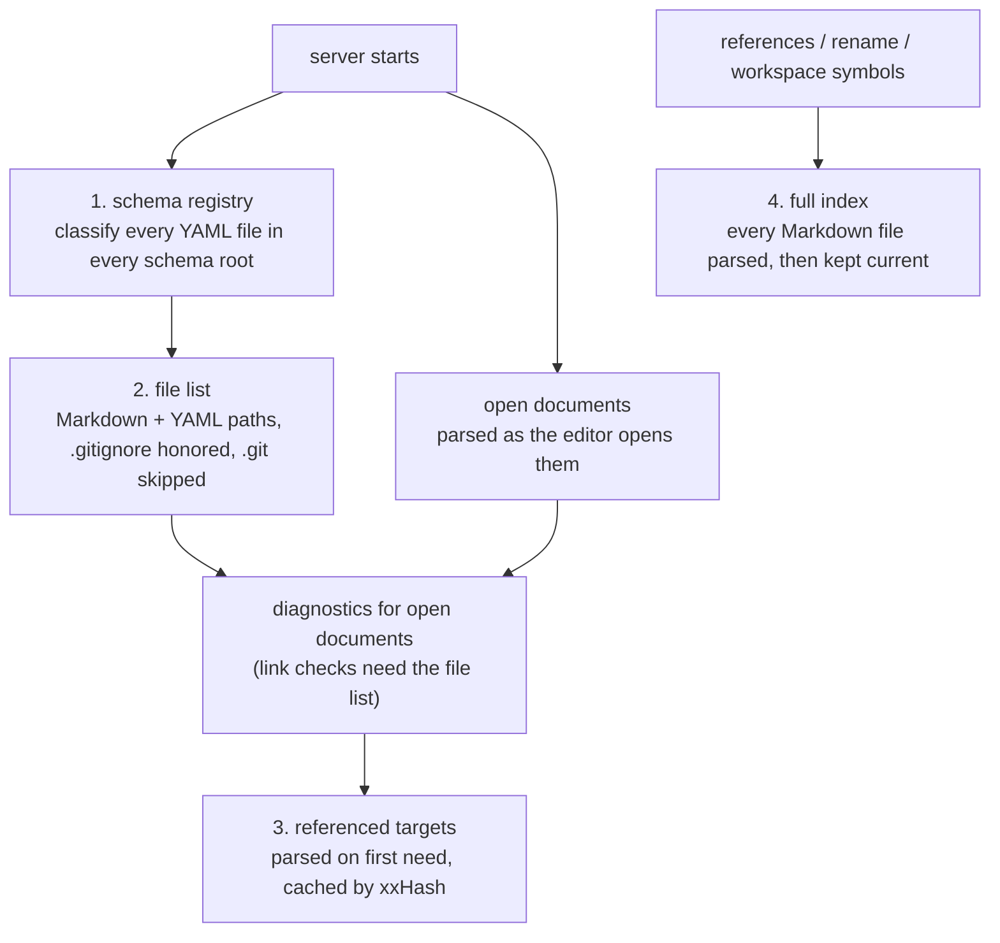

# DMLS Startup Schema Registry and Logging

This fix does three things:

1. It stops one malformed YAML file from breaking schemas for a whole
   repository, and stops DMLS from logging that failure on every request.
2. It reorders DMLS startup so the server does only the work that matters
   first: classify every schema file, list the workspace's files, and parse
   the documents the editor has open. Everything else is parsed when a feature
   needs it.
3. It makes DMLS's logs say what it found and where its time goes.

The persistent backlink and symbol store that builds on this is a separate
feature, `2026-10-17-dmls-index-store`. Until it lands, the full index this
spec builds on demand lives in memory.

## The Incident

On 2026-10-17 at 17:30:52Z, while `prompts/agent-skills.md` was open in Zed,
DMLS began writing this warning without pause:

```text
WARN dmls::overlay: retaining last-good trigger registry
  path=…/.ai/prompts/agent-skills.md
  error=trigger-schema file `…/schemas/feature-review.yaml` is malformed:
  invalid trigger-schema match expression: trigger-schema envelope is not
  valid YAML: mapping values are not allowed in this context at line 17 column 93
```

The author closed Zed to stop it. Investigation showed:

- `schemas/feature-review.yaml` was mid-edit. Line 17 briefly held an
  unquoted value containing `` `<ID> (<priority>): <title>` ``; the `: ` at
  column 93 is invalid in a plain YAML scalar. The file was saved, quoted and
  valid, at 17:31:34Z. Stripping the quotes reproduces the exact error.
- The file **does not claim** `kind: trigger-schema`. It is an ordinary
  SimplifiedSchema file that happens to live in a schema root.
- Nothing reached disk. DMLS logs to stderr unless given `--log-file`, and Zed
  keeps LSP stderr in memory. The cost was CPU and editor memory.

## Findings

### F1. Any unparseable YAML in a schema root is a trigger load error

`parse_trigger_envelope_from_str`
(`darkmatter/lib/src/markdown/schemas/triggers/envelope.rs`) parses YAML
**before** deciding whether the file claims the envelope, and maps a parse
failure to `SchemaError::TriggerMatch`. Discovery
(`triggers/discovery.rs::scan_with_embedded`) feeds it every `.yaml`/`.yml`
in every searched root, and discovery is transactional, so one syntax error in
an unrelated file rejects the whole scan.

This contradicts the documented contract in three places:

- `darkmatter/docs/topics/schemas/definition.md`: "an invalid opted-in
  envelope rejects the scan, while unrelated YAML files are ignored."
- `triggers/discovery.rs` module docs: "A file that does not claim
  `kind: trigger-schema` is silently ignored."
- `dmls/src/overlay/mod.rs` (authoring path): "ordinary schema-root YAML
  remains silent."

Blast radius, verified in a scratch repository:

- `md compose` of **any** document under that root fails
  (`schema validation failed`, exit 1). Claudine composes through the same
  path, so every Claudine launch in the repository would fail too.
- A freshly started DMLS has no last-good registry, so documents silently lose
  their trigger payloads.
- DMLS's schema-file authoring path publishes a trigger diagnostic on the
  ordinary YAML file.

### F2. A YAML syntax error is reported as a match-grammar error

Even for a file that *does* claim the envelope, a syntax error is wrapped as
"invalid trigger-schema match expression" and carries the hint "Fix the match
grammar or envelope shape… combinators, property conditions, and the `$path`
predicate". Neither is true: the file never got as far as the match grammar.

### F3. DMLS rescans every schema root on every request

`OverlayCache::trigger_registry` (`dmls/src/overlay/mod.rs`) calls
`scan_triggers` uncached. It is reached from `schema_for` on every overlay
build, which happens on hover, completion, semantic tokens, inlay hints,
document highlights, and diagnostics. Each call enumerates all five roots and
reads and parses every YAML file in them, plus payload resolution. That is
wasted I/O while the scan is healthy, and it is the loop that made F4 visible.

### F4. The retained-registry warning repeats on every request

The `tracing::warn!` in `trigger_registry` fires on every failed scan. The
code right below it already deduplicates the *diagnostic* transition (it
compares path and error text with the recorded failure), but the log line
ignores that comparison.

### F5. Startup parses every Markdown file, and reports one opaque number

```text
INFO dmls::router: startup index complete documents=5676
```

At startup DMLS walks the workspace and fully parses every Markdown file
(headings, links, wiki links, transclusions, `$schema` and file uses, variable
uses, frontmatter keys). `dmls --bench-index .` on this repository on
2026-10-17:

| Stage | Cost |
| --- | --- |
| walk (`ignore` crate, `.gitignore` honored) | 211 ms |
| read all files | 358 ms |
| xxHash all files | 5 ms |
| parse Markdown | 56 s of CPU, summed across worker threads |
| wall clock, end to end | 4.05 s |
| peak memory | 680 MB |

Zed had seven `dmls` processes running, and each one pays this.

Only three features need every document's contents (see
[R7](#r7-build-the-full-index-only-when-a-feature-needs-it)); the rest need
the file list, the open documents, and the documents those reference.

The log line is accurate but uninformative. `documents` is the Markdown file
count (it matches `rg --files --hidden -g '*.md' -g '*.markdown'` exactly), but
the line does not say so, YAML files (272 here) are never mentioned, and
nothing reports the schema files that shape every document.

The walk itself has two gaps:

- it uses `hidden(false)`, which with the `ignore` crate **descends into
  `.git/`** in a primary checkout (about 3,800 files in this repository's
  common git dir), none of which can ever match;
- the `ignore` crate applies `.gitignore` only inside a git repository
  (`require_git` defaults to `true`). A workspace that is not a repository but
  has a `.gitignore` excluding `node_modules/` walks `node_modules/` anyway.

### F6. Nothing reports where request time goes

DMLS is often slow to answer editor requests
(`2026-10-11-dmls-request-timeouts` records 120-second timeouts). No log line
names a slow request, its document, or how long it took, so each slowness
report starts from nothing.

### F7. `.dmls.toml` has no reference page

The `[workspace]` section (`root`, `include`, `exclude`) is described only by
its source comments in `dmls/src/config/mod.rs`. The README's Configuration
section points readers at the original feature spec for the key list. No page
under `darkmatter/docs/` documents the file's keys, their defaults, or what
`include` controls (both discovery and the file-watch globs).

## How Startup Works After This Fix



| Step | Reads file contents? | When |
| --- | --- | --- |
| 1. Schema registry | schema-root YAML only | at startup, before anything else |
| 2. File list | no | at startup, on a background thread |
| Open documents | the open buffers | as the editor opens them, as today |
| 3. Referenced targets | each target, once | the first time a feature needs its headings or transclusions |
| 4. Full index | every Markdown file | the first references, rename, or workspace-symbols request |

## Requirements

### R1. Decide the claim before treating a parse failure as fatal (F1)

`parse_trigger_envelope_from_str` returns `Ok(None)` for source that is not
valid YAML **unless** the source claims the envelope. For unparseable source,
a claim is a line that:

- starts at column 0 with `kind`, then optional spaces, then `:`;
- has a value that is `trigger-schema`, written plain, single-quoted, or
  double-quoted;
- is optionally followed by whitespace and a `#` comment.

| Source (unparseable elsewhere) | Result |
| --- | --- |
| `kind: trigger-schema` | claimed → error (R2) |
| `kind: "trigger-schema"  # note` | claimed → error (R2) |
| `  kind: trigger-schema` (indented, nested) | not claimed → `Ok(None)` |
| no `kind:` line | not claimed → `Ok(None)` |
| `kind: schema` | not claimed → `Ok(None)` |

Parseable source keeps today's behavior exactly: the claim is read from the
parsed mapping.

This one function serves discovery, the DMLS authoring path, and
`assemble.rs::file_claims_trigger_envelope`, so all three callers get the fix.
No caller may add its own pre-classification.

After this change the `overlay/mod.rs` authoring-path comment ("ordinary
schema-root YAML remains silent") is accurate again; leave it in place.

### R2. A claimed envelope with invalid YAML gets its own error (F2)

Add a dedicated `SchemaError` variant for "claims `kind: trigger-schema` but is
not valid YAML". It carries the YAML error's message and, when the parser
reports one, its line and column. It is wrapped in `TriggerLoad` like any other
load failure, so transactional semantics are unchanged.

- Its message names YAML syntax, not the match grammar. For example:
  ``trigger-schema file `…/x.yaml` is not valid YAML at line 17, column 93: mapping values are not allowed in this context``.
- Its help text points at YAML syntax (for example, quote a value that
  contains `: `), never at combinators or `$path`.
- DMLS publishes the diagnostic on the trigger file at the reported position
  when it has one, else at the start of the file as it does today.

`TriggerMatch` remains for genuine match-grammar errors only.

### R3. Build the schema registry once, at startup (F3)

Before anything else, DMLS classifies every YAML file in every schema root
that can apply to a document in the workspace:

| Root | Scope | Found by |
| --- | --- | --- |
| each `{package}/schemas/` | documents inside that package | the package catalog the resolution contexts already use |
| each `{package-area}/schemas/` | documents inside that package area | the same catalog |
| `{tree root}/schemas/` | every document in the tree | the workspace folder's tree root |
| `$SCHEMAS_DIR` | every document | the startup `RequestSnapshot` environment |
| `~/schemas/` | every document | `biscuit_file::home_dir()` via the snapshot |

Each file is classified as one of:

- **named schema**: a standalone SimplifiedSchema document
  (`parse_standalone_schema_document`), available by name to `$schema` and
  trigger payloads in its root's scope;
- **trigger schema**: claims `kind: trigger-schema` and loads (R1, R2);
- **unclassified**: neither, including a file that does not parse and does not
  claim the trigger envelope. Unclassified files are counted, never reported
  as errors.

A document's registry is the subset of this classification for that
document's five roots, with today's filename shadowing applied. It must equal,
trigger for trigger and in the same order, what
`triggers::scan(&context.for_source(path))` returns for that document. A test
enforces the equivalence.

**Serving a request never reads a schema-root file.** The registry changes only
when DMLS learns that one of its inputs changed:

- `workspace/didChangeWatchedFiles` or `didSave` for a YAML file;
- a server-rescan pass (`ServerState::rescan_workspace`);
- a change to the package catalog (an added or removed package or package
  area adds or removes a root).

For each changed path, DMLS re-reads the file, compares its
`biscuit_hash` xxHash with the recorded one, and reclassifies only on a
difference. The registry also records the payload, import, and example files
its triggers read, wherever they live, with their xxHashes; a change to one of
those reloads the triggers that read it. The client watch registration covers
them because R5 watches every YAML file.

Transactional loading is kept per scope: a malformed trigger in
`claudine/schemas/` keeps the last-good registry for documents in `claudine/`
only, and publishes its diagnostic on the trigger file, as today.

The scan still reads disk, not open buffers. Unsaved edits to a schema file
affect consuming documents only after save, as today.

### R4. Log trigger-registry state changes once (F4)

Per scope:

| Event | Level | Message |
| --- | --- | --- |
| Load fails; no failure recorded, or a different file or error text | `warn` | `retaining last-good trigger registry` with `scope`, `trigger_file`, `error` |
| Load fails with the same file and error text as recorded | `debug` | same message |
| Load succeeds after a recorded failure | `info` | `trigger registry recovered` with `scope`, `trigger_file` |

The comparison reuses the one that already decides diagnostic transitions;
there is one source of truth for "this failure is new". With R3 a repeat is
rare (it needs an input change that still fails identically); R4 bounds the
log even if R3 regresses.

### R5. Hold a flat file list in memory (F5)

One walk per workspace root produces the in-memory file list:

- **Markdown**: files matching `workspace.include` (default `**/*.md`,
  `**/*.markdown`) and not `workspace.exclude`;
- **YAML**: `*.yaml` and `*.yml`, not `workspace.exclude`. `include` does not
  apply to YAML: its defaults are Markdown-only.

The walk:

- honors `.gitignore`, `.ignore`, `.git/info/exclude`, and the global excludes
  file, as today;
- sets `require_git(false)`, so `.gitignore` applies in a workspace that is not
  a git repository;
- keeps `hidden(false)`, because hidden directories such as `.claude/` hold
  real Markdown, but skips every directory named `.git`
  (`WalkBuilder::filter_entry`);
- does not follow symlinks and reports a second path to the same physical file
  as a duplicate, as today;
- reads no file contents.

The list is kept current by watched-file events and server-rescan passes. The
watch registration adds `**/*.yaml` and `**/*.yml`, so a YAML change anywhere
reaches R3.

Wherever DMLS today asks "is this an **indexed** document?" (the first column
of the "Two ways to resolve" table in `darkmatter/docs/lsp/architecture.md`:
graph edge targets and anchor-completion candidates), it asks "is this path in
the file list?" instead. Whether a file exists is still decided as today.

Diagnostics for an open document that depend on whether a path exists
(broken links, missing `::file`/`::code`/`$schema` targets, wiki-link
resolution and ambiguity) are published only once the file list is ready, so
an early publish cannot report a link broken that is not.

Path completion (`completion.rs` link paths, `frontmatter.rs` `file(...)`
values, `wiki.rs` wiki-link files) reads the file list, not the parsed index.

### R6. Parse referenced targets on first need

A document that is not open is parsed only when a feature needs its contents:

| Feature | Needs from the target |
| --- | --- |
| missing-anchor diagnostic (`foo.md#heading`, `[[foo#heading]]`) | headings |
| heading completion after `#` | headings |
| link hover preview | headings |
| transclusion cycle detection | `::file`/`::code` targets, followed outward from the open document |

A parsed target is cached in memory, keyed by path, with the xxHash of the
bytes it was parsed from. A watched-file event or rescan for the path drops
the entry; the next need re-reads it and reuses the cached parse when the
xxHash is unchanged.

### R7. Build the full index only when a feature needs it

Three features need every Markdown document's contents. They build the full
index on first use:

| Feature | What it needs |
| --- | --- |
| find references (headings, links, `[[wiki]]` links) | backlinks |
| rename of a heading or a file | backlinks |
| workspace symbols | every heading |

- The build parses every Markdown file in the file list, reusing any document
  already parsed under R6 or open in the editor, and reports
  `window/workDoneProgress` as today's startup index does.
- **Rename waits** for the build to finish before computing any edit; a
  partial index would leave links in unparsed files broken. References and
  workspace symbols also wait, so all three answer from a complete index.
- Once built, the full index is kept current file by file, as today's index
  is. Before it is built, a change only updates the file list and drops R6
  entries.

The persistent store in `2026-10-17-dmls-index-store` replaces this in-memory
build. Its interface stays behind the same three call sites, so that feature
changes where the data lives, not who asks for it.

### R8. Startup and index log lines (F5)

| When | Level | Line |
| --- | --- | --- |
| R3 finishes | `info` | `schema registry ready roots=5 tree_schemas=… scoped_schemas=… trigger_schemas=… unclassified=… elapsed_ms=…` |
| R5 finishes | `info` | `workspace files listed markdown=5676 yaml=272 duplicates=0 elapsed_ms=…` |
| a rescan finishes | `info` | `workspace rescan complete` with the R5 fields |
| R7 finishes | `info` | `full index built markdown=… headings=… links=… trigger=references elapsed_ms=…` |

Field meanings:

- `roots`: schema roots that exist.
- `tree_schemas`: named schemas in roots that apply to every document (tree
  root, `$SCHEMAS_DIR`, `~/schemas`).
- `scoped_schemas`: named schemas in package and package-area roots.
- `trigger_schemas`: trigger schemas in any root.
- `unclassified`: schema-root YAML files that are neither.
- `trigger`: `references`, `rename`, or `workspace-symbols`, whichever request
  caused the build.

Counts are of files, before per-document shadowing. The old
`startup index complete documents=…` line is removed. Each duplicate file is
still logged on its own line at `warn`.

### R9. Log slow requests (F6)

DMLS measures every request and notification it handles, from receipt to
response.

- At or above **500 ms**: one `warn` line,
  `slow request method=textDocument/hover uri=… elapsed_ms=…`, plus the time
  spent in each stage DMLS measures for that request (at least: overlay build,
  schema assembly, trigger registry, and the provider chain) and whether it
  waited for R5 or R7.
- Below the threshold: the same line at `debug`.
- A cancelled request logs its elapsed time and `cancelled=true`.

The threshold is a constant in this fix. A setting can be added later.

## Configuration

This fix adds no setting. A setting to narrow which files are in scope is
expected later; until then `workspace.include` and `workspace.exclude` are the
controls, and the new configuration page (see
[Documentation](#documentation)) says so.

## Tests

| Requirement | Tier | Test |
| --- | --- | --- |
| R1 | L1 lib | envelope unit tests for each row of the R1 table |
| R1 | L1 lib | discovery: a root with a valid trigger and an unparseable, unclaimed YAML file loads the trigger |
| R1 | L1 lib | the incident fixture (an unquoted `findings:` value with `): ` at column 93, no `kind:`) is not a trigger |
| R1 | L1 CLI | end-to-end: in a `git init` fixture repository with that schema-root file, `md compose doc.md` succeeds and `md schema triggers doc.md` exits 0 |
| R1 | L1 lib | corpus: every shipped `schemas/*.yaml` in the repository classifies without error (extend the existing corpus test if one covers schema roots) |
| R2 | L1 lib | a claimed, unparseable envelope yields the new variant with line and column; its message and help name YAML, not the match grammar |
| R2 | L1 DMLS | the authoring diagnostic lands at the reported line and column |
| R1 | L1 DMLS | an unparseable, unclaimed schema-root YAML file gets no trigger diagnostic |
| R3 | L1 DMLS | for fixture documents in a package, a package area, and the tree root (with `SCHEMAS_DIR` and a fixture home set), the per-document registry equals `triggers::scan` |
| R3 | L1 DMLS | repeated requests read no schema-root file (a read-counting seam, or a fixture whose files are made unreadable after startup) |
| R3 | L1 DMLS | a watched-file event for an envelope, a payload outside every root, or a new file in a root updates the registry; an event whose file has an unchanged xxHash does not reclassify |
| R3 | L1 DMLS | a malformed trigger in a package root keeps last-good only for documents in that package |
| R4 | L1 DMLS | with a captured `tracing` subscriber: repeated identical failures produce one `warn`; a different error a second; recovery one `info` |
| R5 | L1 DMLS | a fixture with Markdown, YAML, a gitignored `node_modules/`, a symlink, and a `.git/` directory containing `.md` files yields the expected file list and counts |
| R5 | L1 DMLS | a `.gitignore` in a non-repository root excludes `node_modules/`; a linked-worktree fixture (`.git` as a file) still honors `.gitignore` |
| R5 | L1 DMLS | startup with a large fixture parses only the open documents (a parse-counting seam) |
| R5 | L1 DMLS | a broken-link diagnostic is not published for an open document before the file list is ready |
| R6 | L1 DMLS | a missing-anchor check parses exactly the target; a second check reuses it; a changed target is re-read |
| R7 | L1 DMLS | the first references, rename, and workspace-symbols requests each build the full index once; rename's edits include a referrer that was never open or referenced |
| R8 | L1 DMLS | with a captured subscriber, the R8 lines and fields are emitted for a fixture with known counts |
| R9 | L1 DMLS | a request slowed past the threshold by a test seam logs one `warn` with method, uri, and elapsed time |

Record before-and-after `dmls --bench-index` numbers for this repository in the
implementation log. Expected after the fix: startup reads no Markdown that is
not open, and memory at idle is well below today's 680 MB.

## Documentation

**New canonical pages** under `darkmatter/docs/lsp/`, written for a developer
new to this repository (an example per rule, a Mermaid diagram where a flow
is clearer):

- `configuration.md`: every `.dmls.toml` key and its default, the precedence
  of `.dmls.toml`, editor settings, and defaults, and a `[workspace]` section
  covering `root`, `include` (Markdown discovery and the watch globs), and
  `exclude` (Markdown and YAML). Absorb the configuration content now in
  `topics/schemas/dmls-schema-support.md` and link to it from there.
- `indexing.md`: the startup order and diagram above, the schema registry and
  its scopes, the file list and its ignore rules, on-demand parsing, the three
  full-index features, and the R4, R8, and R9 log lines.

**Sweep.** Read every page under `darkmatter/docs/` and
`darkmatter/dmls/README.md`, and correct any statement this fix makes untrue.
Pages under `docs/research/` record research; correct them only where they
state current DMLS behavior. Pages known to need changes:

- `lsp/architecture.md`: the "Two ways to resolve" table and the paragraph
  below it ("indexed document" becomes "in the file list"; anchors on
  unopened targets are now checked by parsing the target), the invalidation
  table, and the watch-glob paragraph (YAML is now watched).
- `topics/dmls.md`: the rescan behavior.
- `topics/schemas/definition.md`: the R1 claim rule with an example, and the
  R2 error.
- `topics/schemas/dmls-schema-support.md` and `topics/schemas/schema-activation.md`:
  registry timing and scope.
- `lsp/how-to-use.md` and `lsp/features.md`: any startup or indexing claim.
- `darkmatter/dmls/README.md`: the Configuration section links to
  `docs/lsp/configuration.md` instead of the feature spec; add one line on the
  log output with a link to `docs/lsp/indexing.md`.

Also update `darkmatter/dmls/src/workspace/discover.rs` module docs (R5) and
`.claude/skills/darkmatter/` (`dmls.md`, `schema.md`) where they describe
startup indexing, trigger discovery, or the startup log.

## Out of Scope

- The persistent backlink and symbol store: `2026-10-17-dmls-index-store`.
- A setting to narrow the files in scope.
- One `dmls` process held 2.2 GB about 3½ minutes after startup on
  2026-10-17, against about 330 MB for its siblings. Record it with
  `2026-10-11-dmls-request-timeouts` if it recurs; R9's logs should help.
- Indexing YAML contents outside schema roots.

## Open Questions

1. **The `darkmatter/dmls/docs/` tree.** DMLS also has docs in
   `darkmatter/dmls/docs/` (`features.md`, `diagnostics.md`, `editors/`, …).
   Should this fix's sweep include them, or should they move under
   `darkmatter/docs/lsp/` as a separate change?
