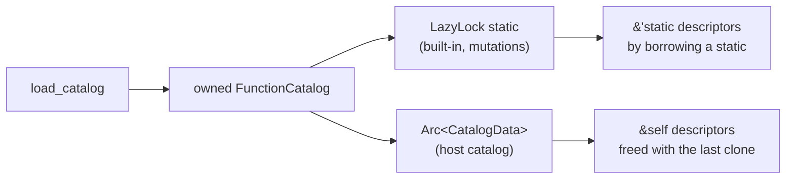

# Host function catalogs are owned, not leaked

Every distinct revision of a host function catalog that DMLS reads from a
schema root is leaked for the rest of the process. That includes revisions
whose facts artifact is absent, stale, or invalid. A long editing session on a
host's function catalog grows DMLS's memory with every save, and nothing can
ever reclaim it.

`2026-10-25-fix-now` removes the same kind of leak from host *lifecycle
profiles* and host *global* catalogs. It left this one out because the cause
is the public descriptor API, not the loading code.

## Today

### Where the leak is

`load_catalog` (`markdown/compose/expression/catalog/mod.rs`) builds a
`FunctionCatalog` whose public fields are `'static` borrows. It meets that
lifetime by leaking each piece as it builds it:

| Leaked by `load_catalog` | Field |
| ------------------------ | ----- |
| category names and descriptions | `CatalogCategory { name, description }` |
| each overload's compiled type | `ExpressionFunctionDescriptor::function_type: &'static FunctionType` |
| parameter lists and examples | `parameters`, `examples` |
| every name, signature, description, and type string | `leak(String)` |
| the descriptor slice itself | `FunctionCatalog::descriptors` |

The function has three callers:

| Caller | Lifetime of the data | Leak acceptable? |
| ------ | -------------------- | ---------------- |
| `expression_function_catalog()` (built-in catalog) | process, behind a `LazyLock` | bounded, built once |
| `effects/types.rs` (mutations catalog) | process, behind a `LazyLock` | bounded, built once |
| `HostFunctionCatalog::load` | as long as the `HostFunctionCatalog` value | **no** |

`HostFunctionCatalog` already owns its catalog through `Arc<CatalogData>`.
Dropping the last clone frees `CatalogData`, but not the leaked descriptor
data that `CatalogData.catalog` points to.

### Every revision is kept

`schemas/catalog.rs::host_function_set` caches by `(path, catalog hash,
artifact)` and never evicts anything. Every edit to a catalog or to its
`<stem>.facts.json` adds one more cache entry, and with it one more leaked
catalog.

### Why the descriptors are `'static`

The `'static` fields exist so that the *built-in* catalog can hand out
`&'static` data:

- `Described::key`, `description`, and `category` return `&'static str` (the
  trait is in `catalog/mod.rs`, with 5 implementations).
- `lifecycle/signatures.rs` builds `VerbSignature`s from
  `&'static [ExpressionFunctionDescriptor]` and exposes `&'static str` verb and
  parameter names.

Host descriptors do not need any of that. Outside `HostFunctionCatalog`, they
surface only through `HostFunctionCatalog::function_names() ->
Vec<&'static str>`. Registration copies each overload's `FunctionType` out of
the descriptor (`registration_builder`).

## Design Decisions

### One owned representation; `'static` comes from where it is stored

**Decision:** `FunctionCatalog`, `CatalogCategory`, `ExpressionFunctionDescriptor`,
`FunctionParameterDescriptor`, and `FunctionExample` own their data: owned
strings (`Box<str>`), boxed slices, and an owned `FunctionType`. This includes
alias strings, example text, and display-only reasons. `load_catalog` and
its projection helpers leak nothing and retain no references to loader input.

The built-in and mutation catalogs stay in their `LazyLock`s. A `&'static
FunctionCatalog` borrowed from a static yields `&'static` descriptors, and
`&'static str` field views of them, so `expression_function_descriptors()`,
`function_descriptors()`, `effect_function_descriptors()`, and the
lifecycle signature tables keep their `&'static` return types without leaking
anything.

**Alternatives considered:**

- Keep a separate owned host descriptor model and the current static model.
- Share descriptor strings through `Arc<str>`.

**Why:** The loader serves both embedded and host catalogs. One representation
removes the leak primitive from every call path; boxed values need no shared
ownership within a catalog because the host already shares the whole catalog.

**Downsides:** Public field types change, and repeated names across overloads
may be allocated separately. Consumers must borrow fields explicitly.

### Public API changes

**Decision:** Adopt the following source-level API changes together; the
repository has no external users requiring a compatibility layer.

- `ExpressionFunctionDescriptor`, `CatalogCategory`, and
  `FunctionParameterDescriptor` lose `Copy` but keep `Clone`. Fields become
  owned; code that copied a descriptor borrows or clones it.
- `Described` returns `&str` borrowed from `&self` instead of `&'static str`.
  Update every implementation and consumer; callers needing permanent borrows
  must obtain them from a concrete static catalog rather than assume the trait
  promises that lifetime.
- `FunctionCatalog::descriptors_for(&self, …)` returns a slice borrowed from
  `&self`. The free functions over the built-in catalog keep `&'static`.
- `HostFunctionCatalog::function_names(&self)` returns `Vec<&str>`.

**Alternatives considered:** Preserve existing signatures through leaked
storage or a compatibility descriptor model.

**Why:** Borrow lifetimes must follow the owner. Embedded catalogs still offer
permanent borrows because their owners are static; host catalogs cannot.

**Downsides:** All repository consumers, examples, and test fixtures must compile
with the new borrowing and cloning rules in the same change.

### Shared examples are borrowed views of owned data

**Decision:** In the darkmatter package's shared metadata framework,
[`Example`](../../lib/src/catalog/mod.rs) and `ExampleVerification` become
lifetime-parameterized borrowed views (`Example<'a>` and
`ExampleVerification<'a>`). Their string fields borrow for `'a`, including the
reason in `DisplayOnly`. `Described::example(&self)` returns
`Option<Example<'_>>` by value. Both view types can retain `Copy`.

Remove the redundant public `ExpressionFunctionDescriptor::example` field.
Its `Described` implementation derives the view from the first inline
`FunctionExample::Call` in its owned examples, preserving today's selection
and verification semantics. Static catalogs store `Example<'static>` and
return a copied view. Update direct field consumers to the trait method.

**Alternatives considered:**

- Store an owned duplicate example beside the owned example list.
- Use `Cow<'static, str>` throughout shared examples and retain the field.
- Keep the shared example type static and leak only its strings.

**Why:** The current shared example stores permanent borrows too; changing only
the descriptor's obvious string fields would leave this leak unresolved.
Borrowed views avoid both self-references and a second owned copy while keeping
static tables usable in constant definitions.

**Downsides:** The shared example types and trait method change across all
catalog implementations, including effects, context, and expression semantics.
Direct users of the removed field must switch to the method.

### Host function cache keeps the latest revision per path

**Decision:** `host_function_set`'s cache keeps one entry per catalog path.
A lookup whose catalog hash or artifact differs replaces the entry. A failed load is cached
the same way and is discarded when its revision is replaced. This is the same
rule `2026-10-25-fix-now` applies to the lifecycle profile cache.

A `HostFunctions` value obtained earlier keeps working after replacement,
because it holds its own `Arc`.

Use the existing discovery `PathBuf` as the map key, with a stored entry
containing the catalog digest, `ArtifactKey`, and result. Preserve path identity,
root ordering, and shadowing; introduce no new path normalization. Compare the
catalog digest using the existing `biscuit-hash` helper and compare the complete
artifact state as today: absent, unreadable (with reason), or text bytes.
Modification times alone must not identify a revision.

Keep lookup, revision comparison, construction, and replacement under the
existing mutex. Here, “latest” means the last revision processed under that
lock, not a guarantee of an atomic snapshot across two separately read files.
Never return the previous successful value for a new failing revision. An
unchanged revision reuses its result, including an error; a changed revision
replaces it and can recover from an error.

Missing, stale, or invalid facts are ordinarily a **successful** `HostFunctions`
result with incomplete functions, not a catalog load failure. Cache that result
under its actual revision and preserve its current diagnostics. Retain no
history of artifact text or error results after replacement.

**Alternatives considered:**

- Cache every distinct revision as today.
- Use only weak references, allowing every lookup to rebuild the current value.
- Add a global size limit or remove entries for paths absent from one discovery.

**Why:** Replacing a path's entry removes revision-driven growth while retaining
reuse. Discovery is scoped to each document's roots, so absence from one scan
cannot establish that another document no longer needs a path.

**Downsides:** The cache retains one result per distinct path ever encountered;
this is a bound per path, not a fixed process-wide memory limit. Caller-held
older values intentionally extend their own lifetimes. Construction remains
serialized as it is today; changing cache concurrency is unnecessary here.

### Failed loads leak nothing either

**Decision:** Every partial catalog allocation is owned and dropped when
`load_catalog` fails. Today an invalid entry after several valid ones leaks
the strings built before that failure; the fix must release those too. No unsafe lifetime
extension, self-referential owner, leaked arena, or global string interning may
replace the removed leaks.

**Alternatives considered:** Retain successful partial allocations globally or
measure process memory after repeated failures.

**Why:** Ordinary Rust ownership releases partial construction on every error
path. A process-memory reading is affected by allocator reuse and cannot prove
that individual allocations were freed.

**Downsides:** A weak-reference test proves the catalog owner is gone, not each
nested allocation. Review must also verify that every dynamically projected
field is owned and no helper leaks it.

### Keep documentation and generated output consistent

**Decision:** Correct the following lifetime comments in the same implementation
change, and preserve metadata values, ordering, examples, signatures, and user
output. Ownership changes are intentional API changes; expression behavior and
the facts artifact's format are unchanged.

**Alternatives considered:** Keep the old lifetime comments or regenerate
changed output as a new baseline.

**Why:** The current comments describe the leak as a lifetime contract. The
ownership fix changes that contract, but provides no reason to change the data
shown to users or sent to the editor.

**Downsides:** Validation must cover all shared metadata consumers and generators,
not just the host loader.

Comments to correct:

- `HostFunctionCatalog::load`: "The loaded descriptors live for the rest of
  the process; load each catalog version once."
- `host_function_catalogs`: "because a loaded catalog lives for the rest of
  the process."
- `load_catalog`'s comment describing leaked descriptors.
- The shared `Described` framework's static-only wording, including the
  explanation of why `suggest_strings` is separate (its actual distinction is
  plain strings versus descriptor records after this change).
- `leak` in the expression catalog module is removed with its last caller.

## Out of scope

- `markdown/compose/context/catalog.rs::leak`. It is a bounded, one-time leak
  of about 86 strings for a compiled catalog behind a `LazyLock`, which is
  allowed by rule 1 in `2026-10-25-fix-now`.
- Test-only leaks such as the fixture in `lifecycle/signatures.rs` tests.
- Caching host function discovery per request in DMLS.

## Implementation surfaces

- `darkmatter/lib/src/markdown/compose/expression/catalog/mod.rs`: types,
  `load_catalog`, accessors
- `darkmatter/lib/src/catalog/mod.rs`: shared example views, the `Described`
  trait, all implementations, and direct example consumers
- `darkmatter/lib/src/markdown/compose/expression/host/mod.rs` and
  `host/artifact.rs`
- `darkmatter/lib/src/markdown/schemas/catalog.rs`: `host_function_set` cache
- `darkmatter/lib/src/lifecycle/signatures.rs`, `darkmatter/lib/src/effects/types.rs`
- Consumers of descriptor fields in `darkmatter-cli` (`md schema about`, the
  generated function table), `dmls` (completion, hover), and `claudine`
  (host function registration), adjusted for borrowed fields
- `darkmatter/lib/examples/`: expression-table and lifecycle-schema generators;
  compile and check both after the descriptor changes

## Documentation

- `darkmatter/docs/topics/host-functions.md`: a loaded host catalog lives as
  long as the values that hold it, and discovery caches only the latest
  revision of each catalog file.
- `darkmatter/docs/topics/darkmatter-expressions.md`, and the generated
  function table if its generator signature changes: no behavior change is
  expected; check after regenerating.
- `darkmatter/lib/src/catalog/README.md`: describe borrowed example views and
  the changed trait contract.
- The `darkmatter` skill's expression and library-surface guidance: record the
  owned descriptor model, borrowed example API, and per-path cache retention.
- Keep the area's README an overview; update it only if it makes a lifetime or
  API claim affected by this fix. Add no dependencies for this refactor.

## Acceptance and verification

All new checks are fast L1 tests using the monorepo test toolkit. Use unique
temporary catalog paths; do not clear a shared process cache or depend on test
order. Test-only access to ownership and cache entries stays inside the library
(`cfg(test)` helpers or module tests), never a new public API.

1. **Reclaim replaced owners.** Exercise the production `host_function_set`
   lookup path and hold a `Weak` to the loaded `CatalogData`. For a catalog-only
   change, an artifact-only change, and replacement by a catalog that fails to
   load, drop every caller-owned catalog, function set, and scope guard. The old
   weak reference must then fail to upgrade. Include catalog inline examples
   and display-only reasons so the overlooked example fields are exercised.
2. **Replace results, including errors.** Assert one stored entry for a path
   after successive revisions and after an unchanged lookup. Cover success to
   error, unchanged cached error, and error to success. There is no `CatalogData`
   to downgrade when a load fails before construction finishes; assert the
   stored result and revision instead. Separately cover facts transitions
   between valid, absent, invalid JSON, stale catalog hash, and non-UTF-8 bytes
   (a portable unreadable-artifact case). Check the current complete/incomplete
   classifications and diagnostics, and recovery when valid facts return.
3. **Held values survive replacement.** Keep an old `HostFunctions` and its
   scope guard while loading the next revision. Its signatures, registrations,
   and call analysis still reflect the old catalog; the new set reflects the
   replacement. After all old owners and guards drop, its weak reference dies.
   Two distinct paths retain independent entries and continue to work.
4. **Failed construction owns everything.** Load a catalog whose earlier valid
   entry includes an inline example and whose later entry fails during
   projection, such as a non-embedded file-form example. Assert the existing
   typed load error. Review the loader and every projection helper for fully
   owned fields and the absence of leaks, including error paths. Audit the
   changed catalog-loading paths, not every unrelated `Box::leak` in the
   repository; the explicitly excluded static and test-only sites remain allowed.
5. **Preserve built-in contracts.** Compile checks pin the existing permanent
   slice return types of `expression_function_descriptors()`,
   `function_descriptors()`, and `effect_function_descriptors()`, and the
   permanent string views from lifecycle signatures. Compare descriptor
   metadata and generated expression-table and lifecycle-schema text with
   their existing expectations; Rust object bytes are not a meaningful
   comparison after changing field representation. Verify `md schema about`
   output with deterministic plain-output fixtures, and DMLS completion, hover,
   and call diagnostics through existing entry points. Existing Claudine
   registration and facts-artifact tests must still pass without artifact changes.
6. **Run scoped checks.** Run `just test` and `just lint` in `darkmatter/`
   (including DMLS) and `claudine/`, and compile both affected generator examples
   because ordinary test targets do not guarantee example compilation. Run the
   existing generated-artifact checks; if no check exists for an output, compare
   generator output directly against its committed section without accepting a
   changed baseline. No L1 test exceeds five seconds. No real-terminal or browser
   window is needed. Keep all production changes portable across macOS, Linux,
   native Windows, and WSL2.

No memory benchmark or cross-host performance spike is required: ownership
inspection and deterministic replacement tests answer whether revisions are
retained. This review changes the specification only; implementation and these
checks follow during the planned work.
