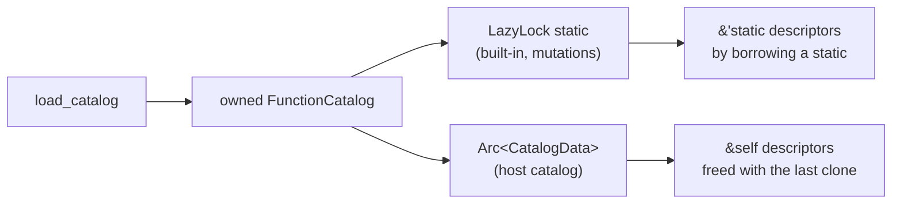

# Host function catalogs are owned, not leaked

Every distinct revision of a host function catalog that DMLS reads from a
schema root is leaked for the rest of the process. That includes revisions
whose facts artifact is absent, stale, or invalid. A long editing session on a
host's function catalog grows DMLS's memory with every save, and nothing can
ever reclaim it.

`2026-10-25-fix-now` removes the same kind of leak from host *lifecycle
profiles* and host *global* catalogs. It left this one out because the cause
is the public descriptor API, not the loading code.

## Today

### Where the leak is

`load_catalog` (`markdown/compose/expression/catalog/mod.rs`) builds a
`FunctionCatalog` whose public fields are `'static` borrows. It meets that
lifetime by leaking each piece as it builds it:

| Leaked by `load_catalog` | Field |
| ------------------------ | ----- |
| category names and descriptions | `CatalogCategory { name, description }` |
| each overload's compiled type | `ExpressionFunctionDescriptor::function_type: &'static FunctionType` |
| parameter lists and examples | `parameters`, `examples` |
| every name, signature, description, and type string | `leak(String)` |
| the descriptor slice itself | `FunctionCatalog::descriptors` |

The function has three callers:

| Caller | Lifetime of the data | Leak acceptable? |
| ------ | -------------------- | ---------------- |
| `expression_function_catalog()` (built-in catalog) | process, behind a `LazyLock` | bounded, built once |
| `effects/types.rs` (mutations catalog) | process, behind a `LazyLock` | bounded, built once |
| `HostFunctionCatalog::load` | as long as the `HostFunctionCatalog` value | **no** |

`HostFunctionCatalog` already owns its catalog through `Arc<CatalogData>`.
Dropping the last clone frees `CatalogData`, but not the leaked descriptor
data that `CatalogData.catalog` points to.

### Every revision is kept

`schemas/catalog.rs::host_function_set` caches by `(path, catalog hash,
artifact)` and never evicts anything. Every edit to a catalog or to its
`<stem>.facts.json` adds one more cache entry, and with it one more leaked
catalog.

### Why the descriptors are `'static`

The `'static` fields exist so that the *built-in* catalog can hand out
`&'static` data:

- `Described::key`, `description`, and `category` return `&'static str` (the
  trait is in `catalog/mod.rs`, with 5 implementations).
- `lifecycle/signatures.rs` builds `VerbSignature`s from
  `&'static [ExpressionFunctionDescriptor]` and exposes `&'static str` verb and
  parameter names.

Host descriptors do not need any of that. Outside `HostFunctionCatalog`, they
surface only through `HostFunctionCatalog::function_names() ->
Vec<&'static str>`. Registration copies each overload's `FunctionType` out of
the descriptor (`registration_builder`).

## Decided

### One owned representation; `'static` comes from where it is stored

`FunctionCatalog`, `CatalogCategory`, `ExpressionFunctionDescriptor`,
`FunctionParameterDescriptor`, and `FunctionExample` own their data: owned
strings (`Box<str>`, or `Arc<str>` if sharing turns out to be useful), owned
slices, and an owned `FunctionType`. `load_catalog` leaks nothing.

The built-in and mutation catalogs stay in their `LazyLock`s. A `&'static
FunctionCatalog` borrowed from a static yields `&'static` descriptors, and
`&'static str` field views of them, so `expression_function_descriptors()`,
`function_descriptors()`, `effect_function_descriptors()`, and the
lifecycle signature tables keep their `&'static` return types without leaking
anything.

**Rejected: two descriptor types** (an owned loader form promoted to the
current `'static` form for built-ins). It would keep today's public types
unchanged, but it doubles the descriptor model and leaves a leak primitive
that the next caller can reach for. One representation is the long-term
shape.

### Public API changes

These are allowed: the repository has no external users.

- `ExpressionFunctionDescriptor` loses `Copy` but keeps `Clone`. Fields become
  owned; code that copied a descriptor borrows or clones it.
- `Described` returns `&str` borrowed from `&self` instead of `&'static str`.
  Implementations over static tables are unaffected in practice, because their
  receivers are already `'static`.
- `FunctionCatalog::descriptors_for(&self, …)` returns a slice borrowed from
  `&self`. The free functions over the built-in catalog keep `&'static`.
- `HostFunctionCatalog::function_names(&self)` returns `Vec<&str>`.

### Host function cache keeps the latest revision per path

`host_function_set`'s cache keeps one entry per catalog path. A lookup whose
catalog hash or artifact differs replaces the entry. A failed load is cached
the same way and is discarded when its revision is replaced. This is the same
rule `2026-10-25-fix-now` applies to the lifecycle profile cache.

A `HostFunctions` value obtained earlier keeps working after replacement,
because it holds its own `Arc`.

### Failed loads leak nothing either

A catalog that fails part-way through `load_catalog` (an invalid entry after
several valid ones) today leaks the strings built before the failure. With
owned data, a failed load drops everything it built.

### Comment drift to correct

- `HostFunctionCatalog::load`: "The loaded descriptors live for the rest of
  the process; load each catalog version once."
- `host_function_catalogs`: "because a loaded catalog lives for the rest of
  the process."
- `leak` in `catalog/mod.rs` is removed with its last caller.

## Out of scope

- `markdown/compose/context/catalog.rs::leak`. It is a bounded, one-time leak
  of about 86 strings for a compiled catalog behind a `LazyLock`, which is
  allowed by rule 1 in `2026-10-25-fix-now`.
- Test-only leaks such as the fixture in `lifecycle/signatures.rs` tests.
- Caching host function discovery per request in DMLS.

## Implementation surfaces

- `darkmatter/lib/src/markdown/compose/expression/catalog/mod.rs`: types,
  `load_catalog`, accessors
- `darkmatter/lib/src/catalog/mod.rs`: the `Described` trait and its
  implementations
- `darkmatter/lib/src/markdown/compose/expression/host/mod.rs` and
  `host/artifact.rs`
- `darkmatter/lib/src/markdown/schemas/catalog.rs`: `host_function_set` cache
- `darkmatter/lib/src/lifecycle/signatures.rs`, `darkmatter/lib/src/effects/types.rs`
- Consumers of descriptor fields in `darkmatter-cli` (`md schema about`, the
  generated function table), `dmls` (completion, hover), and `claudine`
  (host function registration), adjusted for borrowed fields

## Documentation

- `darkmatter/docs/topics/host-functions.md`: a loaded host catalog lives as
  long as the values that hold it, and discovery caches only the latest
  revision of each catalog file.
- `darkmatter/docs/topics/darkmatter-expressions.md`, and the generated
  function table if its generator signature changes: no behavior change is
  expected; check after regenerating.
- The `darkmatter` skill, if it describes descriptor lifetimes.

## Acceptance and verification

1. **Reclaim.** A unit test loads a host catalog through `host_function_set`,
   keeps a `Weak` to its `CatalogData`, rewrites the catalog file, and
   discovers again. Once the caller drops its `HostFunctions`, the `Weak`
   fails to upgrade. The same holds when only the facts artifact changes, and
   when the new revision fails to load.
2. **Held values survive replacement.** A `HostFunctions` obtained before a
   revision change still registers and analyzes calls as before.
3. **No leak on a failed load.** `load_catalog` contains no `Box::leak`, and
   a source check during review confirms the remaining `Box::leak` sites are
   only the ones listed under "Out of scope".
4. **Built-ins unchanged.** `expression_function_descriptors()`,
   `function_descriptors()`, the effects catalog, lifecycle verb signatures,
   `md schema about` output, and the generated function table are
   byte-for-byte unchanged. The existing catalog tests and the doc-table
   generator check cover this.
5. `just test` and `just lint` pass in `darkmatter/` (including DMLS) and
   `claudine/`. No test exceeds five seconds.
