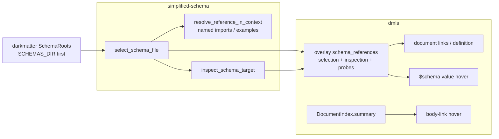

## Summary and Definition of Done

### What this fix does

DMLS (the Darkmatter language server) and the validator disagree about which file a
bare-name `$schema` means, and its hovers say nothing about references. This fix:

1. **Makes validation, document links, and go-to-definition select a `$schema` file
   through one function** in `simplified-schema` (`select_schema_file`), which also
   reports the ordered attempted locations and a safe creation target.
2. **Moves `SCHEMAS_DIR` first** in the schema-root order.
3. **Narrows what a `$schema` reference may target**: a YAML document with a top-level
   `$schema`, or a JSON object declaring the Draft 2020-12 dialect. The YAML envelope
   gains `description`, and the "global catalog" refusal is removed.
4. **Adds value hovers** for a `$schema` value and for `file`-typed values, and stops
   DMLS reporting a missing `file` target as a diagnostic.
5. **Adds the target's summary** to body-link hovers for Markdown documents.



### Definition of Done

Every item is observable through a test named in the phase that delivers it.

- In `review-3.md` (`$schema: feature-review.yaml`), document link and definition target
  the repository's `schemas/feature-review.yaml`; the same selection function serves
  validation. A new response-contract fixture pins this for both requests.
- A bare name that resolves nowhere links to `{first searchable root}/{name}`, or
  `{document folder}/{name}` when no root folder exists, and no file or folder is created.
- `SCHEMAS_DIR` precedes every other root for `$schema`, named imports, examples, trigger
  payloads, and trigger-file shadowing; pattern bases and root eligibility are unchanged.
- A `$schema` naming a `types`-only YAML file, a YAML file without `$schema`, or a JSON
  file without the 2020-12 declaration is an error in validation and shows the "not a valid
  schema definition" hover; another declared JSON dialect reports "unsupported JSON Schema
  dialect"; a declared 2020-12 JSON schema is checked with the offline meta-schema validator.
- `kind: schema` + `description` + `$schema` (no `types`), `kind: schema` with neither
  `$schema` nor `types` (an error), and an informal file with `description` + `$schema`
  behave as the spec's tables say; `GlobalCatalog` still loads both shipped catalogs.
- The `$schema` value hover shows description, `Schema Definition:`, the fenced preview
  (at most 10 lines, with the exact truncation line), and `Resolves to [...](...)`. The key
  hover is byte-for-byte unchanged.
- `file`-typed values show every outcome in the spec's table; a clean miss produces no DMLS
  existence diagnostic; every other file-reference diagnostic is unchanged; the `md` runtime
  eager check is unchanged.
- A body link to a Markdown document with `summary:` (or `excerpt`, `description`, `about`
  in that precedence) shows the summary below the existing hover.
- Documentation, the Darkmatter skill, and the implementation log are updated; the
  MIME/image-preview claim is gone from `darkmatter/docs/lsp/features.md`.
- `just test` and `just lint` pass in `simplified-schema/`, `darkmatter/`, and
  `claudine/` (root order and error variants reach it). No `just test-l2` is required: every
  new test is L1 and spawns no window.

### Conventions Used by Every Phase

- Do **not** run `cargo fmt`; do **not** commit.
- Write US English. Follow the surrounding comment density; update the `///`/`//!` docs of
  every symbol whose behavior changes (the repo's drift rule). Docs under `docs/` never link
  to or name this fix.
- Nothing is created under `_unscheduled`. New files go in this fix's directory or the
  packages named below.
- Load the `os` skill before touching `#[cfg(windows)]`, path comparison, or display-path
  code. Every path in a test fixture is built with the existing portable/native helpers; no
  new OS character blacklist is added.
- Tests are L1 only (protocol requests and temp dirs; no terminal, no browser). New test
  files must be declared in the owning `main.rs` (`autotests = false`; `test_layout.rs`
  rejects an undeclared file). Run with the area's `just test`.
- A test that fails because a fixture no longer meets the new restriction is fixed by Rule 6.
- Use `GIT_TERMINAL_PROMPT=0` for any git command. The whole session tree is non-interactive.

---

## Phase 1: Rules, Root Order, and the Shared Selector

Delivers the decisions every later phase follows, the `SCHEMAS_DIR`-first root order, and
the one file-selection function. Nothing in DMLS changes yet.

### Necessary Rules

**Rule 1: Root order is changed by reordering one array.**
`SchemaRoots::for_document` builds `candidates` in `darkmatter/lib/src/markdown/schemas/roots.rs`
(lines 162-177). Reorder it to `SchemasDir, Package, PackageArea, Tree, Home`, and reorder the
`SchemaRootKind` variants and their docs to match. `entries()`, `searched()`, and
`search_paths()` follow the array, so trigger shadowing (`triggers/discovery.rs::scan_with_source`
iterates `roots.searched()`), bare-name lookup (`search_paths()`), and host-catalog lookup
(`schemas/catalog.rs` lines 478-547, 676) all take the new order with no other edit.
Evidence: spec "Schema root order: `SCHEMAS_DIR` moves first".
Files to touch: `roots.rs` (module docs, `SCHEMAS_DIR_VARIABLE` docs "fourth schema root",
`SchemaRootKind` docs, `for_document`). `darkmatter/cli/src/commands/schema/triggers.rs` needs
no source edit: its "Schema roots (search order)" list iterates `entries()`, so only its
tests and snapshots change. Tests whose expected order changes:
`darkmatter/lib/tests/l1/schema_roots.rs` (lines 171-179, comment on line 223),
`darkmatter/dmls/tests/l1/schema_roots_parity.rs` (lines 268-280),
`darkmatter/cli/tests/l1/schema_triggers.rs` and its snapshots,
`darkmatter/lib/src/markdown/schemas/triggers/discovery.rs` unit tests (lines 1203-1273),
`claudine/lib/src/invocation_context/document_tests.rs` (line 147 onward), and any other
`SchemaRootKind::` or `search_paths()` assertion `grep -rn` finds.

**Rule 2: Duplicate identity, symlink policy, and pattern bases stay per-kind.**
The `seen` identity loop in `for_document` is unchanged: the first root *in the new order*
that names a folder searches it and later ones are `Duplicate { of }`. `reads_patterns_from_tree_root`,
`is_searchable_directory(path, user_level)`, and `schemas_dir_candidate` are unchanged, so a
`SCHEMAS_DIR` root keeps the document's tree root as its pattern base and may be a symlink.
Consequence, accepted and documented: when `SCHEMAS_DIR` names the same folder as a package,
package-area, or tree `schemas/`, `SCHEMAS_DIR` now searches it (user-level pattern base) and
that kind reports `Duplicate { of: SchemasDir }`. Add one test pinning this. Evidence: spec
"Moving `SCHEMAS_DIR` first must preserve ... duplicate-root identity rules, symlink policy, and
trigger-pattern base directories. Only precedence changes."

**Rule 3: One selector, in `simplified-schema`, replaces three copies.**
Create `simplified-schema/lib/src/resolve/select.rs` and re-export it from `resolve`
(public path `simplified_schema::resolve::{select_schema_file, SchemaFileSelection,
SelectionOutcome, SelectionFailure}`). Signature:

```rust
pub fn select_schema_file(
    reference: &str,
    base_dir: &Path,
    schema_roots: &[PathBuf],
    request_context: &FileResolutionContext,
) -> SchemaFileSelection;

pub struct SchemaFileSelection {
    /// The trimmed authored reference.
    pub reference: String,
    pub outcome: SelectionOutcome,
    /// Every location probed, in probe order, deduplicated by first occurrence,
    /// lexical (absent locations included), through the selected one.
    pub attempted: Vec<PathBuf>,
}
pub enum SelectionOutcome {
    Found(PathBuf),
    /// A clean miss. `bare_name` is true only on the schema-root branch.
    Missing { bare_name: bool, creation: Option<PathBuf> },
    /// Bare name absent from every root while `base_dir/name` exists.
    SiblingOnly { sibling: PathBuf, suggestion: String, creation: PathBuf },
    Failed(SelectionFailure),
}
pub enum SelectionFailure { Remote, Resolution(biscuit_file::FileReferenceError) }
impl SchemaFileSelection {
    /// The existing errors: `Found` -> `Ok(path)`; `Missing` -> `NoMatch`;
    /// `SiblingOnly` -> `BareNameSiblingExists`; `Remote` -> `RemoteUnsupported`;
    /// `Resolution` -> `Unresolved`.
    pub fn into_result(self) -> Result<PathBuf, SchemaError>;
}
```

The body is the union of the three existing copies: `resolve_reference_in_context`
(`resolve.rs` 897-960), `named_type_file_path` (2761-2823), and `resolve_example_path`
(4024-4090) each parse with `FileReference::new`, reject `Url`, take the bare-name branch when
`!schema_roots.is_empty() && is_bare_name(..)` (using `try_bare_name_in_roots`), else
`resolve_file_reference_in_context`. Replace the three bodies with
`select_schema_file(..).into_result()` plus the existing `searched.extend(attempted)`.
`observed::probed` is split into frame recording (called inside `select_schema_file`, so a
failed trigger payload still records its probes) and the `BTreeSet` extend (kept by callers).
`#[cfg(not(feature = "file"))]` returns `Failed(Resolution(ResolutionUnavailable))`, mirroring
`try_bare_name_in_roots`. Error values, `searched` contents, and `referenced_files` stay
identical, which the existing tests prove.

**Rule 4: Creation target.**
Computed inside `select_schema_file` and never guessed on failure:
- Bare name, at least one root (`schema_roots` is already the searchable list): `Missing`
  or `SiblingOnly` gets `creation = schema_roots[0].join(name)`.
- Bare name, zero roots: ordinary implicit resolution (document folder, then the context
  fallback) runs; on a clean miss `creation` is the first path of
  `reference.candidate_plan_with_order(&request_context.for_cwd(base_dir),
  CandidatePlanOrder::Resolution)`, and a repository-root match is `Found`, never replaced.
- Explicit relative or any other form: same first-planned-candidate rule (this is today's
  `ReferenceTarget::navigation_target`), so explicit `./x.yaml` links beside the document and
  boundary violations plan nothing.
- `Failed(_)` never carries a path. `SiblingOnly` exists only on the schema-root branch.
Evidence: spec "Link target when a `$schema` reference does not resolve" and "Shared
resolution and editor lifecycle".

**Rule 5: The restriction lives in the referenced-file loader only.**
Enforce the new target rules in `load_schema_from_path_in_context` /
`parse_yaml_referenced_file` (`resolve.rs` 1107-1202) and a new
`parse_referenced_json_schema` that only that function calls. Leave unchanged:
`parse_raw_json_schema` and `SimplifiedSchema::from_file/from_content`
(`schema/layer.rs`, which accepts YAML raw JSON Schema with a dialect URI and has its own
`MissingSchema` contract); `prepare_embedded_schema_in` (shipped types-only partials such as
`darkmatter/schemas/partials/fm.yaml` are prepared through it); `GlobalCatalog`'s own strict
loader (`schemas/catalog.rs::load`, which never calls the standalone parser); the function
catalog loader (`compose/expression/catalog/mod.rs::load_catalog`, needs `types`).
Named-type imports (`Name@file.yaml`) still use `parse_standalone_schema_document`, so a
`types`-only document keeps serving imports.

**Rule 6: Migration of files and fixtures the restriction rejects.**
Audit result recorded at planning time (`/tmp` script over every `$schema:` value in
`.md`/`.yaml` outside `target`, `_completed`, `.claude`): the only shipped file newly rejected
is `prompts/_implement/implement.yaml` (a `kind: schema` file with only `types:`, targeted by
`prompts/_implement/_fm.md`). Migration: rename its `types:` key to `$schema:` (it keeps
`kind: schema`); entries then become document properties, which is what `_fm.md` intends.
`darkmatter/docs/schemas/schema-definition.yaml` is an empty placeholder already rejected
today and belongs to `2026-10-30-yaml-document-schemas`; leave it. No shipped root-union file
arm, trigger payload, or embedded source names a types-only or JSON-without-dialect file; both
shipped JSON fixtures (`dmls/tests/fixtures/suggest_constraint/raw-schema.json`,
`lib/tests/fixtures/validate/json_schema_ref/schema.json`) already declare the 2020-12 URI.
Tests: about thirty test files write inline raw JSON schemas or raw YAML schemas as
referenced files or trigger payloads (found by `grep -rln '\$schema[^\n]*\.json'` and the
raw-schema suites `raw_schema_conversion.rs`, `raw_root_union_assertions.rs`,
`schema_robustness_matrix.rs`). Rule: a fixture whose subject is something else gains
`"$schema": "https://json-schema.org/draft/2020-12/schema"` (JSON) or moves its raw YAML
schema into a `.json` file with that declaration; a test whose subject is "raw YAML JSON
Schema is accepted" flips to assert the new rejection. Every changed file is listed in the
implementation log. This audit exposed no further public-format decision, so nothing returns
to the spec's Open Questions.

**Rule 7: New and renamed errors (`simplified-schema/lib/src/errors.rs`).**
Rename `SchemaError::AmbiguousReferenced { path }` to
`NotASchemaDocument { path: PathBuf, reason: NotSchemaReason }`; add
`UnsupportedJsonDialect { path: PathBuf, declared: String }` and
`InvalidJsonSchema { path: PathBuf, message: String }`. `NotSchemaReason` is
`TypesOnly | NoSchemaProperty | NotAMapping | JsonMissingDialect`, with a `hint()` that returns
the migration text:
`TypesOnly` -> "use a named-type import (`Name@file.yaml`) to reuse its types";
`JsonMissingDialect` and a JSON non-object (`NotAMapping` on a `.json` path) -> "declare
`\"$schema\": \"https://json-schema.org/draft/2020-12/schema\"`".
Existing uses become: `layer.rs:236` -> `NotAMapping`; `resolve.rs` embedded `Ok(None)` ->
`NoSchemaProperty`; referenced loader per Rule 8. All three variants name `path`; add them to
`dmls/src/overlay/mod.rs::error_dependencies` and `file_failures` handling (path only).
Render them in the `StatusBlock` match (`errors.rs` near line 719) and in the located-error
docs (`simplified-schema/docs/topics/diagnostics.md`). Update every `AmbiguousReferenced`
reference found by `grep -rn AmbiguousReferenced` in source, tests, and non-completed docs.

**Rule 8: Referenced-file classification table (what the loader returns).**
YAML (`.yaml`, `.yml`, and any non-`.json` extension, as today):

| Content | Result |
|---|---|
| Not valid YAML, duplicate key, trailing content, second document | `SchemaDocument` (existing located error) |
| Not a mapping | `NotASchemaDocument { NotAMapping }` |
| Recognized envelope with a `$schema` property | accepted (then validated as today) |
| Recognized envelope, `types` only (tagged, no `$schema`) | `NotASchemaDocument { TypesOnly }` |
| Mapping with `$schema` plus a key outside `$schema`/`types`/`description` and no `kind: schema` | `SchemaDocument` "unsupported top-level key(s): ..."; when `$schema` is a `json-schema.org` URI the message adds "raw JSON Schema in YAML is not a `$schema` target; write it as a `.json` file declaring `https://json-schema.org/draft/2020-12/schema`" |
| Any other mapping (no `$schema`, or another `kind`) | `NotASchemaDocument { NoSchemaProperty }` |

JSON (`.json`, case-insensitive): order of checks is syntax (existing strict
`content_error(Json)`, duplicate keys, trailing content), non-object root ->
`NotASchemaDocument { NotAMapping }`, `$schema` absent or not a string ->
`NotASchemaDocument { JsonMissingDialect }`, any string other than exactly
`https://json-schema.org/draft/2020-12/schema` (including the empty string and a trailing `#`)
-> `UnsupportedJsonDialect { declared }`, then `jsonschema::draft202012::meta::validate`
failure -> `InvalidJsonSchema`. This resolves the spec's "format rejection and
schema-validation failure are distinct".

**Rule 9: Standalone parser changes (`simplified-schema/lib/src/simplified/standalone.rs`).**
- `StandaloneSchemaDocument` gains `pub exports_schema: bool` (true when the document has a
  `$schema` property, i.e. `RecognizedStandalone::payload_key() == "$schema"`) and
  `pub description: Option<String>` (the top-level string, `None` when absent).
- `description` shape: absent -> `None`; present and not a string (including `null`) ->
  `SchemaDocument` "`description` must be a string"; `""` accepted, stored as `Some("")`.
  Hover treats blank as absent (Rule 14).
- Informal (`Pure`): no `kind: schema`, `$schema` present, every top-level key in
  `{$schema, types, description}`. A document with any other key stays `Ok(None)` (the
  `SimplifiedSchema` raw-dialect path in `layer.rs` depends on it); the loader reports it per
  Rule 8. A mapping whose `kind` is present and not `schema` is never `Pure`
  (`kind: schema-trigger` documents stay out).
- Tagged: `kind: schema`; allowed keys `{kind, types, categories, $schema, description}`; at
  least one of `$schema`/`types` (neither -> `SchemaDocument` "tagged schema document needs a
  `$schema` or `types` property"); `types` must still be a mapping; `$schema: null` is an
  error (present, so `payload_key` is `$schema` and the payload parse rejects it).
- Remove the "global catalog" refusal (lines 313-317). Both shipped catalogs load only through
  `GlobalCatalog` registration, so they are unaffected.
- `check_named_types` on the exported payload (line 220) runs only when `payload_key ==
  "types"`; a tagged document with `$schema` only behaves like an informal one (no category or
  overload check on `$schema` entries).
- Update the module and function docs (`//!` "Recognition", `parse_standalone_schema_document`
  "Errors versus lint") and `simplified/source.rs::locate_standalone_definition_failure`
  continues to work through `recognize_standalone`.
- DMLS lexical claim `overlay/schema.rs::standalone_envelope_claim` (line 295) changes to
  claim `Pure` when `$schema` is present and every top-level key is in
  `{$schema, types, description}`.

**Rule 10: Schema facts live in the existing overlay cache; navigation reads them.**
Add `dmls/src/overlay/references.rs`:

```rust
pub struct SchemaReferenceFacts { pub entries: Vec<SchemaReferenceFact> }   // Arc'd
pub struct SchemaReferenceFact {
    pub pointer: String,                       // "/$schema" or "/$schema/{n}"
    pub reference: String,                     // authored string value
    pub selection: Result<SchemaFileSelection, Arc<SchemaError>>,  // Err: roots unreadable
    pub target: Option<SchemaTargetPreview>,   // Phase 4; None in Phase 3
}
```

`OverlayCache::schema_for` (`overlay/mod.rs` ~877) builds it on a cache miss, beside
`named_types` and `reference_suggestions`, from the same `schema_roots` and `context`, with
`base_dir = path.parent()`: the identical inputs `schema::assemble` passes the validator. It is
stored in `CachedSchema`, returned in `FrontmatterSchema`, and exposed as
`DocumentOverlay::schema_references: Arc<SchemaReferenceFacts>`; the three other
`DocumentOverlay { .. }` constructors (trigger error, trigger warning, standalone) use
`Arc::default()`. The facts cover exactly these references: the scalar `/$schema` and each
scalar `/$schema/{n}` item of a root-union sequence, taken from the frontmatter AST of the
same text the schema was assembled from (last-good text when the buffer is mid-edit), and only
when the authored scalar decodes to a YAML string (parse the value span with
`serde_yaml_ng::from_str`; `null`, numbers, booleans, and aliases are not references). The
`looks_like_path` gate is dropped for `$schema` because the validator treats every string as a
reference; `graph/substrate.rs` keeps its own gate (it is a graph fact, out of scope). With no
context, no facts. With a registry error (`trigger_registry` returned `Err`), every reference
gets `selection: Err(error)` and no roots are guessed.
Invalidation: extend `CachedSchema` with `probes: Vec<(PathBuf, bool)>`, the `attempted`
locations of every fact with whether each existed at assembly; a hit also requires every
probe's existence to be unchanged (`Path::is_file`). Add each selected path to the content
hashes (`collect_dep_hashes`) so editing, deleting, or repairing the selected file refreshes a
cached failure. A new higher-priority root folder or root file already arrives through the
registry version in the cache key. Referenced schema files are read from disk only: the
existing source layer (`schema_for`, `deps_unchanged`, the resolver's `fs::read`) has no
open-buffer overlay for schema targets, so an unsaved schema edit takes effect on save, as
diagnostics already behave.

**Rule 11: Navigation targets.**
`schema_target` (`providers/frontmatter.rs` 2214) becomes `schema_targets` and returns every
fact whose `reference` equals the AST entry's scalar at the same pointer, as
`(value_span, PathBuf)`: `Found(path)` -> that path; `Missing { creation: Some(p) }` and
`SiblingOnly { creation, .. }` -> the creation path (never the sibling); everything else ->
no target. `nav_targets` and `definition` use it; `file_target` and `navigation_path` for
`file` values are unchanged. Evidence: spec "Link target ..." and Goals ("select the same file
in validation, document links, and go-to-definition").

**Rule 12: `file` value hover conventions.**
- Static test (`file_value_is_static`): not static when `holds_pending_syntax(value)` and
  either `value` contains `$(` or `FileReference::new(value)` fails; otherwise static. A
  biscuit-file `{{DIR}}/x.md` therefore stays a static reference, and a Darkmatter
  `{{ expr }}` or `$(...)` value gets no file hover and keeps the existing hover.
- Reference kinds that are not strings (null, number, mapping, sequence, comments) never
  reach this hover: it requires a scalar entry whose value decodes to a YAML string.
- `eager` for a scalar array item is `is_eager(parent_def) || is_eager(item_def)` (the
  synthesized item def drops array-level constraints). The typing is extended by two bool
  fields on `ScalarTyping` (`eager`, `mixed_arms`) computed in `classify_scalar` from the
  surviving definition `memo.def_at(path)`; `mixed_arms` is `atoms_of(def)` containing a
  non-file atom.
- `{property}` in the missing-file sentences is the dotted path of the nearest
  mapping-property entry (the entry itself, or the parent array's property for a sequence
  item), in backticks.
- Mixed union and eager: the sentence's second part becomes "The `{property}` has an
  **eager** `file` arm, so when this value is read as that file reference it must refer to a
  real file at runtime." Non-eager sentences and the pure-eager sentence stay verbatim from the
  spec.
- Resolution uses `ctx.resolve_reference(value)` (disk probing, uncached, like navigation);
  the formatting functions take the already-computed `ReferenceTarget` and do no I/O.
- Failure classes (`ReferenceTarget::Missing { failure }`): `InvalidReference` -> the
  "is not a valid file reference: {reason}" sentence, where `{reason}` is
  `FileReferenceError`'s `Display` from `FileReference::new` (the validator's own wording);
  `MissingContext`, `Io`, `UnsupportedRemote` get the sentences in Rule 14; none carries a
  creation link. With no document context (`ctx.file_context()` is `Err`) the hover says the
  document has no file-resolution context; no duplicate diagnostic is added.

**Rule 13: Diagnostic suppression.**
In `dmls/src/diagnostics/frontmatter.rs` (the `report.problems` loop, line ~417) skip a
problem when `problem.file_reference` is `Some(FileReferenceDiagnostic::NoMatch { .. })` and
`problem.caller_file.is_none()`. This is a typed match, never message text. `InvalidSyntax`
and `ResolutionFailed` (context, I/O) are retained with their codes, ranges, and
`resolution_failure` data. Missing `$schema`, imports, and examples are `SchemaError`s on the
bundle, not problems, and stay. No change to `simplified-schema` or `md` runtime validation.

**Rule 14: Hover wording and rendering.**
All value-hover text is built by pure functions in the new
`dmls/src/providers/reference_hover.rs` (no I/O, no composition). Helpers:
`markdown_escape` (backslash-escapes `\ ` * _ [ ] ( ) < > & ~ | !`, newlines to spaces),
`code_span` (backtick fence one longer than the longest backtick run in the text),
`fence_for(excerpt)` (backtick fence at least 3 and longer than any backtick run in the
excerpt), `display_path(path, repository_root)` (repository-relative with `/` separators when
the path is inside the document's repository, otherwise the absolute path with `/`
separators), and `markdown_link(label, uri)` (uri from `file_path_to_uri`, with `(` and `)`
percent-encoded as `%28`/`%29`). Templates (`{...}` is substituted; links are Markdown only,
never HTML):

- **Valid schema target:** `{description}\n\n` (only when the target's top-level string
  `description` is nonempty after trimming; full text, unescaped), then `Schema Definition:\n\n`,
  then the fence (`yaml` or `json`) with at most 10 lines, then, only when truncated,
  `\n\n*Showing **10** of **{total}** lines*`, then
  `\n\nResolves to [{display}]({uri})` (label escaped, no backticks).
- **Not an accepted format** (`NotASchemaDocument`): ``The file [`{display}`]({uri}) exists but it is **not** a valid schema definition!`` (verbatim).
- **Unsupported dialect:** ``The file [`{display}`]({uri}) declares the unsupported JSON Schema dialect `{declared}`. Only `https://json-schema.org/draft/2020-12/schema` is supported.``
- **Other load failure** (malformed, invalid grammar, unreadable, invalid dependency, cycle,
  `InvalidJsonSchema`): ``The file [`{display}`]({uri}) could not be used as a schema: {error}`` with `{error}` the `SchemaError` text, escaped, newlines to spaces.
- **Clean miss:** ``{code_span(reference)} does not match a schema file.\n\nSearched, in order:\n\n- {code_span(display(attempted[0]))}\n- ...\n\nMissing: {code_span(display(creation))} does not exist yet; following the link opens this path.`` The `Missing:` paragraph is omitted when `creation` is `None`. With zero roots the lead sentence is ``{code_span(reference)} was looked up like any other file reference (no schema root folder exists).`` and the list is the attempted candidates.
- **Sibling only:** ``{code_span(reference)} is not in any schema root, but a file with that name is beside this document. Write {code_span(suggestion)} to reference it.`` followed by the same `Searched, in order:` list and `Missing:` paragraph; the sibling is never linked.
- **Typed failure:** ``{code_span(reference)} could not be resolved: {reason}`` where `{reason}` is the `FileReferenceError` text; remote: ``{code_span(reference)} is a remote reference. Remote schemas are not fetched.``; roots unreadable: ``{code_span(reference)} could not be resolved because the schema roots could not be read: {error}``. No creation link in any of these.
- **No context:** `This document has no file-resolution context, so {code_span(value)} is not resolved.`
- **`file` value:** invalid -> ``{code_span(value)} is not a valid file reference: {reason}``;
  found -> ``Resolves to [`{display}`]({uri})`` (backticks in the label, per the spec);
  missing -> the two verbatim sentences (Rule 12); `MissingContext` -> "This file reference
  needs context this document does not have (a home folder, repository, or package), so it
  cannot be resolved."; `Io` -> "The filesystem could not be checked for this file reference
  (a permission or I/O failure)."; `UnsupportedRemote` -> "This is a remote URL. It is a
  well-formed file reference, but the editor never fetches remote content and has not checked
  whether it exists."
The hover range is the value's authored span through `ctx.source_map.byte_range_to_lsp`
(negotiated position encoding).

**Rule 15: Preview excerpt algorithm** (`simplified_schema::resolve::inspect_schema_target`,
Phase 4). YAML: the excerpt is the source text of the document's root
`SchemaSpanKind::Declaration` span (`StandaloneSchemaDocument::source_map`, which
`project_standalone_payload` sets to the `$schema` value span; the key and the file's leading
comments are outside it). Normalize `\r\n` to `\n`. The first line is the text from the span
start; its virtual indentation is the span's starting column. Remove common indentation:
subtract `min(starting column, smallest indentation among later non-blank lines)` from every
line (comments and blank lines inside the span are kept in order). A final newline is not a
line. `total_lines` is the line count after that. JSON: the excerpt is the whole file text
with `\r\n` normalized and no dedent. The overlay stores `preview` (the first 10 lines) and
`total_lines`, never the whole file. A delegated YAML schema's excerpt is its reference text
and the link names the directly selected file.

**Rule 16: Body-link summaries are parse-time state on the document record.**
Add `summary: Option<String>` to `DocumentIndex` (`graph/substrate.rs`), computed in
`index_document_timed` from the frontmatter AST it already builds; leave it out of
`FileFacts` (`index_store/facts.rs`; `into_index` yields `None`, like the other unstored
fields), so `FACTS_VERSION` and `index_store_golden.txt` are untouched. In
`graph/arena.rs`, `DocumentState` (path-independent, per snapshot, not the shared
`DocumentTable`) changes from `Copy` to `Clone` and gains `summary: Option<Arc<str>>`;
`DocumentRecord` gains `summary: Option<&'a str>`. The reader order is `excerpt`, `summary`,
`description`, `about`; a field counts when the top-level entry is a scalar whose value span
decodes (`serde_yaml_ng`) to a YAML string, is nonempty after trimming, and is not pending
(`holds_pending_syntax`); anything else moves to the next field. The text is stored
trimmed, unmodified otherwise. `providers/hover.rs::resolved_hover` appends
`\n\n{summary}` after all existing content (title, path, heading line) when the resolved
target node's document has one; `hover.rs` stays free of disk reads. Existing router behavior
already prepares the target on demand (`prepare_target` -> `ensure_parsed`, which also reads
Markdown outside the listing as a dependency), re-reads on watched change and save, drops a
closed buffer's disk state, and removes a deleted document, so no new invalidation is needed;
Phase 5 proves each.

**Rule 17: No spike, no performance gate.**
The spec's design reuses prepared data and on-demand parsing and asks for no timing. Reuse is
verified with counters: add `schema_target_inspections` to `dmls/src/work_counters.rs`
(following the existing `record_parse` pattern; parse counts keep using `record_parse`) and
assert counts, not durations. No
multi-OS measurement is added.

**Rule 18: Out of scope, confirmed.** Editor underline behavior, `DocumentLink.tooltip`,
non-Markdown link previews, and YAML definitions of `schema`/`schema-trigger`
(`2026-10-30-yaml-document-schemas`). `graph/substrate.rs::is_schema_file_value`/`looks_like_path`
and navigation for `file` values keep their semantics.

### Wave 1 (parallel: disjoint crates)

- [x] **1.1 Root order**
    - Apply Rule 1 and Rule 2 in `darkmatter/lib/src/markdown/schemas/roots.rs` and update the
      listed tests and snapshots; add the aliasing test from Rule 2 to
      `darkmatter/lib/tests/l1/schema_roots.rs`.
    - Add to `schema_roots.rs`: with `SCHEMAS_DIR` and a package root both holding
      `shared.yaml` and a trigger file of the same name, `roots.searched()` lists `SchemasDir`
      first and discovery's shadow report says the package file is shadowed.
    - Risk: snapshots in `darkmatter/cli/tests` encode the old order; regenerate only those
      that differ and read each diff.
- [x] **1.2 Shared selector**
    - Implement `resolve/select.rs` per Rules 3 and 4 and replace the three copies.
    - Unit tests in `simplified-schema/lib/tests/l1/schema_files.rs` (declare any new file in
      `main.rs`), using the existing temp-dir and context helpers:
        - bare name found in the first of two roots; found only in the second; present in both
          (first wins); `attempted` is ordered and contains the nearer miss;
        - clean miss with zero, one, and two roots gives `creation` per Rule 4; zero roots with
          a repository-root fallback file is `Found`, not a creation link;
        - sibling-only returns `SiblingOnly` with `suggestion == "./name"` and
          `creation == roots[0]/name`;
        - explicit `./x.yaml` miss plans beside the document; `../` past the boundary plans
          nothing (`Failed(Resolution)`), malformed reference and missing anchor give `Failed`
          with no path; URL gives `Failed(Remote)`;
        - an unreadable first root surfaces as `Failed(Resolution)` and a later root's file
          does not win (reuse the "folder behind an ancestor neither side can search" fixture in
          `darkmatter/dmls/tests/l1/schema_roots_parity.rs` line ~296 for the setup and its
          platform handling);
        - `into_result()` equals the old error for each outcome.
    - Keep every existing resolver test passing unchanged; they are the equivalence proof.

### Wave 2 (parallel: after Wave 1)

- [x] **2.0 Consumer parity (resolver and root order)**
    - In `darkmatter/lib/tests/l1/schema_roots.rs` or a new `schema_reference_parity.rs`
      (declared in `l1/main.rs`): a document with `$schema: shared.yaml`, a named import
      `Name@shared.yaml`, an `example(shared.yaml)` constraint, and a trigger payload naming
      `shared.yaml` all select `SCHEMAS_DIR/shared.yaml` when it and
      `{package}/schemas/shared.yaml` both exist. A malformed `SCHEMAS_DIR/shared.yaml` is
      reported as that file's error and is not skipped for the valid file in a later root.
    - Duplicate root, `Invalid` and unset `SCHEMAS_DIR` produce no creation target and no
      root; an unreadable root stays an error.
- [x] **2.1 Roots documentation**
    - Update `roots.rs` module docs (done in 1.1), `darkmatter/docs/topics/schemas/definition.md`
      "Schema roots" table and prose (lines ~1149-1180), the other pages that state the order
      (`docs/topics/schemas/authoring-schemas.md`, `dmls-schema-support.md`,
      `schema-activation.md`, `docs/lsp/configuration.md`, `docs/lsp/indexing.md`,
      `dmls/docs/editors/README.md`, `docs/topics/lifecycle/host-artifact.md`,
      `claudine/docs/topics/schemas.md`, `claudine/docs/topics/composition.md`), found with
      `grep -n "SCHEMAS_DIR\|schema roots"`. State the order, the `SCHEMAS_DIR` override, and the
      aliasing consequence with a short example and a Mermaid diagram of the search order.

### Phase 1 checkpoint

`just test` and `just lint` in `simplified-schema/` and `darkmatter/` pass. `grep -rn
"try_bare_name_in_roots\|is_bare_name" simplified-schema/lib/src/resolve.rs` shows no caller
outside `select.rs`.

---

## Phase 2: Schema Document Recognition

Delivers the YAML envelope, the JSON recognition, the new errors, the loader restriction, and
the migration sweep.

### Input Robustness Matrix

Default outcome (stated once): every invalid shape produces a located `SchemaError` naming the
file, resolves nothing, and publishes nothing. Only exceptions are listed.

**Loaders (document shapes), tested once each**

| Loader | Used by | Cases (each asserts the located error and that nothing is accepted) |
|---|---|---|
| `load_admitted_yaml` | `recognize_standalone`, hence every YAML target | control (valid informal doc), duplicate top-level key, trailing content after the document, a second `---` document, `$schema:` written as a bare key (`$schema:`, YAML null) |
| strict JSON (`content_error(Json)` + `serde_json`) | `parse_referenced_json_schema` | control (valid 2020-12 object), duplicate key, trailing content, JSON5 comment and trailing comma (rejected as syntax) |

**Field shapes, tested at the validator that decides them**

| Field | Validator | absent | null | wrong type | empty |
|---|---|---|---|---|---|
| `description` | `recognize_standalone` | accepted, `None` | error | number, sequence, mapping: error | `""` accepted, `Some("")` |
| `$schema` (YAML) | `recognize_standalone` + payload parser | informal: not a schema (`NoSchemaProperty`); tagged: needs `types` | error | number, boolean: error | `""`: payload parse error |
| `types` | `recognize_standalone` | informal: accepted; tagged: needs `$schema` | error | scalar, sequence: error | `{}` accepted |
| `categories` | existing `parse_categories` | accepted | error | non-sequence: error | `[]` accepted (declares none) |
| `$schema` (JSON) | `parse_referenced_json_schema` | `JsonMissingDialect` | `JsonMissingDialect` | number: `JsonMissingDialect` | `""`: `UnsupportedJsonDialect` |

Exceptions to the default: a `types`-only tagged document is a valid *envelope* (imports) but
`NotASchemaDocument { TypesOnly }` as a `$schema` target; an unknown top-level key on an
informal mapping is `Ok(None)` from the parser and an error only from the loader.

Control rows: the unedited fixtures (`informal.yaml`, `tagged.yaml`, `schema.json`) give the
accepted result; each cell is one edit of a control. Before closing the phase run these greps
over the files this phase touches and justify or remove every hit: `#[serde(default)]`,
`unwrap_or_default()`, `filter_map(.. as_str())`, `.ok()` on a load-bearing parse.

### Wave 3 (parallel: disjoint files)

- [x] **3.1 Standalone parser**
    - Implement Rule 9 in `standalone.rs` (new fields, `description` validation, envelope key
      sets, catalog refusal removed, `check_named_types` condition, docs).
    - Add `exports_schema` and `description` to the places that construct
      `StandaloneSchemaDocument` (`parse_standalone_schema_document` only; the struct has no
      other constructor).
    - The `resolve.rs` test `malformed_local_types_are_schema_errors_with_authored_locations`
      (lines ~4585-4600) asserts errors the new parser still raises and stays unchanged.
- [x] **3.2 Errors**
    - Implement Rule 7 in `errors.rs`, `layer.rs`, the embedded `Ok(None)` branch, the
      `StatusBlock` rendering, DMLS `error_dependencies`, and the docs; update every test and
      doc that named `AmbiguousReferenced`.

### Wave 4 (parallel: separate crates, after Wave 3)

- [x] **4.1 Referenced-file loader**
    - Implement Rules 5 and 8: factor `classify_yaml_schema_text(path, text)` and
      `classify_json_schema_text(path, text)` (both return typed errors) out of the loader so
      Phase 4's inspection reuses them; `load_schema_from_path_in_context` calls them.
    - Reject `!document.exports_schema` with `TypesOnly`. Remove the raw-YAML fallback from
      `parse_yaml_referenced_file` and replace it with the Rule 8 errors; delete
      `missing_simplified_envelope_advisory` and `is_draft_2020_12_keyword` (the raw-YAML fallback
      was their only caller). Keep `SchemaAdvisory`, `SchemaAdvisoryKind`, and the
      `dm.schema.missing_simplified_envelope` code: they are a public diagnostic surface with
      other consumers (`report.rs`, DMLS, CLI tests) and the spec does not remove them. Tests
      that expected the loader to emit this advisory now expect `NotASchemaDocument {
      NoSchemaProperty }`; tests that construct the advisory directly stay. Record in the
      implementation log that the framework now has no producer.
    - Delegation (`SchemaDeclaration::Reference`) and root-union file arms keep calling
      `resolve_reference_in_context`, so each hop is classified again; cycle and depth guards
      are untouched.
    - Docs: loader and `resolve_schema` `## Errors` sections; `simplified-schema/docs/topics/language/schema-documents.md`
      (envelope table, `description`, JSON recognition, migration of raw YAML JSON Schema).
- [x] **4.2 DMLS standalone claim**
    - Update `standalone_envelope_claim` per Rule 9 and its tests in `overlay/schema.rs`;
      confirm an informal file with `description` keeps its last-good model while mid-edit.

### Wave 5 (parallel by crate: migration sweep, after 4.1)

Run each crate's `just test`, read every failure caused by `NotASchemaDocument`,
`UnsupportedJsonDialect`, or the removed fallback, and apply Rule 6. Append each changed
file and its reason to `darkmatter/fixes/2026-10-30-reference-navigation-and-hover/implementation-log.md`
(create it in 5.1).

- [x] **5.1 simplified-schema and the prompts migration**
    - Create the log with an "Audit and migration" section; record the planning-time audit
      (Rule 6) and the `prompts/_implement/implement.yaml` rename (`types:` -> `$schema:`).
    - Fix `simplified-schema` tests (`shipped_corpus.rs`, `located_schema_errors.rs`,
      `schema_files.rs`, in-source tests).
- [x] **5.2 darkmatter lib and CLI**
    - Fix `darkmatter/lib/tests/l1/*` and `darkmatter/cli/tests/l1/*` listed in Rule 6 plus any
      other failure; the `trigger_discovery_recovery.rs` and `schemas_*` suites write raw JSON
      payloads.
- [x] **5.3 dmls and claudine**
    - Fix `darkmatter/dmls/tests/l1/*` (`invalid_trigger_warnings.rs`, `startup_log_lines.rs`,
      `suggest_constraint_phase1.rs`) and `claudine/cli/tests/l1/compose_schema_cli.rs`,
      `provider_tail_ownership.rs`, and the claudine in-source tests the grep lists.

### Wave 6 (parallel: new tests)

- [x] **6.1 Classifier tests** (`simplified-schema/lib/tests/l1/schema_files.rs`,
      `located_schema_errors.rs`)
    - Every row of Rule 8's YAML and JSON tables through `resolve_schema_with_roots` at the
      public result (the returned `SchemaError` and its location), plus the matrix above
      (control + one edit per cell).
    - `kind: schema` + `description` + `$schema` (no `types`) and informal `description` +
      `$schema` resolve; `kind: schema` with neither is the envelope error; an unknown
      top-level key (informal and tagged) errors; a types-only file is rejected as `$schema`
      but `Name@types-only.yaml` still imports; delegation and root-union file arms to a
      types-only or no-dialect file fail with that file named; a malformed winning file in the
      first root is reported and a valid file in a later root is not used.
- [x] **6.2 Corpus and normal invocation**
    - `simplified-schema/lib/tests/l1/shipped_corpus.rs` and
      `darkmatter/lib/tests/l1/shipped_schema_corpus.rs`: the passive corpus classifies every
      shipped schema file under the new rules; `GlobalCatalog::darkmatter()` and the Claudine
      catalog (`claudine/schemas/globals.yaml`) still load.
    - A `md schema validate` invocation test (`CliProcessFixture`, `git init`) on a document
      whose `$schema` file has `description` + `$schema`, and one on a types-only target
      (rejected). This proves `description` works outside hover.

### Phase 2 checkpoint

`just test` and `just lint` pass in `simplified-schema/`, `darkmatter/`, and `claudine/`.
`grep -rn AmbiguousReferenced` finds no code or non-completed doc.

---

## Phase 3: DMLS Navigation

Delivers the schema facts, document links, definition, the editor-only diagnostic policy, and
the response-contract fixtures.

### Wave 7 (sequential: foundation)

- [x] **7.1 Schema reference facts**
    - Implement Rule 10: `overlay/references.rs`, the `schema_for` build, `CachedSchema.probes`,
      the `collect_dep_hashes` addition, `DocumentOverlay::schema_references` and its three
      other constructors.
    - Risk: `schema_for` has early returns (no context, registry error); keep them producing
      empty facts and `Err` facts respectively. The probes check goes next to `deps_unchanged`
      on the cache hit path.
    - Unit tests in `overlay/mod.rs`'s test module: facts for scalar and root-union string
      items, none for inline mappings, `null`, numbers, aliases; stale text keeps the last-good
      facts; no context gives no facts; unreadable roots give `Err` facts.

### Wave 8 (parallel: disjoint files)

- [x] **8.1 Links and definition**
    - Implement Rule 11 in `providers/frontmatter.rs` (`schema_target` -> `schema_targets`,
      `nav_targets`, `definition`); the `looks_like_path` gate leaves `$schema`.
    - Update `docs` comments on `nav_targets` ("Resolution is never cached" is false for
      `$schema` now).
- [x] **8.2 Diagnostic policy**
    - Implement Rule 13 in `diagnostics/frontmatter.rs`.
    - Tests in the existing diagnostics test module (and `dmls/tests/l1/*` where eager-file
      diagnostics are asserted; find them with `grep -rn "invalid_file_reference\|NoMatch"
      darkmatter/dmls`): a missing `file(eager)` value and a missing plain `file` value
      produce no diagnostic; a malformed reference (`InvalidSyntax`), a context failure, an
      I/O failure, a missing `$schema`, a missing import and example, a missing required
      value, and a syntax error each keep their code, range, message, and `data`
      (`resolution_failure`). Add a CLI invocation test (`md schema validate` on the same
      document) proving the runtime eager check still fails for the missing file.

### Wave 9 (parallel: tests after Wave 8)

- [x] **9.1 Response contracts and parity**
    - `dmls/tests/l1/frontmatter_response_contracts.rs` plus a new golden
      `dmls/tests/fixtures/response_contracts/schema_reference_navigation.json` (generate with
      `DMLS_UPDATE_GOLDEN=1`, then read it): `$schema: feature-review.yaml` in
      `messenger/features/x/review-3.md` with the file at repo-root `schemas/feature-review.yaml`
      pins document link target and definition (regression for problem 1); one more
      document pins a clean-miss bare name (first-root link), a no-root-folder document
      (document-folder link), `SCHEMAS_DIR` winning over a package copy, a sibling-only
      document, an explicit `./missing.yaml`, a root-union string item, and a malformed winning
      file (link opens it).
    - Parity test (`dmls/tests/l1/schema_roots_parity.rs` or a new
      `schema_reference_parity.rs`): for each of those documents, the validator's selected
      file (`resolve_schema_with_roots` with `registry.roots.search_paths()`) equals the link
      target and the definition target, and equals the diagnostics' related-information file
      for a failing target.
    - Assert URI and range with spaces, Markdown punctuation, and non-ASCII in folder names,
      using the existing portable/native path fixtures.
- [x] **9.2 Session tests** (`dmls/tests/l1/searched_candidates.rs` or a new
      `schema_reference_sessions.rs`, using the existing `LspFixture` seams)
    - Change a schema file, delete it, create a nearer candidate (including in a root outside
      the workspace folder), and repair a malformed target: after each, links, definition, and
      diagnostics agree and refresh together. Cover a JSON target and a watched root outside the
      workspace through the existing watcher seams.

### Phase 3 checkpoint

`just test` and `just lint` pass in `darkmatter/` (lib, cli, dmls). A fresh session on a
fixture shaped like `review-3.md` returns the repository's `schemas/feature-review.yaml`
for both requests.

---

## Phase 4: Value Hovers

Delivers `inspect_schema_target`, the `$schema` and `file` value hovers, and their wiring.

### Input Robustness Matrix

Default: a malformed or unreadable target never panics and never reads as absent; it produces
its own typed failure hover and keeps its resolved path. Exceptions: a clean miss lists
searched locations; a `file` value that is dynamic gets no file hover.

| Shape | Validator | Cases |
|---|---|---|
| `$schema` value | `SchemaReferenceFact` builder | string, blank string, null (no fact), number (no fact), URL, mapping (no fact) |
| `file` value | `file_value_is_static` + `FileReference::new` | static path, `{{DIR}}/x.md`, `{{ expr }}`, `$(cmd)`, malformed (`::`), URL, empty string |
| description | `inspect_schema_target` | absent, `null`, number, blank, nonempty (YAML and JSON) |

### Wave 10 (parallel: disjoint crates)

- [x] **10.1 `inspect_schema_target`** (`simplified-schema/lib/src/resolve/inspect.rs`)
    - `pub fn inspect_schema_target(path: &Path, bytes: &[u8]) -> SchemaTargetInspection` with
      `format: SchemaTargetFormat` (`Json` for a `.json` extension, else `Yaml`),
      `classification: Result<(), SchemaError>` from `classify_yaml_schema_text` /
      `classify_json_schema_text`, `description: Option<String>` (nonempty after trimming,
      YAML and JSON), and `lines: Option<Vec<String>>` per Rule 15 (present only when
      `classification` is `Ok`). Re-export it from `resolve`.
    - Tests: block mapping, block sequence (the `feature-review.yaml` shape: 4-space items
      dedent to `- description: ...`, header comment excluded), flow mapping, scalar
      delegation (`$schema: other.yaml` previews `other.yaml`), quoted scalar, comments inside
      the span kept, `\r\n` normalization, final newline not counted, ten-line and eleven-line
      boundaries via `total`, JSON whole document, a types-only file (classification error, no
      lines), and the description matrix.
- [x] **10.2 Hover helpers** (`dmls/src/providers/reference_hover.rs`)
    - Implement Rule 14's helpers and the template functions (inputs are plain data; no
      `DocumentContext`), with unit tests: the exact strings for every template, ten-or-fewer
      lines show no truncation line, eleven lines show `*Showing **10** of **11** lines*`,
      a body containing a triple-backtick run gets a four-backtick fence, a label with
      `[`, `]`, `*`, `_` is escaped, `(`/`)` in a URI are percent-encoded, a repository-relative
      label versus an absolute label for an outside-repository document, and non-ASCII text.

### Wave 11 (parallel: separate new modules)

- [x] **11.1 `$schema` value hover** (`dmls/src/providers/schema_value_hover.rs`)
    - Extend `SchemaReferenceFact::target` (`SchemaTargetPreview { format, description,
      preview: Vec<String>, total_lines, verdict }`) in `overlay/references.rs`: on a cache
      miss, for each `Found` selection read the file with `work_counters::read_to_string`, call
      `inspect_schema_target`, keep only the first 10 lines and the total, increment the new
      `schema_target_inspections` counter. `verdict` is `Valid` when the assembled outcome is
      `Ready` (every `$schema` reference resolved), and otherwise the result of resolving
      that one reference with `resolve_yaml_schema_with_roots(&YamlValue::String(reference), ..)`
      (`Rejected(Arc<SchemaError>)` on error), so a failure of a different reference or a trigger
      does not mislabel this one. Add the selected path to the dependency hashes (Rule 10).
    - `schema_value_hover(ctx, offset) -> Option<Hover>`: the facts entry at the cursor's
      pointer whose `reference` equals the entry's scalar; format with Rule 14.
- [x] **11.2 `file` value hover** (`dmls/src/providers/file_value_hover.rs`)
    - Implement Rule 12: extend `ScalarTyping` and `classify_scalar` (`ScalarTyping::UNRESOLVED`
      gains the new fields `false`), add `file_value_hover(ctx, ast, index, typing)`, resolve
      with `ctx.resolve_reference`, format with Rule 14.

### Wave 12 (sequential: wiring)

- [x] **12.1 Wire both hovers into `frontmatter::hover`**
    - In `providers/frontmatter.rs::hover`: call `schema_value_hover` first, before
      `meta_schema_hover` (a `$schema` string or root-union string item is not a type
      definition); call `file_value_hover` after the existing expression hover block
      (`cursor_scalar` + `scalar_typing`) and before `ast.entry_at_offset`, only when the
      cursor is inside the scalar's value span. Key hovers fall through unchanged.
    - Update the docs of `hover`, `schema_hover`, and the module header that say "hover on a
      frontmatter key".
    - Regenerate with `DMLS_UPDATE_GOLDEN=1` every `a3_*hovers.json` golden whose test fails
      after this wiring, and read each diff: only value positions of file-typed properties may
      differ. `a3_navigation.json` is judged the same way for `$schema` targets after Phase 3.

### Wave 13 (parallel: tests)

- [x] **13.1 Hover snapshots**
    - `$schema`: success (a `review-3.md`-shaped fixture; asserts `Schema Definition:`, a
      10-line `yaml` block, `*Showing **10** of **{n}** lines*`, and the key hover equal to
      the pre-change text), a short file, exactly ten lines, over ten, description policy
      (`description` leads for `kind: schema` + `description` and for informal;
      blank and absent are omitted; the leading comment block is not used), JSON target
      (`json` fence, whole document), delegated target, malformed and unreadable targets
      (distinct failure text with the resolved path), `types`-only, no-dialect JSON,
      draft-7 JSON, clean miss (zero, one, two roots), sibling-only, remote URL, no context,
      root-union string items, and inline arms and inline mappings keeping their
      schema-authoring hovers.
    - `file` values: every row of the spec's table (invalid, exists, missing eager, missing
      plain), nested mapping and scalar array item values, a selected union arm versus an
      ambiguous union (eager wording), an expression and `$(...)` value keeping their hover,
      `{{DIR}}/x.md`, null, number, inline mapping, collection marker, and comment positions
      returning no file hover, and key hovers unchanged. Missing context, I/O failure, and
      remote URL get their own text and no creation link.
- [x] **13.2 Hover session and work counters**
    - Session test: change/delete a schema, create a nearer candidate, repair a malformed
      target; after each the hover agrees with links, definition, and diagnostics.
    - Counter test: two hovers on one unchanged snapshot increase
      `schema_target_inspections` by zero; hover never composes (`work_counters` compose
      count stays zero) and the formatting module performs no I/O (it takes no context).
- [x] **13.3 Range and URI encoding**
    - Value hover ranges are the value span under UTF-8, UTF-16, and UTF-32 position
      encodings with non-ASCII text before the value; label and URI cases from 10.2 hold
      end to end for a path with spaces, `[`, `(`, and non-ASCII characters.

### Phase 4 checkpoint

`just test` and `just lint` pass in `simplified-schema/` and `darkmatter/`. Open
`messenger/features/2026-09-17-research-metadata-pipeline/review-3.md`'s fixture equivalent
and read the hover text once to confirm it matches the Acceptance section.

---

## Phase 5: Body-Link Summaries

Delivers `DocumentIndex.summary` and the hover addition. It shares no file with Phases 3 and 4.

### Input Robustness Matrix

Default: a summary field that is not a usable string is skipped and the next field is tried;
nothing is an error. One validator (`summary_text`) decides every field.

| Shape | Behavior |
|---|---|
| absent | next field |
| explicit null (`summary:`, `summary: null`, `summary: ~`) | next field; never read as the string `"null"` |
| wrong type, whole field (number, boolean, sequence, mapping) | next field; never stringified |
| empty / blank (`""`, `"   "`) | next field |
| pending (`{{ x }}`, `$(cmd)`) | next field |
| nonempty string (plain, quoted, block scalar) | accepted, trimmed |

Each of `excerpt`, `summary`, `description`, `about` gets a control (a nonempty string wins at
its precedence) and one invalid shape (null) proving it uses `summary_text`.

### Wave 14 (sequential: capture)

- [x] **14.1 Capture the summary**
    - Implement Rule 16 in `graph/substrate.rs` (`summary_text` plus the field walk over
      `ast.top_level()`), `graph/arena.rs` (`DocumentState`, `DocumentRecord`,
      `record_at`, every `states[..] = DocumentState { .. }` construction), and
      `index_store/facts.rs` (`into_index` sets `summary: None`; add the field to the doc list
      of unstored fields).
    - Unit tests next to `index_document` tests: the matrix above plus precedence
      (`excerpt` beats `summary` beats `description` beats `about`) and a document with no
      frontmatter.
    - Guard: `index_store_golden.txt` and `FACTS_VERSION` must be unchanged; run
      `dmls/tests/l1/index_store_*` to prove it.

### Wave 15 (parallel: after 14.1)

- [x] **15.1 Hover addition**
    - `providers/hover.rs::resolved_hover`: append the summary per Rule 16 for the resolved
      node's document, for both document and heading targets; update the module docs.
    - Unit tests: each field, precedence, blank/non-string/pending skipped, no summary
      leaves the hover byte-identical, a heading target keeps its `Heading:` line and
      gains the summary after it.
- [x] **15.2 Session tests** (`dmls/tests/l1/referenced_targets.rs`, which already runs a
      listed, an excluded, and an outside-workspace target)
    - Each case shows the summary in hover; editing the target's open buffer changes it (buffer
      beats disk); closing the buffer falls back to disk; a watched change and a save refresh
      it; deletion removes it and keeps the existing path-only hover; an unreadable target
      keeps the existing hover. Assert via `dmls::work_counters` that no unlisted file is parsed
      except the hovered target (no parse of every listed file).

### Phase 5 checkpoint

`just test` and `just lint` pass in `darkmatter/`.

---

## Phase 6: Documentation, Skills, and Close

### Wave 16 (parallel: disjoint documents)

- [x] **16.1 Schema docs**
    - `darkmatter/docs/topics/schemas/definition.md`: the "what a `$schema` reference may point
      at" YAML and JSON tables, the `description` property, the migration path for raw YAML JSON
      Schema (move to `.json` declaring 2020-12) and for `types`-only files (named-type
      import), with a compact example each and a Mermaid flowchart of the classification.
    - `simplified-schema` docs: `schema-documents.md` (done in 4.1, verify), `diagnostics.md`
      (new error variants and hints), crate docs on `select_schema_file` and
      `inspect_schema_target` (a short "Selecting a schema file" topic page under
      `simplified-schema/docs/topics/` linked from its index).
    - `darkmatter/lib/src/markdown/schemas/catalog.rs` module docs: replace "the standalone
      schema loader refuses its envelope" with the real mechanism (a catalog is registered
      explicitly; a document `$schema` that names one now gets its entries as optional
      properties, which is accepted).
- [x] **16.2 DMLS docs**
    - `darkmatter/dmls/docs/file-references.md`: schema-specific lookup, creation candidates,
      typed failures, the editor-only missing-file policy. `darkmatter/dmls/docs/hover.md`:
      value versus key hover, every `$schema` and `file` outcome with an example, the body
      summary rule.
    - `darkmatter/docs/lsp/features.md`: remove "inferred MIME, image preview"; add the new
      hovers, the link fallback, and the summary. `darkmatter/docs/topics/dmls.md`: the same
      behaviors in the topic overview. `darkmatter/dmls/README.md` is an overview that does
      not describe hover behavior in detail, so it is not edited.
    - Rule: no `docs/` page names this fix or links to its spec.

### Wave 17 (parallel: after Wave 16)

- [x] **17.1 Skills**
    - `.claude/skills/darkmatter/SKILL.md` ("Triggers and bare-name `$schema` lookup use the
      five schema roots" bullet and the standalone-classifier sentence), `schema.md` (roots
      section ~931-1037, ~1087), `dmls.md` (value hovers, link fallback, facts cache and probes,
      summary), and `.claude/skills/simplified-schema/` (selector, inspection, envelope rules,
      `NotASchemaDocument`). Keep each `SKILL.md` under 200 lines.
- [x] **17.2 Implementation log and spec status**
    - Finish `implementation-log.md`: the audit and migration list, each departure from the
      spec (there is none planned; record any real one with the corrected doc), the Rule 2
      aliasing note, and the test inventory. Set the spec frontmatter `implemented: true`,
      `implemented_by: claude/sonnet`, and `status: implemented`. Do not move the fix to
      `_completed` and do not run `just complete`.

### Wave 18 (sequential: final verification)

- [x] **18.1 Verification**
    - `just test` and `just lint` in `simplified-schema/`, `darkmatter/`, `claudine/`;
      confirm every test named in this plan exists (`just test` list output, filtered by the
      new module names).
    - Re-read the plan's Definition of Done against the new tests; confirm the repository-wide
      greps are clean: `grep -rn "AmbiguousReferenced"`, `grep -rn "inferred MIME"`, and
      `git status` shows only intended files (no `.gitnexus` or snapshot noise).
    - Do not commit.

### Phase 6 checkpoint

All Definition-of-Done items are demonstrable from a named test; the working tree holds the
implementation, docs, skills, log, and the spec status edit, uncommitted.