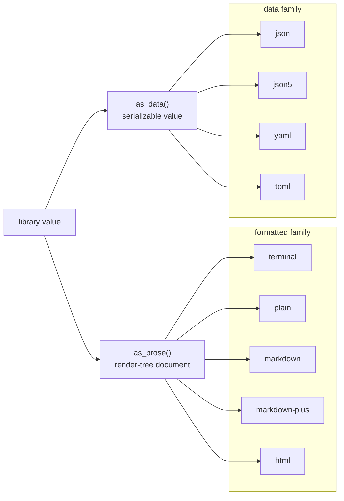
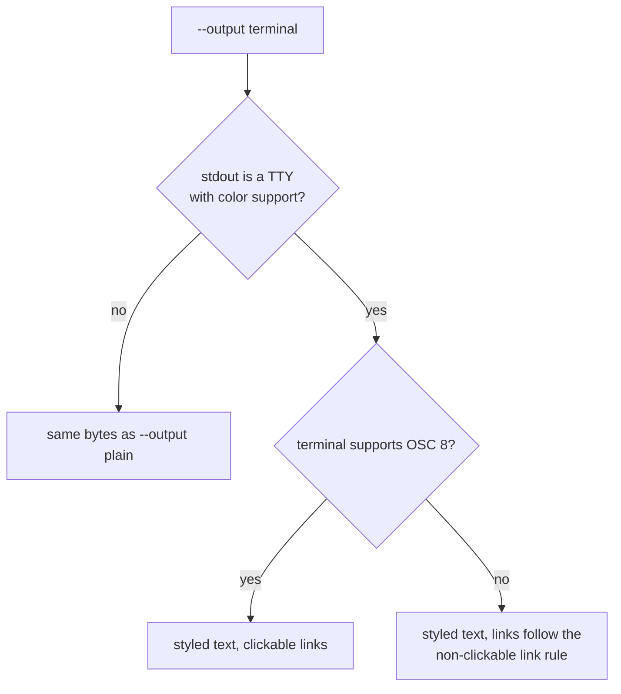
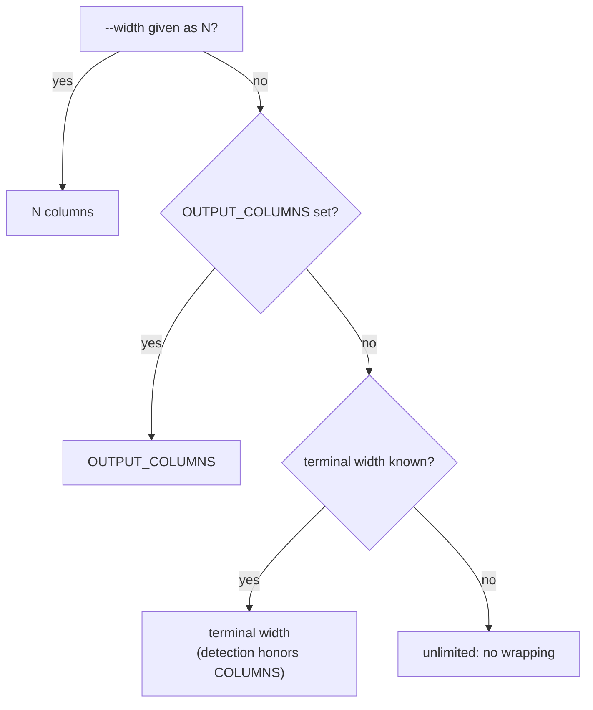
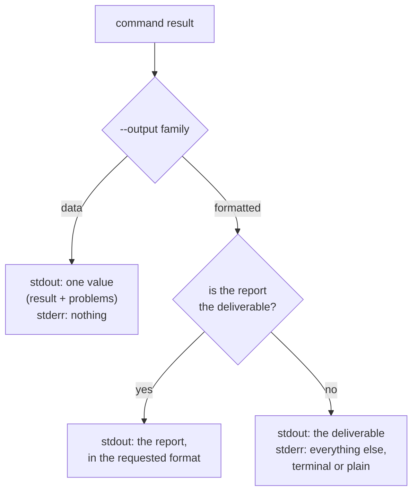

# Composition Errors: an Actionable Report, and One `--output` for Every `md` Command

When `md` finds composition problems (broken references, missing headings,
failed transclusions), its report says something is wrong without saying
what, where, or how to fix it. It also ignores the output the user asked for:
a caller that asked for JSON gets ANSI-styled terminal text. And each `md`
command chooses its output type, and its line width, in its own way.

This fix does three things, in one change:

1. **Rewrites the reference report** so every problem names its reason, the
   construct it is in, and a linked location.
2. **Unifies output selection across every `md` command.** One option,
   `--output <target>`, chooses the output type everywhere, and every output
   is rendered from one of two sources a library provides: a human-readable
   render tree, or a serializable data value.
3. **Unifies line width across every `md` command.** One option,
   `--width`, sets the width prose is wrapped to, independently of styling.

Two spikes, run on 2026-11-05, back the design and list the work it implies:
[authored positions](./spike-authored-positions.md) (where a reference's line
and column come from) and [plain output](./spike-plain-output.md) (what
today's renderers emit without styling, and at very large widths).

**How to read the markers.** A **Decided** note records a ruling the owner
made on 2026-11-04 or 2026-11-05, including the names and details the drafter
chose, which the owner accepted on 2026-11-05. A decided name may still change
during implementation, but only if the docs record the name that shipped.
**Assumption** marks something stated to the owner and agreed with.

## Scope

> **Decided.** Everything stays in this one spec, which stays filed under
> `fixes/`: the reference-report rewrite, the output unification, and the
> width option, across every `md` command. It is not split.

The changes touch these packages:

| Package | Why |
|---|---|
| `renderable` | defines the two-source trait (`as_prose()` / `as_data()`), its per-target override methods, the options struct they receive, and the width enum; gives the Markdown fold a width |
| `biscuit-terminal` | defines the shared `OutputTarget` enum, the one dispatch function, width resolution, and the one plain terminal profile; replaces the tree fold's link and image fallbacks with the new rule and fixes its `plain` leaks; writes link metadata as OSC 8 parameters |
| `darkmatter` | the report builder, the per-target overrides for Darkmatter documents, the data changes (authored locations, sections, transclusion trail), the terminal link and image rule, the reference-diagnostic location fix, the page builder's width and `plain` fixes, and the JSON5 structured link title (with its `md clean` migration) |
| `darkmatter-cli` | `--output` and `--width` on every command, removal of the old flags, per-command defaults, the output schema files and their tests, the `check_references` fix |
| `simplified-schema` | its strict validation checks `md`'s data outputs in tests; otherwise comment-only (below) |
| `claudine`, `darkmatter-lsp` | comment-only: doc comments that name `md compose --output report-json` are reworded |

### Sequencing

> **Decided.** The work lands as one change, built in this order:

1. The shared trait (`renderable`) and the dispatch function
   (`biscuit-terminal`), including width resolution.
2. The reference report: its data, its builder, and its `as_prose()` /
   `as_data()`.
3. `md compose` and `md render`.
4. Every other `md` command.
5. Documentation and skills.

For a command that already has JSON output, every data shape this spec does
not define is **today's JSON, unchanged**, now produced through `as_data()`.
The one exception is `md schema validate`. A command with no JSON today gets
a new shape, designed in step 4 and defined in its SimplifiedSchema file (see
[Other commands](#other-commands)).

**Planned follow-up.** The other monorepo CLIs (`sniff`, `bt`, `playa`) adopt
the trait and `OutputTarget` in a later spec. That spec does not exist yet,
so it is not named here.

## Terms

| Term | Meaning here |
|---|---|
| **TTY** | a terminal a person is looking at, as opposed to a pipe or a file |
| **ANSI escape / SGR** | invisible byte sequences a terminal reads as "make this red" or "bold" |
| **OSC 8** | an escape sequence that makes text a clickable link in terminals that support it; besides the URI it has a parameters field of colon-separated `key=value` pairs, which terminals ignore when they do not know a key ([reference](../../../biscuit-terminal/docs/research/terminal-standards/osc/osc-8.md)) |
| **authored position** | a line and column in the file as the author saved it, frontmatter included, as opposed to a position in the *prepared* body Darkmatter checks references against (frontmatter removed, expressions expanded, blocks removed) |
| **render tree** | `renderable`'s target-neutral document IR (`RenderNode`, `renderable::Document`); anything that implements `TreeRenderable` can produce one, and one fold turns it into terminal text, Markdown, or HTML |
| **Prose** | biscuit-terminal's styled-text component (`<b>`, `<red-500>`, links); it implements `TreeRenderable` |
| **formatted family** | the outputs made from `as_prose()`: `terminal`, `plain`, `markdown`, `markdown-plus`, `html` |
| **`markdown` / `markdown-plus`** | author-ergonomic Markdown, and Markdown that uses inline HTML for higher-fidelity rendering; see [below](#markdown-and-markdown-plus) |
| **data family** | the outputs made from `as_data()`: `json`, `json5`, `yaml`, `toml` |
| **deliverable** | what a command was run to produce: a rendered document, a value, a report someone asked for |
| **envelope** | the one JSON (or YAML, ...) value a command prints in a data output, carrying both its result and its problems |
| **SimplifiedSchema** | the monorepo's compact YAML schema language (the `simplified-schema` crate) |
| **reference** | anything in a document that names another file or URL: a link, an image, `::file`, `::code`, `prologue:`, ... |
| **transclusion** | inserting another document's content (`::file`), which makes that document part of the composition |
| **reflow** | joining a paragraph's lines and breaking them again at a target width |

## Problem

Observed 2026-11-04 running `md` against
`simplified-schema/docs/topics/types.md`, which links to two files that do not
exist:

```text
Invalid Hyperlink(s)
- the types.md reference to ./global-type-constraints.md is not valid
  failure: no-match
- the types.md reference to ./using-prose-in-schemas.md is not valid
  failure: no-match
3 references scanned, 1 valid, 2 issues
```

The renderer is `ValidationReportView` in
`darkmatter/lib/src/markdown/reference/validate.rs`. It is used by
`md compose`'s preflight (`render_reference_report` in
`cli/src/commands/compose.rs` and `compose/lifecycle.rs`) and as the footer of
`md graph --validate` (`cli/src/commands/graph.rs`). `md validate refs` has a
second, hand-built plain-text renderer (`print_validation_report_text` in
`cli/src/commands/validate.rs`).

### 1. "is not valid" hides a reason we already know

Each issue carries a `ReferenceIssueCode` (`MissingLocalTarget`,
`MissingFragmentTarget`, `InvalidUrl`, `RemoteUnreachable`, ...). The report
discards it and prints the same generic sentence for every issue.

### 2. `failure: no-match` repeats the reason in jargon

Because the sentence is generic, a second row was added to carry the reason
as a failure-class name. Once the reason is stated in plain words, that row
only takes up space.

### 3. The summary is unstructured and runs into the list

- No blank line separates the list from the summary.
- `3 references scanned, 1 valid, 2 issues` does not say what was scanned.
  The user named one file, but transclusion may have pulled in any number of
  others, and a problem can be in any of them.
- Counts are not broken down by reason, which is the most useful overview.

### 4. A problem's location cannot be acted on

The report prints only the file *name* of the document containing the
reference (`types.md`). It gives no line or column and no relative path, and
does not say how a transcluded document was reached. Two files called
`types.md` are indistinguishable, and a problem inside a transcluded file
looks the same as one in the file the user named.

### 5. "file not found" alone would still be ambiguous

A missing file can be named by a hyperlink, an image, `::file`, `::code`,
`::toc-linking`, `prologue:`, and more. Each is fixed differently, so the
report must name the construct as well as the reason. The heading
`Invalid Hyperlink(s)` tries to do this per group, but mixes kinds badly and
adds a heading for every kind.

### 6. The report ignores the output target

`md render` and `md compose` take `--output`, but it only selects the format
of the *document*. A composition failure prints the same ANSI-styled report
whatever was asked for:

```text
$ md compose types.md --output json
[38;2;251;44;54m[1mInvalid Hyperlink(s)[0m
- the [[38;2;43;127;255mtypes.md[0m](file:///Volumes/…/types.md) reference to …
```

On a pipe the report keeps its color escapes, and its links fall back to raw
`[types.md](file:///…)` text whose URL wraps across lines.

### 7. Output options differ between commands

| Command | Output option | Values | Default |
|---|---|---|---|
| `md render` | `--output` | `auto`, `markdown`, `markdown-plus`, `html`, `json` (= AST) | `auto`: terminal on a TTY, else Markdown |
| `md compose` | `--output` | the same, plus `report-json` | `markdown` |
| `md graph` | `--json` | on/off | terminal |
| `md validate refs` | `--format` | `text`, `json` | `text` |

There is no `terminal` or `plain` value; the terminal is reachable only
through `auto`.

The problem is not limited to the commands that print this report. Across
all of `md`, nine different mechanisms choose an output type today:

| # | Mechanism | Where |
|---|---|---|
| 1 | `--output auto\|markdown\|markdown-plus\|html\|json` | `md render`, `md FILE` |
| 2 | `--output …` plus `report-json` | `md compose` |
| 3 | `--json` (tree vs JSON) | `md graph` |
| 4 | `--format text\|json` | `md validate refs` |
| 5 | `--format pretty\|json` (newline-delimited JSON) | `md schema validate` |
| 6 | `--format yaml\|json` (SimplifiedSchema vs JSON Schema) | `md schema detect` |
| 7 | `--output terminal\|html\|markdown` | `md code-block` |
| 8 | `--json` | `md clean`, `md toc`, `md delta`, `md rm` |
| 9 | `--json5`, `--yaml`, `--toml`, `--raw`, `--compact` | `md get` |

`docs/cli-best-practices.md` §2.1 records the same finding.

### 8. JSON output has no defined contract

- `--output json` (alias `ast`) is the document's AST. On failure it is not
  JSON at all (problem 6).
- `--output report-json` prints `{ outcome, diagnostics, document }`. Its
  diagnostics are useful, but every reference location is lost:

  ```json
  { "code": "dm.reference.missing_hyperlink", "severity": "error",
    "message": "Missing local target: ./nope-a.md",
    "source": null, "span": null }
  ```

  A separate output *format* for the report is the wrong shape. The envelope
  should be what `json` means.

### 9. Locations are not linked to anything stable

Line numbers drift with every edit. The heading section that contains a
problem is a more stable marker, and both Markdown and HTML can link to it
(`file.md#section`). No report uses it.

### 10. A failed reference check passes silently

`check_references` (`cli/src/commands/compose.rs`, about line 742) runs
`md.validate_references(...)` and, when that returns `Err`, returns
`ReferenceCheck::Clean`. A reference check that could not run is reported as
one that found nothing.

### 11. Width options differ between commands

Each command that wraps text has its own idea of width:

| Command | Option | Meaning |
|---|---|---|
| `md render` | `--max-width N` | caps the content width inside the terminal |
| `md render` | `--width N` | rejected with an error that points at `--max-width` (`cli/src/args/cli.rs`, `reject_width_flag`) |
| `md clean` | `--fixed-width N` | reflows the cleaned Markdown at `N` columns |
| `md clean` | `--ignore-incidental-newlines` | turns reflow off (`unwrap: false`, no fixed width) |

No command honors a width when its output is not a terminal, and there is no
way to ask for "wrap at the terminal's width" or "keep my line breaks" in the
same words on every command.

## Design: two sources, two output families

> **Decided.** Libraries expose two sources, `as_prose()` and `as_data()`.
> Every output a CLI offers is rendered from one of them.

> **Decided.** The outputs form two families, and this split is a design
> principle to preserve. The **formatted** family (`terminal`, `plain`,
> `markdown`, `markdown-plus`, `html`) comes from `as_prose()`. The **data**
> family (`json`, `json5`, `yaml`, `toml`) comes from `as_data()`.



- **`as_prose()`** returns a render-tree document. Most building blocks
  already qualify: biscuit-terminal's `Prose`, `Table`, lists, and other
  components implement `TreeRenderable`, and a Darkmatter document is already
  a `renderable::Document`.
- **`as_data()`** returns a serializable value that holds all of the data in a
  sensible structure. `json`, `json5`, `yaml`, and `toml` are its
  serializations and nothing else.

A family is the unit a command opts into. A command accepts whole families
(both, or the data family only), plus any command-specific extra values. It
never accepts part of a family.

### `markdown` and `markdown-plus`

> **Decided.** The formatted family has two Markdown outputs, and they differ
> in purpose, not just in one construct.

- **`markdown`** is valid Markdown, with Darkmatter's directives and
  conventions layered on top. Its primary goal is to be ergonomic for authors
  and readable in every Markdown editor and viewer.
- **`markdown-plus`** is Markdown that carries more presentation logic and
  metadata by using inline HTML, which the Markdown specification permits. It
  renders with higher fidelity, at the cost of being less ergonomic to edit.

Any component that implements `MarkdownRenderable` should be able to produce
both from the same source. Today disclosure sections are the main
difference (`markdown-plus` writes them as `<details>` / `<summary>`);
tables, images, and more will follow.

`markdown-plus` is accepted wherever the formatted family is accepted. For
content that has no richer form, it is identical to `markdown`.

The same disclosure section in each output:

```md
<!-- markdown: the authored directive form -->
::disclosure Setup
::details
Run `just install`.
::end-disclosure

<!-- markdown-plus: native HTML disclosure, body still Markdown -->
<details><summary>Setup</summary>

Run `just install`.

</details>
```

### The trait (in `renderable`)

> **Decided.** A trait in the `renderable` crate defines `as_prose()` and
> `as_data()`. It also has optional per-target override methods; each one
> defaults to the generic fold of `as_prose()`.

The overrides exist because a generic fold is not always right. A Darkmatter
document's `markdown` output is its **source text**, not a fold of its tree,
and its `terminal` and `html` outputs come from Darkmatter's page builder,
which needs the CLI's style and theme options. A value that does not
override a target gets the generic fold.

The trait's name, the method names, and the exact signatures are **Decided**:

```rust
/// A command result that can be printed as any `OutputTarget`.
pub trait CommandOutput {
    /// The serializable form behind json, json5, yaml, and toml.
    type Data: serde::Serialize;

    /// The human-readable form behind the formatted family.
    fn as_prose(&self) -> renderable::Document;

    fn as_data(&self) -> Self::Data;

    /// Per-target overrides. `None` means "use the generic fold of
    /// `as_prose()`", which is what every default returns.
    fn render_terminal(&self, _options: &OutputOptions) -> Option<String> { None }
    fn render_markdown(&self, _options: &OutputOptions) -> Option<String> { None }
    fn render_markdown_plus(&self, _options: &OutputOptions) -> Option<String> { None }
    fn render_html(&self, _options: &OutputOptions) -> Option<String> { None }
}
```

The overrides return `Option` rather than calling the fold themselves because
the terminal fold lives in `biscuit-terminal`, which depends on `renderable`
and not the reverse; the dispatch function performs the fallback.

> **Decided.** There is no `plain` override. `plain` is always the `terminal`
> path given the one built-in plain terminal profile (see
> [The plain profile](#the-plain-profile)), so a value that overrides
> `terminal` gets a matching `plain` as long as its override honors the
> profile it is given.

The [plain-output spike](./spike-plain-output.md#does-the-trait-need-a-plain-override)
confirmed that no separate renderer is needed: every defect it found was a
capability leak in an existing path, not a missing renderer.

`OutputOptions` is the small options struct the dispatch passes to every
path (**Decided** name and fields):

| Field | Meaning |
|---|---|
| `verbosity` | the global `-v` count; drives the [non-clickable link rule](#links-and-images-that-cannot-be-clickable) |
| `width` | the resolved [width](#width), a `Width` enum: `Columns(n)`, `Unlimited`, or `Source` |
| `terminal_profile` | the detected (or spoofed) terminal capabilities: color depth, OSC 8, ...; the [plain profile](#the-plain-profile) for `plain` |

`OutputOptions` lives in `renderable` so the trait can name it.
`renderable` already has target-neutral capability types (`ColorDepth`,
`ColorMode`); the profile is described with those, and `biscuit-terminal`'s
detection fills it in (**Decided**). `renderable` already depends on `serde`,
so the trait adds no dependency.

**Darkmatter documents.** The document value used by `md render`, `md clean`,
and `md set` overrides three targets:

| Target | Darkmatter's override |
|---|---|
| `markdown` | emits the document's source text, reflowed by Darkmatter's own reflow (`cleanup::reflow::reflow_to_width`) when the width is `Columns(n)` |
| `terminal` | Darkmatter's page builder, with the CLI's style and theme options, at the resolved width |
| `html` | Darkmatter's page builder, with the CLI's style and theme options |

`markdown-plus` and `plain` use the generic paths described above; `plain`
reaches Darkmatter's `terminal` override with the plain profile. Darkmatter
keeps its style and theme options on the document value itself, so
`OutputOptions` stays small.

### The target and the dispatch (in `biscuit-terminal`)

> **Decided.** biscuit-terminal provides one shared `OutputTarget` enum and one
> dispatch function that folds a value to the chosen target, including TTY and
> color detection. The dispatch function takes the small options struct
> described above.

`OutputTarget` has the nine values listed under
[`--output`](#--output-is-the-only-output-selector). The dispatch function's
name and signature are **Decided**:

```rust
pub fn write_output<T: CommandOutput>(
    value: &T,
    target: OutputTarget,
    options: &OutputOptions,
    out: &mut dyn std::io::Write,
) -> Result<(), OutputError>;
```

| Target | Source | How it is produced |
|---|---|---|
| `terminal` | `as_prose()` | the value's `render_terminal` override, else the terminal fold, with the detected terminal's capabilities |
| `plain` | `as_prose()` | the `terminal` path with the [plain profile](#the-plain-profile) (no separate renderer) |
| `markdown`, `markdown-plus` | `as_prose()` | the override, else the Markdown fold (`RenderTarget::Markdown` / `MarkdownPlus`), given the resolved width (see [Width in the Markdown fold](#width-in-the-markdown-fold)) |
| `html` | `as_prose()` | the override, else the browser fold (`RenderTarget::Browser`) |
| `json`, `json5`, `yaml`, `toml` | `as_data()` | serialized; `toml` is converted from the data by biscuit-file |

biscuit-terminal already depends on `renderable` and on `biscuit-file` (with
its `toml`, `yaml`, and `json5` features), so the dispatch adds no dependency
edge.

A command no longer has its own hand-written renderer for any output.
`print_validation_report_text`, `graph.rs`'s success footer, and the reference
kind headings all go away.

## `--output` is the only output selector

> **Decided.** `--output <target>` is the only way to choose an output type in
> `md`. Its values are the formatted family (`terminal`, `plain`, `markdown`,
> `markdown-plus`, `html` with alias `browser`) and the data family (`json`,
> `json5`, `yaml`, `toml`). A command accepts whole families, both or the
> data family only, and may add command-specific values, which its `--help`
> lists.

| Value | Family | What you get |
|---|---|---|
| `terminal` | formatted | styled text for a terminal (color, bold, OSC 8 links), degraded to what the terminal supports |
| `plain` | formatted | plain text with all styling removed |
| `markdown` | formatted | Markdown that is ergonomic to author and readable in any Markdown viewer |
| `markdown-plus` | formatted | Markdown that uses inline HTML for higher-fidelity presentation; equal to `markdown` where there is no richer form |
| `html` (`browser`) | formatted | HTML |
| `json`, `json5`, `yaml`, `toml` | data | the command's data, serialized |

Every `md` command accepts both families except `md compose`, which accepts
the data family only besides its Markdown default (see
[`md compose`](#md-compose-always-writes-markdown)).

**TOML.** TOML is produced by converting the data through biscuit-file.
TOML has no `null`, and TOML needs a table at the root:

> **Decided.** A field whose value is `null` is omitted from TOML output. A
> `null` inside an array cannot be omitted without changing the array, so it
> makes TOML output fail with a clear error naming the path to the value.

A scalar result is wrapped as `value = …`, as `md get --toml` does today.

**Command-specific values.** One is decided:
`md schema detect --output json-schema` (see
[`md schema detect`](#md-schema-detect)).

### What is removed

> **Decided.** The following are removed. Each becomes a usage error (exit 2).

| Removed | Use instead |
|---|---|
| `--output auto` | the command's declared default, or an explicit value |
| `--output ast`, and the document-AST meaning of `--output json` | nothing: the document AST is no longer an output |
| `--output text` (an alias of `markdown`, too easily confused with `plain`) | `--output markdown` |
| `--output report-json` (`md compose`) | `--output json` |
| `md compose --output markdown-plus\|html\|browser` | `md compose doc.md \| md render --output …` |
| `--format` (`md validate refs`, `md schema validate`, `md schema detect`) | `--output` |
| `--json` (`md clean`, `md toc`, `md delta`, `md rm`, `md graph`) | `--output json` |
| `--json5`, `--yaml`, `--toml` (`md get`) | `--output json5\|yaml\|toml` |
| `--plain` (anywhere it exists) | `--output plain` |
| `md get --raw` | `md get --output plain` |
| `md clean --fixed-width N` | `md clean --width N` |
| `md clean --ignore-incidental-newlines` | `md clean --width source` |

`md get --compact` is **kept**, as a modifier that is valid only with
`--output json` or `--output json5`; with any other output it is a usage
error.

> **Decided.** `md validate refs --graph <mermaid|dot>` keeps its current
> meaning and is unaffected by this spec. It is not an output-type selector:
> it names the notation of a diagram printed in addition to the report.

### Each command declares its default

> **Decided.** There is no `auto`. Each command declares its own default, and
> its `--help` shows it. The default follows one rule:
>
> - A command whose default is `markdown` **always** writes Markdown,
>   whatever stdout is and whatever the terminal supports.
> - A command whose default is `terminal` falls back to `plain` when stdout
>   is not a terminal or the terminal lacks color support.
>
> An explicit `--output` always wins over both.

| Default | Commands |
|---|---|
| `markdown` | `md compose`, `md clean`, `md set` (without `--save`) |
| `terminal` | every other command: `md render` / `md FILE`, `md toc`, `md delta`, `md graph`, `md validate refs`, `md schema validate`, `md schema triggers`, `md schema about`, `md schema detect`, `md hash`, `md code-block`, `md rm`, `md edit`, ... |
| `json` | `md get` |

`md compose`, `md clean`, and `md set` are the **document commands**: their
deliverable is a Markdown document.

> **Decided.** Only the document commands default to `markdown`. Every
> command not given another default here (for example `md edit` and
> `md schema about`) defaults to `terminal`, including any command added
> later.

Consequences:

- `md compose x.md > out.md` still writes Markdown, so the compose recipes in
  the `homelab` and `claudine` justfiles need no change.
- `md set` keeps printing the edited Markdown on a pipe, as it does today.
- `md FILE > out.txt` changes: `auto` used to write Markdown on a pipe; the
  `terminal` default now writes the same text as `plain`
  ([below](#terminal-degradation-and-plain)). A caller that wants Markdown
  says `--output markdown`.
- `just/review.just` calls `md get --raw` nine times; those calls become
  `md get --output plain` in this change.

## `md compose` always writes Markdown

> **Decided.** Composition is Markdown to Markdown. `md compose` always
> produces Markdown and has no formatted alternatives.

| `--output` | Prints |
|---|---|
| (default) | the composed Markdown |
| `json`, `json5`, `yaml`, `toml` | the [envelope](#md-compose-and-md-render) |

Nothing else is accepted. To see a composed document in a terminal, as
plain text, or as HTML, pipe it to `md render`:

```sh
md compose doc.md | md
md compose doc.md | md render --output html > doc.html
```

(`md` with no subcommand is `md render`; making it an exact alias is owned by
`2026-11-05-render-surface`.)

Because compose's default is not a dispatch target, compose never goes
through the formatted dispatch: its Markdown bytes are exactly what they are
today. Problems found while composing go to stderr (see [Streams](#streams)).

## Terminal degradation and `plain`

> **Decided.** `terminal` degrades, when stdout is not a terminal or the
> terminal lacks color support, to the same text `plain` gives. This matches
> the capability-based degradation Prose already does.

> **Decided.** `plain` is plain text with all styling removed.



### Code in `plain`

> **Decided.** Removing styling does not remove meaning. In `plain`, and in a
> terminal that cannot style code, inline code keeps its backticks and a code
> block keeps its fences and language tag.

````text
Run `md compose` first.

```yaml
name: string(required)
```
````

A reader, or a script, can still tell code from prose and knows the block's
language.

> **Decided.** Code is never wrapped in `plain`. A code line longer than the
> width is printed whole. (In a styled terminal the width is a cut-off for
> code lines; see [Width](#width).)

### Other elements in `plain`

> **Decided.** The rest of `plain` follows the same principle: structure that
> carries meaning stays, styling goes, and no escape byte is ever written.

| Element | In `plain` |
|---|---|
| bold, italic | the markers are dropped and the text is kept: `**bold**` prints `bold` |
| table | keeps its box-drawing borders (`┌─┬┐│`), which are structure, not styling |
| block quote | each line is prefixed `> ` |
| horizontal rule | `---` |
| heading | its text alone, without `#` markers |
| disclosure section | its summary line, then its contents as normal text beneath it, with no bar glyph |
| link, image | the [non-clickable rule](#links-and-images-that-cannot-be-clickable) |
| a URL printed by that rule | never broken by word wrap (see [below](#links-and-images-that-cannot-be-clickable)) |

> **Decided** (2026-11-05). In `plain`, a heading prints as its text alone,
> without `#` markers. A disclosure section prints its summary line, then its
> contents as normal text beneath it, with no bar glyph: nothing in `plain`
> can be expanded, so the contents are always shown.

```text
Setup
Run `just install`.

> Quoted text keeps a visible marker.

---

┌──────┬───────┐
│ Name │ Type  │
├──────┼───────┤
│ id   │ ulid  │
└──────┴───────┘
```

Because tables keep box drawing, `plain` is not ASCII-only. It is
escape-free: no SGR, no OSC 8, no other control sequence.

### The plain profile

> **Decided.** There is one built-in plain terminal profile. `plain` always
> uses it, and so does `terminal` when it
> [degrades](#terminal-degradation-and-plain). No caller assembles a plain
> profile by hand.

The profile turns every capability off: no color, no OSC 8 links, no italics
or underline, no inline images. Its constructor's name is **Decided**
(`Terminal::plain(width)`, or `TerminalProfile::plain()` carried in
`OutputOptions`; the implementation picks one and the docs record it). It is applied *after* any width or capability selection, so
no option (a `max_width`, a hyperlink mode) can switch a `plain` run back to a
rich profile.

### What has to change for `plain`

The [plain-output spike](./spike-plain-output.md#gaps-and-fixes-by-file)
rendered one corpus through every existing path with a no-color, no-TTY
profile. Code meaning already survives on every path, but **no path is
escape-free** and none follows the link and image rule. These are
implementation tasks of this change; the spike report has the measurements
and line references.

| # | Defect today | Fix | Where |
|---|---|---|---|
| P1 | The block-quote bar is formatted with a hard-coded truecolor SGR, whatever the color depth | gate it on the color depth, as `render_code` already does; in `plain` the prefix is `> ` | `biscuit-terminal` `render_tree/render.rs` (`render_blockquote_with_prefix`); Darkmatter's `blockquote_prefix` in `render_tree/entrypoints.rs` |
| P2 | `Markdown::as_terminal` with a `max_width` on a pipe selects the optimistic (rich) profile, so OSC 8 links leak into piped output | width no longer selects capabilities; the plain profile is pinned after selection | `darkmatter` `render_tree/entrypoints.rs` (`capability_terminal`) |
| P3 | `TerminalOptions::hyperlink_mode` is never read on the render-tree path, so `HyperlinkMode::Never` has no effect | map it onto the profile's OSC 8 capability, or remove it in favor of the profile | `darkmatter` `render_tree/entrypoints.rs` |
| P4 | Links print `[text](url)`; images print `[alt]` or `▉ IMAGE[alt]` | the [non-clickable rule](#links-and-images-that-cannot-be-clickable), with the verbosity passed to the fold (for example a `TerminalRenderContext` field filled from `OutputOptions::verbosity`); one image placeholder, `IMAGE[alt]` | `biscuit-terminal` `render_tree/render.rs` (`NodeKind::Link`, `NodeKind::Image`) |
| P5 | Word wrap can hyphenate inside a URL | a printed URL is one unbreakable word | `biscuit-terminal` wrapping |
| P6 | The zero-config `DarkmatterPage` ignores its terminal's width and re-detects the ambient one (80 on a pipe), so `--width N` cannot reach `md render` | pass the resolved width through | `darkmatter` `layout/page.rs` |
| P7 | Page frame decoration pads every line with trailing spaces | with no page background, a right margin and padding emit nothing; `plain` has no trailing whitespace | `darkmatter` `layout/page.rs` (`apply_row_decoration`) |
| P8 | Width is a `u16` on Darkmatter's paths and silently clamps at 65 535; `Terminal::width()` falls back to 80 off a TTY | the `Width` enum end to end (see [Width](#width)) | `darkmatter` `layout/page.rs`, `TerminalOptions`; `biscuit-terminal` `terminal.rs` |
| P9 | The horizontal rule fills the full width with `╌` | `---` in `plain`; natural width under `Unlimited` | `biscuit-terminal` `render_tree/render.rs` |
| P10 | No plain profile exists; each caller assembles one | the one [plain profile](#the-plain-profile) | `biscuit-terminal` |

Darkmatter's `terminal` override must honor the profile too: the page builder
has defects P1, P6, and P7, so it is fixed alongside the generic fold.

### Links and images that cannot be clickable

> **Decided.** One rule applies everywhere a link cannot be clickable: in
> `plain` output, and in a terminal without OSC 8 support.

The rule uses the existing global `-v` / `--verbose` count flag, whose help
already describes it as controlling "styled user-facing output".

| Element | Default | With `-v` |
|---|---|---|
| link | `text` | `text <url>` |
| link whose text equals its URL | `url` (once) | `url` (once) |
| image | `IMAGE[alt]` | `image: alt <path>` |

> **Decided.** A URL this rule prints (the `<url>` under `-v`, or a URL shown
> once) is never broken by word wrap. It is treated as one unbreakable word:
> when it does not fit on the current line it moves to a line of its own, and
> if it is longer than the width it overflows that line rather than being
> split or hyphenated.

```text
See the docs
<https://example.com/a/very/long/path/to/the/documentation/page.html>
for details.
```

This rule replaces three behaviors that exist today:

| Today | Where |
|---|---|
| `[text](url)` | Prose's OSC 8 fallback (`biscuit-terminal/docs/components/prose.md`, "Graceful Degradation"), and the render-tree fold's `NodeKind::Link` arm |
| `text [url]` | Darkmatter's terminal `HyperlinkMode::Never` (`darkmatter/lib/src/markdown/output/terminal.rs`, about line 290) |
| `[alt]`, `▉ IMAGE[alt]` | the render-tree fold's two image placeholders (`ImagePlaceholder::Bracket` and `Block`), and Darkmatter's `render_image` in the same file |

**Invariant:** the problem report never puts information only in a link's
URL. A location's path and `line:col` are visible text, so a reader who
cannot click still sees where the problem is.

**Accepted trade-off:** Apple Terminal has no OSC 8 support, so its users no
longer see link URLs on screen unless they pass `-v`.

## Width

> **Decided.** Width is independent of styling. When a width is known, prose
> is word-wrapped at it in **every** formatted output, `plain` included. When
> no width is known, width is unlimited and nothing is wrapped.

How text is wrapped:

- **Prose** wraps at word boundaries. It follows Markdown rules: a single
  newline inside a paragraph is a soft break, so the paragraph's lines are
  joined and then wrapped again at the width. In `terminal` and `plain` this
  is Prose's word wrap, for every command.
- **Code blocks** are never reflowed or wrapped. In a styled terminal the
  width is a cut-off for a code line that is too long; in `plain` and in the
  Markdown outputs a code line is always printed whole.
- **Printed URLs** are unbreakable words (see
  [Links and images that cannot be clickable](#links-and-images-that-cannot-be-clickable)).

### Width is an enum, and unlimited means unlimited

> **Decided.** Internally, width is an enum, never a large number:
> `Columns(n)`, `Unlimited`, or `Source`. It is carried from width resolution
> into every fold (`OutputOptions`, the terminal render context, and the
> Markdown fold's options).

The [plain-output spike](./spike-plain-output.md#what-unlimited-must-mean)
showed why: at a width of 100 000, the horizontal rule alone was 100 000
glyphs (300 KB of a 302 KB output), and Darkmatter's `u16` widths silently
clamped the value to 65 535. With an enum, every component that fills to the
width has to choose its `Unlimited` behavior explicitly, and the compiler
enforces it. The `u16` clamp disappears with the `u16`.

> **Decided.** Under `Unlimited`, whether asked for with `--width unlimited`
> or because no width is known, nothing wraps **and nothing fills**. Every
> component that would otherwise fill the width renders at its natural width.

| Component | Under `Columns(n)` | Under `Unlimited` |
|---|---|---|
| prose paragraph | joined, wrapped at `n` | joined, never wrapped |
| code block | lines unchanged; cut off at `n` in a styled terminal | lines unchanged |
| code band (color terminals) | padded to `n` | padded to the block's longest line, plus its padding |
| table | planned to fit `n`, cells wrap | natural column widths, no cell wrapping |
| horizontal rule | `n` glyphs in a styled terminal; `---` in `plain` | `---` in `plain`; a short fixed rule in a styled terminal (**Decided:** 3 glyphs) |
| page right margin and background band | padded to `n` | omitted: there is nothing to fill to |
| left margin, padding, list and quote indentation | applied | applied (they are not fills) |
| `max-width` and fill-width component policies | resolved against `n` | a fill resolves to the natural width; `max-width` still caps |

`Source` keeps authored line breaks: no reflow at all. It is the default of
the [document commands](#markdown-output-commands-default-to-source).

> **Decided.** Width applies to data outputs too. A payload often carries the
> text a formatted output would have printed, such as the envelope's
> `document` or a rendered prose property. Each such property is transformed
> exactly as the formatted output would transform it, under the same width
> and reflow rules. Structural values (numbers, paths, codes) are never
> wrapped.

For example, `md compose doc.md --output json` puts in `document` exactly the
Markdown `md compose doc.md` would print: with compose's `source` default it
is not reflowed, and with `--width 80` it is reflowed at 80 columns.

> **Decided.** `--width` applies to the deliverable. What goes to stderr (see
> [Streams](#streams)) wraps at stderr's own terminal width, and is unlimited
> when stderr is not a terminal.

### `--width`

> **Decided.** A new CLI-wide option,
> `--width <N | N% | auto | source | unlimited>`.
> Every `md` command has it, with no opt-outs. A command that prints no
> prose (`md hash`, `md rm`, `md get`, `md schema detect`, ...) still accepts
> `--width`, and it has no effect there. One rule covers every command.

| Value | Width |
|---|---|
| `auto` (the general default) | `OUTPUT_COLUMNS` if set, else the terminal's column width |
| `N` (an integer) | `N` columns, overriding both `OUTPUT_COLUMNS` and the terminal |
| `N.M` (a float) | floored to an integer, with a warning that `--width` takes integers: on stderr for a formatted output, as an entry in `diagnostics` for a data output |
| `N%` | `N` percent of `OUTPUT_COLUMNS` if set, else of the terminal width, floored; unlimited when neither is known |
| `source` | no reflow: line breaks stay exactly as authored (`Source`) |
| `unlimited` | no wrapping and no filling (`Unlimited`), even on a terminal of known width |

```sh
md render notes.md --width 72        # wrap at 72 columns
md render notes.md --width 80%       # 80% of the terminal (or OUTPUT_COLUMNS)
OUTPUT_COLUMNS=100 md toc notes.md   # wrap at 100 columns, even on a pipe
md clean notes.md --width source     # keep every authored line break
md render notes.md --width unlimited # one line per paragraph, nothing padded
```

`auto` resolves in this order, first match wins:



> **Decided.** The terminal width is known only when stdout is a terminal.
> On a pipe with neither `--width` nor `OUTPUT_COLUMNS`, nothing wraps, so
> `md get --output plain` on a pipe is byte-for-byte today's `md get --raw`.

Terminal width detection keeps honoring `COLUMNS`, as it does today. Width
resolution returns the `Width` enum, so "not known" is `Unlimited`, never a
fallback of 80 columns.

### Width in the Markdown fold

> **Decided.** `renderable`'s Markdown fold takes a width.
> `MarkdownRenderOptions` gains a `width` field of the same `Width` enum, so
> `--output markdown --width N` (and `markdown-plus`) reflows prose on every
> command whose Markdown comes from `as_prose()`.

The fold follows Markdown's soft-break rules:

| `width` | Paragraph text |
|---|---|
| `Source` (the default; today's behavior) | soft breaks written as authored |
| `Unlimited` | each paragraph's soft breaks joined into one line |
| `Columns(n)` | joined, then wrapped at word boundaries at `n`; never inside a code span, a link destination, or an autolink |

Code blocks and tables are never reflowed. Darkmatter documents keep their
own reflow through their `markdown` override (see
[The trait](#the-trait-in-renderable)): the dispatch in `biscuit-terminal`
cannot depend on Darkmatter, which is why the generic fold needs a width of
its own.

### Markdown-output commands default to `source`

> **Decided.** The document commands (`md compose`, `md clean`, `md set`) opt
> out of `auto` and default to `--width source`.

- The document's own `fixed-width:` and `unwrap:` frontmatter still applies,
  unless `--width` is given explicitly; an explicit `--width` wins.
- `--width N` replaces `md clean --fixed-width N`.
- `--width source` replaces `md clean --ignore-incidental-newlines`: given
  explicitly, it overrides the document's `fixed-width:` and `unwrap:`
  exactly as the old flag did.
- With no `--width`, `md compose`'s output is byte-for-byte what it is today.

### `md render` and `--max-width`

> **Decided.** `--max-width` is not a general pattern and is not added to any
> other command. `md render`'s style surface, about 40 root style flags in
> `darkmatter/cli/src/args/cli.rs` (`--max-width` among them), moves to
> `md render --style` in `2026-11-05-render-surface`. This spec does not
> design `--style`.

Until that lands, `md render --max-width` stays, so capping the content width
is never lost. `--width` is the width available; `--max-width` caps the
content inside it. The `--width` stub on `md render` that rejects the flag
today (`reject_width_flag`) is replaced by the real `--width` from this spec.

## Streams

> **Decided.** Where output goes depends on the family.

> **Decided.** A data output (`json`, `json5`, `yaml`, `toml`) writes
> **nothing** to stderr. There is no "operational chatter" channel: anything
> a run has to say is part of the one value on stdout, or is not said.

**Data outputs.** Everything goes to stdout as exactly one value, success or
failure; the value's `outcome` says which. What used to go to stderr moves
into the payload or disappears:

| Formerly on stderr | In a data output |
|---|---|
| `--perf` timings | the payload's `perf` field (**Decided** name; see [the data contract](#md-compose-and-md-render)) |
| the float `--width` floor warning | an entry in `diagnostics` |
| warnings and problem reports | entries in `diagnostics` |
| a lifecycle communication action's line (`stdout:`, `stderr:`, `info:`, `warn:`, ...), and the output of a lifecycle or shell step | the payload's `lifecycle_output` field (**Decided** name; see [the data contract](#md-compose-and-md-render)) |
| `-v` output | nothing: `-v` only affects formatted outputs |

> **Decided.** Lifecycle and shell step output in a data output is captured
> into the payload, not dropped and not written to stderr.

**Formatted outputs.** The deliverable goes to stdout, in the requested
format. Anything that is not the deliverable goes to stderr, rendered as
`terminal` with the `plain` fallback, judged by **stderr's own** TTY and
color detection, and wrapped at stderr's own width (see [Width](#width)).
Examples of what goes to stderr: `md render`'s style warnings, and
`md compose`'s problem report in its default Markdown mode.

**When the report is the deliverable,** it goes to stdout in the requested
format. That is the case for `md validate refs`, `md graph --validate`, and
`md schema validate`.

> **Decided.** `md schema validate`'s results are what it was run to
> produce, so its report is the deliverable and goes to stdout.



| Command and output | stdout | stderr |
|---|---|---|
| `md compose broken.md` | nothing (it failed) | the problem report |
| `md compose broken.md --output json` | the envelope, `outcome: "failure"` | nothing |
| `md render doc.md --output html` | the HTML | style warnings, composition problems |
| `md validate refs doc.md --output markdown` | the report, as Markdown | nothing |

### Usage errors and exit status

> **Decided.** The one exception to "nothing on stderr" is a **usage error**:
> the arguments could not be parsed (an unknown or removed flag, a misspelled
> subcommand, a conflicting pair). No command ran, so no payload exists.
> The parser's message goes to stderr, stdout is empty, and the exit status
> is 2. This is standard argument-parser behavior.

> **Decided.** Every `md` command uses three exit statuses, in every output
> mode:
>
> - **0**: the command ran and succeeded.
> - **1**: the command ran and failed. In a data output, stdout still holds
>   the one value, with `outcome: "failure"`.
> - **2**: a usage error, and nothing else. The message is on stderr and
>   stdout is empty.
>
> Exit 0 never carries `outcome: "failure"`, and exit 2 never carries a
> payload.

A script decides what happened from the exit status, never from stderr:

| Exit status | Meaning | stdout (data output) | stderr (data output) |
|---|---|---|---|
| 0 | success | one value, `outcome: "success"` | nothing |
| 1 | the command ran and failed | one value, `outcome: "failure"` | nothing |
| 2 | usage error | empty | the usage message, for humans only |

In a formatted output the statuses mean the same; only the streams differ
(see the table above): on a failure the problems are on stderr, or on stdout
when the report is the deliverable.

Several `md` commands exit 2 today for a run that failed, not for a usage
error. Each moves to 1 in this change:

| Today | Under this contract |
|---|---|
| `md compose` stopped by a broken reference no recovery covers, with or without a lifecycle, and with `report-json` | 1 |
| `md compose` stopped by a blocking passive-check finding (`--deny`) | 1 |
| `md graph --validate` and `md validate refs` that find reference errors | 1 |
| `md hash --diff` that finds a difference, or no stored hash | 1 |
| `md schema validate` that finds a schema error, including a selection error or a schema file that cannot be loaded | 1 |
| a custom baseline schema (`--schema`) that cannot be loaded | 1 |

Arguments the parser accepts but that conflict or are out of range (for
example `--schema` with `--disable baseline-schema`, or
`--max-iteration-visits 0`) stay usage errors, exit 2: no command ran.

**Decided:** a run interrupted by Ctrl-C keeps exiting 130 and prints no object, as a lifecycle
run does today. That status reports the signal, not an outcome the command
reached, so it sits outside the contract.

`md schema validate` also exits 3 today, for a file that is not one
admissible YAML document. **Decided:** that becomes 1 as well, since the
contract has no other failure status; the data output still tells the two
apart by the diagnostic's `error` field.

```sh
if out=$(md compose doc.md --output json); then
  jq -r .document <<<"$out"            # success
elif [ $? -eq 2 ]; then
  echo "fix the command line" >&2      # usage error: no payload
else
  jq '.diagnostics[]' <<<"$out"        # failure: the payload says why
fi
```

> **Decided.** A run that fails only because `--deny` made warnings blocking
> is a failure like any other: `outcome: "failure"` and exit status 1.

### `--show` with a data output

> **Decided.** `--show` (on `md render` and `md compose`) combined with a
> data output is not an error. The value is written to a temp file with the
> matching extension (`.json`, `.json5`, `.yaml`, `.toml`) and opened with
> the host's default app for that type.

```sh
md compose doc.md --output yaml --show   # opens a temp .yaml file
```

**Assumption:** when the host has no default app for the type, that is
reported like any other failure to open, with no fallback to another app.

The repository's CLI conventions are updated to this principle by this
change: `.claude/skills/cli/SKILL.md` ("Output Formats" and "STDOUT vs
STDERR", which today make `--json` and `--plain` mandatory and send errors to
stderr even in JSON mode) and `docs/cli-best-practices.md` §2.1 (which
recommends `--format` plus `--json`/`--plain` shortcuts).

## Subcommands and the root command

> **Decided.** A general CLI rule, recorded in the `cli` skill and
> `docs/cli-best-practices.md` by this change: a CLI that has subcommands
> never has a separate "root command". A root alias is fine for ergonomics,
> but it must always be an exact alias of one named subcommand.

For `md`, making bare `md` an exact alias of `md render` is owned by
`2026-11-05-render-surface`, not by this spec.

## The data contract

> **Decided.** The JSON contract evolves today's `report-json` shape; it does
> not adopt a new flat envelope.

### `md compose` and `md render`

Both print one object:

| Field | Value |
|---|---|
| `file` | the file as given on the command line; `null` for stdin |
| `outcome` | `"success"` or `"failure"` |
| `document` | the rendered document as a Markdown string (honoring `--frontmatter`); `null` on failure |
| `diagnostics` | every diagnostic the run reported, in the order `report-json` uses today; `[]` when there were none |
| `summary` | the reference check's totals (below) |
| `perf` | **Decided:** the `--perf` timings (command-level and per-stage), present only when `--perf` is given |
| `lifecycle_output` | **Decided** name and shape: what lifecycle communication actions and lifecycle or shell steps printed, in run order, one entry per step; `[]` when nothing was printed |

`document` is always Markdown, whatever a formatted output would have
rendered. It is the Markdown the command's `markdown` output would print,
width included: compose's `source` default leaves it unreflowed, and
`--width 80` reflows it at 80 columns (see [Width](#width)).

Each diagnostic keeps the existing record (`Diagnostic` in
`darkmatter/lib/src/markdown/compose/expression/diagnostics.rs`, built by
`compose/report_diagnostics.rs`), with new fields added:

| Field | Status | Value |
|---|---|---|
| `code` | existing | stable `dm.<family>.<kind>` code, shared with DMLS |
| `severity` | existing | `"error"`, `"warning"`, or `"info"` (`warning`, not `warn`) |
| `message` | existing | the problem in words |
| `source` | existing, extended | `{ file, line, column, section, inserted }`, or `null` |
| `expected_type`, `actual_type` | existing | for a call argument; otherwise `null` |
| `span` | existing | `{ start, end }` byte range in `source.file`; otherwise `null` |
| `iteration_path` | existing | `::map` / `::filter` item positions; otherwise `[]` |
| `reason` | new, optional | the reason phrase, e.g. `"file not found"` |
| `construct` | new, optional | the construct phrase, e.g. `"hyperlink"`, `"::code"` |
| `reference` | new, optional | the reference as written |
| `failure` | new, optional | the file-reference failure class, e.g. `"no-match"` |
| `included_via` | new, optional | the transclusion trail, outermost first, as `{ file, line }` steps |

- `source.line` and `source.column` are the **authored position**, and follow
  the [position rule](#where-a-position-comes-from). They are `null` only for
  a document built in memory, which has no file to point into.
- `source.section` is the composed anchor slug of the innermost heading at or
  before the problem; absent above the first heading. (**Decided:** it lives
  inside `source`, beside the line and column it refines.)
- `source.inserted` (**Decided** name) is `true` when the reference was
  created by an expression, a shell step, or a `replace:` value, so `line`
  and `column` point at the construct that created it; otherwise `false`.
- `source` stays nullable, but every producer fills it wherever it knows the
  position, falling back to the composed document when it knows only that.
- Reference diagnostics fill `source` from the reference's authored location
  (see [Data changes](#data-changes)). Today `reference_issue_diagnostic`
  builds them with `source: null`.
- `included_via` steps name the authored line of each `::file` (or
  `::toc-linking`) directive.

`summary` (**Decided** field names, carried over from the earlier draft):

| Field | Value |
|---|---|
| `references` | references checked |
| `documents` | documents checked, the named one included |
| `ok` | references that resolved |
| `broken` | references that did not |

`summary` is `null` when the reference check did not run (for example, the
input could not be read).

An example failure, for the observed `types.md` case:

```json
{
  "file": "simplified-schema/docs/topics/types.md",
  "outcome": "failure",
  "document": null,
  "diagnostics": [
    {
      "code": "dm.reference.missing_hyperlink",
      "severity": "error",
      "message": "Missing local target: ./global-type-constraints.md",
      "source": {
        "file": "simplified-schema/docs/topics/types.md",
        "line": 14, "column": 83, "section": "simplified-schema-types",
        "inserted": false
      },
      "expected_type": null, "actual_type": null,
      "span": { "start": 912, "end": 940 },
      "iteration_path": [],
      "reason": "file not found",
      "construct": "hyperlink",
      "reference": "./global-type-constraints.md",
      "failure": "no-match",
      "included_via": []
    }
  ],
  "summary": { "references": 3, "documents": 1, "ok": 1, "broken": 2 },
  "lifecycle_output": []
}
```

(The `span` values are illustrative.)

The envelope's SimplifiedSchema file
(see [Typed data outputs](#typed-data-outputs)):

```yaml
$schema:
    file: string -> the file as given; null for stdin
    outcome: enum(success,failure;required)
    document: string -> the rendered Markdown; null on failure
    diagnostics: diagnostic[](required)
    summary: summary
    perf: perf -> present only with --perf
    lifecycle_output: output-entry[](required) -> lifecycle and shell step output, in run order
types:
    diagnostic:
        code: string(required) -> stable code, e.g. dm.reference.missing_hyperlink
        severity: enum(info,warning,error;required)
        message: string(required)
        source: source -> null when no position is known
        expected_type: string
        actual_type: string
        span: span
        iteration_path: iteration-step[](required)
        reason: string -> e.g. "file not found"
        construct: string -> e.g. "hyperlink", "::code"
        reference: string -> the reference as written
        failure: string -> file-reference failure class, e.g. no-match
        included_via: trail-step[] -> outermost first
    source:
        file: string -> null for stdin
        line: number -> 1-based authored line; null for a document built in memory
        column: number -> 1-based authored column, in characters; null for a document built in memory
        section: string -> composed anchor slug of the innermost heading at or before the problem
        inserted: boolean -> true when an expression, shell step, or replace value created the reference
    span:
        start: number(required)
        end: number(required)
    iteration-step:
        collection: string(required)
        position: unknown(required) -> a number for an index, a string for a key
    trail-step:
        file: string(required)
        line: number -> authored line of the directive; null when the parent was built in memory
    summary:
        references: number(required)
        documents: number(required)
        ok: number(required)
        broken: number(required)
    perf:
        stages: perf-stage[](required) -> command-level and pipeline stages, in run order
    perf-stage:
        name: string(required)
        milliseconds: number(required)
    output-entry:
        stage: string(required) -> the lifecycle stage, e.g. composed
        step: string(required) -> the action or command that printed it, e.g. stdout, info, or the shell command
        text: string(required) -> what it printed
```

The `source.inserted` field name is **Decided**. The `perf` and `perf-stage`
shapes are **Decided**; they carry what the
`--perf` report prints today. The `output-entry` shape is **Decided**; it
carries what a formatted output sends to stderr today.

### Other commands

> **Decided.** Each command's `as_data()` is one struct per command. For a
> command that already has JSON output, a shape this spec does not define is
> today's JSON for that command, unchanged, produced through `as_data()`.

> **Decided.** A command with no JSON output today gets a new data shape. The
> shape is designed as part of this work and defined in the command's
> SimplifiedSchema file (see [Typed data outputs](#typed-data-outputs)).

| Command | `as_data()` |
|---|---|
| `md compose`, `md render` / `md FILE` | the envelope above |
| `md get` | today's shape: one property's value, or an object of the requested keys (missing keys as `""`) |
| `md schema detect` | the detected SimplifiedSchema as a data value (below) |
| `md rm` | today's `{ removed, remaining, filename }` |
| `md clean` | today's `--json` frontmatter diagnostics (not the cleaned document) |
| `md toc`, `md delta`, `md graph`, `md validate refs` | today's `--json` / `--format json` value |
| `md schema validate` | **changed:** one object, `{ files: [...] }`, holding today's per-file objects in order |
| `md schema triggers`, `md hash`, `md set`, `md code-block` | **new:** no JSON output today; each shape is designed in step 4 and defined in its schema file |

`md schema validate` changes because today it prints newline-delimited JSON,
one value per file. A stream of values has no YAML or TOML form, and a data
output is always exactly one value.

### `md get`

`md get`'s `as_prose()` is today's `--raw` layout: strings unquoted, `null`
as empty, a list as one item per line, an object as `key: value` lines. It
prints no prose, so `--width` has no effect on it (see [`--width`](#--width)),
`--output plain` reproduces `--raw` byte for byte, and `terminal` on a pipe
gives the same text.

### Typed data outputs

> **Decided.** Every command's data output shape is defined as a
> SimplifiedSchema file, and tests enforce it. There is no code generation:
> the Rust structs are written by hand and the tests keep them honest.

> **Decided.** The schema files, the envelope's included, live together at
> `darkmatter/cli/schemas/output/` and are owned by `darkmatter-cli`.

Each file is `{command}.yaml` (**Decided** naming), for example
`compose.yaml` holding the envelope above and `schema-validate.yaml` holding
`{ files: [...] }`.

Enforcement:

- **Conformance tests, per command.** Each runs the real `md` command with
  `--output json` and validates stdout against that command's schema with the
  `simplified-schema` library's strict validation (`validate_strict`). Cases
  cover success, failure, and warnings where the command can produce them.
- **A guard test.** It enumerates every command and its data outputs from the
  clap definitions, and **fails** if any lacks a schema file or a conformance
  test. A new command cannot ship an untyped data output.
- **A format-parity test.** For the same run, `yaml`, `json5`, and `toml`
  carry the same data as `json` (with `null` fields absent in TOML, and a
  `null` inside an array failing TOML output with a clear error).

## `md schema detect`

> **Decided.**

| `--output` | Prints |
|---|---|
| `terminal` (default) | the detected SimplifiedSchema as a YAML code block |
| `plain` | the same YAML as a fenced block (```` ```yaml ```` … ```` ``` ````), per [Code in `plain`](#code-in-plain) |
| `yaml` | the SimplifiedSchema YAML text, bare |
| `json`, `json5` | the same SimplifiedSchema, converted to that format |
| `json-schema` | JSON Schema Draft 2020-12 (today's `--format json`) |

To write a schema file, use the data output:

```sh
md schema detect a.md --output yaml > schema.yaml
```

`md schema detect a.md > schema.yaml` (which wrote bare YAML before this
change) now writes the fenced block, because the `terminal` default falls
back to `plain` on a pipe.

## The reference report

> **Decided.** The grouped human report covers **reference problems only**,
> and keeps the title `Broken references in …`. The design below stands as
> drafted unless a decision above contradicts it.

### Target output

The report is grouped by the document that contains the problem. Each row
gives the reason, the construct, the reference as written, and a location
link. A summary follows after a blank line: its scope, then a tally by
reason.

Prose source:

```text
<b>Broken references in [types.md](/Volumes/coding/wt/rusty-biscuit/feat-better-research/simplified-schema/docs/topics/types.md)</b>

<b>[simplified-schema/docs/topics/types.md](/Volumes/coding/wt/rusty-biscuit/feat-better-research/simplified-schema/docs/topics/types.md)</b>
  <red-500>file not found</red-500> <i>in hyperlink</i>        `./global-type-constraints.md`   [types.md<dim>:14:83</dim>](/Volumes/coding/wt/rusty-biscuit/feat-better-research/simplified-schema/docs/topics/types.md#simplified-schema-types '{ qp: { line: 14, column: 83 } }')
  <red-500>file not found</red-500> <i>in hyperlink</i>        `./using-prose-in-schemas.md`    [types.md<dim>:15:153</dim>](/Volumes/coding/wt/rusty-biscuit/feat-better-research/simplified-schema/docs/topics/types.md#simplified-schema-types '{ qp: { line: 15, column: 153 } }')

<b>[simplified-schema/docs/topics/shared/intro.md](/Volumes/coding/wt/rusty-biscuit/feat-better-research/simplified-schema/docs/topics/shared/intro.md)</b> <dim>(transcluded at types.md:22)</dim>
  <red-500>no matching heading</red-500> <i>in hyperlink</i>   `#setup`                         [intro.md<dim>:8:12</dim>](/Volumes/coding/wt/rusty-biscuit/feat-better-research/simplified-schema/docs/topics/shared/intro.md#getting-started '{ qp: { line: 8, column: 12 } }')
  <red-500>file not found</red-500> <i>in `::code`</i>          `./examples/basic.rs`            [intro.md<dim>:31:1</dim>](/Volumes/coding/wt/rusty-biscuit/feat-better-research/simplified-schema/docs/topics/shared/intro.md#examples '{ qp: { line: 31, column: 1 } }')

Checked 6 references across 2 documents: 2 ok, <red-500><b>4 broken</b></red-500>
  <dim>3 × file not found · 1 × no matching heading</dim>
```

The `shared/intro.md` group is illustrative; the observed file produces only
the first group. In a terminal with OSC 8, each location shows as
`types.md:14:83` linked to the file, with the line, column, and heading in
the link's parameters (see [Terminal](#terminal-osc-8)).

One builder turns the report data into this Prose (`as_prose()`); the same
data fills the diagnostics' `reason`, `construct`, `reference`, `failure`,
`source`, and `included_via` fields (`as_data()`). The wording tables below
exist once and are used by both.

### Grouping: by containing document

Problems are grouped under the document they are in, in graph order: the
named document first, then transcluded documents depth-first in insertion
order. Fixing happens file by file, so this is the order an author works
through. The per-reason overview lives in the summary tally.

The kind headings (`Invalid Hyperlink(s)`, `Invalid Transclusion Target(s)`,
...) are removed, along with `ReferenceKind::validation_category_label` and
`validation_order` once nothing else uses them.

### Group heading

- The document's path is relative to the launch directory, bold, and linked
  to its absolute path.
- A transcluded document adds a dim `(transcluded at {file}:{line})` naming
  the directive that pulled it in, at its authored line. For a deeper chain
  the whole path is shown, outermost first:
  `(transcluded at types.md:22 → intro.md:4)`.
- A remote (`ComposeSource::Url`) document shows its URL and is not linked as
  a file.

### Row: reason, construct, reference, location

1. **Reason**, red (yellow for a warning, dim for info). One plain phrase per
   issue code:

   | `ReferenceIssueCode` | Reason |
   |---|---|
   | `MissingLocalTarget` | `file not found` |
   | `MissingFragmentTarget` | `no matching heading` |
   | `InvalidUrl` | `malformed URL` |
   | `RemoteUnreachable` | `unreachable` |
   | `UnsupportedScheme` | `unsupported scheme` |
   | `MissingSourceContext` | `no document context` |
   | `RemoteDisallowed` | `remote check disabled` |

2. **Construct**, italic, from `ReferenceOrigin.syntax`:

   | `ReferenceSyntax` | Construct |
   |---|---|
   | `MarkdownLink`, `HtmlAnchor` | *in hyperlink* |
   | `MarkdownImage`, `HtmlImage` | *in image* |
   | `HtmlVideoTag`, `HtmlAudioTag`, `HtmlSourceTag`, `HtmlIframeTag` | *in `<video>`*, *in `<audio>`*, *in `<source>`*, *in `<iframe>`* |
   | `DirectiveFile`, `DirectiveCode`, `DirectiveUrl` | *in `::file`*, *in `::code`*, *in `::url`* |
   | `DirectiveTocLinking`, `DirectiveFileLinks` | *in `::toc-linking`*, *in `::file-links`* |
   | `FrontmatterPrologue`, `FrontmatterEpilogue` | *in `prologue:`*, *in `epilogue:`* |

   Any remaining syntax variants get a phrase in the same style. Both tables
   are exhaustive `match`es, so a new variant cannot be added without a
   phrase.

3. **Reference** as written, inline code, not linked. The target of a broken
   reference usually does not exist, so a link to it would open nothing.

4. **Location link**, described in [Location links](#location-links).

Each group's rows are a borderless `Table` (problem, reference, location), so
the columns line up whatever the construct phrase is, without hand padding.

Detail that a reason does not already state goes on a dim line under its row:

- the glob hint from `ResolutionFailure::glob_hint` (`a file reference never
  expands *`),
- a remote failure's status or timeout (`server returned 404`,
  `timed out after 10s`),
- a malformed URL's parser error.

### Location links

Every location is one link. In the Prose source, and in the `markdown` and
`markdown-plus` outputs, it is written:

```md
[{filename}<dim>:{line}:{col}</dim>]({filepath}#{section} '{ qp: { line: {line}, column: {col} } }')
```

For example:

```md
[types.md:14:83](/…/simplified-schema/docs/topics/types.md#simplified-schema-types '{ qp: { line: 14, column: 83 } }')
```

- **Display:** the file name, then `:line:col` dimmed. The display text is
  ours to choose; this form is kept because a reader always sees the precise
  location, whatever an output does with the link. Line and column are the
  [authored position](#where-a-position-comes-from): 1-based, the column
  counting characters, not bytes, from the start of the line to the
  reference's first character.
- **Destination:** the absolute path of the document *containing* the
  problem, which is where the fix goes, plus `#{section}`, the
  [section](#where-a-position-comes-from) slug. A problem above the first
  heading has no fragment.
- **Title:** a [structured title](#structured-link-titles) whose `qp` key
  (query parameters) carries the line and column. The goal of the two
  Markdown outputs is to be **non-lossy**: the link carries everything the
  data output knows about the location.

A location always names the **source document** that contains the problem,
never a position in the composed output, so transclusion cannot shift it.
`line:col` is relative to the start of that source file, and the
transclusion trail says how it was reached. Line and column are the most
precise marker, the section the most stable one, and all three are carried.

> **Decided.** Each output carries the same three facts (path, heading,
> line and column) in the form that output supports. There are no `data-*`
> attributes, and no highlight metadata.

| Output | The location becomes |
|---|---|
| `markdown`, `markdown-plus` | the link exactly as above; `<dim>` degrades to plain text |
| `html` | `<a href="/…/types.md?heading=simplified-schema-types&line=14&column=83">types.md:14:83</a>` |
| `terminal` with OSC 8 | an OSC 8 link to the file, with the metadata in its parameters (see below) |
| `terminal` without OSC 8, and `plain` | the text `types.md:14:83`; with `-v`, `types.md:14:83 <file:///…/types.md>` |
| data outputs | the diagnostic's `source` fields |

**HTML.** Each `qp` entry becomes a query parameter, and the `#fragment`
becomes a `heading=` query parameter, so the `href` has no fragment. The
path is not rewritten: a `.md` destination stays `.md`. Rewriting
destinations to published `.html` pages belongs to a future `md publish`
command and is out of scope here.

> **Decided.** Locations behave the same on every OS:
>
> - A `file://` link to a Windows path is written `file:///C:/…`, with
>   forward slashes.
> - A displayed relative path uses `/` on every OS, Windows included.
> - A column counts characters on the line; a CRLF line ending does not
>   change the count.

For example, the first broken link in `types.md` on Windows displays as
`simplified-schema/docs/topics/types.md` and `types.md:14:83`, and its
terminal link's URI is
`file:///C:/src/rusty-biscuit/simplified-schema/docs/topics/types.md`
(the drive and root are illustrative), whether the file ends its lines with
LF or CRLF.

The location link is the first user of a `qp` title. The same mapping (`qp`
to HTML query parameters plus `heading=`, and to OSC 8 parameters) applies to
any `Link` that carries a `qp` title (**Decided**); a link without `qp`
renders as it does today, its fragment included.

#### Terminal (OSC 8)

> **Decided.** In a terminal with OSC 8 support, the link's URI is the bare
> `file://` path of the document: no fragment and no query. The line, the
> column, and the heading go in OSC 8's **parameters** field, as
> colon-separated `key=value` pairs.

```text
ESC ] 8 ; line=14:column=83:heading=simplified-schema-types ; file:///…/simplified-schema/docs/topics/types.md ST
types.md:14:83
ESC ] 8 ; ; ST
```

The OSC 8 convention says a terminal must ignore parameters it does not
know, so these pairs are safe everywhere: today's terminals open the file and
ignore them, and a terminal or tool that learns to read them can jump to the
line. The `file://` scheme itself has no standard way to name a line,
column, or fragment, and how terminals and OS file openers treat
`file:///…#slug` varies, which is why the URI carries neither. The visible
`:line:col` still tells the reader where to look.

Parameter values cannot contain `:` or `;`, which delimit the field. Line
and column are numbers, and heading slugs from `generate_heading_slug`
contain neither. A `qp` entry on another link whose key or value contains
either character, or a control character, is left out of the parameters
(**Decided**).

Prose's terminal link conversion is documented as leaving "a target with a
URL scheme … or a `#fragment`" unchanged
(`biscuit-terminal/docs/components/prose.md`). Whichever way that reads, the
report builds terminal links from an explicit `file://` URL so it does not
depend on that rule.

### Structured link titles

> **Decided.** A Markdown link title that is a JSON or JSON5 object is
> **structured data**. Any other title is a plain string, exactly as in
> CommonMark.

```md
[Plain title](./a.md "Shown as a tooltip")
[Structured](./a.md '{ class: "docs-link", target: "_blank", qp: { line: 14 } }')
```

> **Decided.** Structured titles gain a new key, `qp`: an object of query
> parameters. It is how a location link carries its line and column.

> **Decided.** JSON5 objects **replace** today's `key=value` structured-title
> syntax. `md clean` migrates existing `key=value` titles to JSON5
> automatically.

Today, `Link`'s Markdown parser (`darkmatter/lib/src/render/link.rs`,
`parse_markdown_link`) treats a title containing an unquoted `key=`
assignment as structured, keeps the keys `title`, `class`, `style`,
`target`, `prompt`, and `data-*`, and silently drops anything else (the
`_ => {}` arm of `apply_structured_prop`). This change replaces that
detection with a JSON5 parse:

| Title | Treated as |
|---|---|
| a JSON or JSON5 object | structured data |
| starts with `{` but does not parse as a JSON5 object | a plain string, **and** a warning naming the link (**Decided** code: `dm.link.malformed_structured_title`) |
| a leftover `key=value` title (not yet migrated by `md clean`) | a plain string, **and** a warning naming the link (code: `dm.link.legacy_structured_title`) |
| anything else | a plain string |

> **Decided** (2026-11-05). A leftover `key=value` title is treated as a
> plain string, but it produces the `dm.link.legacy_structured_title`
> warning, which says to run `md clean`. A document that has not been
> migrated never silently stops applying its attributes.

**Assumption:** the existing keys (`title`, `class`, `style`, `target`,
`prompt`, `data-*`) carry over unchanged as JSON5 keys beside `qp`, and an
unknown key is still ignored.

```md
<!-- before: key=value (removed) -->
[Docs](https://example.com/docs "class='docs-link' target='_blank' data-section='help'")

<!-- after md clean: JSON5 -->
[Docs](https://example.com/docs '{ class: "docs-link", target: "_blank", "data-section": "help" }')
```

A detector for the old syntax (today's `reference_parse::is_structured`) is
kept for two uses only: `md clean`'s migration uses it to find titles to
rewrite, and the link parser uses it to raise the legacy warning. Nothing
interprets `key=value` titles as attributes after this change. A document
that has not been cleaned still renders, with that text as its tooltip, and
the warning names each link that needs migrating.

### The `failure:` row

The `failure: no-match` row leaves the Prose report: the reason phrase states
it. `docs/errors/file-reference-failures.md` promises scripts a stable
`failure: <class>` row and uses this report as an example. Scripts read the
diagnostic's `failure` field in a data output instead, and the docs page says
so. Other surfaces that print a `failure:` row (transclusion errors,
`md schema validate`, tolerated warnings) are unchanged by this fix.

### Severities and the success case

The report data includes every severity. Which ones the Prose shows is an
option of the builder: `md compose` and `md graph --validate` show errors;
`md validate refs` shows all of them, which is its behavior today. The
summary's second line tallies warnings separately
(`3 × file not found · 1 warning`).

When nothing is broken, the Prose is a summary line
(`Checked 6 references across 2 documents: all ok`), never an empty string.

### Summary

After a blank line:

- **Line 1, scope and result:** `Checked {n} references across {d} documents:
  {ok} ok, {broken} broken`, with the broken count in bold red. Singular for
  one document or reference.
- **Line 2, tally by reason,** dim, `·`-separated, in descending count:
  `3 × file not found · 1 × no matching heading`. Omitted when there is only
  one reason, because line 1 already says it.

The title line, `Broken references in {named document}`, names the document
the user asked about, linked to its path.

## Other problem families

> **Decided.** Problem families other than references (schema, transclusion,
> expression, shell, lifecycle, trigger warnings) keep their current terminal
> renderers. In data outputs they carry locations wherever their producers
> know them. Their stopping rules are unchanged, and each is documented.

A *stopping rule* says whether a run keeps looking for more problems of a
family after it finds the first one:

| Family | Stopping rule |
|---|---|
| references | collect every problem (`fail_fast` is `false`), then report them together |
| schema | collect every problem within one document, then stop |
| transclusion | a fatal failure stops; a tolerated failure is reported and composition continues |
| expression, shell, lifecycle | stop at the first error |

**Also fixed in this change:** `check_references` returns
`ReferenceCheck::Clean` when `validate_references` returns `Err` (problem 10).
The error is reported as a failure instead, through the same diagnostics as
any other composition failure.

## Data changes

Every composition problem carries `source` (file, line, column, section) from
where it is produced: reference validation, schema validation, transclusion
resolution. `report-json`'s `null`s for reference issues show these are
dropped today.

### Why today's positions are wrong

Darkmatter checks references against the **prepared** body: frontmatter
removed, `replace:` values applied, `{{ … }}` and `$( … )` expanded, and
`::block` regions removed (`prepare_content` in
`lib/src/markdown/reference/graph.rs`). Every `ReferenceOrigin.line` and
`span`, and every `ReferenceInsertion.directive_line`, is in that prepared
space. The [authored-positions spike](./spike-authored-positions.md#findings-table)
measured the error on one fixture: lines off by the frontmatter's length, by
the lines an interpolation added, and by a removed block, and columns off by
a same-line replacement and by multibyte characters.

The map back to the authored file already exists. Composition builds a
`BodyOrigin` (`compose/body_origin.rs`) that maps the body to byte offsets in
the loaded file, frontmatter included, and every preparation stage keeps it
up to date. It already gives expression diagnostics exact, CRLF-safe
positions through `AuthoredSpan::locate`. But the pipeline drops it at the
end (`compose/pipeline/mod.rs`, about line 323, copies `body.data` and the
scopes into the report and discards `body.origin`), so reference extraction
has nothing to project with.

> **Decided.** Darkmatter's `BodyOrigin` map is carried out of preparation,
> and each reference's position is projected through it to the authored
> file.

### Where a position comes from

> **Decided.** A reference's position follows these rules.

| Case | `line` / `column` | `inserted` |
|---|---|---|
| **(a) Typed by the author.** The reference's first character is in the authored file. | the exact authored line and column of that character: 1-based, the column in characters, not bytes, and unchanged by CRLF line endings | `false` |
| **(b) Created by an expression, a shell step, or a `replace:` value.** The reference has no authored bytes of its own. | the authored construct that created it: the `{{ … }}`, the `$( … )`, or the replaced key | `true` |
| **(c) In a document built in memory**, with no file behind it. | `null`; `source.file` still names the document when it has a name. A prepared-body number is never reported as an authored one. | `false` |
| **(d) `prologue:` / `epilogue:`** in frontmatter. | the authored position of that frontmatter value | `false` |

Only the reference's **first character** is projected. A link whose text
contains an interpolation, such as `[{{ title }} docs](./x.md)`, still starts
with an authored `[`, so it is case (a).

**Section.** `section` is the heading's **final composed anchor slug**: the
slug of the innermost heading at or before the reference, as the composed
document's anchors name it (after interpolation, with the same duplicate
numbering). It is not a slug of the authored heading text. For example,
`# Intro {{ title }}` with `title: Root` is anchored `intro-root`; its
authored text would slug to `intro-title`, an anchor that exists nowhere. A
heading inside a removed `::block` does not count. `section` is available in
cases (a) to (c).

**Trail.** The directive lines in a transclusion trail are authored lines.
`::file` and `::toc-linking` openers are never written by a preparation
stage, so a directive's line is always case (a) when its document has a
map, and case (c) otherwise.

Worked example, from the spike's `root.md`, which has six frontmatter lines,
a `{{ multi }}` that expands to three lines, a `replace:` key on the same
line as a link, and a four-line `::block` that is removed:

| Reference | Prepared line:col (today) | Authored line:col |
|---|---|---|
| `./missing-one.md` | 3:5 | **9:5** |
| `./missing-two.md` (after a replacement on its line) | 11:32 | **15:9** |
| `./missing-three.md` (after the removed block) | 14:13 | **22:13** |
| `./missing-five.md` (after `Café — `) | 16:11 (bytes) | **24:8** |
| `#no-such-heading` | 20:1 | **28:1** |
| `::file ./child.md` (trail step) | 18 | **26** |

### Implementation tasks

From the [spike's task list](./spike-authored-positions.md#implementation-tasks).
The first four are the core of the change.

| # | Task | Where |
|---|---|---|
| A1 | **Carry the map out.** Keep `body.origin` in `ComposeReport` (a `pub(crate)` field beside `body_data`) and return it from `prepare_content`. | `compose/pipeline/mod.rs`, `compose/context/report.rs`, `reference/graph.rs` |
| A2 | **Add the authored location to `ReferenceOrigin`** as a new field (for example `authored: AuthoredLocation { line, column, inserted }`, or unlocated). Keep `line` and `span` in prepared space, because the file-tree model matches `directive_line == origin.line` in that space. Fill it in `build_node` for Markdown, HTML, transclusion, TOC-linking, and file-links records. | `reference/types.rs`, `reference/graph.rs`, `file_tree/model.rs` (reader) |
| A3 | **Store heading offsets.** Keep each heading's prepared byte start in `build_heading_index` and `PreparedHeadingSnapshot`, and choose the section by byte offset. Check that `build_heading_index`'s re-parse with `Markdown::new(prepared)` cannot misread a body that begins with `---` as frontmatter. | `reference/graph.rs`, `reference/snapshot.rs` |
| A4 | **Record the trail.** Give `ReferenceInsertion` the authored directive line (project `directive.span.start`), and accumulate `(document, line)` steps on each `ReferenceIssue` during the validation walk. An issue reached by two insertion paths is already reported once per path, so each report has exactly one trail. | `reference/graph.rs`, `reference/validate.rs` |
| A5 | Add `BodyOrigin::producer_of(offset)`, returning the authored range of the construct that wrote an unmapped offset (case b), with unit tests for interpolation, shell, and replacement. | `compose/body_origin.rs` |
| A6 | Rebase CSS `@import` / `@font-face` record spans onto the body; today they are offsets into the style block. | `reference/css.rs`, `reference/graph.rs` |
| A7 | Locate `prologue:` / `epilogue:` values in the frontmatter (case d), replacing today's `line: 0` / `line: usize::MAX` sentinels. | `reference/graph.rs` |
| A8 | Guard case (c) with a `debug_assert`: a file-sourced document always has a map. | `reference/graph.rs` |
| A9 | Switch consumers to the authored location: `md validate refs` data and text, the compose diagnostic `source`, and the compose "inside inserted text" line. Update the `2026-06-17-cli-atheist` baseline JSON, whose `line` values change meaning. | `reference/validate.rs`, `cli/src/commands/compose.rs`, the report sink |
| A10 | (Same root cause.) Use the map for the transclusion stage's `when=` error line, which reports a prepared line today. | transclusion stage |

DMLS is unaffected: it extracts references from the raw body and shifts by
the frontmatter itself (`dmls/src/graph/substrate.rs`).

## Out of scope

- Acting on a location's `qp` metadata or OSC 8 parameters in any output
  (jumping to the line, scrolling). This fix only carries the metadata.
- Rewriting `.md` destinations to `.html` in HTML output: a future
  `md publish` command.
- DMLS diagnostics, which carry LSP ranges already.
- The `failure:` row on surfaces other than this report.
- A grouped human report for problem families other than references.
- `md render --style`, the move of `md render`'s root style flags, and making
  bare `md` an exact alias of `md render`: all owned by
  `2026-11-05-render-surface`.
- Adopting the trait in `sniff`, `bt`, and `playa`: a planned follow-up spec.

## Open questions

There are none. The last one, whether OSC 8 links could keep a `#section`
fragment, was settled on 2026-11-05: the URI never carries a fragment, and
the heading travels in the OSC 8 parameters instead (see
[Terminal](#terminal-osc-8)). The names and details the drafter chose were
accepted by the owner on 2026-11-05 and are marked **Decided**.

## Acceptance

Reference report:

- The observed `types.md` case renders exactly the first group and a
  one-line summary of the target output.
- Every row names a reason phrase and a construct phrase. No row contains
  `is not valid`, and the Prose has no `failure:` row.
- An issue in a transcluded document appears under that document's group,
  with a `(transcluded at …)` trail matching the directive line(s).
- A blank line always separates the last group from the summary.
- Two documents with the same file name are distinguishable by their relative
  paths.
- `md validate refs --output markdown` (and `markdown-plus`) renders each
  location as `[types.md:14:83](…/types.md#section '{ qp: { line: 14, column: 83 } }')`;
  `--output html` renders `href="…/types.md?heading=section&line=14&column=83"`
  with no fragment, no `data-*` attributes, and the `.md` path unchanged.
- In a terminal with OSC 8, a location link's URI is the bare `file://` path
  (no fragment, no query) and its parameters field is
  `line={line}:column={col}:heading={section}`.
- No output carries highlight metadata.

Authored positions:

- Every reference the author typed reports its exact authored line and
  character column, for LF and CRLF files alike and after multibyte text.
- A reference created by an expression, a shell step, or a `replace:` value
  points at the construct that created it, with `inserted: true`.
- A document built in memory reports `line` and `column` as `null`, never a
  prepared-body number.
- A `prologue:` / `epilogue:` reference points at its frontmatter value.
- `section` is the heading's composed anchor slug (`intro-root` for
  `# Intro {{ title }}`), and transclusion trail lines are authored lines.

Link titles:

- A JSON or JSON5 object title is structured, `qp` included; any other title
  is a plain string; a title starting with `{` that does not parse is a
  plain string and produces a warning.
- `key=value` titles are no longer parsed as structured: each is a plain
  string and produces the `dm.link.legacy_structured_title` warning;
  `md clean` rewrites them to JSON5 objects, after which no warning remains.
- `md validate refs` still lists warnings and info issues and still prints a
  summary when nothing is broken.

Output selection:

- Every `md` command accepts `--output` with whole families, as declared:
  both families, except `md compose`, which accepts only its Markdown default
  and the data family. `--help` lists the values and shows the command's
  default.
- `md compose --output terminal|plain|markdown-plus|html` is a usage error
  (exit 2).
- Each command's default matches the [default table](#each-command-declares-its-default):
  `md compose`, `md clean`, and `md set` write Markdown on a TTY and on a
  pipe alike; `md get` defaults to `json`; every other command, `md edit`
  and `md schema about` included, defaults to `terminal`.
- `md validate refs --graph <mermaid|dot>` behaves as it does today.
- Every removed flag and value (`auto`, `ast`, `text`, `report-json`,
  `--format`, `--json`, `--json5`, `--yaml`, `--toml`, `--plain`,
  `md get --raw`, `--fixed-width`, `--ignore-incidental-newlines`) is a usage
  error with exit 2.
- `markdown-plus` is accepted wherever the formatted family is, and equals
  `markdown` for content with no richer form; a disclosure section is the
  directive form in `markdown` and `<details>` / `<summary>` in
  `markdown-plus`.
- `--show` with a data output writes the value to a temp file with the
  matching extension and opens it; it is not a usage error.
- `md get --compact` works with `--output json` and `json5` and is a usage
  error with any other output.
- `md get --output plain` on a pipe prints exactly what `md get --raw`
  printed.
- All formatted outputs of a command come from its `as_prose()` (through any
  per-target override), and all data outputs from its `as_data()`, through
  the one dispatch function. `md compose`'s Markdown default is the one path
  outside the dispatch. `print_validation_report_text` and `graph.rs`'s
  success footer no longer exist.
- `md render --output markdown` prints the document's source text, and its
  `terminal` and `html` outputs come from Darkmatter's page builder.
- `--output terminal` on a pipe is byte-identical to `--output plain`, and
  neither emits escape sequences (no ESC byte at all), on the generic fold and
  on Darkmatter's page builder, with or without a width.
- In `plain`, inline code keeps its backticks and code blocks keep their
  fences and language tag; code lines are never wrapped; tables keep
  box-drawing borders; block quotes are prefixed `> `; horizontal rules are
  `---`; bold and italic markers are dropped and their text kept; headings
  print their text without `#` markers; a disclosure section prints its
  summary line and then its contents as normal text, with no bar glyph; no
  line ends in trailing whitespace.
- A URL printed by the non-clickable rule is never split or hyphenated by
  word wrap.
- In `plain` and in a terminal without OSC 8, links and images follow the
  [non-clickable rule](#links-and-images-that-cannot-be-clickable), with and
  without `-v`; the three old fallbacks no longer appear.
- `md schema detect` prints a YAML code block by default, a fenced YAML block
  with `--output plain`, bare SimplifiedSchema YAML with `--output yaml`, and
  JSON Schema Draft 2020-12 with `--output json-schema`.

Width:

- Every `md` command accepts `--width <N | N% | auto | source | unlimited>`,
  with no opt-outs; on a command that prints no prose (`md hash`, `md rm`,
  `md get`, `md schema detect`) it is accepted and changes nothing.
- Under `Unlimited` (explicit, or no width known) nothing wraps and nothing
  fills: rules, code bands, tables, and margins render at their natural
  width, and output size does not grow with any number.
- No width is clamped: the `u16` widths are gone.
- `--output markdown --width N` reflows prose on a non-document command
  through the Markdown fold, never inside a code span, link destination, or
  autolink; `md render --output markdown --width N` reflows through
  Darkmatter's own reflow.
- `md render --width N` reaches the zero-config page builder; it no longer
  renders at the ambient width.
- Precedence is `--width N` > `OUTPUT_COLUMNS` > terminal width; with none of
  them known, nothing wraps.
- A float `--width` is floored, with a warning on stderr for a formatted
  output and a `diagnostics` entry (nothing on stderr) for a data output.
- On a pipe with no `--width` and no `OUTPUT_COLUMNS`, nothing wraps.
- Data outputs apply width to prose-bearing properties exactly as the
  formatted output would: `md compose --output json`'s `document` is
  unreflowed by default and reflowed with `--width 80`.
- Text written to stderr wraps at stderr's own terminal width, unlimited
  when stderr is not a terminal, whatever `--width` says.
- `N%` is a floored percentage of `OUTPUT_COLUMNS` or the terminal width, and
  unlimited when neither is known.
- Prose wraps at word boundaries in every formatted output, `plain`
  included; a soft line break inside a paragraph is joined before wrapping;
  code-block lines are not reflowed, and are cut off at the width only in a
  styled terminal.
- `md compose`, `md clean`, and `md set` default to `source`; the document's
  `fixed-width:` and `unwrap:` frontmatter applies unless `--width` is
  explicit.
- `md render --max-width` still caps content width; `md render --width N`
  is accepted, not rejected.

Data contract and streams:

- `md compose broken.md --output json` prints one JSON object on stdout that
  validates against its schema file, with one diagnostic per problem; each
  reference diagnostic has a non-null `source` with the authored `line` and
  `column`. A
  successful run prints `outcome: "success"` with the Markdown in `document`.
- In every data output (`json`, `json5`, `yaml`, `toml`), stdout carries
  exactly one value and stderr is empty, on success and on failure, with
  `-v`, and with `--perf`.
- `md compose --perf --output json` carries its timings in the payload's
  `perf` field.
- Exit status follows the contract in every output mode: 0 with
  `outcome: "success"`; 1 with `outcome: "failure"`; 2 only for a usage
  error, with an empty stdout and the message on stderr. No run exits 0 with
  `outcome: "failure"`.
- A run that fails only because `--deny` made a warning blocking reports
  `outcome: "failure"` and exits 1.
- Every failure that exits 2 today without being a usage error exits 1: a
  broken reference that stops `md compose` (with or without a lifecycle),
  reference errors found by `md graph --validate` and `md validate refs`,
  a difference found by `md hash --diff`, and a schema error or an
  unloadable custom baseline in `md schema validate`.
- With a data output, lifecycle communication lines (`stdout:`, `info:`, ...)
  and lifecycle and shell step output are in the payload's `lifecycle_output` field, in run order, and
  stderr is empty; with a formatted output they go to stderr as today.
- TOML output omits `null` fields and fails with a clear error on a `null`
  inside an array.
- `md schema validate --output json` prints one `{ files: [...] }` object,
  and its formatted report is on stdout.
- Commands with no JSON today (`md schema triggers`, `md hash`, `md set`,
  `md code-block`) have a data output, a schema file, and a conformance test.
- Locations are identical across OSes: a Windows `file://` link is
  `file:///C:/…`, displayed relative paths use `/`, and a CRLF line ending
  does not change a column.
- In formatted outputs the deliverable is on stdout and everything else is on
  stderr, rendered as `terminal` or `plain` by stderr's own detection.
- `md validate refs` and `md graph --validate` print their report on stdout,
  in the requested format.
- Every command with a data output has a schema file under
  `darkmatter/cli/schemas/output/` and a passing conformance test.
- A `validate_references` error makes `md compose` fail; it is never reported
  as clean.
- `md compose` output used by the `homelab` and `claudine` justfiles is
  byte-for-byte unchanged.

### Tests

- Builder tests on one fixture with a problem in the named document and one in
  a transcluded document, pinned for every formatted output.
- Cases: the observed file, a two-level transclusion trail, mixed reasons
  (tally line present), a single reason (tally omitted), a glob hint, a
  remote source, warnings shown and tallied, and the all-ok summary.
- Section resolution: a problem above the first heading (no fragment), under
  nested headings (innermost wins), under a duplicate heading (`-1`
  suffix), under an interpolated heading (`# Intro {{ title }}` gives
  `intro-root`), after a heading inside a removed `::block` (that heading does
  not count), and in a body that begins with `---`.
- **Authored positions** (L1, `lib/tests/l1/`), on the
  [spike's fixtures](./spike-authored-positions.md#fixtures) rebuilt as test
  fixtures: in `root.md`, the five broken references report authored lines
  **9, 15, 22, 24, and 28** (columns 5, 9, 13, 8, 1), and the `::file`
  trail step for `child.md` reports line **26**; `child.md`'s issues report
  lines 7, 7, and 11 under that trail.
- **CRLF and non-ASCII:** `root-crlf.md` gives exactly the same lines and
  columns as `root.md`; `Café — [missing five]…` reports column 8 (characters),
  not 11 (bytes); a file with a BOM matches too.
- **Inserted reference:** `child.md`'s `Data: {{ inserted }}` link reports the
  `{{ inserted }}` construct's position (line 9, column 7) with
  `inserted: true`; a shell step and a `replace:` value each do the same.
  `BodyOrigin::producer_of` has unit tests for all three.
- **In memory:** a document built with `Markdown::new` reports `line` and
  `column` as `null`, never a prepared-body number.
- **Trail:** a two-level trail, and the same child transcluded twice
  (`twice.md`), each report with its own trail and authored directive lines
  (`mid.md`'s directive at line 6, not today's 3).
- `prologue:` / `epilogue:` references report their frontmatter value's
  position.
- Every `ReferenceSyntax` and `ReferenceIssueCode` variant has a phrase. The
  exhaustive `match` guarantees this at compile time; the test pins the
  wording.
- **`Link` round trip:** a location link with a JSON5 title
  (`'{ qp: { line: 14, column: 83 } }'`) parses back with `qp` intact and
  re-renders to the same Markdown; JSON titles, JSON5 titles carrying the
  existing keys (`class`, `target`, `data-*`, ...), and plain-string titles
  each round-trip. The `key=value` parser tests
  (`parse_markdown_structured_mode_legacy`,
  `with_title_parsed_supports_structured_and_title_modes`) move to JSON5.
- **Malformed structured title:** a title starting with `{` that does not
  parse is kept as a plain string and produces the warning.
- **Legacy structured title:** a `key=value` title is kept as a plain string
  and produces `dm.link.legacy_structured_title`; the same document after
  `md clean` produces no warning.
- **`md clean` migration:** a document with `key=value` titles is rewritten
  to equivalent JSON5 titles, a second `md clean` changes nothing, and the
  migrated link parses to the same `Link` the old syntax did.
- **HTML query parameters:** a `qp` link renders `href` with each entry as a
  query parameter and the fragment as `heading=`, no `#`, no `data-*`
  attributes, and the `.md` path unchanged; a link without `qp` keeps its
  fragment.
- **OSC 8 parameters:** under a spoofed OSC 8 profile, a location link is
  emitted as `ESC]8;line=14:column=83:heading=…;file:///…/types.md ST` with
  no fragment or query in the URI; a `qp` value containing `:` or `;` is
  left out of the parameters.
- Dispatch unit tests in `biscuit-terminal`: a value with no overrides gets
  the generic fold for every formatted target; a value that overrides
  `terminal` gets that override, and `plain` equals the override given the
  plain profile.
- **Plain corpus** (the [spike's corpus](./spike-plain-output.md#method):
  soft-broken and long paragraphs, inline code, bold and italic, a `yaml`
  fence, a table, `---`, a block quote, nested and ordered lists, a link, an
  autolink, a relative image, a disclosure, and a `mermaid` fence), rendered
  as `plain` through the generic fold, `Markdown::as_terminal` with and
  without a width, and `DarkmatterPage` with and without a frame, at widths
  40, 80, and unlimited: the output contains **no ESC byte**, no trailing
  whitespace, `> ` quotes, a `---` rule, box-drawn tables, kept fences and
  backticks, headings without `#` markers, the disclosure's summary line
  followed by its contents with no bar glyph, and links and images per the
  rule.
- **Unlimited width:** at `Unlimited`, the corpus's rule, tables, code bands,
  and page margins are at their natural size (the output is about the size of
  the input, not hundreds of kilobytes), and nothing wraps.
- **URL not hyphenated:** with `-v` at width 40, a printed URL appears whole on
  one line, moved to its own line when it does not fit.
- **Page width:** `DarkmatterPage` with no frame renders at the width it is
  given (40 gives 40-column lines), not at the ambient 80.
- **Markdown fold width:** `MarkdownRenderOptions` with `Source` writes soft
  breaks as authored, `Unlimited` joins each paragraph, and `Columns(40)`
  wraps at word boundaries without breaking a code span, link destination, or
  autolink; code blocks and tables are untouched.
- **Conformance tests, per command:** the real command with `--output json`
  validates against its schema file with `validate_strict`, for success,
  failure, and warnings where the command produces them.
- **Guard test:** enumerates every command and data output from the clap
  definitions and fails if any lacks a schema file or a conformance test.
- **Format parity:** for one run each of `md compose` and `md render`, `yaml`,
  `json5`, and `toml` parse to the same data as `json` (with `null` fields
  absent in TOML).
- **TOML `null` in an array:** a unit test in the dispatch that a value
  holding `[1, null]` fails TOML output with an error naming the path, and
  that a `null` field is omitted.
- **Location portability:** a unit test that a Windows path becomes
  `file:///C:/…` and displays with `/`; a fixture saved with CRLF endings
  gives the same `line:col` as its LF twin.
- A CLI L1 test, per command, that `--output` accepts its declared families
  and extras and that `--help` shows its default; and that
  `md compose --output terminal|plain|markdown-plus|html` exits 2.
- A CLI L1 test that each removed flag and value exits 2, and that `--compact`
  outside `json`/`json5` exits 2.
- A CLI L1 test that `--output terminal` piped equals `--output plain` for
  `md render`, `md validate refs`, and `md graph`.
- A CLI L1 test that `md compose`, `md clean`, and `md set` write Markdown on
  a pipe and under a spoofed TTY profile.
- **Streams:** for a failing and a succeeding run of `md compose` and
  `md render` with each data output, and with `-v` and `--perf` added,
  stdout is one value and stderr is empty; with a formatted output, the
  problem report is on stderr only; and `md validate refs`,
  `md graph --validate`, and `md schema validate` put their report on
  stdout.
- **Exit status:** a success exits 0; a composition failure, a broken
  reference that stops `md compose` (with and without a lifecycle), and a
  `--deny`-blocked warning each exit 1 with `outcome: "failure"` in a data
  output and exit 1 in a formatted output; `md graph --validate` and
  `md validate refs` with a broken reference, `md hash --diff` with a
  difference, and `md schema validate` with a schema error each exit 1; an
  unknown flag, a misspelled subcommand, and a conflicting pair each exit 2
  with an empty stdout. Existing tests that assert exit 2 for a failure move
  to 1.
- **Lifecycle output:** a lifecycle fixture with a `stdout:` action and a
  shell step, run with each data output, puts both in `lifecycle_output` in
  run order and leaves stderr empty; its `--output markdown` run still
  writes them to stderr.
- **`--width` everywhere:** a CLI L1 test that every command accepts
  `--width`, and that `md hash`, `md rm`, `md get`, and `md schema detect`
  print the same bytes with and without `--width 20`.
- **Defaults:** `md edit` and `md schema about` default to `terminal` and
  degrade to `plain` on a pipe.
- **`--perf` in the payload:** `md compose --perf --output json` validates
  against the envelope schema with a `perf` field, and without `--perf` the
  field is absent.
- **`--show` with a data output:** the opener is stubbed, so the test never
  launches an app or takes focus. It asserts the temp file's extension
  (`.json`, `.json5`, `.yaml`, `.toml`) and contents, and that a stubbed
  "no default app" result is reported as an open failure.
- **Width:** precedence (`--width N` beats `OUTPUT_COLUMNS` beats a spoofed
  terminal width); unlimited on a pipe with neither set; a float is floored,
  warning on stderr for a formatted output and as a `diagnostics` entry with
  an empty stderr for a data output; the payload's `document` matches the
  `markdown` output byte for byte with no `--width` and with `--width 80`;
  stderr text wraps at stderr's width, not `--width`; `N%` of
  `OUTPUT_COLUMNS`, of the terminal width, and
  unlimited with neither; `--width unlimited` on a spoofed 80-column terminal
  wraps nothing; `plain` wraps prose at word boundaries and joins
  soft breaks; code-block lines are not reflowed, and a code line longer than
  the width is printed whole in `plain` and cut off in a styled terminal;
  `md clean --width source`
  matches today's `--ignore-incidental-newlines` and `md clean --width 80`
  matches today's `--fixed-width 80`; explicit `--width` overrides
  `fixed-width:` frontmatter.
- **Code in `plain`:** inline code keeps backticks and a fenced block keeps
  its fences and language tag, in `plain` and in a spoofed no-color terminal
  profile.
- Link and image rule tests: a link, a link whose text equals its URL, and an
  image, each in `plain` and in a spoofed no-OSC-8 terminal profile, with and
  without `-v`.
- `md schema detect` with the default, `plain` (fenced block), `yaml` (bare),
  `json`, `json5`, and `json-schema` outputs.
- `md get --output plain` against today's `--raw` output for a string, `null`,
  a list, and an object.
- A unit test that `check_references` reports an `Err` from
  `validate_references` as a failure, not `Clean`.
- A CLI L1 test that `md compose` of the justfile recipes' inputs (or an
  equivalent fixture with `--frontmatter`), with no `--width`, is
  byte-for-byte what it is today.
- A CLI L1 test that `md validate refs` and `md graph --validate` print the
  same report body for the same broken document.
- Update tests pinning the old text: the `Invalid Hyperlink(s)` assertion in
  `lib/src/markdown/reference/validate.rs` and the `failure: no-match` row in
  `cli/src/commands/compose.rs`'s unit tests. Check each other
  `failure: no-match` assertion (`cli/tests/l1/compose_state_set.rs`,
  `cli/tests/l1/literal_glob_hint.rs`,
  `lib/tests/l1/error_snapshots/toc_linking.rs`) to see whether it reads this
  report or a surface this fix leaves alone, and update only the former. Tests
  that use a removed flag move to `--output` or `--width`, including the
  `clean_fixed_width_*` and `clean_ignore_incidental_newlines_*` parser tests
  in `cli/src/args/cli.rs`. The `2026-06-17-cli-atheist` baseline JSON for
  `md validate refs` is updated, because its `line` values become authored
  lines.

## Documentation

- **`darkmatter/docs/cli/`:** every command page (`render.md`, `compose.md`,
  `clean.md`, `toc.md`, `delta.md`, `get.md`, `set.md`, `rm.md`, `hash.md`,
  `graph.md`) and `index.md`, plus wherever `md validate`, `md schema`, and
  `md code-block` are documented (they have no page under `docs/cli/` today):
  the command's accepted families, default, and extra values; `--width`; the
  stream rule; and the removed flags. `compose.md` explains that compose
  always writes Markdown and shows piping to `md render`. `graph.md` loses
  its list of category headings; `get.md` documents `--output plain` in place
  of `--raw` and `--compact`'s new restriction; `clean.md` documents
  `--width` in place of `--fixed-width` and `--ignore-incidental-newlines`.
- **A shared output-and-width page** under `darkmatter/docs/cli/`
  (**Decided**), linked from every command page: the two families, the
  `markdown` / `markdown-plus` definitions, the default rule, code and the
  other elements in `plain`, the non-clickable link rule (unbreakable URLs
  included), `--width` values (`unlimited` included) and precedence
  (including width in data outputs and on stderr), `OUTPUT_COLUMNS`,
  streams, the exit-status contract, and `--show` with a data output, each
  with an example.
- **`darkmatter/docs/topics/lifecycle/index.md`, "Output order":** with a
  data output, lifecycle `stdout` actions and command output go into the
  payload's `lifecycle_output`, not to stderr.
- **`darkmatter/docs/cli/report-json.md`:** rewritten as the data-contract
  page for `md compose` and `md render` (the envelope, the diagnostic fields,
  the `perf` and `lifecycle_output` fields, the schema files and how they are enforced, TOML's
  `null` rules, streams and exit status), and renamed to match; every link to
  it is updated. Its statements that lifecycle output, `-v` progress, and
  `--perf` timings go to stderr, and that `--show` cannot be combined with the report, are removed.
  `compose.md`'s `--perf` entry says where the timings go in a data output.
- **Pages that state the old exit status.** Each says a failure that is not
  a usage error exits 2 (or 3), and moves to the
  [contract](#usage-errors-and-exit-status). Usage-error mentions of exit 2
  stay.
  - `darkmatter/docs/cli/compose.md`: reference validation "exits with code
    2", `--allow` "still blocks with exit code 2", and lifecycle errors
    "2 for unresolved references, otherwise 1".
  - `darkmatter/docs/cli/graph.md`: the `--validate` option row and "Exit
    code 2 is returned if any validation errors exist".
  - `darkmatter/docs/cli/hash.md`: `--diff` "exits 2 on difference", the
    "`--diff` Behavior" section, and the strict-mode example.
  - `darkmatter/docs/cli/policy.md`: "A blocking reference issue exits with
    status 2".
  - `darkmatter/docs/topics/lifecycle/error-handling.md`: "Unresolved
    references exit with status 2" and the diagram's "1 or 2 on failure".
  - `darkmatter/docs/topics/schemas/definition.md`: `md schema validate`'s
    exit 3 and 2 (the `LoadedYamlDocument` example, "Load errors exit `3`",
    a `$schema` load failure, "Selection errors exit `2`", and a custom
    baseline that cannot be loaded).
  - `darkmatter/docs/topics/schemas/dmls-schema-support.md`: an invalid type
    definition "as `md schema validate` reports it (exit `2`)".
  - `darkmatter/docs/inline/schema-validation.md`: "a custom baseline that
    cannot be loaded exits `2`".
  - `darkmatter/cli/README.md`: "`2` validation found errors".
  - `darkmatter/docs/cli/report-json.md`: the exit-status table's "2, as
    without the report" row for a reference no recovery covers (the page is
    rewritten anyway, below).
- **`darkmatter/docs/errors/file-reference-failures.md`:** replace the
  `Invalid Transclusion Target(s)` example and point scripts at the
  diagnostic's `failure` field.
- **Problem-family stopping rules:** documented per family where Darkmatter
  documents composition errors.
- **Structured link titles,** where Darkmatter documents link attributes:
  `darkmatter/docs/topics/hyperlinking.md` ("Put structured attributes in the
  title", whose examples and its "Structured mode is detected by an unquoted
  `key=` assignment" rule are rewritten for JSON5), `darkmatter/docs/structs/Link.md`,
  and any other page showing a `key=value` title (`docs/darkmatter-dsl.md`,
  `docs/cli/render.md`, ...). Each documents JSON/JSON5 titles, the `qp` key,
  how `qp` renders in HTML (query parameters plus `heading=`) and in a
  terminal (OSC 8 parameters), the malformed-`{` warning, and the legacy
  `key=value` warning. `md clean`'s
  documentation (`docs/cli/clean.md` and the cleanup rules) gains the
  `key=value` migration.
- **Authored positions,** where Darkmatter documents diagnostics and
  `md validate refs`' data: `line` and `column` are authored positions, the
  `inserted` flag, `null` for in-memory documents, and `section` as the
  composed anchor slug.
- **The plain profile and `Width`:** `plain`'s element rules, the `Width` enum
  and what `Unlimited` does to each width-filling component, and the Markdown
  fold's `width`, in `biscuit-terminal`'s and `renderable`'s docs and on the
  shared output-and-width page.
- **Other Darkmatter pages that use a removed flag**, including
  `docs/topics/schemas/definition.md` ("JSON Output"),
  `docs/topics/schemas/schema-triggers.md`, `docs/topics/compose-requests.md`,
  `docs/topics/lifecycle/index.md`, `docs/topics/darkmatter-expressions.md`,
  `docs/inline/{call-check,map,filter,schema-validation}.md`, and
  `docs/inline/preflight-checks.md` (confirm which surface its pre-flight
  `failure: no-match` describes); plus `darkmatter/README.md` and
  `darkmatter/cli/README.md`. Any page that shows
  `md schema detect … > schema.yaml` gains `--output yaml`.
- **`biscuit-terminal/docs/components/prose.md`, "Graceful Degradation":**
  the OSC 8 fallback becomes the non-clickable link rule, and code keeps its
  backticks and fences in `plain`. The `OutputTarget` enum, the dispatch
  function, and width resolution are documented in biscuit-terminal's docs;
  the trait, its overrides, and `OutputOptions` in `renderable`'s.
- **`.claude/skills/cli/SKILL.md`** and **`docs/cli-best-practices.md` §2.1:**
  the two-sources principle and the two families, `--output` as the one
  selector, the default rule, the stream rule, `--width` as the CLI-wide
  width option (and `--max-width` as not a general pattern), typed data
  outputs enforced by tests, and the rule that a CLI with subcommands never
  has a separate root command, only an exact alias of one subcommand.
- **`.claude/skills/darkmatter/SKILL.md`** (and `schema.md`, `cli.md`,
  `cleanup.md`, `rendering.md`): the `report-json` paragraph, the `--format`
  mentions, the output schema files, JSON5 link titles and their `md clean`
  migration, and authored reference positions.
- **Code comments** that name `md compose --output report-json`:
  `darkmatter/lib/src/markdown/compose/report_diagnostics.rs`,
  `simplified-schema/lib/src/validation.rs`,
  `claudine/lib/src/composition/error/mod.rs`, and
  `darkmatter/dmls/tests/l1/expression_call_diagnostics.rs`.
- **`just/review.just`:** its `md get --raw` calls become
  `md get --output plain`.
