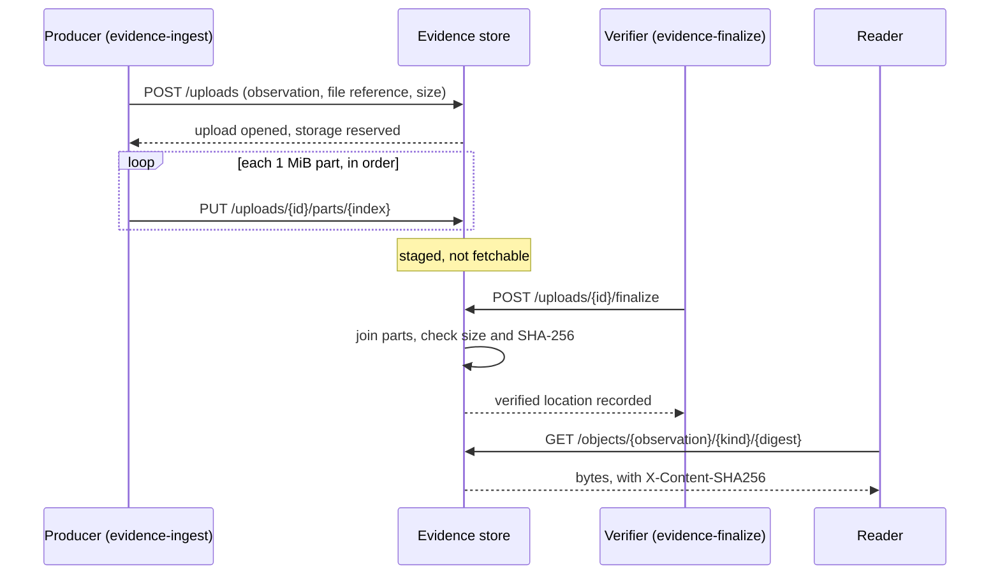
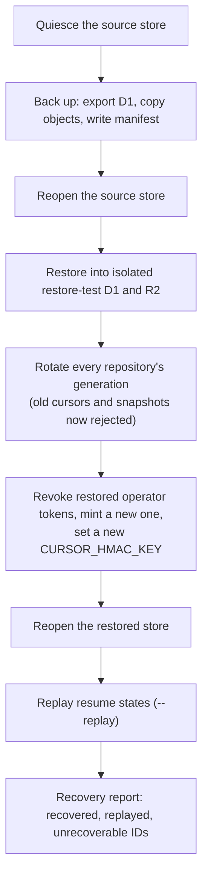

# Operating the evidence store

This page is the operating guide for the evidence store, a small private web
service that can hold copies of the test evidence this repository already
produces. It shows how to run the service's checks, deploy it, issue and rotate
credentials, send evidence to it, diagnose failures, take backups, restore, and
roll back. The service's code lives in
[`tools/evidence-store`](../../tools/evidence-store/README.md); the full HTTP
reference (every route, limit, and error code) is
[`tools/evidence-store/api/README.md`](../../tools/evidence-store/api/README.md).
This page summarizes that reference and links into it rather than repeating it.

## What the service is, and what it is not

The evidence store records _observations_ (one attempt to run one
`{package, environment, gate}` cell, as described in
[CI evidence schema](evidence.md)) and keeps the report and proof files those
observations cite, so they can be looked up and fetched later from any host.

Its current status matters more than its features:

- **Git notes remain the authoritative evidence store.** CI, the pre-push hook,
  and reuse decisions read and write `refs/notes/ci-local/<environment>` exactly
  as before. Nothing in CI reads from or writes to the service, no CI cell
  runs its tests, and nothing is scheduled for it.
- **Evidence reaches it only when someone sends it explicitly**, with the
  ingestion commands below or the manual demonstration workflow.
- **Evaluation consumers are not enabled.** `POST /evaluations` answers 403
  `evaluation_publication_disabled` to every caller, so the service never
  declares that a cell is covered.
- **Retention is not enabled.** No retention-verifier credential is
  provisioned, so no real evidence is ever pruned.
- **Nothing is deployed yet.** The procedures below are complete, but the
  development environment has not been provisioned. Every endpoint on this
  page is a placeholder such as
  `https://evidence-store-development.<your-subdomain>.workers.dev`; substitute
  the URL of your own deployment.

### Terms used on this page

| Term | Meaning |
| --- | --- |
| Cloudflare Worker | A small program Cloudflare runs on its servers in response to HTTP requests. The service is one Worker written in TypeScript. |
| D1 | Cloudflare's hosted SQLite database. It holds observations, credentials, upload state, and the audit trail. |
| R2 | Cloudflare's file storage (similar to Amazon S3). It holds report and proof bytes in a **private** bucket; public access is never enabled. |
| Wrangler | Cloudflare's command-line tool. The recipes call it to create resources, apply database migrations, deploy, and export backups. It is a pinned dev dependency, so you do not install it separately. |
| Migration | A numbered SQL file in `tools/evidence-store/migrations/` that changes the database schema. Once deployed, a migration is frozen; changes get a new number. |
| Environment | A named deployment in `wrangler.jsonc`, each with its own Worker, D1 database, and R2 bucket: `development` (the working service) and `restore-test` (an isolated target for restores). |
| OIDC token | A short-lived signed token GitHub Actions gives a workflow run, proving which repository, workflow, and branch it came from. The service accepts it in place of a stored credential. |

## Run the checks locally

Every recipe below runs from `tools/evidence-store`, or from the repository
root through the delegating `just evidence-store <recipe>`:

```sh
just evidence-store typecheck   # strict TypeScript check of the Worker, CLIs, and tests
just evidence-store test        # Node and Workers-runtime Vitest suites (local, in-process D1 and R2)
just evidence-store lint
```

`test` needs no Cloudflare account. It runs the Worker in Cloudflare's local
runtime with a real database engine, including the same correctness cases the
[deployed acceptance run](#run-the-deployed-acceptance-suite) repeats against
a live deployment.

## Roles and credentials

Every request carries a bearer token, and every token holds _roles_ on
specific repositories. A role is what the caller may do:

| Role | May |
| --- | --- |
| reader | read evidence, snapshots, change feeds, and stored files |
| producer | submit collections and upload the files they reference |
| verifier | finalize uploads (vouch that bytes are intact) and record file locations |
| retention-verifier | certify which superseded evidence may be pruned; **none is provisioned** |
| operator | register repositories, manage credentials, read the audit trail, control maintenance mode, recover jobs |

The split is deliberate: a producer can stage bytes but never vouch for them,
so a compromised host credential cannot make a file look verified. The full
route-by-role matrix is in
[Routes and the role matrix](../../tools/evidence-store/api/README.md#routes-and-the-role-matrix).

Hosts (laptops and test rigs) use stored credentials. GitHub Actions uses its
OIDC token instead, and only the demonstration workflow is trusted (see
[The hosted demonstration workflow](#the-hosted-demonstration-workflow)).

### Issue a credential

Write a _grant file_ naming the host, repositories, and roles, and where the
token should be written:

```json
{
  "label": "rig-linux-01",
  "repository_ids": ["873451209"],
  "roles": ["producer", "reader"],
  "secret_file": "/home/ci/.config/evidence-store/rig-linux-01.token"
}
```

```sh
just operator issue --endpoint https://evidence-store-development.<your-subdomain>.workers.dev \
  --token-file /abs/operator.token --grant /abs/rig-linux-01.grant.json
```

The token is returned once and written to `secret_file` with owner-only
permissions (mode 0600 on Unix, an owner-only ACL on Windows). It is never
printed, passed on a command line, or logged, and the service stores only its
SHA-256 digest. The operator commands run from `tools/evidence-store`, so use
absolute paths. An empty `repository_ids` or `roles` list grants nothing.

### Rotate a credential

Credentials expire after 90 days. At day 60, issue a replacement that names the
old credential in `replaces`; the old one then expires within 7 days, which
gives the host a week to switch files:

```json
{
  "label": "rig-linux-01",
  "repository_ids": ["873451209"],
  "roles": ["producer", "reader"],
  "replaces": "0f3c9a6e2b7d4e18a5c6b7d8e9f01234",
  "secret_file": "/home/ci/.config/evidence-store/rig-linux-01.2.token"
}
```

### Revoke a credential

```sh
just operator revoke --endpoint https://… --token-file /abs/operator.token \
  --credential 0f3c9a6e2b7d4e18a5c6b7d8e9f01234 --reason "rig decommissioned"
```

Revocation is checked on every request, so it takes effect immediately, even
while the store is quiesced. It never rewrites evidence the credential already
submitted. Operator credentials are never issued through the API; the first one
comes from `just operator bootstrap` (below). More detail:
[Credentials](../../tools/evidence-store/api/README.md#credentials).

## Deploy the service

### One-time provisioning

Before the first deployment of an environment, create its Cloudflare
resources. This needs a Cloudflare API token and account ID in
`CLOUDFLARE_API_TOKEN` and `CLOUDFLARE_ACCOUNT_ID`; nothing logs in
interactively.

Create the token in the Cloudflare dashboard (My Profile → API Tokens →
Create Token → custom token), limited to the one account whose ID is in
`CLOUDFLARE_ACCOUNT_ID`. Copy the secret from the confirmation page: it is
shown only once and is about 40 characters. A value of another length, such
as the 37-character Global API Key or a 36-character ID, makes every
Wrangler call fail with `Invalid format for Authorization header [code: 6111]`.
The token needs these **Account** permissions:

| Permission | Used by |
| --- | --- |
| D1: Edit | `provision`, `deploy` (migrations), `operator bootstrap`, `operator backup` and `restore`, `prove-d1` |
| Workers Scripts: Edit | `deploy`, and the `CURSOR_HMAC_KEY` secret set by `provision` and `restore` |
| Workers R2 Storage: Edit | `provision` (the bucket), `operator backup` and `restore` (the objects) |
| Workers Tail: Read (optional) | `just evidence-store wrangler tail` for live logs |

Both environments are served on `workers.dev`, so the account must have a
workers.dev subdomain. If it has never registered one, choose it once in the
dashboard (Workers & Pages) before the first deploy.

`provision`, `deploy`, and `operator bootstrap` act on the `development`
environment unless you pass `--env restore-test`. Raw Wrangler commands
(`just evidence-store wrangler …`) have no default, so they always name
`--env`.

1. Create the resources. From the repository root (or any directory):

   ```sh
   just evidence-store provision
   ```

   This creates the D1 database and the private R2 bucket, writes the
   database's ID into the environment's `database_id` in
   `tools/evidence-store/wrangler.jsonc`, and sets the `CURSOR_HMAC_KEY`
   secret that signs paging cursors. The key goes to Wrangler on stdin, so it
   never appears on a command line. Commit the `wrangler.jsonc` change; the ID
   is not a secret.

   `provision` is safe to run again. Each step first looks for what it would
   create and reuses it, so a run that failed part-way finishes the job, and a
   run against a provisioned environment changes nothing:

   ```text
   development is already provisioned; nothing was changed:
     D1 database   evidence-store-development (0f9e8d7c-…) already existed
     R2 bucket     evidence-store-development already existed
     wrangler.jsonc already held the database_id
     CURSOR_HMAC_KEY already existed
   ```

   It never replaces an existing cursor key, because that would invalidate
   every paging cursor clients hold. If `wrangler.jsonc` names a different
   database ID than Cloudflare has for that name, it stops without editing the
   file. Never enable public access on the bucket.
2. Fill the environment's `SERVICE_CONFIG` allowlists in `wrangler.jsonc`:
   `repositories` (the repositories the service will accept) and
   `oidc.trusted_workflows` (the workflow, ref, and event GitHub tokens may come
   from). Both are empty in the checked-in file, and **an empty list denies
   everything**, so the service is useless until they are set. `provision`
   names any that are still empty.
3. Deploy (next section).
4. After the first deploy, mint the first operator token.
   It goes straight into an owner-only file:

   ```sh
   just evidence-store operator bootstrap --label operator-laptop --token-file /abs/operator.token
   ```

5. Register the repository by the stable IDs GitHub reports for it (needs
   `GITHUB_TOKEN` or `GH_TOKEN`):

   ```sh
   just evidence-store operator register --endpoint https://… --token-file /abs/operator.token --slug owner/name
   ```

### Deploy and apply migrations

```sh
just evidence-store deploy --manifest /abs/deploy-development.json
```

`deploy` first applies any pending migrations to the remote database
(`wrangler d1 migrations apply <db> --remote --env development`) and then
publishes the Worker (`wrangler deploy --env development`). Migrations always
run first, so a new Worker never meets an older schema. Running it again with
nothing changed applies nothing and republishes the same code.

It exits 2 before doing anything when `CLOUDFLARE_API_TOKEN` or
`CLOUDFLARE_ACCOUNT_ID` is missing (naming which) or while the environment's
`database_id` is still the placeholder.

Every deploy prints a redacted manifest of what was deployed (to the
`--manifest` file when given, otherwise to stdout): the environment, Worker
name, D1 database name and ID, bucket, each migration file with its SHA-256,
the Worker version ID, the endpoint Wrangler reported, the Wrangler version,
and the time. It contains no token, secret, or account ID, so it can be kept
with other evidence of the deployment.

## Send evidence to the service

`just evidence-ingest` submits one version-3 observation collection, or a
version-2 receipt that it converts locally. With `--proof-dir`, it also stages
every report and proof file the collection references, found by name in that
directory:

```sh
just evidence-ingest ./collection.json \
  --endpoint https://evidence-store-development.<your-subdomain>.workers.dev \
  --repo 873451209 --token-file ~/.config/evidence-store/producer.token \
  --state ./ingest-0001.json --proof-dir ~/ci-evidence/run-0001
```

Every flag, the token file, the input, and each mapped file are checked before
anything is sent. A problem names its location (for example
`/observations/0/reports/1`) and exits 2 with nothing written. A collection is
accepted or rejected whole: if one observation conflicts with one already
recorded, none are stored.

### Resume an interrupted ingestion

Progress is written to the `--state` file before the first request and after
every acknowledgment, beside copies of the original input and the exact
collection submitted. If the run is interrupted (exit 1 prints the command),
continue it:

```sh
just evidence-resume ./ingest-0001.json
```

Resuming never reruns a test and never changes a recorded observation; it only
repeats requests whose acknowledgment was not saved, and the service treats a
repeated identical request as the same request.

## Stage and finalize proof files

An observation names its files by path and SHA-256 but carries no bytes.
Ingestion with a **producer** credential only _stages_ those bytes: they are
stored privately and cannot be fetched yet. A **verifier** then _finalizes_
each upload, which checks the length and digest before the file becomes
fetchable. An expected-test listing must also name the observation's package,
gate, environment, and target. A completion record must name its package,
gate, and environment; one from a GitHub Actions run must also name its
commit, run, and attempt. A seed or rig run proves each cell on a commit of
its own with the same tree, so its record's commit is not compared:

```sh
just evidence-finalize ./ingest-0001.json --token-file ~/.config/evidence-store/verifier.token
```



Finalizing twice returns the same result. A mismatch rejects the upload and
discards the joined bytes; the observation stays recorded, and a new upload
can be opened. Finalization proves the bytes are intact, never that the tests
they describe passed. Uploads left open for 24 hours expire. Details:
[Uploading and fetching files](../../tools/evidence-store/api/README.md#uploading-and-fetching-files).

## Diagnose a failure

Every error has the same body:

```json
{
  "error": {
    "code": "unavailable",
    "message": "store is quiesced for maintenance",
    "location": null,
    "retryable": true,
    "retry_after_ms": 60000
  },
  "request_id": "…"
}
```

Start from `code` and `retryable`. `location` points into your request when
the request itself is wrong. Quote `request_id` when looking through the
Worker's logs; error bodies and logs never contain tokens or report bytes. The
CLIs already retry retryable errors (up to five attempts, honoring
`retry_after_ms`), so a retryable error that reaches you has persisted.

| You see | It means | What to do |
| --- | --- | --- |
| 503 `unavailable` | The service cannot serve the write right now: a platform failure, missing or invalid `SERVICE_CONFIG`, GitHub's signing keys unreachable, the store quiesced for maintenance, or a retention job working in that cell. Nothing was written. | Check maintenance mode (below). If the store is open, check the Worker's logs for the `request_id` and the configuration. Retry after `retry_after_ms`. |
| 429 `rate_limited` | This credential exceeded its per-minute rate (60 writes or 300 reads; operators 30 writes). | Wait `retry_after_ms`. Nothing is wrong with the service. |
| 429 `quota_exhausted` | The upload would push a free-tier allowance past 80%. | See [Capacity alerts](#capacity-alerts-and-the-storage-budget). |
| 401 `unauthenticated` | The token is missing, malformed, expired, or revoked, or a GitHub token failed verification. | Check the token file and its expiry; rotate if needed. |
| 403 `denied` | The credential lacks the role or repository, the repository is not in `SERVICE_CONFIG`'s allowlist, or a GitHub token comes from an untrusted workflow or context. | Check the grant and the allowlists. |

The 503 versus 429 distinction is the useful one: **503 means the service is
not accepting work; 429 means this caller should slow down.** The full table
is in [Errors](../../tools/evidence-store/api/README.md#errors).

### Check and change maintenance mode

_Quiescing_ pauses every write (for a backup or a risky change) while reads,
revocation, and the audit trail keep working. Writes answer 503 `unavailable`
with `retry_after_ms` 60000 until the store reopens:

```sh
just operator maintenance --endpoint https://… --token-file /abs/operator.token --mode quiesced --reason "schema change"
just operator maintenance --endpoint https://… --token-file /abs/operator.token --mode open
```

`just operator backup` reopens the store even when it fails. A quiesce
started for a backup carries a `boundary_id`, and
`--mode open --boundary-id ID` reopens only that quiesce. See
[Maintenance mode and the backup boundary](../../tools/evidence-store/api/README.md#maintenance-mode-and-the-backup-boundary).

## Capacity alerts and the storage budget

The service is sized to Cloudflare's free tier, so it watches its own usage
of each allowance (R2 storage and operations; D1 size, rows read, and rows
written; Worker requests):

- At **70%** of an allowance, the daily run logs an
  `evidence_store.capacity_alert` warning with numbers only (resource, period,
  used, allowance, ratio). An operator decides what to do: add capacity, or
  stop sending files.
- At **80%**, opening an upload is refused with 429 `quota_exhausted` and a
  `Retry-After`. Opening an upload _reserves_ its bytes and write operations
  first, so the refusal happens before any bytes are sent.

A refusal never deletes existing evidence, and collections are never refused
for capacity, so a failure is always recorded; only its files wait. The
thresholds and allowances are `quotas.capacity` in `SERVICE_CONFIG`. See
[Storage budget](../../tools/evidence-store/api/README.md#storage-budget).

## Retention (not enabled)

Retention removes evidence that something newer has superseded, 14 days after
it is first certified as superseded. The service never decides on its own what
is superseded: a separate retention-verifier credential must submit a
certificate computed from a snapshot, and the service refuses it if anything
changed since. Failures nobody has resolved, current passes, and observations
a release cites are always kept.

**No retention-verifier credential is provisioned**, so nothing is pruned in a
deployed service; only tests exercise pruning, with an isolated verifier. No
route can delete evidence outside a prune job. See
[Retention](../../tools/evidence-store/api/README.md#retention).

## Take daily backups

A backup quiesces the store, exports the database, reopens the store (always,
even after a failure), copies every finalized object with a digest check, and
writes a manifest last. Run it once a day; each run keeps the seven newest
complete backups in the destination and removes older ones:

```sh
# Needs CLOUDFLARE_API_TOKEN and CLOUDFLARE_ACCOUNT_ID.
just operator backup --endpoint https://… --token-file /abs/operator.token \
  --env development --destination /abs/evidence-backups

just operator verify-backup --backup /abs/evidence-backups/<backup_id>
```

`verify-backup` re-checks every file's size and SHA-256 and exits 1 on any
problem. Every write the service acknowledged before the quiesce is in the
backup; that point is the _backup boundary_ recorded in the manifest. A backup
holds credential digests and grants but no bearer tokens. See
[Taking a backup](../../tools/evidence-store/api/README.md#taking-a-backup).

## Restore into isolated resources

A restore never writes to the environment it came from. It refuses a
destination whose environment, database, or bucket equals the source's, and a
destination database that is not empty. Use `restore-test`, provisioned with
`just evidence-store provision --env restore-test` (see
[One-time provisioning](#one-time-provisioning)), which gives it its own
database and bucket. Its Worker needs the code but not the migrations, so
deploy it with the raw Wrangler command, which applies none:

```sh
just evidence-store wrangler deploy --env restore-test
```

Do not run `just evidence-store deploy --env restore-test` before restoring:
that recipe applies migrations, and a database with migrations applied is not
empty, so the restore refuses it. The restored database carries the source's
migration history, so later `deploy` runs apply only newer migrations.

```sh
just operator restore --backup /abs/evidence-backups/<backup_id> \
  --source-env development --dest-env restore-test \
  --dest-token-file /abs/restored-operator.token \
  --dest-endpoint https://evidence-store-restore-test.<your-subdomain>.workers.dev \
  --replay /abs/ingest-0001.json --report /abs/recovery-report.json
```



Rotating the _generation_ (a per-repository value every cursor and snapshot
carries) is what makes every pre-restore cursor fail loudly instead of
silently skipping records. Each `--replay` state is compared against the
backup: an acknowledged observation is **recovered** (in the backup),
**replayed** (missing, and resubmitted with its original ID from the
collection kept beside the state), or **unrecoverable**. Without `--replay`,
loss after the boundary is reported as unknown, never as zero. Replayed files
are staged again and need `just evidence-finalize` with a verifier token; the
report prints the command. Revocations made on the source after the backup
must be repeated on the restored service. See
[Restoring](../../tools/evidence-store/api/README.md#restoring).

### Recover interrupted jobs

```sh
just operator recover-jobs --endpoint https://… --token-file /abs/operator.token
```

This expires stale open uploads, advances unfinished retention jobs in small
batches, and releases cell locks left by finished jobs. Rerunning it is always
safe; run it after an outage or a restore.

## Run Wrangler directly

For anything the recipes do not cover, run the package's pinned Wrangler
through `just evidence-store wrangler …`. It works from any directory and
always uses `tools/evidence-store/wrangler.jsonc`:

```sh
just evidence-store wrangler d1 list
just evidence-store wrangler tail --env development
```

Do not use a bare `wrangler` or `pnpm exec wrangler` from the root: either can
pick up a different Wrangler on your `PATH`. A common one is the retired
Wrangler 1 that `cargo install wrangler` provides, which fails with
`Found argument 'd1' which wasn't expected`. If the recipe says the pinned
Wrangler is not installed, run `just evidence-store install` (`just init` also
installs it).

## Roll back a deployment

- **A bad Worker build:** restore a compatible prior build with
  `just evidence-store wrangler rollback --env development` (or
  `just evidence-store wrangler versions deploy`). The deployment manifest's Worker version ID
  tells you what was live.
- **Migrations are never reversed.** A rolled-back Worker must work with the
  current schema, so roll back only to a build that does.
- **A schema change that must be undone** is a restore, not a rollback:
  restore the last backup taken before the change into isolated resources, as
  above. The generation rotation invalidates every cursor and snapshot taken
  under the abandoned schema.

See [Rolling back a deployment](../../tools/evidence-store/api/README.md#rolling-back-a-deployment).

## The hosted demonstration workflow

`.github/workflows/evidence-store-demo.yml` shows that a GitHub Actions run
can send evidence without any stored secret. It runs only when dispatched by
hand (`workflow_dispatch`) on `main`. It downloads a named, already-retained
artifact from an earlier run, requests a GitHub OIDC token with audience
`rusty-biscuit-evidence-store`, runs the ingestion CLI as a producer, and
uploads the resume-state directory as an artifact. It runs no tests, imports
no history, and adds no publication hook to any other workflow.

Dispatch it from a host with `GITHUB_TOKEN` or `GH_TOKEN` set:

```sh
just demo-hosted --run-id 19283746501 --artifact ci-evidence-macos-latest \
  --collection collection.json --proof-dir reports
```

`--collection` and `--proof-dir` are paths inside the artifact. The recipe
checks that the workflow exists on `main` before dispatching; if it does not,
it exits 2 and reports a missing external prerequisite. It never pushes or
merges anything. The workflow also needs the repository variable
`EVIDENCE_STORE_ENDPOINT`, and the service's `oidc.trusted_workflows` must list
the workflow on `refs/heads/main` for `workflow_dispatch`. A GitHub token only
ever gets producer and reader, so finalize the staged files afterwards from a
host: download the resume-state artifact and run
`just evidence-finalize STATE --token-file /abs/verifier.token`. See
[GitHub Actions (OIDC)](../../tools/evidence-store/api/README.md#github-actions-oidc).

## Run the deployed acceptance suite

`just test-real` runs the correctness cases that matter most against a real
deployment, where D1 and R2 behave as they do in production:

```sh
export EVIDENCE_STORE_ENDPOINT=https://evidence-store-development.<your-subdomain>.workers.dev
export EVIDENCE_STORE_OPERATOR_TOKEN_FILE=/abs/operator.token
export EVIDENCE_STORE_ACCEPTANCE_REPO=873451209   # a registered repository used only for acceptance
just test-real --report /abs/acceptance-results.json
```

It exits 2 naming any missing variable. Each case issues its own temporary
credentials through the operator API and revokes them afterward. The cases:

- concurrent writes from different identities, where a conflicting collection
  is rolled back whole;
- revoked and unauthorized identities being refused (expired ones are proven
  locally, as described below);
- an interrupted upload and finalization being replayed;
- a withdrawn file location staying withdrawn;
- change-feed replay;
- paging a snapshot to its end while writes continue.

Expiry cannot be waited out against a deployed service, so expired
credentials are proven by the same cases in `just test`, which run against the in-process
Worker with the real authenticator. `--report` writes the assertions and
results, never credentials or report bytes.
