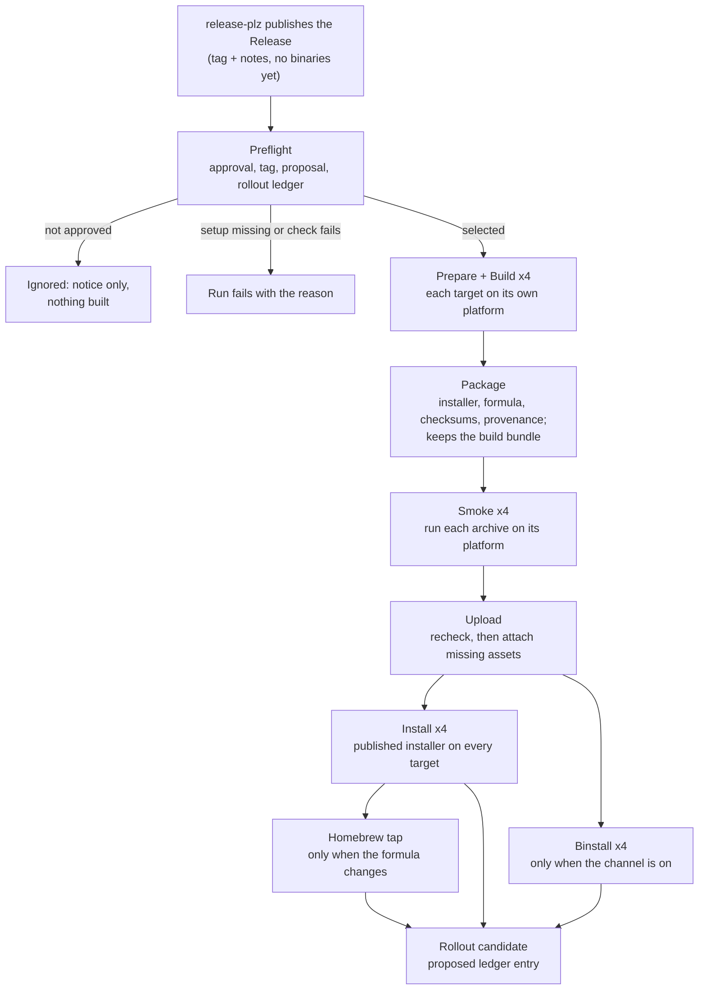
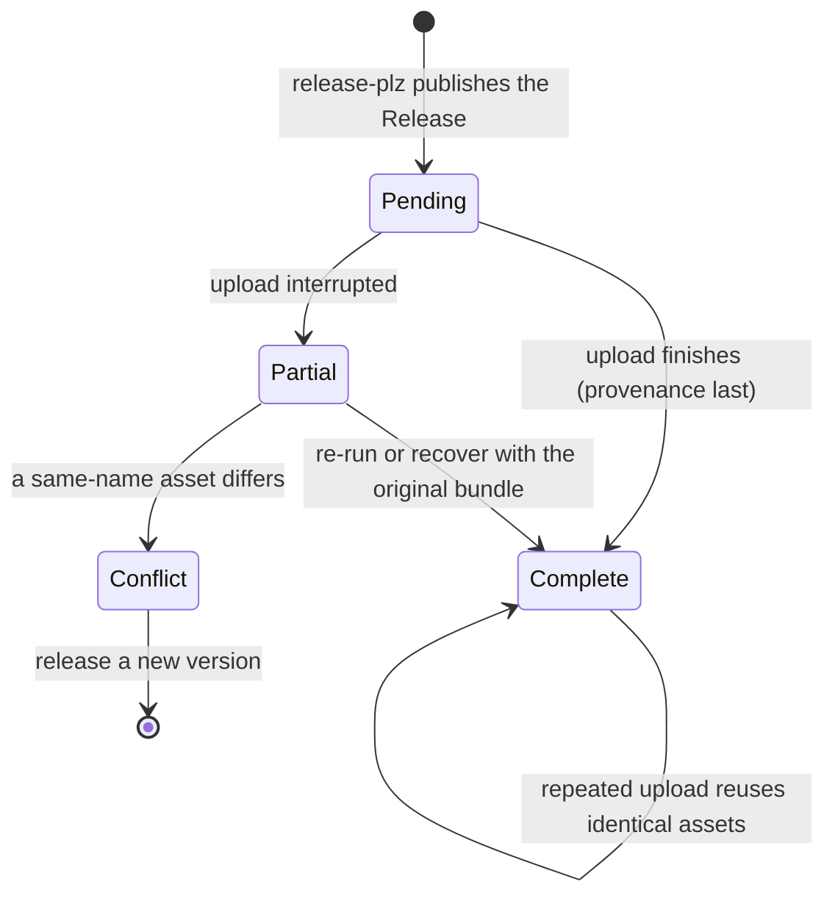

# Distributing prebuilt binaries

This page explains how Rusty Biscuit turns a released command-line package into prebuilt binaries
that people can install without a Rust toolchain: what is built, which systems it supports, how
users will install it, and how a maintainer approves, watches, and recovers a distribution. It
also covers the rollout ledger that controls which packages may be distributed, the credentials the
automation needs, and the checks you can run before changing any of it.

Distribution starts where [releasing a version](releases.md) ends. Releasing creates a Git tag and
a GitHub **Release** page (the page on GitHub that shows a version's notes and downloadable
files). Distribution then builds that tagged source for four platforms and attaches the results to
the Release that already exists. It never creates, edits, or deletes a Release and never moves a
tag.

> **Current state.** The automation is in place, but **no package is approved and no channel is
> live**. Every entry in [`docs/deployment.yaml`](deployment.yaml) is disabled, and the first live
> release (a `bh` release proving the whole chain) has not happened yet; `biscuit-hash-cli` must
> also become eligible for release first (see
> [the two-package restriction](releases.md#the-temporary-two-package-restriction)). Every
> installation route below is therefore **planned**. The commands show the syntax that the automation tests; do not
> advertise them until the [rollout ledger](#7-the-rollout-ledger) records a verified release.

## 1. What gets distributed

Eight packages can ship a binary. A **package** is a Rust project with its own `Cargo.toml`, name,
and version; the **command** is the program a user types. They are usually named differently:

| Package (Cargo name)  | Command    |
| --------------------- | ---------- |
| `biscuit-hash-cli`    | `bh`       |
| `biscuit-file-cli`    | `bf`       |
| `tree-hugger-cli`     | `hug`      |
| `git-wt-cli`          | `wt`       |
| `sniff-detection-cli` | `sniff`    |
| `darkmatter-cli`      | `md`       |
| `darkmatter-lsp`      | `dmls`     |
| `claudine-cli`        | `claudine` |

This list says what *can* ship, not what is approved; approval is a separate decision (see
[Approving a package](#6-approving-a-package)). Libraries and the home-automation integrations are
never distributed by this path (the integrations have their own archives; see
[Integration archives](releases.md#7-integration-archives)).

Each package is versioned and tagged on its own. A tag is always `{package}-v{version}`, and each
archive ships exactly one command. For example, `biscuit-hash-cli` version `0.3.1` is tagged
`biscuit-hash-cli-v0.3.1`, and its archives contain only `bh`, never other binaries the package
might build for testing.

## 2. Supported platforms

Every distributed package is built for four targets. A **target** names a CPU and operating system
in Rust's spelling:

| Target                      | Runs on                                          | Minimum                |
| --------------------------- | ------------------------------------------------ | ---------------------- |
| `aarch64-apple-darwin`      | Apple silicon Macs                               | macOS 15.0             |
| `x86_64-apple-darwin`       | Intel Macs                                       | macOS 15.0             |
| `aarch64-unknown-linux-gnu` | 64-bit ARM Linux with the GNU C library (glibc)  | glibc 2.35             |
| `x86_64-unknown-linux-gnu`  | 64-bit Intel/AMD Linux with glibc                | glibc 2.35             |

### Why these minimums

A Linux binary runs only on systems whose **glibc** (the standard C library most Linux distributions
ship) is at least as new as the one it was built against. The Linux builds therefore run inside an
Ubuntu 22.04 container image (glibc 2.35), pinned by its exact digest so the floor cannot drift when
GitHub retires a runner image. glibc is not bundled into the binary: it runs against the host's own,
patched glibc. The macOS floor is the deployment target recorded in
[`build-images.json`](../.github/distribution/build-images.json) (`15.0`).

| Supported (examples)                 | Not supported                                   |
| ------------------------------------ | ----------------------------------------------- |
| Ubuntu 22.04 and 24.04               | RHEL 9 (glibc 2.34)                             |
| Debian 12 and 13                     | Amazon Linux 2023 (glibc 2.34)                  |
| Current Fedora                       | Any musl-based distribution, such as Alpine     |
| WSL2's default Ubuntu                | macOS 14 and older                              |

On an unsupported system the shell installer refuses **before** it downloads or writes anything and
reports the required and found versions:

```text
ERROR: biscuit-hash-cli 0.3.1 cannot be installed: requires glibc 2.35 or newer; found glibc 2.34
Supported platforms: Linux aarch64/x86_64 with glibc 2.35+, macOS arm64/x86_64 15.0+
```

The Homebrew formula carries the same two floors and refuses at install time.

### WSL2 and Windows

WSL2 (the Windows Subsystem for Linux) runs a real Linux distribution, so it uses the Linux
archive for its CPU; there is no separate WSL2 build. Native Windows binaries and a PowerShell
installer are **planned** and not shipped yet. musl-based Linux and Windows on ARM are out of scope.

### `claudine` needs ALSA on Linux

`claudine` plays audio, so on Linux it links ALSA's runtime library `libasound.so.2`. Most desktop
systems already have it; a minimal server or container may not. Install it with your distribution's
package manager:

```bash
# Debian 12, Ubuntu 22.04
sudo apt-get install libasound2

# Ubuntu 24.04, Debian 13 (the package was renamed)
sudo apt-get install libasound2t64

# Fedora
sudo dnf install alsa-lib
```

The Homebrew formula declares this Linux dependency itself, so `brew` users need no extra step. The
other seven commands need nothing beyond the C library.

## 3. Installing a release (planned)

Users will have four routes. All four are **planned**: none is advertised until the first release
has been verified live. Every route is pinned to one package version, because packages are versioned
independently. Never use GitHub's `releases/latest` URL: the "latest" Release of this repository may
belong to a different package.

The URL patterns below use `<package>`, `<version>`, and `<target>` placeholders. They show the
shape of the address and are **not** runnable as written.

### Download an archive

Each Release holds one archive per target, plus a checksum file for it:

```text
https://github.com/yankeeinlondon/rusty-biscuit/releases/download/<package>-v<version>/<package>-<target>.tar.xz
https://github.com/yankeeinlondon/rusty-biscuit/releases/download/<package>-v<version>/<package>-<target>.tar.xz.sha256
```

After downloading both files into one directory, check the archive against its checksum, then
unpack it. On macOS and most Linux systems `shasum` is already installed:

```bash
shasum -a 256 -c biscuit-hash-cli-aarch64-apple-darwin.tar.xz.sha256
# biscuit-hash-cli-aarch64-apple-darwin.tar.xz: OK
tar -xJf biscuit-hash-cli-aarch64-apple-darwin.tar.xz
./biscuit-hash-cli-aarch64-apple-darwin/bh --version
```

Move the command to any directory on your `PATH`. `sha256.sum` on the same Release lists the
checksums of all four archives in one file.

### Run the shell installer

The shell installer picks the right archive for the machine, checks it, and installs the command
into `$CARGO_HOME/bin` (`~/.cargo/bin` by default). It runs on macOS, Linux, and WSL2:

```text
curl --proto '=https' --tlsv1.2 -LsSf \
  https://github.com/yankeeinlondon/rusty-biscuit/releases/download/<package>-v<version>/<package>-installer.sh | sh
```

It refuses an unsupported system before downloading anything (see
[Supported platforms](#2-supported-platforms)).

### Homebrew

Formulas are published to the repository's own tap (a **tap** is a Git repository of Homebrew
formulas), `yankeeinlondon/homebrew-tap`. A formula is named after the command:

```bash
brew install yankeeinlondon/tap/bh
```

Homebrew always installs the newest stable version the tap holds; see
[The Homebrew tap](#9-the-homebrew-tap) for when the formula changes.

### cargo-binstall

[cargo-binstall](https://github.com/cargo-bins/cargo-binstall) downloads a prebuilt binary instead
of compiling. It installs by package name, not command name, and needs no crates.io entry because
each package's `Cargo.toml` tells it where the Release archives are. Compiling from source as a
fallback is disabled: if no archive matches, binstall fails rather than starting a long build.

There are two routes, and they resolve the version differently:

1. **Whatever version the default branch declares.** Binstall clones the repository's default
   branch and installs the version in that package's `Cargo.toml`. You cannot choose a tag this
   way, and passing `--version` does not change which manifest is read:

   ```bash
   cargo binstall --git https://github.com/yankeeinlondon/rusty-biscuit biscuit-hash-cli
   ```

2. **An exact released version.** Check out the release tag and point binstall at that package's
   manifest:

   ```text
   git clone --depth 1 --branch <package>-v<version> https://github.com/yankeeinlondon/rusty-biscuit
   cargo binstall --manifest-path rusty-biscuit/<package-dir>/Cargo.toml <package>
   ```

   For `bh`, `<package-dir>` is `biscuit-hash/cli`.

The distribution workflow tests the exact-tag route against every release that enables binstall.

## 4. What a Release contains

After a complete distribution, a package's Release holds these files (GitHub calls them
**assets**):

| Asset                                   | What it is                                                                                    |
| --------------------------------------- | --------------------------------------------------------------------------------------------- |
| `<package>-<target>.tar.xz` (four)      | The archive for one target                                                                    |
| `<package>-<target>.tar.xz.sha256`      | That archive's SHA-256 checksum                                                               |
| `sha256.sum`                            | The checksums of all four archives                                                            |
| `<package>-installer.sh`                | The shell installer, including the platform check                                             |
| `<formula>.rb`                          | The Homebrew formula, only when the package's `brew` channel is on                            |
| `distribution-provenance.json`          | What was built and from what: package, command, version, tag, commit, targets, Rust toolchain, `dist` version, build images, and every asset's size and checksum |

`distribution-provenance.json` is always uploaded **last**, so its presence means the set is
complete.

Each archive unpacks into one directory named `<package>-<target>/` holding:

- the one command (for example `bh`);
- `LICENSE`, the project license (AGPL-3.0-only);
- `README.md`, the package's README;
- `SOURCE.txt`, which links the exact tagged source and commit;
- `THIRD-PARTY-NOTICES.md`, the licenses of the bundled dependencies;
- `CHANGELOG.md`, only when the package directory has a release changelog (today only
  `sniff-detection-cli` does). Nothing else is accepted: any other file fails the archive checks.

```text
biscuit-hash-cli 0.3.1 (bh)
License: AGPL-3.0-only, see LICENSE; third-party notices are in THIRD-PARTY-NOTICES.md.
Source: https://github.com/yankeeinlondon/rusty-biscuit/tree/biscuit-hash-cli-v0.3.1/biscuit-hash/cli
Commit: https://github.com/yankeeinlondon/rusty-biscuit/commit/<commit>
```

The third-party notices are generated by `cargo-about` from [`about.toml`](../about.toml).

## 5. How a distribution run works

GitHub Actions runs repository automation as **workflows**. One execution of a workflow is a
**run**, made of **jobs** that each run on a fresh machine (a **runner**). A run keeps files for
later jobs and for people to download as **artifacts**.

Distribution is the **Distribute binaries** workflow
([`distribute-binaries.yml`](../.github/workflows/distribute-binaries.yml)). It starts by itself when
a Release is published, and every decision it makes comes from
[`scripts/ci/distribution.py`](../scripts/ci/distribution.py).



| Job                 | What it does                                                                                                   |
| ------------------- | -------------------------------------------------------------------------------------------------------------- |
| `preflight`         | Decides whether this Release is distributed at all, and with which channels (see below)                       |
| `prepare`           | Writes the third-party notices and asks `dist` for its build plan, once for all targets                      |
| `build` (×4)        | Builds, inspects, and smoke-tests one target: macOS on its own runner, Linux inside the pinned Ubuntu 22.04 image |
| `package`           | Generates the installer, formula, and checksum files, records provenance, and keeps the **build bundle**      |
| `smoke` (×4)        | Runs each archive's command on its own platform (Linux in the runtime image, with no build tools)             |
| `upload`            | Rechecks everything against GitHub, then attaches the missing assets to the Release                           |
| `install` (×4)      | Downloads the published installer and installs into an isolated directory on each target                     |
| `binstall` (×4)     | Installs with cargo-binstall from the exact tag, only when the `binstall` channel is on                       |
| `homebrew-tap`      | Publishes the formula, only after every `install` job passed                                                  |
| `rollout-candidate` | Writes the ledger entry this run proves                                                                       |

Building uses [`dist`](https://github.com/axodotdev/cargo-dist) (cargo-dist), pinned in
`build-images.json`. Its base settings live in [`dist-workspace.toml`](../dist-workspace.toml),
which opts no package in: the run adds the one selected package's settings to a temporary copy of the
tagged source, so the repository never carries a second approval.

### What preflight checks

Preflight selects a Release only when all of these hold; an unapproved package is **ignored** (the
run succeeds with a notice and builds nothing), and any other failure stops the run with a located
message:

- the tag names one of the [eight packages](#1-what-gets-distributed) and is in this repository;
- the package is approved in both the tagged and the current `docs/deployment.yaml`;
- the package's `Cargo.toml` version equals the tag's version, and the checkout is the tag's commit;
- the Release exists and is published, not a draft;
- the tag points at the final commit of a merged, reviewed release proposal;
- for any package other than `biscuit-hash-cli`, the [rollout ledger](#7-the-rollout-ledger) holds a
  verified `biscuit-hash-cli` entry.

### Following a run

Open the repository's **Actions** tab and select **Distribute binaries** in the workflow list; each
published Release starts one run, triggered by the `release` event. When `upload` finishes, the
run's summary page shows a **Distributed `<tag>`** section with links to the Release and the run,
followed by the publication record. A successful run also prints the proposed ledger entry under
**Rollout ledger candidate**.

### The Release while a run is in progress

release-plz publishes the Release before distribution starts, so for a few minutes a Release page
legitimately has notes but no binaries. That is "published, assets pending", not a failure. The
asset set moves through these states:



## 6. Approving a package

Approval is the decision to distribute a package, and it has one home:
[`docs/deployment.yaml`](deployment.yaml). Each package has an entry with `approved` and one setting
per channel. A channel's `false` means off; `true` means on under the package's own name; a string
means on under that name. This workflow publishes only two channels, `brew` and `binstall`; any
other channel enabled for a selected package is refused.

Archives and the shell installer come with approval itself. For example, to distribute `bh` with a
Homebrew formula named `bh` and the binstall channel:

```yaml
biscuit-hash-cli:
    {
        crate: biscuit-hash-cli,
        approved: true,
        brew: bh,
        binstall: true,
        # every other channel stays false
    }
```

`binstall` accepts only `true`, because binstall installs by package name. Turning it on also needs
the package's `[package.metadata.binstall]` in its enabled form,
`disabled-strategies = ["quick-install", "compile"]` (the disabled form adds `"crate-meta-data"`);
preflight refuses a mismatch.

Rules that follow from where the policy is read:

- **Both copies must approve.** Preflight reads the policy at the tag and on the default branch.
  Approval at the tag is what makes a release eligible, so the approval change must be merged before
  the release is tagged. In practice it lands through a normal reviewed release proposal.
- **Approving later does not reach back.** A release that was unapproved when tagged is ignored even
  if `main` approves the package now.
- **Revoking on `main` stops later runs.** If `main` no longer approves the package, a run for an
  older tag fails instead of publishing, and `upload` rechecks the current policy right before
  writing.
- **A revoked channel is dropped, not fatal.** If a channel was on at the tag but is off on `main`,
  that channel is skipped and the archives are still built.

## 7. The rollout ledger

The first distributed package is `bh`, and it proves the whole chain (build, upload, installers,
binstall, Homebrew) before any other package may follow. The rollout ledger,
[`.github/distribution/rollout.json`](../.github/distribution/rollout.json), records that proof.

Preflight refuses every package other than `biscuit-hash-cli` until the ledger's `verified` list
holds a `biscuit-hash-cli` entry whose `run_id` GitHub reports as a successful run of
`distribute-binaries.yml`. That holds even when `docs/deployment.yaml` approves the other package.
Ledger entries are evidence, never approvals: a verified entry does not approve anything by itself.

### Recording a verified release

A successful publishing run writes the entry it proves as the `distribution-rollout-candidate`
artifact and prints the same JSON in its summary. To record it, copy that entry into `verified`
through a reviewed pull request. An entry has this shape:

```json
{
  "package": "biscuit-hash-cli",
  "version": "0.3.1",
  "tag": "biscuit-hash-cli-v0.3.1",
  "commit": "<40-character commit>",
  "run_id": 1234567890,
  "run_url": "https://github.com/yankeeinlondon/rusty-biscuit/actions/runs/1234567890",
  "release_url": "https://github.com/yankeeinlondon/rusty-biscuit/releases/tag/biscuit-hash-cli-v0.3.1",
  "targets": {
    "aarch64-apple-darwin": "pass",
    "x86_64-apple-darwin": "pass",
    "aarch64-unknown-linux-gnu": "pass",
    "x86_64-unknown-linux-gnu": "pass"
  },
  "channels": {
    "archive": "pass",
    "shell-installer": "pass",
    "brew": "pass",
    "binstall": "pass"
  }
}
```

`brew` may also be `unchanged` (the tap already held that or a newer version) or `disabled`;
`binstall` may be `disabled`. Every target must be `pass`. The ledger is validated strictly: an
unknown field, a URL that does not match the run or tag, or a duplicate tag is an error.

### Outstanding items

`pending` lists, per package, what still stands between it and distribution. Each item has a
`name`, a `package`, and a `reason`:

| Name                  | Meaning                                                                 |
| --------------------- | ----------------------------------------------------------------------- |
| `approval`            | `docs/deployment.yaml` does not approve the package                     |
| `release-app`         | `RELEASE_APP_BOT_LOGIN` is not set (see [Credentials](#10-credentials-and-setup)) |
| `homebrew-tap`        | The tap repository, its token, or its author variable does not exist    |
| `clean-runtime-macos` | No clean macOS 15 machine has produced runtime evidence                 |
| `x86_64-runtime`      | No native x86_64 macOS or Linux host has run the archives and installer |
| `wsl2-runtime`        | No WSL2 host has run the Linux archive and installer                    |
| `live-release`        | No release of the package has been distributed yet                      |
| `first-chain`         | The package waits for a verified `biscuit-hash-cli` entry               |
| `brew-description`    | The Cargo `description` fails `brew audit`; shorten it when enabling `brew` |

Remove an item in the same reviewed change that resolves it.

## 8. When a run fails: retry and recovery

Most failures are fixed by running the same work again. The rules exist so that a retry can never
change bytes a user may already have downloaded.

### Re-run the failed jobs

On the run's page, choose **Re-run failed jobs**. Artifacts survive a re-run, so a run that failed
during or after `upload` reuses its own build bundle and uploads only what is missing.

### Start a recover run

When the original run cannot be re-run (for example GitHub canceled it), start a new run by hand.
In **Actions → Distribute binaries → Run workflow**, choose mode `recover` and name the existing
tag. The same run with the GitHub CLI:

```bash
gh workflow run distribute-binaries.yml -f mode=recover \
  -f tag=biscuit-hash-cli-v0.3.1 -f bundle-run-id=1234567890
```

- **With `bundle-run-id`**, the run reuses that run's verified build bundle instead of rebuilding.
  The bundle must come from a successful `Package` job of this workflow and match a fresh preflight.
  Bundles are kept for 90 days.
- **Without `bundle-run-id`**, the run rebuilds from the tag. A rebuild's bytes may differ, so it is
  refused as soon as the Release holds any of the expected assets; use it only for a Release that
  has none.

A recover run repeats every preflight check, including approval in the current policy.

### How uploads treat existing assets

`upload` compares the complete set with what the Release already holds, byte for byte:

- an identical asset is reused;
- a missing asset is uploaded, with `distribution-provenance.json` last;
- a same-name asset with **different** bytes refuses the whole upload (exit status 1) before
  anything is written. Nothing is ever replaced or deleted.

A conflict, or a partly uploaded Release whose bundle has expired, is fixed by **releasing a new
version**. Never move a tag or replace a published archive: people and checksums may already depend
on it.

### Concurrent runs

Only one upload per package runs at a time, and only one Homebrew tap update runs at a time across
all packages; a running job is never canceled. GitHub keeps only one *waiting* run per group, so if
several runs for the same package queue at once, a waiting one may be canceled. Finish its tag with
a recover run.

## 9. The Homebrew tap

When a package's `brew` channel is on, the formula is published to `yankeeinlondon/homebrew-tap`:

- **only after every `install` job passed**, so a formula never points at assets that fail to
  install;
- **never as a downgrade**: versions are compared by semantic-versioning order, so a retried older
  run leaves a newer formula alone and counts as success;
- **never for a prerelease** (a `-rc.1`-style version, or a Release marked prerelease); the stable
  formula is unchanged;
- **only after `brew audit --strict` and `brew style` pass** on the prepared formula.

The formula is `dist`'s output with three additions: the macOS 15 floor, the glibc 2.35 floor on
Linux, and, for `claudine`, the Linux ALSA dependency. Each tap commit is signed by GitHub, and the
job checks the signature both through GitHub and with `git verify-commit` against GitHub's pinned
signing key. Publishing the same version again with different formula contents is refused; publish
a new version instead.

## 10. Credentials and setup

Credentials are scoped to the one job that needs them:

- Build, package, smoke, install, and binstall jobs can only read the repository and see no
  secrets.
- Only `upload` may write to the repository (`contents: write`), and only to add Release assets.
- Only `homebrew-tap` sees the tap credentials.

The repository owner configures these under **Settings → Secrets and variables → Actions** (a
**secret** is hidden from logs; a **variable** is not):

| Name                    | Kind     | Used by        | Purpose                                                                                       |
| ----------------------- | -------- | -------------- | --------------------------------------------------------------------------------------------- |
| `RELEASE_APP_BOT_LOGIN` | variable | `preflight`, `upload` | The release App's bot login; proves a tag came from a reviewed proposal ([set up in releases](releases.md#2-set-up-the-release-app)) |
| `HOMEBREW_TAP_TOKEN`    | secret   | `homebrew-tap` | A token with Contents write access to the tap repository only                                 |
| `HOMEBREW_TAP_AUTHOR`   | variable | `homebrew-tap` | The token owner's login; tap commits must be authored by it                                   |

A missing credential is never skipped. Without `RELEASE_APP_BOT_LOGIN`, preflight reports
"setup pending" (exit status 3) and the run fails with the instruction; it is never treated as a
pass. Without the tap token or author, an enabled `brew` channel fails `homebrew-tap` with an
instruction.

## 11. Refreshing the build image

The Linux builds depend on a digest-pinned Ubuntu 22.04 image. A digest identifies exact image
bytes, so the image never changes by itself, which also means it stops receiving security updates
until someone moves the pin. Refresh it **monthly** through a reviewed pull request:

1. Read the current digests. The **index digest** names the multi-platform image; each **platform
   digest** names the image for one CPU:

   ```bash
   docker buildx imagetools inspect ubuntu:22.04
   ```

   Use the top-level `Digest:` as `linux.index_digest`, and the digests in the `Name:` lines of the
   `linux/amd64` and `linux/arm64` manifests as `linux.platform_digests.amd64` and `.arm64`.
2. Update those three values in
   [`.github/distribution/build-images.json`](../.github/distribution/build-images.json), and the same
   values in `test_pinned_linux_image` in `scripts/distribution/test_inspect.py`, which pins them a
   second time.
3. Check that the `dist` pins still match upstream. For each target in `dist.sha256`, compare it with
   the published checksum:

   ```bash
   curl -fsSL https://github.com/axodotdev/cargo-dist/releases/download/v0.34.0/cargo-dist-aarch64-apple-darwin.tar.xz.sha256
   ```

4. Run `just distribution-test` (see below), then open the pull request. CI runs the `distribution`
   suite because `build-images.json` changed. A `verify` run (see below) proves the new image
   actually builds.

## 12. Checking changes

These checks cover the distribution scripts and configuration. None of them publishes anything.

| Command                                         | What it runs                                                                                       |
| ----------------------------------------------- | -------------------------------------------------------------------------------------------------- |
| `just distribution-test`                        | Every distribution Python suite, in a temporary environment holding exactly the pinned requirements |
| `just distribution-check`                       | `distribution-test`, then the `distribution_*` workflow contract tests in Rust                    |
| `just distribution-verify OUT --artifacts DIR`  | Runtime acceptance of already-built outputs on this host                                           |

`just distribution-test` fails if any test is skipped, so it needs the real tools the suites call:
`ruby`, `gpg`, `shellcheck`, `shasum`, and `cargo`.

`just distribution-verify` never builds. `DIR` must hold what the `package` job produces (the
archives, their `.sha256` files, `sha256.sum`, and the installer), for example the `assets/`
directory of a `verify` run's `distribution-bundle` artifact. It runs a cargo-binstall fixture
check and then, per target, installs the real archive and installer in isolation and runs only
`--version` and `--help`. It writes `OUT/report.json` and `OUT/README.md`, classifying each result:

| Evidence class           | Meaning                                                                                  |
| ------------------------ | ---------------------------------------------------------------------------------------- |
| `native-build-host`      | Ran natively, but the host has developer tools or Homebrew that could mask a missing library |
| `native-clean-runtime`   | Ran natively on a host with neither                                                      |
| `pending-infrastructure` | This host cannot produce the evidence (for example another CPU would only be emulated)   |
| `disabled`               | The channel is off in `docs/deployment.yaml`                                             |

Pending and disabled results are reported but never count as a pass.

### In CI

CI runs `just distribution-test` as the `distribution` companion suite of the `repo-deps` package,
on `ubuntu-latest`, when the distribution scripts or configuration files (`docs/deployment.yaml`,
`dist-workspace.toml`, `about.toml`, the files under `.github/distribution/`, or
`just/distribution.just`) change. See [the CI README](../.github/ci/README.md) for how changed files
select work.

### A verification build

To build a branch exactly as a release would, without publishing, start **Distribute binaries** by
hand in mode `verify`:

```bash
gh workflow run distribute-binaries.yml --ref my-branch \
  -f mode=verify -f package=biscuit-hash-cli -f brew=bh
```

It builds the dispatched revision for one package, approved by the run's own inputs instead of
`docs/deployment.yaml`, and keeps everything as artifacts. `brew` exercises the formula output, and
`binstall=true` checks that the manifest's binstall metadata is in its enabled form. A verify run
cannot reach `upload`, `install`, `binstall`, `homebrew-tap`, or `rollout-candidate`.

## Where to look next

- [Releasing a version](releases.md) explains how tags and Releases are created, which is what
  starts a distribution.
- [`docs/deployment.yaml`](deployment.yaml) is the approval policy;
  [`.github/distribution/rollout.json`](../.github/distribution/rollout.json) is the rollout ledger.
- [`distribute-binaries.yml`](../.github/workflows/distribute-binaries.yml) defines the jobs;
  [`scripts/ci/distribution.py`](../scripts/ci/distribution.py) makes every decision and lists its
  commands at the top. Exit statuses are 0 (selected, ignored, or done), 1 (refused: an asset
  conflict), 2 (invalid input), and 3 (pending setup).
- [`scripts/distribution/`](../scripts/distribution/) holds the build, installer, tap, and
  verification scripts; [`just/distribution.just`](../just/distribution.just) holds the recipes.
- [`build-images.json`](../.github/distribution/build-images.json),
  [`dist-workspace.toml`](../dist-workspace.toml), and [`about.toml`](../about.toml) pin the build
  images, `dist`, and license notices.
